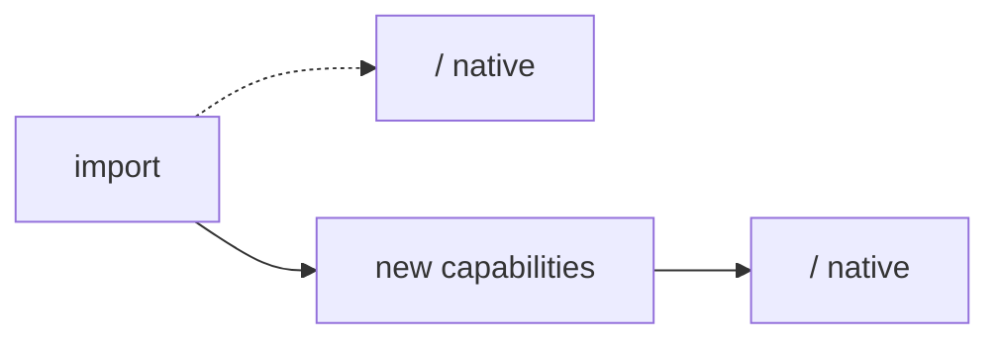

# PR body template

This is `.github/pull_request_template.md` filled in for a deck import. It follows
`/create-pr`. Fill in every `<...>`. Take the numbers from `before.json` and a fresh
`deck_status.py` / `author_cards.py --report` run. Keep the top sections short; the
tables and lists go inside Details.

~~~markdown
Makes every card in [*<deck name>*](<moxfield url>) playable: **<N> of <N>**, up from
<before>. <M> engine capabilities were added through `/extend-dsl`, and the cards were
written through `/author-cards`.

## Risks

- Blast radius: <the engine subsystems the new capabilities touch, and which existing cards share them>.
- Rollback: revert the merge; the new cards fall back to proxies, nothing else depends on them.

## What

- <the largest capability, in one line>
- <the next one, or "plus <k> smaller ones">
- <tests: per-card behaviour file + import pin at <N>/<N>>

## Why

- The deck was not playable: <N - before> cards were proxies.
- <the most-requested or most-reused capability, and what else it unblocks>
- <anything else a reviewer should know the reason for>

## How

- `/author-cards` for the card definitions, `/extend-dsl` for what the DSL could not say.
- One commit per capability or authoring wave (<K> commits).
- Every card passes the six authoring gates; behaviour the gates cannot reach is in `tests/cards/test_<slug>_deck.py`.

Details

| | before | after |
|---|---|---|
| Deck cards native | <before> / <N> | **<N> / <N>** |
| Registry | <cards> | <cards> |
| Catalog coverage | <x.x>% | <y.y>% |
| Open gap records | <capabilities> | <capabilities> |

**Capabilities:** one line each: <slug>, what it says, the near miss it is not, the cards it unblocked.

**Bugs found by the tests:** <each: what was wrong, which card exposed it, the commit; or none>.

**Not done:** <empty; or the card, why it is not native, and what it would take>.

**Verification**
- `pytest tests/unit tests/cards tests/server tests/ai`: green
- `ruff check src scripts tests`: clean
- `scripts/verify.py`: all stages pass locally
- changed files under `src/commanderblitz`: <lowest>% to <highest>% line coverage
- `scripts/audit_cards.py`: no deck card has an open fidelity deficit

🤖 Generated with [Claude Code](https://claude.com/claude-code)
~~~
