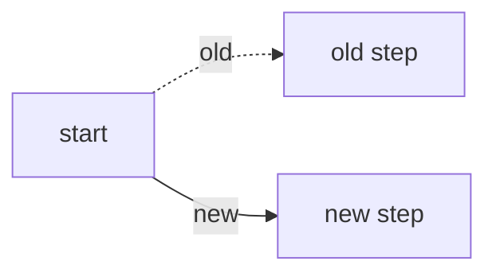

<!--
Title: type(scope): summary -- e.g. "fix(engine): auto-pass stops at a mana ability".
feat fix perf refactor build revert ship (site deploy + Steam Deck release);
docs chore ci test style do not. See CONTRIBUTING.md, "Pull request titles".
-->

One short paragraph: what this changes and why, for someone who has not seen the work.

## Risks

- Blast radius:
- Rollback:

## What

-
-
-

## Why

-
-
-

## How

-
-
-

Details

How it was verified (commands and results), follow-ups, anything else a reviewer might want.

