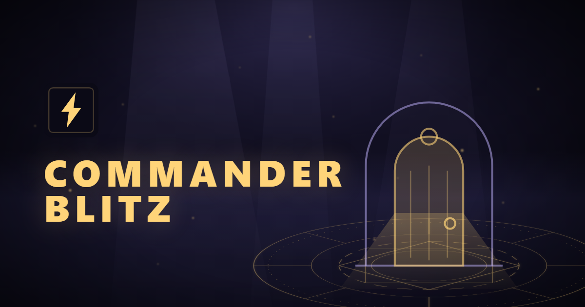
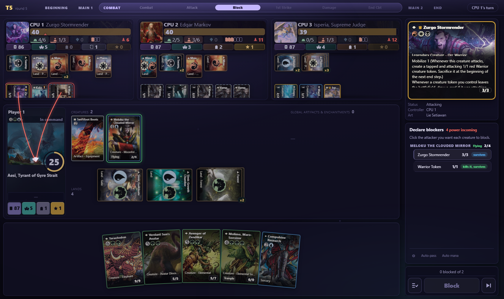
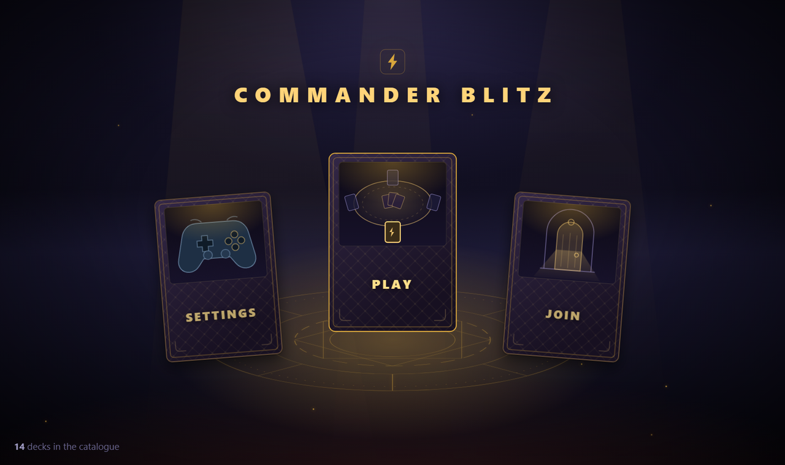
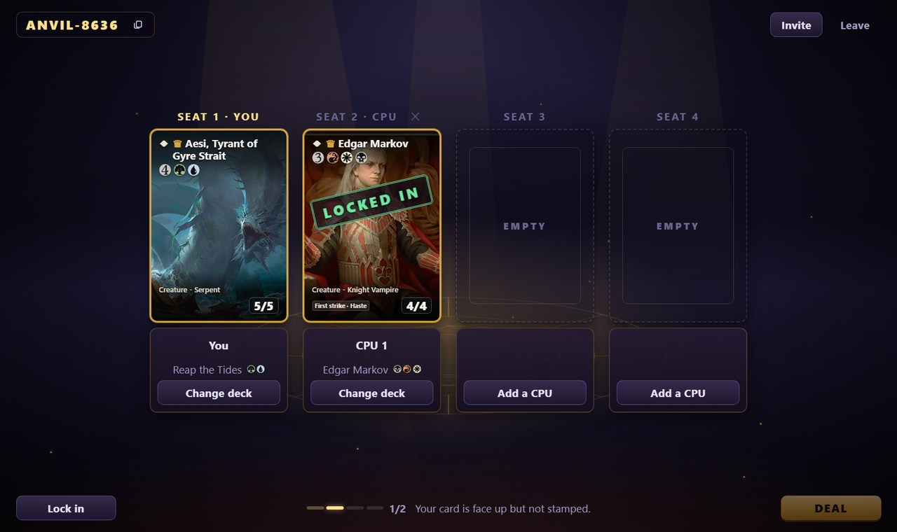

<p align="center">
  
</p>

<p align="center">
  <a href="https://commanderblitz.com"></a>
  <a href="https://github.com/TylerGauntlett/commander-blitz/actions/workflows/deploy.yml"></a>
  <a href="docs/steamdeck.md"></a>
  <a href="LICENSE"></a>
</p>

**Commander Blitz** is a Magic: The Gathering **Commander** engine you can play
against, in a browser or on a Steam Deck: twelve decks, each piloted by a CPU with
its own plan, two to four seats at the table, and a rules engine that implements
the stack, priority, combat and about 3,000 cards faithfully enough that a game
feels like a game.

The rules live in exactly one place. A human clicking a card, a CPU scoring the
board, and a reinforcement-learning policy sampling an action index all end up
calling the same `Game.apply(action)`, so there is one code path for "a player
did something" and no way for the client and the AI to disagree about the rules.

<p align="center">
  
</p>

## ⚡ Play it now

**In a browser:** [commanderblitz.com](https://commanderblitz.com). Create a pod,
seat up to three CPUs or share the code with friends, pick a deck, play. Nothing
to install, no account.

**On a Steam Deck:** there is a native build. See the next section.

## 🎮 Steam Deck

Commander Blitz ships as a **native Steam Deck app**, not a browser bookmark. In
Desktop Mode, open Konsole and paste:

```bash
curl -fsSL https://github.com/TylerGauntlett/commander-blitz/releases/latest/download/install.sh | bash
```

- It lands in your Steam library with a capsule, hero and logo, and launches from
  Game Mode like anything else there.
- It runs the game's own server on the device, so playing alone or against CPUs
  works with **no connection at all**; the Online card takes you to the site to
  play with friends when you have one.
- The whole controller layer and every 1280×800 layout were built on the Deck.
- It keeps itself current from this repository's
  [Releases](https://github.com/TylerGauntlett/commander-blitz/releases): the shell
  updates on quit, the game content updates in place.

[docs/steamdeck.md](docs/steamdeck.md) has the controls, what the installer wrote
and how to undo it. The AppImage is also on the Releases page for a manual
install.

<p align="center">
  
  
</p>

## 🚀 Run it yourself

Python 3.13 and Node 20+.

```bash
git clone https://github.com/TylerGauntlett/commander-blitz.git && cd commander-blitz
python -m venv .venv
# Windows: .venv\Scripts\activate      macOS / Linux: source .venv/bin/activate
pip install -c constraints.txt -e ".[dev]"
```

Play in the terminal, or run a hundred headless games and read the report:

```bash
python scripts/play_cli.py
python scripts/run_arena.py --games 100
```

Play in the browser, with the API and the client in two terminals:

```bash
uvicorn commanderblitz.server.app:get_app --factory --reload
cd frontend && npm install && npm run dev        # then open http://localhost:5173
```

Or the whole thing in one container: `docker compose up` (see
[docs/deployment.md](docs/deployment.md#self-hosting)).

**Over a LAN**, bind both servers to the network instead of loopback and everybody
opens `http://<your-ip>:5173`; one person creates a pod and reads out the code.

```bash
uvicorn commanderblitz.server.app:get_app --factory --host 0.0.0.0
cd frontend && npm run dev -- --host
```

## 📦 What is in the box

| | |
|---|---|
| **Twelve decks** | Commander-legal 100-card lists, ten of them real Moxfield decks imported card for card: Aesi, Atraxa, Bard, Blor, Bruvac, Edgar Markov, Giada, Isperia, Sheoldred, The Ur-Dragon, Vivi and Zurgo. Every card in all twelve is implemented and tested. [docs/decks.md](docs/decks.md) |
| **A CPU per deck** | Each deck ships with a strategy that knows how it wins: landfall, superfriends, voltron, mill, aristocrats, dragons. [docs/cpus/](docs/cpus/README.md) explains how each one plays |
| **The rules** | Full turn structure, the stack and priority, triggered and static abilities, combat with the evergreen keywords, state-based actions, commander tax and damage, N-player pods. What is simplified or absent is written down in [docs/rules-coverage.md](docs/rules-coverage.md) |
| **~3,000 cards** | JSON definitions in a DSL the engine compiles at load time, verified card by card against Scryfall's oracle text. Any other card imports as an inert proxy, and [docs/unsupported-cards.md](docs/unsupported-cards.md) says why |
| **Import a deck** | Paste a Moxfield link. Every card the engine knows plays natively; the rest get their art, cost and types and do nothing |
| **Multiplayer** | Two to four people in their own browsers against one process, with versioned long-polling and no sockets. [docs/api.md](docs/api.md) |
| **Steam Deck** | A self-contained build: 1280×800 is the size every layout was measured at, and the whole controller layer exists for it |
| **AI training** | A Gymnasium environment with a flat action space and a legal-action mask, a heuristic agent, and a masked-PPO self-play trainer. [docs/ai-training.md](docs/ai-training.md) |

## 🧭 How it works

```
commanderblitz.engine   pure, deterministic rules engine (no I/O, no ML, no HTTP)
commanderblitz.cards    JSON card definitions, validated and compiled at load time
commanderblitz.ai       Gymnasium environment, agents, per-deck CPU strategies, PPO trainer
commanderblitz.server   FastAPI application exposing the engine
frontend/               React + Vite client
desktop/                Electron shell for the Steam Deck build
```

The engine is a state machine that advances until it needs a decision from a
player. Every shuffle and coin flip goes through one seeded RNG, so a seed
reproduces a game exactly, undo is a replay, and training runs are repeatable.
The client simulates nothing: it receives a list of legal actions with opaque ids
and echoes one back. [docs/architecture.md](docs/architecture.md) has the
diagrams.

## 📚 Docs

- [docs/architecture.md](docs/architecture.md) — the shape of the system and why there is one seam
- [docs/engine-rules.md](docs/engine-rules.md) — turn structure, the stack, combat, with diagrams
- [docs/rules-coverage.md](docs/rules-coverage.md) — **what is implemented, what is simplified, and what is not**
- [docs/card-dsl.md](docs/card-dsl.md) — how to write a card
- [docs/testing.md](docs/testing.md) — every gate, and `python scripts/verify.py` to run them all
- [docs/README.md](docs/README.md) — the rest, including the ADRs

## 🤝 Contributing

Issues and pull requests are welcome. [CONTRIBUTING.md](CONTRIBUTING.md) covers
the setup, the gates, and the three Claude Code skills that grow the card pool:
`/import-moxfield` makes a whole deck playable, `/author-cards` implements cards
the DSL can express, and `/extend-dsl` builds the engine capability that unblocks
the ones it cannot.

## 📜 License

The code is [MIT](LICENSE). Commander Blitz is unofficial Fan Content permitted
under the [Wizards of the Coast Fan Content Policy](https://company.wizards.com/en/legal/fancontentpolicy)
and is not approved or endorsed by Wizards; card names, text and illustrations
are © Wizards of the Coast, obtained through [Scryfall](https://scryfall.com).
See [NOTICE.md](NOTICE.md).
