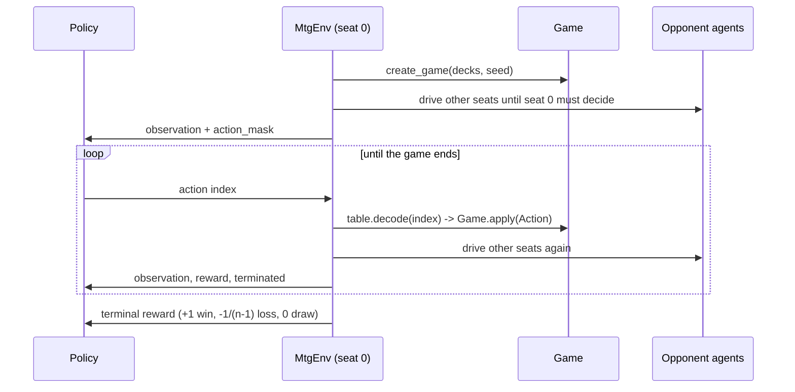

# Self-play training

## The loop



The env owns exactly one seat. Every other seat is played inside `step()` by its own
agent, so from the policy's point of view this is an ordinary single-agent MDP.

## The action space

Magic offers a different set of actions in every state, but a policy needs a constant
one. The bridge is a **structured index**: a slot per hand position, battlefield
position, ability and target option.

| Range | Size | Meaning |
|---|---|---|
| 0 | 1 | pass / finish declaration ("done", contextually) |
| 1–20 | 20 | play a land from hand slot *i* |
| 21–120 | 100 | cast hand slot *i* × target option *t* |
| 121–130 | 10 | cast a commander × target option |
| 131–530 | 400 | activate battlefield slot × ability × target option |
| 531–650 | 120 | attack: battlefield slot × defender |
| 651–810 | 160 | block: battlefield slot × attacker slot |
| 811–820 | 10 | choose ordinal (search results, modes, sacrifices) |
| 821–824 | 4 | yes / no / mulligan / keep |

`ACTION_SPACE_SIZE = 825`.

Slots come from a deterministic, stable sort — hand by mana value then card id then
oid; battlefield by type group then card id then oid — so index 37 tends to mean the
same *kind* of thing from step to step. That is much better for learning than "the
37th legal action", which shuffles every time the board changes.

**The mask is built by walking `legality.legal_actions()` and encoding each result.**
There is no second implementation of legality, so the mask cannot disagree with what
the engine will accept, and it cannot disagree with what the HTTP layer serves either.

A handful of actions can fall outside the fixed layout (a 21st card in hand, a 5th
target option). Those are reported on `ActionTable.dropped` rather than silently
vanishing, and a test asserts `len(by_index) + len(dropped) == len(legal_actions)`.

## The observation

Two parts:

**`scalar`** — 1385 floats, all clipped to [-1, 1]:

| Section | Size | Contents |
|---|---|---|
| Global | 21 | turn, step one-hot, whose turn, who has priority, stack depth, player count, land drops left, players alive |
| Per seat × 4 | 24 each | life, hand/library/graveyard/exile sizes, land and creature counts, total power and toughness, mana pool by colour, commander tax, commander damage taken, alive, is-me, is-active |
| Per battlefield slot × 40 | 24 each | occupied, mine, power, toughness, damage, tapped, summoning sick, attacking, blocking, commander, token, +1/+1 counters, 4 type bits, 10 keyword bits |
| Per hand slot × 20 | 12 each | occupied, mana value, 5 colour bits, 4 type bits, castable right now |
| Per stack slot × 8 | 6 each | occupied, mine, creature spell, instant, mana value, targets something of mine |

Seats are ordered **relative to the viewer** — slot 0 is always "me" — so the same
network works from any seat.

**`card_ids`** — 68 integers naming the card in each hand, battlefield and stack slot.

That second array is where most of the usable signal is. It lets the model learn a
32-dimensional embedding per card, so it can distinguish "Legion Lieutenant" from
"some 2/2". With only ~150 distinct cards the table is tiny, and it is the single
biggest quality-per-line decision in this layer.

## Rewards

Terminal only by default: **+1** for a win, **0** for a draw, **−1/(n−1)** for a loss
so a pod's rewards sum to zero and no seat is intrinsically favoured. An optional
shaping term (`reward_shaping=True`) adds `0.001 × Δ(own life − mean opponent life)`
per step; it is off by default and always off for evaluation.

## Agents

| Agent | What it does |
|---|---|
| `random` | Uniform over the mask. The floor everything else must beat |
| `heuristic` | Reflexive, rule-ordered, and **deck-aware**: every score passes through the seat's strategy ([cpus/](cpus/README.md)) — the baseline fixes for any deck, and a plan of its own for each shipped precon |
| `heuristic_classic` | The heuristic as it was before strategies: never miss a land drop, remove the biggest threat, counter anything worth 3+ mana, attack when profitable, block when it trades up, chump only when desperate, target whoever is closest to dying. Kept as a benchmark and for seeded tests; `AUTOMTG_CPU=classic` makes plain `heuristic` mean this |
| `policy` | A trained checkpoint; falls back to `heuristic` when none is supplied |

The heuristic agent is deliberately reflexive — no lookahead. Undo and env resets work
by replay rather than by cloning state, so an agent that wanted to explore
hypotheticals would have to replay whole games to do it. That is a real constraint of
the no-cloning design, and it is why the heuristic scores actions from the current
position only.

### Deck strategies

The heuristic looks up a `Strategy` for each seat from the deck it is playing
(`automtg.ai.strategy`): the precon's own plan by deck id, else a plan for the
same commander, else `DefaultStrategy`. The agent still produces every score; the
strategy adjusts it — a Voltron deck adds weight to equipping its commander, a
mill deck to the shortest library — so `classic=True` (the neutral `Strategy`) is
the old agent exactly. [cpus/README.md](cpus/README.md) has the design and one
page per deck.

The benchmark is the strategy agent against the classic one, seats rotated, over
every precon:

```bash
python scripts/run_arena.py --agents heuristic,heuristic_classic --decks precons --pods 2,4 --games 60
```

Measured when the strategies landed (40 games per pod size): **level within
noise** — 50% vs 45% in duels, 22.5% vs 26.2% in four-player pods, with 95%
intervals ±15 points. That run mixes decks and agents, so deck strength swamps
the agent. The sharper measurement holds the deck fixed and swaps only its
pilot, against a classic-piloted Zurgo, 12 duels each:

| Deck | Strategy wins | Classic wins |
|---|---|---|
| Sheoldred | 6 | 2 |
| Blor | 7 | 5 |
| Atraxa | 2 | 1 |
| Bard | 4 | 3 |
| Edgar | 8 | 7 |
| Giada, Isperia, Vivi | 9, 8, 4 | 9, 8, 4 |
| Bruvac | 0 of 10 | 0 of 10 — but its mill gets an opponent to 9 and 28 cards left where classic stops at 57 and 39 |

Never worse, sometimes much better — and the point of the plans is less the
win rate than that each deck now *does its thing* where a player can see it.
Aesi and the Ur-Dragon were left out: long games trip the engine's 200-trigger
loop guard (Scute Swarm, Ganax), which the arena scores as a draw.

## The trainer

Masked PPO. Two choices matter:

- **The mask is applied to the logits, not to sampling.** An illegal action gets
  probability zero and contributes nothing to the gradient, so the policy never has to
  learn legality — only strategy.
- **Opponents come from a snapshot pool.** Training purely against your current self
  collapses into a strategy that beats only itself. Each episode samples an opponent:
  15% random, 35% heuristic, the rest one of the last five snapshots.

Defaults: γ=0.999 (episodes are long), GAE λ=0.95, clip 0.2, entropy 0.01, value
coefficient 0.5, Adam at 3e-4, 512 env steps per update, 4 epochs of minibatch 128.

```bash
python scripts/train.py --pod 2 --updates 200
python scripts/train.py --pod 4 --updates 200
python scripts/run_arena.py --agents policy,heuristic --pods 2 --games 200
```

**A separate checkpoint is trained per pod size.** The spec is explicit that player
count changes how the game should be played — a duel rewards emptying your hand early,
a pod rewards not being the biggest threat on the table — so mixing the two into one
policy would average away exactly the behaviour we want to measure.

## Evaluating

`scripts/run_arena.py` runs the (agents × pod size) matrix, rotating seats so seat
order cannot flatter an agent, and reports win rates with Wilson 95% intervals,
draw rate, median turn count, and per-deck and per-seat breakdowns — all segmented by
pod size.

```bash
python scripts/run_arena.py --games 200 --pods 2,4 --out runs/
```

## What to expect

Measured on this machine, after a 120-update CPU run (~61k environment steps, 871
episodes):

| Matchup | Win rate | 95% CI |
|---|---|---|
| Heuristic vs random | ~85% | — |
| **Trained policy vs random** | **60%** | 47–71% |
| **Trained policy vs heuristic** | **10%** | 4–23% |

The policy has clearly learned something — 60% against random is well clear of a coin
flip — and it is just as clearly not competitive with the heuristic yet. That is the
expected shape at this budget. An 825-wide action space, 15–40 turn episodes and a
terminal-only reward need orders of magnitude more experience than a background CPU
run.

Treat this as a working pipeline with sensible defaults rather than a finished player.
If you want to push it: more updates first, then reward shaping to get a denser signal
early, then a wider trunk. The heuristic agent remains the opponent the app ships with.
