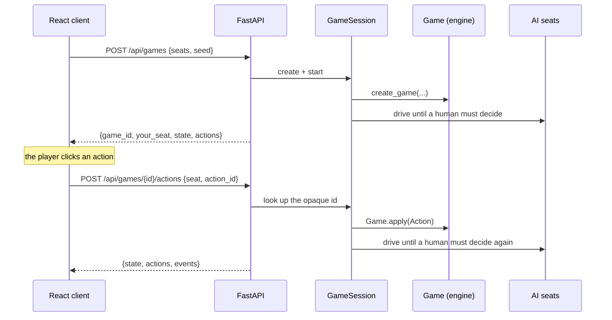

# HTTP API

A thin driver over the engine. It holds no rules logic.

## The round trip



One round trip carries the game all the way to the human's next decision, so the
client never polls for the AI's turn.

## The key design call

`LegalActionDTO` carries an **opaque, server-generated id**:

```json
{
  "id": "a3-cast",
  "kind": "cast",
  "label": "Cast Counterspell -> Test Bear",
  "source_oid": 42,
  "ability_index": null,
  "targets": [{ "kind": "stack", "id": 7 }],
  "choice": null,
  "x": 0
}
```

The client echoes `id` back. It never reconstructs an action. Two things follow:

- **Client/engine desync is structurally impossible.** The client cannot invent an
  action the engine did not offer.
- **New rules need no client change.** Add an action kind to the engine and the button
  appears, labelled, with no frontend work.

The other fields are display-only — enough to draw an arrow to a target or highlight
a card, never enough to decide legality.

## Endpoints

| Method | Path | Purpose |
|---|---|---|
| `GET` | `/health` | Version, card count, deck list, live game count |
| `GET` | `/api/decks` | Deck summaries for the new-game dialog |
| `GET` | `/api/cards/{card_id}` | Full card definition, for tooltips |
| `POST` | `/api/games` | Create a game. Body: `{seats: [{deck_id, kind, agent, name}], seed?}` |
| `GET` | `/api/games/{id}/state?seat=&since=` | The player view, legal actions, and new events |
| `GET` | `/api/games/{id}/actions?seat=` | Just the legal actions |
| `POST` | `/api/games/{id}/actions` | Apply one action id |
| `POST` | `/api/games/{id}/declare` | Submit a whole attack or block at once |
| `POST` | `/api/games/{id}/advance` | Let the AI seats act (rarely needed) |
| `POST` | `/api/games/{id}/undo` | Rewind past the last human action |
| `GET` | `/api/games/{id}/events?since=` | Event slice for the log |
| `GET` | `/api/games/{id}/debug` | Full state, hidden zones included. **Development only** |
| `DELETE` | `/api/games/{id}` | Discard the session |

Errors: `400` for an illegal or out-of-turn action, `404` for an unknown game or card.

## Hidden information

`player_view(state, seat)` is the only shape the client ever receives. In it:

- Your own hand is a full card list.
- **Every other hand is `null`**, with only `hand_count` alongside it.
- **No library is ever listed**, only `library_count`.
- Graveyards, exiles and command zones are public and listed in full.

Three tests hold this line, including one that asserts the `/debug` endpoint — the
deliberate exception — really does reveal what the player view hides.

## Combat

The engine declares combat incrementally, one `ADD_ATTACKER` at a time. `POST /declare`
takes the whole set and loops the increments server-side:

```json
{ "seat": 0, "kind": "attackers", "pairs": [[42, 1], [43, 1]] }
```

so the client can present the familiar "select everything, then confirm", while the
engine still validates each step on its own.

A creature appearing twice in `pairs` is rejected **before anything is applied** — in a
pod, legality offers the same creature against every opponent, but it can only attack
one. If a later pair turns out to be illegal only once the earlier ones are in place,
the request fails mid-loop and the declaration decision stays open, so the client can
simply submit a corrected set.

## Undo

`POST /undo` rewinds to before the last human action by **replaying the tape**: the
session re-creates the game from its seed and re-applies every recorded action except
the last human one.

Replay rather than a snapshot, because the engine never clones state — replay is the
only representation that cannot silently miss a field. It is O(game length), which is
irrelevant for a local app.

## Sessions

In-memory, single process, no auth. This is a local application; there is no database
and no user model. Restarting the server discards every game.

## Running it

```bash
uvicorn automtg.server.app:get_app --factory --reload
```

CORS is open to the Vite dev server ports only. In development the Vite proxy forwards
`/api` and `/health`, so the client uses same-origin relative URLs and needs no
base-URL setting at all.
