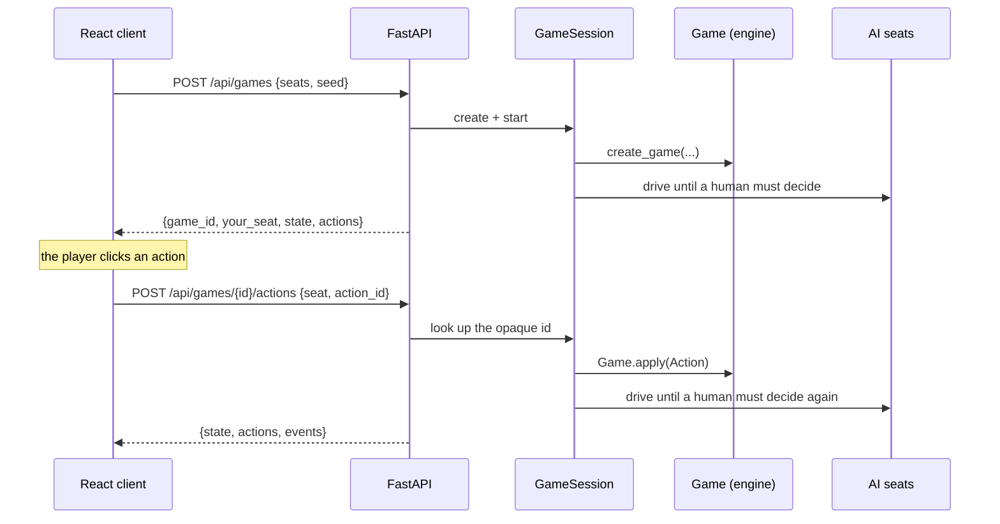

# HTTP API

A thin driver over the engine. It holds no rules logic.

## The round trip



One round trip carries the game all the way to the human's next decision, so the
client never polls for the AI's turn.

## The key design call

`LegalActionDTO` carries an **opaque, server-generated id**:

```json
{
  "id": "a3-cast",
  "kind": "cast",
  "label": "Cast Counterspell -> Test Bear",
  "source_oid": 42,
  "ability_index": null,
  "targets": [{ "kind": "stack", "id": 7 }],
  "choice": null,
  "x": 0
}
```

The client echoes `id` back. It never reconstructs an action. Two things follow:

- **Client/engine desync is structurally impossible.** The client cannot invent an
  action the engine did not offer.
- **New rules need no client change.** Add an action kind to the engine and the button
  appears, labelled, with no frontend work.

The other fields are display-only — enough to draw an arrow to a target or highlight
a card, never enough to decide legality.

## Endpoints

| Method | Path | Purpose |
|---|---|---|
| `GET` | `/health` | Version, card count, deck list, live game and pod counts |
| `GET` | `/api/decks` | Deck summaries for the catalogue, with `source`/`playable`/`simplified`/`tags` |
| `GET` | `/api/decks/{deck_id}` | One deck with the dossier's fields: `ratings`, `strategy`, `signature`, and the derived `curve`/`lands`/`swaps` |
| `POST` | `/api/decks/import` | Import a public Moxfield deck. Body: `{url, dry_run?}` |
| `DELETE` | `/api/decks/{deck_id}` | Remove an imported deck. `400` on a precon |
| `GET` | `/api/cards/{card_id}` | Full card definition, for tooltips |
| `GET` | `/api/images?game_id=` | Card art paths. Static, so fetched once. Scoped to a game's own cards when `game_id` is given — unscoped it grows with every imported deck |
| `GET` | `/art/{card_id}.jpg` | The art itself, from disk. Lazily fetched for cards outside the shipped pool |
| `GET` | `/api/catalog?q=&colors=&types=&limit=` | Search the ~32,700-card Scryfall-derived catalog |
| `GET` | `/api/catalog/{scryfall_id}` | One catalog card |
| `POST` | `/api/games` | Create a game. Body: `{seats: [{deck_id, kind, agent, name}], seed?}` |
| `GET` | `/api/games/{id}/state?seat=&since=&since_version=&timeout=` | The player view, legal actions, and new events. Omit `seat` to be told yours by your token; pass `since_version` to long-poll |
| `GET` | `/api/games/{id}/actions?seat=` | Just the legal actions |
| `POST` | `/api/games/{id}/actions` | Apply one action id |
| `POST` | `/api/games/{id}/declare` | Submit a whole attack or block at once |
| `POST` | `/api/games/{id}/advance` | Let the AI seats act (rarely needed) |
| `POST` | `/api/games/{id}/options` | Change a human seat's play settings (`full_control`) |
| `POST` | `/api/games/{id}/undo` | Rewind past the last human action. `409 multiplayer_undo` with more than one human |
| `GET` | `/api/games/{id}/events?since=` | Event slice for the log |
| `GET` | `/api/games/{id}/debug` | Full state, hidden zones included. **Development only** |
| `DELETE` | `/api/games/{id}` | Discard the session |
| `POST` | `/api/pods` | Open a pod and take seat 0. Body: `{name?, deck_id?, seed?}` -> `{player_token, pod}` |
| `POST` | `/api/pods/{code}/join` | Take a chair. Passing your existing token is how reconnecting works |
| `GET` | `/api/pods/{code}?since=&timeout=` | The pod, blocking until it changes. Token optional |
| `PATCH` | `/api/pods/{code}/seat` | Your own chair: `{deck_id?, locked?, name?}` |
| `PATCH` | `/api/pods/{code}/seats/{i}` | A chair that is not yours. Host only. `{action, deck_id?, agent?}` |
| `POST` | `/api/pods/{code}/start` | Deal the pod. Host only |
| `POST` | `/api/pods/{code}/leave` | Give up your chair |

Errors: `400` for an illegal or out-of-turn action, `404` for an unknown game or card.

**Deck import is the one route whose errors carry a machine-readable code**, as
`{"detail": {"detail": "...", "code": "private"}}`. "That deck is private" and
"there is no such deck" send somebody to two different places — their Moxfield
settings, or the address bar — and a client that switched on the sentence would
break the first time somebody reworded it. Codes and statuses are tabulated in
[deck-import.md](deck-import.md).

## Hidden information

`player_view(state, seat)` is the only shape the client ever receives. In it:

- Your own hand is a full card list.
- **Every other hand is `null`**, with only `hand_count` alongside it.
- **No library is ever listed**, only `library_count`.
- Graveyards, exiles and command zones are public and listed in full.

Three tests hold this line, including one that asserts the `/debug` endpoint — the
deliberate exception — really does reveal what the player view hides.

**The event log is filtered too**, by `event_log_for(state, seat)`. `player_view` hid
the hands, but the log ran alongside it unredacted, and a `draw` fires with the object
id of the card drawn. An opaque id is not a card name today — but the client
accumulates every id it has ever seen, so an id drawn now and played later is
retroactively identified, and the hand was never really hidden.

So for `draw`, `discard` and `mill` by another seat, the id is dropped. The event
itself stays, with its type and its `player`, so "Priya drew a card" still narrates: a
client that silently received a shorter list than its neighbour would have no way to
tell that from a bug.

## Combat

The engine declares combat incrementally, one `ADD_ATTACKER` at a time. `POST /declare`
takes the whole set and loops the increments server-side:

```json
{ "seat": 0, "kind": "attackers", "pairs": [[42, 1], [43, 1]] }
```

so the client can present the familiar "select everything, then confirm", while the
engine still validates each step on its own.

A creature appearing twice in `pairs` is rejected **before anything is applied** — in a
pod, legality offers the same creature against every opponent, but it can only attack
one. If a later pair turns out to be illegal only once the earlier ones are in place,
the request fails mid-loop and the declaration decision stays open, so the client can
simply submit a corrected set.

## Priority stops

Eleven of the thirteen steps grant priority to every player, and instants and activated
abilities are legal in all of them -- so a player holding one instant used to be asked
about every window, on every player's turn. The engine auto-passes any window with only
`PASS` in it; on top of that, a seat with `auto_pass` set skips windows where passing is
not a real choice. It stops when the stack is non-empty, in its own main phases, and at
declare blockers.

`GameSession.start` sets `auto_pass` on **human seats only**, so the RL environment and
the golden tests see exactly the behaviour they always did. `POST /options` flips
`full_control` for a seat, which puts every window back; the flag is echoed in
`player_view` so the client renders the state the engine is actually holding.

## Undo

`POST /undo` rewinds to before the last human action by **replaying the tape**: the
session re-creates the game from its seed and re-applies every recorded action except
the last human one.

Replay rather than a snapshot, because the engine never clones state — replay is the
only representation that cannot silently miss a field. It is O(game length), which is
irrelevant for a local app.

Each tape entry records the seat's `full_control` setting at the time, because that
setting decides which priority windows exist: replaying an old Pass under a newer
setting could find it illegal.

## Pods, tokens, and who is allowed to see what

A pod is the pre-game lobby: a code somebody can read down a phone line, four chairs,
and a version counter. `POST /api/pods` returns a **`player_token` exactly once** — it
is the only thing that proves a later request is the same person, and it never appears
in any pod view, for anybody. Clients send it as `X-Player-Token`.

A header rather than a cookie, deliberately: CORS here is `allow_credentials=False`, so
a cookie would not be sent cross-origin from the Vite dev server at all.

**Deck secrecy is the lobby's hidden-information rule**, and `Pod.view_for(player_id)`
is the only way a pod reaches the wire, exactly as `player_view` is for a game. For
every seat that is not the viewer's own, `deck` is `null` until that seat locks in. A
CPU is always fully visible — the host chose its deck. No token, and no other player's
`player_id`, appears in any view.

**Names are optional everywhere and settled from the seat plate.** The front door
asks for a code, not a name, so `POST /pods` and `/join` normally carry none and an
unnamed chair is called `Player {n}` after its seat — not `"You"`, which is only true
for one reader and would have the rest of the pod waiting on somebody called You.
`PATCH /seat` takes a `name`, which is how the lobby renames. It is deliberately
**not** gated on `locked`: the lock commits a *deck*, and making somebody unlock —
which un-readies the pod for everybody else — to fix a typo would be a worse rule
than the one it enforced. It *is* refused after the deal, by the same
`_require_open` every other seat change goes through.

`POST /pods/{code}/start` compacts the four chairs down to the seats that are actually
filled and hands them to `SessionRegistry.create`, so a pod holding
`[you, empty, cpu, empty]` becomes a **two-player game, not a four-player game with two
dead seats**. It also writes `session.tokens`, a `player_token -> seat` map — which is
why `GET /state` with no `?seat=` can tell you which seat is yours.

A pod view carries `invite_link`, the pod's address **in the client**: `/pods/GYRE-8412`.
Relative on purpose — the server does not know what host the browser reached it on, and
over a LAN that is a machine address it cannot guess, so an absolute link it built would
say `localhost` and work for exactly one person. The client resolves it against
`window.location`. Following it on a browser that holds no token for the pod lands at
the front door with the code filled in, because the token is per-tab and a link is not
what grants a seat; see `docs/adr/0008-url-routing.md`.

Pod errors carry a machine-readable code in the same shape deck import established:

| code | status | means |
|---|---|---|
| `not_found` | 404 | no pod with that code |
| `bad_token` | 401 | that token does not belong to this pod |
| `not_host` | 403 | only the host can do that |
| `not_your_seat` | 403 | that chair is somebody else's |
| `pod_full` | 409 | somebody took the last chair first |
| `already_started` | 409 | the pod dealt; `game_id` is in the detail, so you are routed to the table rather than bounced |
| `not_ready` | 409 | a seat has not locked in, or you have not chosen a deck |
| `bad_name` | 400 | a name of nothing but whitespace |
| `unknown_deck` | 400 | no such deck |
| `pod_closed` | 410 | everybody left |

## Authorisation at the table

`_authorise` runs in two regimes, chosen by whether the session has a token map.

A session **dealt from a pod** has one, and then `X-Player-Token` must resolve to
exactly the seat being asked about — otherwise anybody holding a `game_id` could read a
rival's hand with `?seat=1`.

A session created straight through `POST /api/games` has **no token map**, and keeps the
bounds-check-only behaviour it has always had. That is not an oversight: the CLI,
`scripts/smoke_http.py`, single-player and every existing test drive a game with no
token at all, and requiring one would break all of them to protect a seat nobody else
can reach. `tests/server/test_multiplayer_game.py` asserts both halves.

`POST /undo` is refused outright in a multi-human session. Undo rebuilds the `Game` by
replay, and a second player already holding the rewound events has no way to reconcile
them.

## Long-polling

Every pod and every game session carries a monotonic `version`. Pass the one you last
saw as `?since=` (pods) or `?since_version=` (games) and the request blocks until it
moves or `timeout` (max 25 s) elapses.

- **`since=0` returns immediately.** That is the first fetch.
- **A timeout is not an error.** You get the current view with a 200 and re-poll. A
  long poll is indistinguishable from a slow one, and a dropped connection costs at
  most one round trip.

Rationale and the alternatives in
[adr/0007-versioned-long-polling.md](adr/0007-versioned-long-polling.md).

## Sessions

In-memory, single process. This is a LAN application; there is no database and no user
model, and a `player_token` is a per-pod bearer credential, not an account. Restarting
the server discards every game and every pod. Idle players, abandoned pods and
abandoned game sessions are swept opportunistically when somebody creates or joins a
pod, so there is no reaper thread to shut down cleanly.

## Running it

```bash
uvicorn automtg.server.app:get_app --factory --reload
```

CORS is open to the Vite dev server ports plus any private-network origin
(`10.x`, `192.168.x`, `172.16-31.x`), by regex rather than `*` — so this stays an app
you can only reach from a network you are already on. In development the Vite proxy
forwards `/api` and `/health`, so the client uses same-origin relative URLs and needs no
base-URL setting at all.

To play across a room, bind both to the LAN:

```bash
uvicorn automtg.server.app:get_app --factory --host 0.0.0.0
cd frontend && npm run dev -- --host
```
