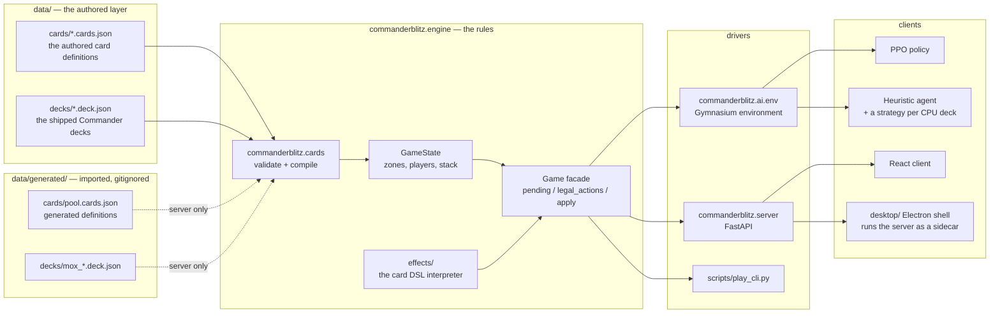
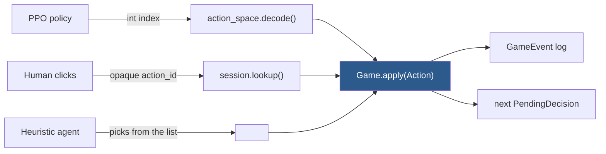
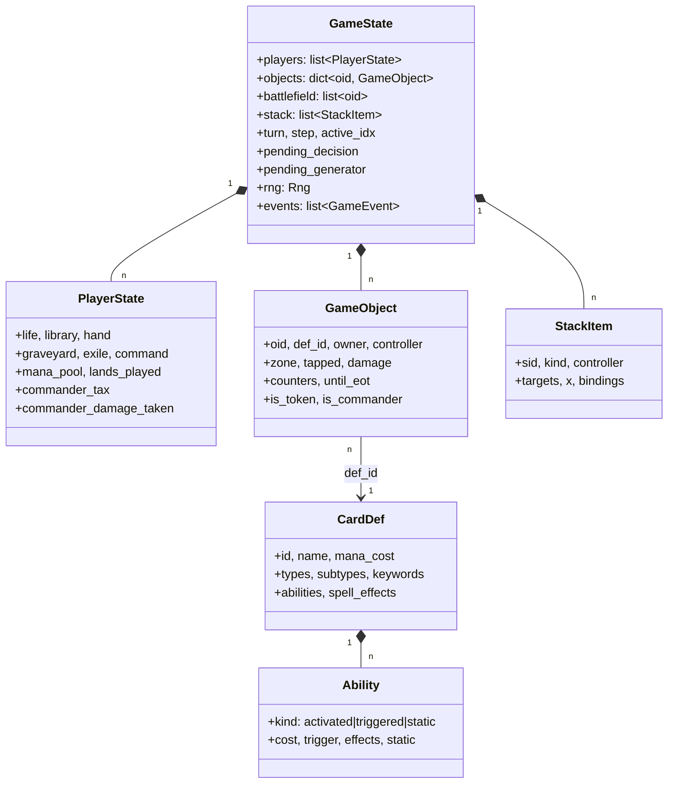

# Architecture

## The one idea

**The engine is a pure, deterministic state machine that advances until it needs a
decision from a player.** Everything else is a *driver* that answers decisions.



The dotted edges are the **two-layer registry**. `default_registry()` loads only
`data/`; `server_registry()` loads `data/generated/` on top. Everything except
the FastAPI app — every test, the trainer, the arena, the CLI — is on the first,
so importing a deck cannot change the answer any of them gives. See
[deck-import.md](deck-import.md).

The heuristic agent is one agent with a plan per deck: each shipped deck carries a
*strategy* that scores the legal actions the way that deck wants to play. See
[cpus/README.md](cpus/README.md).

The desktop build ([steamdeck.md](steamdeck.md)) is the same server and the same
client: an Electron shell starts the server as a sidecar on loopback and loads the
built client from it, so a Steam Deck plays offline against the same engine the
site runs. See [adr/0009-offline-first-desktop.md](adr/0009-offline-first-desktop.md).

## Why a single seam matters

Both the RL agent and the human end up calling the same method with the same type:



Two consequences fall out of this, and both are load-bearing:

- **The RL action mask and the HTTP action list are the same enumeration.** Both are
  built by walking `legality.legal_actions()`. They cannot drift apart, because there
  is no second implementation of what is legal.
- **The frontend simulates nothing.** It receives a list of legal actions with opaque
  ids and echoes one back. Client/server desync is structurally impossible, and adding
  a new kind of action needs no client change at all.

## The data model

Flat and id-keyed. No object graph, no cycles, so serialization is trivial and
nothing can hold a stale reference.



`CardDef` is immutable and shared by every instance of that card in every game.
`GameObject` is the mutable per-instance state.

## Modules

The dependency graph inside `commanderblitz.engine` is acyclic, and the
subsystems below are listed roughly bottom-up: each depends on the ones above
it and not the reverse. `structs.py` exists solely to keep it that way — it
holds the dumb containers (`CombatState`, `StackItem`, `TargetRef`,
`TurnLedger`) that both `state` and the modules operating on state need, so
nothing has to import upward.

**State and structs.** `state.GameState` is the root: players, objects keyed by
`oid`, the battlefield, the stack, the step, the pending decision and its
suspended generator, the RNG and the event log. `objects.GameObject` is one
class for a card in any zone (the `oid` survives zone changes, a documented
simplification), `player.PlayerState` is per-seat state, `carddef.CardDef` is
the immutable definition shared by every instance, and `actions` holds the two
types that are the engine's entire input surface, `Action` and
`PendingDecision`. `rng.Rng` is the only source of randomness.

**Characteristics.** `characteristics.chars` computes a permanent's derived
power, toughness, types and keywords in a *fixed order* rather than through
the seven numbered layers: "layers-lite",
[adr/0001-layers-lite.md](adr/0001-layers-lite.md). `player_statics` wraps the
same machinery for what a player's permanents do to the rules that apply to
that player, and `text_change` is the one piece of layer 3 the engine has —
replacing creature-type words.

**Zones.** `zones.move_object` is the single place an object moves between
zones, so enters/leaves/dies triggers, permanent-state resetting, the
commander zone-change replacement and cache invalidation happen exactly once.
The synchronous replacements that never ask a question (enters tapped, enters
with counters, tokens ceasing to exist) are applied inline here.

**Triggers and events.** Every mutating primitive calls `triggers.fire`, which
is two steps with a real distinction between them: `GameState.emit` records a
`GameEvent` in the log, and `triggers.collect` scans for triggered abilities
that match it and queues them in `state.pending_triggers`. Collected triggers
go on the stack the next time a player would receive priority, in APNAP order.
`events` defines `EventType` and `GameEvent`; the log is what the trigger
system matches, what the UI narrates, and — with the seed and the tape — the
replay mechanism. `primitives` holds the low-level mutations that fire those
events and never make decisions.

**The effects package.** Card JSON is data and `engine.effects` is its
interpreter: every effect is a dict whose `op` names a function in
`registry.OPS`, populated by the `@register` decorator in `effects/registry.py`
and implemented across the `ops_*.py` modules (cards, characteristics, combat
flags, control, counters, life, mana, player, removal, stack).
`RECORDING_OPS`, beside `OPS`, lists the ops that write an `as` binding so the
loader can refuse one nothing would read. Three sub-languages feed the ops and
are validated at load time: `selectors` ("which objects"), `values` (any number
a card names, from a literal to a per-turn tally) and `conditions` (the boolean
tests behind `if`, intervening-if clauses and static conditions). Ops are
generators; `context.ask_objects` and its siblings yield a `PendingDecision`
and receive the answer, which is why resolution can pause mid-effect.

**Replacements and temporary effects.** `replacements` holds the three
replacement effects that stop to ask — dredge, madness, miracle — and the draw
doublers that interleave with them; everything simpler is applied inline by
`zones`. `temp_effects` holds the until-end-of-turn restrictions on permanents
and players (attack and block prohibitions, goad, unblockability, damage
shields, life locks), each a set/clear/query triple over one expiry rule.

**The ledger.** Morbid, raid, spectacle and storm ask about *events*, and the
board keeps no record that one happened. `structs.TurnLedger` is the per-turn
tally of what has happened — creatures died, attackers declared, life gained
and lost, spells cast — folded from every event by `GameState._tally` as it is
emitted, so no emitter had to change and none can route around it. The
`values` sub-language reads it through forms such as
`creatures_died_this_turn`.

**Costs, mana and cost reduction.** `mana` holds mana costs, pools and the
automatic payment solver, `solve_payment`: an action never carries a payment,
legality only offers a cast when the solver finds sources, and applying the
action runs the solver again ([adr/0003-auto-mana-payment.md](adr/0003-auto-mana-payment.md)).
`costs.pay` pays everything else — sacrifice, discard, life — as a generator,
because those may need a choice. `cost_reduction` is split out of `costs` and
holds the reductions and the filters that decide what a reduction counts.

**Casting and the stack.** `casting` enumerates the cast actions and their
variants — kicker, additional and alternative costs, the ceilings on each —
split from `legality` so the priority-window logic and the casting grammar can
be read apart. `stack` puts spells and abilities on the stack and resolves
them; resolution is a generator for the reason the effects are.
`targeting` chooses and re-checks targets, and caps how many target tuples
legality will enumerate on a wide board.

**Legality.** `legality.legal_actions` is the single source of truth for "what
can I do?". The HTTP action list and the RL action mask are both built from it
and its order is deterministic, so the two can never disagree.

**Combat.** `combat` declares attackers and blockers *incrementally* — one
`ADD_ATTACKER` or `ADD_BLOCKER` at a time, then `FINISH_DECLARATION` — so the
action mask is always exact and never enumerates attack sets
([adr/0004-incremental-combat.md](adr/0004-incremental-combat.md)); the HTTP
layer accepts a whole set and loops the increments.

**Turn and state-based actions.** `turn.begin_step` drives step transitions
and turn-based actions, as a generator because discarding to hand size needs a
decision. `sba` runs state-based actions to a fixpoint before any player
receives priority and after anything resolves.

**Rules-supplied card types.** Three behaviours that no card prints have a
module each: `sagas` (the lore counter, the tick after the draw step, the
sacrifice after the last chapter), `battles` (defense counters, being attacked,
being defeated) and `suspend` (a special action, not a cast). Planeswalkers
have no module of their own: loyalty abilities are activations in `legality`,
attacking one is `combat`, and losing the last counter is `sba`.

**Serialize.** `serialize.full_view` is everything, for golden tests and the
debug endpoint; `player_view` is what one seat may know, and the only shape a
client ever receives; `event_log_for` filters the log the same way.

**Sandbox.** `sandbox.GameBuilder` puts a game into an exact, hand-specified
position — known hands, known battlefield, known top of library. It lives in
`src` rather than `tests` because the card-authoring verifier
(`cards.authoring.verify.build_sandbox`) stands a candidate card up in a real
position and watches what it does.

**The `cards` package.** `schema` is the contract: strict pydantic models
(`CardModel`, `DeckModel`, `extra="forbid"`) so a misspelled field is caught
rather than silently ignored. `loader.compile_card` turns a validated model
into a `CardDef`, checking every op, selector key, value form and keyword
against `loader.vocabulary` and raising `DslError` at *load* time, so a typo
fails the test suite instead of a game; `loader.linking` wires faces, meld
results and token references across cards. `registry` holds `CardRegistry`,
`DeckList`, `GameData` and the two entry points — `default_registry()` for the
authored layer, `server_registry()` for the authored and generated layers
together. `proxy`, `importer` and `moxfield` are the deck-import path
([deck-import.md](deck-import.md)), `images` resolves a card to its printing
([card-catalog.md](card-catalog.md)), and `authoring` is the pipeline that
writes new cards behind six gates ([card-authoring.md](card-authoring.md)).

**`ai`** turns the decision machine into something an agent can hold: a flat
action space with the legality mask, an observation encoding, a Gymnasium
environment, the agents and the trainer. See [ai-training.md](ai-training.md).

**`server`** is the HTTP driver: sessions, the lobby, the art store and the
sidecar entry point. See [server.md](server.md) for how it is organised and
[api.md](api.md) for the contract.

## Determinism

Every shuffle, coin flip and random choice goes through `state.rng`, a seeded
`random.Random`. Nothing else in the package touches `random` or `numpy.random`, and
a test enforces that by scanning the source.

That single rule buys three things:

1. **Reproducible training runs and arena results.** A seed fully determines a game.
2. **Golden replays.** A recorded action tape plus a seed reproduces a game exactly.
3. **Undo without cloning.** The server rewinds by replaying the tape from the seed
   minus the last human action. State is never copied, so no field can be silently
   missed by a clone.

## Resolution is a coroutine

An effect that needs a choice — "sacrifice a creature", "choose a mode" — cannot
finish in one call. Rather than continuations or state snapshots, effect ops are
**generators**: they `yield` a `PendingDecision` and receive the answer back.

```python
picked = yield from ask_objects(ctx, "Sacrifice", pool, 1, 1, pid, "sacrifice")
```

`Game` holds the suspended generator in `state.pending_generator` and resumes it when
a driver answers. This is why one resolution can stop mid-effect and pick up exactly
where it left off, and why the same code serves a human clicking a button and an agent
returning an index.

## What this architecture deliberately does not do

- No layers system. See [rules-coverage.md](rules-coverage.md).
- No state cloning, so no lookahead search in agents.
- No WebSockets. Multiplayer uses **versioned long-polling** instead: every pod and
  game session carries a monotonic version, and clients block on `?since=` until it
  moves. That keeps every handler a sync `def` and removes the reconnection state
  machine a socket layer would need. See
  [adr/0007-versioned-long-polling.md](adr/0007-versioned-long-polling.md).
- No runtime network calls. Card rules are JSON in the repo; card art is
  downloaded once at build time and served from `data/art/` by this app, so a
  game renders with the network unplugged. See [card-catalog.md](card-catalog.md).
