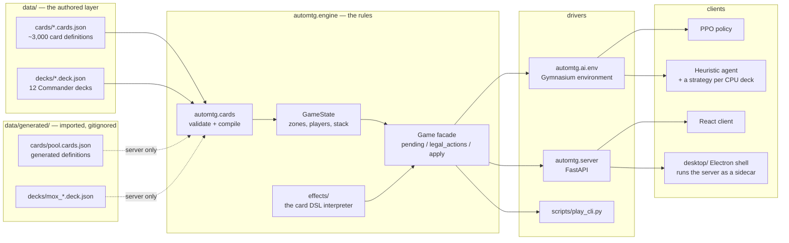
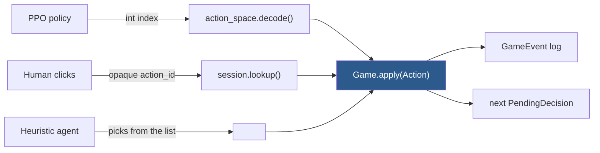
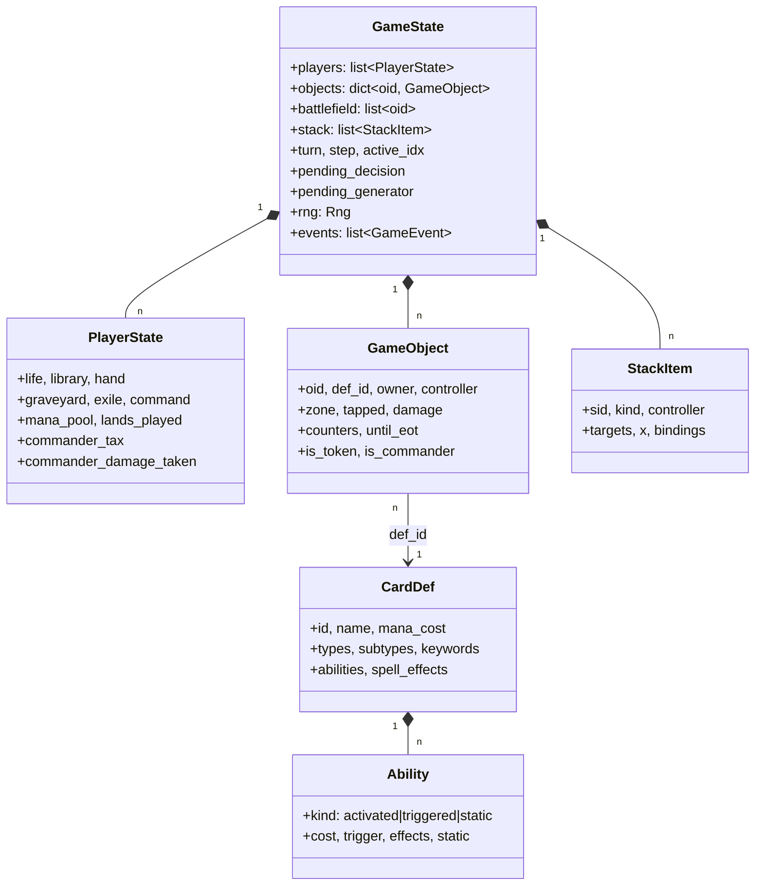

# Architecture

## The one idea

**The engine is a pure, deterministic state machine that advances until it needs a
decision from a player.** Everything else is a *driver* that answers decisions.



The dotted edges are the **two-layer registry**. `default_registry()` loads only
`data/`; `server_registry()` loads `data/generated/` on top. Everything except
the FastAPI app — every test, the trainer, the arena, the CLI — is on the first,
so importing a deck cannot change the answer any of them gives. See
[deck-import.md](deck-import.md).

The heuristic agent is one agent with twelve plans: each shipped deck carries a
*strategy* that scores the legal actions the way that deck wants to play. See
[cpus/README.md](cpus/README.md).

The desktop build ([steamdeck.md](steamdeck.md)) is the same server and the same
client: an Electron shell starts the server as a sidecar on loopback and loads the
built client from it, so a Steam Deck plays offline against the same engine the
site runs. See [adr/0009-offline-first-desktop.md](adr/0009-offline-first-desktop.md).

## Why a single seam matters

Both the RL agent and the human end up calling the same method with the same type:



Two consequences fall out of this, and both are load-bearing:

- **The RL action mask and the HTTP action list are the same enumeration.** Both are
  built by walking `legality.legal_actions()`. They cannot drift apart, because there
  is no second implementation of what is legal.
- **The frontend simulates nothing.** It receives a list of legal actions with opaque
  ids and echoes one back. Client/server desync is structurally impossible, and adding
  a new kind of action needs no client change at all.

## The data model

Flat and id-keyed. No object graph, no cycles, so serialization is trivial and
nothing can hold a stale reference.



`CardDef` is immutable and shared by every instance of that card in every game.
`GameObject` is the mutable per-instance state.

## Modules

| Module | Responsibility | Depends on |
|---|---|---|
| `engine.state` | The root state and its accessors | nothing above it |
| `engine.characteristics` | Derived P/T, types, keywords ("layers-lite") | state |
| `engine.zones` | The single place objects move between zones | characteristics, triggers |
| `engine.triggers` | Event bus and triggered-ability matching | state |
| `engine.effects` | The card DSL interpreter | zones, primitives |
| `engine.legality` | Legal action enumeration | costs, targeting, combat |
| `engine.game` | The `Game` facade and the advance loop | everything |
| `cards` | JSON validation and compilation | engine (for the vocabulary) |
| `ai` | Environment, action space, agents, trainer | engine |
| `server` | HTTP | engine, ai (for agents) |

The dependency graph is acyclic. `structs.py` exists solely to keep it that way: it
holds the dumb containers (`CombatState`, `StackItem`, `TargetRef`) that both `state`
and the modules operating on state need.

## Determinism

Every shuffle, coin flip and random choice goes through `state.rng`, a seeded
`random.Random`. Nothing else in the package touches `random` or `numpy.random`, and
a test enforces that by scanning the source.

That single rule buys three things:

1. **Reproducible training runs and arena results.** A seed fully determines a game.
2. **Golden replays.** A recorded action tape plus a seed reproduces a game exactly.
3. **Undo without cloning.** The server rewinds by replaying the tape from the seed
   minus the last human action. State is never copied, so no field can be silently
   missed by a clone.

## Resolution is a coroutine

An effect that needs a choice — "sacrifice a creature", "choose a mode" — cannot
finish in one call. Rather than continuations or state snapshots, effect ops are
**generators**: they `yield` a `PendingDecision` and receive the answer back.

```python
picked = yield from ask_objects(ctx, "Sacrifice", pool, 1, 1, pid, "sacrifice")
```

`Game` holds the suspended generator in `state.pending_generator` and resumes it when
a driver answers. This is why one resolution can stop mid-effect and pick up exactly
where it left off, and why the same code serves a human clicking a button and an agent
returning an index.

## What this architecture deliberately does not do

- No layers system. See [rules-coverage.md](rules-coverage.md).
- No state cloning, so no lookahead search in agents.
- No WebSockets. Multiplayer uses **versioned long-polling** instead: every pod and
  game session carries a monotonic version, and clients block on `?since=` until it
  moves. That keeps every handler a sync `def` and removes the reconnection state
  machine a socket layer would need. See
  [adr/0007-versioned-long-polling.md](adr/0007-versioned-long-polling.md).
- No runtime network calls. Card rules are JSON in the repo; card art is
  downloaded once at build time and served from `data/art/` by this app, so a
  game renders with the network unplugged. See [card-catalog.md](card-catalog.md).
