# Writing a card

Cards are JSON. There is no Python in a card file, no `eval`, and no escape hatch —
which means a card either uses vocabulary the engine implements, or it fails to load.

```mermaid
flowchart LR
    json["cards/*.cards.json"] --> pydantic["schema.py<br/>shape validation"]
    pydantic --> vocab["cards/loader/<br/>vocabulary validation"]
    vocab --> constraints["cards/loader/<br/>constraint checks"]
    constraints --> carddef["CardDef<br/>immutable"]
    carddef --> ability["Ability"]
    ability --> ctx["EffectContext<br/>targets, bindings, x"]
    ctx --> ops["op registry"]
    ops --> events["GameEvent log"]

    style vocab fill:#2d5a8c,color:#fff
    style constraints fill:#2d5a8c,color:#fff
```



The two blue steps are the point: **an unknown op name, selector key, keyword, type or
trigger event is an error at load time**, so a typo fails the test suite rather than
silently producing a card that looks implemented and does nothing.

This page is present tense: it describes the vocabulary as it is now and says
nothing about how it got here. Three other places carry what it leaves out.
[card-dsl-cookbook.md](card-dsl-cookbook.md) holds the worked mechanics -- a
chapter per subsystem, a recipe per printed sentence; the
[Mechanics](#mechanics) index at the end of this page lists the chapters. The
generated [card-dsl-reference.md](card-dsl-reference.md) holds the vocabulary
tables: every op, selector key, value leaf, condition, trigger event, static
effect, cost key and keyword the loader accepts, one line each, read off the
registries. The *why* of a change is its commit message, and a decision with
consequences is an ADR in [docs/adr/](adr/) --
[ADR 0018](adr/0018-card-data-checked-against-the-printing.md), "Card data is
checked against the printed card, and the loader refuses what it would ignore",
is the one this page is built on. New vocabulary goes in through the `/extend-dsl`
skill ([.agents/skills/extend-dsl/SKILL.md](../.agents/skills/extend-dsl/SKILL.md)),
which adds the op, its test and its section here.

## The shape of a card

```jsonc
{
  "id": "snake_case_id",          // required, unique
  "name": "Display Name",         // required, unique among non-tokens
  "oracle_text": "...",           // the printed text, verbatim - see below
  "mana_cost": "{4}{G}{U}",       // omit for lands
  "supertypes": ["Legendary"],
  "types": ["Creature"],          // required
  "subtypes": ["Serpent"],
  "power": 5, "toughness": 5,     // required for creatures
  "keywords": ["trample"],       // the `Keyword` enum in engine/enums.py; see keywords.md
  "colors": ["G"],                // defaults to the colours in the cost
  "color_identity": ["G", "U"],   // defaults to derived; override for Command Tower etc.
  "targets": [ ... ],             // spell-level targets
  "spell_effects": [ ... ],       // what an instant/sorcery does on resolution
  "replacements": [ ... ],        // whitelist only
  "abilities": [ ... ],           // activated | triggered | static | chapter
  "is_token": false
}
```

### `oracle_text` is a contract, not a caption

`oracle_text` is **the printed text, verbatim**, and each ability's `text`
is **the printed line that ability implements** — that is what the residual gate
matches on. The gate that asks whether a card implements everything it prints
compares the implementation to `oracle_text`, so a summary written *after* a
shortcut agrees with the shortcut. Two checks keep it honest, both in
`tests/cards/test_hand_written_cards.py`: one compares every card's `oracle_text`
to `data/catalog/cards.sqlite`, and one runs all six authoring gates over it.

`python scripts/audit_cards.py` reports where the pool falls short, which today is
nowhere: `tests/cards/precon_deficits.json` is empty. `--fix-oracle` and
`--fix-text` record the printing and re-point ability text.

## Effect ops

Each op takes a spec dict; the common fields are `objects` (a selector),
`player` (a player spec) and `amount` (a value expression). The full list,
grouped and with a line each, is
[card-dsl-reference.md#effect-ops](card-dsl-reference.md#effect-ops); what
follows is the semantics a line cannot carry.

`cast_from_hand` is "you may cast a spell **from your hand** without paying its
mana cost" — Electrodominance, Glamdring. A free cast from the library top is
`look_at_top`'s `cast_free`, cascade or Bolas's Citadel; from exile it is
`play_exiled` or foretell.

```jsonc
{ "op": "cast_from_hand",
  "selector": { "any_types": ["Instant", "Sorcery"],
                "mana_value": { "op": "<=", "value": { "x": true } } } }
```

`grant_playable` is the near miss and is a **different sentence**: it permits a
*play* from a zone that normally forbids one, at the card's printed cost. A card
already in hand needs no permission to be cast — it needs the price waived — so
reaching for it here produces a card that does nothing at all.

`selector` is the whole of the printed restriction and is optional; omitted, any
card in hand qualifies, which is Electrodominance's bare "a spell". The op is
optional by construction — the choice has a minimum of zero, so no `may` wrapper
is needed — and a player with nothing matching is never asked.

`zones` widens where the card may come from. Kaya the Inexorable's emblem casts
"a legendary spell from your hand, from your graveyard, or from among cards you
own in exile":

```jsonc
{ "op": "cast_from_hand",
  "zones": ["hand", "graveyard", "exile"],   // default ["hand"]
  "selector": { "supertypes": ["Legendary"] } }
```

It is **one** choice over the union of the zones, because the sentence casts *a*
spell. Three ops would offer three. Each zone is the player's own list, and
exile is kept per owner, so "cards you own in exile" needs no filter. A card an
opponent owns is never offered. The loader takes `hand`, `graveyard` and
`exile`, each at most once. The library top is `look_at_top`'s `cast_free`.

`objects` replaces the caster's zones with a named pool, and `per_owner` asks
once per owner of a card in it. The Ur-Sphinx's "each player mills that many
cards. For each player, you may cast a card that player milled this way without
paying its mana cost":

```jsonc
{ "op": "mill", "player": "each_player",
  "amount": { "count": { "binding": "attackers", "subtypes": ["Sphinx"] } },
  "as": "milled" },
{ "op": "cast_from_hand",
  "objects": { "binding": "milled", "zone": "graveyard" },
  "per_owner": true }
```

`zone: "graveyard"` is what makes it "milled this way": a milled card that has
since left its owner's graveyard is not offered, and neither is one that was
already there. The caster controls the spell; its owner keeps the card. Without
`per_owner` the pool is one choice. The loader refuses `objects` beside `zones`,
and `per_owner` without `objects`.

`scry` takes `player` (whose library) and `chooser` (who decides) separately.
They are the same person for scry and different people for **fateseal** —
`{"op": "scry", "player": {"target": "t1"}, "chooser": "you"}` — and that is
the entire difference between the two keywords. Omitting `chooser` asks the
library's owner, which is what every scry card in the pool wants.
`look_at_hand` is the one op that moves **private** information:

```jsonc
{ "op": "look_at_hand", "player": { "target": "t1" } }
```

"Look at target player's hand" (Glasses of Urza). `reveal` cannot stand in — it
emits a public event, so at a pod it would tell the victim's *other* opponents
everything too, which is a different card. The seats entitled to see a card are
recorded on it as `GameObject.revealed_to`, and `player_view` sends those cards
to that seat alone under `hand_revealed`; every other seat still sees
`hand: null` and a count. It is written on the card rather than emitted because
the view is rebuilt on every request and has to answer "may this seat see this?"
long after the ability resolved. The entitlement is cleared by
`reset_permanent_state`, so a card that leaves and returns is hidden again.

`search_zones` searches more than one of your own zones as a **single** pool:

```jsonc
{ "op": "search_zones", "zones": ["library", "graveyard"], "count": 1,
  "destination": "battlefield",
  "selector": { "types": ["Creature"],
                "mana_value": { "op": "<=", "value": { "x": true } } } }
```

That is Finale of Devastation's "search your library **and/or** graveyard for a
creature card". A `search_library` followed by a `return_from_graveyard` is a
different card: each carries its own count, so it would fetch up to *two*
creatures. The count here is over the union, which is what "and/or" means — you
look through both and take one. `choose_mode` is the near miss: it gets the
count right, but a mode is chosen blind and locks out the other zone.

`zones` needs at least two of `library`, `graveyard`, `hand`, `exile` — one zone
is `search_library` spelled the long way. A `zone` in the `selector` is refused,
because each half is matched in the zone it actually came from and a `zone`
written there would be overridden rather than honoured. `search_library` is
this op with `zones: ["library"]`, so the two cannot drift apart.

The shuffle is **not** conditional. Finale prints "If you search your library
this way, shuffle", and that `if` exists because a player may announce they are
searching only the graveyard; this op always offers both zones, so it has always
searched the library and always shuffles. See
[rules-coverage.md](rules-coverage.md).

`share_subtype: true` is "up to two basic land cards **that share a land type**"
(Myriad Landscape) — a constraint between the picks rather than on each of them.
No selector clause can say it: every clause in `_matches_in_zone` is evaluated
against one candidate in isolation, so `supertypes: ["Basic"]` says "each of
these is a basic land" and can never say "these two match". `shares_a_type_with`
is the near miss and compares against an object already bound, while nothing
binds a card the same search is still choosing.

So the *choice* is staged, not the filter widened: one card is picked from the
whole pool, then only what shares a subtype with it is offered. Still one search
and one shuffle — two `search_library` ops in sequence shuffle twice and carry
two independent "up to" counts, leaving the second pick unconstrained, which is
the one thing the printed sentence exists to say. Hardcoding `subtypes:
["Forest"]` was the other shortcut and it takes a choice the card gives the
player. Refused at load time on any other op, and on a `count` below 2, where
it would be decoration on a card that reads as though it constrained something.

`distinct_names: true` is the mirror relation — "up to five Dragon cards **that
each have different names**" (Tiamat, and the Sliver and Primevals family with
it). Cards that *differ*, where `share_subtype` is cards that *match*, and a
constraint between the picks for the same reason: a clause judges one candidate
at a time. `not_name` is the other half of Tiamat's sentence and not this one —
it is a literal name written into the card, which can exclude Tiamat itself and
can say nothing about the four cards the search has not chosen yet.

It stages the same way and narrows after **every** pick rather than only after
the first: offer the whole pool, take one, drop every card sharing that name,
repeat up to `count`. Sharing stages exactly twice because "two that share a
type" is one relation to one lead card; distinctness is a relation among all of
them. Declining a pick ends the search, because "up to five" is satisfied at any
count. Guarded exactly as `share_subtype` is — the two search ops only, a
boolean, a `count` above 1 — plus one more: the two together are refused, since
they stage the pool differently and whichever ran would silently drop the other
half of the sentence.

`look_at_top` is `search_library` with the pool bounded to the top `amount`
cards, and the bound is the card:

```jsonc
{ "op": "look_at_top", "amount": { "const": 20 },
  "objects": { "types": ["Land"], "count": "any" },
  "destination": "battlefield", "tapped": true, "shuffle": true }
```

That is Through the Forest Gate. Written as a `search_library` it would find
every land in the deck rather than whatever the top twenty happened to hold,
which is a different and much better card. Two things follow from *look* rather
than *search*: nothing shuffles unless the card says `"shuffle": true` (701.19c's
mandatory shuffle belongs to searching a hidden zone, and the cards you declined
stay on top in order), and the count is the ordinary selector `count` on
`objects`, because `pick_from_pool` is shared with `choose_objects`. `amount` is
required — defaulted it would look at one card and say nothing about it.

`cast_free` sends what was picked to the **stack** instead of to a destination
zone — see [Casting for free out of the window](card-dsl-cookbook.md#casting-for-free-out-of-the-window).

`destinations` splits one look into ordered steps, each drawing from what the
earlier ones left — Expressive Iteration's "put one of them into your hand, put
one on the bottom and exile one". A step is `{to, count}` plus, optionally, a
`selector` narrowing what **that step** may take and `up_to: true` letting it take
fewer, down to none. That pair is Kiora, Master of the Depths' "a creature card
**and/or** a land card":

```jsonc
{ "op": "look_at_top", "amount": 4,
  "destinations": [
    { "to": "hand", "count": 1, "up_to": true, "selector": { "types": ["Creature"] } },
    { "to": "hand", "count": 1, "up_to": true, "selector": { "types": ["Land"] } } ],
  "rest_to": "graveyard" }
```

One pick of count 2 over Creature-or-Land is the near miss and takes two
creatures. A creature land answers one step, never both. `rest_to` (or
`rest_to_bottom`) takes everything looked at and not taken, including cards no
step could take. Unknown step keys, a non-boolean `up_to`, an unknown `to` and a
malformed step `selector` are load errors.

`counters` and `counters_if` are a card put onto the battlefield **with**
counters — Turntimber Symbiosis' "If that card has mana value 3 or less, it
enters with three additional +1/+1 counters on it":

```jsonc
{ "op": "look_at_top", "amount": { "const": 7 },
  "objects": { "count": 1, "optional": true, "types": ["Creature"] },
  "destination": "battlefield",
  "counters": { "+1/+1": 3 },
  "counters_if": { "mana_value": { "op": "<=", "value": { "const": 3 } } },
  "rest_to_bottom": true }
```

`counters` maps a counter kind to a positive amount and rides `move_object`'s
`enters_with` into the arrival itself (614.1c), joining whatever the card prints
in one placement (122.6) — so Hardened Scales adds one, and "whenever you put one
or more counters on this creature" triggers once. `counters_if` is a selector
asked of the **printed** card while it is still in the library; without it every
arrival gets the counters. The near miss is `as` plus a following `add_counters`,
which is a second placement on a creature already on the battlefield at its
printed size. Only with `destination: "battlefield"`, never with `cast_free`, and
`counters_if` never alone — each is a load error.

`as` and `face_down` are Necropotence's third line, which needs both:

```jsonc
{ "op": "look_at_top", "amount": { "const": 1 },
  "objects": { "count": 1 },
  "destination": "exile", "face_down": true, "as": "impulsed" }
```

**`as`** records the cards this op actually took, so a *later* effect can name
them. "Exile the top card of your library face down. Put **that card** into your
hand at the beginning of your next end step" — `delay` copies `ctx.bindings`
when it schedules, so `{"binding": "impulsed"}` in the scheduled effects moves
exactly the card this activation exiled. `exiled_with: "self"` cannot stand in:
`_move_found` deliberately writes no `exiled_by` (writing one would strand
Florian's declined cards in exile — see
[Casting for free out of the window](card-dsl-cookbook.md#casting-for-free-out-of-the-window)), so
the selector matches nothing and the delayed return silently hands back no card
at all.

**`link`** is the opt-in for when the printed card *does* want the record:
Ashiok, Nightmare Weaver's "+2: Exile the top three cards of target opponent's
library" and its later "a creature card … **exiled with Ashiok**". `link: true`
(exile destinations only; a load error elsewhere) writes the same `exiled_by` the
`exile` op's `link` writes, so `{"zone": "exile", "exiled_with": "self"}` finds the
cards on a later activation. Off by default, which keeps Florian's guarantee. Even with the link written it would be *source-wide* where the printed
"that card" is per-activation. The binding accumulates across seats, like
`discard`'s and `mill`'s, so a `player: "each_player"` look binds every seat's
cards rather than the last one's.

**`face_down`** is privacy, and it is refused at load time on any destination
but `exile` — a card is only face down there, and elsewhere the key would print
its words and do nothing. It is *not* `GameObject.face_down`, the 707
morph/manifest state a permanent has on the battlefield: a card in exile has no
characteristics to hide behind. What it sets is `hidden_in_exile`, and that flag
has to exist because **exile is a public zone** — `player_view` sends it in full
to the whole table, and `revealed_to` is empty for every card in every zone by
default, so "nobody has been shown it" cannot by itself mark a face-down exile.
A hidden card is dropped from the `exile` list of every seat not in
`revealed_to` and counted in `exile_hidden_count` instead, so the pile stays
public even though its faces are not. `hideaway` is the deliberate contrast: it
writes `revealed_to.add(pid)`, because 702.75a says its controller may look and
Necropotence says no such thing.

`put_on_top` sends a permanent to a library, and `from_top` says **how deep**:

```jsonc
{ "op": "put_on_top", "objects": { "target": "t1" }, "from_top": { "const": 4 } }
```

That is Lost to Legend's "put target nonland historic permanent into its owner's
library **fourth from the top**". `from_top` is the printed ordinal and counts
from 1 — absent or `1` is the top card, `2` is Hinder and Condemn, `4` is this —
and it is a value expression like every other numeric field, so a card may
compute it. It reaches the zone layer as `move_object`'s `to_index`, a library
position.

Rounding the depth to either end is a different card, in opposite directions:
on **top**, the owner draws the permanent back on their next draw step, which is
the reverse of what the depth buys; on the **bottom** of a 99-card deck it is
exile with extra steps. Three details are only ever visible when they are wrong:

- the **clamp** — a library shorter than the depth takes the card as deep as it
  goes, and the floor matters as much as the ceiling, because a raw
  `list.insert` of a negative index counts back from the *bottom* and would bury
  a card that asked for the top;
- the **owner** — always `obj.owner`, never the controller. Only a stolen
  permanent can tell the difference, and there sending it to the thief's library
  hands them the victim's card for good;
- the **ordinal** — off by one is a card drawn a turn early, and no expectation
  key can read a library's order, so it is pinned in
  `tests/unit/zones/test_library_depth.py` rather than by the authoring gate.

`any_order: true` is "…puts the cards in their hand on the bottom of their
library **in any order**" (Teferi's Puzzle Box). Rule 401.4 lets the **owner**
arrange several cards put into one end of a library at once; without the flag
they go in pool order, which for a hand is the order it was held in and which
nobody chose.

```jsonc
{ "op": "put_on_top", "bottom": true, "any_order": true,
  "objects": { "zone": "hand", "player": { "binding": "event_player" }, "count": "all" } }
```

The owner is asked one card at a time (`ask_objects` with a count of one,
purpose `library_order`) until one card is left, and each answer is the next card
**put** there: on the bottom the last card chosen is the bottom card, on top it is
the top card. One card asks nothing. Each owner orders only their own cards.
Refused beside `from_top` (an ordinal is one position, not a run) and beside
`owner_chooses` (a per-card choice of end), and on any other op.

`as` on `put_on_top` binds **the cards that arrived in a library** -- the rest of
the Box's sentence, "then draws **that many** cards":

```jsonc
{ "op": "put_on_top", "bottom": true, "any_order": true, "as": "tucked",
  "objects": { "zone": "hand", "player": { "binding": "event_player" }, "count": "all" } },
{ "op": "draw", "player": { "binding": "event_player" },
  "amount": { "count": { "binding": "tucked" } } }
```

`cards_in_hand` is the near miss and reads 0 once the hand has gone under. What
arrived rather than what was chosen, so a commander sent to the command zone
instead is not counted; written even when nothing moved.

The loader refuses `from_top` on any other op: `draw` and friends read `amount`
and ignore the rest, so a depth written there loads clean and plays as a
strictly better card. A zero or negative ordinal is refused too — the op floors
it, but a card that needed correcting was authored wrong.

### Copying an ability on the stack

`copy_ability` is "copy target activated or triggered ability you control. You
may choose new targets for the copy" (Lithoform Engine, Peter Parker's Camera)
— 706.10 for an **ability**:

```jsonc
{ "op": "copy_ability", "target": "t1", "new_targets": true }
// with the target declared as { "id": "t1", "kind": "ability_on_stack",
//                               "selector": { "controller": "you" } }
```

An `ability_on_stack` target's selector reads exactly two clauses: `controller`
and `ability_kind`, which is `"triggered"` or `"activated"` — "copy target
**triggered** ability you control" (Strionic Resonator, Mister Fantastic) is
`{ "controller": "you", "ability_kind": "triggered" }`. The kind is recorded on
the stack item as the ability is put there, and both the target's candidates
and its re-check on resolution read it. The loader refuses any other clause on
such a target, and `ability_kind` on any other selector. "Copy … twice" is two
`copy_ability` effects on the same target, each with its own `new_targets`.

It is a different op from `copy_spell` because the two copy different kinds of
object: `copy_spell` written for an ability loads clean and does nothing. The
copy keeps every field of the original, including the `bindings` the trigger
captured, the announced `x` and its ability kind, and goes on top of the stack.
`new_targets` is offered from the **ability's** own target specs, not the
card's; the loader accepts it on `copy_spell` and `copy_ability` only.

### Proliferate — a choice over permanents and players

```jsonc
{ "op": "proliferate" }
```

"Choose any number of permanents and/or players, then give each another counter
of each kind already there" (701.27a). The op takes no keys: as it resolves, the
controller is asked one `ask_targets` decision (purpose `"proliferate"`, minimum
0, maximum everything offered) over every permanent **any** player controls that
has a counter and every player with a counter — `PlayerState.poison`, the only
player counter the engine has. Each chosen one gets one more of each kind it
carries, read per object at resolution. It is not targeting, so hexproof does not
stop it.

The loader refuses `objects`: a selector decides for the player what the printed
word lets them choose, and an infect card's proliferate is worthless if it cannot
reach an opponent's poison.

## Selectors — "which objects"

Every key is optional; all present keys must match. The key list with a
line each is [card-dsl-reference.md#selectors](card-dsl-reference.md#selectors).

```jsonc
{
  "zone": "battlefield",          // library|hand|battlefield|graveyard|exile|stack|command
  "controller": "you",            // you|opponent|any, or a player spec: {"target": "t1"} is
                                  // "…THEY control" / "…THOSE OPPONENTS control" -- every seat t1 chose
  "owner": "you",                 // "a commander you OWN" -- same words as `controller`, see below
  "types": ["Creature"],          // all must be present
  "any_types": ["Artifact", "Enchantment"],   // any one is enough -- "artifact or enchantment"
  "any_of": [{"self_only": true}, {"is_commander": true}],  // a union of whole selectors
  "not_types": ["Artifact"],
  "subtypes": ["Vampire"],        // any one is enough
  "supertypes": ["Basic"],
  "not_supertypes": ["Basic"],    // "target NONBASIC land" -- see below
  "colors": ["B"], "keywords": ["flying"],
  "tapped": false, "attacking": true, "blocking": false,
  "attacking_player": "you",      // attacking YOU, not your planeswalker -- "you"|"opponent"|"any"|"most_life"|{"binding": name}
  "attacked_this_turn": true,     // Relentless Assault -- read AFTER combat, not during
  "entered_this_turn": true,      // Ocelot Pride -- the turn's arrivals, from the ledger
  "blocked": false,               // ninjutsu -- is anything blocking *this attacker*
  "is_commander": false, "is_token": false, "damaged": true,
  "power":      { "op": ">=", "value": { "const": 3 } },   // the LIVE size, after counters and anthems
  "base_power": { "op": "<=", "value": { "const": 1 } },   // Angelic Aberration -- 613.2 layer 7a/7b
  "base_toughness": { "op": "<=", "value": { "const": 1 } },
  "toughness":  { "op": "<=", "value": { "const": 2 } },
  "mana_value": { "op": "<=", "value": { "const": 3 } },
  "x_in_mana_cost": true,         // "target spell WITH {X} IN ITS MANA COST" -- see below
  "mana_cost": ["{0}", "{1}"],    // "WITH MANA COST {0} OR {1}" -- printed symbols; no cost never matches
  "exclude_self": true,           // "other ... you control"
  "exclude_binding": "subject",   // "each OTHER attacking creature"
  "created_with": "self",         // "tokens CREATED WITH THIS CREATURE" -- see below
  "shares_a_type_with": "subject",// "...that shares a creature type with it"
  "shares_a_color_with": "it",   // radiance -- "...that shares a color with it"
  "shares_a_name_with": "victim",// "...with the same name as that permanent"
  "self_only": true,              // this permanent only
  "extreme": { "of": "toughness", "pick": "least" },  // "...with the least toughness"
  "count": 1,                     // an int, or "all", or "any" -- see below
  "optional": true,               // "you may ... a card" -- exactly N, or none
  "chooser": "controller",        // controller|owner|none
  "random": false,
  "name": "Forest",
  "not_name": "Tiamat"            // "…Dragon cards NOT NAMED Tiamat" -- a list for two or more
}
```

`owner` is `controller`'s ownership twin — the same four words (`you`,
`opponent`, `any`, `enchanted_player`) and the same player-spec mapping, read
off `GameObject.owner` instead. Ownership is written once, when the object is
made, and `change_control` leaves it alone, so it is the one relation on a
permanent that gaining control cannot move.

```jsonc
{ "op": "look_at_top",
  "amount": { "extreme_value": { "of": "mana_value", "pick": "greatest",
              "objects": { "union": [
                { "zone": "battlefield", "is_commander": true, "owner": "you" },
                { "zone": "command", "player": "you", "is_commander": true } ] } } },
  "objects": { "count": "any", "not_types": ["Instant", "Sorcery"] },
  "destination": "battlefield", "rest_to_bottom": true }
```

That is Majestic Genesis — "where X is the greatest mana value of a commander
**you own** on the battlefield or in the command zone". Rule 903.3 makes
ownership the relation on a commander, and `controller` is wrong in both
directions on a board where `gain_control` has been cast: it misses your own
commander while an opponent holds it and counts an opponent's commander you have
taken. X then comes out a different number, silently — a look six deep and a
look four deep look the same on screen.

Unlike the static-ability filter of the same name, this one is **only** a filter:
a static defaults `controller: "you"` and so `owner` there switches that default
off, while a selector defaults nothing, so writing both is a conjunction — "a
permanent you own that an opponent controls" is one selector. In a zone somebody
owns (hand, library, graveyard, exile) `owner` also says *whose list to walk*,
because 400.3 puts a card in its owner's, and otherwise `owner: "any"` on a
graveyard would default back to reading only yours.

`extreme` is bolster's "a creature with the **least toughness** among creatures
you control", and it is the one clause that is not a test on a candidate. Every
other key here can be answered by looking at one object; an extremum is a fact
about the *pool*, so it is applied last, after everything else has filtered.
`of` is `power`, `toughness` or `mana_value` and is read off derived
characteristics; `pick` is `greatest` or `least`.

Ties are all kept. Rule 701.36a has the player choose among equals and
`choose_objects` is already what asks, so narrowing to one here would take that
choice away — and breaking the tie by oid would make the answer depend on the
order permanents happened to arrive in.

`count` has three spellings and they are three different cards. `"all"` takes
every match and asks nothing — mandatory. A **value expression** forces exactly
that many, because the one number becomes both the minimum and the maximum of
the question. `"any"` is the free subset: the chooser may take none of them, all
of them, or anything between.

```jsonc
{ "op": "put_onto_battlefield",
  "objects": { "zone": "hand", "controller": "you",
               "types": ["Creature"], "count": "any" } }
```

That is Last March of the Ents, and neither of the other two says it — `"all"`
empties your hand whether you wanted that or not, and any fixed number is
decided when the card is written rather than when it resolves.

`"any"` is refused at load time alongside `random` or `chooser: "none"`. Both
would resolve the whole pool without asking, which is `"all"` under another name;
a card that means "all" should say "all".

`optional: true` beside an integer `count` is the fourth shape, and it is the
only one that is *bounded and declinable*: **exactly N of them, or none.**

```jsonc
{ "op": "look_at_top", "amount": { "const": 6 },
  "objects": { "count": 1, "optional": true,
               "any_of": [ { "subtypes": ["Human"] }, { "types": ["Artifact"] } ] },
  "destination": "hand", "rest_to_bottom": true }
```

That is Boromir, Gondor's Hope — "look at the top six cards of your library. You
**may** reveal **a** Human or artifact card from among them and put it into your
hand" — and every impulse card printed with the same middle sentence. Only the
*floor* moves; the ceiling stays at the printed number, which is the whole
difference from `"any"`: `"any"` would put every Human and artifact among the six
into hand. A bare `count: 1` is the opposite error — the one number becomes both
bounds, so "You may" is deleted, and `pick_from_pool`'s `count >= len(pool)`
shortcut would take the card without even asking when the six held exactly one
match.

Wrapping the op in `may` is a third card again. `may` gates the whole effects
list, so declining skips the mandatory look and the mandatory `rest_to_bottom`
— a real, distinct game action, not `shuffle_library` — and it asks the yes/no
*before* anything has been seen, which turns the one informed decision on the
card into a blind one. The name is `TargetModel.optional`'s, deliberately: that
field is this exact shape on the declared-target side, and these pools are not
targeted because `look_at_top` bounds its own.

Refused at load time on `"all"` or `"any"` (mandatory by definition, and already
reaching zero, respectively — on either the key would be silently inert), and,
for the same reason `"any"` is, alongside `random` or `chooser: "none"`: with
nobody asked there is nobody to decline.

The comparison keys (`power`, `toughness`, `mana_value`) take a full **value
expression** on the right, which is how mentor says "target attacking creature
with lesser power" without any extremum at all:

```jsonc
"power": { "op": "<", "value": { "power_of": { "self": true } } }
```

`x_in_mana_cost` is **not** one of them, and that is the point of it. It is a
bare `true`/`false` — "counter target spell **with {X} in its mana cost**"
(Frontline Medic, Ertai's Meddling) — and it asks about a printed mana *symbol*
(rule 107.3), not about a number. It reads `ManaCost.x_count` off the face
being cast, so a split half or an adventure answers for the half on the stack.

`mana_value` is the only other cost reader and cannot say it in either
direction. 202.3b scores X as 0, so Fireball `{X}{R}` and Shock `{R}` are both
mana value 1 and one comparison catches both or neither. Nor would a
202.3b-correct mana value on the stack help: 601.2b lets the caster announce
X = 0, and a Fireball for 0 is *still* a legal target for the Medic while having
Shock's mana value exactly. That boundary is why the filter reads the printed
cost and never `StackItem.x`.

A non-boolean is refused at load time. The key sits beside `mana_value`, which
*is* a comparison, so `{"op": ">=", "value": 1}` is the natural thing to reach
for — and it is a truthy dict, so it would have meant `true` by accident while
`0` would have quietly meant `false`. It is deliberately not in
`STATIC_FILTER_KEYS`: a static filter matches permanents, where X is 0 and the
question is not asked.

`mana_cost` is the printed cost itself, as a list of costs any one of which
matches — Urza's Saga's "an artifact card **with mana cost {0} or {1}**":

```jsonc
"selector": { "types": ["Artifact"], "mana_cost": ["{0}", "{1}"] }
```

It compares symbols, not numbers (`mana.printed_cost_is`). A card with **no mana
cost** — an artifact land, Lotus Bloom — never matches (202.1b: that is not a
cost of {0}, though both are mana value 0). `{X}` is not `{0}`, `{C}` is not
`{1}`, and hybrid and Phyrexian pips (`{W/P}`, `{2/W}`) are themselves, never the
generic or coloured mana they can be paid with. Each wanted cost is normalised
through the cost parser, so spacing and letter case do not matter. The near
miss — `mana_value <= 1` with `not_colors` and `x_in_mana_cost: false` — fetches
Seat of the Synod, which the Saga cannot.

A bare string, an empty list and an empty entry are refused at load time. Unlike
`x_in_mana_cost` it *is* in `STATIC_FILTER_KEYS`, `SPELL_FILTER_KEYS` and the
off-battlefield counting keys, because a printed cost is as fixed as a name; it
is read by `selectors.matches`, trigger filters, `_matches_printed` and
cost-reduction counts. A copy that has "no mana cost" (embalm, eternalize) never
matches on the effect and trigger sides; `_matches_printed` sees only the card
face and does not know about that override.

`types` and `any_types` are the two halves of the same question and the
difference is load-bearing. `types` is *and* — `["Artifact", "Enchantment"]`
selects a permanent that is both at once, which on most boards is nothing.
`any_types` is *or*, matching how `subtypes` and `colors` have always behaved,
and it is what "destroy target artifact or enchantment" needs.

Neither `not_types` nor a second target spec substitutes for it. The complement
spelling is only equal for permanents with a single type, so it refuses Solemn
Simulacrum — an Artifact Creature, and a legal target for that line; and two
optional target specs destroy *up to two* permanents rather than one.

Both keys are validated against the card types the engine knows, because a typo
narrows a selector silently rather than failing: "artifact or enchantmnet" would
quietly become "artifact". `any_types` with a single entry is also refused —
`types` already says that, and two spellings of one filter is how they drift.

`not_supertypes` is "destroy target **nonbasic** land" — Field of Ruin,
Wasteland, Ruination. `supertypes` cannot say it: it is a positive subset test,
so it can *require* Basic and never forbid it. `not_supertypes` is the supertype
member of the negated family (`not_types`, `not_subtypes`, `not_colors`,
`not_keywords`).

Spelling "nonbasic" as `not_subtypes` over the five basic land types is the
approximation to refuse, and the difference is the whole card: it spares every
nonbasic land that carries a basic land type — Hallowed Fountain, Murmuring
Bosk, Dryad Arbor — which is exactly the mana base these cards are printed to
answer. It gets the other half right only by accident, too: Wastes is Basic with
no subtype at all, so the subtype list would destroy a land the printed card
protects. `mana_value` separates nothing here; every land is 0.

Supertypes are validated against the three the engine knows, for a sharper
version of the reason types are. A misspelled *positive* supertype selects
nothing and is obvious on the first board; a misspelled negation forbids nothing
and looks like it worked, so `not_supertypes: ["basic"]` would be a Field of Ruin
that happily destroys a Mountain.

It is honoured everywhere a selector is *validated*: an effect's `objects`, a
target spec's `selector` (`targeting.candidates` and the `still_legal` re-check
on resolution) and a trigger `filter`. It is deliberately **not** in
`STATIC_FILTER_KEYS`. Every printed card that wants a static "nonbasic lands …"
is blocked on a missing static *effect* rather than on the filter — Blood Moon
and Magus of the Moon need a type-changing continuous effect, Back to Basics and
Winter Moon an untap restriction, Archon of Emeria a filtered enters-tapped
replacement — so the key would have nothing to attach to and no card to prove
itself on.

`not_name` is the last member of that family and the same argument in one more
place: "search your library for up to five Dragon cards **not named Tiamat**".
`name` is a positive exact match, so it can *require* a name and never forbid
one, and there is no generic `not` wrapper around a selector to stand in.

`exclude_self` is the near miss and asks a different question — it excludes
*this object*, and the card being excluded here is a **second copy** of Tiamat
sitting in the library, which `exclude_self` never sees. Dropping the clause is
not a safe approximation either: a deck running two Tiamats would tutor the
other one. It takes a name, or a list when a card names more than one, since two
`not_name` keys cannot sit in one selector; anything that is not a name is a load
error, because a negation that excludes nothing looks exactly like one that
worked.

`any_of` is the same idea one level up, for where there is no single clause to
widen. Stumpsquall Hydra distributes counters "among **it and any number of
commanders**", and neither `self_only` nor `is_commander` is true of both
objects — they are two different descriptions, so the union has to be across
selectors rather than inside a key.

A union narrows nothing on its own and every key beside it still filters, so
`{"types": ["Creature"], "any_of": [...]}` reads "a creature that is either of
these", not "either a creature or these". A branch may not name a `zone` — that
would read as "or anything over there" and is not what it does — and a union of
one is refused, since that is a filter written the long way. A branch is matched
in whatever zone the **outer** selector settled on, which is the other half of
that rule: Boromir's "a Human **or** artifact card" is asked about cards in a
library, and matched against the battlefield every branch would fail, leaving
the op an empty pool it never asks about.

### Describing objects relative to *another* object

Every key above compares a candidate against something written into the card.
Shared Animosity cannot be said that way — "Whenever a creature you control
attacks, it gets +1/+0 until end of turn **for each other attacking creature
that shares a creature type with it**". Both halves of that clause point at
whatever attacked, which is different on every trigger.

| | |
|---|---|
| `shares_a_type_with` | matches when the candidate's subtypes intersect those of the object bound under this name. **Derived** subtypes on both sides, so a changeling or a granted type counts — which is most of what anybody plays this alongside |
| `shares_a_creature_type_with` | the **creature-types-only** clause (205.3m): `"self"` (the object that has the ability) or a binding name. A Background, Aura, Equipment or Arcane is a subtype and not a creature type, so it never counts; a Kindred spell's creature type does. The one spelling of this family a **trigger filter** honours — and there it must be `"self"`. Folk Hero: see [the cookbook](card-dsl-cookbook.md#that-shares-a-creature-type-with-this-creature) |
| `shares_a_color_with` | the same clause on colours — radiance. `colors` cannot stand in for the same reason `subtypes` cannot: it takes a literal list, and which colour matters is decided by what was targeted. `"self"` names the ability's own source instead of a binding: Kasmina, Enigma Sage's "a card that shares a color with **this planeswalker**" |
| `shares_a_name_with` | the same clause on names — Legions to Ashes' "all tokens that player controls **with the same name as that permanent**". `name` cannot stand in: it takes a literal string fixed when the card is written. Alone in the family in **tolerating a bound object that has already left the battlefield**, so a spell that exiles its target and its copies together works whichever order the two ops run in |
| `exclude_binding` | drops the bound object — or the whole **set** a binding holds — from the pool |

`subtypes` cannot stand in for the first: it takes a literal list, fixed when
the card is written. Reaching for `{"count": {"attacking": true}}` instead
counts *every* attacker regardless of type, which is a different card that
loads and resolves without complaint.

`exclude_self` cannot stand in for the second, and this is the subtle one:
`exclude_self` compares against the **ability's source**, which for Shared
Animosity is the enchantment — not a creature, never attacking. It removes
nothing from a set of attackers, so every pump would be over by exactly one.

`shares_a_color_with` has one boundary of its own, and it is intimidate's
rather than landwalk's: a **colorless** object shares a colour with nothing,
itself included. So radiance cast on an artifact creature hits only the target,
and reading the clause as "is not a different colour" inverts exactly that case
while looking identical on a board of coloured creatures.

An unbound name matches **nothing** rather than everything. A trigger that did
not bind what the card thought it did is a bug, and the failure should be a card
that does nothing rather than one that pumps the whole board.

Two shorthands name a pool directly instead of searching a zone:

```jsonc
{ "target": "t1" }       // whatever was chosen for target spec t1
{ "binding": "subject" } // the object a trigger bound (the land that was played, ...)
{ "binding": "eaten" }   // …or the whole *set* an op recorded with `as`
```

On their own they *are* the whole selector. Combined with other keys they are the
**source** and the rest still filters, which is how a card asks a question about
one particular card rather than about a zone:

```jsonc
// Coiling Oracle: is the card I just bound a land?
{ "op": "snapshot", "as": "top_card", "objects": { "zone": "library", "controller": "you" } },
{ "op": "if",
  "condition": { "exists": { "binding": "top_card", "zone": "library", "types": ["Land"] } },
  "then": [ { "op": "put_onto_battlefield", "objects": { "binding": "top_card" } } ],
  "else": [ { "op": "return_to_hand",       "objects": { "binding": "top_card" } } ] }
```

Without that, the nearest thing a card can ask is "is there a land *somewhere*
in my library", which is true almost always and makes the branch a formality.

The two shorthands differ in one place: **what an absent `zone` clause means.**

- After `target`, it means the battlefield, because a target is re-checked as the
  spell resolves (608.2b) — "destroy target creature" whose creature is already
  in a graveyard has no legal target left, and that default is the check.
- After `binding`, it means *nowhere in particular*. A binding is a **record** of
  objects an earlier effect touched, and those have usually just changed zones:
  `{"binding": "exiled", "types": ["Creature"]}` is "the number of creature cards
  exiled this way", and reading a battlefield default into it would not narrow
  the set but empty it — silently, since nothing is malformed. The card would
  count 0 and enter with no counters.

A `zone` the card *writes* still filters on both, so "…the exiled cards that are
still in exile" remains sayable. The Coiling Oracle snapshot above keeps its
explicit `"zone": "library"` because that is the question it is asking.

### Recording what an op consumed or produced — "this way", "the token"

```jsonc
// Amplify 2 — "…for each Beast card you reveal in your hand."
{ "op": "reveal", "as": "shown",
  "objects": { "zone": "hand", "controller": "you",
               "subtypes": ["Beast"], "count": "any" } },
{ "op": "add_counters", "counter": "+1/+1",
  "objects": { "zone": "battlefield", "self_only": true },
  "amount": { "times": [ { "const": 2 }, { "count": { "binding": "shown" } } ] } }

// Devour 2 — "…you may sacrifice any number of creatures."
{ "op": "sacrifice", "as": "eaten",
  "objects": { "zone": "battlefield", "controller": "you",
               "types": ["Creature"], "exclude_self": true, "count": "any" } }
```

Both keywords are "twice **that** many", and *that* is a set the player chose a
moment ago in this same resolution. Nothing can name it afterwards, and the two
fail differently — which is why one `as` covers both:

| | why it cannot be recovered |
|---|---|
| amplify | the revealed cards are back in a hand full of other Beasts; no filter tells them apart |
| devour | the eaten creatures are in a graveyard, and `creatures_died_this_turn` also counts combat and removal — a plausible number, and the wrong one |

`as` writes the chosen oids into the binding, and `{"binding": …}` seeds a
**list** as readily as a single object.

`reveal` goes through `choose_objects`, which is what makes "reveal **any
number**" sayable at all. `count` defaults to `"all"`.

The ops that record are `engine.effects.RECORDING_OPS` -- among them `sacrifice`,
`reveal`, `exile`, `destroy`, `create_token`, `copy_permanent`, `gain_control`, `snapshot`,
`join_forces`, `roll_dice`, `search_library`, `search_zones`, `discard`, `mill`,
`may`, `draw` and `lose_life`. **No other op does**, and an `as` on one
that does not is a load error — it would name a binding nothing writes, every
read of it would be 0, and the card's second sentence would silently do nothing.

### Tokens "created with this creature" — `created_with`

```jsonc
// Faerie Artisans
{ "kind": "triggered",
  "trigger": { "event": "permanent_enters", "controller": "opponent",
               "filter": { "types": ["Creature"], "is_token": false } },
  "effects": [
    { "op": "copy_permanent", "objects": { "binding": "subject" },
      "except_": { "add_types": ["Artifact"] }, "as": "the_copy" },
    { "op": "exile", "objects": { "zone": "battlefield", "controller": "any",
        "created_with": "self", "exclude_binding": "the_copy" } } ] }
```

A binding lives for one resolution, and "all other tokens created with this
creature" reaches the copies made by *earlier* triggers, turns ago. So both
token-making ops — `create_token` and `copy_permanent` — record every token they
make on the ability's **source**, in `GameObject.created_tokens`, and
`created_with: "self"` reads it back. `"self"` is the only spelling; anything
else is a load error. "Other" is the `as` binding through `exclude_binding`, so
the copy this resolution made is spared.

The link is to the **object**, not the card. A creator that leaves the
battlefield and comes back is a new object (400.7), and the tokens its previous
incarnation made are no longer "created with this creature" — so the record sits
on the creator and `reset_permanent_state` clears it on every zone change. A
pointer on the token could not tell the two incarnations apart, since an oid
survives every move. Tokens that have left the battlefield have ceased to exist
and are in no zone a selector searches, so the set is never pruned.

`{"is_token": true, "controller": "you"}` minus the fresh copy is the near miss,
and a different card: it exiles every Treasure, Clue and Soldier you control, and
a second Artisans' copy with them. The key is honoured in trigger filters too
("whenever a token created with this creature…"), read off the ability's source.

### `sacrifice`'s `snapshot` — what the creature *had*

`as` records which object was chosen; `snapshot` records what it **was** while
it was still on the battlefield. Entrapment Maneuver needs the second: "Target
player sacrifices an attacking creature of their choice. You create X 1/1 white
Soldier creature tokens, where X is **that creature's toughness**."

```jsonc
{ "op": "sacrifice",
  "objects": { "controller": { "target": "t1" }, "types": ["Creature"],
               "attacking": true, "count": 1, "chooser": "owner" },
  "snapshot": "victim" },
{ "op": "create_token", "token": "soldier_1_1_w",
  "amount": { "toughness_of": { "binding": "victim" } } }
```

The creature is chosen by **another player**, inside the op, so nothing outside
it can name the object while it is still there — and afterwards every route
reads the *printed* toughness. A 5/5 with three +1/+1 counters is toughness 8 on
the battlefield and reports 5 through the `as` binding, which is a card that
quietly makes three fewer Soldiers than it should. `toughness_had` cannot reach
it either: that is bound by the dies and leaves-battlefield **trigger** events,
and this is an instant's own resolution.

So the key fills in the window the op already had between the choice being made
and the sacrifice happening — the same window `as` is written in. A sacrifice
that finds nothing binds an empty snapshot, and `toughness_of` over it is 0,
which is the printed card: no creature sacrificed, no Soldiers.

Only `sacrifice` reads it. On any other op it is a load error, because a
`snapshot` key nothing consumes is the silent-failure shape this whole
validation pass exists to catch.

The two searches record for the referent in "then … untap **that land**"
(Fabled Passage). The near miss is "untap a tapped basic land you control",
which also frees a Forest tapped for mana earlier in the turn — a strictly
better land than the printed one, and one that looks entirely ordinary on
screen. Written *after* the moves, unlike `exile`'s and `sacrifice`'s: a search
sends its cards somewhere usable, and the next sentence wants them where they
landed. A search that finds nothing binds an empty list rather than leaving the
name stale.

`gain_control`'s is the one whose *absence* is unsayable rather than merely
awkward. Call for Aid takes "all creatures target opponent controls" and then
says three more things about **those creatures**; by the second sentence the
opponent controls none of them, and "creatures you control" catches everything
that was already yours. Written after the loop, like `create_token`'s and unlike
`sacrifice`'s: it records what control actually moved, so a permanent that left
in response — or one that was already yours, which `change_control` refuses as a
no-op — is not one of "those creatures".

`destroy`'s is "for each creature **destroyed this way**" (Avenge), and it is
written after the moves for the same reason: it records the permanents that
were actually destroyed, not the ones chosen. An indestructible creature, one a
regeneration shield or a shield counter saved, and one whose totem armor took
the hit were never destroyed (701.8a), so none of them is in it; one whose death
a replacement sent to exile was destroyed and is. With `no_regeneration` a
shielded creature is destroyed and counted. The near miss is a `count` or
`snapshot` of the creatures ahead of the wrath, which gains a life for every
survivor. The binding accumulates across a loop, as `exile`'s does.

```jsonc
// Grey Host Reinforcements — "…equal to the number of creature cards exiled this way."
{ "op": "exile", "as": "exiled",
  "objects": { "zone": "graveyard", "player": { "target": "t1" }, "count": "all" } },
{ "op": "add_counters", "counter": "+1/+1",
  "objects": { "zone": "battlefield", "self_only": true },
  "amount": { "count": { "binding": "exiled", "types": ["Creature"] } } }

// Avenge — "Destroy all creatures. You gain 1 life for each creature destroyed this way."
{ "op": "destroy", "as": "destroyed",
  "objects": { "zone": "battlefield", "types": ["Creature"], "count": "all" } },
{ "op": "gain_life", "player": "you",
  "amount": { "count": { "binding": "destroyed" } } }

// Flamerush Rider — "Exile the token …"
{ "op": "copy_permanent", "objects": { "target": "t1" },
  "tapped": true, "attacking": true, "as": "the_token" },
{ "op": "exile", "objects": { "binding": "the_token" } }

// Joshua — "Discard up to two cards, then draw that many cards."
{ "op": "discard", "player": "you", "amount": { "const": 2 },
  "up_to": true, "as": "pitched" },
{ "op": "draw", "player": "you",
  "amount": { "count": { "binding": "pitched" } } }

// Kefka — "each player who owns a spell YOU CAST this way loses life…"
// `play_exiled`'s `as` is the cards actually cast, which is neither the cards
// offered nor the cards exiled: one with no legal target is never cast at all.
{ "op": "exile", "as": "banished", "objects": { … } },
{ "op": "play_exiled", "as": "cast",
  "objects": { "binding": "banished", "count": "any" } },
{ "op": "for_each", "objects": { "binding": "cast" },
  "effects": [ { "op": "lose_life", "player": { "owner_of": "each" },
                 "amount": { "mana_value_of": { "binding": "each" } } } ] }

// Mog — "each player may discard a card … if a creature card was discarded this way"
// `"each_player"` as a plain string, and ONE discard op: the binding is written
// once at the end, so it accumulates across every seat the op touched. A
// per-iteration discard inside `for_each_player` rewrites it each pass and the
// card would only ever see the last player's card.
{ "op": "discard", "player": "each_player", "amount": { "const": 1 },
  "up_to": true, "as": "pitched" },
{ "op": "if", "condition": { "exists": { "binding": "pitched",
                                         "types": ["Creature"] } },
  "then": [ … ] }
```

### `discard`: `up_to` and `as`

`up_to` makes `amount` a **ceiling** with a floor of zero, so "discard up to two
cards" is satisfiable with none and, with `amount` reading your hand size, so is
"discard any number of cards". It is opt-in on purpose: an exact discard offered
as a range would let a player keep a card the effect was meant to take. It may
not be combined with `random`, which has no choice to relax.

`as` records what actually went, so "then draw **that many** cards" (Joshua),
"that many cards **plus one**" (Celes) and "if a **creature card** was discarded
this way" (Mog) can all read it back. The binding **accumulates** across the
players one discard touches — Mog asks one card of every player in a single
resolution and then asks what was discarded at all, not what the last player
pitched.

Every near-miss for that read-back is wrong in a way nobody would catch on the
board, which is why the binding exists rather than a clever value:
`cards_to_graveyard_this_turn` is one turn-wide integer over every graveyard at
the table, counting deaths and mills and earlier discards, and counting your own
graveyard counts what was already sitting in it.

The token half is not expressible any other way: `is_token` matches every token
you control, and `{"is_token": true, "attacking": true}` also catches tokens
another attack trigger made this turn, so a second copy of the same card exiles
the wrong permanent. The oids `create_token` returns are the only thing that
identifies them. `delay` snapshots `ctx.bindings` when it schedules, so a
recorded set survives into a later step — which is the only way a delayed
trigger can say "that card"; see
[return that card to the battlefield](card-dsl-cookbook.md#return-that-card-to-the-battlefield).

Not `until_leaves` for the exile half of Grey Host Reinforcements: that is the
O-Ring *link* and declares a return the card does not have. And not "count the
graveyard first" — that is numerically equal only because this particular card
empties the whole zone, it needs the printed sentences in the opposite order, and
it does not generalise to "this way".

*Divergence*: both keywords print "**as** this creature enters", a replacement.
They are `self_enters` triggers here, for the reason
["as this enters, choose a creature type"](rules-coverage.md) is one.

### Selectors on a `kind: "spell"` target

A target spec with `kind: "spell"` filters with the same selector language as
every other spec, and the zone it defaults to is the **stack** rather than the
battlefield:

```jsonc
// Negate
{ "id": "t1", "kind": "spell", "selector": { "not_types": ["Creature"] } }
// Frontline Medic
{ "id": "t1", "kind": "spell", "selector": { "x_in_mana_cost": true } }
```

Characteristics come off the printed face, because nothing on the stack is a
permanent and no static is applying to it. Both `targeting.candidates` and the
608.2b `still_legal` re-check consult it, so a spell that stops matching between
being targeted and resolving is dropped like any other target.

`tests/unit/costs/test_x_in_mana_cost.py` pins the spell-target selector, on shipped
cards as well as on `x_in_mana_cost`.

### Doing something to a spell that is not countering it

```jsonc
// Reprieve — "Return target spell to its owner's hand. Draw a card."
{ "targets": [ { "id": "t1", "kind": "spell", "selector": {} } ],
  "spell_effects": [ { "op": "return_spell_to_hand", "target": "t1" },
                     { "op": "draw", "amount": { "const": 1 } } ] }
```

Rule 701.5a makes **countering** one specific action, and three things are true
of it and of nothing else: "this spell can't be countered" stops it, the card
lands in its owner's graveyard, and it is what "whenever a spell is countered"
watches. Returning a spell to a hand shares none of them, so it is a separate op
rather than a `destination` key on `counter` — which would be a card that
declines to answer Carnage Tyrant and sets off the wrong triggers when it does.

`return_to_hand` is the other near miss and the dangerous one. It takes an
`objects` **selector**, and a `kind: "spell"` target is not an object: it is a
`TargetRef.stack(sid)`, which `resolve_pool` drops. `{"op": "return_to_hand",
"objects": {"target": "t1"}}` therefore loads, validates, resolves, and returns
*nothing* — the targeted spell goes on to resolve untouched. The loader refuses
the two ways of writing that: `return_spell_to_hand` insists its `target` is
declared `kind: "spell"`, and refuses an `objects` key outright.

Selecting the spell by zone (`{"objects": {"zone": "stack"}}`) does move it, and
is a different card: untargeted, so it sweeps the whole stack and ward, hexproof
and "can't be the target of spells" stop applying.

Where the card goes is its **owner's** hand — a spell whose controller is not
its owner still goes home. And a *copy* of a spell is not a card (706.10), so
there is nothing to put anywhere: 704.5e removes it and it ceases to exist.
`stack.pull_spell_off_stack` is the one place all of that lives.

### "Target spell or nonland permanent"

```jsonc
{ "id": "t1", "kind": "spell_or_permanent", "count": 1,
  "selector": { "not_types": ["Land"], "controller": "opponent" } }
```

Sink into Stupor. One instance of the word "target" whose legal choices live in
two zones at once — `"spell"` walks the stack, `"permanent"` and `"any"` walk the
battlefield, and `"spell_or_permanent"` pools the two.

**One spec, not two.** Two specs, one of each kind, is a card that targets
*twice*: it would need a legal choice of each to be castable, and 608.2b would
fizzle it if either became illegal. The printed card is castable with only a
permanent on the board and with only a spell on the stack.

`still_legal` re-checks a stored ref by `ref.kind` rather than by the spec's —
so every ref this pool offers is one it will accept. The `selector` narrows both
halves, since "nonland" and "an opponent controls" are meant to.

When the printed word narrows only the permanent, `permanent_selector` gives
that half its own selector and `selector` is left to the spell half:

```jsonc
{ "id": "t1", "kind": "spell_or_permanent", "count": 1,
  "permanent_selector": { "types": ["Creature"] } }
```

"Return target spell or creature to its owner's hand" (Fatehold Charm): any
spell, or a creature permanent. Writing `"selector": {"types": ["Creature"]}`
instead is the near miss — it would narrow the spell half too, making the card
"target creature spell or creature". `permanent_selector` is refused on every
other kind, with a `zone` other than the battlefield, and with a clause naming a
sibling target or `{X}`; `candidates` and `still_legal` both read it through
`TargetSpec.permanent_half`.

`return_spell_to_hand` reads both `target_sids` and `target_oids` for the same
reason: a union target that landed on a permanent would otherwise return nothing
and leave it on the battlefield with the card looking like it worked — the silent
failure that op's docstring was already written about, one kind further along.

### "As this enters, you may pay …"

```jsonc
{ "event": "self_enters_tapped", "unless_cost": { "pay_life": 3 } }
```

"As this land enters, you may pay 3 life. If you don't, it enters tapped."
(Soporific Springs, and the shock lands.)

`unless_cost` takes a whole `Cost`, not a life number, because the rest of the
cycle pays with a sacrifice or a discard.

**Where the question is asked is the design.** 614 applies enters replacements
*inside* the zone change, and `move_object` is not a generator — it cannot stop
for a decision, and making it one would put a suspend point inside every zone
change in the engine. So `zones.offer_enters_costs` is called by whichever path is
about to put the permanent onto the battlefield — `game._play_land` for a land
drop, `stack._place_after_resolution` for a permanent spell, both already
generators — and leaves the answer on `obj.enters_cost_paid` for the replacement
to read a moment later.

Asking a moment early is not an approximation: nobody receives priority between
the question and the arrival, so there is no window in which the permanent exists
with the question unanswered. It is the argument `_play_land` already makes for
writing `showing_second_face` before the move.

`enters_cost_paid` survives `reset_permanent_state` deliberately — the same
exemption `hasted_by_suspend` has, and for the same reason — and
`_enter_battlefield` clears it once the replacements have read it, because a
permanent that leaves and returns is a new object whose controller has been asked
nothing.

An unaffordable price is never offered: 118.4 forbids paying life you do not have,
so `can_pay` is asked first rather than showing a question whose "yes" cannot be
honoured.

### "Target … chosen at random"

```jsonc
// Power Pack: "exile target instant or sorcery card from your graveyard
// chosen at random"
{ "id": "t1", "kind": "card_in_graveyard", "count": 1,
  "selector": { "owner": "you", "any_types": ["Instant", "Sorcery"], "random": true } }
```

Still a target: chosen as the triggered ability goes on the stack (603.3d),
re-checked on resolution, and an ability with no legal candidate is not put on
the stack. Only the chooser changes — the seeded `state.rng` picks uniformly
among the legal candidates (`stack._random_trigger_targets`). The loader
allows `random` only on a **triggered** ability's one target spec, with a
fixed `count` and no `mode`, `optional` or `up_to`: a spell's and an activated
ability's targets are chosen in legality, where nothing would read the clause.
The near miss is an untargeted `exile` with `random` in its `objects`, which
never fizzles and goes on the stack with nothing to exile.

### "Each of X targets"

```jsonc
{ "id": "t1", "kind": "any", "count": { "x": true },
  "selector": { "types": ["Creature"] } }
```

Crackle with Power. One of the two computed `count`s a **spell's** targets may
carry (the other is [sized by an additional cost](#targets-sized-by-an-additional-cost)),
and the reason there are only two is an ordering rule.

`_compile_targets` otherwise refuses a value-expression count on a card's own
targets, because a spell's are declared while it is being cast (601.2c), before
any additional cost is paid, so the expression would read 0. The exceptions are
the numbers 601.2b has already announced when 601.2c declares targets: X, and how
many times the additional cost will be paid.

The engine runs them in that order. `Game._cast` asks `_ask_x`, then
`_ask_modes`, then `_ask_mode_targets` — a target declaration made at cast time
after a cast-time choice, which is "exactly where 601.2 puts it".
`_ask_x_targets` is its sibling, keyed on X instead of on modes.

Legality is a **gate**, as it is for the cost: "X is a gate here, not a value…
`game._cast` then asks the player which one." It sizes the spec at zero, offers
one line, and the refs are chosen where X is a number. There is deliberately no
line-per-X: that would multiply target tuples by every affordable X, and the
choice is one the player already makes at cast time.

In `filter_legal`, `variable_size` makes the last spec swallow the remaining
refs, and its comment argues that re-evaluating a computed count on resolution
would be worse than using the stored length — "the number is fixed when the
targets are declared (601.2c)".

Two refusals: `{"x": true}` on a card with no `{X}` in its mana cost (the spec
would size to zero for ever — a spell that says it targets and never does), and
every computed count on a spell but these two.

### Targets sized by an additional cost

```jsonc
// Immoral Bargain: "As an additional cost to cast this spell, sacrifice X
// creatures. Destroy X target nonland permanents."
{ "additional_cost": { "sacrifice": { "controller": "you", "types": ["Creature"] } },
  "additional_optional": true, "additional_repeatable": true,
  "targets": [{ "id": "t1", "kind": "permanent", "count": { "additional_paid": true },
                "selector": { "zone": "battlefield", "not_types": ["Land"] } }],
  "spell_effects": [{ "op": "destroy", "objects": { "target": "t1" } }] }
```

`count: {"additional_paid": true}`, exactly that and nothing beside it in the
expression, sizes a spell's target spec by the number of times its additional
cost is paid. 601.2b announces that number one step before 601.2c declares the
targets, so legality already knows it: each cast line carries it as
`Action.additional_times`, and `casting._cast_variant` enumerates that line's
targets from `targeting.additional_sized_targets` with the count in place.
Sacrificing two offers exactly two targets; sacrificing none (107.3, X = 0) is a
cast with no targets. A line whose X has too few legal targets is not offered,
and each X's combinations are capped by `targeting.MAX_TARGET_OPTIONS` like any
fixed count above one.

Resolution keeps the printed expression, which is variable-size, so
`filter_legal` hands the spec every remaining ref — the number the line declared,
and the number a copy keeps (707.10). A resolution-time free cast (cascade,
madness, suspend) pays no optional additional cost and declares no such target.

Refused at load: the count on a card with no `additional_cost`, or with one that
is neither `additional_optional` nor `additional_repeatable` (paid exactly once,
it is `count: 1`); beside `up_to`, `optional`, `count_if_kicked` or `mode`, each
a second size or a second moment for one spec; and anywhere but the last target,
the variable-size rule. X is bounded by the board — the pool each payment
draws from — and by `casting.MAX_ADDITIONAL_TIMES`, the cap on every repeatable
cost ([rules-coverage.md](rules-coverage.md#simplified)).

The near misses: `count: "any"` lets the caster destroy three permanents for one
sacrifice, a strictly better card; a fixed `count` cannot follow the sacrifices.

### Plot

```jsonc
{ "op": "grant_plot" }        // the spell the trigger bound
```

"Whenever you cast a multicolored instant or sorcery spell from your hand, exile
that spell instead of putting it into your graveyard as it resolves. If you do,
it becomes plotted." (Lilah, Undefeated Slickshot; 702.171a.)

`grant_plot` is `grant_rebound`'s slot exactly — a flag on the spell's object,
written while it is still on the stack, read by `_place_after_resolution`, and
turned into what it leaves behind *after* the move, because
`reset_permanent_state` runs on the way into exile and clears every `playable_*`
field. The two differ only in what they leave: rebound owes one free cast at the
next upkeep, plot leaves a standing permission.

That permission is three riders on `playable_by`:

- **`later_turns`**, the fourth `playable_duration` and the only one with a
  *start* rather than an end. Nothing expires a plotted card; the turn it was
  plotted on is the one turn it may not be cast.
- **`playable_free`** — "without paying its mana cost", which is 601.2b and not a
  reduction to zero: on an X spell a discount still leaves X payable.
- **`playable_sorcery_only`** — a restriction on the permission, not the card. A
  plotted instant is still an instant, so `_timing_ok` alone would offer it in
  response to something.

"If you do" needs no expression: the exile and the plotting are one rider, so
there is no state where the first happened and the second did not.

The from-hand gate does double duty exactly as rebound's does — it is the printed
words, and it is the loop guard, since the plotted card is cast from **exile** and
would otherwise re-plot itself for ever.

### "Multicolored" — `min_colors`

```jsonc
{ "any_types": ["Instant", "Sorcery"], "min_colors": 2 }
```

Two or more colors (202.2b). `colors` cannot say it — that is a membership test,
so `["U", "R"]` matches a mono-red spell, and `require_all` would mean exactly
those colours and no others. Written as a number rather than a `multicolored`
boolean because the number is what the rule says and reads the same on the rarer
"three or more colors". Honoured by all three matchers: the selector language, the
trigger filter, and `_matches_printed`.

### "Colorless" — `colorless`

```jsonc
"affects": { "types": ["Creature"], "controller": "you", "colorless": true }   // Forsaken Monument's anthem
"filter":  { "colorless": true }                                                 // …"whenever you cast a colorless spell"
```

No colours at all (105.2c). `true` only: colorless is not a colour, so
`colors: ["C"]` names nothing, an empty `colors` is no filter, and the loader
refuses `false` rather than read it as "any" — "colored" is `min_colors: 1`. One
word in every filter language: the selector (derived colours, where `not_colors`
over all five says the same the long way), static and counting filters and the
trigger filter (the printed face, as `colors` is), and the cost-reduction count
(derived on the battlefield). It is the reading protection's `from_colorless`
already makes of a source.

### "Enchanted creatures" — `enchanted_by`

```jsonc
// Winds of Rath: "Destroy all creatures that aren't enchanted."
{ "op": "destroy", "no_regeneration": true,
  "objects": { "zone": "battlefield", "types": ["Creature"], "enchanted_by": false, "count": "all" } }
// Eriette of the Charmed Apple: "Each creature that's enchanted by an Aura you control can't attack you…"
{ "kind": "static", "effect": "cant_attack_you",
  "affects": { "controller": "any", "types": ["Creature"], "enchanted_by": { "controller": "you" } } }
```

Whether one or more Auras are attached to the permanent (303.4): `true` is
enchanted by anybody's Aura, `false` by none at all, and
`{"controller": "you" | "opponent" | "any"}` asks for an Aura whose controller
stands that way to the player the filter is read for — the ability's controller,
the static's, or the player paying a reduced cost. The creature's own controller
is a separate clause: a static filter still defaults `controller: "you"`, so
Eriette writes `"any"` to reach the opponents' creatures carrying her Auras. An
Aura is told by its printed face or by bestow (702.103b); a Curse enchants a
player and no permanent.

One word in every filter language — the selector, static and counting filters,
the trigger filter and the cost-reduction count — answered by one function,
`characteristics.enchanted_by`, from the host's end of `attached_to`. Every half
of the answer is a pipeline input, so a static may read it (ADR 0001). The
loader refuses a word (`"you"` would read as "anybody's Aura"), an empty filter
and any key on the Auras but `controller`.

On a trigger watching a permanent leave the battlefield (`dies`,
`creature_dies`, `leaves_battlefield`, `sacrificed`) the key looks back in time
(603.10a): `zones._detach_all` unattaches every Aura before the event goes out,
so the filter is answered from the Auras the permanent wore as it left, which
the event carries as `had_auras` — see `auras_had` below.

"Whenever one or more creatures that are enchanted by an Aura you control
attack" (Killian, Decisive Mentor) is `you_attack` with `controller: "any"` and
the question asked of the declaration, checked as it triggers only:

```jsonc
"trigger": { "event": "you_attack", "controller": "any", "recheck": false,
             "condition": { "exists": { "binding": "attackers",
                                        "enchanted_by": { "controller": "you" } } } }
```

| Near miss | Why not |
|---|---|
| `modified` | also counts counters and Equipment, and only Auras you control |
| `attached` | names the one permanent the ability's own source is attached to |
| `attached_to_host` | names the *other* attachments sharing the source's host, not a host |

### "For each Aura that was attached to it" — `auras_had`

```jsonc
// Hateful Eidolon: "Whenever an enchanted creature dies, draw a card for each
// Aura you controlled that was attached to it."
{ "kind": "triggered",
  "trigger": { "event": "creature_dies", "controller": "any", "filter": { "enchanted_by": true } },
  "effects": [ { "op": "draw", "amount": { "auras_had": { "controller": "you" } } } ] }
```

A value, on a trigger about a permanent that has just left the battlefield: how
many Auras were attached to it as it left (603.10a). `true` counts every one,
anybody's; `{"controller": "you" | "opponent" | "any"}` counts those whose
controller, as each was controlled as it left, stands that way to the
ability's controller — the `enchanted_by` spelling, and the same snapshot an
`enchanted_by` trigger filter reads on a departure.

`zones.move_object` writes the snapshot as `had_auras` on the `dies`,
`leaves_battlefield` and `sacrificed` events, one seat per Aura, before
`_detach_all`, and an Aura is told as `enchanted_by` tells it (printed, or
bestowed). The engine moves a simultaneous event's permanents one at a time, so
an Aura that left in the same event as its host, a "destroy all nonland
permanents" reaching it first, is recovered from `GameState.leaving_auras`
for the rest of that event. A trigger that never fired binds nothing and reads
0. The loader refuses `false`, a word, an empty filter and any key on the Auras
but `controller`.

| Near miss | Why not |
|---|---|
| `{"count": {"subtypes": ["Aura"], "attached_to": …}}` | reads the board at resolution, when the Auras are graveyard cards |
| `attached` | names the one permanent the ability's own source was attached to |
| `counters_had` | the counters it died with, not its attachments |

### "Attached to a creature" — `attached_to`

```jsonc
// Sage's Reverie: "…draw a card for each Aura you control that's attached to a creature."
{ "op": "draw", "amount": { "count": {
    "subtypes": ["Aura"], "controller": "you", "attached_to": { "types": ["Creature"] } } } }
// Kor Spiritdancer: "This creature gets +2/+2 for each Aura attached to it."
{ "kind": "static", "effect": "buff", "affects": { "self_only": true },
  "power": { "times": [ { "const": 2 },
    { "count": { "subtypes": ["Aura"], "attached_to": { "self_only": true } } } ] }, … }
```

`enchanted_by` from the other end: an attachment — an Aura, an Equipment, a
Fortification, whatever the outer filter names — matched by a filter on the
permanent it is attached to. The value is a non-empty filter in the language it
sits in, so `self_only` there is the ability's own source ("attached to it").
Neither end has a controller by default: a static filter's `controller: "you"`
is switched off for the attachment, as `attached_to_host` switches it off,
because Kor Spiritdancer counts the opponent's Pacifism on it too; "Auras you
control" writes `controller: "you"`. An Aura on a player is attached to no
permanent and matches no host filter, and a bestowed creature is an Aura while
attached (702.103b) in the static filter's printed face as everywhere else.

Read by `selectors.matches` and `characteristics._matches_wherever`, so it
works in a selector, a static's `affects` and its counting filters. The loader
refuses an empty or non-filter value, a host `zone` off the battlefield, a host
filter nested inside the host filter, `attached` beside it (which names one
host already), the pool-shaping keys (`target`, `binding`, `count`, …) inside
it, and the key in a trigger filter and a cost reduction, whose matchers do not
read it.

| Near miss | Why not |
|---|---|
| `attached` | names the one permanent the ability's own source is attached to |
| `attached_to_host` | the attachments sharing the source's host; a host has none |
| `subtypes: ["Aura"]` alone | counts an Aura on a land, an artifact or a player too |

### "Two cards that share a color" — `two_share_a_color`

```jsonc
{ "two_share_a_color": { "binding": "milled", "not_types": ["Land"] } }
```

A **condition**, not a selector clause, and the only colour question in the
language that is about a *relation between two cards* rather than a property of
one — "if two nonland cards that share a color were milled this way" (Sphinx's
Tutelage). It takes a pool and is true when any two members' colour sets
intersect.

Nothing above can say it. `colors` and `not_colors` test a member against a
colour fixed when the card is written, and this card names no colour; `min_colors`
counts the colours on a single card, so it asks whether a *multicolored* card was
milled; and `shares_a_color_with` — the near-namesake — resolves its argument
through `_bound_oid`, which reads one oid and returns `None` for a list, so
pointed at a `mill`'s always-a-list `as` binding it matches nothing at all.

`exists` with a count is the near miss and drops the colour clause entirely: "two
nonland cards were milled" is true on almost every mill, which on Sphinx's
Tutelage is a far longer loop than the card prints.

Colourless cards share no colour with anything — the intersection is empty, which
is the printed ruling rather than a special case. Colours are read the way
`selectors.matches` reads them: derived on the battlefield, printed anywhere else,
and a milled card is in a graveyard.

### Granting rebound to a spell that does not print it

```jsonc
{ "op": "grant_rebound" }                    // the spell the trigger bound
{ "op": "grant_rebound", "target": "t1" }    // a declared kind: "spell" target
```

"Whenever you cast an instant spell from your hand, **it gains rebound**" (Ojer
Pakpatiq, Deepest Epoch). `rebound` is a card-level rider, with the
exile-on-resolution in `_place_after_resolution`, `rebound_by` on the exiled card
and the free cast in `suspend.rebound_tick`.

`grant_rebound` writes the same fact onto the spell's *object* while it is still
on the stack, and the rider reads `card.rebound or obj.granted_rebound`. A
granted rebound and a printed one are then the same rebound — deliberately, since
a separate exile-and-recast path for the grant would be two mechanisms for one
behaviour.

The spell must still have been **cast from a hand**, which is 702.87a's own
wording and also the loop guard: the free cast at the next upkeep is made from
exile, so without it one instant would rebound every upkeep for ever. A grant
made to a spell cast from anywhere else is therefore inert rather than refused.

Which spell is named the same three ways `copy_spell` names one — a `sid` value,
a declared `target`, or by default the spell the `spell_cast` trigger bound. The
two ops share `_spell_named_by` rather than spelling it twice.

## Value expressions

Anywhere a number is expected -- the leaf list is
[card-dsl-reference.md#values](card-dsl-reference.md#values):

```jsonc
{ "const": 3 }
{ "x": true }                                   // the X paid when cast
{ "count": { "controller": "you", "subtypes": ["Vampire"] } }
{ "power_of": { "var": "victim" } }             // from a snapshot
{ "toughness_of": { "target": "t1" } }
{ "mana_value_of": { "target": "t1" } }
{ "mana_value_of": { "objects": { "zone": "exile",       // …of whatever a selector
                                  "exiled_with": "self" } } }  // finds; SUMS the pool
{ "life_of": "you" }                            // SUMS over its player spec
{ "min_life_of": "each_opponent" }              // the lowest, one player at a time
{ "max_life_of": "each_opponent" }              // the highest
{ "starting_life_of": "you" }                   // the life total ONE seat began with (103.4)
{ "max_count_of": { "player": "each_opponent",  // "an opponent controls more
                    "objects": { "zone": "battlefield",   //  lands than you"
                                 "types": ["Land"] } } }
{ "min_count_of": { "player": "each_opponent",  // "…EACH opponent controls more"
                    "objects": { "types": ["Creature"] } } }
{ "cards_in_hand": "each_opponent" }
{ "player_count": "each_opponent" }             // "the number of opponents you have"; seats, not a quantity
{ "commander_casts_this_game": "you" }          // casts of your commanders from the command zone (903.8)
{ "command_zone_casts_of": { "binding": "subject" } }  // ONE commander's casts from the command zone
{ "cards_drawn_this_turn": "you" }              // a tally of an event, not of objects
{ "cards_discarded_this_turn": "you" }          // "if you discarded a card this turn"; per seat
{ "creatures_died_this_turn": "all" }           // morbid; "you" for "a creature you controlled"
{ "attacked_this_turn": "you" }                 // raid; 1 if they attacked, else 0
{ "attackers_this_turn": "you" }                // …with HOW MANY creatures; see below
{ "permanents_entered_this_turn":               // WHICH permanents entered; see below
    { "controller": "you", "subtypes": ["Human"], "exclude_self": true } }
{ "damage_taken_this_turn": "each_opponent" }   // bloodthirst; SUMMED over the spec
{ "max_damage_taken_this_turn": "each_opponent" } // "an opponent was dealt N or more"; ONE player's total
{ "life_lost_this_turn": "each_opponent" }      // spectacle; damage counts towards it
{ "life_gained_this_turn": "you" }              // "if you gained life this turn"; lifelink counts
{ "loyalty_activations_this_turn": "you" }      // The Chain Veil; "didn't activate" is `==` 0
{ "spells_cast_this_turn": "all" }              // storm
{ "cards_to_graveyard_this_turn": true }        // CARDS, from anywhere; every graveyard, so no spec
{ "permanents_to_graveyard_this_turn": true }   // gravestorm; permanents, tokens too, from the battlefield
{ "cards_from_graveyard_this_turn": "you" }     // Gau; the mirror, and per-graveyard
{ "extreme_value": { "of": "mana_value", "pick": "greatest",   // Edgar; ONE number off a pool,
                     "objects": { … } } }                      //   where `mana_value_of` sums
{ "resolutions_this_turn": "self" }             // …times THIS ability has resolved
{ "binding": "amount" }                         // a value the trigger carried
{ "counters_on": { "counter": "+1/+1", "objects": { "self_only": true } } }
{ "counters_had": "-1/-1" }                     // what a creature that just died had
{ "counters_had": "any" }                       // …of every kind, summed (Angelic Sleuth)
{ "power_had": true } { "toughness_had": true }  // …and the P/T it died with
{ "auras_had": { "controller": "you" } }        // …and the Auras you controlled on it
{ "most_sharing_a_name": { "objects": { … } } } // Endless Atlas; the biggest same-name group
{ "distinct": { "of": "basic_land_type",        // domain; "power" is coven
                "objects": { "controller": "you", "types": ["Land"] } } }
{ "mana_symbols": { "of": "G",                  // chroma -- pips, not colours
                    "objects": { "controller": "you" } } }
{ "colors_of_mana_spent": true }                // sunburst, converge
{ "rolled": { "binding": "roll" } }             // how many dice a roll_dice threw
{ "rolled": { "binding": "roll",                // …how many came up even
              "parity": "even" } }              //    ("odd" is the other half)
{ "rolled": { "binding": "roll", "face": 6 } }  // …how many came up 6
{ "rolled": { "binding": "roll", "total": true } } // …the faces added up ("equal to the result")
{ "sum": [a, b] } { "minus": [a, b] } { "times": [a, b] } { "max": [...] } { "min": [...] }
{ "half": { "of": a, "round": "up" } }          // "round up"; "down" is the other
```

`player_count` counts the seats a player spec names, never anything about
them: "where X is the number of opponents you have" (Dack Fayden, Helping Hand)
is `{"player_count": "each_opponent"}`. Only players still in the game are
counted, because a player who has left is nobody's opponent (800.4a). It is
effect-side only; no static prints a headcount. The near miss is
`{"count": …}`, which counts objects and cannot reach a player.

`half` is the one division in the language, and it takes its rounding direction
as a **required** key: 107.1a makes the card say which way a fraction goes, and
both directions are printed (Peer into the Abyss rounds up, Heartless
Hidetsugu rounds down), so a default would be wrong for half the cards that use
it. Peer into the Abyss is two of them, each read as its own instruction runs:

```jsonc
{ "op": "draw", "player": { "target": "t1" },
  "amount": { "half": { "of": { "count": { "zone": "library", "player": { "target": "t1" } } },
                        "round": "up" } } },
{ "op": "lose_life", "player": { "target": "t1" },
  "amount": { "half": { "of": { "life_of": { "target": "t1" } }, "round": "up" } } }
```

Not a static magnitude (`static_value_keys` does not list it); no static prints a
halving.

`power_had` and `toughness_had` take no argument: they are always "the creature
this trigger is about", the only object the death event snapshotted. `power_of
{"self": true}` is the trap — by the time a `dies` trigger resolves the object is
a graveyard card, so `chars()` gives the printed line and Goldvein Hydra's
printed line is 0/0. `counters_had` is the near miss and sees only the counters,
so an anthem, a pump spell or a -1/-1 counter makes it the wrong number. A
trigger that never fired binds nothing and both read 0.

### Pricing an attack rather than forbidding it

```jsonc
// Propaganda
{ "kind": "static",
  "text": "Creatures can't attack you unless their controller pays {2} for each creature they control that's attacking you.",
  "effect": "attack_tax",
  "cost": { "mana": "{2}" },
  "affects": { "controller": "any", "types": ["Creature"] } }
```

The tax protects **the seat the permanent is under**, which is the shape of the
whole pillowfort family (Ghostly Prison, Norn's Annex): `affects` says which
creatures are priced, and the static's own controller is who they are priced for
attacking. Like `cant_attack`, that filter routinely names creatures its
controller does not control, so it is written with an explicit
`controller: "any"`.

Neither near miss can say it. `cant_attack` and the `cant_attack_player` op are
absolute prohibitions with no price, so a Propaganda built on either is a *lock*
— strictly stronger than what is printed, and it looks entirely normal on
screen. `ward` is the only other cost-parameterised static and it prices
targeting, paying out as a triggered counter that never reaches combat.

Charged as each attacker is declared. 508.1g settles a declaration's costs at
once, and per-attacker reaches the same total because the printed price is "{2}
for each creature ... attacking you" — with the added property that a third
attacker nobody can afford cannot strand a declaration the first two paid for.
An unpayable tax is a prohibition, so `legality` withholds the ADD_ATTACKER
rather than offering one that would be rewound, and the price goes in the action
label because a player choosing between defenders is choosing between prices.

Two Propagandas are `{4}`, summed rather than concatenated into an unpayable
`{2}{2}`. **Mana only**, refused at load time otherwise: a sacrifice or a
discard would have to ask a question inside the declare-attackers decision, and
no printed pillowfort asks for one. A tax with no cost is refused for the reason
ward {0} is — it is `cant_attack` wearing a costume.

**`or_planeswalkers: true`** widens the tax to attacks on the static's
controller's planeswalkers — "creatures can't attack you **or planeswalkers you
control** unless ..." (Archangel of Tithes, Sphere of Safety). Off by default,
because Propaganda's sentence names only the player and attacking a
planeswalker is not attacking its controller (506.2). Priced, withheld and
labelled on the walker's ADD_ATTACKER exactly as on the player's. Refused on any
static but `attack_tax`.

### Pricing a block rather than forbidding it

```jsonc
// Archangel of Tithes
{ "kind": "static",
  "text": "As long as this creature is attacking, creatures can't block unless their controller pays {1} for each of those creatures.",
  "effect": "block_tax",
  "cost": { "mana": "{1}" },
  "affects": { "controller": "any", "types": ["Creature"] },
  "condition": { "exists": { "self_only": true, "attacking": true } } }
```

`attack_tax`'s twin at declare-blockers (509.1d), read by
`characteristics.block_tax`. Every blocking near miss is absolute: `cant_block`
(static and op) forbids, and `block_restriction` refuses a blocker by what it is
with no payment path, so an Archangel built on either is a lock on blocking
rather than a toll. **No seat test**: the sentence names no player, only
"creatures", so `affects` is the whole of who pays — the blocker's controller.
Priced once per blocking creature as it is declared (a creature blocks one
attacker here, so one block is one price), withheld when unpayable (509.1e),
the price in the label, and taxes from several permanents summed. Mana only and
a cost required, for `attack_tax`'s reasons. **509.1c**: a player is never
required to pay to obey a block requirement, so a provoked or lured creature
under a block tax owes nothing (`combat.block_taxed` exempts it from
`unmet_block_requirements` and from `_required_block`'s narrowing).

"As long as this creature is untapped / is attacking" needs nothing new: the
static condition `exists` over `{"self_only": true, "tapped": false}` or
`{"self_only": true, "attacking": true}` reads the source's own board state.

### A static magnitude that counts in twos

```jsonc
// Swordsman's Steel
{ "kind": "static", "effect": "buff",
  "text": "Equipped creature gets +2/+2 for each Equipment you control.",
  "affects": { "attached": true },
  "power":     { "times": [ { "count": { "controller": "you", "subtypes": ["Equipment"] } }, { "const": 2 } ] },
  "toughness": { "times": [ { "count": { "controller": "you", "subtypes": ["Equipment"] } }, { "const": 2 } ] } }
```

Every other leaf in the static value language *measures* something, so a `count`
magnitude steps by exactly one. `times` is a list of factors, multiplied — the
same spelling and shape as the effect-side `times`, so one word means one thing
in both languages.

Splitting the doubling across two `buff` statics is not the alternative it looks
like. A static carries no `effects`, so it would have to be two *abilities*, and
the residual gate asks which printed line each ability claims — two abilities
claiming one sentence is what that gate exists to refuse.

Safe inside a static for `count`'s reason: every factor it may contain is a
pipeline input, so a magnitude built from them cannot depend on another static's
output. The loader recurses into the factors, because the key-difference check
reads only the outermost keys and an effect-side leaf smuggled inside would
otherwise load and then reach `_static_value` as vocabulary it cannot evaluate.
A single-element product is refused: that is a `count` wearing a hat.

### Forbidding a sacrifice, continuously

```jsonc
// Assault Suit
{ "kind": "static",
  "text": "Equipped creature gets +2/+2, has haste, can't attack you or planeswalkers you control, and can't be sacrificed.",
  "effect": "cant_sacrifice",
  "affects": { "attached": true } }
```

The continuous half of the `cant_sacrifice` **op**, and a second mechanism for
the reason `cant_attack_you` is not the `cant_attack_player` op: the op records a
*set of permanents*, named when a spell resolved, and a static is a *filter*
recomputed every time it is asked. That difference is Assault Suit — the
protection must **end** when the Suit is unequipped or destroyed and **move**
when it is equipped elsewhere, and a recorded set does neither.

Both are read at one seam, `temp_effects.sacrifice_forbidden`, which is asked
where a player *chooses* what to sacrifice rather than at `zones.sacrifice`. That
closes both roads the rule does not distinguish: a sacrifice **cost** becomes
unpayable and is never offered (701.17b), and the **`sacrifice` op** picks
something else. `zones.sacrifice` is deliberately not the funnel, because the
game also sacrifices with nobody choosing — 704.5s finishing a Saga — and a
silent failure there would spin the state-based-action loop.

`affects` is required. Absent it matches nothing, so the card would load, print
"can't be sacrificed" and not do it; read as a wildcard instead it would be
worse, turning a one-permanent clause into a lock on every outlet in the game.

### Forbidding an attack on you rather than pricing it

```jsonc
// Combat Calligrapher
{ "kind": "static",
  "text": "Inklings can't attack you or planeswalkers you control.",
  "effect": "cant_attack_you",
  "affects": { "controller": "any", "subtypes": ["Inkling"] } }
```

`attack_tax` with the price taken out, and deliberately the same shape: `affects`
says which creatures are stopped, and the static's own controller is the seat
they are stopped from attacking — the seat the permanent is under is never
written down, because it is always the same one. Like `cant_attack` and
`attack_tax`, the filter routinely names creatures its controller does not
control, so `controller: "any"` is written out; without it the card walls off
only its own Inklings, which is not a card.

Three near misses, and each is a different card:

| | what it says instead |
|---|---|
| `cant_attack` | filters the attacker and takes **no defender at all**, so an Inkling under it could attack *nobody* — strictly stronger than the printed line, and it switches off Combat Calligrapher's own third line, which hands each opponent an Inkling expressly so they keep swinging at each other |
| the `cant_attack_player` **op** | the right scope with **no creature filter**, keyed on a pair of seats; and its `duration` is required precisely because it is a resolving one-shot with no permanent to hang off, so it can never be a creature's continuous ability |
| `attack_tax` | defender-scoped *and* filtered, and it prices the attack. An unpayable tax is a prohibition; a payable one is a different card |

**It reaches the defender's planeswalkers**, which is the opposite answer from
`cant_attack_player`, and the reason is the one goad already gave: the answer
follows the printed sentence. "You can't attack that player this turn" is 506.2's
reading — attacking somebody's planeswalker is not attacking *them*, which is why
Ghostly Prison taxes nothing when the attack goes at a walker — and this sentence
names the walkers out loud. A planeswalker's controller **is** the defending
player, so one seat test covers both attack kinds.

Read live off the battlefield, so it wears off with its source mid-declaration,
and it joins `attack_restrictions` in the guard that keeps a creature with
nowhere left to swing from being offered as an attacker: with one opponent and
one wall, an Inkling is not a legal attacker at all, and a creature *compelled*
to attack owes nothing it cannot legally do. `affects` is required at load time —
`_matches` reads a missing filter as "matches nothing", so a wall without one
loads clean, prints on the card and stops nobody.

**`player_only: true`** is the sentence that names only "you":

```jsonc
// Queen Mother Ramonda
{ "kind": "static",
  "text": "As long as you're the monarch, creatures with power 2 or less can't attack you.",
  "effect": "cant_attack_you",
  "player_only": true,
  "affects": { "controller": "any", "types": ["Creature"],
               "power": { "op": "<=", "value": 2 } },
  "condition": { "is_monarch": "you" } }
```

The wall then stands in front of the seat alone, and the controller's
planeswalkers and battles stay attackable (506.2: attacking a permanent is not
attacking its controller). Without the key the same line also closes every
walker and battle — a strictly stronger card that looks normal on screen. It is
the opposite default from `attack_tax`'s `or_planeswalkers` because each effect
defaults to the sentence it was built for: Propaganda names only the player,
Combat Calligrapher names the walkers too. Refused on any static but
`cant_attack_you`.

`affects` reads the attacker **as it now is** — current power, types and
subtypes after every layer — because a prohibition on declaring attackers is no
layer (613). "Creatures with power 2 or less" is checked when the attack is
declared, so an anthem lifts a 2/2 over Ramonda's wall and a shrink drops a 6/6
under it. The `condition` is an ordinary static condition, read live: the wall
falls the moment the crown moves.

### Which creatures attacked this turn, and how many

Two spellings of one record, and neither is interchangeable with a near miss.

```jsonc
// Relentless Assault: "Untap all creatures that attacked this turn."
{ "op": "untap",
  "objects": { "zone": "battlefield", "types": ["Creature"],
               "attacked_this_turn": true, "count": "all" } }

// Windbrisk Heights: "…if you attacked with three or more creatures this turn."
{ "op": "if",
  "condition": { "cmp": ">=", "left": { "attackers_this_turn": "you" },
                 "right": { "const": 3 } },
  "then": [ { "op": "may", "effects": [ { "op": "play_exiled" } ] } ] }
```

Both cards are used in a **main phase, after the combat they are talking
about**, and that is what rules out every near miss:

| | |
|---|---|
| `attacking` | Strictly live combat state — `end_combat` sets `state.combat` to `None`, so in a postcombat main phase it is false for every creature and the untap hits nothing. It also misses an attacker that died in combat |
| `tapped` | Wrong in **both** directions: it catches a creature tapped for mana or by a tapper, and misses a vigilant attacker — the one Relentless Assault most wants to untap |
| `{"attacked_this_turn": "you"}` (the *value*) | Counts **seats**, not creatures. It is 1 whether you swung with one creature or ten, so a `cmp` against 3 can never be true, and relaxing it to 1 quietly turns a hideaway land into a raid land |
| `damaged_by` | The only other per-object turn ledger in the filter language, and it records damage *dealt* — so it misses an attacker that was blocked without connecting, or removed before damage |

`TurnLedger.creatures_attacked` maps player id to the oids they declared, folded
from `ATTACKERS_DECLARED`'s own payload in `GameState.emit` like every other
tally. The player-level `attacked` is *derived* from its keys, so raid and this
read one fact and cannot disagree.

**`attackers_this_turn` is not `{"count": {"attacked_this_turn": true}}`.** The
count is over the *board*, and an attacker that died in combat still attacked
(506.4 — leaving combat does not undo a declaration): three attackers, one of
which traded, leaves the board count at 2 and Windbrisk Heights locked in the
very turn it was supposed to open. The value reads the ledger's oids instead, so
it survives the death. Use the selector when the effect has to *reach* the
creatures, and the value when the card is only counting them.

### Pack tactics — attackers' total power as declared

```jsonc
// Minion of the Mighty: "Pack tactics — Whenever this creature attacks, if you
// attacked with creatures with total power 6 or greater this combat, …"
"trigger": {
  "event": "attacks", "source": "self",
  "condition": { "cmp": ">=", "left": { "attack_power_this_combat": "you" },
                 "right": { "const": 6 } } }
```

Pack tactics is an ability word, so the whole mechanic is this value in an
ordinary intervening-if `condition`. `attack_power_this_combat` takes a player
spec and reads `TurnLedger.attack_power_this_combat`: the derived power of the
creatures that player declared as attackers in the combat in progress, summed
at `ATTACKERS_DECLARED` and frozen there. That event fires before any
creature's `attacks` trigger, so the condition already sees the total when the
trigger is checked, and nothing done to the attackers afterwards changes it —
the rulings read the power as attackers are declared, so the recheck on
resolution (603.4) passes after an attacker is shrunk, killed or removed from
combat. A creature put onto the battlefield attacking was never declared and
adds nothing. `combat.start_combat` resets it, so in an extra combat only that
combat's attackers count. Power is summed as crew sums it, a negative power
included. The loader refuses anything but a player spec.

The near miss is `{"power_of": {"objects": {"attacking": true, "controller":
"you"}}}`: it sums the **live** board, so it loses an attacker that left combat
before the trigger resolved and counts one put onto the battlefield attacking.

### Which permanents entered the battlefield this turn

```jsonc
// Éowyn, Shieldmaiden: "At the beginning of combat on your turn, if another
// Human entered the battlefield under your control this turn, …"
"trigger": {
  "event": "begin_combat", "controller": "you",
  "condition": { "cmp": ">=",
                 "left": { "permanents_entered_this_turn": {
                             "controller": "you", "subtypes": ["Human"],
                             "exclude_self": true } },
                 "right": { "const": 1 } } }
```

The only ledger value that takes a **filter** rather than a player spec, because
the printed sentence asks *which* permanents entered and not how many did. The
clauses are the selector language's, spelled the same way: `controller` (a player
spec), `types` (all-of), `not_types` (none-of — Celebration's "two or more
**nonland** permanents"), `subtypes` and `colors` (any-of), `is_token`, and
`exclude_self`.
`not_types` is not a list of every other card type written into `types`: that
is all-of, so it would count only permanents that were all of them at once, and
an any-of spelling would still count an artifact land.

| | |
|---|---|
| `{"exists": {"subtypes": ["Human"], "zone": "battlefield"}}` | A **board** query, and a different question in both directions: true when a Human has stood there since turn three and nothing entered — the trigger fires every combat, forever — and false when a Human entered this turn and died before combat, which is the ordinary line the card is printed for |
| `set_flag` / `has_flag` | Wrong lifetime *and* wrong shape. Flags clear on a zone change and never at cleanup, so the gate stays open for the rest of the game; and writing one needs a second `permanent_enters` ability no printed line asks for, which the residual gate rejects |
| a `permanent_enters` trigger | The right event, the wrong tense. A trigger fires *when* the arrival happens; this clause is checked at the beginning of combat and asks about the whole turn behind it |

`controller` is **required** — omitted, it would silently count the opponents'
arrivals too. Say `"all"` when a card really does mean anybody's.

**`is_token: false` is the printed word "nontoken"**, and `true` is "token"; it
must be a boolean. Gyome, Master Chef counts "nontoken creatures you had enter
the battlefield under your control this turn":

```jsonc
{ "permanents_entered_this_turn":
    { "controller": "you", "types": ["Creature"], "is_token": false } }
```

Left out, every creature token made this turn is counted too. The near miss is
`{"count": {"zone": "battlefield", "is_token": false, "entered_this_turn": true}}`,
which forgets a creature that entered and was sacrificed before the end step.

**`exclude_self` is the printed word "another".** Éowyn is herself a Human and
may well have entered this turn, so without it her own arrival satisfies her own
trigger. It matches on the recorded arrival's *oid*, so it excludes her rather
than everything shaped like her.

The record is `TurnLedger.permanents_entered`, a snapshot per arrival taken from
**derived** characteristics and the token flag as the permanent entered — so a
changeling and a creature a static had made a Human both count, and so the entry
survives the permanent leaving. That last part is the point: a Human that
entered and died this turn still entered, and there is nothing left on the board
to ask.

#### `has_counters` — "with counters on them"

```jsonc
// Innkeeper's Talent (level 2): "Permanents you control with counters on them
//  have ward {1}."
{ "kind": "static", "level": 2, "effect": "ward", "cost": { "mana": "{1}" },
  "affects": { "controller": "you", "has_counters": true } }
```

One or more counters of **any** kind (122.1); `false` is "with no counters on
it". A static filter key for `tapped`'s licence — counters are board state no
layer writes, since no static puts a counter on anything — and honoured by every
reader of the filter language (the layer pipeline, trigger filters, cost
reductions) and by the effect-side selector. The answer moves the moment a
counter arrives or leaves.

#### `entered_this_turn` — the same fact asked of **one** permanent

```jsonc
// Zurgo and Ojutai: "Zurgo and Ojutai has hexproof as long as it entered
//  this turn."
{ "kind": "static", "effect": "grant_keyword", "keywords": ["hexproof"],
  "affects": { "self_only": true, "entered_this_turn": true } }

// Neriv, Heart of the Storm: "If a creature you control that entered this
//  turn would deal damage, it deals twice that much damage instead."
{ "kind": "static", "effect": "replace_damage", "damage_multiplier": 2,
  "damage_source": { "controller": "you", "types": ["Creature"],
                     "entered_this_turn": true } }
```

A **filter key**, not a value: the value above sums arrivals across a filter and
these two sentences point at one permanent — the one with the ability, or the
one that is about to deal damage. Counting cannot say either. The snapshots
carry *characteristics* only, so the narrowest condition the value can express
is "an Orc Dragon you control entered this turn", which any second Orc Dragon
satisfies and which is true of a Zurgo that has stood there since last turn the
moment a Dragon token lands. `entered_this_turn` is asked of the object's own
oid, so it is false for that Zurgo and true only for the one that arrived.

It reads the same ledger, and that is why it is legal in a static filter at all.
Static filters are matched against **printed** characteristics, and "entered
this turn" is not one — the licence is the same one `tapped`, `attacking`,
`is_token` and `owner` already hold: board state that no layer of
[layers-lite](adr/0001-layers-lite.md) can write, so reading it cannot make one
static depend on another's output. An arrival snapshot is one step safer than
those: it is written once, by `emit`, and is never rewritten at all. Power is
the contrast — a pipeline *output* — and it is in the list on quite different
terms; the section below says which.

**Not `GameObject.entered_turn`**, which is the near miss and the field
`summoning_sick` reads. `change_control` stamps it, because 302.6 makes a
stolen permanent summoning sick without its having entered anything — so a
filter reading that field would double an Act of Treason'd attacker under Neriv
and hand a stolen commander hexproof. The ledger records arrivals and nothing
else.

Nothing is removed from the ledger while the turn lasts, so a permanent that
entered, left and came back this turn still answers yes: it has an entry for the
trip it is on. A permanent that phased out and back does **not** gain one, which
is correct — 702.26c is not a zone change.

Off the battlefield the key is refused at load time with the rest of the board
state, and a `cost_reduction` **does** read it, because
`costs._reduction_matches` honours every key the loader accepts.

#### `power` / `toughness` — a *derived* characteristic, read at a fixed layer

```jsonc
// Temur Battlecrier: "During your turn, spells you cast cost {1} less to cast
//  for each creature you control with power 4 or greater."
{ "kind": "static", "effect": "spell_cost_reduction",
  "affects_spells": { "controller": "you" },
  "condition": { "is_your_turn": true },
  "amount": { "count": { "controller": "you", "types": ["Creature"],
                         "power": { "op": ">=", "value": 4 } } } }

// The `affects` position, and the whole ferocious family:
// "Creatures you control with power 4 or greater get +1/+1."
{ "kind": "static", "effect": "buff", "power": 1, "toughness": 1,
  "affects": { "controller": "you", "types": ["Creature"],
               "power": { "op": ">=", "value": 4 } } }
```

The clause is `{"op": ">=", "value": 4}` — the same spelling the effect-side
selector and a trigger filter already take, down to the defaulted `">="` and
the bare-integer shorthand (`"power": 4` is equality). `value` is a plain
integer here and not a value expression: a filter tests one object and has no
source permanent to measure an expression against.

**This is the one derived characteristic in `static_filter_keys`, and it is in
there under a restriction rather than as an exception.** `entered_this_turn`
above got in by being an *input* no layer writes. Power is not: `set_pt` writes
it at layer 3 and every anthem adds to it at layer 4, so a static filter reading
`chars()` would read another static's output — which is the cycle
[layers-lite](adr/0001-layers-lite.md) has no dependency analysis to resolve,
and which does not merely give a wrong answer but fails to terminate, since
`_matches` is called *from* `chars`.

What a static filter reads instead is **base P/T**: the size the object starts
the pipeline with — printed power and toughness, a copy exception's replacement
of them (707.9b, eternalize's "except it's a 4/4"), bestow's 0/0 while attached,
and the 2/2 shell of a face-down permanent (707.2). One function,
`characteristics._base_pt`, and `_compute` opens by calling it, so the filter's
answer cannot drift from the pipeline's starting point. Nothing a layer writes
is visible: no `animate`, no `set_pt`, no anthem, no +1/+1 counter, no pump.

*Simplification, and it is the layers-lite one again*: a 3/3 pumped to 4 power
by an anthem is **not** "a creature with power 4 or greater" to a static. That
is the same sentence `keywords` in this list already carries — a creature
granted flying by Levitation does not have flying to a static's filter either —
and the line is drawn at base P/T rather than at the looser "everything no
static wrote" precisely to keep it one sentence. A +1/+1 counter *is* an input
and could have been admitted safely; it is refused so that a counter is invisible
to a static filter for size exactly as it is for keywords.

The two readers of this filter language that run **outside** the characteristics
pipeline are not restricted and must not be, because nothing is half-computed
where they run: a trigger filter (`matches_card_filter`) reads derived power
(Welcoming Vampire's "creatures you control with power 2 or less enter"), and a
`cost_reduction` counts derived power too, as it counts derived types and
keywords. So the same JSON clause counts an anthem-pumped creature in a
card-level `cost_reduction` and does not count it in a static's `count`. That
divergence is deliberate and is pinned by
`tests/unit/statics/test_static_power_filter.py`.

A `spell_cost_reduction`'s `affects_spells` takes `power` too, and there it is
the power of the **spell being cast** — Goreclaw's "creature spells you cast with
power 4 or greater cost {2} less": printed, or what a `*/*`'s characteristic-defining
`set_pt` says in hand (604.3), never its printed 0. It is the reduction's key
alone; no other `affects_spells` reads it.

Off the battlefield the key is refused at load time with the rest of the board
state: a card in a graveyard has a printed P/T, but no printed line asks a
counting filter about it yet, and `static_zone_filter_keys` stays the list of
what a card outside the battlefield actually has.

### Counting the mana that was actually spent

`{"colors_of_mana_spent": true}` is sunburst and converge, and it reads how a
spell was **paid for** rather than what it costs.

Every near miss reads the cost, and the ordinary card separates them — a
Sunburst artifact costs `{5}` and has no coloured pip at all. `{"x": true}`
reads an X these cards do not have; `mana_symbols` reads printed pips, which is
zero here; a `count` over lands counts permanents rather than what they made.

Two details are the keyword rather than plumbing. **Mana spent on the generic
part counts** — that is the whole of sunburst. And the record survives the move
onto the battlefield, because the enters trigger is what reads it: it follows
`cast_x`'s contract rather than the battlefield state `reset_permanent_state`
wipes.

A **hybrid** pip reports the half actually paid, which is not what `colors` on
the cost says: that reports both, because both decide colour identity. Only one
of them was ever spent.

### Counting mana symbols

`{"mana_symbols": {"of": "G", "objects": …}}` is chroma, and it looks **inside**
a mana cost. Every other reader wants the total (`mana_value`) or the set of
colours (`colors`); this wants how many times one symbol appears, so
`{G}{G}{G}{G}` is four where `colors` says green once.

A **hybrid** pip counts for each of its colours (rule 107.4f) — a Kitchen Finks
adds one to a green count and one to a white one. `ManaCost` stores `hybrid`
apart from `colored`, deliberately and for unrelated reasons, so this is the case
that would otherwise count for neither.

It reads the **printed** cost, which is what the keyword says and also what makes
it legal in a `set_pt` **static**: a printed cost is a pipeline input, so no
layer can change one. Primalcrux is a static, so the leaf lives in both value
languages — added to only one, the card would have loaded and read 0.

### Granting a static ability with the one-shot op

```jsonc
// The Irencrag — "it gains equip {3} and "Equipped creature gets +3/+3""
{ "op": "grant_ability", "ability": 1, "duration": "permanent",
  "objects": { "zone": "battlefield", "self_only": true } }
```

The `grant_ability` op hands over an activated ability (Urza's Saga), a
triggered one (Clavileño) or a **static**. `abilities_of` appends what
`_op_granted_abilities` returns, and `_battlefield_statics` reads `abilities_of`
— so a static put on that list joins the pipeline with no new walk.

The continuous `grant_ability` **static** is not a substitute, which is why this
is the op: a static on The Irencrag applies from the moment the artifact enters,
handing out +3/+3 on turn one with no transformation. The printed clause
happens *once*, when the player says yes, and stays.

An op-granted **triggered** ability is kept off the derived list — and that is a
fact about `_op_granted_abilities`, not a refusal at load, because
`triggers.collect` yields one off the grant record itself.

### Losing all abilities because an effect said so

```jsonc
// The Irencrag
{ "op": "lose_all_abilities",
  "objects": { "zone": "battlefield", "self_only": true } }
```

The `lose_all_abilities` **static** is the wrong shape for this line twice over.
It is gathered off the printed face, so written on The Irencrag it would strip
"{T}: Add {C}" from the moment the artifact entered — before any legendary
creature arrived and whether or not the player said yes. And no `condition` can
gate it.

So the fact goes on the object and is read by `_derived_abilities` beside the
static — the one place that decides what abilities a permanent has. The two mean
the same thing about the printed list and differ only in who is saying it and for
how long. ("Loses all abilities **until end of turn**" is `temp_effects`' job and
a different clause.)

Two other readers honour it: `abilities_of`'s fast path, which returns the
printed list outright when no static and no op grant is in sight, and
`_loses_abilities`, which answers the same question for callers outside the walk.

**Other** abilities: a grant applied in the same breath survives, because
`_derived_abilities` drops the *printed* list and appends the granted ones after
— which is what "loses all other abilities and gains …" says.

### Changing a permanent's name

```jsonc
// The Irencrag
{ "op": "rename", "name": "Everflame, Heroes' Legacy",
  "objects": { "zone": "battlefield", "self_only": true } }
```

The characteristics pipeline has no name layer at all, and `_matches_printed`
says so where it tests `selector.name`: "a name is the most printed
characteristic there is and nothing in the pipeline can change one."

Both near misses are the wrong shape. `change_text` rewrites *creature types* and
the loader refuses it anything else; `become_copy`'s `except_name` renames a
permanent that is **copying** something (706.2's override), which this is not —
the permanent stays itself and is called something else.

So the name goes on the object and is read by `GameState.card_of`, the single
funnel that decides a permanent's current face — where the copy override already
lives. One place, and every reader gets it at once: the characteristics layers,
`selector.name`, the legend rule and the serializer. Applied on top of a copy as
well, since the two are the same kind of claim and the later one wins.

`reset_permanent_state` clears it, so a renamed permanent that leaves the
battlefield answers to its printed name again (400.7).

### A discount that asks what the spell or ability is aimed at

```jsonc
// Strong Back, both halves
{ "effect": "ability_cost_reduction", "affects_abilities": { "equip": true },
  "activated_by": "you", "targeting": { "attached": true },
  "amount": { "const": 3 } }
{ "effect": "spell_cost_reduction",
  "affects_spells": { "subtypes": ["Aura"], "controller": "you" },
  "targeting": { "attached": true }, "amount": { "const": 3 } }
```

Every other filter a reduction reads describes the **board** — `affects_spells`
is the spell's printed face, `affects` the permanents around it — so with those
alone "that target enchanted creature" can only be softened into "every Aura you
cast", which is a different and stronger card. `targeting` reads the
*activation* instead: it is matched against the refs that were actually chosen,
as an ordinary static filter resolved against this permanent, so
`{"attached": true}` is the creature this Aura enchants.

That makes the price a question about **which** permanent is being aimed at, and
the plumbing follows from it: `costs.ability_mana` and `cost_reduction.cost_reduction`
both take the chosen targets, `legality._ability_aims` prices each aim
separately, and `casting._priced_tuples` — shared with strive, the other case
where the targets change the price — solves each tuple on its own when such a
static is on the board.

**The gate reads it generously.** Legality asks whether the card or ability is
payable at all *before* it enumerates a single target tuple, and there is no
tuple to read there. `targets=None` therefore applies the discount, because
refusing would drop an activation that is affordable once discounted; the
per-tuple pass then drops any aim that cannot actually be paid for, so the offer
and the charge still agree.

### A static that discounts another permanent's activated ability

```jsonc
// Strong Back
{ "kind": "static", "effect": "ability_cost_reduction",
  "affects_abilities": { "equip": true },   // which class of ability
  "activated_by": "you",                    // whose activation
  "amount": { "const": 3 } }
```

`spell_cost_reduction` prices **spells**: it is handed a `CardDef` being cast.
`Cost.mana_reduction` also reaches an activated ability, and it is a different
sentence — it lives *inside the ability's own cost node*, so only the card
printing the ability can discount it. Strong Back is an Aura discounting
somebody else's Equipment.

So this is that static's mirror: one picks a spell out by its printed face, the
other picks an activated ability out by what class of ability it is
(`affects_abilities`, read against `Ability.is_equip`) and, optionally, by whose
permanent prints it (`affects`, an ordinary static filter). `activated_by` is
"abilities **you** activate" — the *activating player*, not the permanent's
controller, because an opponent equipping your Equipment is their activation.

Read in `costs.ability_mana`, the one function `can_pay` and `pay` both reach —
an ability offered at the reduced price and charged the printed one would strand
the payment. Added to the ability's own `mana_reduction` rather than replacing
it: two cards may both be talking about one activation, and the printed answer
is that both apply. Generic only and clamped at zero, like every other reduction.

### A delayed trigger scoped to one chosen object

```jsonc
// Hunter's Insight
{ "op": "delayed_trigger",
  "trigger": { "event": "deals_combat_damage_to_player",
               "controller": "you",
               "subject": { "target": "t1" } },     // "…whenever THAT creature"
  "effects": [ { "op": "draw", "amount": { "binding": "amount" } } ] }
```

Without `subject`, `delayed_trigger` says *when* ("this turn") and *whose*
(`controller`), and not *which*. Forth Eorlingas! watches any creature you
control and needs no scope — so written without one, Hunter's Insight is that
card with a target line stapled on, and every creature you control draws off it.

`subject` names an object the delayed ability **already has in hand** — a
`target` or a `binding` — and is resolved to an oid as the ability is created,
for the reason the bindings and the controller are captured there: the instant is
in a graveyard before the first blow lands, and there is nothing left to resolve
"that creature" against. `TriggerSpec.source` cannot stand in; it says `"self"`,
and a delayed ability has no self.

It is compared against the event's **subject**, which for a damage event is the
dealer — the same object `source: "self"` means on an ordinary trigger — so the
event must be one with an object subject, and the loader refuses a scope on one
without: compared with nothing, the subscription never fires and the card reads
as printed while doing nothing.

A target that is gone by resolution installs no subscription at all. 608.2b took
it, so there is no "that creature" to watch, and watching everything instead
would be a strictly better card.

#### A watch on the subject's own departure

```jsonc
// Fight for the Throne — "When the creature an opponent controls dies this
// turn, if you control your commander, you become the monarch."
{ "op": "delayed_trigger",
  "trigger": { "event": "dies", "controller": "any",
               "subject": { "target": "t2" },
               "condition": { "exists": { "controller": "you", "owner": "you",
                                          "is_commander": true } } },
  "effects": [ { "op": "become_monarch", "player": "you" } ] }
```

A scoped subscription is released as its subject leaves the battlefield (400.7):
what comes back is a new object. When the event *is* that departure — `dies`,
`creature_dies`, `leaves_battlefield` or `sacrificed` (`triggers.LOOK_BACK_EVENTS`)
— the ability looks back in time (603.10a) and hears it: `zones.move_object`
releases such a subscription only after the leave events have gone out. It hears
that one departure and no later one, so the default `this_turn` duration already
fires at most once, and a creature reanimated and killed again is a new object
that does not fire it. A subject exiled or bounced instead of dying fires no
`dies` and is simply released. Every other scoped subscription is released before
the leave events, as above.

`controller` is `"any"` here because the subject already says whose creature it
is: the dies event is read after the move, when the creature's controller has
been reset to its owner, so `"opponent"` would be a question about the owner.
`condition` is the intervening-if (603.4), asked as the event arms the ability
and again by `triggers.run_armed_delays` as it resolves — which is what keeps
the crown off a player whose commander left in the same batch of deaths.

#### `recipient` — the permanent being hit

```jsonc
// Vraska the Unseen — +1
{ "op": "delayed_trigger", "duration": "until_your_next_turn",
  "trigger": { "event": "deals_combat_damage_to_planeswalker", "controller": "any",
               "recipient": { "self_only": true } },
  "effects": [ { "op": "destroy", "objects": { "binding": "subject" } } ] }
```

The other end of the hit: `subject` scopes the **dealer**, `recipient` the
permanent the damage lands on — "whenever a creature deals combat damage **to
Vraska**". Named as a `target`, a `binding` or `self_only` (the permanent whose
ability created the subscription), resolved when it is created, and compared
against the key the event carries its recipient under (`triggers.RECIPIENT_KEYS`:
`planeswalker` on `deals_combat_damage_to_planeswalker`, the only event so far
whose recipient is a permanent apart from its subject). The loader refuses it on
any other event. The subject stays the dealer, so "destroy that creature" is
`{"binding": "subject"}`. A recipient leaving the battlefield is released the way
a subject is.

### "…deals combat damage to a player or planeswalker"

```jsonc
// Two abilities, one printed line
{ "kind": "triggered", "text": "…to a player or planeswalker, draw a card.",
  "trigger": { "event": "deals_combat_damage_to_player",
               "source": "self", "controller": "you" }, … }
{ "kind": "triggered", "text": "…to a player or planeswalker, draw a card.",
  "trigger": { "event": "deals_combat_damage_to_planeswalker",
               "source": "self", "controller": "you" }, … }
```

306.8's damage is `damage_permanent` taking the loyalty counters off, and the
near misses cannot trigger on it: `deals_combat_damage_to_player` is fired from
`damage_player`, which a planeswalker hit never reaches, and `dealt_damage` is
about the permanent *being* hurt rather than the one connecting.

**Its own event, not a widening.** "Whenever this creature deals combat damage to
a player" is printed on dozens of cards that say nothing about planeswalkers, and
firing that event here would make every saboteur in the pool trigger off a
planeswalker hit — strictly better than any of them, and silent. The cards that
mean both print "a player **or planeswalker**", which is a disjunction, and the
engine's idiom for a printed disjunction is two abilities claiming one line.

**The subject is the dealer.** The event carries the walker as `planeswalker`
rather than `oid`: `_subject_oid` reads `oid` first, so the permanent being hit
would become the trigger's subject and `source: "self"` would scope the ability
to the planeswalker instead of the creature connecting. Left off, the subject
falls through to `event.source` — the dealer — exactly as on the player half, and
`{"binding": "amount"}` carries the damage for "draw that many cards".

### "…deals combat damage", to anything — `deals_combat_damage`

```jsonc
{ "kind": "triggered", "text": "Whenever this creature deals combat damage, draw a card.",
  "trigger": { "event": "deals_combat_damage", "source": "self" }, … }
```

Once per dealing permanent per combat damage step, whatever it hit and however
many things — a player, a planeswalker, a battle or a **blocker**. Fired by
`combat._fire_per_source` from the amounts actually dealt (after prevention), as
`EventType.CREATURE_DEALT_COMBAT_DAMAGE`, with the dealer as subject and the total
on `amount`. Not the three per-recipient triggers composed: they miss a blocked
creature, and a trampler that hits its blocker and the player "deals combat
damage" once (510.2) where per-recipient triggers would fire twice. First strike
and regular damage are two steps and two firings. Also takes a delayed trigger's
`subject` — Tamiyo, Field Researcher's "whenever either of those creatures deals
combat damage".

### A reduction that counts an *or* of characteristics

```jsonc
// Excalibur, Sword of Eden -- "historic" is artifact OR legendary OR Saga
"cost_reduction": {
  "total_mana_value": {
    "controller": "you",
    "any_of": [
      { "types": ["Artifact"] },
      { "supertypes": ["Legendary"] },
      { "subtypes": ["Saga"] }
    ]
  }
}
```

A reduction filter **ANDs** every key it reads, which makes historic unsayable:
`{"types": ["Artifact"], "supertypes": ["Legendary"], "subtypes": ["Saga"]}`
matches only a permanent that is all three at once, and almost nothing is. The
card would price itself off an empty board for ever, and nothing on a table
would say so — a reduction that counts too little just makes a spell dearer.
`any_types` is the nearest existing key and is an or over **types** alone, so it
reaches neither a supertype nor a subtype; three of the words on this card are
out of its range.

Spelled as the effect-side selector language already spells it, so one printed
word has one spelling wherever it is written. The mechanism is recursion:
`_object_matches` is split out of `_reduction_matches` so a branch can be the
same filter language asked about the same object.

A branch is held to the same keys as the filter around it, recursively — and may
not name a `zone`, because the zones are chosen once for the whole filter and a
branch's own would be read by nobody. A permanent matching several branches is
counted **once**: this is a disjunction, not a tally.

### A reduction that sums mana values

```jsonc
// Excalibur, Sword of Eden
"cost_reduction": {
  "total_mana_value": { "controller": "you", "types": ["Artifact"] }
}
```

The fifth reduction shape, beside `count`, `total_power`, `amount` and
`greatest_mana_value`, and not one of the four says this:

* `greatest_mana_value` reads mana values and takes a **maximum** — its own
  docstring says it is a separate key precisely so it does not sum. Two
  permanents of mana value 3 and 5 are 5 there and 8 here.
* `total_power` sums, but sums *power*, which the board this card is printed for
  mostly has none of: a Saga and a Signet are power 0 and mana value 3 and 2.
* `count` gives 1 per permanent, and `amount` is a flat number needing a
  condition.

So it is the mana-value analogue of `total_power`. It reads the **printed** mana
value off the card, the same face `greatest_mana_value` reads: a mana value is a
property of a card and nothing in the characteristics pipeline writes one.

### A reduction that maximises a per-player tally

```jsonc
// Cavern-Hoard Dragon — "This spell costs {X} less to cast, where X is the
//  greatest number of artifacts an opponent controls."
"cost_reduction": {
  "greatest_count": { "controller": "opponent", "types": ["Artifact"] }
}
```

The sixth reduction shape, and it is to `count` exactly what
`greatest_mana_value` is to `total_mana_value`, one axis over: a **maximum**
where the other is a sum, and the grouping is **per player** rather than over
one flat pool. `reduction_amount` tallies `_reduction_matches` by each matched
object's controller and takes the largest tally, `default=0`.

`count` is the near miss, and the reason this needed its own key is sharper than
any other on the list. A reduction filter's `controller: "opponent"` names every
opponent **at once** — the filter language can say "not you", but not "them,
separately", which is the same limit `effects.values._counts_per_player` spells
out for the effect-side `max_count_of` (which has the arithmetic and cannot be
reached from a price, because `player_statics.spell_cost_reduction` walks the
battlefield only and this spell is priced from hand). So `count` over that
filter is their **sum**:

| board | `count` | `greatest_count` | printed |
| --- | --- | --- | --- |
| one opponent with two artifacts | 2 | 2 | {2} |
| three opponents with two each | 6 | 2 | {2} |

**The two readings agree at two players**, because one opponent is one group and
the maximum of one number is that number. That is not a curiosity: the card
authoring sandbox is a two-player game, so a Cavern-Hoard Dragon written with
`count` prices itself correctly through all six gates and is wrong only at a
pod. `tests/unit/costs/test_greatest_count_reduction.py` is therefore written entirely
at four seats, with the `count` card beside it as a control.

The filter is the ordinary reduction filter and every key still applies, applied
*before* the tally — so "artifacts an opponent controls" does not count their
creatures into the seat that would otherwise win. A filter that admits one
player has one group, so `greatest_count` with the default `controller: "you"`
is simply `count`; the grouping and the filtering are separate steps.

### A target pool that only exists once X is known

```jsonc
// The Mycosynth Gardens
{ "kind": "activated",
  "cost": { "mana": "{X}", "tap": true },
  "targets": [ { "id": "t1", "kind": "permanent", "count": 1,
                 "selector": { "zone": "battlefield", "controller": "you",
                               "types": ["Artifact"], "is_token": false,
                               "mana_value": { "op": "=", "value": { "x": true } } } } ],
  "effects": [ { "op": "become_copy", "objects": { "self_only": true },
                 "copying": { "target": "t1" }, "duration": "permanent" } ] }
```

601.2b announces X **before** 601.2c declares targets, so a target selector's
`{"x": true}` leaf has to read the X being paid, both when listing the candidates
and when 608.2b re-checks them on resolution. The answer is the shape
`ability_modes` takes, for the same rule: a modal ability whose bullets own their
targets makes the mode part of the *action*. Legality offers **one activation
per payable X**, each carrying the targets legal at that value, the label says
`(X=n)`, and `_activate_ability` takes the number off the action rather than
asking again. `candidates`, `_spec_options`, `enumerate_target_tuples`,
`still_legal` and `filter_legal` all take an `x` and put it on the context they
build, and `stack` passes `item.x` so the 608.2b re-check asks about the X that
was actually paid.

The ceiling is `max_affordable_x` with the tapped source excluded — it cannot
help pay for itself — so an X the payment would refuse is never offered.

Only for an ability that asks: `_targets_read_x` is gated first on the cost
having an *announced* `{X}` (a defined one, `cost.x_value`, is filled in by
`costs.ability_mana` and has nothing to enumerate) and then on a target selector
actually mentioning it. Every other activation in the pool pays one attribute
check.

### A permanent that enters as a copy

```jsonc
// Masterwork of Ingenuity
"replacements": [
  { "event": "self_enters_as_copy",
    "copying": { "zone": "battlefield", "subtypes": ["Equipment"] } }
]
```

614.1b, and an entry on the enters-the-battlefield replacement whitelist beside
`self_enters`, `self_enters_tapped`, `self_enters_with_counters` and
`self_enters_prepared`. None of those four can change the arriving object's
*identity*.

Neither existing copy is this one. `copy_permanent` calls `create_token`: it
makes a new permanent and never touches the object it is pointed at, where
Masterwork has to enter as the real card — it stays a card, it can be equipped
and returned. `become_copy` is the right mechanism and the wrong timing: applied
in place, the only way to reach it here is a `self_enters` trigger, which puts
the Equipment on the battlefield as *itself* first, so everything watching an
Equipment enter sees the blank and anything answering the trigger answers before
the copy exists.

The question is asked by `zones.offer_enters_copy` a moment **before** the move,
beside `offer_enters_costs` and from its two call sites, because `move_object` is
not a generator and cannot stop for a decision — making it one would put a
suspend point inside every zone change in the engine. Asking early is not an
approximation: 614 applies the replacements during the zone change and nobody
receives priority in between, so there is no window in which the permanent exists
with the question unanswered.

The answer rides on `GameObject.enters_copy_of`, a field of its own rather than
`copying` written early, because `reset_permanent_state` clears `copying` — a
permanent that leaves the battlefield stops being a copy — and it runs during the
very move the answer has to survive. `_enter_battlefield` turns it into `copying`.

```jsonc
// Cursed Mirror
"replacements": [
  { "event": "self_enters_as_copy",
    "copying": { "zone": "battlefield", "types": ["Creature"] },
    "duration": "end_of_turn",
    "except_": { "add_keywords": ["haste"] } }
]
```

`duration` is `permanent` by default, since 706.2 gives a copy applied as a
permanent enters none (Phyrexian Metamorph). `end_of_turn` is Cursed Mirror's
"…become a copy of any creature on the battlefield **until end of turn**": the
copy is `clear_until_eot`'s timed form, and after cleanup the permanent is its
own printed card again.

`except_` is the copy exception, 707.9b. Dack's Duplicate's "…except it has
haste and dethrone" is `{"add_keywords": ["haste", "dethrone"]}`. The keywords go
on `GameObject.copying_keywords`, which `GameState.card_of` writes into the
copied face, so they are part of the copy rather than granted on top of it and
they end when the copy ends. The near miss is a printed `grant_keyword` static:
that is a layer-6 grant which keeps working on the uncopied card when the
controller declines.

```jsonc
// Spark Double
{ "event": "self_enters_as_copy",
  "copying": { "zone": "battlefield", "controller": "you",
               "any_types": ["Creature", "Planeswalker"] },
  "except_": {
    "enters_with": [
      { "counter": "+1/+1", "amount": 1,
        "condition": { "exists": { "self_only": true, "types": ["Creature"] } } },
      { "counter": "loyalty", "amount": 1,
        "condition": { "exists": { "self_only": true, "types": ["Planeswalker"] } } } ],
    "remove_supertypes": ["Legendary"] } }

// Chameleon, Master of Disguise
{ "event": "self_enters_as_copy",
  "copying": { "zone": "battlefield", "controller": "you", "types": ["Creature"] },
  "except_": { "name": "Chameleon, Master of Disguise" } }
```

The other keys, each a copiable value the copy carries until it ends:

| key | meaning |
|---|---|
| `add_keywords` | keywords added to the copied face |
| `remove_supertypes` | `copy_permanent`'s key of the same name: supertypes the copy does not take, on `copying_remove_supertypes`. The legend rule reads the result |
| `name` | the name the copy keeps (`become_copy`'s `except_name`), on `copying_name` |
| `enters_with` | counters the copy enters with, each `{counter, amount, condition}`, the fields `self_enters_with_counters` has |

`enters_with` is part of the replacement (614.1c). Its conditions are judged once
the copy is applied, with the arriving permanent as `self_only`, so "if it's a
creature" asks about the copy and never about the printed 0/0. The counters join
the arrival's one placement (122.6), so Hardened Scales and Oath of Gideon apply
to the total. Written as a `self_enters` trigger, the counters would arrive a
moment after the copy, and a planeswalker copy would sit at its copied loyalty
until they did.

Whatever the exception, a permanent entering as a copy also takes the copied
face's own "enters with" counters (614.12), above all a planeswalker's starting
loyalty (306.5b), which the loader compiles as a `self_enters_with_counters` on
that face. The printed card's other replacements stay the ones read.

The loader holds the key set as `ENTERS_COPY_EXCEPT_KEYS`. It refuses an unknown
key, an empty exception, an empty list, an unknown keyword, supertype or counter,
a malformed condition and an empty name.

`copying` is required on the event; `copying`, `except_` and a non-default
`duration` are refused on the other four. Always an
offer, because every printed card in this family says "you may"; an empty pool
asks nothing, and the arriving permanent is not on the battlefield yet, so it
cannot find itself.

### A permanent whose arrival is itself replaced

```jsonc
// Mox Diamond
"replacements": [
  { "event": "self_enters_replaced",
    "instead_cost": { "discard": 1, "discard_selector": { "types": ["Land"] } },
    "instead_zone": "graveyard" }
]
```

*"If this artifact **would enter**, you may discard a land card instead. If you
do, put this artifact onto the battlefield. If you don't, put it into its owner's
graveyard."*

614.1a, and the one entry on the whitelist that is not a decoration. The other
five (`self_enters`, `self_enters_tapped`, `self_enters_with_counters`,
`self_enters_prepared`, `self_enters_as_copy`) all modify a permanent that is
**already arriving**, which is why they can live in `zones._enter_battlefield`:
that function runs with the object on the battlefield, and it reads nothing but
`tapped`, `counters`, `prepared` and `copying`. There is no destination in that
code path at all.

**Why not a `self_enters` trigger running `may` + `discard` + `sacrifice`.** Four
differences, each of them printed the other way: the artifact would really enter,
so every enters trigger on the table sees it; an opponent would receive priority
with it on the battlefield and could answer it there; it would reach the
graveyard *from* the battlefield, so it dies and feeds a death trigger; and it
would be on the board to be sacrificed, bounced or stolen in response. The card
says it was never there.

**Why not `unless_cost`.** That key is the opposite polarity: paying it *avoids*
a modification — "as this land enters, you may pay 3 life; if you don't it enters
tapped" — and the land arrives on either answer. Here the payment is the only
thing that buys the arrival. The two read alike in a diff and mean opposite
things, so they are two keys, and the loader refuses each on the other's event.
`instead_cost` is required on this event, because a replaced arrival with no
price is a permanent that can never enter.

**Why not the card-level cast costs.** `additional_cost` and
`additional_optional` are paid as the spell is *cast*, so neither applies to a
Mox Diamond returning from a graveyard or blinked back — and neither branch is
the printed card anyway: a mandatory discard makes the artifact uncastable with
an empty hand, and an optional one left unpaid still lets it enter.

**Asked wherever the permanent is coming from.** This is the design, and the one
thing a naive implementation gets wrong. `move_object` is not a generator, so the
question is asked a moment before it by `zones.offer_enters_replacement` — the
argument `offer_enters_costs` already makes — but *unlike* those two neighbours
it is called from every arrival path that can stop to ask, not only from the cast
line and the land drop: `put_onto_battlefield`, `return_from_graveyard` and the
exile-and-return blink each offer it too. "If this artifact **would enter**" is
any arrival from any zone, and a replacement wired into `stack` alone would be
right for a cast Mox and free for every reanimated one.

The answer rides on `GameObject.enters_replacement_paid`, which survives
`reset_permanent_state` for `enters_cost_paid`'s reason. It is read by
`move_object` itself rather than by `_enter_battlefield`, because that runs after
the object is on the battlefield and an unpaid Mox must never get there — the
redirect happens *before* the commander replacement, so a commander Mox nobody
paid for is sent to a graveyard and then on to the command zone, which is 903.9a
replacing the new destination.

**An arrival nobody was asked about counts as unpaid**, and that is deliberate:
the routes that cannot stop for a question — a tutor straight onto the
battlefield, manifest, meld — get the printed card's own worst branch rather than
a permanent that quietly enters for free. A face-down arrival is exempt, since
707.2 gives it no abilities to replace anything with.

`instead_zone` is `"graveyard"`, `"exile"`, `"hand"` or `"library"`, and it is the
card's own owner's copy of that zone.

### Damage multiplied on the way out

```jsonc
// Inquisitor's Flail, line 1
{ "kind": "static", "effect": "replace_damage",
  "damage_multiplier": 2, "combat_only": true,
  "damage_source": { "attached": true } }          // "if equipped creature would deal"

// …line 2
{ "effect": "replace_damage", "damage_multiplier": 2, "combat_only": true,
  "damage_source": { "controller": "any", "types": ["Creature"] },
  "affects": { "attached": true } }                // "…to equipped creature"

// Furnace of Rath: neither end named, no combat clause
{ "effect": "replace_damage", "damage_multiplier": 2 }

// Twinflame Tyrant: "if a source you control would deal damage to an
//  opponent OR a permanent an opponent controls"
{ "effect": "replace_damage", "damage_multiplier": 2,
  "damage_source": { "controller": "you" },   // any zone -- see below
  "affects_player": "opponent",               // the seat half
  "affects": { "controller": "opponent" } }   // the permanent half

// Fiery Emancipation: the same dealer, no recipient named
{ "effect": "replace_damage", "damage_multiplier": 3,
  "damage_source": { "controller": "you" } }

// Thor, Asgard's Avenger: "if ANOTHER source you control would deal damage to
//  an opponent or a permanent an opponent controls, it deals that much damage
//  plus 1 instead"
{ "effect": "replace_damage", "damage_addend": 1,
  "damage_source": { "controller": "you", "exclude_self": true },
  "affects_player": "opponent",
  "affects": { "controller": "opponent" } }
```

**Two axes, one per static.** `damage_multiplier` is "double that damage" (2 or
more) and `damage_addend` is "that much damage plus N" (1 or more); the loader
requires exactly one, as `replace_life_gain` requires one of `gain_multiplier`
and `gain_addend`. Several statics multiply and add independently, each applied
once to the event (614.5), so two Thors add 2. The near miss for the addend is a
"whenever a source you control deals damage" trigger dealing 1 more: that is a
second damage event on the stack, not a bigger one.

**Against a doubler the order shows.** 616.1 lets the affected player — the one
being dealt the damage, or the damaged permanent's controller — choose, and
under Furnace of Rath and Thor a 3 is 3×2+1 = 7 or (3+1)×2 = 8. The damage
primitives cannot ask, so `player_statics.replaced_damage` applies every
multiplier before every addend, the smaller hit and the one the affected player
picks. Damage a `prevent_damage` shield turns into +1/+1 counters is the
exception: there the permanent's controller wants the larger number, and the
addends go first.

The other multiplier replacements — `replace_life_gain`, `replace_life_loss`,
`replace_draw`, `replace_mill`, `replace_token_creation` — are life and card
economy, every one **player-wide** and keyed by player id, so none can be
attached to a permanent or filtered by who is dealing to whom; and the other
damage-facing statics, `prevent_damage` and `protection`, subtract or forbid and
have no way to add.

`replace_life_loss` is the near miss and is a different sentence: damage is not
life loss — it is marked on creatures, feeds deathtouch and infect, and only
incidentally reduces a life total — so doubling the loss would leave a doubled
hit on a creature undoubled and would double a Village Rites too.

**Both ends filter.** `damage_source` is the dealer, `affects` is the recipient,
and both are optional: the Flail prints one line of each and Furnace of Rath
names neither. `affects` here is the one place in the DSL where it means "what
this is done *to*" rather than "which permanents this static describes", which is
why `replace_damage` sits with `spell_cost_reduction` on the list of statics that
do not require it. A static carrying `affects` never applies to damage dealt to a
**player**: a player is not a permanent, and "…to equipped creature" is a sentence
about one.

**The recipient's other half is a seat.** `affects_player` — `"you"`,
`"opponent"` or `"any"` — is "…would deal damage **to an opponent**", and it is
the only key on this static that names a player. `replace_damage` is still not
one of the [player-wide statics](card-dsl-cookbook.md#player-wide-statics): those *require*
`affects_player` and forbid `affects`, and this one takes either, neither or
both. All four combinations are printed sentences:

| `affects` | `affects_player` | the sentence | witness |
| --- | --- | --- | --- |
| — | — | "to a permanent or player" | Furnace of Rath |
| ✓ | — | "to equipped creature" | Inquisitor's Flail, line 2 |
| — | ✓ | "to an opponent" | Twinflame Tyrant's first half |
| ✓ | ✓ | "to an opponent **or** a permanent an opponent controls" | Twinflame Tyrant |

Written together they are a **union**, which is the one place in the DSL two
filters on one static do not both have to pass. One damage event is dealt either
to a player or to a permanent and never to both, so ANDing them would double
nothing at all — the failure that looks exactly like the static not being there.
Dropping the pair instead is the loud version of the same mistake: Twinflame
Tyrant without them is Furnace of Rath restricted to your sources, doubling your
own sweeper onto your own board and your own painland's ping onto you.

**"A source you control" is not "a permanent you control."** 109.5's source of
damage is the instant on the stack as readily as the creature on the
battlefield, and for a burn spell the dealer `op_damage` passes down *is* the
resolving spell object. The static filter language refuses anything off the
battlefield by construction, so the widening is keyed on the filter's shape
rather than a new key: a `damage_source` naming **only** `controller` is
answered off the dealer's controller in whatever zone it stands, and the moment
a card names a type, an attachment or any other characteristic it is describing
a permanent and gets the permanent reading. `exclude_self` beside `controller`
keeps the widened reading — Thor's "**another** source you control" is still a
source in any zone, and only the static's own permanent is left out. The Flail's
"another **creature**" and the Tyrant's "a **source** you control" are different
sentences, and the filters say so. An *empty* `damage_source` is not the widened shape — `{}` keeps
the default `controller: "you"` and so means "a permanent you control".

Read in `primitives.damage_permanent` and `primitives.damage_player`, the two
points every damage passes through, so deathtouch marks the doubled number,
lifelink gains it, the ledger and the commander tally record it and
`DAMAGE_DEALT` carries it. A trigger dealing the extra damage afterwards would be
a second event — two `DAMAGE_DEALT`s, two lifelink gains, and a creature dying to
the first half before the second arrived.

After the preventions, which were never dealt, and before the wither, infect and
planeswalker branches, each of which is a different *place to put* the damage
rather than a change to how much there is. 616.1's ordering of a prevention
against a doubling is not asked; doubling last means "prevent the next 3" answers
3 of the printed damage, the order the damaged object's controller would have
chosen — the judgement the shield counter already makes. Several multipliers
compound by multiplication, so between two of them the unasked order cannot
show; against an addend it can, and the paragraph above says which order is
taken.

### Distributing counters among targets

```jsonc
// Ajani, Sleeper Agent
{ "kind": "activated",
  "text": "−3: Distribute three +1/+1 counters among up to three target creatures. They gain vigilance until end of turn.",
  "cost": { "loyalty": -3 },
  "targets": [ { "id": "t1", "kind": "permanent", "count": 3, "up_to": true,
                 "selector": { "types": ["Creature"], "controller": "any" } } ],
  "effects": [
    { "op": "distribute_counters", "counter": "+1/+1", "amount": 3,
      "objects": { "target": "t1" } },
    { "op": "grant_keyword", "keywords": ["vigilance"], "objects": { "target": "t1" } } ] }
```

601.2d (602.2b for abilities): the division is **announced on activation**, over
the targets just declared, each getting at least one. `game.Game._ask_distribution`
asks it before the cost is paid — one extra counter at a time through
`ask_objects` (purpose `distribute`), nothing asked when the split is forced —
and it rides on the stack item as `bindings["distribution"]`. At resolution each
still-legal target gets its share; an illegal one takes its share with it
(608.2b) and nothing is redistributed. The loader accepts the op only as a
**top-level effect of an activated ability** with a printed `amount` and
`objects: {"target": id}`, and refuses a target spec that could name more objects
than there are counters. A spell's or a trigger's "distribute" is refused — there
is no announcement to read, and asking at resolution would let the split follow
the responses.

### Dividing damage among targets

```jsonc
// Pyrokinesis -- "deals 4 damage divided as you choose among any number of target creatures"
"targets": [ { "id": "t1", "kind": "permanent", "count": "any",
               "selector": { "types": ["Creature"], "controller": "any" } } ],
"spell_effects": [ { "op": "damage", "amount": { "const": 4 }, "divided": "t1" } ]
```

`divided` on `damage` names the target spec whose objects **share** the amount.
601.2d: the division is announced **as the spell is cast**, after its targets and
before its cost, each target dealt at least one. `game.Game._ask_damage_division`
asks it with the walk distributing counters uses (purpose `divide_damage`) and it
rides on the stack item as `bindings["distribution"]`; at resolution each
still-legal target is dealt its share, and an illegal one's share is lost (608.2b).

The amount is read **once, at the announcement**, because the split cannot be
made before the number is known — so a computed amount is always the number as
the spell was cast, which is what Monstrous Onslaught's "the greatest power among
creatures you control **as you cast this spell**" prints (`extreme_value` over
power). Nothing changes when the board does before resolution. `engine.division`
caps "any number" of targets at the amount where they are chosen, and legality
offers no line with more targets than damage.

The loader accepts it only as a **top-level spell effect**, over a `permanent`
spec the spell declares, with no other recipient (`objects`, `player`, `target`)
beside it; a fixed target count larger than a printed amount, and an amount that
reads the announced X, are refused. Dividing among players or "any target", and
dividing on an ability, are not modelled.

### Doubling the counters on a permanent

```jsonc
// Deepglow Skate
{ "kind": "triggered",
  "text": "When this creature enters, double the number of each kind of counter on any number of target permanents.",
  "trigger": { "event": "self_enters" },
  "targets": [ { "id": "t1", "kind": "permanent", "count": "any",
                 "selector": { "controller": "any" } } ],
  "effects": [ { "op": "double_counters", "objects": { "target": "t1" } } ] }
```

For each permanent, every kind of counter on it at resolution gets that many
more — through `add_counters`, so it is a placement: Doubling Season doubles what
it puts (2 become 6) and "whenever a counter is put on" triggers. Not
`proliferate` (one of each kind) and not `move_counters` (from somewhere else).
`objects` is required.

### The same number and kind of counters

```jsonc
// Captain Marvel, Apex Avenger
{ "kind": "triggered",
  "text": "Whenever you put one or more counters on another creature, if it's not a Kree, you may put the same number and kind of counters on Captain Marvel.",
  "trigger": { "event": "counter_placed", "controller": "any", "put_by": "you",
               "filter": { "types": ["Creature"], "exclude_self": true },
               "condition": { "exists": { "binding": "subject", "types": ["Creature"],
                                          "not_subtypes": ["Kree"] } } },
  "effects": [ { "op": "may", "prompt": "Put the same counters on Captain Marvel?",
                 "effects": [ { "op": "add_counters",
                                "counter": { "binding": "counter" },
                                "amount": { "binding": "amount" },
                                "objects": { "self_only": true } } ] } ] }
```

`counter: {"binding": "counter"}` on `add_counters` is the kind the triggering
placement put, and `amount: {"binding": "amount"}` the number that arrived,
after the recipient's counter replacements (122.6). Both are copied into the
bindings by every `counter_placed` trigger. The copy is a placement of its own,
so a replacement on the recipient applies to it again: under Hardened Scales two
counters on the other creature become three, and the copy becomes four.

`counter_placed` fires once per kind per permanent, so a placement of two kinds
at once (proliferate, or an arrival with a +1/+1 and a flying counter) is two
triggers, each copying its own kind, and "you may" is answered for each.

The loader accepts the mapping only in that one shape, only on `add_counters`
and only inside a `counter_placed` trigger's effects, the only place the binding
exists; on a spell, another trigger or another op it is refused. The near miss
is a fixed `counter: "+1/+1"`, which copies one kind and is a weaker card.

### Counters replaced on the way in

```jsonc
// High Score, Hardened Scales
{ "kind": "static",
  "effect": "replace_counters",
  "counter": "+1/+1",
  "counter_addend": 1,                       // "that many plus one"
  "affects": { "controller": "you", "types": ["Creature"] } }

// Corpsejack Menace ("+1/+1 counters would be put on a creature you control")
{ "effect": "replace_counters", "counter": "+1/+1", "counter_multiplier": 2,
  "affects": { "controller": "you", "types": ["Creature"] } }

// Doubling Season ("if an effect would put one or more counters…")
{ "effect": "replace_counters", "counter_multiplier": 2,
  "effects_only": true,                      // a cost is not an effect
  "affects": { "controller": "you" } }       // no `counter`: every kind
```

`effects_only` is Doubling Season's "if **an effect** would put". A cost is not
an effect (118.1), so a planeswalker's +1 loyalty ability — paid through
`add_counters(..., as_cost=True)` in `costs.py` — still puts exactly one loyalty
counter on it, which is the card's ruling. Omitted, costs are replaced too, which
is what "counters **would be put**" (Hardened Scales, High Score) and "if **you**
would put" say.

```jsonc
// Innkeeper's Talent (level 3), Vorinclex, Monstrous Raider's first half
{ "effect": "replace_counters", "counter_multiplier": 2,
  "put_by": "you",                           // "if YOU would put…"
  "affects_player": "any" }                  // "…on a permanent or player"
```

`put_by` keys the replacement on **who puts** the counters (122.6a) rather than
on what they land on, so `affects` may be omitted — every permanent, whoever
controls it. The putter is the controller of the placing spell or ability
(`primitives._putter`: the `source` every `add_counters` call names), or, with no
source, the permanent's own controller — which is who pays a +N loyalty cost,
ticks a Saga and puts the counters a permanent enters with. `affects_player`
reaches **players**: poison counters go through `primitives.add_poison`, the one
funnel for the `add_poison` op and infect damage. A recipient-keyed static
(`affects` only) never reaches a player.

A named replacement about an **object** rather than a player — tokens, draws,
life gain, life loss and milling all take `affects_player`; every printed
counter replacement names what the counters would be put on, so this one takes
`affects` and the filter is **required**. Without it the card replaces an
opponent's counters too, which is a strictly better card than any that has been
printed.

None of the five player-keyed replacements fits, either: every one of them is a
*multiplier* refused below 2 by the loader, and "plus one" is not a multiplier
at any size. Hence two axes — `counter_addend` and `counter_multiplier` — of
which a card uses exactly one.

Read in `primitives.add_counters`, the single funnel every placement comes
through — the `add_counters` op, `move_counters`, `proliferate`, the `counters`
key on `put_onto_battlefield` — and the counters a permanent **enters with**
(122.6: those are "put on" it too; a planeswalker's starting loyalty, riot's
counter, every `self_enters_with_counters`, `enters_with_additional_counters`)
are gathered per kind and replaced by the same statics **once**, as one
placement, in `zones._entering_counters` -- in the order 616.1 lets the
controller choose, taken as the one leaving the most counters (Hardened Scales
before Doubling Season; compleated wherever it costs least). Their
`counter_placed` is fired once the permanent is on the battlefield, by
`zones._fire_entered_with_counters`, with that total. So it applies once per
batch, and *before* `counter_placed` fires or a Saga chapter comparison reads
the new total. A replacement that fired the event with the pre-replacement
number would be a card lying to every trigger watching it. Only on the way in:
"would be **put** on" says nothing about counters coming off.

Not a `counter_placed` trigger, the near miss: a trigger uses the stack, so the
extra counter would arrive after state-based actions and after anything else
that read the count, and its own `add_counters` fires `counter_placed` again and
retriggers itself.

614.5 applies each static once, each seeing the amount as the one before it left
it, so a doubler never doubles its own output. Several compound, and the order
is `state.battlefield` order — 616.1 gives that choice to the affected player and
this engine does not ask. The divergence is invisible between two multipliers and
visible exactly when an addend and a multiplier are on the table together:
Hardened Scales plus Doubling Season is (1+1)×2 = 4 here and could be 1×2+1 = 3.
Recorded in `docs/rules-coverage.md`.

### "Whenever this creature mutates…"

```jsonc
// Gemrazer
{ "kind": "triggered",
  "text": "Whenever this creature mutates, destroy target artifact or enchantment an opponent controls.",
  "trigger": { "event": "mutates", "source": "self", "controller": "you" },
  "targets": [ /* … */ ],
  "effects": [ { "op": "destroy", "objects": { "target": "t1" } } ] }
```

702.140e. `merge_permanents` hands the event to the trigger bus with `fire`;
`emit` alone only writes the log ("the caller is responsible for handing the
event to the trigger bus"). The event has its `EventType` and its
`trigger_events` row.

Every near miss is wrong by construction, which is why this is its own event
rather than a widening of one. A mutating spell never becomes a permanent of its
own, so neither `self_enters` nor `permanent_enters` ever fires: `_merge_mutation`
returns before any enter happens. `counter_placed`, `becomes_monstrous` and
`becomes_level` are the other "this permanent changed state" events and are each
tied to their own state.

The subject is the **host** — the one object that exists afterwards, and the one
carrying both cards' abilities — so `source: "self"` on the newcomer's printed
trigger is answered by the host's oid. That is what lets the trigger be written
on the card that merges in.

The merge renumbers the two ability lists, because resolution reads
`Ability.index` back as a *position* in `abilities_of`: an ability from
underneath that kept its old `index` would look up whatever the top card has at
that number. See `TestTheMergedAbilitiesAreRenumbered`.

### Mana that doesn't empty as steps and phases end

```jsonc
// Tanuki Transplanter
{ "op": "repeat", "amount": { "power_of": "trigger_source" },
  "effects": [
    { "op": "add_mana", "mana": "{G}", "persists_until_end_of_turn": true }
  ] }
```

500.4 empties every mana pool as each step and phase ends, so mana added by an
attack trigger would otherwise live until the end of the declare-attackers step
and no longer — one boundary short of ever reaching the main phase the card is
for.

**The pip carries it, not the player.** The printed sentence is about *this*
mana: a Tanuki attack promises nothing about the mana already floating from a
land tapped a moment earlier, and the two sit in the same pool. `Pip` carries a
`persists_through_turn`, `ManaPool.clear` takes a `keep_for_turn`, and
`empty_all_mana_pools` passes the current turn at every boundary but the cleanup
step's — which is the `advance` that ends the turn, and so is exactly where
"until end of turn" runs out. (Omnath and Upwelling *do* say it about all your
mana; they say it as a static, which is a different card and a different
mechanism.)

**The turn, not a flag**, for `drawn_this_turn`'s reason above: a flag would have
to be cleared at the turn boundary, and mana that forgot to be cleared is mana
that never empties.

Read only by `add_mana` and `add_mana_per`, and **refused inside a mana
ability**: a mana ability never runs its effects — `activate_mana_ability` adds
the parsed symbols itself, which is what keeps activation inside cost payment
decision-free — so the rider would be read by nobody and the promise would
silently vanish.

### Cards in a hand drawn this turn

```jsonc
// Sylvan Library
{ "op": "choose_permanents", "as": "kept",
  "objects": { "zone": "hand", "controller": "you",
               "drawn_this_turn": true, "count": 2 } }
```

`GameState.cards_drawn_this_turn` is a per-player **integer**: it says how many,
and no selector can ask which. Nothing else tells a card drawn a moment ago from
one that has sat in hand since the opening draw — both are just cards in a hand
— so the fact has to be recorded as the card is drawn or it is gone.

`draw_cards` records it, for the tally's own reason: every draw passes through
that function, so a card cannot be drawn without being marked.

**The turn, not a flag.** A boolean would need clearing at a turn boundary, which
is one more thing for the boundary to forget, and a stale `true` reads as a card
drawn this turn that was not. Comparing a recorded turn against the current one
is self-clearing.

Effect-side only: nothing continuous asks the question.

### A search whose destination depends on what it found

```jsonc
// Archdruid's Charm, first mode
{ "op": "search_library",
  "selector": { "any_types": ["Creature", "Land"] },
  "reveal": true, "shuffle": true,
  "destination": "hand",
  "destination_if": [ { "selector": { "types": ["Land"] },
                        "to": "battlefield", "tapped": true } ] }
```

Without `destination_if`, a search sends everything it picks to one destination
with one `tapped`, so "put it onto the battlefield tapped if it's a land card,
otherwise put it into your hand" cannot be written. The shapes that look like a
workaround are approximations: `as` + `if` + `put_onto_battlefield` really does
pass the land through your hand, and it arrives after the search's shuffle.

`destination_if` is a list of branches tried **in order**, first match winning,
with the op's own `destination` as the fallthrough. In order and with a default
rather than two mutually exclusive filters, because that is the shape of the
printed sentence — "if it's a land … otherwise …" — and two filters could both
miss. Each branch carries its own `tapped`.

Branches match the **printed** face, which is what they ask about and all there
is: the card is still in the library when the question is put. A branch with no
`selector` is refused (it is the default wearing a hat, and would swallow the
fallthrough), and the key is refused on any op but the two searches, where it
would load and be ignored — the printed line with half its sentence missing.

### Narrowing when a spell may be cast

```jsonc
// Berserk
{ "types": ["Instant"], "cast_before_step": "combat_damage" }
```

`casting._timing_ok` is the one gate on casting speed. It returns True the
moment it sees an instant, and everything after it — `flash`,
`cast_as_though_flash`, an ability's `sorcery_speed_only` — is another way of
saying yes.

`cast_before_step` names the step the window closes at, and it is asked **first**,
before any of the widening branches. Written after them it would load, read
exactly like the printed card, and never once refuse a cast.

**510.4 is why the card names one step and the engine checks another.** With
first strike on the board a combat phase has two combat damage steps, and both of
them are combat damage steps — so "only before the combat damage step" closes at
the earlier one. The card file says what the card prints; `_WINDOW_CLOSES` reads
the rule.

A misspelled step is a load error rather than a fall back to "no restriction",
which would be a strictly better Berserk: castable after blockers, with the
damage already dealt.

```jsonc
// Serra Avenger
{ "types": ["Creature"], "cant_cast_first_turns": 3 }
```

`cant_cast_first_turns` is "you can't cast this during your first, second, or
third turns of the game": how many of the caster's **own** turns it waits out,
counted by `PlayerState.turns_begun` (extra turns count, 500.7). It is a
"can't" rather than a window, so `player_statics.player_cant_cast_spells`
answers it with the card in hand, on every cast path; on an opponent's turn a
card with flash can still be cast. `GameState.turn` is the near miss: it counts
the table's turns, and in a pod the game's third turn is somebody's first.

### Choosing a permanent or card type, and reading it back

```jsonc
// Creeping Renaissance
"spell_effects": [
  { "op": "choose_type", "of": "permanent_type" },
  { "op": "return_from_graveyard", "destination": "hand",
    "objects": { "zone": "graveyard", "controller": "you", "count": "all",
                 "types": [ { "chosen_card_type_of": "self" } ] } }
]
```

`choose_type` asks "pick one of these labels" and records the answer. For
creature types its options come from `CardRegistry.creature_types()` and its
answer lands in `GameObject.chosen_type`, whose one reader substitutes into a
filter's `subtypes`.

`of` is the axis — `creature_type` (the default), `permanent_type` or
`card_type` — and it is a parameter rather than a second op because the decision,
the prompt, the storage and the read-back have the same shape on all three. A near-miss word is a load error,
since it would fall through to the creature branch and offer Vampire on a card
that prints "choose a permanent type".

`permanent_type` and `card_type` write a **separate slot**, `chosen_card_type`, read back by
`{"chosen_card_type_of": "self"}` in a selector's `types`. One field for both
axes would make "of the chosen type" ambiguous at every reader, and the reader
that guessed wrong would match nothing — silently. The leaf is refused outside
`types`, and a near-miss spelling is refused too: unrefused it would freeze into
a name no card has and match nothing for ever.

The options are the six types rule 110.4a calls permanent types, in its printed
(alphabetical) order — a fixed list for `COLOR_CHOICES`' reason, since every one
is always a legal answer and a fixed order keeps a replay picking the same type
from the same index. Battle and Planeswalker are offered although neither is
modelled: they are legal answers at a real table, and a list that quietly held
four would make a card that offers the wrong choices rather than one that
refuses.

`card_type` offers the nine types of rule 205.2a in the same order
(`CARD_TYPE_CHOICES`): the six permanent types plus Instant, Kindred and
Sorcery — "as this enters, choose a card type" (Serra's Emissary), where an
instant is a legal and common answer. A permanent type is a card type, so both
axes share the slot and every reader of it reads either answer. Naming Kindred
matches the [Kindred](card-dsl-cookbook.md#kindred) cards.

A source that has chosen nothing yet matches **nothing** — "all cards of the
chosen type" before a type is chosen returns nothing, not the whole graveyard.

### Which combat phase of the turn this is

```jsonc
// Genji Glove's trigger
{ "cmp": "==", "left": { "combats_this_turn": true }, "right": { "const": 1 } }
```

"Whenever equipped creature attacks, **if it's the first combat phase of the
turn**, untap it. After this phase, there is an additional combat phase."

The intervening if is the whole card. Without it the Glove untaps its creature in
the extra combat it just granted, which grants another — so a card written
without the clause is not a weaker Genji Glove, it is an infinite combat engine.

`GameState.combat_number` is the near miss and cannot answer it: that counter is
monotonic for the **whole game** on purpose, because a delayed trigger names the
combat it must fire in by that integer, so "at end of combat" would fire in the
wrong one if it ever reset. `TurnLedger.combats` is a second tally, counting the
combat in progress and cleared at cleanup with the rest — two counters for two
questions, one identifying a combat for ever and one counting them within a turn.

It is written by `combat.start_combat` rather than folded in `emit` like every
other tally there, and deliberately: beginning a combat emits no event, and
inventing one to carry a counter would put an entry on the trigger bus that no
card subscribes to.

A value rather than a boolean condition head, so the ordinary `cmp` says it — the
printed clause is `== 1`, and "the second combat" needs no new vocabulary.
`max_per_turn: 1` is the other near miss and is a different card: it caps how
often the ability fires, so a creature that sat out the first combat and attacked
in a later one would still get its extra combat.

### How many times a permanent has become tapped this turn

```jsonc
// Captain America, Living Legend: "Whenever a creature you control becomes
// tapped during your turn, if it's the first time that creature has become
// tapped this turn, untap it."
"trigger": {
  "event": "becomes_tapped", "controller": "you", "filter": { "types": ["Creature"] },
  "condition": { "all": [
    { "is_your_turn": true },
    { "cmp": "==", "left": { "times_tapped_this_turn": { "binding": "subject" } },
      "right": { "const": 1 } } ] } },
"effects": [ { "op": "untap", "objects": { "binding": "subject" } } ]
```

`times_tapped_this_turn` is how many times **one object** has become tapped this
turn, read off `TurnLedger.taps_by_permanent`. The engine folds every TAPPED
event into it from the start of the turn, whether or not anything was watching,
so a creature tapped for mana to cast the Captain has used its first time before
the Captain arrived. TAPPED fires only from `tap_permanent`, which does nothing to
a permanent that is already tapped, so the count is of times it *became* tapped;
entering the battlefield tapped is not one. The tap that fires a `becomes_tapped`
trigger is already counted when the trigger is checked, so "the first time" is
`== 1`, and the recheck on resolution (603.4) fails if the creature was untapped
and tapped again in response.

It takes an object reference, not a selector: `{"binding": "subject"}` for the
permanent a trigger bound, `{"self": true}`, or `{"target": id}`. The loader
refuses anything else, `true` included, which reads like the sentence and names
no object. A permanent that leaves the battlefield and comes back is a new object
(400.7) and reads from 0; phasing out and changing control are the same object
and keep their count.

| | |
|---|---|
| `set_turn_flag` / `has_turn_flag` written by the trigger | Remembers only the taps this trigger saw, so a creature tapped before the Captain entered, or while its trigger was not armed, is untapped on its second tap |
| `max_per_turn: 1` | Caps the *ability's* firings across every creature, so the second creature tapped in a turn is never untapped |

### Counting different values rather than objects

`{"distinct": …}` is domain, coven and delirium, and they are one leaf rather
than three because `count` fails them in **opposite** directions:

| | `count` says | the card means |
|---|---|---|
| five Forests, domain | 5 | 1 basic land type |
| three 2/2s, coven | 3 | 1 power |
| two creature cards, delirium | 2 | 1 card type |

No selector, however filtered, reaches any of those numbers — `count` counts
matches, and these count the distinct values those matches hold. `of` is `power`,
`basic_land_type`, `card_type` or `color`, and nothing else: each has a printed
card behind it, and a misspelling is a load error rather than a silent fall back
to powers.

`color` counts the five colors (105.1) among the pool's derived colors;
colorless counts none (105.2c). It alone takes `spells_cast_this_turn`, a player
spec whose casts this turn join the pool — First Family's "the number of colors
among permanents you control **and spells you've cast this turn**":

```jsonc
{ "distinct": { "of": "color",
                "objects": { "zone": "battlefield", "controller": "you" },
                "spells_cast_this_turn": "you" } }
```

A cast contributes the printed colors of the face `TurnLedger.spells_cast_ids`
recorded, the reading `spells_cast_this_turn`'s `filter` takes, because most of
those spells have left the stack; the spell being resolved is among them. The
key is refused on any other `of`. **Not** `each_color_among`, which loops once
per color and has no way to reach a resolved spell.

Domain and coven read **derived** characteristics — an anthem changes who has
coven, "all lands are Islands" changes what counts for domain — which is also
why this leaf is absent from the *static* condition language, where reading it
would make one static depend on another's output. **`card_type` reads the
printed face**, and that is not an inconsistency: delirium counts cards in a
*graveyard*, where there are no continuous effects to apply, so asking `chars`
would be answering a question about a permanent for something that is not one.
It is the same reading `characteristics._count_matching` already takes off the
battlefield.

`objects` is required. An empty selector is every permanent in the game, so
domain would count an opponent's basics and coven their creatures — and both
would look plausible.

Coven is then an ordinary comparison and needs nothing else:

```jsonc
{ "cmp": ">=", "right": { "const": 3 },
  "left": { "distinct": { "of": "power",
                          "objects": { "controller": "you", "types": ["Creature"] } } } }
```

Both readings are of **derived** characteristics, which is why this leaf is in
the `if`-effect language and deliberately **not** in a static's `condition`. An
anthem changes who has coven and "all lands are Islands" changes what counts for
domain, so a static reading it would be switched on and off by another static's
output — the one dependency [layers-lite](adr/0001-layers-lite.md) forbids. The
static value whitelist already refuses it, and a test pins that it stays refused.

### Counting one player at a time

```jsonc
// Knight of the White Orchid — "if an opponent controls more lands than you"
{ "cmp": ">",
  "left":  { "max_count_of": { "player": "each_opponent",
                               "objects": { "zone": "battlefield",
                                            "types": ["Land"] } } },
  "right": { "lands_you_control": true } }
```

`count` resolves **one** pool, and `controller: "opponent"` means every opponent
at once — so `{"count": {"types": ["Land"], "controller": "opponent"}}` is the
*sum* across the table. In a duel that is the printed card. At a four-player pod
it is a different and strictly better one: three opponents holding two lands each
total six and beat your five, so Knight of the White Orchid becomes an
unconditional two-mana 2/2 that ramps and Weathered Wayfarer an unconditional
repeatable land tutor, while both printed cards are switched **off** whenever you
are the one ahead on lands.

So the pair asks about one player at a time, then aggregates:

| | reads | says |
|---|---|---|
| `max_count_of` | the largest of the per-player counts | "**an** opponent controls more X than you" — the existential |
| `min_count_of` | the smallest | "**each** opponent controls more X than you" — the universal |

Exactly the [`life_of` / `min_life_of` split](#an-opponent-has-10-or-less-life),
and the empty-table bias goes the same way: `max_count_of` over nobody is 0, so
the existential is correctly false; `min_count_of` returns `NO_PLAYERS_COUNT`, so
the universal is vacuously true rather than claiming every departed opponent is
ahead of you.

`for_each_player` is the only other per-player mechanism and cannot stand in: it
is an **op**, so it cannot appear in a condition at all, and moving the test into
the body would run the search once per qualifying opponent — up to three Plains
off a card that fetches one — as well as dropping the on-trigger half of an
intervening-`if`.

**The scope is injected, not written.** A condition is not inside a loop, so
there is no binding for the card to name; the evaluator sets one per player the
way `for_each_player` sets `each_player`. Which word carries it depends on the
zone, and that is the split `validate_selector` already spells out: the
battlefield and the stack are shared, so a player is a `controller` filter over
the one pool, while a hand, library, graveyard or exile *belongs* to somebody, so
a player chooses whose list to walk. Writing `controller` or `player` inside
`objects` is a load error rather than a clause silently overwritten — and
`controller: "opponent"` there is precisely the summing filter this leaf exists
to replace.

`player` is not defaulted either. `each_opponent` and `each_player` are different
cards, and a default would read identically in the card file.

Both work in the `if`-effect language, in a trigger's intervening-`if`, in an
activated ability's `condition` and in a static's `condition` — four call sites
and two separately validated languages, so a leaf added to one would load in a
card that then quietly read 0.

### Counting an event rather than the board

Most leaves above are a question about the position: how many Vampires, how many
counters, how much life. Seven are not, and they are the reason the engine keeps
per-turn state at all rather than adding another selector.

"Cards you've drawn this turn" cannot be recovered from the board. A card drawn
this turn may since have been played, discarded, bounced or drawn again, so
`{"cards_in_hand": "you"}` is a different number — and different in the
direction that matters, because the cards that make Kydele, Chosen of Kruphix
worth playing are the ones you drew *and spent*.

So `GameState.cards_drawn_this_turn` is a tally: player id -> draws, incremented
in `primitives.draw_cards` so that no route from a library to a hand can miss
it, and **cleared by the untap step**. Two things force that timing, and both
produce a wrong number rather than an error:

- The opening hand is drawn before turn 1 exists (rule 103), through the same
  `draw_cards`. Clearing at cleanup — where `damage_ledger` clears — would leave
  seven draws, or fourteen after a mulligan, sitting in the tally for the whole
  first turn.
- Cleanup is still this turn. Rule 514.3a hands priority back when cleanup
  triggers something, and a tally cleared there would read 0 while the turn was
  still running.

It is keyed by player but lives on the state and not on `PlayerState`, next to
`damage_ledger`, because it is cleared **once per turn and not once per seat**.
`lands_played` is the engine's other per-turn counter and it resets in the
active player's own untap, which is right for a land drop and wrong here: you
draw on other players' turns too.

The other six live together in `GameState.turn_ledger` (`structs.TurnLedger`),
and every one is unanswerable from the board for the same kind of reason. A
creature in a graveyard may have been discarded or milled rather than having
died; a creature that died last turn is still lying in the same place. Nothing
whatsoever records that a player attacked once combat is over.

Two things about that ledger are load-bearing:

- **It is folded in `GameState.emit`, not counted at six primitives.** Each
  tally counts an event that is already being logged, and `emit` is the single
  function every event passes through, so a new way to kill a creature or deal
  damage is counted without anybody remembering to count it. The fold runs
  while the object is still in `state.objects`, which is how it can ask a dying
  creature who controlled it.
- **Damage to a player counts as life lost** (rule 118.2), as well as as damage.
  Spectacle is printed on cards you cast after hitting somebody with a burn
  spell, so a `life_lost_this_turn` that only saw `lose_life` would read false
  in exactly the case the mechanic exists for.

- **A plural spec sums.** `{"damage_taken_this_turn": "each_opponent"}` is the
  table's total, which is bloodthirst's "an opponent was dealt damage" at any
  threshold of 1 but not at a larger one: Spinerock Knoll's "an opponent was
  dealt 7 or more damage this turn" is true of no opponent when two of them
  took 4 each. `max_damage_taken_this_turn` reads each player's total and
  takes the greatest, so the `cmp` asks about one opponent — the
  `life_of` / `min_life_of` split, for the same reason.
- **A count per seat is not a record per object.** `cards_discarded_this_turn`
  ("if you discarded a card this turn", Typhoid Mary, Fractured) counts DISCARD
  events by the discarding player, so a card discarded and since exiled, cast
  with mayhem, or replaced into exile by madness or Rest in Peace still counts.
  Mayhem's `TurnLedger.discarded` is the near miss: it asks about one object
  and forgets it at its next zone change (400.7).

It clears at **cleanup**, with `damage_ledger` and unlike `cards_drawn_this_turn`
— nothing it counts can happen before turn 1, so it has no opening hand to
survive, and "a creature died this turn" has to stay true through the end step
that reads it.

`resolutions_this_turn` is in the ledger too and breaks both of those rules,
for reasons worth stating. Scythecat Cub's "if this is the second time this
ability has resolved this turn" is not a fact about a *seat*, so it is keyed by
`(object, ability index)` — two Cats count separately. And it is **not** folded
in `emit`: `ABILITY_RESOLVED` is emitted after the effects have run, which is one
resolution too late for the effect that has to read it, so `stack.resolve_top`
bumps it on the way in. That placement is past the fizzle and intervening-if
returns and before the effects, which is the only spot that counts a real
resolution, counts the one in progress, and counts neither of the two ways an
ability leaves the stack without resolving (608.2b, 603.4).

A flag cannot stand in for it. `set_flag` is one-way — there is no `clear_flag`
and nothing empties `obj.flags` at end of turn — so a mark written on the first
landfall would still be there next turn and would double the *third* resolution
as well as the second.

## Costs

What an activated ability charges, and what `may`'s `pay` spends -- the key
lists are [card-dsl-reference.md#ability-costs](card-dsl-reference.md#ability-costs)
and [#card-level-costs](card-dsl-reference.md#card-level-costs):

```jsonc
{ "mana": "{1}{U}", "tap": true, "untap": true,
  "exert": true,                                  // Arena of Glory: it won't untap next untap step
  "pay_life": 3,
  "sacrifice":      { "types": ["Creature"] },   // a selector; the permanent dies
  "sacrifice":      { "types": ["Creature"], "exclude_self": true,
                      "as": "sacrificed" },      // Gisa: names *the* sacrificed creature
  "return_to_hand": { "types": ["Land"] },       // a selector; the permanent comes back
  "tap_permanents": { "subtypes": ["Vampire"], "count": 5 },  // taps *others*; they stay
  "tap_permanents": { "types": ["Creature"], "total_power": 3 },  // crew 3
  "tap_permanents": { "types": ["Creature"], "exclude_self": true,
                      "as": "stationed" },       // Station: names *the* tapped creature
  "untap_permanents": { "types": ["Creature"], "count": 2 },  // untaps *others*; they stay
  "discard": 1, "discard_selector": { "types": ["Land"] },
  "discard_self": true,                           // cycling: *this* card, no choice
  "exile_self": true,                             // Phoenix Down: exiles the source, not to the graveyard
  "exile_from_hand": { "colors": ["U"] },         // Force of Will: a selector over *your* hand
  "exile_self_from_hand": true,                   // Simian Spirit Guide: *this* card, out of hand
  "mill": 1,                                      // Millikin: off *your* library's top
  "pay_life_x": true,                             // Toxic Deluge: X life, the caster announces it
  "loyalty_x": true,                              // a planeswalker's −X: X loyalty, announced
  "remove_counters": { "counter": "-1/-1", "amount": 1 },
  "put_counters":    { "counter": "page", "amount": 1 },   // Mazemind Tome: onto the source
  "exile_from_graveyard": { "types": ["Creature"] },
  "times": { "counters_on": { "counter": "age",            // cumulative upkeep:
                              "objects": { "self_only": true } } },  // …for each
  "x_value": { "mana_value_of": { "objects": {             // "X is the mana value
                 "zone": "exile", "exiled_with": "self" } } } }      //  of that card"
```

### `exert` — the keyword as a cost

"{R}, {T}, **Exert this land**: Add {R}{R}" — Arena of Glory.

```jsonc
{ "kind": "activated", "is_mana_ability": true,
  "text": "{R}, {T}, Exert this land: Add {R}{R}. If that mana is spent on a creature spell, it gains haste until end of turn.",
  "cost": { "mana": "{R}", "tap": true, "exert": true },
  "mana_grant": { "keywords": ["haste"], "spell_types": ["Creature"] },
  "effects": [ { "op": "add_mana", "mana": "{R}" },
               { "op": "add_mana", "mana": "{R}" } ] }
```

Exert usually needs no engine support at all: the keyword's ordinary home is an
`attacks` trigger resolving a `may` around `skip_untap` and `set_turn_flag`, and
`docs/keywords.md` still routes it that way. **That shape cannot be reused
here**, twice over. Exert is a *cost* on this card, paid as the ability is
activated (601.2h), not an effect that resolves — and the ability is a **mana
ability**, which never resolves at all, so there is no resolution for an op to
run in. The loader says so before the engine gets the chance:
`_split_mana_rider` allows a mana ability only `add_mana` plus a rider from
`MANA_RIDER_OPS`, and `skip_untap` is not in it. Rewriting the line as an
ordinary activated ability to smuggle the op in would be a different card — it
would use the stack and be uncastable during another spell's payment, which is
the entire point of a land that makes mana.

So `exert` is a cost key, paid beside `{T}` and the `{R}`, and it writes the two
halves rule 702.121a names: `skip_next_untap` — a one-shot spent by the untap
step it skips — and the turn-scoped word `exerted` on `TurnLedger.object_flags`,
which is what `{"has_turn_flag": "exerted"}` reads. Two stores and not one, the
same call `skip_untap` and `set_turn_flag` already made: the lifetimes are
different rules objects and using either for the other is wrong in both
directions.

It is **not** `tap`. Arena's printed cost is `{R}`, `{T}` *and* exert, so a tap
cannot stand in for both, and 702.121b exerts a tapped permanent quite happily.
It asks nothing of its source but that it be on the battlefield: no creature
test and no attacking test, because the only printed exert cost is on a land.

`Cost.is_tap_only` excludes it, which is what keeps the payment solver off it —
a solver that paid an exert silently would keep a land down for a turn nobody
agreed to. Cashed by `tests/unit/keywords/test_exert_cost.py`.

### `mill` — a cost, and never an effect

"{T}, Mill a card: Add {C}" — Millikin, Deranged Assistant, The Warring Triad.
No selector: the cards come off the top of the *activating* player's own
library, so there is nothing to choose and nobody to ask.

Writing it as the `mill` **op** in the ability's `effects` is the wrong card,
not a stylistic variant. A cost is paid as the ability goes on the stack
(601.2h); an effect runs at resolution, so the ability could be activated and
responded to with the cards still on top of the library. The Warring Triad makes
that observable — its *other* ability counts cards in the very graveyard this
cost fills. On Millikin the op is not merely wrong but unwritable, because a
mana ability may contain only `add_mana`.

**It is payable with an empty library.** 701.13b: milling more cards than you
have mills your entire library, so the action always succeeds and the cost can
always be paid — Millikin still taps for {C} with nothing left to mill. This is
the opposite of `discard`, which an empty hand *does* make unpayable, and the
asymmetry is exactly that no rule lets you discard fewer cards than asked.

The one trap is `Cost.is_tap_only()`, which `costs.solver_taps` reads to decide
which mana abilities the payment solver may tap on its own without asking. A
mill cost disqualifies an ability there, moving it to the offered-to-the-player
path where a Signet's `{1}` and a Vivid land's counter already sit. Without
that, the solver would take the mana and never mill.

`times` multiplies the **mana** half and is one of the two parts of a cost that
are not fixed when the card is written — cumulative upkeep's "pay its upkeep cost
for each age counter on it". It is read only by `may`'s `pay`, and that location
is forced rather than convenient: an activated ability's cost is settled by
legality *before* any effect has run, so a value expression there would have
nothing to read.

### `put_counters` — counters on the source, paid on activation

"{T}, **Put a page counter on this artifact**: Scry 1." — Mazemind Tome.

```jsonc
"cost": { "tap": true, "put_counters": { "counter": "page", "amount": 1 } }
```

`counter` is the kind (required, checked by the same near-miss rule as every
other counter kind) and `amount` a positive literal, defaulting to one. The
counters go on the ability's own permanent as the ability is activated (602.2b),
so they are there while it waits on the stack and stay whether it resolves or
not. The loader refuses the key anywhere but an activated ability's cost: an
additional cost to cast has a spell for a source.

It is a placement like any other (122.6): it raises `counter_placed` with the
activator as `put_by`, and counter replacements apply — except one marked
`effects_only` (Doubling Season's "if **an effect** would put"), because a cost
is not an effect. The near misses are the `add_counters` **op**, which moves the
counter to resolution where a response can stop it arriving, and `loyalty`,
which is a planeswalker's and carries 606.3's once per turn. Like every non-tap
cost it disqualifies a mana ability from `Cost.is_tap_only()`, so the payment
solver never pays it silently.

### `exile_from_hand` — the pitch cost, and why it is not a discard

"You may pay 1 life and **exile a blue card from your hand** rather than pay this
spell's mana cost." — Force of Will, Misdirection, Pyrokinesis, the Modern
Horizons elementals.

`discard` narrowed by `discard_selector` picks a hand card by exactly this kind
of filter, and it is a *different cost*: a discarded card is in the graveyard,
where delirium, threshold, Tarmogoyf and every reanimation spell can still see
it. The printed pitch exiles, and that difference is the whole reason these
spells are priced at nothing.

Two keys, mirroring `discard` and `discard_self` one zone over:

```jsonc
"exile_from_hand": { "colors": ["U"] }   // "a blue card": a selector, optional "count"
"exile_self_from_hand": true             // "Exile this card from your hand": no choice
```

The selector is resolved against the **paying player's own hand and nothing
else** — `costs._hand_exile_pool` walks that list rather than resolving a
`zone: "hand"` selector, because the hand is hidden and an opponent's card must
never become fodder or leak into a pool the client can count. Writing `zone` on
it is a load error rather than a value silently overwritten.

**The source is never its own fodder.** Rule 601.2a moves a spell to the stack
before any of its costs are paid, and Force of Will is itself a blue card sitting
in the hand it is pitching from — so without the exclusion it pays for itself,
exiles itself, and never resolves. Legality prices the line while the card is
still in hand, which is why the exclusion lives in the pool rather than in the
zone check. `_discard_pool` does the same thing for the same rule.

`exile_self_from_hand` is deliberately **not** `exile_self`, which is Phoenix
Down's "Exile this artifact" and whose `costs.can_pay` requires the source to be
on the battlefield. Merging them would mean either loosening Phoenix Down's check
to any zone, or shipping a Simian Spirit Guide that loads clean and can never be
activated. And it is not `exile_from_hand` narrowed by a selector, for the reason
cycling is not `discard: 1`: the pool would offer the whole hand, and the player
could "activate" the Guide by exiling something else and keeping it.

Like cycling, it is what makes an ability in hand safe. `active_zones: ["hand"]`
is refused unless the cost or an unconditional effect removes the source from
that zone — otherwise a card in hand with a free ability is an infinite engine.

The Guide's ability is a mana ability, and it is invisible to the payment solver
on purpose: `costs.mana_sources` collects only `Cost.is_tap_only()` abilities on
the battlefield, so this one reaches the player through
`legality._activate_zones`, which already walks their own hand. That is the right
answer as well as the only one — the solver exiling cards out of a hand it was
never asked about is not a thing anybody wants.

### `x_value` — an X the card fixes, not the player

The other one, and it goes the other way: `x_value` is read **only** on an
activated ability's cost, and it is what lets that cost be settled before any
effect runs rather than being blocked by it.

Rule 601.2b makes X an announcement — the player chooses it, and `game._ask_x`
puts a `CHOOSE_X` decision to them with a ceiling of whatever they can pay. Some
abilities say what X is instead: Soul Foundry's "{X}, {T}: Create a token that's
a copy of the exiled card. **X is the mana value of that card.**" There is
nothing to announce, so nothing is asked.

```jsonc
{ "kind": "activated",
  "cost": { "mana": "{X}", "tap": true,
            "x_value": { "mana_value_of": { "objects": { "zone": "exile",
                                                         "exiled_with": "self" } } } },
  "effects": [ { "op": "copy_permanent",
                 "objects": { "zone": "exile", "exiled_with": "self" } } ] }
```

One reader, `costs.ability_mana`, which both `costs.can_pay` and `costs.pay` go
through — so the X legality prices the ability at is the X the payment charges,
and there is no seam between them. `legality._ability_aims` therefore skips the
"is there **any** affordable X" gate that an announced X needs: a Soul Foundry
with a six-drop imprinted is simply absent from the action list until six mana is
available, rather than being offered at its floor.

That floor is the whole reason the field exists. Written as a bare
`{"mana": "{X}"}` the line loads, passes every authoring gate — the verifier's
sandbox never activates an activated ability — and lets the player announce X = 0
and copy an imprinted Griselbrand for nothing. `tests/unit/costs/test_defined_x_cost.py`
asserts both halves of that difference.

Refused anywhere else, because nowhere else prices its mana through
`ability_mana`: on a triggered or static ability's cost, on `additional_cost`
(folded into the spell's price), on `graveyard_cost`/`flashback` (priced by
`variant_reduction`, and an X there is unimplemented anyway), and on `may`'s
`pay`. Also refused beside a `mana` with no `{X}` in it — there would be nothing
for it to fill in. A value that comes out negative is clamped to zero: a negative
X is not a discount on the rest of the cost.

Zero is a real answer rather than an absence, which is why the field is `None`
for "X is announced" instead of `0`. An imprinted Ornithopter really does make
the ability free, and Soul Foundry with nothing imprinted really is activatable
for `{0}` — the empty pool sums to zero, and the copy then has nothing to copy.

It multiplies **every** part of the cost. `{1}{U}` at three age counters is
`{3}{U}{U}{U}`, and scaling only the generic half gives `{3}{U}` — a card that
gets relatively cheaper the longer it lives. Hybrid pips are repeated rather
than summed, since each is its own choice of which half to pay. A `times` beside
a cost with no mana is refused: it would multiply nothing and charge flat.

`return_to_hand` is not `sacrifice` with a nicer ending, and the two cards that
need it are built entirely on the difference. Meloku the Clouded Mirror and
Trench Behemoth both *replay* what they return — every bounce is another land
drop, and in a landfall deck another trigger. Written as a sacrifice they are not
worse cards or better ones, they are a different engine, and nothing on screen
would say so.

`tap_permanents` is the third of that family — "Tap five untapped Vampires you
control", Captivating Vampire — and the one thing that separates it from the
other two is that the permanents **stay**. They untap on the next untap step, so
a cost of this shape is repeatable in a way a sacrifice is not.

It is not `tap`. `tap` is the `{T}` symbol and only ever taps the source. Nor is
it the `tap` **op**: paying with the op would put the taps on resolution rather
than on activation, and would let the ability be activated with no untapped
Vampires at all — which makes it free.

`tapped: false` is forced on the pool and the loader **refuses** a card that
spells `tapped` itself, because "untapped" is in every printed line of this
shape and a cost that could re-tap something already tapped costs nothing.

Summoning sickness deliberately does not apply: rule 302.6 restricts the `{T}`
symbol in a permanent's *own* cost, and Captivating Vampire's ruling is explicit
that a Vampire which just arrived may be tapped for it — the source included.

`untap_permanents` is its mirror — "Untap two tapped creatures you control",
Halo Fountain — and everything above holds with the sign flipped. The pool forces
`tapped: **true**`, the loader refuses a card that spells `tapped` itself, the
permanents stay, and summoning sickness does not apply.

It is not `untap`. `untap` is the `{Q}` symbol and only ever untaps the source,
and on this card that is not merely imprecise, it is the wrong permanent: Halo
Fountain's cost is `{T}` **and** an untap, so `"tap": true, "untap": true` taps
the Fountain, untaps the Fountain, and touches no creature at all. The two
halves have to name different permanents, which is exactly what a selector cost
is for.

Nor is it the `untap` **op**, for `tap_permanents`' reason doubled: paying at
resolution lets the ability be activated with nothing tapped, and Halo Fountain's
third line is *"you win the game"*. The gating is the card.

No `total_power`. Crew is a printed sum — "total power 3 or greater" — and
nothing printed unbends a board by power, so one here is a load error rather
than a knob that quietly reads as "untap one".

### Crew — a tap cost measured in power

```jsonc
{ "kind": "activated", "text": "Crew 3 (…)",
  "cost": { "tap_permanents": { "controller": "you", "types": ["Creature"],
                                "total_power": 3 } },
  "effects": [ { "op": "animate", "power": { "const": 4 }, "toughness": { "const": 4 },
                 "types": ["Creature"],
                 "objects": { "zone": "battlefield", "self_only": true } } ] }
```

`subtypes` is free text, so *Vehicle* is an ordinary subtype. `total_power` is the
whole capability, and a sum is not a count with a different number: **one 4/4
crews a Vehicle that four 0/1s cannot.** Written as a count, crew is unpayable on
a wide small board or free on a tall one, and both look plausible.

**Derived** power, for skulk's reason: an anthem, a pump spell or a `+1/+1`
counter all change who can crew, and the printed face would refuse a crew the
board plainly supports.

It asks **one creature at a time**, which is forced rather than stylistic:
`ask_objects` takes counts, not sums, so a single subset question could be
answered with a set that does not reach the number — and a cost cannot fail
halfway through being paid. It also stops the moment the Vehicle is crewed,
rather than taking every creature that could have helped.

`count` and `total_power` together are refused: they are two different questions,
and a card giving both would be paid by whichever was checked first.

### Crews Vehicles as though its power were N greater

```jsonc
{ "kind": "static", "text": "This token crews Vehicles as though its power were 2 greater.",
  "effect": "crew_power_bonus", "affects": { "self_only": true },
  "amount": { "const": 2 } }
```

Hotshot Mechanic, and the Pilot token Shorikai, Reckoner Bankbuster, Prodigy's
Prototype and Born to Drive make (`pilot_1_1_c_crew2`). What the creature adds to
**a crew sum** goes up by N, and nothing else about it changes: the Pilot is a
1/1 in combat, to `chars`, and to every other "total power" on the board.

That is why it is not `buff`. A +2/+0 on the token is a 3/1 that attacks for
three and counts three toward Ghalta's reduction; the printed Pilot does
neither. The static is read by `costs._crew_power` alone — both for whether the
crew is offered and for how much each tapped creature takes off what is still
needed — and never by the characteristics pipeline, beside `prevent_damage`
among the statics whose output one other rule asks for.

It stacks with derived power (a Pilot under an anthem crews as a 4) and it
cannot rescue a tapped creature, whose absence from the pool is decided first.
`amount` is required: a bonus of nothing prints the line and crews as a vanilla
creature. Only `total_power` on `tap_permanents` reads it, which is crew's by
definition.

**Saddle is not here.** Several newer Pilots print "saddles Mounts and crews
Vehicles as though its power were 2 greater"; the engine has no saddle, so that
token is a different id and is not defined.

### Station — a tap cost that names what it tapped

```jsonc
{ "kind": "activated",
  "text": "Station (Tap another creature you control: Put charge counters equal to its power on this Planet. Station only as a sorcery.)",
  "cost": { "tap_permanents": { "types": ["Creature"], "exclude_self": true,
                                "as": "stationed" } },
  "sorcery_speed_only": true,
  "effects": [ { "op": "add_counters", "counter": "charge",
                 "amount": { "power_of": { "binding": "stationed" } },
                 "objects": { "self_only": true } } ] }
```

Rule 702.184a: "Tap another untapped creature you control: Put a number of charge
counters on this permanent equal to **the tapped creature's** power. Activate only
as a sorcery." `as` on `tap_permanents` binds the tapped permanent under that
name, and `power_of`/`toughness_of` `{"binding": …}` read it back. No keyword
sugar: Station is written out like crew is.

What the binding holds is set by the Edge of Eternities release notes. The power
is read **as the ability resolves** — a pump in response counts — and **as the
creature last existed on the battlefield** if it has gone. So it is neither a
snapshot at payment nor a bare oid (which here outlives the permanent and reads
the graveyard card's printed power): it is a reference to a record in
`GameState.paid_objects` that `zones.move_object` fills in as the permanent
leaves. The record is dropped once the ability resolves.

`as` names *the* tapped permanent, so the loader refuses it beside a `count` above
1 or a `total_power`. `add_counters` clamps a negative amount to zero (107.1b): a
creature with negative power stations nothing rather than removing counters.

Not `choose_permanents` + the `tap` op + `add_counters`: that pays on resolution,
so the ability could be activated with nothing to tap.

### Ghoulcaller Gisa — a sacrifice cost that names what it sacrificed

```jsonc
{ "kind": "activated",
  "text": "{B}, {T}, Sacrifice another creature: Create X 2/2 black Zombie creature tokens, where X is the sacrificed creature's power.",
  "cost": { "mana": "{B}", "tap": true,
            "sacrifice": { "types": ["Creature"], "exclude_self": true,
                           "as": "sacrificed" } },
  "effects": [ { "op": "create_token", "token": "zombie_2_2_b",
                 "amount": { "power_of": { "binding": "sacrificed" } } } ] }
```

`as` on the `sacrifice` cost binds the sacrificed permanent under that name, and
`power_of`/`toughness_of` `{"binding": …}` read it back, as does `{"binding": …}`
as a selector. It is the sacrifice twin of Station's `as`, and what it holds
differs for a rules reason: the creature has left the battlefield by the time
the cost is paid, so X is its last-known information (608.2h) and nothing cast
in response can change it. The binding is a `zones.snapshot` taken after the
choice and before the move — the shape the `sacrifice` op's `snapshot` key
writes — so counters, anthems and pumps on the creature count, and a sacrificed
token, which no longer exists once it has left, still has a power.

`as` names *the* sacrificed permanent, so the loader refuses it beside a `count`
above 1, and anywhere but an activated ability's cost: an additional cost to
cast, a ward or tax price and a mana ability have no effects that receive what
the cost named, so the name would bind nothing and read 0.

Not the `sacrifice` op with `snapshot` in the effects: that pays on resolution,
so the ability could be activated with no other creature and responded to
before anything had died.

### Station symbols — `threshold`, an ability the permanent has only at N+

```jsonc
{ "kind": "activated",
  "text": "12+ | {U}, {T}: Add {U} for each artifact you control.",
  "threshold": { "counter": "charge", "at_least": 12 },
  "cost": { "mana": "{U}", "tap": true },
  "is_mana_ability": true,
  "effects": [ { "op": "add_mana", "mana": "{U}",
                 "amount": { "count": { "controller": "you", "types": ["Artifact"] } } } ] }
```

Rule 721: a station symbol means "As long as this permanent has N or more charge
counters on it, it has [abilities]." Below N the ability **does not exist**:
`characteristics.abilities_of` leaves it out, so legality does not offer it, the
payment solver and the by-hand mana path do not have it, and neither the AI nor
the client's action list sees it. Off the battlefield a card has no counters and
so no striations. An ability already on the stack resolves if the counters go
(113.7a). The station ability itself is ungated and may be activated past the
last number.

Not `condition`: "activate only if…" refuses the activation of an ability the
permanent still *has*, and a mana ability never goes through that check — so
Uthros would tap for blue on turn one.

The loader holds three rules. `threshold` goes on **activated** abilities only
(a gated static or trigger would also have to reach the printed-face readers, so
it is refused rather than loading always-on). Gated abilities come **after every
ungated one**, in **rising order** on **one counter** — abilities are addressed
by position, so an absent ability may only ever drop a tail. And a threshold is a
printed striation, so it is refused on `grantable_abilities`.

The residual gate claims a `N+ | …` line only through an ability gated at that N
whose whole `text` is the line: an ungated "{U}, {T}: Add {U} …" does not claim
"12+ | {U}, {T}: Add {U} …".

**Not built:** a Spacecraft's striated P/T box ("It's an artifact creature at
12+"), and gated keywords, statics and triggers ("12+ | Flying", "8+ |
Whenever…"). The two Planets need neither.

All three take a selector over the battlefield defaulting to `controller: "you"`,
and all three make the ability **unavailable** when too little matches rather
than cheaper: an ability whose bounce cost has nothing to bounce would cost only
its mana, and a cost of five that settled for four would be a different card.

### `remove_counters_from_among` — counters of any kind, off other permanents

    Tekuthal, Inquiry Dominus — "Remove three counters from among other
    artifacts, creatures, and planeswalkers you control: …"

```jsonc
"cost": { "mana": "{1}{U/P}{U/P}",
          "remove_counters_from_among": {
            "count": 3,
            "any_types": ["Artifact", "Creature", "Planeswalker"],
            "exclude_self": true } }
```

A selector over the battlefield (`controller` defaults to you) plus a required
positive `count`. Payable when the matching permanents carry at least `count`
counters between them; paid one counter at a time — which permanent
(`ask_objects`, purpose `"remove_counter_cost"`), then which kind when it has
more than one (`ask_mode`, harmful kinds such as -1/-1 and stun offered first) —
so every split is expressible. Not `remove_counters`, which takes one **named**
kind off the **source**; the loader refuses a `counter` key here.

## Player specs

The list with a line each is
[card-dsl-reference.md#player-specs](card-dsl-reference.md#player-specs).

`"you"` · `"opponent"` / `"each_opponent"` · `"each_player"` · `"active_player"` ·
`"enchanted_player"` · `"gift_recipient"` · `{ "target": "t1" }` ·
`{ "controller_of_target": "t1" }` ·
`{ "controller_of": "snapshot_name" }` · `{ "owner_of": "snapshot_name" }` ·
`{ "binding": "name" }` · `{ "not": { … } }` · `{ "attacked_by": "self" }` ·
`{ "dealt_combat_damage_by": "self" }`

`{"binding": …}` names whichever seat a trigger, a `for_each_player` or a
`choose_player` put under that name. It is the only one of these that can name
**one** opponent at a pod without a target to read it off — which is what
demonstrate needs, since its copy is not targeted.

`"enchanted_player"` is the seat the ability's **own source** is attached to —
"enchanted opponent", "that player", "enchanted player". It is refused at load
time on any card that is not an Aura, and it is the only named spec that is also
legal as a selector's `controller`: see
[An Aura that enchants a player](card-dsl-cookbook.md#an-aura-that-enchants-a-player).

`"gift_recipient"` is the one opponent the caster promised a gift as this spell
was cast — the only string here naming a seat the **caster chose**, rather than
one derived from the turn structure, from who is playing, or from where a
permanent is attached. It resolves to **nobody** when no promise was made, which
is what makes a gift's reward conditional with no `if` around it. See
[Gift](card-dsl-cookbook.md#gift--a-promise-made-to-one-opponent-for-nothing).

### `attacked_by` — the players *this creature* attacked this turn

```jsonc
// Angel of Destiny: "At the beginning of your end step, if you have at least 15
// life more than your starting life total, each player this creature attacked
// this turn loses the game."
"trigger": { "event": "end_step", "controller": "you",
             "condition": { "cmp": ">=", "left": { "life_of": "you" },
                            "right": { "sum": [ { "starting_life_of": "you" },
                                                { "const": 15 } ] } } },
"effects": [ { "op": "lose_game", "player": { "attacked_by": "self" } } ]
```

Read off `TurnLedger.players_attacked_by` (attacker oid → seats), written from
each creature's `attacks` event, because by the end step `state.combat` — the
only other thing that knew — is gone. `creatures_attacked` is the near miss: it
is keyed by the attacking *seat*, so on a split attack at a pod it cannot say
which opponent this creature swung at, and "each opponent" would end the game
for a player the Angel never touched.

Two rules shape the record. A creature attacking a **planeswalker or battle**
attacked that permanent, not its controller (506.2), so it records no player.
And the record goes when the creature **leaves the battlefield**: the oid
survives the zone change but the object does not (400.7), and a flickered Angel
attacked nobody. `"self"` is the only subject; anything else is a load error.

### `dealt_combat_damage_by` — the players *this creature* dealt combat damage to this turn

```jsonc
// Steel Hellkite: "{X}: Destroy each nonland permanent with mana value X whose
// controller was dealt combat damage by this creature this turn. Activate only
// once each turn."
"cost": { "mana": "{X}" }, "once_each_turn": true,
"effects": [ { "op": "destroy",
               "objects": { "zone": "battlefield", "not_types": ["Land"],
                            "mana_value": { "op": "=", "value": { "x": true } },
                            "controller": { "dealt_combat_damage_by": "self" } } } ]
```

Read off `TurnLedger.players_dealt_combat_damage_by` (source oid → seats),
folded off each `combat_damage_to_player` event, which fires only for damage
actually dealt: a prevented hit records nothing, and an infect hit records the
seat. Usable wherever a player spec is — an effect's `player`, a
`for_each_player`'s `players`, or a selector's `controller` as above.

`attacked_by` is the near miss: a blocked creature attacked a player and dealt
them nothing. `damaged_by` is the other: it is a *selector* key over objects
damaged by the source, and records no players.

The record is dropped when the oid **enters** the battlefield, because the
permanent that comes back is a new object that has dealt nobody anything
(400.7). It is kept when the creature leaves, so an ability it already put on
the stack still resolves off what it did — a Hellkite killed in response still
destroys. `"self"` is the only subject; anything else is a load error.

### `not` — the player a card *excludes*

Every spec above names the players to **allow**. Lucy MacLean names the one to
forbid: "target player **other than its controller**", where "it" is the token
her `token_created` trigger bound as `subject`.

```jsonc
"targets": [ { "id": "t1", "kind": "player",
               "selector": { "controller": { "not": { "controller_of": "subject" } } } } ]
```

`"opponent"` is the near miss, and on a card that triggers on *anybody's* token
it is wrong in both directions at once — it forbids **you** when an opponent
made the token, and permits the very opponent who made it. At a four-player pod
"other than its controller" is *three* seats, which no inclusive spec can name.

The complement is taken over the living, so a player who has already lost is
never offered. It nests, so it reuses whatever mapping form it wraps rather than
duplicating it, and it is the whole spec — combining it with another key is a
load error.

A `controller` clause on a `kind: "player"` (or `"any"`) target is a **full player
spec**, resolved by the same `select_players` an effect's `player` key uses, and
it is validated as one. `"any"` is spelled out rather than added to
`PLAYER_SPEC_NAMES`, because it is a *target* word: it would otherwise start
meaning something to every effect's `player` key too.

### `target` versus `controller_of_target`

```jsonc
// Frontline Medic: "Counter target spell with {X} in its mana cost
//                   unless its controller pays {3}."
"targets": [ { "id": "t1", "kind": "spell",
               "selector": { "x_in_mana_cost": true } } ],
"effects": [ { "op": "may", "player": { "controller_of_target": "t1" },
               "pay": { "mana": "{3}" },
               "else": [ { "op": "counter", "target": "t1" } ] } ]
```

Both read the **target list**; they differ on what the chosen ref *is*.
`{"target": ...}` keeps only refs that are players, so it is the spelling for
`kind: "player"` and for the player half of `kind: "any"`. `controller_of_target`
asks a ref that is an object or a spell who controls it, at the moment the
effect resolves (608.2 — control of a spell can change while the ability is on
the stack, and the seat that pays is the one holding it when the bill arrives).

Exactly one of the two is right for any given target spec, and **the loader
refuses the other** — `loader._validate_player_spec`, checked for every effect
that takes a `player`. That is not tidiness. Written the wrong way round the
clause resolves to *nobody*, and `op_may` reads an empty player list as
`ctx.controller`: "unless its controller pays {3}" silently becomes "unless
**you** pay {3}", which is the card's own opposite and raises nothing.

| | |
|---|---|
| `{"controller_of": "…"}` | Reads `ctx.bindings`, which only a **trigger** or a `snapshot` writes. Rhystic Study's payer arrives that way off `spell_cast` and ward's off `becomes_target`; an activated ability binds nothing for what it was activated at, so this cannot reach a target |
| `"opponent"` | The tempting approximation and wrong twice over: a targeted spell's controller need not be an opponent, and with two of them `select_players` hands `op_may` a list whose first entry is an arbitrary seat |

## Conditions

The form list is
[card-dsl-reference.md#conditions](card-dsl-reference.md#conditions).

```jsonc
{ "cmp": ">=", "left": {...}, "right": {...} }
{ "all": [...] }  { "any": [...] }  { "not": {...} }
{ "exists": { selector } }
{ "zone_is": "battlefield" }
{ "is_your_turn": true }
{ "combat_damage_by": ["Faerie", "Rogue"] }   // prowl
{ "attacked_you_last_turn": "each_player" }   // "if a player attacked you during their last turn"
{ "has_city_s_blessing": "you" }              // ascend
{ "is_monarch": "you" }                       // the monarch (721)
{ "no_monarch": true }                        // …and the vacancy, which is not its negation
{ "has_flag": "renowned" }                    // a word written by `set_flag`, for the game
{ "has_turn_flag": "exerted" }                // …and one written by `set_turn_flag`, for the turn
{ "cast_during": "your_main" }                // addendum — the phase the spell was *cast* in
{ "was_cast": true }                          // 603.6e — *this* arrival was a resolving spell
{ "is_active_player": { "binding": "event_player" } }   // "during their turn"
{ "step_is": "declare_attackers" }            // the step the game is in *now*
```

`is_monarch` takes a player spec, so "if an opponent is the monarch" is
`{"is_monarch": "each_opponent"}` and needs nothing new — and it can never be
true of two of them at once, because the designation is one field.

`no_monarch` is a second key rather than `{"not": {"is_monarch": "you"}}`, and
the difference is a whole card. Crown of Gondor reads "when a legendary creature
you control enters, **if there is no monarch**, you become the monarch". The
negation is true in two situations — nobody holds it, and an *opponent* holds it
— and the second is precisely the one the card must not fire in. Written as the
negation it becomes a repeatable steal instead of a way to claim a vacant crown.
It must be a literal `true` or `false`: `"false"` is a non-empty string and would
read as `true`, firing the card in exactly that case.

`combat_damage_by` is prowl: "…if a player was dealt combat damage this turn by
a Faerie or a Rogue". A seventh entry in the per-turn ledger, and the only one
that is not a number — the other six say how much and to whom, and none says
**who dealt it**.

The board cannot stand in, which is the argument the whole ledger rests on: by
the time a prowl spell is cast the Faerie that got through may be dead, bounced,
or no longer a Faerie, and none of those undo the damage. `exists` over Faeries
you control is the near miss and is a different card — true with one sitting at
home that never attacked, false after the one that connected traded in combat.

Read off **derived** subtypes at the moment the damage lands, so a changeling
and a creature granted the type both count. Combat damage only, and cleared at
cleanup with the rest of the ledger.

`attacked_you_last_turn` is Avenge's "costs {2} less to cast **if a player
attacked you during their last turn**". It takes a player spec naming who might
have attacked — `"each_player"` for "a player", `"each_opponent"` for "an
opponent", a binding for O-Kagachi's "that player" — and is true when any of
them declared an attacker against the condition's controller during their own
most recent completed turn. "You" is the player: an attacker sent at your
planeswalker or battle attacked that permanent (506.2) and does not count, and
neither does an attack on somebody else. Each of a player's turns replaces their
record, so an attack two turns of theirs ago is forgotten once they take a quiet
one; while their turn is in progress their last turn is still the previous one.
An attacker that died in combat still attacked. The loader refuses `true` (it
reads like the sentence and names nobody) and an unknown player name. A cost
reduction may use it, because the record is kept on the state across turns —
`GameState.attacked_last_turn`, written by the cleanup step from
`TurnLedger.seats_attacked` before the ledger is cleared.

The near misses are the per-turn ones: the `attacked_this_turn` value and
selector key, and `exists` over creatures attacking you (Heroic Return's "if a
creature is attacking you"). All of them see only the turn in progress, and a
sorcery cast in your own main phase is never inside the attacker's turn.

`has_flag` and `has_turn_flag` are the same question with two lifetimes, and
they are two keys over two stores rather than one key with a duration — see
["If this creature hasn't been exerted this turn"](card-dsl-cookbook.md#if-this-creature-hasnt-been-exerted-this-turn)
in the cookbook. Both ask about the ability's own source, which is the only thing that can
have become the word.

`cast_during` is addendum, and it is the only condition here that reads a fact
about a moment that has already passed — see
[Addendum](card-dsl-cookbook.md#addendum--the-phase-a-spell-was-cast-in) in the cookbook.

`was_cast` is 603.6e's "**if it was cast**", and it is about *this* arrival on
the battlefield rather than about anything the card did earlier in the game —
see ["If it was cast"](card-dsl-cookbook.md#if-it-was-cast--6036e) in the cookbook. The loader confines it to
a `self_enters` trigger, which is the only place the clause is printed and the
only place it asks about the right object.

`step_is` is the step the game is in when the condition is asked, named the
way `Step` names it lower-cased (`"declare_attackers"`, `"end_step"`), or a list
of names for any of them; the loader refuses a name the turn does not have.
"When this artifact enters **during the declare attackers step**" (Misleading
Signpost) is a `self_enters` trigger with `{"step_is": "declare_attackers"}` as
its `condition`. Asked again on resolution it gives the same answer, since a
step does not end while the stack is non-empty. `cast_during` is the near miss:
it reads the phase stamped on a spell as it was cast, is false for anything
never cast, and names a phase, where "combat" spans the declare blockers step a
reselection must not reach.

`is_active_player` takes a player spec the way `is_monarch` does, and it is
"during **their** turn" — the turn of the player a trigger's event was about.
`is_your_turn` cannot say it: a trigger's intervening-if is always evaluated with
the ability's own controller, so that key can only ever ask about you. See
["During their turn"](card-dsl-cookbook.md#during-their-turn--whose-turn-a-trigger-means) in the cookbook.

## Triggers

The event list is
[card-dsl-reference.md#trigger-events](card-dsl-reference.md#trigger-events)
and the filter keys are
[#trigger-filters](card-dsl-reference.md#trigger-filters).

```jsonc
{
  "kind": "triggered",
  "active_zones": ["battlefield"],   // add "command" for eminence-style abilities
  "trigger": {
    "event": "permanent_enters",
    "controller": "you",             // whose action must it be
    "source": "self",                // restrict to this permanent
    "filter": { "types": ["Land"] }, // a selector applied to the event's subject
    "condition": { ... },            // intervening "if", re-checked on resolution
    "recheck": false,                // makes `condition` a "while": checked as it triggers only
    "defending": "you",              // attack and damage triggers: whom it hit
    "not_cause": "kodama_of_the_east_tree", // enters triggers only: a loop guard
    "counter": "+1/+1",              // `counter_placed` only: which kind
    "put_by": "you",                 // `counter_placed` only: YOU put them
    "mana_ability": false,           // `ability_activated` only: exclude mana abilities
    "targeted_by": "spell",          // `becomes_target` only: a spell, not an ability
    "to_zones": ["graveyard", "exile"], // `leaves_battlefield` only: where it went
    "from_zones": ["exile"]          // `spell_cast` / `land_played` only: where it was played from
  },
  "effects": [ ... ]
}
```

**"While" is not "if".** 603.4 re-checks an intervening "if" on resolution and
says nothing of "while", which qualifies the event: Pugnacious Hammerskull's
"whenever this creature attacks while you don't control another Dinosaur" is
`condition` plus `recheck: false`, so a Dinosaur arriving in response does not
stop the stun counter. The loader refuses `recheck` with no `condition`.

**A trigger `filter` is a subset of the selector language.** It is matched against
the event's subject by `triggers.matches_card_filter`, which answers
`TRIGGER_FILTER_KEYS` (the packet's `trigger_filter_keys`) and nothing else, and
the loader refuses any other selector key there: a key that loaded and was
silently dropped would make a trigger strictly wider than the printed line.
`controller` and `owner` take `you`, `opponent` or `any` only; a player spec or
`enchanted_player` is refused for the same reason. A `double_triggers`
`cause_filter` is matched by the same function and held to the same list.

`owner` is "**your commander**" -- Tome of Legends, "Whenever your commander
enters or attacks": two triggers, `permanent_enters` and `attacks`, each with
`controller: "any"` and `filter: {"is_commander": true, "owner": "you"}`. Rule
903.3 makes "your commander" the one you own, wherever it is and whoever
controls it, so it still counts attacking for the opponent who stole it, and an
opponent's commander you have stolen does not. `controller: "you"` in the filter
(Norn's Choirmaster's "a commander you control") reads both of those boards the
other way. Not an intervening-if either: 603.4 re-checks a `condition` on
resolution, and the printed card has no "if".

`any_of` is "a noncreature **or** Dragon spell" -- Firespitter Whelp:
`filter: {"any_of": [{"not_types": ["Creature"]}, {"subtypes": ["Dragon"]}]}`.
Every other key is ANDed, so the two halves written as one filter say
"noncreature Dragon spell", and `any_types` cannot reach a subtype. Each branch
is a trigger filter asked about the same subject, held to `TRIGGER_FILTER_KEYS`
itself; keys beside `any_of` narrow every branch; it takes at least two
branches. Two triggers, one per half, are the near miss and a different card: a
spell answering both halves fires them twice, where one cast fires the printed
ability once (603.2). An `nth` spell-cast trigger cannot carry it
(`ORDINAL_FILTER_KEYS`).

`not_cause` is "…**if it wasn't put onto the battlefield with this ability**".
Zone changes carry a `cause`, and `put_onto_battlefield` can set its own, so an
ability that puts permanents down can refuse to trigger on its own output.
Checked on the trigger rather than as a condition because by the time the ability
resolves the cause is no longer anywhere to be read. Without it Kodama of the
East Tree triggers on the permanent it just put down, and again on that one's,
until the loop guard kills the game.

`to_zones` is "when this creature **dies or is put into exile**" -- Kaya the
Inexorable's ghostform. `dies` misses the exile half, and bare
`leaves_battlefield` also fires on a bounce or a tuck. `move_object` stamps the
destination on every `leaves_battlefield` event as `to_zone`, and the trigger
fires only when that zone is in the list. It is allowed on `leaves_battlefield`
only, and names zones a permanent can leave to (`library`, `hand`, `graveyard`,
`exile`, `command`). To return the card from whichever zone it reached, use a
`union` of `{"zone": "graveyard", "self_only": true}` and `{"zone": "exile",
"self_only": true}`.

`from_zones` is "whenever you play a card **from exile**" -- Klaw, Master of
Sound. "Play" is cast or play a land, so the line is two abilities claiming one
printed sentence, `spell_cast` and `land_played`, each with
`from_zones: ["exile"]`; one play is never both, so they never fire together.
The trigger fires only when the zone the card was played from is in the list. A
spell answers with the origin `stack.push_spell` stamps on it
(`GameObject.cast_from_zone`), because 601.2a has already moved it to the stack
when SPELL_CAST fires; a land drop carries `from_zone` on its LAND_PLAYED
payload. It is allowed on those two events only, and names zones a card is
played from (`library`, `hand`, `graveyard`, `exile`, `command`). A filter's
`zone: "exile"` is the near miss: it reads where the subject is *now*, the stack
or the battlefield, and never matches.

`self_enters` and `permanent_enters` are the *same* engine event, separated only
by `source: "self"` — so the loader supplies it for `self_enters` rather than
trusting each card file to remember.

`defending` is **not** a synonym for `controller`. `controller` says whose
creature is swinging; `defending` says who is being swung at. "Whenever a
creature attacks you" needs the second, and in a duel the two are
indistinguishable — which is exactly why writing it with `controller:
"opponent"` looks right until a pod draws you a card for a combat you were not
in. The loader rejects `defending` on any other event rather than ignoring it.

Three events carry a defending player and so accept the clause: `attacks`,
`creatures_attack_player` and `deals_damage_to_player`. The last is the one that
is not about combat — Curiosity's "whenever enchanted creature deals damage to
**an opponent**" asks who took the damage, and `controller` there is a question
about whose *creature* dealt it. `creatures_deal_combat_damage` accepts it only
with `per_player`, where each firing is about the one seat it hit.

`defending: "most_life"` is dethrone's "whenever this creature attacks **the
player with the most life or tied for most life**" (702.105a), legal on
`attacks` only. It matches when the creature attacked a player, not a
planeswalker or battle that player controls (the event's `attacked_permanent`),
whose life is at least every other living player's, the attacker's controller
included (`GameState.has_most_life`). It is part of the trigger event, so it is
asked once as the creature attacks and never on resolution. The near miss is a
`condition` comparing `{"life_of": {"binding": "defender"}}` with
`{"max_life_of": "each_player"}`: an intervening-if is re-checked on
resolution, which dethrone is not, and `defender` names a planeswalker's
controller, so it fires on an attack at the walker. Printed dethrone is the
`dethrone` keyword ([cookbook](card-dsl-cookbook.md#dethrone)); this clause is
for the cards that print the sentence with another effect (Preacher of the
Schism, Undercover Butler).

`defending: "monarch"` is "whenever equipped creature attacks **the monarch**"
(The Spear of Bashenga), also legal on `attacks` only. It asks the same two
questions with the crown in place of the life totals: the creature attacked a
player and not a planeswalker or battle (506.2), and that player is
`GameState.monarch` as the creature attacks. Part of the event, so the crown
moving before resolution does not undo the trigger. "That player" is the
event's defender, so a target restricted to them is `"controller": {"binding":
"defender"}` in its selector. The near miss is `condition: {"is_monarch":
{"binding": "defender"}}` with `recheck: false`, which fires on an attack at the
monarch's planeswalker because `defender` names the walker's controller.

`defending: "enchanted_player"` is "whenever you attack **enchanted player**"
(Archnemesis): the defender is the seat this Aura is attached to as the event
happens, and only on an Aura, like every `enchanted_player`. On `attacks` the
creature must attack that player, not their planeswalker or battle (506.2); on
`creatures_attack_player` one of the declared creatures must. On a damage event
it is the seat that was dealt the damage. "That player" in the effect is
`{"binding": "defender"}`. The near miss is `defending: "opponent"` with a
condition on `enchanted_player`, which still fires on an attack at the
enchanted player's planeswalker alone.

`counter` names which kind a `counter_placed` trigger cares about. Without it the
trigger fires on *every* kind — and the pool places `charge` and `slumber`
counters, so Fathom Mage's "whenever a +1/+1 counter is put on this creature"
would also draw off Arixmethes waking up. The kind is also copied into `bindings`
beside `amount`, so effects can read what fired them. Rejected on any other event,
for the same reason as `defending`.

`put_by: "you"` is "whenever **you** put one or more +1/+1 counters on this
creature" -- Exemplar of Light. `controller` on `counter_placed` reads the
*recipient's* controller, so an opponent's Graft on your creature passes it and
would draw you a card. The event also carries `put_by`, the player who put the
counters (122.6a: the controller of the placing spell or ability, or the
permanent's own controller for a cost or a Saga tick -- the same `_putter` the
`replace_counters` static's `put_by` reads), and this clause requires it to be
the ability's controller. "One or more" needs nothing further: `add_counters`
fires one event per placement, so three counters at once are one trigger. A
failed match never queues, so an opponent's placement does not spend a
`max_per_turn: 1` cap. `"you"` is the only value; rejected on any other event.

```jsonc
// Exemplar of Light
{ "event": "counter_placed", "source": "self", "counter": "+1/+1",
  "put_by": "you", "max_per_turn": 1 }
```

`nth` is "whenever you draw your **second** card each turn", and it is legal only
on a `draw`, a `spell_cast`, a `you_gain_life`, a `life_lost`, an `attacks` or a `counter_placed` trigger. `draw_cards` puts the ordinal of each draw on the event —
1 for the draw step's card, 2 for the next one — and this compares against it.

```jsonc
// Prince Imrahil the Fair
{ "event": "draw", "controller": "you", "nth": 2 }
// Faerie Mastermind's half of the same clause
{ "event": "draw", "controller": "opponent", "nth": 2 }
// Ian Malcolm: "whenever a player draws their second card each turn"
{ "event": "draw", "controller": "any", "nth": 2 }
```

Writing it as a `condition` instead is the trap, and it fails in the card's
*ordinary* line of play rather than at an edge. `{"cmp": "==", "left":
{"cards_drawn_this_turn": "you"}, "right": {"const": 2}}` reads correctly when
the trigger queues — the tally is bumped immediately before the event fires, so
it *is* the ordinal — but an intervening-if is checked a second time on
resolution (rule 603.4, `stack.resolve_top`), and by then the tally has moved.
Cast Divination with Prince Imrahil out: the first card takes the tally to 2 and
queues the trigger, the second takes it to 3, and the re-check reads 3 and
returns `skipped="condition"`. No token, no error, no log line saying why.
Relaxing it to `>=` with `max_per_turn: 1` survives the re-check and breaks the
other way: a permanent that enters *after* its controller has drawn two cards
fires on the next draw, where the printed card does nothing for the rest of the
turn. An ordinal is a fact about the draw, not about the board, so it is settled
where the ability queues and never re-asked.

On `spell_cast` it is "whenever a player casts their **Nth** spell each turn",
counted **per caster** — the ledger fold writes each cast's ordinal for the
player who cast it onto SPELL_CAST, so `controller` picks whose casts fire it
and every seat has a first and a second spell of their own. With a `filter`, the
ordinal is counted over that player's spells **matching the filter**: "their
first *noncreature* spell" is the first noncreature one, so a creature followed
by an instant fires on the instant.

```jsonc
// Mangara, the Diplomat; Trouble in Pairs' third clause
{ "event": "spell_cast", "controller": "opponent", "nth": 2 }
// Esper Sentinel; The Queen of Dale
{ "event": "spell_cast", "controller": "opponent",
  "filter": { "not_types": ["Creature"] }, "nth": 1 }
// The Council of Four: "a player casts their second spell during their turn"
{ "event": "spell_cast", "controller": "any", "nth": 2,
  "condition": { "is_active_player": { "binding": "event_player" } } }
```

On `you_gain_life` it is "whenever you gain life **for the first time** each
turn" (Vanguard Seraph): the ledger fold counts each player's gain *events* in
`TurnLedger.life_gains` and writes the count onto LIFE_GAINED. A condition on
`life_gained_this_turn` cannot say it, because that is a total and one gain of 4
is four gains of 1 to it.

```jsonc
// Vanguard Seraph
{ "event": "you_gain_life", "nth": 1 }
```

On `life_lost` it is "whenever you lose life **for the first time** each turn"
(Intermediate Chirography, Vengeful Warchief): the same fold counts each
player's loss events in `TurnLedger.life_losses` and writes the count onto
LIFE_LOST. Every loss is one of those events — a drain, life paid as a cost
(119.4) and damage to a player (119.3) — and a loss of 0, a locked life total or
infect damage fires none, so it spends no ordinal. The count is per losing
player, so with `controller: "opponent"` every opponent has a first loss of
their own. `max_per_turn: 1` is the near miss: it counts from when the ability
appeared, so a Class reaching level 2 after its controller had already lost
life would fire on the second loss.

```jsonc
// Intermediate Chirography, level 2
{ "event": "life_lost", "controller": "you", "nth": 1 }
```

On `attacks` it is "whenever this creature attacks **for the first time each
turn**" (Scourge of the Throne): the ledger fold counts each creature's ATTACKS
events in `TurnLedger.attacks_by_creature` and writes the count onto the event,
so the ordinal moves on every attack whether or not anything triggered. That is
what `max_per_turn: 1` cannot say: it counts the ability's queued firings, so a
first attack whose intervening-if failed leaves the cap unspent and the second
attack, in an extra combat, fires the ability. An attack on a planeswalker or a
battle is an attack and counts; a creature put onto the battlefield attacking
never attacked and does not; a creature that leaves the battlefield starts again.
"If it's attacking the player with the most life" beside it is an ordinary
intervening-if over the source with the `attacking_player: "most_life"`
selector key, re-asked on resolution as the printed "if" requires.

```jsonc
// Scourge of the Throne
{ "event": "attacks", "source": "self", "nth": 1,
  "condition": { "exists": { "zone": "battlefield", "self_only": true,
                             "attacking_player": "most_life" } } }
```

On `counter_placed`, with `counter`, it is "when the **tenth** +1/+1 counter
is put on" (Shang-Chi and the Ten Rings): the placement that carries the count
of that kind on the permanent across N. Every COUNTER_PLACED carries `before`,
the count just before it, beside `amount`, what really arrived after
replacements, and the trigger fires when `before < nth <= before + amount` --
the before/after comparison 714.2c makes for a Saga's chapter. One placement of
three onto eight fires it once; a placement onto ten or more does not; an
arrival with ten counters does (122.6, `before` is what it carried in). The
count is the counters on the object now, not a lifetime tally, so counters
removed (or annihilated by a -1/-1 counter, 704.5q) and put back cross N again,
and a permanent that leaves and returns is a new object counting from nought
(400.7). The loader refuses `nth` here without `counter`: ten counters of mixed
kinds are the tenth of none.

```jsonc
// Shang-Chi and the Ten Rings
{ "event": "counter_placed", "source": "self", "counter": "+1/+1", "nth": 10 }
```

A `counters_on >= 10` condition is the near miss: it fires on the eleventh
counter and every one after. A `state` trigger fires on the count holding, not on
the tenth counter arriving.

Three near misses. `max_per_turn: 1` is a cap **per permanent**, so in a pod the
first opponent's spell spends it and the second opponent's first spell does
nothing — right only for "whenever **you** cast your first … each turn". A
`condition` on `spells_cast_this_turn` fails the 603.4 re-check exactly as the
draw form does, whenever the caster holds priority and casts again in response.
And an unfiltered `nth` with a `filter` beside it would have meant "their first
spell, if it is noncreature", which is not the printed card — so the filter is
what is counted. The earlier spells of the run have left the stack, so they are
matched on their printed faces, and the loader refuses a filter key that
`_matches_printed` cannot read (`mana_value`, `paid_by`, `exclude_self`, …) on a
`spell_cast` trigger carrying `nth`: `types` `any_types` `not_types` `subtypes`
`supertypes` `colors` `min_colors` `keywords` `not_keywords` `name`.

One placement is one trigger, however many counters it puts: `add_counters`
fires a single event with `amount` on it. That is correct for "a +1/+1 counter"
and for Sharktocrab's "one or more +1/+1 counters" alike, so neither needs
batching work.

`chapter` is a Saga's, and no card writes it — see
[Sagas](card-dsl-cookbook.md#sagas) in the cookbook, where the whole trigger is supplied by rule 714.2c.

`or_battle` is the one **widening** key on a trigger and means something on
`creatures_deal_combat_damage` alone: it adds 506.2's battle half to "deal
combat damage to a player", which is Zurgo and Ojutai's "or battle". Off by
default, and refused by the loader on any other event. See
["One or more Dragons … a player or battle"](card-dsl-cookbook.md#one-or-more-dragons--a-player-or-battle).

`per_player` reads the same event per seat: "one or more creatures you control
deal combat damage to **a player**" triggers once for each player dealt damage,
with "that player" bound as `defender` and `defending` naming whom it may be.
Off by default, and refused anywhere else. See
["… to an opponent, … that opponent"](card-dsl-cookbook.md#-to-an-opponent--that-opponent).

Events: `self_enters` · `permanent_enters` · `dies` · `creature_dies` ·
`leaves_battlefield` · `land_played` · `spell_cast` · `spell_copied` · `attacks` · `blocks` ·
`deals_combat_damage_to_player` · `dealt_damage` · `becomes_target` ·
`becomes_blocked` · `attacks_unblocked` · `becomes_untapped` · `becomes_tapped` · `upkeep` ·
`draw_step` · `begin_combat` · `precombat_main` · `postcombat_main` ·
`end_step` · `you_gain_life` ·
`life_lost` · `you_attack` · `creatures_attack_player` ·
`creatures_deal_combat_damage` · `becomes_monstrous` · `becomes_level` ·
`becomes_monarch` ·
`counter_placed` · `sacrificed` · `leaves_graveyard` · `token_created` · `draw` · `discard` · `cycle` ·
`ability_activated` · `damage_prevented` · `deals_damage_to_player` ·
`searches_library` · `state`

### `state` — "When there are four or more page counters on this artifact"

A **state trigger** (603.8) — Mazemind Tome's third line:

```jsonc
{ "kind": "triggered",
  "text": "When there are four or more page counters on this artifact, exile it. If you do, you gain 4 life.",
  "trigger": { "event": "state",
               "state": { "cmp": ">=",
                          "left":  { "counters_on": { "counter": "page",
                                                      "objects": { "self_only": true } } },
                          "right": { "const": 4 } } },
  "effects": [ { "op": "exile", "objects": { "self_only": true }, "as": "exiled" },
               { "op": "if", "condition": { "cmp": ">", "left": { "count": { "binding": "exiled" } },
                                            "right": { "const": 0 } },
                 "then": [ { "op": "gain_life", "player": "you", "amount": { "const": 4 } } ] } ] }
```

`state` is any condition. No event fires it: `triggers.check_state_triggers`
walks the battlefield whenever state-based actions are checked (after them, so
a permanent they remove triggers nothing) and queues the ability when its
`state` holds. It then goes on the stack like any trigger and can be responded
to. It does not trigger again while it is waiting or on the stack; once it has
left the stack, a state that still holds triggers it again at the next check —
so the effect should normally make the state false. `state` is not re-asked on
resolution: it is the trigger condition, not an intervening "if" (603.4).

The loader requires `state` on `event: "state"` and refuses it on every other
event; refuses `source`, `filter`, `condition`, `nth`, `max_per_turn` and
`batched` beside it, since there is no event for them to read; refuses any
`active_zones` but the battlefield; and refuses `state` as a `delayed_trigger`'s
event. The near miss is `counter_placed` with a `counters_on` condition, which
needs a placement to fire, fires again on a fifth counter while the first
ability waits, and re-asks its condition on resolution. Ascend's city's blessing
is checked in the same pass but is not a triggered ability at all — see
[Ascend](card-dsl-cookbook.md#ascend).

**"Whenever this creature or another creature dies"** (Blood Artist, Zulaport
Cutthroat, Falkenrath Noble) is a filtered `dies` / `creature_dies` with **no**
`exclude_self`, not `source: "self"`. Leaves-the-battlefield abilities look back
in time (603.10a), so the permanent that just died is offered its own leave
triggers and the filter decides: without `exclude_self` it hears its own death,
and with it ("whenever **another** creature dies") it does not. Writing
`exclude_self` on an "X or another" wording silently drops the X half.

### Tiered, and reading back which price was paid

Fire Magic and Ice Magic print "Tiered (Choose one additional cost)" with three
prices, and — unlike every other choose-a-price card — **which price was paid
decides what the spell does**. Ice Magic's tiers bounce, or put on top or
bottom, or shuffle away: three different effects, not one with a scaling number.

The cost half is `additional_cost_options`, Bitter Triumph's "discard a card
**or** pay 3 life": one price chosen at cast, paid as part of casting, offered as
its own cast line per option. `{"cost_option": n}` reads the choice back.

```jsonc
"additional_cost_options": [ {"mana": "{0}"}, {"mana": "{2}"}, {"mana": "{5}"} ],
"spell_effects": [
  { "op": "if", "condition": { "cost_option": 0 }, "then": [ … ] },
  { "op": "if", "condition": { "cost_option": 1 }, "then": [ … ] }
]
```

The index rides the stack item and is stamped onto the object **before**
`spell_effects` run — the same moment and for the same reason as `overloaded`
and `kicked`. Written after them it would read `None`, every branch would fail,
and the spell would cost mana and do nothing at all.

### Spree — "choose **one or more** additional costs"

Smuggler's Surprise. Three priced modes, and the caster buys any non-empty
**subset** of them as the spell is cast: two modes chosen means both prices paid
and both effects run.

That word is why spree is its own slot rather than a flag on the section above.
`additional_cost_options` is exclusive by construction — `chosen_additional`
returns one indexed branch, the paid branch is stored as one `int | None`, and
`{"cost_option": n}` can only ever name one index. Written that way, Smuggler's
Surprise loads clean and plays a strictly weaker card: the player may buy
exactly one of its three modes and never two, however much mana is on the table.
`multikicker` is one fixed price paid N times, not N distinct prices with N
distinct effects; and `choose_mode` picks a subset but runs at **resolution**,
so it can neither be a cost nor decide whether the spell is castable — three
modes written there would hand the player all of them for {G}.

```jsonc
"mana_cost": "{G}",
"spree": [ {"mana": "{2}"}, {"mana": "{4}{G}"}, {"mana": "{1}"} ],
"spell_effects": [
  { "op": "if", "condition": { "spree_mode": 0 }, "then": [ … ] },
  { "op": "if", "condition": { "spree_mode": 1 }, "then": [ … ] },
  { "op": "if", "condition": { "spree_mode": 2 }, "then": [ … ] }
]
```

`{"spree_mode": n}` is the **set-membership** sibling of `{"cost_option": n}`:
"was mode `n` among those paid", not "is the mode that was paid `n`". An
equality test there would make a two-mode cast run one mode.

Legality offers one cast line per non-empty subset — seven for three modes,
cheapest shape first — and each line's price is the printed cost **plus every
chosen mode's mana**, folded in so the solver prices what the player is actually
offered. The plain line is **withdrawn**: 702.166a's "one or more" means the
unmodified spell is not a legal cast at all, and a spree card castable for its
printed cost is a card with none of its text. A card that cannot afford a single
mode is simply not castable.

Each mode is a bare mana price, and the loader enforces that. A non-mana mode
would be checked for payability once per mode and never per *combination*, so
two "sacrifice a creature" modes would be offered together to a player with one
creature. It also refuses fewer than two modes, a mode that costs nothing, and
`additional_cost`, `additional_cost_options`, `additional_optional` or
`additional_repeatable` beside it.

The chosen indices ride the stack item and are stamped onto the object **before**
`spell_effects` run, for the reason `cost_option` is and with more riding on it:
written afterwards the set would read empty and a spell three extra prices were
paid for would do nothing at all.

### `mana_spent_of` — what was paid, not what is printed

"…if **at least four mana was spent** to cast it" — The Emperor of Palamecia.

```jsonc
{ "cmp": ">=", "left": { "mana_spent_of": { "binding": "subject" } },
  "right": { "const": 4 } }
```

`pay_mana` records the total on the spell object beside `colors_spent` and
`mana_sources_spent`, for the reason those two live there: it is knowable
exactly once, while the payment is happening. It **accumulates**, because a cast
with an additional cost pays in more than one call.

Every near miss answers a different question, and they only diverge when
something interesting has happened — which is exactly when these cards are
played:

| leaf | what it gives |
|---|---|
| `mana_value_of` | the **printed** cost — unmoved by reductions, alternative costs, free casts; a spell on the stack adds the X it was cast with (202.3e) |
| `additional_paid` | only the overpayment *above* the mana cost — 0 for a plainly qualifying {3}{R} |
| `colors_of_mana_spent`, `mana_symbols` | colour and printed symbols, not an amount |

A {3}{R} spell cast under a cost reducer is mana value 4 and three mana spent,
and that case is what the tests pin.

### Discarding a whole hand, and reading the greatest that went

Windfall: "Each player discards their hand, then draws cards equal to the
**greatest number of cards a player discarded this way**." Two halves, and each is
a per-player quantity in an op whose `amount` is evaluated once.

```jsonc
{ "op": "discard", "player": "each_player", "whole_hand": true, "as": "pitched" },
{ "op": "draw",    "player": "each_player",
  "amount": { "greatest_discarded_by_a_player": "pitched" } }
```

`whole_hand` replaces `amount` rather than joining it. The near miss is
`{"amount": {"cards_in_hand": ...}}`, which reads the **resolving** player's
hand and then takes that many from everybody: a Windfall cast with three in hand
rips three from an opponent holding seven and leaves them four.

`greatest_discarded_by_a_player` groups the discard's binding by owner and takes
the largest group. `as` accumulates oids across players, and an oid knows its
owner. Every other way to ask is wrong quietly:

| spelling | what it actually gives |
|---|---|
| `{"count": {"binding": …}}` | the **total** across all players — 3 and 1 draws four |
| `cards_in_hand`, `max_count_of` | read at `draw` time, when every hand is empty — zero |
| `cards_to_graveyard_this_turn` | turn-wide, every graveyard, counting what was already there |

### `damage`'s `excess_to`

"Excess damage is dealt to that creature's controller instead" — Gandalf's
Sanction. **One damage event split in two**, not two events, which is visible:
two would let a damage trigger fire twice and would let the second half be
prevented on its own.

```jsonc
{ "op": "damage", "target": "t1",
  "amount": { "count": { "zone": "graveyard", "controller": "you",
                         "any_types": ["Instant", "Sorcery"] } },
  "excess_to": "controller" }
```

Only on the single-`target` form: `objects` is a pool and there is no one
creature whose controller the spill belongs to, so the loader refuses it there.

Lethal is read the way `sba` reads it — toughness minus damage **already
marked**, or 1 from a deathtouch source. That matters and is tested: a creature
already carrying a point of damage spills one more, which is exactly what a
naive "amount minus toughness" gets wrong.

`trample` is the near miss and spills for the same reason, but only in combat.
`prevent_damage` suppresses without redirecting.

### `damage`'s `defender_of`

"…deals X damage to **the player or planeswalker it's attacking**" — Myr
Battlesphere. `defender_of` is a selector naming the attacking creature, and the
recipient is read off the combat as the damage is dealt: the planeswalker it is
attacking, or else the player (506.2).

```jsonc
{ "op": "damage", "amount": { "count": { "binding": "tapped_myr" } },
  "defender_of": { "zone": "battlefield", "self_only": true } }
```

A creature no longer attacking deals nothing, and neither does one attacking a
battle, which is neither a player nor a planeswalker. The loader takes only a
selector. `"player": {"binding": "defender"}` off the `attacks` trigger is the
near miss: it names the walker's **controller** when the attack is at a walker,
and it is fixed as the trigger fires, so an attack moved by `redirect_attack`
in between is not followed. The tapping half of the card is in the cookbook,
under ["Tap X untapped Myr"](card-dsl-cookbook.md#tap-x-untapped-myr--an-optional-choice-of-any-number-at-resolution).

### A mana ability that splits colours

"{0}: Add X mana in **any combination of {U} and/or {R}**, where X is Vivi
Ornitier's power." Two things at once:

```jsonc
{ "op": "add_mana", "split": ["U", "R"], "amount": { "power_of": { "self": true } } }
```

`split` names the colours the combination may draw on and replaces `mana`;
`amount` is how much is being divided. One of the family that includes
`reflecting`, `colors_of`, `each_color_among`, `in_commander_identity`,
`any_one_color` and a `mana` mapping — all seven are abilities whose options
cannot be known at load time, so the card records the question and
`costs.mana_options_of` answers it at activation. `each_color_among` is the odd
one: the others hand back a *list* of one-mana options and the payer picks, and
it hands back a single multi-symbol bundle.

The combination is offered as **one option per composition**: a power-3 source
offers 3+0, 2+1, 1+2 and 0+3, and the payment picks whichever covers the spell.
A `choose_mode` of two `add_mana`s is the near miss and is a strictly worse
card — it offers X of one colour *or* X of the other and can never make
{U}{U}{R}{R} off a power-4 source, which is the whole card.

**The size lives inside the option, not beside it.** Every other mana ability
multiplies its single option by `mana_amount`; a split's compositions already
sum to X, so `mana_amount` returns 1 for one. Without that the card would make
X² mana.

### The same split, off a trigger

```jsonc
// Klauth, Unrivaled Ancient — "Whenever Klauth attacks, add X mana in any
// combination of colors, where X is the total power of attacking creatures."
{ "op": "add_mana",
  "split": ["W", "U", "B", "R", "G"],
  "amount": { "power_of": { "objects": {
    "zone": "battlefield", "types": ["Creature"], "attacking": true, "count": "all" } } } }
```

The same two keys, read at **resolution** instead of at activation — because a
triggered ability uses the stack and a mana ability may not (605.1a). That one
difference changes how the combination is answered:

- A **mana ability** may not stop to ask, so the choice is folded into the price:
  `costs._split_options` hands the payment solver one option per composition and
  the solver picks the one that covers the spell.
- A **trigger** has no payment to fold into and every right to ask, so
  `ops_mana._add_split_mana` asks — one `ask_mode` per mana, over the named
  colours. X independent one-mana choices *is* a free division of X.

`op_add_mana` returns that generator only on the `split` branch; written as one
function with a `yield` in it, every `add_mana` in the game would have become a
generator. `execute_one` delegates to a returned generator, which is what makes
the split half of this op askable and leaves the other half a plain call.

X is read **once**, as the trigger resolves, and the loop cannot walk past it.
X of zero asks nothing and adds nothing — an attack by a 0-power creature, which
is the printed card. `amount` is required beside `split`: without it the effect
would load clean and add no mana at all.

The near miss is Tanuki Transplanter's shape — a `repeat` whose body is an
`add_mana` of **one fixed colour**. It spells the size and the persistence
exactly and still fixes the colour on the card, so for a card that prints "any
combination of colors" it is strictly worse. `tests/unit/mana/test_triggered_split_mana.py`
asserts the difference as a mixed pool.

`in_commander_identity` looks like a shortcut for Vivi and is not: it reads the
*controller's commander identity* rather than the printed {U}/{R}, so it is
correct only while Vivi is the commander and silently wrong in the 99 of a
five-colour deck.

`MAX_SPLIT_OPTIONS` caps the enumeration at 64. Two colours and a large X is
linear; five colours is combinatorial, and the cap is a guard against a
pathological board rather than a rule.

### A mana ability that makes X of **one** colour

```jsonc
// Helga, Skittish Seer — "{T}: Add X mana of any one color, where X is
// Helga's power."
{ "op": "add_mana", "any_one_color": true,
  "amount": { "power_of": { "self": true } } }
```

The sixth member of the family above, and the only one that needs no branch in
`costs.mana_options_of` at all: the five one-symbol options really *are* what the
ability offers, and `mana_amount`, which scales a single option, turns whichever
one the payer picks into X of that colour. `amount` is required; without it the
sentence is "add one mana of any color", which is already a `choose_mode` of five
`add_mana`s, and a second spelling for a line that has one is how the untested
spelling ships.

The two near misses are opposites, and each is a different card:

- **`split`** is "any **combination**". At X=3 a split may make {W}{U}{G}, which
  this card cannot — strictly more permissive, so it is an approximation rather
  than a spelling.
- **A `choose_mode` of five fixed `add_mana`s** (Gilded Lotus) is how "Add N mana
  of any one color" is written when N is printed. N has to be a literal at load
  time, and Helga's N is her power — she starts a 1/1 and grows with every +1/+1
  counter her own first ability puts on her. Worse, `_mana_amount` only looks for
  an `amount` on the *top-level* effects, so with a `choose_mode` there it comes
  back `None` and the ability taps for exactly one mana for ever: it loads, it
  plays, and it is a quieter card.

The card prints **no mana symbol**, so the five-colour option list contributes no
colour identity — `_derive_color_identity` skips it exactly as it skips
`mana_chosen_color`, `mana_colors_of` and `mana_each_color_among`. Rule 903.4 is
a deck-building rule, and a five-colour Helga would be illegal in the Simic decks
she is actually played in.

Off an ability that **uses the stack** the same line is asked instead of folded
into the price, exactly as `split` is:

```jsonc
{ "op": "add_mana", "any_one_color": true, "amount": { "const": 3 } }
```

`ops_mana._add_one_color_mana` asks **once** — one `ask_mode` over the five
colours — where `_add_split_mana` asks once per mana. That single difference is
the whole distance between "any one color" and "any combination".

### `double_triggers`, and its two axes

"That ability triggers an additional time." Two shipped cards print the same
effect and disagree completely about what it applies to, which is why the static
carries two independent filters:

| | scope | written as |
|---|---|---|
| **Harmonic Prodigy** | the permanent whose ability fired — "a Shaman or another Wizard you control" | `affects` |
| **Veyran** | the **cause** — "if *you casting or copying an instant or sorcery spell*" | `cause_events` · `cause_controller` · `cause_filter` |

```jsonc
{ "kind": "static", "effect": "double_triggers",
  "affects": { "controller": "you" },
  "cause_events": ["spell_cast", "spell_copied"],
  "cause_controller": "you",
  "cause_filter": { "any_types": ["Instant", "Sorcery"] } }
```

Either half omitted means "any", so a card writes only what it prints. Harmonic
Prodigy has no cause clause and therefore doubles an upkeep trigger as readily
as a cast one; Veyran has no subtype clause and doubles a Goblin's.

`affects` is matched per ability inside `collect`, because it asks about the
permanent that just triggered. The cause is matched **once for the whole event**,
above that loop, because it is a fact about what happened rather than about who
answered.

Doublers stack additively: each queues **one** more copy of the ability that
fired, so a trigger under both cards happens three times, not four. "Triggers an
additional time" twice over is not "twice, twice".

`double_land_triggers` stays separate. It is player-wide with no `affects` at
all and reads its "as long as" gate through `players_doubling_land_triggers`,
which is the one place every player-wide static is gated.

One asymmetry worth knowing, since it is in the printed card and not in the
engine: Harmonic Prodigy says "a Shaman **or another** Wizard", and
`exclude_self` applies to the whole filter rather than to the Wizard half. That
is coincidentally exact for this printing — Harmonic Prodigy is a Human Wizard,
never a Shaman — and would be wrong for a Shaman that printed the same line.

### `spell_copied`, and why magecraft is two abilities

"Magecraft — Whenever you cast **or copy** an instant or sorcery spell…" —
Archmage Emeritus, Storm-Kiln Artist, Veyran. Two events, one printed line, and
the line is claimed by two abilities: the same shape Winged Boots uses for "has
flying and ward {4}".

The temptation is to widen `spell_cast` to fire on copies instead, and it is
badly wrong. A copy put on the stack is **not cast** (707.10a) — nobody paid for
it and it never existed in a zone. Storm, replicate, conspire, casualty,
gravestorm and epic are every one of them a `spell_cast` trigger whose effect
copies the spell that fired it, so a copy that counted as a cast would retrigger
the ability that made it: a storm count of nine becoming an unbounded loop
rather than nine copies. `tests/unit/triggers/test_magecraft.py::TestACopyIsNotACast`
holds that line.

The subject is the **original** spell, so a filter asks what was copied —
`{"any_types": ["Instant", "Sorcery"]}` is the printed question and the original
is still on the stack to answer it. `controller` is the **copy's** controller,
because 706.10 gives a copy to whoever created it: reading the original's
controller would fire your magecraft when an opponent copied your spell, and
stay silent when you copied theirs.

`{"binding": "sid"}` is the copy's stack id, so an ability may act on the copy
it just heard about.

**`precombat_main`** is "at the beginning of your **first** main phase" — Black
Market Connections. `upkeep` is the near miss and is a step too early: it is
before the draw, so a card hung there pays its life and hands out its Treasure
before its controller has seen the card they drew. The printed word "first"
needs no ordinal of its own, because 505.1b makes every main phase after a
combat a *postcombat* one — including an inserted extra — so this event can fire
only once in a turn. That is also why its twin reads "each of your postcombat
main phases" and is fired per phase.

**`damage_prevented`** fires when damage that would have been dealt to a player
is prevented — Selfless Squire's second line, with the amount readable as
`{"binding": "amount"}`. Its subject is a **player**, so `controller: "you"`
means "damage that would be dealt to *you*", not "your permanent". Scoped to the
player half of the event: absorb and protection fire the same event about a
*permanent*, and without the scoping a blocked absorb creature would pay out too.
See "Preventing all damage to a player for the turn" below for the op that
installs the shield.

**`deals_damage_to_player`** fires whenever a permanent deals damage of **any**
kind to a player — combat, a ping, a Fireball, a fight, a triggered burn spell.
Curiosity, Ophidian Eye and Tandem Lookout. Its subject is the permanent that
**dealt** the damage, so `filter: {"attached": true}` is how an Aura says
"enchanted creature" and `source: "self"` is how a granted copy says "this
creature"; `defending` says who took it, and `controller` whose creature dealt
it.

The other half of the same event `dealt_damage` takes, and the pair is worth
reading together: DAMAGE_DEALT covers damage to a permanent and damage to a
player, says which in `to`, and the two triggers are scoped to one half each and
take opposite subjects — the victim for enrage, the dealer for this.

`deals_combat_damage_to_player` is the near miss and is combat-only by
construction, so a pinger under Curiosity draws nothing — and a pinger is what
the card is played with, which makes the substitution a different card rather
than a weaker one. Combat damage fires *both* events, so nothing is given up by
writing the broader one. `life_lost` is the other near miss and reaches the loss
without the dealer: its subject is a player, it fires for discards and taxes as
readily as for damage, and an infect hit deals damage while costing no life at
all.

`ability_activated` · `chapter`

**`ability_activated`** fires when a player activates an activated ability — Harsh
Mentor, "whenever an opponent activates an ability of an artifact, creature, or
land on the battlefield, if it isn't a mana ability".

`spell_cast` is the near miss and covers a *disjoint* set of actions: it fires on
a card going from hand to stack, so a card built on it punishes every instant and
never punishes an equip, a cracked fetchland or a Signet. `becomes_target` is the
other, and it sees nothing at all when an ability has no targets.

Its subject is the **permanent whose ability it was**, so `filter` reads that
permanent; its `controller` clause is the **player who activated it**, which is
not the same question — an opponent equipping a creature *you* control is their
activation of their ability on your permanent, and the printed line says that
triggers.

```jsonc
{ "event": "ability_activated", "controller": "opponent",
  "mana_ability": false,
  "filter": { "zone": "battlefield", "any_types": ["Artifact", "Creature", "Land"] } }
```

`mana_ability` is the intervening "if it isn't a mana ability", and it has to be
a restriction on the trigger rather than a `condition`: every condition key asks
about the board or about the trigger's own card, and this asks *which ability was
used*. `filter` cannot answer it either — it reads the source permanent's printed
face, and the permanents the clause exists for are exactly the ones carrying both
kinds. Bant Panorama taps for `{C}` and sacrifices itself to fetch; a Signet taps
for `{W}{U}`. Same types, opposite answers. So both activation paths tag the
event and this compares the tag. Omit it and *every* activation fires the
trigger; drop it from Harsh Mentor and the card becomes Manabarbs, since every
land in a real game taps many times a turn.

Two payment-path notes. The event is fired **before the cost is paid** — where
602.2b puts the announcement, and the only moment a permanent that sacrifices
itself as a cost is still on the battlefield for `zone` to see. And the mana
abilities the *payment solver* taps for itself (`{T}: Add {G}` on a land, tapped
automatically to cast a spell) never reach an activation path at all and emit
nothing, so `mana_ability: true` sees only mana abilities a player activated by
hand. `mana_ability: false` — the printed clause — is unaffected.

`zone` and `any_types` in a **trigger filter** are honoured. Harsh Mentor needs
both, and needs them in the narrowing direction: `types` is a conjunction, so "an
artifact, creature, or land" written with it matches nothing, and without `zone`
the card fires when an opponent *cycles* a land card out of hand.

**`tapped`** in a trigger filter is the third of that family. It is how "whenever
an artifact or creature an opponent controls enters **untapped**" is said
(Charismatic Conqueror), and it is the one clause `matches_card_filter` answers
from object *state* rather than from a printed face.

That is sound because a trigger filter is asked **once, as the ability is
collected**, and `zones._enter_battlefield` writes `tapped` before it fires the
event — so the flag it reads is the permanent's arrival state. It is therefore
only meaningful on an arrival: a `dies` filter writing it reads a permanent
whose state `reset_permanent_state` has already cleared.

Not a trigger `condition`, which would be a **different card**. A condition is
re-checked on resolution (603.4), so an opponent tapping the fresh artifact in
response would make the ability do nothing — the opposite of the printed ruling,
which pays you off precisely when they cannot tap it.

**`becomes_monarch`** fires when the crown changes hands, whichever way it got
there — the `become_monarch` op and the game's own combat-damage rule alike, since
both go through one primitive. Its subject is a **player**, not an object, so
`event_player` and the `controller` clause both name the *new* monarch: "until an
opponent becomes the monarch" is `controller: "opponent"` and nothing else.

`deals_combat_damage_to_player` is the near miss and is the wrong abstraction. It
fires on the damage rather than on the designation, so every watcher would have
to re-derive "and that player was the monarch, so the crown just moved" — and it
would still miss the other route in, where an opponent's own card crowns them with
no damage anywhere. Nothing fires when a player who is *already* the monarch
becomes it again, because the event is the crown moving.

**`searches_library`** fires once per library search (701.19) — every tutor,
fetchland and landcycling ability, since `search_library` and `search_zones` both
go through `ops_cards._search`, which fires it. Its subject is a **player**: the
`controller` clause and `event_player` name the **searcher**, so Archivist of
Oghma's "whenever an opponent searches their library" is
`{"event": "searches_library", "controller": "opponent"}`, and an opponent
searching because of *your* Path to Exile counts, as the printed ruling says. A
search that finds nothing, or where "up to one" is declined, is still a search
and fires; two searches in one resolution fire twice; a `search_zones` over
library and graveyard fires once. A library `cant_search_library` refuses was
never searched and fires nothing, even when the graveyard half of the same
search goes ahead. `look_at_top` is not a search and does not fire it. The event
carries `owner` (whose library); every search op today searches the searcher's
own. `spell_cast` and `ability_activated` are the near misses and fire on the
cause: they count a conditional tutor that never searched and miss a search a
trigger performed.

**`becomes_untapped`** is inspired, and it is nearly all untap step.
`untap_permanent` fires it, and the untap step fires one event per permanent like
every other path does, each naming its permanent for `source: "self"` to match. A
permanent that was already untapped does not *become* untapped, and one held down
by `skip_untap` never untapped at all.

**`becomes_tapped`** is the other half: every route to tapping a permanent goes
through `tap_permanent`, which fires the event — including tapping for mana and
being declared as an attacker, which are the two cases the printed cards (City of
Brass, the painlands, Legolas's Quick Reflexes' granted trigger) are played for.

"Becomes" is already right at the primitive: `tap_permanent` returns early on a
permanent that is *already* tapped, so re-tapping one is not a second event —
which is the whole of the distinction between being tapped and becoming tapped.

**`becomes_blocked` and `attacks_unblocked` are told from the attacker's side**,
and they are a pair rather than two features: both are decided when the block
declaration closes, and "isn't blocked" is not an event that happens but the
absence of one, which only becomes a fact once the declaration is over. Flanking,
rampage, bushido and frenzy. Every event of one declaration carries the same
`batch`, so `batched` on `attacks_unblocked` is "whenever **one or more**
creatures … aren't blocked" (Coveted Jewel, see
[the cookbook](card-dsl-cookbook.md#whenever-one-or-more---batched)).

`blocks` cannot stand in for either. It fires once per *blocker* and is about
the blocker, so an attacker blocked by three creatures sees three unrelated
events concerning somebody else, and an attacker blocked by nobody sees none at
all.

`blockers` on the event is the count — rampage is "+N/+N for each creature
blocking it **beyond the first**", so the card does that arithmetic:

```jsonc
{ "op": "pump", "objects": { "self_only": true },
  "power": { "times": [ { "const": 2 },
                        { "minus": [ { "binding": "blockers" }, { "const": 1 } ] } ] } }
```

Flanking needs *which* creatures are blocking, not how many, so the `blocking`
selector takes a binding as well as a boolean:

```jsonc
{ "blocking": true }                      // blocking anything
{ "blocking": { "binding": "self" } }     // blocking the creature bound here
```

The boolean form cannot say flanking: on a board with two attackers it matches
every blocker in both combats, so flanking would shrink creatures blocking
somebody else — and on a one-attacker board, which is the obvious test to write,
it looks perfect.

**`becomes_target` fires as the spell goes on the stack**, not as it resolves
(rule 603.2d) — heroic and ward. That timing is the whole of ward: the point is
to tax the opponent *before* the removal spell does anything, and a version
firing on resolution would be a refund. One event per target, so a spell hitting
two creatures wakes both.

Its `controller` clause asks **whose spell it is**, not who controls the thing
being targeted — heroic is "whenever *you* cast a spell that targets this", ward
is "whenever an *opponent* does". The two are easy to confuse and the confusion
is silent: read the other way round, heroic would grow off the removal aimed at
killing it. `source: "self"` likewise means the permanent *being* targeted; the
event's `source` is the spell.

Ward needs nothing else. `may` takes an arbitrary `player` and a `pay` cost,
`{"binding": "event_player"}` is the caster, and `counter` takes a `sid`:

```jsonc
{ "op": "may", "player": { "binding": "event_player" },
  "pay": { "mana": "{2}" },
  "else": [ { "op": "counter", "sid": { "binding": "sid" } } ] }
```

`counter`'s `sid` form exists because "counter **it**" is not a targeted
ability. The spell it means is the one that just targeted this permanent, which
the trigger's bindings already carried; written as a `target` instead, the ward
creature's controller would get to point it at a different spell. The loader
refuses a card carrying both.

`targeted_by` is **"a spell", as against ward's "a spell or ability"** — Goldspan
Dragon's "whenever this creature attacks or becomes the target of a spell". The
clause omitted is the wide reading, which is ward's and heroic's and every
shipped user's, so leaving it off stays a real sentence rather than a default:

```jsonc
{ "event": "becomes_target", "source": "self", "controller": "any",
  "targeted_by": "spell" }     // "spell" | "ability" | omitted, meaning both
```

It is a restriction on the trigger because nothing else can reach it. `filter` is
matched against the event's **subject**, which here is the permanent *being*
targeted, so it can only ask what the Dragon is; `controller` asks *whose* spell
or ability it was, which is the heroic-versus-ward axis and not this one; and a
`condition` reads `event_bindings`, which copies only `EVENT_BINDING_KEYS` — the
`sid` is there and the kind is not. Without `targeted_by` the only trigger a card
can write is the wide one, and a Dragon written with it mints a Treasure off an
opponent's tapper, off a fight ability, and off its own controller's equip.

`announce_targets` tags every `BECAME_TARGET` with the answer, on both the object
and the player half and at all four push sites. **`put_copy_on_stack` is one of
them**, which is the half a condition cannot imitate: rule 706.10 puts a copy on
the stack without casting it, so a copy is a spell here and fires the trigger
again, while `spell_cast` never hears of it.

The near miss is a `spell_cast` trigger with an intervening-if of
`{"exists": {"binding": "spell_targets", "self_only": true, "zone":
"battlefield"}}` — Orvar's shape — and it is wrong twice. It misses that copy,
and it is an intervening-if, which rule 603.4 re-asks on resolution: remove the
Dragon in response and the condition finds nothing on the battlefield, so the
Treasure is silently skipped. That is the exact interaction the printed card
exists for.

**`dealt_damage` is about the creature being hurt** — enrage, "whenever this
creature is dealt damage". Sugar over `DAMAGE_DEALT` in the sense `creature_dies`
is sugar over `DIES`: the engine fires one event for damage to a permanent and
for damage to a player, and only the first has an object for a trigger to be
about. Two things it does not do, both of which would be a wrong number rather
than an error:

- it does not fire on damage to a **player**, so a burn spell to the face does
  not wake every enrage creature on the board;
- `source: "self"` means *this creature was dealt damage*, never "this creature
  dealt it". For every other trigger the event's subject and its source are one
  object; here they are the victim and the attacker, so this is the one event
  where the two have to be told apart.

"…deals **that much** damage" reads `{"binding": "amount"}`: `amount` is copied
into the trigger's bindings.

**`discard` names the player who discarded**, through the ordinary `controller`
clause — which defaults to `"you"`, so Sangromancer's "whenever an *opponent*
discards a card" must say so or it watches the wrong seat and never fires. One
trigger per card, because `discard_cards` fires per card, so an effect taking
two is two triggers. It fires for every discard there is: a discard effect, the
cleanup step's trim to hand size (rule 514.1), and a cycling cost (rule
702.29a) — a version that missed the last two would be quiet in almost every
real game. The discarded card is the trigger's subject, so a `filter` may ask
what it was, and it reads the printed face out of the graveyard.

**Landfall is not `land_played`.** "Whenever a land you control enters" is
`permanent_enters` with a `{"types": ["Land"]}` filter, and it fires however the
land arrived — played, or put there by Cultivate. `land_played` is the narrower
"whenever you *play* a land", which Cultivate does not do; only Horn of Greed
wants it. Reading the first as the second is a silent defect, because the card
still works on your own land drops and only goes quiet on ramp.

Triggers carry bindings the effects can read: `subject` (the object the event was
about), `amount` (damage dealt, life gained), `self`, `x`, `defender` (the player
attacked), and `was_attacking` on `leaves_battlefield`.

`was_attacking` is 1 or 0 rather than a boolean, so it reads with the ordinary
`{"binding": "was_attacking"}` value expression and needs no new condition
vocabulary:

```jsonc
{ "op": "if",
  "condition": { "cmp": ">=", "left": { "binding": "was_attacking" },
                 "right": { "const": 1 } },
  "then": [ { "op": "draw", "player": "you", "amount": { "const": 1 } } ],
  "else": [ { "op": "lose_life", "player": "each_opponent", "amount": { "const": 1 } } ] }
```

It is last-known information and has to be: by the time the trigger resolves the
object is out of combat and there is nothing left to ask. It is snapshotted where
`was_creature` already was — the one LKI case a card cannot reach with a
`snapshot` op of its own, because the object has already gone.

## Static abilities

Parameters are flattened onto the ability, and the filter may only read **printed**
characteristics — the loader rejects anything else. See
[engine-rules.md](engine-rules.md#derived-characteristics-layers-lite) for why.

```jsonc
{ "kind": "static", "effect": "buff",
  "affects": { "controller": "you", "subtypes": ["Vampire"], "exclude_self": true },
  "power": { "const": 1 }, "toughness": { "const": 1 } }
```

Effects: `buff` · `grant_keyword` · `set_pt` ·
[`add_subtype`](card-dsl-cookbook.md#is-the-chosen-type-in-addition-to-its-other-types) · `set_types` ·
`block_restriction` · `prevent_damage` · [`prevent_all_but`](card-dsl-cookbook.md#prevent-all-but-n-of-that-damage) ·
[`damage_life_floor`](card-dsl-cookbook.md#damage-cant-take-you-below-1) · [`crew_power_bonus`](#crews-vehicles-as-though-its-power-were-n-greater) ·
[`ward`](#ward-with-a-cost) ·
[`replace_token_creation`](card-dsl-cookbook.md#if-you-would-create-a--token-instead-) ·
[`replace_dies`](card-dsl-cookbook.md#if-a-nontoken-creature-an-opponent-controls-would-die-instead-exile-that-card) ·
[`replace_life_loss`](card-dsl-cookbook.md#if-a-player-would-lose-life-they-lose-twice-that-much-instead) ·
[`replace_life_gain`](card-dsl-cookbook.md#if-you-would-gain-life-you-gain-twice-that-much-life-instead) ·
[`cant_gain_life`](card-dsl-cookbook.md#your-opponents-cant-gain-life) ·
[`replace_draw`](card-dsl-cookbook.md#if-you-would-draw-a-card-draw-two-cards-instead) ·
[`cant_attack_alone` / `cant_block_alone`](card-dsl-cookbook.md#cant-attack-or-block-alone) ·
[`cant_attack_you`](#forbidding-an-attack-on-you-rather-than-pricing-it) ·
[`goaded`](card-dsl-cookbook.md#goaded-for-as-long-as-a-static-applies) ·
[`attack_tax`](#pricing-an-attack-rather-than-forbidding-it) ·
[`block_tax`](#pricing-a-block-rather-than-forbidding-it) ·
`extra_land_drops`, plus the player-wide ones in
[Player-wide statics](card-dsl-cookbook.md#player-wide-statics). The complete lists --
per-object, player-wide and grantable -- are
[card-dsl-reference.md#static-effects](card-dsl-reference.md#static-effects),
[#player-wide-statics](card-dsl-reference.md#player-wide-statics) and
[#grantable-statics](card-dsl-reference.md#grantable-statics).

#### Granting another permanent's loyalty abilities

"Each other planeswalker you control has the loyalty abilities of Kasmina"
(Kasmina, Enigma Sage) needs nothing new: write the loyalty abilities once as
the card's own `abilities`, again as `grantable_abilities`, and add one
`grant_ability` static per grantable (`"ability": 0`, `1`, `2`) with
`affects: {"types": ["Planeswalker"], "exclude_self": true}`. A granted loyalty
ability is paid from the loyalty of the walker that has it, counts toward that
walker's one-per-turn limit (606.3) -- `abilities_of` renumbers granted abilities
after the printed ones, so their indices never collide -- and "this planeswalker"
in it (`shares_a_color_with: "self"`, a `self_only` selector) is that walker.

#### `owner` — "creatures you **own**"

```jsonc
// Inspiring Leader: "Commander creatures you own have ..."
"affects": { "types": ["Creature"], "is_commander": true, "owner": "you" }
```

`you` or `opponent`, and there is no `any` — a filter that does not care who
owns a permanent simply says nothing. Ownership is board state that no layer can
touch (`GameObject.owner` is written when the object is made and `change_control`
deliberately leaves it alone), so it is safe in a static filter for exactly the
reason `controller` is.

It exists because of rule 903.3: on a **commander**, ownership is the relation
the rules use, and it is not control. A commander an opponent has stolen is still
one you own; one you have stolen is not. `controller: "you"` is the near miss and
is wrong in both of those directions at once — which is the whole subject of
every card that prints the word.

**Writing `owner` switches the defaulted `controller: "you"` off.** Read the other
way round, the filter would mean "you own it *and* you control it", which drops
the stolen commander — the only case the key was written for. Say both explicitly
when a card really means both. `costs`' cost-reduction filter reads the word this
way, and this is the same spelling rather than a second dialect.

Battlefield only. A counting filter that names a zone other than `battlefield`
refuses it with the rest of the board-state keys.

#### `any_of` — a union of static filters

```jsonc
// Death Baron: "Skeletons you control and other Zombies you control get +1/+1 ..."
"affects": { "types": ["Creature"],
             "any_of": [ { "subtypes": ["Skeleton"] },
                         { "subtypes": ["Zombie"], "exclude_self": true } ] }
```

A permanent is described when **any** branch describes it, and it is described
once: a Skeleton Zombie gets +1/+1, not +2/+2. Each branch is matched as the
outer filter with the branch's keys added, so a relation to the source —
`exclude_self` above — belongs to its branch, and the outer keys (here `types`,
and the defaulted `controller: "you"`) apply to every branch.

Two statics, one per half, are the near miss, and they pump a creature both
halves describe twice — every changeling, in a Zombie deck. One static with
`subtypes: ["Skeleton", "Zombie"]` is the other near miss: it cannot put "other"
on one half only.

`affects` only (`STATIC_AFFECTS_FILTER_KEYS`); `blockers`, `targeting`,
`damage_source` and the counting filters do not take it. A branch is held to the
same keys and checks as the top level, recursively. The loader refuses a union
of one, an empty branch, and a branch that repeats a key the outer filter names —
the branch's value would replace the outer one rather than narrow it.

A static's **magnitude** — its `power`, `toughness` or `amount`, and either side
of a `cmp` in its condition — is a fourth language, `STATIC_VALUE_KEYS`, and much
smaller than the effect-side `value_keys`:

| leaf | reads |
|---|---|
| `{"const": n}` | a literal |
| `{"count": filter}` | how many objects match, in any [countable zone](#counting-filters-and-the-zone-key) |
| `{"counters_on": {"counter": …, "objects": …}}` | how many counters of a kind sit on the objects the filter picks |
| `{"mana_symbols": {"of": "G", "objects": …}}` | chroma — pips in printed costs |
| `{"permanents_entered_this_turn": filter}` | [how many arrived this turn](#which-permanents-entered-the-battlefield-this-turn), not how many are standing there |
| `{"min_life_of": …}` / `{"max_life_of": …}` | [one player's life at a time](#an-opponent-has-10-or-less-life) |
| `{"max_poison_of": …}` | [the most poison counters on one player](#corrupted--an-opponent-has-three-or-more-poison-counters) |
| `{"unspent_mana_count": …}` | [the unspent mana in the players' pools](#for-each-unspent-mana-you-have) |
| `{"spells_cast_this_turn": …}` | [how many spells the players have cast this turn](#as-long-as-an-opponent-has-cast-a-spell-this-turn) — the bare player spec only |
| `{"creatures_died_this_turn": …}` | how many creatures died under the players' control this turn, off `TurnLedger.creatures_died`; the bare player spec only, and the death fold and the cleanup step both bump `char_version` (Gorma, the Gullet's [entering counters](card-dsl-cookbook.md#enters_with_additional_counters--a-static-about-other-arrivals)) |
| `{"max_count_of": …}` / `{"min_count_of": …}` | [one player's count at a time](#counting-one-player-at-a-time) |
| `{"starting_life_of": "you"}` | [your starting life total](#at-least-7-life-more-than-your-starting-life-total) — `"you"` only |
| `{"greatest_commander_mana_value": "you"}` | the greatest printed mana value among your commanders, wherever they are (Tangleweave Armor); 0 with none — `"you"` only |
| `{"extreme_value": {"of": "mana_value", "pick": …, "objects": …}}` | the greatest (or least) printed mana value among the objects a counting filter, or a `union` of them, finds; 0 with none — `"mana_value"` only (Dragon Man, Reformed Robot) |
| `{"times": [a, b, …]}` / `{"sum": [a, b, …]}` | arithmetic over the leaves above; every term is held to this same list |

`extreme_value` is the effect side's leaf held to a printed number. Dragon Man,
Reformed Robot's "power is equal to the greatest mana value among noncreature
permanents you control and noncreature cards in your graveyard" is a `set_pt`
static whose `power` spans two zones, so `objects` takes a `union` of counting
filters, each held to the static filter rules for its zone, and an object two
branches find counts once:

```jsonc
{ "extreme_value": { "of": "mana_value", "pick": "greatest", "objects": { "union": [
    { "zone": "battlefield", "controller": "you", "not_types": ["Creature"] },
    { "zone": "graveyard",   "controller": "you", "not_types": ["Creature"] } ] } } }
```

`of: "power"` is refused: a power is a layer's output, and a static sized by one
would depend on another static. `count` is the near miss and says how many,
never how big; `greatest_commander_mana_value` reaches commanders only.

`permanents_entered_this_turn` is the leaf whose near miss is worst. Kinbinding
reads "Creatures you control get +X/+X, where X is the number of creatures that
entered the battlefield under your control this turn", and `{"count": {"zone":
"battlefield", …}}` is wrong in **both** directions — it counts a creature that
has stood there since turn three, and it has already forgotten one that entered
this turn and died. Both are ordinary lines of play. The anthem therefore grows
when a creature lands and does *not* shrink when it dies, which looks like a bug
and is the printed card.

It reads the same `TurnLedger.permanents_entered` snapshots the effect side reads,
through the same `validate_entered_filter`, so `controller` stays required here
too: an omitted clause would silently count the opponents' arrivals, and every
printed sentence of this shape says whose battlefield it means.

Everything in that table reads a **pipeline input**, which is the whole rule: a
leaf that read a *derived* characteristic would let one static's magnitude depend
on another static's output, and the fixed order of
[layers-lite](adr/0001-layers-lite.md) has no way to resolve that. A leaf outside
the table is a `DslError` at load, and — since the loader is the only thing
standing between a card and `characteristics._static_value` — an unknown leaf
reaching the engine raises there too rather than reading 0. That direction
matters: a static magnitude that silently reads 0 is an anthem that loads clean,
prints as the card does, and does nothing.

`set_types` **replaces** the printed types rather than adding to them —
Arixmethes is "a land (it's not a creature)", which `add_subtype` cannot say. A
`{"count": filter}` value is also how a creature printed `*/*` works:

```jsonc
{ "kind": "static", "effect": "set_pt", "affects": { "self_only": true },
  "power":     { "count": { "controller": "you", "types": ["Land"] } },
  "toughness": { "count": { "controller": "you", "types": ["Land"] } } }
```

### Ward with a cost

```jsonc
// printed on the creature itself
{ "kind": "static", "effect": "ward", "affects": { "self_only": true },
  "cost": { "mana": "{2}" } }

// "Each other Human you control ... has ward {1}."  Coppercoat Vanguard
{ "kind": "static", "effect": "ward",
  "affects": { "controller": "you", "subtypes": ["Human"], "exclude_self": true },
  "cost": { "mana": "{1}" } }
```

Ward is a static for the reason `protection` is: it is parameterised, and a
`Keyword` is a bare string with nowhere to put the `{1}`. Its `cost` is an
ordinary [`pay` spec](card-dsl-cookbook.md#you-may-pay-2-if-you-do), the same mapping `may` charges
and validated through the same `CostModel` — so `{"sacrifice": {...}}` is Vein
Ripper's "Ward — Sacrifice a creature" and needs nothing the mana form does not.
**A ward with no `cost` is a load error**: ward {0} taxes nothing, can never be
declined, and would print on the card while doing nothing at all.

Do **not** write the trigger out by hand. The reminder text — "whenever it
becomes the target of a spell or ability an opponent controls, counter it unless
that player pays…" — is the rules speaking, not the card, so
`carddef.ward_ability` builds it: one interned `becomes_target` trigger per
distinct cost, with `may` routed to `{"binding": "event_player"}` (the *caster*)
and `counter` of `{"binding": "sid"}` in the `else`.

**The `affects` filter is what makes this a keyword rather than an anthem, and
the difference is which permanent owns the trigger.** The tempting shortcut is a
single `becomes_target` trigger on the Vanguard filtered to Humans you control.
It loads, and in a duel it looks identical — and it is a weaker card: 603.2d puts
the ward trigger on the stack as the removal spell is cast, so the opponent holds
priority with it sitting there, and if the trigger's source is the Vanguard then
killing the Vanguard is an answer to the tax. The printed ability belongs to the
creature being targeted. So `characteristics.granted_wards` decides who has ward
and `triggers._candidate_abilities` yields the trigger with the **warded**
permanent as its source; the ability is addressed by a negative `ability_index`
into the rules' own table, so it resolves without asking the board whether the
granter is still there.

`grant_ability` is not a substitute and card-dsl says so elsewhere: it is an
`ops` entry, a one-shot, so from an enters-the-battlefield trigger it would miss
every Human that arrives later and keep granting after the Vanguard died.

*Simplification*: a face-down permanent is never granted ward. The rules would
grant it (707.2 removes the abilities of the *card*, not ones an effect hands
over), but a static's filter reads the printed face, so "each other Human you
control" would reach through the shell and the trigger would announce what is
under it. `chars` already makes exactly this trade. Cloak's own ward {2} is
unaffected — it comes from the cloak rule rather than from a static.

### "+1/+1 for each charge counter on this artifact"

```jsonc
// Door of Destinies — the third line
{ "kind": "static", "effect": "buff",
  "affects": { "controller": "you", "types": ["Creature"],
               "subtypes": [ { "chosen_type_of": "self" } ] },
  "power":     { "counters_on": { "counter": "charge",
                                  "objects": { "self_only": true } } },
  "toughness": { "counters_on": { "counter": "charge",
                                  "objects": { "self_only": true } } } }
```

An anthem with a **size**. It has to be a static and not an op, twice over:
`pump` wears off at end of turn, and `add_counters` putting +1/+1 counters onto
the creatures themselves is a different card — the creatures already out would
not grow when a later charge counter landed, and creatures cast afterwards would
arrive unsized.

Safe inside a static for the reason the [`counters`
condition](#as-long-as) head already was: a counter is a pipeline input, placed
and removed by primitives, and no layer can touch one. That head is a
**threshold** though — it compares the count against a fixed amount and yields on
or off — so it can switch a fixed anthem on and off and never size one. Nor can
`count` stand in: it counts *objects* matching a filter, and counters are not
objects, so no filter reaches "the number of charge counters on this artifact".

The magnitude is re-read on every cache miss like every other static value —
`chars` is cached against `state.char_version`, which `add_counters` bumps — so
the anthem grows the instant a counter lands and shrinks again when one leaves.

`counter` and `objects` are both **required**, in this language and in the
effect-side one. `counter` defaults to `+1/+1` in the evaluator, so a Door of
Destinies that omitted `charge` would be an anthem sized by a counter kind the
artifact never receives; and an omitted `objects` is not `{"self_only": true}`,
it is every permanent the filter language defaults to, which on the static side
is everything its controller has. The kind goes through the same 122.1c
near-miss check `add_counters` uses (see "Keyword counters" below), so
`"vigilance counter"` is a load error rather than an inert tally.

### "As long as…"

A static may carry a `condition`: a small boolean tree that switches the whole
static on and off as the board moves. There is no trigger and nothing goes on
the stack — the effect simply exists whenever the condition holds, and stops
existing the instant it does not, including mid-combat and on someone else's
turn.

```jsonc
// Arixmethes — "as long as it has a slumber counter on it, it's a land"
{ "kind": "static", "effect": "set_types",
  "affects": { "self_only": true }, "types": ["Land"],
  "condition": { "counters": { "counter": "slumber", "op": ">=", "amount": 1 } } }

// Nimble Mongoose — "Threshold — gets +2/+2 as long as there are seven or
// more cards in your graveyard"
{ "kind": "static", "effect": "buff", "affects": { "self_only": true },
  "power": { "const": 2 }, "toughness": { "const": 2 },
  "condition": { "cmp": ">=",
                 "left":  { "count": { "zone": "graveyard", "controller": "you" } },
                 "right": { "const": 7 } } }
```

Each node names **exactly one** form:

| form | asks |
|---|---|
| `{"counters": {"counter": …, "op": …, "amount": …}}` | how many counters of a kind sit on the static's own source |
| `{"cmp": op, "left": …, "right": …}` | compares two [static values](#static-abilities) — `const`, `count`, `counters_on`, `mana_symbols`, `permanents_entered_this_turn`, `starting_life_of`, `times`/`sum`, and the per-player `min_life_of`/`max_life_of`, `max_poison_of`, `unspent_mana_count`, `spells_cast_this_turn`, `creatures_died_this_turn` and `max_count_of`/`min_count_of` |
| `{"exists": filter}` | does anything match — `count > 0`, spelled the way it reads |
| `{"all": [ … ]}` / `{"any": [ … ]}` / `{"not": …}` | combine the above |
| `{"is_your_turn": true}` | whether it is the source's controller's turn |
| `{"is_attached": true}` | whether the source is attached to something — reconfigure |
| `{"is_monstrous": true}` | whether the source is monstrous — [monstrosity](card-dsl-cookbook.md#monstrosity-and-holding-creatures-down) |
| `{"has_flag": "mardu"}` | whether `set_flag` wrote that word on the source — a Siege's chosen mode |
| `{"top_of_library": filter}` | matches the **one** card on top of a library, on its printed face |
| `{"is_monarch": player}` | whether that player is the monarch — `you`, `opponent`, `each_player`, or `affected_controller` (below) |
| `{"exists_derived": filter}` | does a permanent match on its **current** characteristics — `cant_attack` and `cant_block` only (below) |

`has_flag` is how "As this enchantment enters, choose Mardu or Jeskai" switches
a **static** mode on. The choice is a `self_enters` trigger whose `choose_mode`
runs `set_flag` on `self_only`, exactly as for a triggered mode (Outpost Siege);
the static mode then carries `{"has_flag": "mardu"}`. Windcrag Siege's Mardu
mode is a `double_triggers` with `cause_events: ["attacks"]` under it. The flag
is object state that only `set_flag` writes and only a zone change clears, so it
is a pipeline input like a counter. It is not a copiable value (707.2), so a
copy of the Siege has chosen nothing. A counter is the near miss, and a wrong one:
proliferate and counter removal would see it.

A condition works on a [player-wide static](card-dsl-cookbook.md#player-wide-statics) too — the
`affects_player` effects go through the same `_static_active`, from
`_active_player_statics`.

This is a **mirror** of the `if`-effect condition language in
`engine/effects/conditions.py`, not that language. The keys it does not have —
`zone_is`, `kicked`, `evoked`, `cast_during` — are not oversights: they read a
resolving object's state, and a static is evaluated for every permanent on every
cache miss. Borrowing one is a `DslError` at load.

The line that decides what may be in this table is the same one that shapes
`affects` filters: **a static may read pipeline inputs, never pipeline outputs.**
The rule binds the statics the pipeline applies; the rule-modifying ones it does
not — `attacks_if_able` and `block_restriction` — match their filters against
derived characteristics instead (`characteristics._matches` with `derived`),
since nothing they say can feed back into a layer.
`exists_derived` is the condition-side form of that exception. Rhonas the
Indomitable "can't attack or block unless you control another creature with
power 4 or greater", and the creature its own ability pumps to 5 has to count:

```jsonc
{ "kind": "static", "effect": "cant_attack", "affects": { "self_only": true },
  "condition": { "not": { "exists_derived": { "controller": "you", "types": ["Creature"],
                                              "exclude_self": true,
                                              "power": { "op": ">=", "value": 4 } } } } }
```

`_static_active` defers a tree holding it, as it defers `affected_controller`,
and `attack_forbidden` and `block_forbidden` ask it once per creature at
declaration, outside the pipeline. The loader refuses it on every other effect,
and off the battlefield.
A condition on an object static is evaluated in `_battlefield_statics`, *before*
the first layer applies, so counters, printed characteristics, zone contents and
whose turn it is are all safe — no layer can change whether another static is switched on, and
the fixed order stays acyclic. A **life total** is safe for exactly that reason
too, and `min_life_of` / `max_life_of` are in the table: nothing in the pipeline
can change what a player's life is. "As long as **you** have 25 or more life"
(Angel of Vitality) is `{"max_life_of": "you"} >= 25` — one player, so the
minimum and the maximum agree. Every life total that moves in play goes through
`primitives._move_life`, which invalidates the characteristic cache, so the
answer follows the life total as it moves rather than standing until something
unrelated bumps `char_version`.

`life_of` itself is deliberately *not*, and the difference is the whole point.

`max_count_of` / `min_count_of` are here for the same reason `count` is — they
read printed characteristics and board state, one player at a time — and they are
here *at all* because "as long as an opponent controls more lands than you" is one
of the shapes a printed static takes. See
[counting one player at a time](#counting-one-player-at-a-time); the two
languages validate the leaf separately, and the filter inside it obeys whichever
rules its own language has, so a graveyard count here is a printed face and an
owner and nothing else.

#### "Unless that player is the monarch"

```jsonc
// Fall from Favor
{ "kind": "static", "effect": "skip_untap_step", "affects": { "attached": true },
  "condition": { "not": { "is_monarch": "affected_controller" } } }
```

`is_monarch` reads `GameState.monarch`, player state and so a pipeline input; both
routes that move the crown invalidate the characteristic cache. Every player spec
in this language is measured from the static's **source**, except one:
`affected_controller` names the controller of the permanent the static is being
applied to. On an Aura that is the difference between the card and its opposite —
Fall from Favor makes its caster the monarch, so `{"is_monarch": "you"}` would free
the creature while the caster holds the crown and freeze it while its own
controller does.

`affected_controller` is answered per affected permanent, so only a reader that
walks them one at a time may carry it: `skip_untap_step`, through `untap_held`.
`_static_active` defers a condition naming it when no permanent is in hand, and the
loader refuses it on every other effect, where the deferral would read as "always
on".

#### "The top card of your library is black"

```jsonc
// Vampire Nocturnus
{ "kind": "static", "effect": "grant_keyword",
  "affects": { "controller": "you", "types": ["Creature"], "subtypes": ["Vampire"] },
  "keywords": ["flying"],
  "condition": { "top_of_library": { "controller": "you", "colors": ["B"] } } }
```

Safe here for the same reason a zone count is: nothing in the characteristics
pipeline can change what is on top of a library, so it is an input.

`exists` over `{"zone": "library", "colors": ["B"]}` is the near miss, and it is
a different card. It asks whether *any* black card is anywhere in ninety-nine,
which in a mono-black deck is true essentially always — so Vampire Nocturnus
would have read as a permanent +2/+1 and flying, and it would have passed every
gate looking correct.

The filter reads a printed face and an owner and nothing else, the same rule
every off-battlefield filter follows: a library card is not tapped, attacking or
attached to anything, and a key that loads and matches nothing is how a card
comes to do less than it prints. `zone` is refused too — the zone is the whole
of what the leaf names.

An empty library matches nothing, so the static is simply off.

#### "An opponent has 10 or less life"

`life_of` **sums** over its player spec, and `"opponent"` and `"each_opponent"`
name the same set — so `{"life_of": "opponent"} <= 10` asks whether your
opponents' *combined* life is 10 or less. In a duel that is the printed card. At
a Commander table it is a different card and backwards: three opponents at 4
life sum to 12, so Guul Draz Vampire would stay a 1/1 against a table in burn
range, and Vampire Lacerator would drain its controller at the same moment.

So the leaves ask about one player at a time:

```jsonc
{ "cmp": "<=", "left": { "min_life_of": "each_opponent" }, "right": { "const": 10 } }
// "an opponent has 10 or less life"   -- the existential

{ "cmp": "<=", "left": { "max_life_of": "each_opponent" }, "right": { "const": 10 } }
// "each opponent has 10 or less life" -- the universal
```

`min` and `max` cannot stand in: they take a literal list of value expressions
written into the card, and no player spec enumerates opponents one at a time to
feed them.

With nobody selected, `min_life_of` reports a life total nothing reaches rather
than 0 — "an opponent has 10 or less life" has to be **false** when there are no
opponents, and a minimum of 0 would make it vacuously true. `max_life_of`
returns 0 there, because "each opponent has…" over nobody is vacuously true and
that reading is correct.

Both work in the `if`-effect language and in a static's `condition`; the two are
validated separately, so a leaf added to one and not the other would load in a
card that then quietly read 0.

#### Corrupted — "an opponent has three or more poison counters"

`{"max_poison_of": spec}` is the most poison counters (`PlayerState.poison`) on
any **one** of the spec's players — the existential, for `min_life_of`'s reason:
a sum would open "an opponent has three or more" at a pod on two opponents with
two counters each.

```jsonc
// Skrelv's Hive -- "Corrupted — As long as an opponent has three or more poison
// counters, creatures you control with toxic have lifelink."
{ "kind": "static", "effect": "grant_keyword", "keyword": "lifelink",
  "affects": { "types": ["Creature"], "controller": "you", "keywords": ["toxic"] },
  "condition": { "cmp": ">=", "left": { "max_poison_of": "each_opponent" },
                 "right": { "const": 3 } } }
```

Over nobody it is 0, so the condition is off once no opponent is left. A
poison count is a pipeline input like a life total — only `primitives.add_poison`
writes one, and it bumps `char_version`, so a static re-reads the condition the
moment a counter lands. `counters_on` is the near miss and cannot reach it: it
counts counters on objects, and a player is not one. The leaf works in both
languages; in a static it takes the life leaves' player specs.

#### "For each unspent mana you have"

`{"unspent_mana_count": spec}` is the total mana in the spec's players' pools,
summed, every type and every pip — a pip carrying a "spend this mana only to…"
restriction is still unspent mana, so it counts.

```jsonc
// Omnath, Locus of the Void -- "Omnath gets +1/+1 for each unspent mana you have."
{ "kind": "static", "effect": "buff", "affects": { "self_only": true },
  "power": { "unspent_mana_count": "you" },
  "toughness": { "unspent_mana_count": "you" } }
```

The pool is player state, a pipeline input on a poison count's terms: only
adding, spending and emptying mana write it, never a layer, so the anthem cannot
come to depend on another static's output (ADR 0001). Each of those funnels —
`costs.activate_mana_ability`, `costs.pay_mana`, the `add_mana` ops,
`GameState.empty_all_mana_pools` and a player leaving — bumps `char_version`, so
the size moves the moment the pool does. A test or a new funnel that writes
`ManaPool` directly must bump too. The leaf works in both languages; in a static
it takes the life leaves' player specs. `mana_spent_of` is the near miss and
reads the other thing: mana already spent on a spell, not mana still floating.

#### "As long as an opponent has cast a spell this turn"

```jsonc
// Captain Mar-Vell, Space-Born -- "Cosmic Awareness — As long as an opponent
// has cast a spell this turn, you may cast spells as though they had flash."
{ "kind": "static", "effect": "cast_as_though_flash", "affects_player": "you",
  "condition": { "cmp": ">", "left": { "spells_cast_this_turn": "opponent" },
                 "right": { "const": 0 } } }
```

`{"spells_cast_this_turn": spec}` in a static is the storm count: how many
spells the spec's players have cast this turn, summed, read off
`TurnLedger.spells_cast`. "An opponent has cast" is `opponent` and `> 0`, so in
a pod any one opponent's cast is enough; your own casts are not counted. The
engine folds every SPELL_CAST into the ledger whatever is watching, so a spell
cast before the permanent arrived counts, and the cleanup step empties it, so
the static stops existing with the turn. A copy is never cast and adds nothing.

The ledger is a pipeline input on a poison count's terms: only the cast fold
writes it and only the cleanup step empties it, never a layer (ADR 0001), and
both bump `char_version`, so a `buff` with the same condition moves the moment
the spell is cast and again when the turn ends. A static takes the life
leaves' player specs and the bare spec only; the loader refuses the effect
side's typed `{"player", "filter"}` form by name. A `spell_cast` trigger setting
a turn flag is the near miss: it is an ability the card does not print, and it
misses a spell cast before the permanent entered.

#### "At least 7 life more than your starting life total"

```jsonc
// Righteous Valkyrie -- a static's condition
{ "cmp": ">=", "left": { "min_life_of": "you" },
  "right": { "sum": [ { "starting_life_of": "you" }, { "const": 7 } ] } }

// Angel of Destiny -- a trigger's intervening-if
{ "cmp": ">=", "left": { "life_of": "you" },
  "right": { "sum": [ { "starting_life_of": "you" }, { "const": 15 } ] } }
```

Rule 103.4: every player begins the game with a starting life total — 40 in
Commander (903.7). It is recorded on the seat as `PlayerState.starting_life`
when the game is created and never written again. A `const` 47 is the near miss
and is a format assumption written into the card: the printed sentence is
relative, and it means 27 in a game that began at 20.

One seat only. A starting life total is one player's, so the effect side refuses
the plural specs (`opponent`, `each_opponent`, `each_player`, `all`) at load, and
a static — whose source has a controller and nothing else to aim at — accepts only
`"you"`. `sum` is in the static language because every printed threshold on a
starting life total is an offset from it; its terms are held to the static list
exactly as `times`' factors are.

A life change bumps the characteristics cache (`primitives._move_life`, which
`gain_life`, `lose_life` and damage to a player all go through), so a static conditioned on a life total switches on and off the
moment the life total crosses the line.

#### Counting filters, and the `zone` key

A filter in a *counting* position — `{"count": …}` in a static value, or
`exists` — may name a `zone`: `battlefield` (the default), `graveyard`, `hand`,
`exile`, `library` or `command`, scoped by `controller` (`you`, `opponent`,
`any`). That is what makes Threshold, Delirium and Hellbent expressible.

Off the battlefield only the printed face and the owner are readable. A card in
a graveyard is not tapped, not attacking and attached to nothing, so `tapped`,
`attacking`, `blocking`, `attached`, `attached_to_host`, `self_only`,
`exclude_self`, `entered_this_turn`, `is_token` and `is_commander` are rejected
there at load time rather than loading and matching nothing.

`modified` is the keyword-action definition, as one key: a permanent with a
counter of any kind on it, **or** equipped by any Equipment, **or** enchanted by
an Aura *you* control. One key and not three clauses because the selector
language is a conjunction and the definition is a disjunction across three
unrelated relationships. The Aura limb is the only one that asks about control,
and that asymmetry is the card: an opponent's Pacifism does not make your
creature modified, so Silkguard written without it would hand hexproof to
exactly the creature the opponent was answering. Effect-side only — the cards
that print the word grant something once, not continuously.

`attached` and `attached_to_host` are the two ends of one relationship, and a
card that prints "attached to it" needs the second. `attached` names the **host**
— the creature this Aura or Equipment is on — which is what every "equipped
creature gets…" static reads. `attached_to_host` names that host's **other
attachments**: "two or more Equipment are attached to it" (Brass Knuckles),
"+2/+2 for each Aura and Equipment attached to it" (Strong Back). Written with
`attached` those would ask whether the equipped *creature* is an Equipment and
count nought on every board.

Unlike `attached` it does **not** short-circuit the rest of the filter, because
every card printing it also narrows by subtype — short-circuiting would make
Brass Knuckles turn on from a single Aura. It does suppress the default
`controller: "you"`, as `attached` does: the equipped creature may be an
opponent's, and the line asks what is on it rather than who controls what. The
source counts itself when it qualifies, which is the printed reading. A
`cost_reduction` refuses it, since `costs._reduction_matches` does not read the
key and one written there would be priced off a filter nobody honoured.

`affects` and `blockers` do **not** take `zone`, and that asymmetry is the
point: they pick out the permanents a static applies to, and there are no
permanents outside the battlefield. A zone there would load clean and do
nothing, which is the one failure this format exists to refuse.

## How the engine is organised

Six choke points, and the refusals that follow from them. Each is a place where
one question about a card is answered once, so a mechanic that routes around
one is the bug that loads clean: it works in the reader that was taught about
it and does something else in every reader that was not.

- **`emit` logs; `fire` triggers.** `GameState.emit` (`engine/state.py`)
  appends an event to the log and nothing more; `triggers.fire` emits it *and*
  hands it to the trigger bus. Every event a printed trigger can read must be
  `fire`d -- an `emit`ted one is a log line no ability ever sees. Two places
  this was settled: [the mutate trigger](#whenever-this-creature-mutates) and
  [damage prevention](card-dsl-cookbook.md#preventing-all-damage-to-a-player-for-the-turn).
- **`card_of` is the one identity choke point.** `GameState.card_of` answers
  which face an object is showing -- transform, mutate's merged card, meld,
  face-down -- and every reader (the characteristics layers, legality, combat,
  the serializer) goes through it, so a face changes everywhere at once.
  [Renaming](#changing-a-permanents-name),
  [transforming](card-dsl-cookbook.md#transforming-double-faced-cards),
  [meld](card-dsl-cookbook.md#meld--mutates-merged-permanent-with-the-pair-fixed-by-the-card) and
  [mutate](card-dsl-cookbook.md#mutate--two-cards-one-permanent-and-one-synthesised-carddef) all
  sit on it.
- **`abilities_of` is the one reader of a permanent's abilities.**
  `characteristics.abilities_of` is what `legality`, `costs`, `triggers`,
  `_battlefield_statics` and `game._activate` ask; printed indices never move
  and a granted ability is appended. See
  [granting a static with the one-shot op](#granting-a-static-ability-with-the-one-shot-op).
- **Rules-supplied abilities carry negative indices.** Ward, cloak's included:
  `stack.ability_of` answers an index below zero with `rules_ability` before it
  reads the board, which is why a granted ward still resolves after its granter
  has gone. See [Battles](card-dsl-cookbook.md#battles).
- **`_active_player_statics` gates every player-wide static.**
  `player_statics._active_player_statics` is the one walk that applies a
  player-wide static's `condition`; a reader that walks `affects_player`
  abilities on its own is an unconditional grant. See
  ["As long as…"](#as-long-as) and
  [its player-wide twin](card-dsl-cookbook.md#as-long-as-on-a-player-wide-static).
- **Table-wide state is a `GameState` field.** `day_night`, `monarch` and the
  attack restrictions beside them belong to the table, not to a player and not
  to a permanent. See
  [Daybound and nightbound](card-dsl-cookbook.md#daybound-and-nightbound--one-field-for-the-whole-table)
  and [The monarch](card-dsl-cookbook.md#the-monarch).

The standing refusals. Each is a load error or a deliberate absence, not a
convention:

- **An activated ability offered outside the battlefield must remove its source
  from that zone**, by its cost or by an unconditional effect; otherwise it is
  an infinite engine. See [`exile_from_hand`](#exile_from_hand--the-pitch-cost-and-why-it-is-not-a-discard),
  [Embalm](card-dsl-cookbook.md#embalm--an-ability-activated-from-the-graveyard) and
  [Cycling](card-dsl-cookbook.md#cycling).
- **Hand activations are yours only.** `legality` walks this player's hand and
  graveyard and nobody else's: the hand is hidden, and offering an opponent's
  would leak it into `legal_actions`.
- **`DESTINATIONS` excludes `"command"` on purpose.** Every op that reads that
  map pulls its pool out of a library or a graveyard, and no printed card puts
  the top of a library into a command zone. See
  [Return it to the command zone](card-dsl-cookbook.md#return-it-to-the-command-zone--return_to_command_zone).
- **Per-copy prompts are opt-in.** `copy_spell` and `copy_ability` ask "choose
  new targets" only when `new_targets` is written, and each copy's own
  controller answers (115.7b). See
  [Demonstrate](card-dsl-cookbook.md#demonstrate--choose-an-opponent-to-also-copy-it).
- **Cascade's free cast does not grant haste.** `_offer_free_cast` shares
  suspend's `cast_for_free` and not its haste flag; a cascaded creature that
  could attack at once would be a strictly better card. See
  [Cascade, ripple and `reveal_until`](card-dsl-cookbook.md#cascade-ripple-and-reveal_until--walking-a-library).
- **X and modes are part of the action.** 601.2b announces X and chooses modes
  before 601.2c declares targets, so `Action` carries `x` and `ability_modes`
  and the target pool is enumerated with both known. See
  [A target pool that only exists once X is known](#a-target-pool-that-only-exists-once-x-is-known)
  and [`x_value`](#x_value--an-x-the-card-fixes-not-the-player).

## Worked examples

A basic land:

```json
{
  "id": "island", "name": "Island",
  "supertypes": ["Basic"], "types": ["Land"], "subtypes": ["Island"],
  "abilities": [
    { "kind": "activated", "is_mana_ability": true,
      "cost": { "tap": true },
      "effects": [{ "op": "add_mana", "mana": "{U}" }] }
  ]
}
```

A commander with a trigger and a static, plus a command-zone ability:

```json
{
  "id": "aesi_tyrant_of_gyre_strait", "name": "Aesi, Tyrant of Gyre Strait",
  "mana_cost": "{4}{G}{U}",
  "supertypes": ["Legendary"], "types": ["Creature"], "subtypes": ["Serpent"],
  "power": 5, "toughness": 5,
  "abilities": [
    { "kind": "triggered",
      "trigger": { "event": "permanent_enters", "controller": "you",
                   "filter": { "types": ["Land"] } },
      "effects": [
        { "op": "may", "prompt": "Draw a card?",
          "effects": [{ "op": "draw", "player": "you", "amount": { "const": 1 } }] }] },
    { "kind": "static", "effect": "extra_land_drops",
      "affects_player": "you", "amount": { "const": 1 } }
  ]
}
```

Last-known information, made explicit:

```json
{
  "id": "swords_to_plowshares", "name": "Swords to Plowshares",
  "oracle_text": "Exile target creature. Its controller gains life equal to its power.",
  "mana_cost": "{W}", "types": ["Instant"],
  "targets": [
    { "id": "t1", "kind": "permanent",
      "selector": { "zone": "battlefield", "types": ["Creature"] }, "count": 1 }
  ],
  "spell_effects": [
    { "op": "snapshot", "target": "t1", "as": "victim" },
    { "op": "exile", "objects": { "target": "t1" } },
    { "op": "gain_life",
      "player": { "controller_of": "victim" },
      "amount": { "power_of": { "var": "victim" } } }
  ]
}
```

Without the `snapshot`, the creature would already be gone by the time the life gain
is computed. Declaring it is the engine's substitute for a general LKI system.

## Mechanics

The cookbook's subsystem chapters, one line each:

- [Mana abilities](card-dsl-cookbook.md#mana-abilities)
- [Auras and Equipment](card-dsl-cookbook.md#auras-and-equipment)
- [Player-wide statics](card-dsl-cookbook.md#player-wide-statics)
- [Prepared](card-dsl-cookbook.md#prepared)
- [Sagas](card-dsl-cookbook.md#sagas)
- [Classes](card-dsl-cookbook.md#classes)
- [Planeswalkers](card-dsl-cookbook.md#planeswalkers)
- [Battles](card-dsl-cookbook.md#battles)
- [Cost reduction](card-dsl-cookbook.md#cost-reduction)
- [Kicker](card-dsl-cookbook.md#kicker)
- [Gift — a promise made to one opponent, for nothing](card-dsl-cookbook.md#gift--a-promise-made-to-one-opponent-for-nothing)
- [Delayed triggers — "at the beginning of the next …"](card-dsl-cookbook.md#delayed-triggers--at-the-beginning-of-the-next-)
- [Soulbond — a relationship that is not attachment](card-dsl-cookbook.md#soulbond--a-relationship-that-is-not-attachment)
- [Ninjutsu — swapping into a combat already under way](card-dsl-cookbook.md#ninjutsu--swapping-into-a-combat-already-under-way)
- [Banding](card-dsl-cookbook.md#banding)
- [Daybound and nightbound — one field for the whole table](card-dsl-cookbook.md#daybound-and-nightbound--one-field-for-the-whole-table)
- [Phasing — "does not exist", said by not being in a list](card-dsl-cookbook.md#phasing--does-not-exist-said-by-not-being-in-a-list)
- [Meld — mutate's merged permanent, with the pair fixed by the card](card-dsl-cookbook.md#meld--mutates-merged-permanent-with-the-pair-fixed-by-the-card)
- [Mutate — two cards, one permanent, and one synthesised `CardDef`](card-dsl-cookbook.md#mutate--two-cards-one-permanent-and-one-synthesised-carddef)
- [Bestow — the alternative cost that changes what the spell points at](card-dsl-cookbook.md#bestow--the-alternative-cost-that-changes-what-the-spell-points-at)
- [Impending — a creature that is not one until it counts down](card-dsl-cookbook.md#impending--a-creature-that-is-not-one-until-it-counts-down)
- [Fuse — the case where the answer is *both* faces](card-dsl-cookbook.md#fuse--the-case-where-the-answer-is-both-faces)
- [A second castable face — adventure, aftermath and split cards](card-dsl-cookbook.md#a-second-castable-face--adventure-aftermath-and-split-cards)
- [Face-down permanents — morph, megamorph and manifest](card-dsl-cookbook.md#face-down-permanents--morph-megamorph-and-manifest)
- [Cipher — the third direction an exile link can point](card-dsl-cookbook.md#cipher--the-third-direction-an-exile-link-can-point)
- [Haunt — the exile link pointing the other way](card-dsl-cookbook.md#haunt--the-exile-link-pointing-the-other-way)
- [Hideaway — "that one, from there"](card-dsl-cookbook.md#hideaway--that-one-from-there)
- [Keyword actions that are only a token](card-dsl-cookbook.md#keyword-actions-that-are-only-a-token)
- [Which mechanism a printed keyword lands on](card-dsl-cookbook.md#which-mechanism-a-printed-keyword-lands-on)
- [The inert keywords — partner, and choose a Background](card-dsl-cookbook.md#the-inert-keywords--partner-and-choose-a-background)
- [Landwalk, and global attack prohibitions](card-dsl-cookbook.md#landwalk-and-global-attack-prohibitions)
- [Attack requirements](card-dsl-cookbook.md#attack-requirements)
- ["That player can't attack you"](card-dsl-cookbook.md#that-player-cant-attack-you)
- [Goad](card-dsl-cookbook.md#goad)
- [Block restrictions](card-dsl-cookbook.md#block-restrictions)
- [Protection](card-dsl-cookbook.md#protection)
- [Granting an ability](card-dsl-cookbook.md#granting-an-ability)
- [Cycling](card-dsl-cookbook.md#cycling)
- [Alternative ways to play a card](card-dsl-cookbook.md#alternative-ways-to-play-a-card)
