# Writing a card

Cards are JSON. There is no Python in a card file, no `eval`, and no escape hatch —
which means a card either uses vocabulary the engine implements, or it fails to load.

```mermaid
flowchart LR
    json["cards/*.cards.json"] --> pydantic["schema.py<br/>shape validation"]
    pydantic --> vocab["cards/loader/<br/>vocabulary validation"]
    vocab --> constraints["cards/loader/<br/>constraint checks"]
    constraints --> carddef["CardDef<br/>immutable"]
    carddef --> ability["Ability"]
    ability --> ctx["EffectContext<br/>targets, bindings, x"]
    ctx --> ops["op registry<br/>125 ops"]
    ops --> events["GameEvent log"]

    style vocab fill:#2d5a8c,color:#fff
    style constraints fill:#2d5a8c,color:#fff
```



The two blue steps are the point: **an unknown op name, selector key, keyword, type or
trigger event is an error at load time**, so a typo fails the test suite rather than
silently producing a card that looks implemented and does nothing.

## The shape of a card

```jsonc
{
  "id": "snake_case_id",          // required, unique
  "name": "Display Name",         // required, unique among non-tokens
  "oracle_text": "...",           // the printed text, verbatim - see below
  "mana_cost": "{4}{G}{U}",       // omit for lands
  "supertypes": ["Legendary"],
  "types": ["Creature"],          // required
  "subtypes": ["Serpent"],
  "power": 5, "toughness": 5,     // required for creatures
  "keywords": ["trample"],       // the `Keyword` enum in engine/enums.py; see keywords.md
  "colors": ["G"],                // defaults to the colours in the cost
  "color_identity": ["G", "U"],   // defaults to derived; override for Command Tower etc.
  "targets": [ ... ],             // spell-level targets
  "spell_effects": [ ... ],       // what an instant/sorcery does on resolution
  "replacements": [ ... ],        // whitelist only
  "abilities": [ ... ],           // activated | triggered | static | chapter
  "is_token": false
}
```

### `oracle_text` is a contract, not a caption

It used to be described here as "display only", and it was written that way: a
human summary of what the card had been made to do. That quietly disabled the one
gate that asks whether a card implements everything it prints, because the gate
compares the implementation to `oracle_text` — and a summary written *after* the
shortcut agrees with the shortcut. Krosan Tusker recorded `"A large boar."`, and
against that text a vanilla 6/5 is a faithful implementation. It shipped for
months with no cycling and nothing to notice.

So `oracle_text` is now **the printed text, verbatim**, and each ability's `text`
is **the printed line that ability implements** — that is what the residual gate
matches on. Two checks keep it honest, both in
`tests/cards/test_hand_written_cards.py`: one compares every card's `oracle_text`
to `data/catalog/cards.sqlite`, and one runs all six authoring gates over it.

`python scripts/audit_cards.py` reports where the pool still falls short;
`--fix-oracle` and `--fix-text` record the printing and re-point ability text.

## Effect ops

123 of them. Each takes a spec dict; the common fields are `objects` (a selector),
`player` (a player spec) and `amount` (a value expression).

| Group | Ops |
|---|---|
| Cards | `draw` `discard` `mill` `search_library` `search_zones` `look_at_top` `look_at_hand` `return_to_hand` `return_from_graveyard` `reveal` `scry` `surveil` `shuffle` `put_on_top` `two_piles` `explore` `connive` `clash` `cascade` `ripple` `reveal_until` `hideaway` `play_exiled` `grant_playable` `grant_graveyard_cast` `cast_from_hand` `return_to_origin` `return_to_command_zone` |

`cast_from_hand` is "you may cast a spell **from your hand** without paying its
mana cost" — Electrodominance, Glamdring. The engine could already cast for free
from the library top (`look_at_top`'s `cast_free`, cascade, Bolas's Citadel) and
from exile (`play_exiled`, foretell); the one zone it could not reach was the one
every card of this shape names.

```jsonc
{ "op": "cast_from_hand",
  "selector": { "any_types": ["Instant", "Sorcery"],
                "mana_value": { "op": "<=", "value": { "x": true } } } }
```

`grant_playable` is the near miss and is a **different sentence**: it permits a
*play* from a zone that normally forbids one, at the card's printed cost. A card
already in hand needs no permission to be cast — it needs the price waived — so
reaching for it here produces a card that does nothing at all.

`selector` is the whole of the printed restriction and is optional; omitted, any
card in hand qualifies, which is Electrodominance's bare "a spell". The op is
optional by construction — the choice has a minimum of zero, so no `may` wrapper
is needed — and a player with nothing matching is never asked.

`scry` takes `player` (whose library) and `chooser` (who decides) separately.
They are the same person for scry and different people for **fateseal** —
`{"op": "scry", "player": {"target": "t1"}, "chooser": "you"}` — and that is
the entire difference between the two keywords. Omitting `chooser` asks the
library's owner, which is what every scry card in the pool wants.
`look_at_hand` is the one op that moves **private** information:

```jsonc
{ "op": "look_at_hand", "player": { "target": "t1" } }
```

"Look at target player's hand" (Glasses of Urza). `reveal` cannot stand in — it
emits a public event, so at a pod it would tell the victim's *other* opponents
everything too, which is a different card. The seats entitled to see a card are
recorded on it as `GameObject.revealed_to`, and `player_view` sends those cards
to that seat alone under `hand_revealed`; every other seat still sees
`hand: null` and a count. It is written on the card rather than emitted because
the view is rebuilt on every request and has to answer "may this seat see this?"
long after the ability resolved. The entitlement is cleared by
`reset_permanent_state`, so a card that leaves and returns is hidden again.

`search_zones` searches more than one of your own zones as a **single** pool:

```jsonc
{ "op": "search_zones", "zones": ["library", "graveyard"], "count": 1,
  "destination": "battlefield",
  "selector": { "types": ["Creature"],
                "mana_value": { "op": "<=", "value": { "x": true } } } }
```

That is Finale of Devastation's "search your library **and/or** graveyard for a
creature card". A `search_library` followed by a `return_from_graveyard` is a
different card: each carries its own count, so it would fetch up to *two*
creatures. The count here is over the union, which is what "and/or" means — you
look through both and take one. `choose_mode` is the near miss: it gets the
count right, but a mode is chosen blind and locks out the other zone.

`zones` needs at least two of `library`, `graveyard`, `hand`, `exile` — one zone
is `search_library` spelled the long way. A `zone` in the `selector` is refused,
because each half is matched in the zone it actually came from and a `zone`
written there would be overridden rather than honoured. `search_library` is now
this op with `zones: ["library"]`, so the two cannot drift apart.

The shuffle is **not** conditional. Finale prints "If you search your library
this way, shuffle", and that `if` exists because a player may announce they are
searching only the graveyard; this op always offers both zones, so it has always
searched the library and always shuffles. See
[rules-coverage.md](rules-coverage.md).

`share_subtype: true` is "up to two basic land cards **that share a land type**"
(Myriad Landscape) — a constraint between the picks rather than on each of them.
No selector clause can say it: every clause in `_matches_in_zone` is evaluated
against one candidate in isolation, so `supertypes: ["Basic"]` says "each of
these is a basic land" and can never say "these two match". `shares_a_type_with`
is the near miss and compares against an object already bound, while nothing
binds a card the same search is still choosing.

So the *choice* is staged, not the filter widened: one card is picked from the
whole pool, then only what shares a subtype with it is offered. Still one search
and one shuffle — two `search_library` ops in sequence shuffle twice and carry
two independent "up to" counts, leaving the second pick unconstrained, which is
the one thing the printed sentence exists to say. Hardcoding `subtypes:
["Forest"]` was the other shortcut and it takes a choice the card gives the
player. Refused at load time on any other op, and on a `count` below 2, where
it would be decoration on a card that reads as though it constrained something.

`distinct_names: true` is the mirror relation — "up to five Dragon cards **that
each have different names**" (Tiamat, and the Sliver and Primevals family with
it). Cards that *differ*, where `share_subtype` is cards that *match*, and a
constraint between the picks for the same reason: a clause judges one candidate
at a time. `not_name` is the other half of Tiamat's sentence and not this one —
it is a literal name written into the card, which can exclude Tiamat itself and
can say nothing about the four cards the search has not chosen yet.

It stages the same way and narrows after **every** pick rather than only after
the first: offer the whole pool, take one, drop every card sharing that name,
repeat up to `count`. Sharing stages exactly twice because "two that share a
type" is one relation to one lead card; distinctness is a relation among all of
them. Declining a pick ends the search, because "up to five" is satisfied at any
count. Guarded exactly as `share_subtype` is — the two search ops only, a
boolean, a `count` above 1 — plus one more: the two together are refused, since
they stage the pool differently and whichever ran would silently drop the other
half of the sentence.

`look_at_top` is `search_library` with the pool bounded to the top `amount`
cards, and the bound is the card:

```jsonc
{ "op": "look_at_top", "amount": { "const": 20 },
  "objects": { "types": ["Land"], "count": "any" },
  "destination": "battlefield", "tapped": true, "shuffle": true }
```

That is Through the Forest Gate. Written as a `search_library` it would find
every land in the deck rather than whatever the top twenty happened to hold,
which is a different and much better card. Two things follow from *look* rather
than *search*: nothing shuffles unless the card says `"shuffle": true` (701.19c's
mandatory shuffle belongs to searching a hidden zone, and the cards you declined
stay on top in order), and the count is the ordinary selector `count` on
`objects`, because `pick_from_pool` is shared with `choose_objects`. `amount` is
required — defaulted it would look at one card and say nothing about it.

`cast_free` sends what was picked to the **stack** instead of to a destination
zone — see [Casting for free out of the window](#casting-for-free-out-of-the-window).

`as` and `face_down` are Necropotence's third line, which needs both:

```jsonc
{ "op": "look_at_top", "amount": { "const": 1 },
  "objects": { "count": 1 },
  "destination": "exile", "face_down": true, "as": "impulsed" }
```

**`as`** records the cards this op actually took, so a *later* effect can name
them. "Exile the top card of your library face down. Put **that card** into your
hand at the beginning of your next end step" — `delay` copies `ctx.bindings`
when it schedules, so `{"binding": "impulsed"}` in the scheduled effects moves
exactly the card this activation exiled. `exiled_with: "self"` cannot stand in:
`_move_found` deliberately writes no `exiled_by` (writing one would strand
Florian's declined cards in exile — see
[Casting for free out of the window](#casting-for-free-out-of-the-window)), so
the selector matches nothing and the delayed return silently hands back no card
at all. Even with the link written it would be *source-wide* where the printed
"that card" is per-activation. The binding accumulates across seats, like
`discard`'s and `mill`'s, so a `player: "each_player"` look binds every seat's
cards rather than the last one's.

**`face_down`** is privacy, and it is refused at load time on any destination
but `exile` — a card is only face down there, and elsewhere the key would print
its words and do nothing. It is *not* `GameObject.face_down`, the 707
morph/manifest state a permanent has on the battlefield: a card in exile has no
characteristics to hide behind. What it sets is `hidden_in_exile`, and that flag
has to exist because **exile is a public zone** — `player_view` sends it in full
to the whole table, and `revealed_to` is empty for every card in every zone by
default, so "nobody has been shown it" cannot by itself mark a face-down exile.
A hidden card is dropped from the `exile` list of every seat not in
`revealed_to` and counted in `exile_hidden_count` instead, so the pile stays
public even though its faces are not. `hideaway` is the deliberate contrast: it
writes `revealed_to.add(pid)`, because 702.75a says its controller may look and
Necropotence says no such thing.

`put_on_top` sends a permanent to a library, and `from_top` says **how deep**:

```jsonc
{ "op": "put_on_top", "objects": { "target": "t1" }, "from_top": { "const": 4 } }
```

That is Lost to Legend's "put target nonland historic permanent into its owner's
library **fourth from the top**". `from_top` is the printed ordinal and counts
from 1 — absent or `1` is the top card, `2` is Hinder and Condemn, `4` is this —
and it is a value expression like every other numeric field, so a card may
compute it. It reaches the zone layer as `move_object`'s `to_index`, a library
position; nothing else in the engine had one, since `to_top: bool` made top and
bottom the only reachable places.

Both roundings the boolean forced are a different card, in opposite directions:
on **top**, the owner draws the permanent back on their next draw step, which is
the reverse of what the depth buys; on the **bottom** of a 99-card deck it is
exile with extra steps. Three details are only ever visible when they are wrong:

- the **clamp** — a library shorter than the depth takes the card as deep as it
  goes, and the floor matters as much as the ceiling, because a raw
  `list.insert` of a negative index counts back from the *bottom* and would bury
  a card that asked for the top;
- the **owner** — always `obj.owner`, never the controller. Only a stolen
  permanent can tell the difference, and there sending it to the thief's library
  hands them the victim's card for good;
- the **ordinal** — off by one is a card drawn a turn early, and no expectation
  key can read a library's order, so it is pinned in
  `tests/unit/test_library_depth.py` rather than by the authoring gate.

`any_order: true` is "…puts the cards in their hand on the bottom of their
library **in any order**" (Teferi's Puzzle Box). Rule 401.4 lets the **owner**
arrange several cards put into one end of a library at once; without the flag
they go in pool order, which for a hand is the order it was held in and which
nobody chose.

```jsonc
{ "op": "put_on_top", "bottom": true, "any_order": true,
  "objects": { "zone": "hand", "player": { "binding": "event_player" }, "count": "all" } }
```

The owner is asked one card at a time (`ask_objects` with a count of one,
purpose `library_order`) until one card is left, and each answer is the next card
**put** there: on the bottom the last card chosen is the bottom card, on top it is
the top card. One card asks nothing. Each owner orders only their own cards.
Refused beside `from_top` (an ordinal is one position, not a run) and beside
`owner_chooses` (a per-card choice of end), and on any other op.

`as` on `put_on_top` binds **the cards that arrived in a library** -- the rest of
the Box's sentence, "then draws **that many** cards":

```jsonc
{ "op": "put_on_top", "bottom": true, "any_order": true, "as": "tucked",
  "objects": { "zone": "hand", "player": { "binding": "event_player" }, "count": "all" } },
{ "op": "draw", "player": { "binding": "event_player" },
  "amount": { "count": { "binding": "tucked" } } }
```

`cards_in_hand` is the near miss and reads 0 once the hand has gone under. What
arrived rather than what was chosen, so a commander sent to the command zone
instead is not counted; written even when nothing moved.

The loader refuses `from_top` on any other op: `draw` and friends read `amount`
and ignore the rest, so a depth written there loads clean and plays as a
strictly better card. A zero or negative ordinal is refused too — the op floors
it, but a card that needed correcting was authored wrong.

| Board | `destroy` `exile` `sacrifice` `put_onto_battlefield` `create_token` `add_counters` `remove_counters` `tap` `untap` `attach` `unattach` `lock_abilities` `monstrosity` `freeze` `copy_permanent` `grant_ability` `skip_untap` `must_attack` `must_block` `cant_attack_player` `goad` `cant_block` `unblockable` `cant_sacrifice` `move_counters` `set_flag` `proliferate` `detain` `gain_control` `haunt` `pair` `aura_swap` `encode` `cast_copy` `manifest` `meld` `phase_out` `regenerate` `replace_deaths` `set_turn_flag` `replace_leaves_battlefield` `become_copy` `exile_and_return` `become_prepared` `phase_in` `airbend` |
| Modify | `pump` `grant_keyword` `grant_protection` `set_pt` `animate` `add_subtype` `change_text` `transform` `become_level` `lose_all_abilities` `rename` |
| Life & damage | `gain_life` `lose_life` `damage` `fight` `add_poison` `prevent_damage` `lock_life_total` |
| Players | `become_monarch` `win_game` `no_maximum_hand_size` `emblem` `cant_cast_spells_from_zones` |
| Mana | `add_mana` `add_mana_per` `extra_land_drop` |
| Stack | `counter` `copy_spell` `grant_plot` `grant_rebound` `return_spell_to_hand` `reflexive_trigger` |
| Turn structure | `extra_combat` `extra_turn` |
| Dice | `roll_dice` |
| Control flow | `if` `for_each` `for_each_player` `may` `choose_mode` `choose_type` `choose_color` `choose_player` `choose_permanents` `repeat` `repeat_while` `snapshot` `noop` `delay` `delayed_trigger` `join_forces` |

## Selectors — "which objects"

Every key is optional; all present keys must match.

```jsonc
{
  "zone": "battlefield",          // library|hand|battlefield|graveyard|exile|stack|command
  "controller": "you",            // you|opponent|any, or a player spec: {"target": "t1"} is
                                  // "…THEY control" / "…THOSE OPPONENTS control" -- every seat t1 chose
  "owner": "you",                 // "a commander you OWN" -- same words as `controller`, see below
  "types": ["Creature"],          // all must be present
  "any_types": ["Artifact", "Enchantment"],   // any one is enough -- "artifact or enchantment"
  "any_of": [{"self_only": true}, {"is_commander": true}],  // a union of whole selectors
  "not_types": ["Artifact"],
  "subtypes": ["Vampire"],        // any one is enough
  "supertypes": ["Basic"],
  "not_supertypes": ["Basic"],    // "target NONBASIC land" -- see below
  "colors": ["B"], "keywords": ["flying"],
  "tapped": false, "attacking": true, "blocking": false,
  "attacking_player": "you",      // attacking YOU, not your planeswalker -- "you"|"opponent"|"any"
  "attacked_this_turn": true,     // Relentless Assault -- read AFTER combat, not during
  "entered_this_turn": true,      // Ocelot Pride -- the turn's arrivals, from the ledger
  "blocked": false,               // ninjutsu -- is anything blocking *this attacker*
  "is_commander": false, "is_token": false, "damaged": true,
  "power":      { "op": ">=", "value": { "const": 3 } },   // the LIVE size, after counters and anthems
  "base_power": { "op": "<=", "value": { "const": 1 } },   // Angelic Aberration -- 613.2 layer 7a/7b
  "base_toughness": { "op": "<=", "value": { "const": 1 } },
  "toughness":  { "op": "<=", "value": { "const": 2 } },
  "mana_value": { "op": "<=", "value": { "const": 3 } },
  "x_in_mana_cost": true,         // "target spell WITH {X} IN ITS MANA COST" -- see below
  "mana_cost": ["{0}", "{1}"],    // "WITH MANA COST {0} OR {1}" -- printed symbols; no cost never matches
  "exclude_self": true,           // "other ... you control"
  "exclude_binding": "subject",   // "each OTHER attacking creature"
  "created_with": "self",         // "tokens CREATED WITH THIS CREATURE" -- see below
  "shares_a_type_with": "subject",// "...that shares a creature type with it"
  "shares_a_color_with": "it",   // radiance -- "...that shares a color with it"
  "shares_a_name_with": "victim",// "...with the same name as that permanent"
  "self_only": true,              // this permanent only
  "extreme": { "of": "toughness", "pick": "least" },  // "...with the least toughness"
  "count": 1,                     // an int, or "all", or "any" -- see below
  "optional": true,               // "you may ... a card" -- exactly N, or none
  "chooser": "controller",        // controller|owner|none
  "random": false,
  "name": "Forest",
  "not_name": "Tiamat"            // "…Dragon cards NOT NAMED Tiamat" -- a list for two or more
}
```

`owner` is `controller`'s ownership twin — the same four words (`you`,
`opponent`, `any`, `enchanted_player`) and the same player-spec mapping, read
off `GameObject.owner` instead. Ownership is written once, when the object is
made, and `change_control` leaves it alone, so it is the one relation on a
permanent that gaining control cannot move.

```jsonc
{ "op": "look_at_top",
  "amount": { "extreme_value": { "of": "mana_value", "pick": "greatest",
              "objects": { "union": [
                { "zone": "battlefield", "is_commander": true, "owner": "you" },
                { "zone": "command", "player": "you", "is_commander": true } ] } } },
  "objects": { "count": "any", "not_types": ["Instant", "Sorcery"] },
  "destination": "battlefield", "rest_to_bottom": true }
```

That is Majestic Genesis — "where X is the greatest mana value of a commander
**you own** on the battlefield or in the command zone". Rule 903.3 makes
ownership the relation on a commander, and `controller` is wrong in both
directions on a board where `gain_control` has been cast: it misses your own
commander while an opponent holds it and counts an opponent's commander you have
taken. X then comes out a different number, silently — a look six deep and a
look four deep look the same on screen.

Unlike the static-ability filter of the same name, this one is **only** a filter:
a static defaults `controller: "you"` and so `owner` there switches that default
off, while a selector defaults nothing, so writing both is a conjunction — "a
permanent you own that an opponent controls" is one selector. In a zone somebody
owns (hand, library, graveyard, exile) `owner` also says *whose list to walk*,
because 400.3 puts a card in its owner's, and otherwise `owner: "any"` on a
graveyard would default back to reading only yours.

`extreme` is bolster's "a creature with the **least toughness** among creatures
you control", and it is the one clause that is not a test on a candidate. Every
other key here can be answered by looking at one object; an extremum is a fact
about the *pool*, so it is applied last, after everything else has filtered.
`of` is `power`, `toughness` or `mana_value` and is read off derived
characteristics; `pick` is `greatest` or `least`.

Ties are all kept. Rule 701.36a has the player choose among equals and
`choose_objects` is already what asks, so narrowing to one here would take that
choice away — and breaking the tie by oid would make the answer depend on the
order permanents happened to arrive in.

`count` has three spellings and they are three different cards. `"all"` takes
every match and asks nothing — mandatory. A **value expression** forces exactly
that many, because the one number becomes both the minimum and the maximum of
the question. `"any"` is the free subset: the chooser may take none of them, all
of them, or anything between.

```jsonc
{ "op": "put_onto_battlefield",
  "objects": { "zone": "hand", "controller": "you",
               "types": ["Creature"], "count": "any" } }
```

That is Last March of the Ents, and neither of the other two says it — `"all"`
empties your hand whether you wanted that or not, and any fixed number is
decided when the card is written rather than when it resolves. Nothing under the
decision layer needed building: `ask_objects` always took distinct `min_count`
and `max_count` bounds and `PendingDecision.min_count` was always honoured, so
`"any"` is only the spelling that reaches them.

`"any"` is refused at load time alongside `random` or `chooser: "none"`. Both
would resolve the whole pool without asking, which is `"all"` under another name;
a card that means "all" should say "all".

`optional: true` beside an integer `count` is the fourth shape, and it is the
only one that is *bounded and declinable*: **exactly N of them, or none.**

```jsonc
{ "op": "look_at_top", "amount": { "const": 6 },
  "objects": { "count": 1, "optional": true,
               "any_of": [ { "subtypes": ["Human"] }, { "types": ["Artifact"] } ] },
  "destination": "hand", "rest_to_bottom": true }
```

That is Boromir, Gondor's Hope — "look at the top six cards of your library. You
**may** reveal **a** Human or artifact card from among them and put it into your
hand" — and every impulse card printed with the same middle sentence. Only the
*floor* moves; the ceiling stays at the printed number, which is the whole
difference from `"any"`: `"any"` would put every Human and artifact among the six
into hand. A bare `count: 1` is the opposite error — the one number becomes both
bounds, so "You may" is deleted, and `pick_from_pool`'s `count >= len(pool)`
shortcut would take the card without even asking when the six held exactly one
match.

Wrapping the op in `may` is a third card again. `may` gates the whole effects
list, so declining skips the mandatory look and the mandatory `rest_to_bottom`
— a real, distinct game action, not `shuffle_library` — and it asks the yes/no
*before* anything has been seen, which turns the one informed decision on the
card into a blind one. The name is `TargetModel.optional`'s, deliberately: that
field is this exact shape on the declared-target side, and these pools are not
targeted because `look_at_top` bounds its own.

Refused at load time on `"all"` or `"any"` (mandatory by definition, and already
reaching zero, respectively — on either the key would be silently inert), and,
for the same reason `"any"` is, alongside `random` or `chooser: "none"`: with
nobody asked there is nobody to decline.

The comparison keys (`power`, `toughness`, `mana_value`) take a full **value
expression** on the right, which is how mentor says "target attacking creature
with lesser power" without any extremum at all:

```jsonc
"power": { "op": "<", "value": { "power_of": { "self": true } } }
```

`x_in_mana_cost` is **not** one of them, and that is the point of it. It is a
bare `true`/`false` — "counter target spell **with {X} in its mana cost**"
(Frontline Medic, Ertai's Meddling) — and it asks about a printed mana *symbol*
(rule 107.3), not about a number. It reads `ManaCost.x_count` off the face
being cast, so a split half or an adventure answers for the half on the stack.

`mana_value` is the only other cost reader and cannot say it in either
direction. 202.3b scores X as 0, so Fireball `{X}{R}` and Shock `{R}` are both
mana value 1 and one comparison catches both or neither. Nor would a
202.3b-correct mana value on the stack help: 601.2b lets the caster announce
X = 0, and a Fireball for 0 is *still* a legal target for the Medic while having
Shock's mana value exactly. That boundary is why the filter reads the printed
cost and never `StackItem.x`.

A non-boolean is refused at load time. The key sits beside `mana_value`, which
*is* a comparison, so `{"op": ">=", "value": 1}` is the natural thing to reach
for — and it is a truthy dict, so it would have meant `true` by accident while
`0` would have quietly meant `false`. It is deliberately not in
`STATIC_FILTER_KEYS`: a static filter matches permanents, where X is 0 and the
question is not asked.

`mana_cost` is the printed cost itself, as a list of costs any one of which
matches — Urza's Saga's "an artifact card **with mana cost {0} or {1}**":

```jsonc
"selector": { "types": ["Artifact"], "mana_cost": ["{0}", "{1}"] }
```

It compares symbols, not numbers (`mana.printed_cost_is`). A card with **no mana
cost** — an artifact land, Lotus Bloom — never matches (202.1b: that is not a
cost of {0}, though both are mana value 0). `{X}` is not `{0}`, `{C}` is not
`{1}`, and hybrid and Phyrexian pips (`{W/P}`, `{2/W}`) are themselves, never the
generic or coloured mana they can be paid with. Each wanted cost is normalised
through the cost parser, so spacing and letter case do not matter. The nearest
older spelling — `mana_value <= 1` with `not_colors` and `x_in_mana_cost: false`
— fetches Seat of the Synod, which the Saga cannot.

A bare string, an empty list and an empty entry are refused at load time. Unlike
`x_in_mana_cost` it *is* in `STATIC_FILTER_KEYS`, `SPELL_FILTER_KEYS` and the
off-battlefield counting keys, because a printed cost is as fixed as a name; it
is read by `selectors.matches`, trigger filters, `_matches_printed` and
cost-reduction counts. A copy that has "no mana cost" (embalm, eternalize) never
matches on the effect and trigger sides; `_matches_printed` sees only the card
face and does not know about that override.

`types` and `any_types` are the two halves of the same question and the
difference is load-bearing. `types` is *and* — `["Artifact", "Enchantment"]`
selects a permanent that is both at once, which on most boards is nothing.
`any_types` is *or*, matching how `subtypes` and `colors` have always behaved,
and it is what "destroy target artifact or enchantment" needs.

Neither `not_types` nor a second target spec substitutes for it. The complement
spelling is only equal for permanents with a single type, so it refuses Solemn
Simulacrum — an Artifact Creature, and a legal target for that line; and two
optional target specs destroy *up to two* permanents rather than one.

Both keys are validated against the card types the engine knows, because a typo
narrows a selector silently rather than failing: "artifact or enchantmnet" would
quietly become "artifact". `any_types` with a single entry is also refused —
`types` already says that, and two spellings of one filter is how they drift.

`not_supertypes` is "destroy target **nonbasic** land" — Field of Ruin,
Wasteland, Ruination. `supertypes` cannot say it: it is a positive subset test,
so it can *require* Basic and never forbid it, and the negated family it joins
(`not_types`, `not_subtypes`, `not_colors`, `not_keywords`) had no supertype
member.

Spelling "nonbasic" as `not_subtypes` over the five basic land types is the
approximation to refuse, and the difference is the whole card: it spares every
nonbasic land that carries a basic land type — Hallowed Fountain, Murmuring
Bosk, Dryad Arbor — which is exactly the mana base these cards are printed to
answer. It gets the other half right only by accident, too: Wastes is Basic with
no subtype at all, so the subtype list would destroy a land the printed card
protects. `mana_value` separates nothing here; every land is 0.

Supertypes are validated against the three the engine knows, for a sharper
version of the reason types are. A misspelled *positive* supertype selects
nothing and is obvious on the first board; a misspelled negation forbids nothing
and looks like it worked, so `not_supertypes: ["basic"]` would be a Field of Ruin
that happily destroys a Mountain.

It is honoured everywhere a selector is *validated*: an effect's `objects`, a
target spec's `selector` (`targeting.candidates` and the `still_legal` re-check
on resolution) and a trigger `filter`. It is deliberately **not** in
`STATIC_FILTER_KEYS`. Every printed card that wants a static "nonbasic lands …"
is blocked on a missing static *effect* rather than on the filter — Blood Moon
and Magus of the Moon need a type-changing continuous effect, Back to Basics and
Winter Moon an untap restriction, Archon of Emeria a filtered enters-tapped
replacement — so the key would have nothing to attach to and no card to prove
itself on.

`not_name` is the last member of that family and the same argument in one more
place: "search your library for up to five Dragon cards **not named Tiamat**".
`name` is a positive exact match, so it can *require* a name and never forbid
one, and there is no generic `not` wrapper around a selector to stand in.

`exclude_self` is the near miss and asks a different question — it excludes
*this object*, and the card being excluded here is a **second copy** of Tiamat
sitting in the library, which `exclude_self` never sees. Dropping the clause is
not a safe approximation either: a deck running two Tiamats would tutor the
other one. It takes a name, or a list when a card names more than one, since two
`not_name` keys cannot sit in one selector; anything that is not a name is a load
error, because a negation that excludes nothing looks exactly like one that
worked.

`any_of` is the same idea one level up, for where there is no single clause to
widen. Stumpsquall Hydra distributes counters "among **it and any number of
commanders**", and neither `self_only` nor `is_commander` is true of both
objects — they are two different descriptions, so the union has to be across
selectors rather than inside a key.

A union narrows nothing on its own and every key beside it still filters, so
`{"types": ["Creature"], "any_of": [...]}` reads "a creature that is either of
these", not "either a creature or these". A branch may not name a `zone` — that
would read as "or anything over there" and is not what it does — and a union of
one is refused, since that is a filter written the long way. A branch is matched
in whatever zone the **outer** selector settled on, which is the other half of
that rule: Boromir's "a Human **or** artifact card" is asked about cards in a
library, and matching the branches against the battlefield instead made every one
of them fail — so the op saw an empty pool and quietly never asked, which on
screen is indistinguishable from a top six that happened to hold neither.

### Describing objects relative to *another* object

Every key above compares a candidate against something written into the card.
Shared Animosity cannot be said that way — "Whenever a creature you control
attacks, it gets +1/+0 until end of turn **for each other attacking creature
that shares a creature type with it**". Both halves of that clause point at
whatever attacked, which is different on every trigger.

| | |
|---|---|
| `shares_a_type_with` | matches when the candidate's subtypes intersect those of the object bound under this name. **Derived** subtypes on both sides, so a changeling or a granted type counts — which is most of what anybody plays this alongside |
| `shares_a_color_with` | the same clause on colours — radiance. `colors` cannot stand in for the same reason `subtypes` cannot: it takes a literal list, and which colour matters is decided by what was targeted |
| `shares_a_name_with` | the same clause on names — Legions to Ashes' "all tokens that player controls **with the same name as that permanent**". `name` cannot stand in: it takes a literal string fixed when the card is written. Alone in the family in **tolerating a bound object that has already left the battlefield**, so a spell that exiles its target and its copies together works whichever order the two ops run in |
| `exclude_binding` | drops the bound object — or the whole **set** a binding holds — from the pool |

`subtypes` cannot stand in for the first: it takes a literal list, fixed when
the card is written. Reaching for `{"count": {"attacking": true}}` instead
counts *every* attacker regardless of type, which is a different card that
loads and resolves without complaint.

`exclude_self` cannot stand in for the second, and this is the subtle one:
`exclude_self` compares against the **ability's source**, which for Shared
Animosity is the enchantment — not a creature, never attacking. It removes
nothing from a set of attackers, so every pump would be over by exactly one.

`shares_a_color_with` has one boundary of its own, and it is intimidate's
rather than landwalk's: a **colorless** object shares a colour with nothing,
itself included. So radiance cast on an artifact creature hits only the target,
and reading the clause as "is not a different colour" inverts exactly that case
while looking identical on a board of coloured creatures.

An unbound name matches **nothing** rather than everything. A trigger that did
not bind what the card thought it did is a bug, and the failure should be a card
that does nothing rather than one that pumps the whole board.

Two shorthands name a pool directly instead of searching a zone:

```jsonc
{ "target": "t1" }       // whatever was chosen for target spec t1
{ "binding": "subject" } // the object a trigger bound (the land that was played, ...)
{ "binding": "eaten" }   // …or the whole *set* an op recorded with `as`
```

On their own they *are* the whole selector. Combined with other keys they are the
**source** and the rest still filters, which is how a card asks a question about
one particular card rather than about a zone:

```jsonc
// Coiling Oracle: is the card I just bound a land?
{ "op": "snapshot", "as": "top_card", "objects": { "zone": "library", "controller": "you" } },
{ "op": "if",
  "condition": { "exists": { "binding": "top_card", "zone": "library", "types": ["Land"] } },
  "then": [ { "op": "put_onto_battlefield", "objects": { "binding": "top_card" } } ],
  "else": [ { "op": "return_to_hand",       "objects": { "binding": "top_card" } } ] }
```

Without that, the nearest thing a card could ask was "is there a land *somewhere*
in my library", which is true almost always and would have made the branch a
formality.

The two shorthands differ in one place: **what an absent `zone` clause means.**

- After `target`, it means the battlefield, because a target is re-checked as the
  spell resolves (608.2b) — "destroy target creature" whose creature is already
  in a graveyard has no legal target left, and that default is the check.
- After `binding`, it means *nowhere in particular*. A binding is a **record** of
  objects an earlier effect touched, and those have usually just changed zones:
  `{"binding": "exiled", "types": ["Creature"]}` is "the number of creature cards
  exiled this way", and reading a battlefield default into it would not narrow
  the set but empty it — silently, since nothing is malformed. The card would
  count 0 and enter with no counters.

A `zone` the card *writes* still filters on both, so "…the exiled cards that are
still in exile" remains sayable. The Coiling Oracle snapshot above keeps its
explicit `"zone": "library"` because that is the question it is asking.

### Recording what an op consumed or produced — "this way", "the token"

```jsonc
// Amplify 2 — "…for each Beast card you reveal in your hand."
{ "op": "reveal", "as": "shown",
  "objects": { "zone": "hand", "controller": "you",
               "subtypes": ["Beast"], "count": "any" } },
{ "op": "add_counters", "counter": "+1/+1",
  "objects": { "zone": "battlefield", "self_only": true },
  "amount": { "times": [ { "const": 2 }, { "count": { "binding": "shown" } } ] } }

// Devour 2 — "…you may sacrifice any number of creatures."
{ "op": "sacrifice", "as": "eaten",
  "objects": { "zone": "battlefield", "controller": "you",
               "types": ["Creature"], "exclude_self": true, "count": "any" } }
```

Both keywords are "twice **that** many", and *that* is a set the player chose a
moment ago in this same resolution. Nothing can name it afterwards, and the two
fail differently — which is why one `as` covers both:

| | why it cannot be recovered |
|---|---|
| amplify | the revealed cards are back in a hand full of other Beasts; no filter tells them apart |
| devour | the eaten creatures are in a graveyard, and `creatures_died_this_turn` also counts combat and removal — a plausible number, and the wrong one |

`as` writes the chosen oids into the binding, and `{"binding": …}` now seeds a
**list** as readily as a single object. Every trigger binding before this held
exactly one, so nothing else changed.

`reveal` also goes through `choose_objects` now, which is what makes "reveal
**any number**" sayable at all: it used to resolve its pool and show the whole
hand without asking. `count` still defaults to `"all"`, so every reveal already
in the pool is unchanged.

The ops that record are `engine.effects.RECORDING_OPS` -- among them `sacrifice`,
`reveal`, `exile`, `create_token`, `copy_permanent`, `gain_control`, `snapshot`,
`join_forces`, `roll_dice`, `search_library`, `search_zones`, `discard`, `mill`,
`may`, `draw` and `lose_life`. **No other op does**, and an `as` on one
that does not is a load error — it would name a binding nothing writes, every
read of it would be 0, and the card's second sentence would silently do nothing.

### Tokens "created with this creature" — `created_with`

```jsonc
// Faerie Artisans
{ "kind": "triggered",
  "trigger": { "event": "permanent_enters", "controller": "opponent",
               "filter": { "types": ["Creature"], "is_token": false } },
  "effects": [
    { "op": "copy_permanent", "objects": { "binding": "subject" },
      "except_": { "add_types": ["Artifact"] }, "as": "the_copy" },
    { "op": "exile", "objects": { "zone": "battlefield", "controller": "any",
        "created_with": "self", "exclude_binding": "the_copy" } } ] }
```

A binding lives for one resolution, and "all other tokens created with this
creature" reaches the copies made by *earlier* triggers, turns ago. So both
token-making ops — `create_token` and `copy_permanent` — record every token they
make on the ability's **source**, in `GameObject.created_tokens`, and
`created_with: "self"` reads it back. `"self"` is the only spelling; anything
else is a load error. "Other" is the `as` binding through `exclude_binding`, so
the copy this resolution made is spared.

The link is to the **object**, not the card. A creator that leaves the
battlefield and comes back is a new object (400.7), and the tokens its previous
incarnation made are no longer "created with this creature" — so the record sits
on the creator and `reset_permanent_state` clears it on every zone change. A
pointer on the token could not tell the two incarnations apart, since an oid
survives every move. Tokens that have left the battlefield have ceased to exist
and are in no zone a selector searches, so the set is never pruned.

`{"is_token": true, "controller": "you"}` minus the fresh copy is the near miss,
and a different card: it exiles every Treasure, Clue and Soldier you control, and
a second Artisans' copy with them. The key is honoured in trigger filters too
("whenever a token created with this creature…"), read off the ability's source.

### `sacrifice`'s `snapshot` — what the creature *had*

`as` records which object was chosen; `snapshot` records what it **was** while
it was still on the battlefield. Entrapment Maneuver needs the second: "Target
player sacrifices an attacking creature of their choice. You create X 1/1 white
Soldier creature tokens, where X is **that creature's toughness**."

```jsonc
{ "op": "sacrifice",
  "objects": { "controller": { "target": "t1" }, "types": ["Creature"],
               "attacking": true, "count": 1, "chooser": "owner" },
  "snapshot": "victim" },
{ "op": "create_token", "token": "soldier_1_1_w",
  "amount": { "toughness_of": { "binding": "victim" } } }
```

The creature is chosen by **another player**, inside the op, so nothing outside
it can name the object while it is still there — and afterwards every route
reads the *printed* toughness. A 5/5 with three +1/+1 counters is toughness 8 on
the battlefield and reports 5 through the `as` binding, which is a card that
quietly makes three fewer Soldiers than it should. `toughness_had` cannot reach
it either: that is bound by the dies and leaves-battlefield **trigger** events,
and this is an instant's own resolution.

So the key fills in the window the op already had between the choice being made
and the sacrifice happening — the same window `as` is written in. A sacrifice
that finds nothing binds an empty snapshot, and `toughness_of` over it is 0,
which is the printed card: no creature sacrificed, no Soldiers.

Only `sacrifice` reads it. On any other op it is a load error, because a
`snapshot` key nothing consumes is the silent-failure shape this whole
validation pass exists to catch.

The two searches record for the referent in "then … untap **that land**"
(Fabled Passage). The closest expressible card without it was "untap a tapped
basic land you control", which also frees a Forest tapped for mana earlier in
the turn — a strictly better land than the printed one, and one that looks
entirely ordinary on screen. Written *after* the moves, unlike `exile`'s and
`sacrifice`'s: a search sends its cards somewhere usable, and the next sentence
wants them where they landed. A search that finds nothing binds an empty list
rather than leaving the name stale.

`gain_control`'s is the one whose *absence* is unsayable rather than merely
awkward. Call for Aid takes "all creatures target opponent controls" and then
says three more things about **those creatures**; by the second sentence the
opponent controls none of them, and "creatures you control" catches everything
that was already yours. Written after the loop, like `create_token`'s and unlike
`sacrifice`'s: it records what control actually moved, so a permanent that left
in response — or one that was already yours, which `change_control` refuses as a
no-op — is not one of "those creatures".

```jsonc
// Grey Host Reinforcements — "…equal to the number of creature cards exiled this way."
{ "op": "exile", "as": "exiled",
  "objects": { "zone": "graveyard", "player": { "target": "t1" }, "count": "all" } },
{ "op": "add_counters", "counter": "+1/+1",
  "objects": { "zone": "battlefield", "self_only": true },
  "amount": { "count": { "binding": "exiled", "types": ["Creature"] } } }

// Flamerush Rider — "Exile the token …"
{ "op": "copy_permanent", "objects": { "target": "t1" },
  "tapped": true, "attacking": true, "as": "the_token" },
{ "op": "exile", "objects": { "binding": "the_token" } }

// Joshua — "Discard up to two cards, then draw that many cards."
{ "op": "discard", "player": "you", "amount": { "const": 2 },
  "up_to": true, "as": "pitched" },
{ "op": "draw", "player": "you",
  "amount": { "count": { "binding": "pitched" } } }

// Kefka — "each player who owns a spell YOU CAST this way loses life…"
// `play_exiled`'s `as` is the cards actually cast, which is neither the cards
// offered nor the cards exiled: one with no legal target is never cast at all.
{ "op": "exile", "as": "banished", "objects": { … } },
{ "op": "play_exiled", "as": "cast",
  "objects": { "binding": "banished", "count": "any" } },
{ "op": "for_each", "objects": { "binding": "cast" },
  "effects": [ { "op": "lose_life", "player": { "owner_of": "each" },
                 "amount": { "mana_value_of": { "binding": "each" } } } ] }

// Mog — "each player may discard a card … if a creature card was discarded this way"
// `"each_player"` as a plain string, and ONE discard op: the binding is written
// once at the end, so it accumulates across every seat the op touched. A
// per-iteration discard inside `for_each_player` rewrites it each pass and the
// card would only ever see the last player's card.
{ "op": "discard", "player": "each_player", "amount": { "const": 1 },
  "up_to": true, "as": "pitched" },
{ "op": "if", "condition": { "exists": { "binding": "pitched",
                                         "types": ["Creature"] } },
  "then": [ … ] }
```

### `discard`: `up_to` and `as`

`up_to` makes `amount` a **ceiling** with a floor of zero, so "discard up to two
cards" is satisfiable with none and, with `amount` reading your hand size, so is
"discard any number of cards". It is opt-in on purpose: an exact discard offered
as a range would let a player keep a card the effect was meant to take. It may
not be combined with `random`, which has no choice to relax.

`as` records what actually went, so "then draw **that many** cards" (Joshua),
"that many cards **plus one**" (Celes) and "if a **creature card** was discarded
this way" (Mog) can all read it back. The binding **accumulates** across the
players one discard touches — Mog asks one card of every player in a single
resolution and then asks what was discarded at all, not what the last player
pitched.

Every near-miss for that read-back is wrong in a way nobody would catch on the
board, which is why the binding exists rather than a clever value:
`cards_to_graveyard_this_turn` is one turn-wide integer over every graveyard at
the table, counting deaths and mills and earlier discards, and counting your own
graveyard counts what was already sitting in it.

The token half is not expressible any other way: `is_token` matches every token
you control, and `{"is_token": true, "attacking": true}` also catches tokens
another attack trigger made this turn, so a second copy of the same card exiles
the wrong permanent. The oids `create_token` returns are the only thing that
identifies them. `delay` snapshots `ctx.bindings` when it schedules, so a
recorded set survives into a later step — which is the only way a delayed
trigger can say "that card"; see
[return that card to the battlefield](#return-that-card-to-the-battlefield).

Not `until_leaves` for the exile half of Grey Host Reinforcements: that is the
O-Ring *link* and declares a return the card does not have. And not "count the
graveyard first" — that is numerically equal only because this particular card
empties the whole zone, it needs the printed sentences in the opposite order, and
it does not generalise to "this way".

*Divergence*: both keywords print "**as** this creature enters", a replacement.
They are `self_enters` triggers here, for the reason
["as this enters, choose a creature type"](rules-coverage.md) is one.

### Selectors on a `kind: "spell"` target

A target spec with `kind: "spell"` filters with the same selector language as
every other spec, and the zone it defaults to is the **stack** rather than the
battlefield:

```jsonc
// Negate
{ "id": "t1", "kind": "spell", "selector": { "not_types": ["Creature"] } }
// Frontline Medic
{ "id": "t1", "kind": "spell", "selector": { "x_in_mana_cost": true } }
```

Characteristics come off the printed face, because nothing on the stack is a
permanent and no static is applying to it. Both `targeting.candidates` and the
608.2b `still_legal` re-check consult it, so a spell that stops matching between
being targeted and resolving is dropped like any other target.

This did not always work. The spell branch used to return every spell on the
stack and never look at `spec.selector` at all, so Negate, Essence Scatter and
Exclude were all Counterspell — the clause loaded, validated, and was simply
never asked. `tests/unit/test_x_in_mana_cost.py` pins the repair on those two
shipped cards as well as on the key it was built for.

### Doing something to a spell that is not countering it

```jsonc
// Reprieve — "Return target spell to its owner's hand. Draw a card."
{ "targets": [ { "id": "t1", "kind": "spell", "selector": {} } ],
  "spell_effects": [ { "op": "return_spell_to_hand", "target": "t1" },
                     { "op": "draw", "amount": { "const": 1 } } ] }
```

Rule 701.5a makes **countering** one specific action, and three things are true
of it and of nothing else: "this spell can't be countered" stops it, the card
lands in its owner's graveyard, and it is what "whenever a spell is countered"
watches. Returning a spell to a hand shares none of them, so it is a separate op
rather than a `destination` key on `counter` — which would be a card that
declines to answer Carnage Tyrant and sets off the wrong triggers when it does.

`return_to_hand` is the other near miss and the dangerous one. It takes an
`objects` **selector**, and a `kind: "spell"` target is not an object: it is a
`TargetRef.stack(sid)`, which `resolve_pool` drops. `{"op": "return_to_hand",
"objects": {"target": "t1"}}` therefore loads, validates, resolves, and returns
*nothing* — the targeted spell goes on to resolve untouched. The loader now
refuses the two ways of writing that: `return_spell_to_hand` insists its
`target` is declared `kind: "spell"`, and refuses an `objects` key outright.

Selecting the spell by zone (`{"objects": {"zone": "stack"}}`) does move it, and
is a different card: untargeted, so it sweeps the whole stack and ward, hexproof
and "can't be the target of spells" stop applying.

Where the card goes is its **owner's** hand — a spell whose controller is not
its owner still goes home. And a *copy* of a spell is not a card (706.10), so
there is nothing to put anywhere: 704.5e removes it and it ceases to exist.
`stack.pull_spell_off_stack` is the one place all of that lives.

### "Target spell or nonland permanent"

```jsonc
{ "id": "t1", "kind": "spell_or_permanent", "count": 1,
  "selector": { "not_types": ["Land"], "controller": "opponent" } }
```

Sink into Stupor. One instance of the word "target" whose legal choices live in
two zones at once — `"spell"` walks the stack, `"permanent"` and `"any"` walk the
battlefield, and nothing pooled the two.

**One spec, not two.** Two specs, one of each kind, is a card that targets
*twice*: it would need a legal choice of each to be castable, and 608.2b would
fizzle it if either became illegal. The printed card is castable with only a
permanent on the board and with only a spell on the stack.

`still_legal` needed no change at all, because it already re-checks a stored ref
by `ref.kind` rather than by the spec's — so every ref this pool offers is one it
will accept. The `selector` narrows both halves, since "nonland" and "an opponent
controls" are meant to.

`return_spell_to_hand` reads both `target_sids` and `target_oids` for the same
reason: a union target that landed on a permanent would otherwise return nothing
and leave it on the battlefield with the card looking like it worked — the silent
failure that op's docstring was already written about, one kind further along.

### "As this enters, you may pay …"

```jsonc
{ "event": "self_enters_tapped", "unless_cost": { "pay_life": 3 } }
```

"As this land enters, you may pay 3 life. If you don't, it enters tapped."
(Soporific Springs, and the shock lands. Steam Vents ships today with the sentence
dropped — a strictly worse card, and a silent one.)

`unless_cost` takes a whole `Cost`, not a life number, because the rest of the
cycle pays with a sacrifice or a discard.

**Where the question is asked is the design.** 614 applies enters replacements
*inside* the zone change, and `move_object` is not a generator — it cannot stop
for a decision, and making it one would put a suspend point inside every zone
change in the engine. So `zones.offer_enters_costs` is called by whichever path is
about to put the permanent onto the battlefield — `game._play_land` for a land
drop, `stack._place_after_resolution` for a permanent spell, both already
generators — and leaves the answer on `obj.enters_cost_paid` for the replacement
to read a moment later.

Asking a moment early is not an approximation: nobody receives priority between
the question and the arrival, so there is no window in which the permanent exists
with the question unanswered. It is the argument `_play_land` already makes for
writing `showing_second_face` before the move.

`enters_cost_paid` survives `reset_permanent_state` deliberately — the same
exemption `hasted_by_suspend` has, and for the same reason — and
`_enter_battlefield` clears it once the replacements have read it, because a
permanent that leaves and returns is a new object whose controller has been asked
nothing.

An unaffordable price is never offered: 118.4 forbids paying life you do not have,
so `can_pay` is asked first rather than showing a question whose "yes" cannot be
honoured.

### "Each of X targets"

```jsonc
{ "id": "t1", "kind": "any", "count": { "x": true },
  "selector": { "types": ["Creature"] } }
```

Crackle with Power. The one computed `count` a **spell's** targets may carry, and
the reason it is the only one is an ordering rule.

`_compile_targets` otherwise refuses a value-expression count on a card's own
targets, because "a spell's are declared while it is being cast (601.2c), before
X is chosen and before any additional cost is paid, so the expression would read
0". That is right for `{"additional_paid": true}` — kicker is paid at 601.2h,
long after — and wrong for X, because **601.2b announces X and 601.2c declares
targets, in that order**.

The engine already ran them in that order. `Game._cast` asks `_ask_x`, then
`_ask_modes`, then `_ask_mode_targets` — a target declaration made at cast time
after a cast-time choice, which is "exactly where 601.2 puts it".
`_ask_x_targets` is its sibling, keyed on X instead of on modes.

Legality is untouched and stays a **gate**, which it already was for the cost:
"X is a gate here, not a value… `game._cast` then asks the player which one." It
sizes the spec at zero, offers one line, and the refs are chosen where X is a
number. There is deliberately no line-per-X: that would multiply target tuples by
every affordable X, and the choice is one the player already makes at cast time.

`filter_legal` needed nothing. `variable_size` already makes the last spec swallow
the remaining refs, and its comment already argues that re-evaluating a computed
count on resolution would be worse than using the stored length — "the number is
fixed when the targets are declared (601.2c)".

Two refusals: `{"x": true}` on a card with no `{X}` in its mana cost (the spec
would size to zero for ever — a spell that says it targets and never does), and
every other computed count on a spell, unchanged.

### Plot

```jsonc
{ "op": "grant_plot" }        // the spell the trigger bound
```

"Whenever you cast a multicolored instant or sorcery spell from your hand, exile
that spell instead of putting it into your graveyard as it resolves. If you do,
it becomes plotted." (Lilah, Undefeated Slickshot; 702.171a.)

`grant_plot` is `grant_rebound`'s slot exactly — a flag on the spell's object,
written while it is still on the stack, read by `_place_after_resolution`, and
turned into what it leaves behind *after* the move, because
`reset_permanent_state` runs on the way into exile and clears every `playable_*`
field. The two differ only in what they leave: rebound owes one free cast at the
next upkeep, plot leaves a standing permission.

That permission is three riders on `playable_by`:

- **`later_turns`**, the fourth `playable_duration` and the only one with a
  *start* rather than an end. Nothing expires a plotted card; the turn it was
  plotted on is the one turn it may not be cast.
- **`playable_free`** — "without paying its mana cost", which is 601.2b and not a
  reduction to zero: on an X spell a discount still leaves X payable.
- **`playable_sorcery_only`** — a restriction on the permission, not the card. A
  plotted instant is still an instant, so `_timing_ok` alone would offer it in
  response to something.

"If you do" needs no expression: the exile and the plotting are one rider, so
there is no state where the first happened and the second did not.

The from-hand gate does double duty exactly as rebound's does — it is the printed
words, and it is the loop guard, since the plotted card is cast from **exile** and
would otherwise re-plot itself for ever.

### "Multicolored" — `min_colors`

```jsonc
{ "any_types": ["Instant", "Sorcery"], "min_colors": 2 }
```

Two or more colors (202.2b). `colors` cannot say it — that is a membership test,
so `["U", "R"]` matches a mono-red spell, and `require_all` would mean exactly
those colours and no others. Written as a number rather than a `multicolored`
boolean because the number is what the rule says and reads the same on the rarer
"three or more colors". Honoured by all three matchers: the selector language, the
trigger filter, and `_matches_printed`.

### "Two cards that share a color" — `two_share_a_color`

```jsonc
{ "two_share_a_color": { "binding": "milled", "not_types": ["Land"] } }
```

A **condition**, not a selector clause, and the only colour question in the
language that is about a *relation between two cards* rather than a property of
one — "if two nonland cards that share a color were milled this way" (Sphinx's
Tutelage). It takes a pool and is true when any two members' colour sets
intersect.

Nothing above can say it. `colors` and `not_colors` test a member against a
colour fixed when the card is written, and this card names no colour; `min_colors`
counts the colours on a single card, so it asks whether a *multicolored* card was
milled; and `shares_a_color_with` — the near-namesake — resolves its argument
through `_bound_oid`, which reads one oid and returns `None` for a list, so
pointed at a `mill`'s always-a-list `as` binding it matches nothing at all.

`exists` with a count is the near miss and drops the colour clause entirely: "two
nonland cards were milled" is true on almost every mill, which on Sphinx's
Tutelage is a far longer loop than the card prints.

Colourless cards share no colour with anything — the intersection is empty, which
is the printed ruling rather than a special case. Colours are read the way
`selectors.matches` reads them: derived on the battlefield, printed anywhere else,
and a milled card is in a graveyard.

### Granting rebound to a spell that does not print it

```jsonc
{ "op": "grant_rebound" }                    // the spell the trigger bound
{ "op": "grant_rebound", "target": "t1" }    // a declared kind: "spell" target
```

"Whenever you cast an instant spell from your hand, **it gains rebound**" (Ojer
Pakpatiq, Deepest Epoch). Rebound itself is not new and never was: `rebound` has
been a card-level rider since the field existed, with the exile-on-resolution in
`_place_after_resolution`, `rebound_by` on the exiled card and the free cast in
`suspend.rebound_tick`. The whole mechanic was reachable only by a card that
printed the keyword, because the rider read the flag off the **card**.

`grant_rebound` writes the same fact onto the spell's *object* while it is still
on the stack, and the rider reads `card.rebound or obj.granted_rebound`. A
granted rebound and a printed one are then the same rebound — deliberately, since
a separate exile-and-recast path for the grant would be two mechanisms for one
behaviour.

The spell must still have been **cast from a hand**, which is 702.87a's own
wording and also the loop guard: the free cast at the next upkeep is made from
exile, so without it one instant would rebound every upkeep for ever. A grant
made to a spell cast from anywhere else is therefore inert rather than refused.

Which spell is named the same three ways `copy_spell` names one — a `sid` value,
a declared `target`, or by default the spell the `spell_cast` trigger bound. The
two ops share `_spell_named_by` rather than spelling it twice.

## Value expressions

Anywhere a number is expected:

```jsonc
{ "const": 3 }
{ "x": true }                                   // the X paid when cast
{ "count": { "controller": "you", "subtypes": ["Vampire"] } }
{ "power_of": { "var": "victim" } }             // from a snapshot
{ "toughness_of": { "target": "t1" } }
{ "mana_value_of": { "target": "t1" } }
{ "mana_value_of": { "objects": { "zone": "exile",       // …of whatever a selector
                                  "exiled_with": "self" } } }  // finds; SUMS the pool
{ "life_of": "you" }                            // SUMS over its player spec
{ "min_life_of": "each_opponent" }              // the lowest, one player at a time
{ "max_life_of": "each_opponent" }              // the highest
{ "max_count_of": { "player": "each_opponent",  // "an opponent controls more
                    "objects": { "zone": "battlefield",   //  lands than you"
                                 "types": ["Land"] } } }
{ "min_count_of": { "player": "each_opponent",  // "…EACH opponent controls more"
                    "objects": { "types": ["Creature"] } } }
{ "cards_in_hand": "each_opponent" }
{ "cards_drawn_this_turn": "you" }              // a tally of an event, not of objects
{ "creatures_died_this_turn": "all" }           // morbid; "you" for "a creature you controlled"
{ "attacked_this_turn": "you" }                 // raid; 1 if they attacked, else 0
{ "attackers_this_turn": "you" }                // …with HOW MANY creatures; see below
{ "permanents_entered_this_turn":               // WHICH permanents entered; see below
    { "controller": "you", "subtypes": ["Human"], "exclude_self": true } }
{ "damage_taken_this_turn": "each_opponent" }   // bloodthirst
{ "life_lost_this_turn": "each_opponent" }      // spectacle; damage counts towards it
{ "life_gained_this_turn": "you" }              // "if you gained life this turn"; lifelink counts
{ "spells_cast_this_turn": "all" }              // storm
{ "cards_to_graveyard_this_turn": true }        // gravestorm; every graveyard, so no spec
{ "cards_from_graveyard_this_turn": "you" }     // Gau; the mirror, and per-graveyard
{ "extreme_value": { "of": "mana_value", "pick": "greatest",   // Edgar; ONE number off a pool,
                     "objects": { … } } }                      //   where `mana_value_of` sums
{ "resolutions_this_turn": "self" }             // …times THIS ability has resolved
{ "binding": "amount" }                         // a value the trigger carried
{ "counters_on": { "counter": "+1/+1", "objects": { "self_only": true } } }
{ "counters_had": "-1/-1" }                     // what a creature that just died had
{ "power_had": true } { "toughness_had": true }  // …and the P/T it died with
{ "distinct": { "of": "basic_land_type",        // domain; "power" is coven
                "objects": { "controller": "you", "types": ["Land"] } } }
{ "mana_symbols": { "of": "G",                  // chroma -- pips, not colours
                    "objects": { "controller": "you" } } }
{ "colors_of_mana_spent": true }                // sunburst, converge
{ "rolled": { "binding": "roll" } }             // how many dice a roll_dice threw
{ "rolled": { "binding": "roll",                // …how many came up even
              "parity": "even" } }              //    ("odd" is the other half)
{ "rolled": { "binding": "roll", "face": 6 } }  // …how many came up 6
{ "rolled": { "binding": "roll", "total": true } } // …the faces added up ("equal to the result")
{ "sum": [a, b] } { "minus": [a, b] } { "times": [a, b] } { "max": [...] } { "min": [...] }
{ "half": { "of": a, "round": "up" } }          // "round up"; "down" is the other
```

`half` is the one division in the language, and it takes its rounding direction
as a **required** key: 107.1a makes the card say which way a fraction goes, and
both directions are printed (Peer into the Abyss rounds up, Heartless
Hidetsugu rounds down), so a default would be wrong for half the cards that use
it. Peer into the Abyss is two of them, each read as its own instruction runs:

```jsonc
{ "op": "draw", "player": { "target": "t1" },
  "amount": { "half": { "of": { "count": { "zone": "library", "player": { "target": "t1" } } },
                        "round": "up" } } },
{ "op": "lose_life", "player": { "target": "t1" },
  "amount": { "half": { "of": { "life_of": { "target": "t1" } }, "round": "up" } } }
```

Not a static magnitude (`static_value_keys` does not list it); no static prints a
halving.

`power_had` and `toughness_had` take no argument: they are always "the creature
this trigger is about", the only object the death event snapshotted. `power_of
{"self": true}` is the trap — by the time a `dies` trigger resolves the object is
a graveyard card, so `chars()` gives the printed line and Goldvein Hydra's
printed line is 0/0. `counters_had` is the near miss and sees only the counters,
so an anthem, a pump spell or a -1/-1 counter makes it the wrong number. A
trigger that never fired binds nothing and both read 0.

### Pricing an attack rather than forbidding it

```jsonc
// Propaganda
{ "kind": "static",
  "text": "Creatures can't attack you unless their controller pays {2} for each creature they control that's attacking you.",
  "effect": "attack_tax",
  "cost": { "mana": "{2}" },
  "affects": { "controller": "any", "types": ["Creature"] } }
```

The tax protects **the seat the permanent is under**, which is the shape of the
whole pillowfort family (Ghostly Prison, Norn's Annex): `affects` says which
creatures are priced, and the static's own controller is who they are priced for
attacking. Like `cant_attack`, that filter routinely names creatures its
controller does not control, so it is written with an explicit
`controller: "any"`.

Neither near miss can say it. `cant_attack` and the `cant_attack_player` op are
absolute prohibitions with no price, so a Propaganda built on either is a *lock*
— strictly stronger than what is printed, and it looks entirely normal on
screen. `ward` is the only other cost-parameterised static and it prices
targeting, paying out as a triggered counter that never reaches combat.

Charged as each attacker is declared. 508.1g settles a declaration's costs at
once, and per-attacker reaches the same total because the printed price is "{2}
for each creature ... attacking you" — with the added property that a third
attacker nobody can afford cannot strand a declaration the first two paid for.
An unpayable tax is a prohibition, so `legality` withholds the ADD_ATTACKER
rather than offering one that would be rewound, and the price goes in the action
label because a player choosing between defenders is choosing between prices.

Two Propagandas are `{4}`, summed rather than concatenated into an unpayable
`{2}{2}`. **Mana only**, refused at load time otherwise: a sacrifice or a
discard would have to ask a question inside the declare-attackers decision, and
no printed pillowfort asks for one. A tax with no cost is refused for the reason
ward {0} is — it is `cant_attack` wearing a costume.

### A static magnitude that counts in twos

```jsonc
// Swordsman's Steel
{ "kind": "static", "effect": "buff",
  "text": "Equipped creature gets +2/+2 for each Equipment you control.",
  "affects": { "attached": true },
  "power":     { "times": [ { "count": { "controller": "you", "subtypes": ["Equipment"] } }, { "const": 2 } ] },
  "toughness": { "times": [ { "count": { "controller": "you", "subtypes": ["Equipment"] } }, { "const": 2 } ] } }
```

`buff` with a `count` magnitude has shipped since Crown of Gondor and always
stepped by exactly one: every leaf in the static value language *measures*
something and nothing combined two. `times` is a list of factors, multiplied —
the same spelling and shape as the effect-side `times`, so one word means one
thing in both languages.

Splitting the doubling across two `buff` statics is not the alternative it looks
like. A static carries no `effects`, so it would have to be two *abilities*, and
the residual gate asks which printed line each ability claims — two abilities
claiming one sentence is what that gate exists to refuse.

Safe inside a static for `count`'s reason: every factor it may contain is a
pipeline input, so a magnitude built from them cannot depend on another static's
output. The loader recurses into the factors, because the key-difference check
reads only the outermost keys and an effect-side leaf smuggled inside would
otherwise load and then reach `_static_value` as vocabulary it cannot evaluate.
A single-element product is refused: that is a `count` wearing a hat.

### Forbidding a sacrifice, continuously

```jsonc
// Assault Suit
{ "kind": "static",
  "text": "Equipped creature gets +2/+2, has haste, can't attack you or planeswalkers you control, and can't be sacrificed.",
  "effect": "cant_sacrifice",
  "affects": { "attached": true } }
```

The continuous half of the `cant_sacrifice` **op**, and a second mechanism for
the reason `cant_attack_you` is not the `cant_attack_player` op: the op records a
*set of permanents*, named when a spell resolved, and a static is a *filter*
recomputed every time it is asked. That difference is Assault Suit — the
protection must **end** when the Suit is unequipped or destroyed and **move**
when it is equipped elsewhere, and a recorded set does neither.

Both are read at one seam, `temp_effects.sacrifice_forbidden`, which is asked
where a player *chooses* what to sacrifice rather than at `zones.sacrifice`. That
closes both roads the rule does not distinguish: a sacrifice **cost** becomes
unpayable and is never offered (701.17b), and the **`sacrifice` op** picks
something else. `zones.sacrifice` is deliberately not the funnel, because the
game also sacrifices with nobody choosing — 704.5s finishing a Saga — and a
silent failure there would spin the state-based-action loop.

`affects` is required. Absent it matches nothing, so the card would load, print
"can't be sacrificed" and not do it; read as a wildcard instead it would be
worse, turning a one-permanent clause into a lock on every outlet in the game.

### Forbidding an attack on you rather than pricing it

```jsonc
// Combat Calligrapher
{ "kind": "static",
  "text": "Inklings can't attack you or planeswalkers you control.",
  "effect": "cant_attack_you",
  "affects": { "controller": "any", "subtypes": ["Inkling"] } }
```

`attack_tax` with the price taken out, and deliberately the same shape: `affects`
says which creatures are stopped, and the static's own controller is the seat
they are stopped from attacking — the seat the permanent is under is never
written down, because it is always the same one. Like `cant_attack` and
`attack_tax`, the filter routinely names creatures its controller does not
control, so `controller: "any"` is written out; without it the card walls off
only its own Inklings, which is not a card.

Three near misses, and each is a different card:

| | what it says instead |
|---|---|
| `cant_attack` | filters the attacker and takes **no defender at all**, so an Inkling under it could attack *nobody* — strictly stronger than the printed line, and it switches off Combat Calligrapher's own third line, which hands each opponent an Inkling expressly so they keep swinging at each other |
| the `cant_attack_player` **op** | the right scope with **no creature filter**, keyed on a pair of seats; and its `duration` is required precisely because it is a resolving one-shot with no permanent to hang off, so it can never be a creature's continuous ability |
| `attack_tax` | defender-scoped *and* filtered, and it prices the attack. An unpayable tax is a prohibition; a payable one is a different card |

**It reaches the defender's planeswalkers**, which is the opposite answer from
`cant_attack_player`, and the reason is the one goad already gave: the answer
follows the printed sentence. "You can't attack that player this turn" is 506.2's
reading — attacking somebody's planeswalker is not attacking *them*, which is why
Ghostly Prison taxes nothing when the attack goes at a walker — and this sentence
names the walkers out loud. A planeswalker's controller **is** the defending
player, so one seat test covers both attack kinds.

Read live off the battlefield, so it wears off with its source mid-declaration,
and it joins `attack_restrictions` in the guard that keeps a creature with
nowhere left to swing from being offered as an attacker: with one opponent and
one wall, an Inkling is not a legal attacker at all, and a creature *compelled*
to attack owes nothing it cannot legally do. `affects` is required at load time —
`_matches` reads a missing filter as "matches nothing", so a wall without one
loads clean, prints on the card and stops nobody.

### Which creatures attacked this turn, and how many

Two spellings of one record, and they are not interchangeable with anything that
was already there.

```jsonc
// Relentless Assault: "Untap all creatures that attacked this turn."
{ "op": "untap",
  "objects": { "zone": "battlefield", "types": ["Creature"],
               "attacked_this_turn": true, "count": "all" } }

// Windbrisk Heights: "…if you attacked with three or more creatures this turn."
{ "op": "if",
  "condition": { "cmp": ">=", "left": { "attackers_this_turn": "you" },
                 "right": { "const": 3 } },
  "then": [ { "op": "may", "effects": [ { "op": "play_exiled" } ] } ] }
```

Both cards are used in a **main phase, after the combat they are talking
about**, and that is what rules out every near miss:

| | |
|---|---|
| `attacking` | Strictly live combat state — `end_combat` sets `state.combat` to `None`, so in a postcombat main phase it is false for every creature and the untap hits nothing. It also misses an attacker that died in combat |
| `tapped` | Wrong in **both** directions: it catches a creature tapped for mana or by a tapper, and misses a vigilant attacker — the one Relentless Assault most wants to untap |
| `{"attacked_this_turn": "you"}` (the *value*) | Counts **seats**, not creatures. It is 1 whether you swung with one creature or ten, so a `cmp` against 3 can never be true, and relaxing it to 1 quietly turns a hideaway land into a raid land |
| `damaged_by` | The only other per-object turn ledger in the filter language, and it records damage *dealt* — so it misses an attacker that was blocked without connecting, or removed before damage |

`TurnLedger.creatures_attacked` maps player id to the oids they declared, folded
from `ATTACKERS_DECLARED`'s own payload in `GameState.emit` like every other
tally. The player-level `attacked` is now *derived* from its keys, so raid and
this read one fact and cannot disagree.

**`attackers_this_turn` is not `{"count": {"attacked_this_turn": true}}`.** The
count is over the *board*, and an attacker that died in combat still attacked
(506.4 — leaving combat does not undo a declaration): three attackers, one of
which traded, leaves the board count at 2 and Windbrisk Heights locked in the
very turn it was supposed to open. The value reads the ledger's oids instead, so
it survives the death. Use the selector when the effect has to *reach* the
creatures, and the value when the card is only counting them.

### Which permanents entered the battlefield this turn

```jsonc
// Éowyn, Shieldmaiden: "At the beginning of combat on your turn, if another
// Human entered the battlefield under your control this turn, …"
"trigger": {
  "event": "begin_combat", "controller": "you",
  "condition": { "cmp": ">=",
                 "left": { "permanents_entered_this_turn": {
                             "controller": "you", "subtypes": ["Human"],
                             "exclude_self": true } },
                 "right": { "const": 1 } } }
```

The only ledger value that takes a **filter** rather than a player spec, because
the printed sentence asks *which* permanents entered and not how many did. The
clauses are the selector language's, spelled the same way: `controller` (a player
spec), `types` (all-of), `subtypes` and `colors` (any-of), and `exclude_self`.

| | |
|---|---|
| `{"exists": {"subtypes": ["Human"], "zone": "battlefield"}}` | A **board** query, and a different question in both directions: true when a Human has stood there since turn three and nothing entered — the trigger fires every combat, forever — and false when a Human entered this turn and died before combat, which is the ordinary line the card is printed for |
| `set_flag` / `has_flag` | Wrong lifetime *and* wrong shape. Flags clear on a zone change and never at cleanup, so the gate stays open for the rest of the game; and writing one needs a second `permanent_enters` ability no printed line asks for, which the residual gate rejects |
| a `permanent_enters` trigger | The right event, the wrong tense. A trigger fires *when* the arrival happens; this clause is checked at the beginning of combat and asks about the whole turn behind it |

`controller` is **required** — omitted, it would silently count the opponents'
arrivals too. Say `"all"` when a card really does mean anybody's.

**`exclude_self` is the printed word "another".** Éowyn is herself a Human and
may well have entered this turn, so without it her own arrival satisfies her own
trigger. It matches on the recorded arrival's *oid*, so it excludes her rather
than everything shaped like her.

The record is `TurnLedger.permanents_entered`, a snapshot per arrival taken from
**derived** characteristics as the permanent entered — so a changeling and a
creature a static had made a Human both count, and so the entry survives the
permanent leaving. That last part is the point: a Human that entered and died
this turn still entered, and there is nothing left on the board to ask.

#### `entered_this_turn` — the same fact asked of **one** permanent

```jsonc
// Zurgo and Ojutai: "Zurgo and Ojutai has hexproof as long as it entered
//  this turn."
{ "kind": "static", "effect": "grant_keyword", "keywords": ["hexproof"],
  "affects": { "self_only": true, "entered_this_turn": true } }

// Neriv, Heart of the Storm: "If a creature you control that entered this
//  turn would deal damage, it deals twice that much damage instead."
{ "kind": "static", "effect": "replace_damage", "damage_multiplier": 2,
  "damage_source": { "controller": "you", "types": ["Creature"],
                     "entered_this_turn": true } }
```

A **filter key**, not a value: the value above sums arrivals across a filter and
these two sentences point at one permanent — the one with the ability, or the
one that is about to deal damage. Counting cannot say either. The snapshots
carry *characteristics* only, so the narrowest condition the value can express
is "an Orc Dragon you control entered this turn", which any second Orc Dragon
satisfies and which is true of a Zurgo that has stood there since last turn the
moment a Dragon token lands. `entered_this_turn` is asked of the object's own
oid, so it is false for that Zurgo and true only for the one that arrived.

It reads the same ledger, and that is why it is legal in a static filter at all.
Static filters are matched against **printed** characteristics, and "entered
this turn" is not one — the licence is the same one `tapped`, `attacking`,
`is_token` and `owner` already hold: board state that no layer of
[layers-lite](adr/0001-layers-lite.md) can write, so reading it cannot make one
static depend on another's output. An arrival snapshot is one step safer than
those: it is written once, by `emit`, and is never rewritten at all. Power is
the contrast — a pipeline *output* — and it is in the list on quite different
terms; the section below says which.

**Not `GameObject.entered_turn`**, which is the near miss and the field
`summoning_sick` reads. `change_control` stamps it, because 302.6 makes a
stolen permanent summoning sick without its having entered anything — so a
filter reading that field would double an Act of Treason'd attacker under Neriv
and hand a stolen commander hexproof. The ledger records arrivals and nothing
else.

Nothing is removed from the ledger while the turn lasts, so a permanent that
entered, left and came back this turn still answers yes: it has an entry for the
trip it is on. A permanent that phased out and back does **not** gain one, which
is correct — 702.26c is not a zone change.

Off the battlefield the key is refused at load time with the rest of the board
state, and a `cost_reduction` **does** read it, because
`costs._reduction_matches` honours every key the loader accepts.

#### `power` / `toughness` — a *derived* characteristic, read at a fixed layer

```jsonc
// Temur Battlecrier: "During your turn, spells you cast cost {1} less to cast
//  for each creature you control with power 4 or greater."
{ "kind": "static", "effect": "spell_cost_reduction",
  "affects_spells": { "controller": "you" },
  "condition": { "is_your_turn": true },
  "amount": { "count": { "controller": "you", "types": ["Creature"],
                         "power": { "op": ">=", "value": 4 } } } }

// The `affects` position, and the whole ferocious family:
// "Creatures you control with power 4 or greater get +1/+1."
{ "kind": "static", "effect": "buff", "power": 1, "toughness": 1,
  "affects": { "controller": "you", "types": ["Creature"],
               "power": { "op": ">=", "value": 4 } } }
```

The clause is `{"op": ">=", "value": 4}` — the same spelling the effect-side
selector and a trigger filter already take, down to the defaulted `">="` and
the bare-integer shorthand (`"power": 4` is equality). `value` is a plain
integer here and not a value expression: a filter tests one object and has no
source permanent to measure an expression against.

**This is the one derived characteristic in `static_filter_keys`, and it is in
there under a restriction rather than as an exception.** `entered_this_turn`
above got in by being an *input* no layer writes. Power is not: `set_pt` writes
it at layer 3 and every anthem adds to it at layer 4, so a static filter reading
`chars()` would read another static's output — which is the cycle
[layers-lite](adr/0001-layers-lite.md) has no dependency analysis to resolve,
and which does not merely give a wrong answer but fails to terminate, since
`_matches` is called *from* `chars`.

What a static filter reads instead is **base P/T**: the size the object starts
the pipeline with — printed power and toughness, a copy exception's replacement
of them (707.9b, eternalize's "except it's a 4/4"), bestow's 0/0 while attached,
and the 2/2 shell of a face-down permanent (707.2). One function,
`characteristics._base_pt`, and `_compute` opens by calling it, so the filter's
answer cannot drift from the pipeline's starting point. Nothing a layer writes
is visible: no `animate`, no `set_pt`, no anthem, no +1/+1 counter, no pump.

*Simplification, and it is the layers-lite one again*: a 3/3 pumped to 4 power
by an anthem is **not** "a creature with power 4 or greater" to a static. That
is the same sentence `keywords` in this list already carries — a creature
granted flying by Levitation does not have flying to a static's filter either —
and the line is drawn at base P/T rather than at the looser "everything no
static wrote" precisely to keep it one sentence. A +1/+1 counter *is* an input
and could have been admitted safely; it is refused so that a counter is invisible
to a static filter for size exactly as it is for keywords.

The two readers of this filter language that run **outside** the characteristics
pipeline are not restricted and must not be, because nothing is half-computed
where they run: a trigger filter (`matches_card_filter`) has read derived power
since Welcoming Vampire's "creatures you control with power 2 or less enter",
and a `cost_reduction` counts derived power too, as it already counts derived
types and keywords. So the same JSON clause counts an anthem-pumped creature in
a card-level `cost_reduction` and does not count it in a static's `count`. That
divergence is deliberate and is pinned by
`tests/unit/test_static_power_filter.py`.

Off the battlefield the key is refused at load time with the rest of the board
state: a card in a graveyard has a printed P/T, but no printed line asks a
counting filter about it yet, and `static_zone_filter_keys` stays the list of
what a card outside the battlefield actually has.

### Counting the mana that was actually spent

`{"colors_of_mana_spent": true}` is sunburst and converge, and it is the first
thing in the engine that reads how a spell was **paid for** rather than what it
costs. The answer used to be thrown away: `ManaPool.spend` decremented six
integers in place and returned nothing, so a moment later one blue mana was
indistinguishable from another.

Every near miss reads the cost, and the ordinary card separates them — a
Sunburst artifact costs `{5}` and has no coloured pip at all. `{"x": true}`
reads an X these cards do not have; `mana_symbols` reads printed pips, which is
zero here; a `count` over lands counts permanents rather than what they made.

Two details are the keyword rather than plumbing. **Mana spent on the generic
part counts** — that is the whole of sunburst. And the record survives the move
onto the battlefield, because the enters trigger is what reads it: it follows
`cast_x`'s contract rather than the battlefield state `reset_permanent_state`
wipes.

A **hybrid** pip reports the half actually paid, which is not what `colors` on
the cost says: that reports both, because both decide colour identity. Only one
of them was ever spent.

### Counting mana symbols

`{"mana_symbols": {"of": "G", "objects": …}}` is chroma, and it is the first
thing in the engine that looks **inside** a mana cost. Every other reader wants
the total (`mana_value`) or the set of colours (`colors`); this wants how many
times one symbol appears, so `{G}{G}{G}{G}` is four where `colors` says green
once.

A **hybrid** pip counts for each of its colours (rule 107.4f) — a Kitchen Finks
adds one to a green count and one to a white one. `ManaCost` stores `hybrid`
apart from `colored`, deliberately and for unrelated reasons, so this is the case
that would otherwise count for neither.

It reads the **printed** cost, which is what the keyword says and also what makes
it legal in a `set_pt` **static**: a printed cost is a pipeline input, so no
layer can change one. Primalcrux is a static, so the leaf lives in both value
languages — added to only one, the card would have loaded and read 0.

### Granting a static ability with the one-shot op

```jsonc
// The Irencrag — "it gains equip {3} and "Equipped creature gets +3/+3""
{ "op": "grant_ability", "ability": 1, "duration": "permanent",
  "objects": { "zone": "battlefield", "self_only": true } }
```

The `grant_ability` op could hand over an activated ability (Urza's Saga) or a
triggered one (Clavileño), and the loader refused it a **static** outright, with
its reason written down: the op's grants "are pointers that the characteristics
pipeline never reads, so granting the static … with it would do nothing".

The premise was true and is no longer. `abilities_of` appends what
`_op_granted_abilities` returns, and `_battlefield_statics` reads `abilities_of`
— so a static put on that list joins the pipeline with no new walk. The function
simply had to stop filtering statics out.

The continuous `grant_ability` **static** is not a substitute, which is why this
had to be the op: a static on The Irencrag applies from the moment the artifact
enters, handing out +3/+3 on turn one with no transformation. The printed clause
happens *once*, when the player says yes, and stays.

An op-granted **triggered** ability is still kept off the derived list — and that
is a fact about `_op_granted_abilities`, not a refusal at load, because
`triggers.collect` already yields one off the grant record itself.

### Losing all abilities because an effect said so

```jsonc
// The Irencrag
{ "op": "lose_all_abilities",
  "objects": { "zone": "battlefield", "self_only": true } }
```

`lose_all_abilities` existed only as a **static**, and a static is the wrong
shape for this line twice over. It is gathered off the printed face, so written
on The Irencrag it would strip "{T}: Add {C}" from the moment the artifact
entered — before any legendary creature arrived and whether or not the player
said yes. And no `condition` can gate it, because the transformation it waits for
was not a fact the engine had a flag for.

So the fact goes on the object and is read by `_derived_abilities` beside the
static — the one place that decides what abilities a permanent has. The two mean
the same thing about the printed list and differ only in who is saying it and for
how long. ("Loses all abilities **until end of turn**" is `temp_effects`' job and
a different clause.)

Two other readers had to learn it: `abilities_of`'s fast path, which returns the
printed list outright when no static and no op grant is in sight, and
`_loses_abilities`, which answers the same question for callers outside the walk.

**Other** abilities: a grant applied in the same breath survives, because
`_derived_abilities` drops the *printed* list and appends the granted ones after
— which is what "loses all other abilities and gains …" says.

### Changing a permanent's name

```jsonc
// The Irencrag
{ "op": "rename", "name": "Everflame, Heroes' Legacy",
  "objects": { "zone": "battlefield", "self_only": true } }
```

Nothing in the engine could change a name. The characteristics pipeline has no
name layer at all, and `_matches_printed` says so where it tests
`selector.name`: "a name is the most printed characteristic there is and nothing
in the pipeline can change one."

Both near misses are the wrong shape. `change_text` rewrites *creature types* and
the loader refuses it anything else; `become_copy`'s `except_name` renames a
permanent that is **copying** something (706.2's override), which this is not —
the permanent stays itself and is called something else.

So the name goes on the object and is read by `GameState.card_of`, the single
funnel that decides a permanent's current face — where the copy override already
lives. One place, and every reader gets it at once: the characteristics layers,
`selector.name`, the legend rule and the serializer. Applied on top of a copy as
well, since the two are the same kind of claim and the later one wins.

`reset_permanent_state` clears it, so a renamed permanent that leaves the
battlefield answers to its printed name again (400.7).

### A discount that asks what the spell or ability is aimed at

```jsonc
// Strong Back, both halves
{ "effect": "ability_cost_reduction", "affects_abilities": { "equip": true },
  "activated_by": "you", "targeting": { "attached": true },
  "amount": { "const": 3 } }
{ "effect": "spell_cost_reduction",
  "affects_spells": { "subtypes": ["Aura"], "controller": "you" },
  "targeting": { "attached": true }, "amount": { "const": 3 } }
```

Every filter a reduction could read described the **board** — `affects_spells`
is the spell's printed face, `affects` the permanents around it — so "that target
enchanted creature" could only be softened into "every Aura you cast", which is a
different and stronger card. `targeting` reads the *activation* instead: it is
matched against the refs that were actually chosen, as an ordinary static filter
resolved against this permanent, so `{"attached": true}` is the creature this
Aura enchants.

That makes the price a question about **which** permanent is being aimed at, and
the plumbing follows from it: `costs.ability_mana` and `costs.cost_reduction`
both take the chosen targets, `legality._ability_aims` prices each aim
separately, and `casting._priced_tuples` — which already existed for strive,
the other case where the targets change the price — solves each tuple on its own
when such a static is on the board.

**The gate reads it generously.** Legality asks whether the card or ability is
payable at all *before* it enumerates a single target tuple, and there is no
tuple to read there. `targets=None` therefore applies the discount, because
refusing would drop an activation that is affordable once discounted; the
per-tuple pass then drops any aim that cannot actually be paid for, so the offer
and the charge still agree.

### A static that discounts another permanent's activated ability

```jsonc
// Strong Back
{ "kind": "static", "effect": "ability_cost_reduction",
  "affects_abilities": { "equip": true },   // which class of ability
  "activated_by": "you",                    // whose activation
  "amount": { "const": 3 } }
```

`spell_cost_reduction` was the only cost-lowering static, and it prices
**spells**: it is handed a `CardDef` being cast. The one reduction that reached
an activated ability was `Cost.mana_reduction`, and it is a different sentence —
it lives *inside the ability's own cost node*, so only the card printing the
ability could discount it. Strong Back is an Aura discounting somebody else's
Equipment.

So this is that static's mirror: one picks a spell out by its printed face, the
other picks an activated ability out by what class of ability it is
(`affects_abilities`, read against `Ability.is_equip`) and, optionally, by whose
permanent prints it (`affects`, an ordinary static filter). `activated_by` is
"abilities **you** activate" — the *activating player*, not the permanent's
controller, because an opponent equipping your Equipment is their activation.

Read in `costs.ability_mana`, the one function `can_pay` and `pay` both reach —
an ability offered at the reduced price and charged the printed one would strand
the payment. Added to the ability's own `mana_reduction` rather than replacing
it: two cards may both be talking about one activation, and the printed answer
is that both apply. Generic only and clamped at zero, like every other reduction.

### A delayed trigger scoped to one chosen object

```jsonc
// Hunter's Insight
{ "op": "delayed_trigger",
  "trigger": { "event": "deals_combat_damage_to_player",
               "controller": "you",
               "subject": { "target": "t1" } },     // "…whenever THAT creature"
  "effects": [ { "op": "draw", "amount": { "binding": "amount" } } ] }
```

`delayed_trigger` could say *when* ("this turn") and *whose* (`controller`), and
could not say *which*. Forth Eorlingas!, the card it was built for, watches any
creature you control and needs no scope — so written without one, Hunter's
Insight is that card with a target line stapled on, and every creature you
control draws off it.

`subject` names an object the delayed ability **already has in hand** — a
`target` or a `binding` — and is resolved to an oid as the ability is created,
for the reason the bindings and the controller are captured there: the instant is
in a graveyard before the first blow lands, and there is nothing left to resolve
"that creature" against. `TriggerSpec.source` cannot stand in; it says `"self"`,
and a delayed ability has no self.

It is compared against the event's **subject**, which for a damage event is the
dealer — the same object `source: "self"` means on an ordinary trigger — so the
event must be one with an object subject, and the loader refuses a scope on one
without: compared with nothing, the subscription never fires and the card reads
as printed while doing nothing.

A target that is gone by resolution installs no subscription at all. 608.2b took
it, so there is no "that creature" to watch, and watching everything instead
would be a strictly better card.

### "…deals combat damage to a player or planeswalker"

```jsonc
// Two abilities, one printed line
{ "kind": "triggered", "text": "…to a player or planeswalker, draw a card.",
  "trigger": { "event": "deals_combat_damage_to_player",
               "source": "self", "controller": "you" }, … }
{ "kind": "triggered", "text": "…to a player or planeswalker, draw a card.",
  "trigger": { "event": "deals_combat_damage_to_planeswalker",
               "source": "self", "controller": "you" }, … }
```

306.8's damage has always worked — `damage_permanent` takes the loyalty counters
off — and nothing could trigger on it: `deals_combat_damage_to_player` is fired
from `damage_player`, which a planeswalker hit never reaches, and `dealt_damage`
is about the permanent *being* hurt rather than the one connecting.

**Its own event, not a widening.** "Whenever this creature deals combat damage to
a player" is printed on dozens of cards that say nothing about planeswalkers, and
firing that event here would make every saboteur in the pool trigger off a
planeswalker hit — strictly better than any of them, and silent. The cards that
mean both print "a player **or planeswalker**", which is a disjunction, and the
engine's idiom for a printed disjunction is two abilities claiming one line.

**The subject is the dealer.** The event carries the walker as `planeswalker`
rather than `oid`: `_subject_oid` reads `oid` first, so the permanent being hit
would become the trigger's subject and `source: "self"` would scope the ability
to the planeswalker instead of the creature connecting. Left off, the subject
falls through to `event.source` — the dealer — exactly as on the player half, and
`{"binding": "amount"}` carries the damage for "draw that many cards".

### A reduction that counts an *or* of characteristics

```jsonc
// Excalibur, Sword of Eden -- "historic" is artifact OR legendary OR Saga
"cost_reduction": {
  "total_mana_value": {
    "controller": "you",
    "any_of": [
      { "types": ["Artifact"] },
      { "supertypes": ["Legendary"] },
      { "subtypes": ["Saga"] }
    ]
  }
}
```

A reduction filter **ANDs** every key it reads, which makes historic unsayable:
`{"types": ["Artifact"], "supertypes": ["Legendary"], "subtypes": ["Saga"]}`
matches only a permanent that is all three at once, and almost nothing is. The
card would price itself off an empty board for ever, and nothing on a table
would say so — a reduction that counts too little just makes a spell dearer.
`any_types` is the nearest existing key and is an or over **types** alone, so it
reaches neither a supertype nor a subtype; three of the words on this card are
out of its range.

Spelled as the effect-side selector language already spells it, so one printed
word has one spelling wherever it is written. The mechanism is recursion:
`_object_matches` is split out of `_reduction_matches` so a branch can be the
same filter language asked about the same object.

A branch is held to the same keys as the filter around it, recursively — and may
not name a `zone`, because the zones are chosen once for the whole filter and a
branch's own would be read by nobody. A permanent matching several branches is
counted **once**: this is a disjunction, not a tally.

### A reduction that sums mana values

```jsonc
// Excalibur, Sword of Eden
"cost_reduction": {
  "total_mana_value": { "controller": "you", "types": ["Artifact"] }
}
```

The fifth reduction shape, beside `count`, `total_power`, `amount` and
`greatest_mana_value`, and not one of the four says this:

* `greatest_mana_value` reads mana values and takes a **maximum** — its own
  docstring says it is a separate key precisely so it does not sum. Two
  permanents of mana value 3 and 5 are 5 there and 8 here.
* `total_power` sums, but sums *power*, which the board this card is printed for
  mostly has none of: a Saga and a Signet are power 0 and mana value 3 and 2.
* `count` gives 1 per permanent, and `amount` is a flat number needing a
  condition.

So it is the mana-value analogue of `total_power`. It reads the **printed** mana
value off the card, the same face `greatest_mana_value` reads: a mana value is a
property of a card and nothing in the characteristics pipeline writes one.

### A reduction that maximises a per-player tally

```jsonc
// Cavern-Hoard Dragon — "This spell costs {X} less to cast, where X is the
//  greatest number of artifacts an opponent controls."
"cost_reduction": {
  "greatest_count": { "controller": "opponent", "types": ["Artifact"] }
}
```

The sixth reduction shape, and it is to `count` exactly what
`greatest_mana_value` is to `total_mana_value`, one axis over: a **maximum**
where the other is a sum, and the grouping is **per player** rather than over
one flat pool. `reduction_amount` tallies `_reduction_matches` by each matched
object's controller and takes the largest tally, `default=0`.

`count` is the near miss, and the reason this needed its own key is sharper than
any other on the list. A reduction filter's `controller: "opponent"` names every
opponent **at once** — the filter language can say "not you", but not "them,
separately", which is the same limit `effects.values._counts_per_player` spells
out for the effect-side `max_count_of` (which has the arithmetic and cannot be
reached from a price, because `player_statics.spell_cost_reduction` walks the
battlefield only and this spell is priced from hand). So `count` over that
filter is their **sum**:

| board | `count` | `greatest_count` | printed |
| --- | --- | --- | --- |
| one opponent with two artifacts | 2 | 2 | {2} |
| three opponents with two each | 6 | 2 | {2} |

**The two readings agree at two players**, because one opponent is one group and
the maximum of one number is that number. That is not a curiosity: the card
authoring sandbox is a two-player game, so a Cavern-Hoard Dragon written with
`count` prices itself correctly through all six gates and is wrong only at a
pod. `tests/unit/test_greatest_count_reduction.py` is therefore written entirely
at four seats, with the `count` card beside it as a control.

The filter is the ordinary reduction filter and every key still applies, applied
*before* the tally — so "artifacts an opponent controls" does not count their
creatures into the seat that would otherwise win. A filter that admits one
player has one group, so `greatest_count` with the default `controller: "you"`
is simply `count`; the grouping and the filtering are separate steps.

### A target pool that only exists once X is known

```jsonc
// The Mycosynth Gardens
{ "kind": "activated",
  "cost": { "mana": "{X}", "tap": true },
  "targets": [ { "id": "t1", "kind": "permanent", "count": 1,
                 "selector": { "zone": "battlefield", "controller": "you",
                               "types": ["Artifact"], "is_token": false,
                               "mana_value": { "op": "=", "value": { "x": true } } } } ],
  "effects": [ { "op": "become_copy", "objects": { "self_only": true },
                 "copying": { "target": "t1" }, "duration": "permanent" } ] }
```

601.2b announces X **before** 601.2c declares targets, and the engine had that
order backwards for an activated ability: `_ability_aims` enumerated one
activation per target tuple with `x = 0`, `_activate_ability` asked for X
afterwards, and every `EffectContext` targeting built left `x` at its default.
The selector's `{"x": true}` leaf therefore read zero twice — once listing the
candidates and again when 608.2b re-checked them on resolution.

It **loads and fails silently**, which is why this needed building rather than
noticing: `validate_selector` has no guard against a value expression on
`mana_value`, so the card compiles, offers the artifacts of mana value 0, and
fizzles.

The fix is the shape `ability_modes` already took, for the same rule. A modal
ability whose bullets own their targets has the same problem — 601.2b picks the
mode before 601.2c declares its targets — and it was answered by making the mode
part of the *action*. X gets the same answer: legality offers **one activation
per payable X**, each carrying the targets legal at that value, the label says
`(X=n)`, and `_activate_ability` takes the number off the action rather than
asking again. `candidates`, `_spec_options`, `enumerate_target_tuples`,
`still_legal` and `filter_legal` all take an `x` and put it on the context they
build, and `stack` passes `item.x` so the 608.2b re-check asks about the X that
was actually paid.

The ceiling is `max_affordable_x` with the tapped source excluded — it cannot
help pay for itself — so an X the payment would refuse is never offered.

Only for an ability that asks: `_targets_read_x` is gated first on the cost
having an *announced* `{X}` (a defined one, `cost.x_value`, is filled in by
`costs.ability_mana` and has nothing to enumerate) and then on a target selector
actually mentioning it. Every other activation in the pool pays one attribute
check and keeps its old shape.

### A permanent that enters as a copy

```jsonc
// Masterwork of Ingenuity
"replacements": [
  { "event": "self_enters_as_copy",
    "copying": { "zone": "battlefield", "subtypes": ["Equipment"] } }
]
```

614.1b, and the fifth entry on the enters-the-battlefield replacement whitelist —
`self_enters`, `self_enters_tapped`, `self_enters_with_counters`,
`self_enters_prepared` and now this. None of the first four could change the
arriving object's *identity*.

Neither existing copy is this one. `copy_permanent` calls `create_token`: it
makes a new permanent and never touches the object it is pointed at, where
Masterwork has to enter as the real card — it stays a card, it can be equipped
and returned. `become_copy` is the right mechanism and the wrong timing: applied
in place, the only way to reach it here is a `self_enters` trigger, which puts
the Equipment on the battlefield as *itself* first, so everything watching an
Equipment enter sees the blank and anything answering the trigger answers before
the copy exists.

The question is asked by `zones.offer_enters_copy` a moment **before** the move,
beside `offer_enters_costs` and from its two call sites, because `move_object` is
not a generator and cannot stop for a decision — making it one would put a
suspend point inside every zone change in the engine. Asking early is not an
approximation: 614 applies the replacements during the zone change and nobody
receives priority in between, so there is no window in which the permanent exists
with the question unanswered.

The answer rides on `GameObject.enters_copy_of`, a field of its own rather than
`copying` written early, because `reset_permanent_state` clears `copying` — a
permanent that leaves the battlefield stops being a copy — and it runs during the
very move the answer has to survive. `_enter_battlefield` turns it into `copying`
with no end-of-turn duration, since 706.2 gives a copy applied as a permanent
enters none.

`copying` is required on the event and refused on the other four. Always an
offer, because every printed card in this family says "you may"; an empty pool
asks nothing, and the arriving permanent is not on the battlefield yet, so it
cannot find itself.

### A permanent whose arrival is itself replaced

```jsonc
// Mox Diamond
"replacements": [
  { "event": "self_enters_replaced",
    "instead_cost": { "discard": 1, "discard_selector": { "types": ["Land"] } },
    "instead_zone": "graveyard" }
]
```

*"If this artifact **would enter**, you may discard a land card instead. If you
do, put this artifact onto the battlefield. If you don't, put it into its owner's
graveyard."*

614.1a, and the sixth entry on the whitelist — and the first that is not a
decoration. The five before it (`self_enters`, `self_enters_tapped`,
`self_enters_with_counters`, `self_enters_prepared`, `self_enters_as_copy`) all
modify a permanent that is **already arriving**, which is why they can live in
`zones._enter_battlefield`: that function runs with the object on the
battlefield, and it reads nothing but `tapped`, `counters`, `prepared` and
`copying`. There is no destination in that code path at all.

**Why not a `self_enters` trigger running `may` + `discard` + `sacrifice`.** Four
differences, each of them printed the other way: the artifact would really enter,
so every enters trigger on the table sees it; an opponent would receive priority
with it on the battlefield and could answer it there; it would reach the
graveyard *from* the battlefield, so it dies and feeds a death trigger; and it
would be on the board to be sacrificed, bounced or stolen in response. The card
says it was never there.

**Why not `unless_cost`.** That key is the opposite polarity: paying it *avoids*
a modification — "as this land enters, you may pay 3 life; if you don't it enters
tapped" — and the land arrives on either answer. Here the payment is the only
thing that buys the arrival. The two read alike in a diff and mean opposite
things, so they are two keys, and the loader refuses each on the other's event.
`instead_cost` is required on this event, because a replaced arrival with no
price is a permanent that can never enter.

**Why not the card-level cast costs.** `additional_cost` and
`additional_optional` are paid as the spell is *cast*, so neither applies to a
Mox Diamond returning from a graveyard or blinked back — and neither branch is
the printed card anyway: a mandatory discard makes the artifact uncastable with
an empty hand, and an optional one left unpaid still lets it enter.

**Asked wherever the permanent is coming from.** This is the design, and the one
thing a naive implementation gets wrong. `move_object` is not a generator, so the
question is asked a moment before it by `zones.offer_enters_replacement` — the
argument `offer_enters_costs` already makes — but *unlike* those two neighbours
it is called from every arrival path that can stop to ask, not only from the cast
line and the land drop: `put_onto_battlefield`, `return_from_graveyard` and the
exile-and-return blink each offer it too. "If this artifact **would enter**" is
any arrival from any zone, and a replacement wired into `stack` alone would be
right for a cast Mox and free for every reanimated one.

The answer rides on `GameObject.enters_replacement_paid`, which survives
`reset_permanent_state` for `enters_cost_paid`'s reason. It is read by
`move_object` itself rather than by `_enter_battlefield`, because that runs after
the object is on the battlefield and an unpaid Mox must never get there — the
redirect happens *before* the commander replacement, so a commander Mox nobody
paid for is sent to a graveyard and then on to the command zone, which is 903.9a
replacing the new destination.

**An arrival nobody was asked about counts as unpaid**, and that is deliberate:
the routes that cannot stop for a question — a tutor straight onto the
battlefield, manifest, meld — get the printed card's own worst branch rather than
a permanent that quietly enters for free. A face-down arrival is exempt, since
707.2 gives it no abilities to replace anything with.

`instead_zone` is `"graveyard"`, `"exile"`, `"hand"` or `"library"`, and it is the
card's own owner's copy of that zone.

### Damage multiplied on the way out

```jsonc
// Inquisitor's Flail, line 1
{ "kind": "static", "effect": "replace_damage",
  "damage_multiplier": 2, "combat_only": true,
  "damage_source": { "attached": true } }          // "if equipped creature would deal"

// …line 2
{ "effect": "replace_damage", "damage_multiplier": 2, "combat_only": true,
  "damage_source": { "controller": "any", "types": ["Creature"] },
  "affects": { "attached": true } }                // "…to equipped creature"

// Furnace of Rath: neither end named, no combat clause
{ "effect": "replace_damage", "damage_multiplier": 2 }

// Twinflame Tyrant: "if a source you control would deal damage to an
//  opponent OR a permanent an opponent controls"
{ "effect": "replace_damage", "damage_multiplier": 2,
  "damage_source": { "controller": "you" },   // any zone -- see below
  "affects_player": "opponent",               // the seat half
  "affects": { "controller": "opponent" } }   // the permanent half

// Fiery Emancipation: the same dealer, no recipient named
{ "effect": "replace_damage", "damage_multiplier": 3,
  "damage_source": { "controller": "you" } }
```

No damage-modifying static existed at all. The five multiplier replacements were
life and card economy — `replace_life_gain`, `replace_life_loss`, `replace_draw`,
`replace_mill`, `replace_token_creation` — every one **player-wide** and keyed by
player id, so none could be attached to a permanent or filtered by who was
dealing to whom; and the only damage-facing statics, `prevent_damage` and
`protection`, subtract or forbid and have no way to add.

`replace_life_loss` is the near miss and is a different sentence: damage is not
life loss — it is marked on creatures, feeds deathtouch and infect, and only
incidentally reduces a life total — so doubling the loss would leave a doubled
hit on a creature undoubled and would double a Village Rites too.

**Both ends filter.** `damage_source` is the dealer, `affects` is the recipient,
and both are optional: the Flail prints one line of each and Furnace of Rath
names neither. `affects` here is the one place in the DSL where it means "what
this is done *to*" rather than "which permanents this static describes", which is
why `replace_damage` sits with `spell_cost_reduction` on the list of statics that
do not require it. A static carrying `affects` never applies to damage dealt to a
**player**: a player is not a permanent, and "…to equipped creature" is a sentence
about one.

**The recipient's other half is a seat.** `affects_player` — `"you"`,
`"opponent"` or `"any"` — is "…would deal damage **to an opponent**", and it is
the only key on this static that names a player. `replace_damage` is still not
one of the [player-wide statics](#player-wide-statics): those *require*
`affects_player` and forbid `affects`, and this one takes either, neither or
both. All four combinations are printed sentences:

| `affects` | `affects_player` | the sentence | witness |
| --- | --- | --- | --- |
| — | — | "to a permanent or player" | Furnace of Rath |
| ✓ | — | "to equipped creature" | Inquisitor's Flail, line 2 |
| — | ✓ | "to an opponent" | Twinflame Tyrant's first half |
| ✓ | ✓ | "to an opponent **or** a permanent an opponent controls" | Twinflame Tyrant |

Written together they are a **union**, which is the one place in the DSL two
filters on one static do not both have to pass. One damage event is dealt either
to a player or to a permanent and never to both, so ANDing them would double
nothing at all — the failure that looks exactly like the static not being there.
Dropping the pair instead is the loud version of the same mistake: Twinflame
Tyrant without them is Furnace of Rath restricted to your sources, doubling your
own sweeper onto your own board and your own painland's ping onto you.

**"A source you control" is not "a permanent you control."** 109.5's source of
damage is the instant on the stack as readily as the creature on the
battlefield, and for a burn spell the dealer `op_damage` passes down *is* the
resolving spell object. The static filter language refuses anything off the
battlefield by construction, so the widening is keyed on the filter's shape
rather than a new key: a `damage_source` naming **only** `controller` is
answered off the dealer's controller in whatever zone it stands, and the moment
a card names a type, an attachment or any other characteristic it is describing
a permanent and gets the permanent reading. The Flail's "another **creature**"
and the Tyrant's "a **source** you control" are different sentences, and the
filters say so. An *empty* `damage_source` is not the widened shape — `{}` keeps
the default `controller: "you"` and so means "a permanent you control".

Read in `primitives.damage_permanent` and `primitives.damage_player`, the two
points every damage passes through, so deathtouch marks the doubled number,
lifelink gains it, the ledger and the commander tally record it and
`DAMAGE_DEALT` carries it. A trigger dealing the extra damage afterwards would be
a second event — two `DAMAGE_DEALT`s, two lifelink gains, and a creature dying to
the first half before the second arrived.

After the preventions, which were never dealt, and before the wither, infect and
planeswalker branches, each of which is a different *place to put* the damage
rather than a change to how much there is. 616.1's ordering of a prevention
against a doubling is not asked; doubling last means "prevent the next 3" answers
3 of the printed damage, the order the damaged object's controller would have
chosen — the judgement the shield counter already makes. Several compound by
multiplication, so between two of these the unasked order cannot show.

### Counters replaced on the way in

```jsonc
// High Score, Hardened Scales
{ "kind": "static",
  "effect": "replace_counters",
  "counter": "+1/+1",
  "counter_addend": 1,                       // "that many plus one"
  "affects": { "controller": "you", "types": ["Creature"] } }

// Doubling Season, Corpsejack Menace
{ "effect": "replace_counters", "counter_multiplier": 2,
  "affects": { "controller": "you" } }       // no `counter`: every kind
```

The sixth named replacement, and the first about an **object** rather than a
player — tokens, draws, life gain, life loss and milling all take
`affects_player`; every printed counter replacement names what the counters
would be put on, so this one takes `affects` and the filter is **required**.
Without it the card replaces an opponent's counters too, which is a strictly
better card than any that has been printed.

Not one of the five could have been borrowed, either: every one of them is a
*multiplier* refused below 2 by the loader, and "plus one" is not a multiplier
at any size. Hence two axes — `counter_addend` and `counter_multiplier` — of
which a card uses exactly one.

Read in `primitives.add_counters`, the single funnel every placement comes
through — the `add_counters` op, `move_counters`, `proliferate`, the `counters`
key on `put_onto_battlefield`, entering with counters — so it applies once per
batch, and *before* `counter_placed` fires or a Saga chapter comparison reads
the new total. A replacement that fired the event with the pre-replacement
number would be a card lying to every trigger watching it. Only on the way in:
"would be **put** on" says nothing about counters coming off.

Not a `counter_placed` trigger, the near miss: a trigger uses the stack, so the
extra counter would arrive after state-based actions and after anything else
that read the count, and its own `add_counters` fires `counter_placed` again and
retriggers itself.

614.5 applies each static once, each seeing the amount as the one before it left
it, so a doubler never doubles its own output. Several compound, and the order
is `state.battlefield` order — 616.1 gives that choice to the affected player and
this engine does not ask. The divergence is invisible between two multipliers and
visible exactly when an addend and a multiplier are on the table together:
Hardened Scales plus Doubling Season is (1+1)×2 = 4 here and could be 1×2+1 = 3.
Recorded in `docs/rules-coverage.md`.

### "Whenever this creature mutates…"

```jsonc
// Gemrazer
{ "kind": "triggered",
  "text": "Whenever this creature mutates, destroy target artifact or enchantment an opponent controls.",
  "trigger": { "event": "mutates", "source": "self", "controller": "you" },
  "targets": [ /* … */ ],
  "effects": [ { "op": "destroy", "objects": { "target": "t1" } } ] }
```

702.140e. The moment has been in the log since mutation existed —
`merge_permanents` ended with an `emit` — but `emit` only writes the log ("the
caller is responsible for handing the event to the trigger bus"), so the printed
line had nothing to hear it. `fire` instead, plus the `EventType` and the
`trigger_events` row.

Every near miss is wrong by construction, which is why this is its own event
rather than a widening of one. A mutating spell never becomes a permanent of its
own, so neither `self_enters` nor `permanent_enters` ever fires: `_merge_mutation`
returns before any enter happens. `counter_placed`, `becomes_monstrous` and
`becomes_level` are the other "this permanent changed state" events and are each
tied to their own state.

The subject is the **host** — the one object that exists afterwards, and the one
carrying both cards' abilities — so `source: "self"` on the newcomer's printed
trigger is answered by the host's oid. That is what lets the trigger be written
on the card that merges in.

Writing it found a bug in the merge itself: the two ability lists were
concatenated without renumbering, so an ability from underneath kept its old
`index` and resolution — which reads `Ability.index` back as a *position* in
`abilities_of` — looked up whatever the top card had at that number. Fixed in
the same commit; see `TestTheMergedAbilitiesAreRenumbered`.

### Mana that doesn't empty as steps and phases end

```jsonc
// Tanuki Transplanter
{ "op": "repeat", "amount": { "power_of": "trigger_source" },
  "effects": [
    { "op": "add_mana", "mana": "{G}", "persists_until_end_of_turn": true }
  ] }
```

500.4 empties every mana pool as each step and phase ends, and `turn.advance`
did that unconditionally. Mana added by an attack trigger therefore lived until
the end of the declare-attackers step and no longer — one boundary short of ever
reaching the main phase the card is for.

**The pip carries it, not the player.** The printed sentence is about *this*
mana: a Tanuki attack promises nothing about the mana already floating from a
land tapped a moment earlier, and the two sit in the same pool. `Pip` grows a
`persists_through_turn`, `ManaPool.clear` takes a `keep_for_turn`, and
`empty_all_mana_pools` passes the current turn at every boundary but the cleanup
step's — which is the `advance` that ends the turn, and so is exactly where
"until end of turn" runs out. (Omnath and Upwelling *do* say it about all your
mana; they say it as a static, which is a different card and a different
mechanism.)

**The turn, not a flag**, for `drawn_this_turn`'s reason above: a flag would have
to be cleared at the turn boundary, and mana that forgot to be cleared is mana
that never empties.

Read only by `add_mana` and `add_mana_per`, and **refused inside a mana
ability**: a mana ability never runs its effects — `activate_mana_ability` adds
the parsed symbols itself, which is what keeps activation inside cost payment
decision-free — so the rider would be read by nobody and the promise would
silently vanish.

### Cards in a hand drawn this turn

```jsonc
// Sylvan Library
{ "op": "choose_permanents", "as": "kept",
  "objects": { "zone": "hand", "controller": "you",
               "drawn_this_turn": true, "count": 2 } }
```

`GameState.cards_drawn_this_turn` has existed as long as the draw tally, and it
is a per-player **integer**: it says how many, and no selector can ask which.
Nothing else tells a card drawn a moment ago from one that has sat in hand since
the opening draw — both are just cards in a hand — so the fact has to be recorded
as the card is drawn or it is gone.

`draw_cards` records it, for the tally's own reason: every draw passes through
that function, so a card cannot be drawn without being marked.

**The turn, not a flag.** A boolean would need clearing at a turn boundary, which
is one more thing for the boundary to forget, and a stale `true` reads as a card
drawn this turn that was not. Comparing a recorded turn against the current one
is self-clearing.

Effect-side only: nothing continuous asks the question.

### A search whose destination depends on what it found

```jsonc
// Archdruid's Charm, first mode
{ "op": "search_library",
  "selector": { "any_types": ["Creature", "Land"] },
  "reveal": true, "shuffle": true,
  "destination": "hand",
  "destination_if": [ { "selector": { "types": ["Land"] },
                        "to": "battlefield", "tapped": true } ] }
```

`_search` resolved one `DESTINATIONS[…]` and one `tapped` **before** it saw what
was picked, and `_move_found` sent everything there — so "put it onto the
battlefield tapped if it's a land card, otherwise put it into your hand" could
not be written. The shapes that look like a workaround are approximations: `as` +
`if` + `put_onto_battlefield` really does pass the land through your hand, and it
arrives after the search's shuffle.

`destination_if` is a list of branches tried **in order**, first match winning,
with the op's own `destination` as the fallthrough. In order and with a default
rather than two mutually exclusive filters, because that is the shape of the
printed sentence — "if it's a land … otherwise …" — and two filters could both
miss. Each branch carries its own `tapped`.

Branches match the **printed** face, which is what they ask about and all there
is: the card is still in the library when the question is put. A branch with no
`selector` is refused (it is the default wearing a hat, and would swallow the
fallthrough), and the key is refused on any op but the two searches, where it
would load and be ignored — the printed line with half its sentence missing.

### Narrowing when a spell may be cast

```jsonc
// Berserk
{ "types": ["Instant"], "cast_before_step": "combat_damage" }
```

`casting._timing_ok` is the one gate on casting speed and it could only **widen**.
It returns True the moment it sees an instant, and everything after it — `flash`,
`cast_as_though_flash`, an ability's `sorcery_speed_only` — is another way of
saying yes. Nothing on a card could say no.

`cast_before_step` names the step the window closes at, and it is asked **first**,
before any of the widening branches. Written after them it would load, read
exactly like the printed card, and never once refuse a cast.

**510.4 is why the card names one step and the engine checks another.** With
first strike on the board a combat phase has two combat damage steps, and both of
them are combat damage steps — so "only before the combat damage step" closes at
the earlier one. The card file says what the card prints; `_WINDOW_CLOSES` reads
the rule.

A misspelled step is a load error rather than a fall back to "no restriction",
which would be a strictly better Berserk: castable after blockers, with the
damage already dealt.

### Choosing a permanent type, and reading it back

```jsonc
// Creeping Renaissance
"spell_effects": [
  { "op": "choose_type", "of": "permanent_type" },
  { "op": "return_from_graveyard", "destination": "hand",
    "objects": { "zone": "graveyard", "controller": "you", "count": "all",
                 "types": [ { "chosen_card_type_of": "self" } ] } }
]
```

`choose_type` already asked "pick one of these labels" and recorded the answer;
what it could only ask about was **creature** types, because its options come
from `CardRegistry.creature_types()` and its answer lands in
`GameObject.chosen_type`, whose one reader substitutes into a filter's
`subtypes`. A card naming a *card* type had no way to say either half.

`of` is the axis — `creature_type` (the default) or `permanent_type` — and it is
a parameter rather than a second op because the decision, the prompt, the storage
and the read-back have the same shape on both. A near-miss word is a load error,
since it would fall through to the creature branch and offer Vampire on a card
that prints "choose a permanent type".

It writes a **separate slot**, `chosen_card_type`, read back by
`{"chosen_card_type_of": "self"}` in a selector's `types`. One field for both
axes would make "of the chosen type" ambiguous at every reader, and the reader
that guessed wrong would match nothing — silently. The leaf is refused outside
`types`, and a near-miss spelling is refused too: unrefused it would freeze into
a name no card has and match nothing for ever.

The options are the six types rule 110.4a calls permanent types, in its printed
(alphabetical) order — a fixed list for `COLOR_CHOICES`' reason, since every one
is always a legal answer and a fixed order keeps a replay picking the same type
from the same index. Battle and Planeswalker are offered although neither is
modelled: they are legal answers at a real table, and a list that quietly held
four would make a card that offers the wrong choices rather than one that
refuses.

A source that has chosen nothing yet matches **nothing** — "all cards of the
chosen type" before a type is chosen returns nothing, not the whole graveyard.

### Which combat phase of the turn this is

```jsonc
// Genji Glove's trigger
{ "cmp": "==", "left": { "combats_this_turn": true }, "right": { "const": 1 } }
```

"Whenever equipped creature attacks, **if it's the first combat phase of the
turn**, untap it. After this phase, there is an additional combat phase."

The intervening if is the whole card. Without it the Glove untaps its creature in
the extra combat it just granted, which grants another — so a card written
without the clause is not a weaker Genji Glove, it is an infinite combat engine.

`GameState.combat_number` is the near miss and cannot answer it: that counter is
monotonic for the **whole game** on purpose, because a delayed trigger names the
combat it must fire in by that integer, so "at end of combat" would fire in the
wrong one if it ever reset. `TurnLedger.combats` is a second tally, counting the
combat in progress and cleared at cleanup with the rest — two counters for two
questions, one identifying a combat for ever and one counting them within a turn.

It is written by `combat.start_combat` rather than folded in `emit` like every
other tally there, and deliberately: beginning a combat emits no event, and
inventing one to carry a counter would put an entry on the trigger bus that no
card subscribes to.

A value rather than a boolean condition head, so the ordinary `cmp` says it — the
printed clause is `== 1`, and "the second combat" needs no new vocabulary.
`max_per_turn: 1` is the other near miss and is a different card: it caps how
often the ability fires, so a creature that sat out the first combat and attacked
in a later one would still get its extra combat.

### Counting different values rather than objects

`{"distinct": …}` is domain, coven and delirium, and they are one leaf rather
than three because `count` fails them in **opposite** directions:

| | `count` says | the card means |
|---|---|---|
| five Forests, domain | 5 | 1 basic land type |
| three 2/2s, coven | 3 | 1 power |
| two creature cards, delirium | 2 | 1 card type |

No selector, however filtered, reaches any of those numbers — `count` counts
matches, and these count the distinct values those matches hold. `of` is `power`,
`basic_land_type` or `card_type`, and nothing else: each has a printed card
behind it, and a misspelling is a load error rather than a silent fall back to
powers.

Domain and coven read **derived** characteristics — an anthem changes who has
coven, "all lands are Islands" changes what counts for domain — which is also
why this leaf is absent from the *static* condition language, where reading it
would make one static depend on another's output. **`card_type` reads the
printed face**, and that is not an inconsistency: delirium counts cards in a
*graveyard*, where there are no continuous effects to apply, so asking `chars`
would be answering a question about a permanent for something that is not one.
It is the same reading `characteristics._count_matching` already takes off the
battlefield.

`objects` is required. An empty selector is every permanent in the game, so
domain would count an opponent's basics and coven their creatures — and both
would look plausible.

Coven is then an ordinary comparison and needs nothing else:

```jsonc
{ "cmp": ">=", "right": { "const": 3 },
  "left": { "distinct": { "of": "power",
                          "objects": { "controller": "you", "types": ["Creature"] } } } }
```

Both readings are of **derived** characteristics, which is why this leaf is in
the `if`-effect language and deliberately **not** in a static's `condition`. An
anthem changes who has coven and "all lands are Islands" changes what counts for
domain, so a static reading it would be switched on and off by another static's
output — the one dependency [layers-lite](adr/0001-layers-lite.md) forbids. The
static value whitelist already refuses it, and a test pins that it stays refused.

### Counting one player at a time

```jsonc
// Knight of the White Orchid — "if an opponent controls more lands than you"
{ "cmp": ">",
  "left":  { "max_count_of": { "player": "each_opponent",
                               "objects": { "zone": "battlefield",
                                            "types": ["Land"] } } },
  "right": { "lands_you_control": true } }
```

`count` resolves **one** pool, and `controller: "opponent"` means every opponent
at once — so `{"count": {"types": ["Land"], "controller": "opponent"}}` is the
*sum* across the table. In a duel that is the printed card. At a four-player pod
it is a different and strictly better one: three opponents holding two lands each
total six and beat your five, so Knight of the White Orchid becomes an
unconditional two-mana 2/2 that ramps and Weathered Wayfarer an unconditional
repeatable land tutor, while both printed cards are switched **off** whenever you
are the one ahead on lands.

So the pair asks about one player at a time, then aggregates:

| | reads | says |
|---|---|---|
| `max_count_of` | the largest of the per-player counts | "**an** opponent controls more X than you" — the existential |
| `min_count_of` | the smallest | "**each** opponent controls more X than you" — the universal |

Exactly the [`life_of` / `min_life_of` split](#an-opponent-has-10-or-less-life),
and the empty-table bias goes the same way: `max_count_of` over nobody is 0, so
the existential is correctly false; `min_count_of` returns `NO_PLAYERS_COUNT`, so
the universal is vacuously true rather than claiming every departed opponent is
ahead of you.

`for_each_player` is the only other per-player mechanism and cannot stand in: it
is an **op**, so it cannot appear in a condition at all, and moving the test into
the body would run the search once per qualifying opponent — up to three Plains
off a card that fetches one — as well as dropping the on-trigger half of an
intervening-`if`.

**The scope is injected, not written.** A condition is not inside a loop, so
there is no binding for the card to name; the evaluator sets one per player the
way `for_each_player` sets `each_player`. Which word carries it depends on the
zone, and that is the split `validate_selector` already spells out: the
battlefield and the stack are shared, so a player is a `controller` filter over
the one pool, while a hand, library, graveyard or exile *belongs* to somebody, so
a player chooses whose list to walk. Writing `controller` or `player` inside
`objects` is a load error rather than a clause silently overwritten — and
`controller: "opponent"` there is precisely the summing filter this leaf exists
to replace.

`player` is not defaulted either. `each_opponent` and `each_player` are different
cards, and a default would read identically in the card file.

Both work in the `if`-effect language, in a trigger's intervening-`if`, in an
activated ability's `condition` and in a static's `condition` — four call sites
and two separately validated languages, so a leaf added to one would load in a
card that then quietly read 0.

### Counting an event rather than the board

Most leaves above are a question about the position: how many Vampires, how many
counters, how much life. Seven are not, and they are the reason the engine keeps
per-turn state at all rather than adding another selector.

"Cards you've drawn this turn" cannot be recovered from the board. A card drawn
this turn may since have been played, discarded, bounced or drawn again, so
`{"cards_in_hand": "you"}` is a different number — and different in the
direction that matters, because the cards that make Kydele, Chosen of Kruphix
worth playing are the ones you drew *and spent*.

So `GameState.cards_drawn_this_turn` is a tally: player id -> draws, incremented
in `primitives.draw_cards` so that no route from a library to a hand can miss
it, and **cleared by the untap step**. Two things force that timing, and both
produce a wrong number rather than an error:

- The opening hand is drawn before turn 1 exists (rule 103), through the same
  `draw_cards`. Clearing at cleanup — where `damage_ledger` clears — would leave
  seven draws, or fourteen after a mulligan, sitting in the tally for the whole
  first turn.
- Cleanup is still this turn. Rule 514.3a hands priority back when cleanup
  triggers something, and a tally cleared there would read 0 while the turn was
  still running.

It is keyed by player but lives on the state and not on `PlayerState`, next to
`damage_ledger`, because it is cleared **once per turn and not once per seat**.
`lands_played` is the engine's other per-turn counter and it resets in the
active player's own untap, which is right for a land drop and wrong here: you
draw on other players' turns too.

The other six live together in `GameState.turn_ledger` (`structs.TurnLedger`),
and every one is unanswerable from the board for the same kind of reason. A
creature in a graveyard may have been discarded or milled rather than having
died; a creature that died last turn is still lying in the same place. Nothing
whatsoever records that a player attacked once combat is over.

Two things about that ledger are load-bearing:

- **It is folded in `GameState.emit`, not counted at six primitives.** Each
  tally counts an event that is already being logged, and `emit` is the single
  function every event passes through, so a new way to kill a creature or deal
  damage is counted without anybody remembering to count it. No emitter needed
  changing, and the fold runs while the object is still in `state.objects`,
  which is how it can ask a dying creature who controlled it.
- **Damage to a player counts as life lost** (rule 118.2), as well as as damage.
  Spectacle is printed on cards you cast after hitting somebody with a burn
  spell, so a `life_lost_this_turn` that only saw `lose_life` would read false
  in exactly the case the mechanic exists for.

It clears at **cleanup**, with `damage_ledger` and unlike `cards_drawn_this_turn`
— nothing it counts can happen before turn 1, so it has no opening hand to
survive, and "a creature died this turn" has to stay true through the end step
that reads it.

`resolutions_this_turn` joined the ledger later and breaks both of those rules,
for reasons worth stating. Scythecat Cub's "if this is the second time this
ability has resolved this turn" is not a fact about a *seat*, so it is keyed by
`(object, ability index)` — two Cats count separately. And it is **not** folded
in `emit`: `ABILITY_RESOLVED` is emitted after the effects have run, which is one
resolution too late for the effect that has to read it, so `stack.resolve_top`
bumps it on the way in. That placement is past the fizzle and intervening-if
returns and before the effects, which is the only spot that counts a real
resolution, counts the one in progress, and counts neither of the two ways an
ability leaves the stack without resolving (608.2b, 603.4).

A flag cannot stand in for it. `set_flag` is one-way — there is no `clear_flag`
and nothing empties `obj.flags` at end of turn — so a mark written on the first
landfall would still be there next turn and would double the *third* resolution
as well as the second.

## Costs

What an activated ability charges, and what `may`'s `pay` spends:

```jsonc
{ "mana": "{1}{U}", "tap": true, "untap": true,
  "exert": true,                                  // Arena of Glory: it won't untap next untap step
  "pay_life": 3,
  "sacrifice":      { "types": ["Creature"] },   // a selector; the permanent dies
  "return_to_hand": { "types": ["Land"] },       // a selector; the permanent comes back
  "tap_permanents": { "subtypes": ["Vampire"], "count": 5 },  // taps *others*; they stay
  "tap_permanents": { "types": ["Creature"], "total_power": 3 },  // crew 3
  "tap_permanents": { "types": ["Creature"], "exclude_self": true,
                      "as": "stationed" },       // Station: names *the* tapped creature
  "untap_permanents": { "types": ["Creature"], "count": 2 },  // untaps *others*; they stay
  "discard": 1, "discard_selector": { "types": ["Land"] },
  "discard_self": true,                           // cycling: *this* card, no choice
  "exile_self": true,                             // Phoenix Down: exiles the source, not to the graveyard
  "exile_from_hand": { "colors": ["U"] },         // Force of Will: a selector over *your* hand
  "exile_self_from_hand": true,                   // Simian Spirit Guide: *this* card, out of hand
  "mill": 1,                                      // Millikin: off *your* library's top
  "pay_life_x": true,                             // Toxic Deluge: X life, the caster announces it
  "remove_counters": { "counter": "-1/-1", "amount": 1 },
  "exile_from_graveyard": { "types": ["Creature"] },
  "times": { "counters_on": { "counter": "age",            // cumulative upkeep:
                              "objects": { "self_only": true } } },  // …for each
  "x_value": { "mana_value_of": { "objects": {             // "X is the mana value
                 "zone": "exile", "exiled_with": "self" } } } }      //  of that card"
```

### `exert` — the keyword as a cost

"{R}, {T}, **Exert this land**: Add {R}{R}" — Arena of Glory.

```jsonc
{ "kind": "activated", "is_mana_ability": true,
  "text": "{R}, {T}, Exert this land: Add {R}{R}. If that mana is spent on a creature spell, it gains haste until end of turn.",
  "cost": { "mana": "{R}", "tap": true, "exert": true },
  "mana_grant": { "keywords": ["haste"], "spell_types": ["Creature"] },
  "effects": [ { "op": "add_mana", "mana": "{R}" },
               { "op": "add_mana", "mana": "{R}" } ] }
```

Exert usually needs no engine support at all: the keyword's ordinary home is an
`attacks` trigger resolving a `may` around `skip_untap` and `set_turn_flag`, and
`docs/keywords.md` still routes it that way. **That shape cannot be reused
here**, twice over. Exert is a *cost* on this card, paid as the ability is
activated (601.2h), not an effect that resolves — and the ability is a **mana
ability**, which never resolves at all, so there is no resolution for an op to
run in. The loader says so before the engine gets the chance:
`_split_mana_rider` allows a mana ability only `add_mana` plus a rider from
`MANA_RIDER_OPS`, and `skip_untap` is not in it. Rewriting the line as an
ordinary activated ability to smuggle the op in would be a different card — it
would use the stack and be uncastable during another spell's payment, which is
the entire point of a land that makes mana.

So `exert` is a cost key, paid beside `{T}` and the `{R}`, and it writes the two
halves rule 702.121a names: `skip_next_untap` — a one-shot spent by the untap
step it skips — and the turn-scoped word `exerted` on `TurnLedger.object_flags`,
which is what `{"has_turn_flag": "exerted"}` reads. Two stores and not one, the
same call `skip_untap` and `set_turn_flag` already made: the lifetimes are
different rules objects and using either for the other is wrong in both
directions.

It is **not** `tap`. Arena's printed cost is `{R}`, `{T}` *and* exert, so a tap
cannot stand in for both, and 702.121b exerts a tapped permanent quite happily.
It asks nothing of its source but that it be on the battlefield: no creature
test and no attacking test, because the only printed exert cost is on a land.

`Cost.is_tap_only` excludes it, which is what keeps the payment solver off it —
a solver that paid an exert silently would keep a land down for a turn nobody
agreed to. Cashed by `tests/unit/test_exert_cost.py`.

### `mill` — a cost, and never an effect

"{T}, Mill a card: Add {C}" — Millikin, Deranged Assistant, The Warring Triad.
No selector: the cards come off the top of the *activating* player's own
library, so there is nothing to choose and nobody to ask.

Writing it as the `mill` **op** in the ability's `effects` is the wrong card,
not a stylistic variant. A cost is paid as the ability goes on the stack
(601.2h); an effect runs at resolution, so the ability could be activated and
responded to with the cards still on top of the library. The Warring Triad makes
that observable — its *other* ability counts cards in the very graveyard this
cost fills. On Millikin the op is not merely wrong but unwritable, because a
mana ability may contain only `add_mana`.

**It is payable with an empty library.** 701.13b: milling more cards than you
have mills your entire library, so the action always succeeds and the cost can
always be paid — Millikin still taps for {C} with nothing left to mill. This is
the opposite of `discard`, which an empty hand *does* make unpayable, and the
asymmetry is exactly that no rule lets you discard fewer cards than asked.

The one trap is `Cost.is_tap_only()`, which `costs.solver_taps` reads to decide
which mana abilities the payment solver may tap on its own without asking. A
mill cost disqualifies an ability there, moving it to the offered-to-the-player
path where a Signet's `{1}` and a Vivid land's counter already sit. Without
that, the solver would take the mana and never mill.

`times` multiplies the **mana** half and is one of the two parts of a cost that
are not fixed when the card is written — cumulative upkeep's "pay its upkeep cost
for each age counter on it". It is read only by `may`'s `pay`, and that location
is forced rather than convenient: an activated ability's cost is settled by
legality *before* any effect has run, so a value expression there would have
nothing to read.

### `exile_from_hand` — the pitch cost, and why it is not a discard

"You may pay 1 life and **exile a blue card from your hand** rather than pay this
spell's mana cost." — Force of Will, Misdirection, Pyrokinesis, the Modern
Horizons elementals.

`discard` narrowed by `discard_selector` picks a hand card by exactly this kind
of filter, and it is a *different cost*: a discarded card is in the graveyard,
where delirium, threshold, Tarmogoyf and every reanimation spell can still see
it. The printed pitch exiles, and that difference is the whole reason these
spells are priced at nothing.

Two keys, mirroring `discard` and `discard_self` one zone over:

```jsonc
"exile_from_hand": { "colors": ["U"] }   // "a blue card": a selector, optional "count"
"exile_self_from_hand": true             // "Exile this card from your hand": no choice
```

The selector is resolved against the **paying player's own hand and nothing
else** — `costs._hand_exile_pool` walks that list rather than resolving a
`zone: "hand"` selector, because the hand is hidden and an opponent's card must
never become fodder or leak into a pool the client can count. Writing `zone` on
it is a load error rather than a value silently overwritten.

**The source is never its own fodder.** Rule 601.2a moves a spell to the stack
before any of its costs are paid, and Force of Will is itself a blue card sitting
in the hand it is pitching from — so without the exclusion it pays for itself,
exiles itself, and never resolves. Legality prices the line while the card is
still in hand, which is why the exclusion lives in the pool rather than in the
zone check. `_discard_pool` does the same thing for the same rule.

`exile_self_from_hand` is deliberately **not** `exile_self`, which is Phoenix
Down's "Exile this artifact" and whose `costs.can_pay` requires the source to be
on the battlefield. Merging them would mean either loosening Phoenix Down's check
to any zone, or shipping a Simian Spirit Guide that loads clean and can never be
activated. And it is not `exile_from_hand` narrowed by a selector, for the reason
cycling is not `discard: 1`: the pool would offer the whole hand, and the player
could "activate" the Guide by exiling something else and keeping it.

Like cycling, it is what makes an ability in hand safe. `active_zones: ["hand"]`
is refused unless the cost or an unconditional effect removes the source from
that zone — otherwise a card in hand with a free ability is an infinite engine.

The Guide's ability is a mana ability, and it is invisible to the payment solver
on purpose: `costs.mana_sources` collects only `Cost.is_tap_only()` abilities on
the battlefield, so this one reaches the player through
`legality._activate_zones`, which already walks their own hand. That is the right
answer as well as the only one — the solver exiling cards out of a hand it was
never asked about is not a thing anybody wants.

### `x_value` — an X the card fixes, not the player

The other one, and it goes the other way: `x_value` is read **only** on an
activated ability's cost, and it is what lets that cost be settled before any
effect runs rather than being blocked by it.

Rule 601.2b makes X an announcement — the player chooses it, and `game._ask_x`
puts a `CHOOSE_X` decision to them with a ceiling of whatever they can pay. Some
abilities say what X is instead: Soul Foundry's "{X}, {T}: Create a token that's
a copy of the exiled card. **X is the mana value of that card.**" There is
nothing to announce, so nothing is asked.

```jsonc
{ "kind": "activated",
  "cost": { "mana": "{X}", "tap": true,
            "x_value": { "mana_value_of": { "objects": { "zone": "exile",
                                                         "exiled_with": "self" } } } },
  "effects": [ { "op": "copy_permanent",
                 "objects": { "zone": "exile", "exiled_with": "self" } } ] }
```

One reader, `costs.ability_mana`, which both `costs.can_pay` and `costs.pay` go
through — so the X legality prices the ability at is the X the payment charges,
and there is no seam between them. `legality._ability_aims` therefore skips the
"is there **any** affordable X" gate that an announced X needs: a Soul Foundry
with a six-drop imprinted is simply absent from the action list until six mana is
available, rather than being offered at its floor.

That floor is the whole reason the field exists. Written as a bare
`{"mana": "{X}"}` the line loads, passes every authoring gate — the verifier's
sandbox never activates an activated ability — and lets the player announce X = 0
and copy an imprinted Griselbrand for nothing. `tests/unit/test_defined_x_cost.py`
asserts both halves of that difference.

Refused anywhere else, because nowhere else prices its mana through
`ability_mana`: on a triggered or static ability's cost, on `additional_cost`
(folded into the spell's price), on `graveyard_cost`/`flashback` (priced by
`variant_reduction`, and an X there is unimplemented anyway), and on `may`'s
`pay`. Also refused beside a `mana` with no `{X}` in it — there would be nothing
for it to fill in. A value that comes out negative is clamped to zero: a negative
X is not a discount on the rest of the cost.

Zero is a real answer rather than an absence, which is why the field is `None`
for "X is announced" instead of `0`. An imprinted Ornithopter really does make
the ability free, and Soul Foundry with nothing imprinted really is activatable
for `{0}` — the empty pool sums to zero, and the copy then has nothing to copy.

It multiplies **every** part of the cost. `{1}{U}` at three age counters is
`{3}{U}{U}{U}`, and scaling only the generic half gives `{3}{U}` — a card that
gets relatively cheaper the longer it lives. Hybrid pips are repeated rather
than summed, since each is its own choice of which half to pay. A `times` beside
a cost with no mana is refused: it would multiply nothing and charge flat.

`return_to_hand` is not `sacrifice` with a nicer ending, and the two cards that
need it are built entirely on the difference. Meloku the Clouded Mirror and
Trench Behemoth both *replay* what they return — every bounce is another land
drop, and in a landfall deck another trigger. Written as a sacrifice they are not
worse cards or better ones, they are a different engine, and nothing on screen
would say so.

`tap_permanents` is the third of that family — "Tap five untapped Vampires you
control", Captivating Vampire — and the one thing that separates it from the
other two is that the permanents **stay**. They untap on the next untap step, so
a cost of this shape is repeatable in a way a sacrifice is not.

It is not `tap`. `tap` is the `{T}` symbol and only ever taps the source. Nor is
it the `tap` **op**: paying with the op would put the taps on resolution rather
than on activation, and would let the ability be activated with no untapped
Vampires at all — which makes it free.

`tapped: false` is forced on the pool and the loader **refuses** a card that
spells `tapped` itself, because "untapped" is in every printed line of this
shape and a cost that could re-tap something already tapped costs nothing.

Summoning sickness deliberately does not apply: rule 302.6 restricts the `{T}`
symbol in a permanent's *own* cost, and Captivating Vampire's ruling is explicit
that a Vampire which just arrived may be tapped for it — the source included.

`untap_permanents` is its mirror — "Untap two tapped creatures you control",
Halo Fountain — and everything above holds with the sign flipped. The pool forces
`tapped: **true**`, the loader refuses a card that spells `tapped` itself, the
permanents stay, and summoning sickness does not apply.

It is not `untap`. `untap` is the `{Q}` symbol and only ever untaps the source,
and on this card that is not merely imprecise, it is the wrong permanent: Halo
Fountain's cost is `{T}` **and** an untap, so `"tap": true, "untap": true` taps
the Fountain, untaps the Fountain, and touches no creature at all. The two
halves have to name different permanents, which is exactly what a selector cost
is for.

Nor is it the `untap` **op**, for `tap_permanents`' reason doubled: paying at
resolution lets the ability be activated with nothing tapped, and Halo Fountain's
third line is *"you win the game"*. The gating is the card.

No `total_power`. Crew is a printed sum — "total power 3 or greater" — and
nothing printed unbends a board by power, so one here is a load error rather
than a knob that quietly reads as "untap one".

### Crew — a tap cost measured in power

```jsonc
{ "kind": "activated", "text": "Crew 3 (…)",
  "cost": { "tap_permanents": { "controller": "you", "types": ["Creature"],
                                "total_power": 3 } },
  "effects": [ { "op": "animate", "power": { "const": 4 }, "toughness": { "const": 4 },
                 "types": ["Creature"],
                 "objects": { "zone": "battlefield", "self_only": true } } ] }
```

*Vehicle* needed nothing — `subtypes` is free text. `total_power` is the whole
capability, and a sum is not a count with a different number: **one 4/4 crews a
Vehicle that four 0/1s cannot.** Written as a count, crew is unpayable on a wide
small board or free on a tall one, and both look plausible.

**Derived** power, for skulk's reason: an anthem, a pump spell or a `+1/+1`
counter all change who can crew, and the printed face would refuse a crew the
board plainly supports.

It asks **one creature at a time**, which is forced rather than stylistic:
`ask_objects` takes counts, not sums, so a single subset question could be
answered with a set that does not reach the number — and a cost cannot fail
halfway through being paid. It also stops the moment the Vehicle is crewed,
rather than taking every creature that could have helped.

`count` and `total_power` together are refused: they are two different questions,
and a card giving both would be paid by whichever was checked first.

### Crews Vehicles as though its power were N greater

```jsonc
{ "kind": "static", "text": "This token crews Vehicles as though its power were 2 greater.",
  "effect": "crew_power_bonus", "affects": { "self_only": true },
  "amount": { "const": 2 } }
```

Hotshot Mechanic, and the Pilot token Shorikai, Reckoner Bankbuster, Prodigy's
Prototype and Born to Drive make (`pilot_1_1_c_crew2`). What the creature adds to
**a crew sum** goes up by N, and nothing else about it changes: the Pilot is a
1/1 in combat, to `chars`, and to every other "total power" on the board.

That is why it is not `buff`. A +2/+0 on the token is a 3/1 that attacks for
three and counts three toward Ghalta's reduction; the printed Pilot does
neither. The static is read by `costs._crew_power` alone — both for whether the
crew is offered and for how much each tapped creature takes off what is still
needed — and never by the characteristics pipeline, beside `prevent_damage`
among the statics whose output one other rule asks for.

It stacks with derived power (a Pilot under an anthem crews as a 4) and it
cannot rescue a tapped creature, whose absence from the pool is decided first.
`amount` is required: a bonus of nothing prints the line and crews as a vanilla
creature. Only `total_power` on `tap_permanents` reads it, which is crew's by
definition.

**Saddle is not here.** Several newer Pilots print "saddles Mounts and crews
Vehicles as though its power were 2 greater"; the engine has no saddle, so that
token is a different id and is not defined.

### Station — a tap cost that names what it tapped

```jsonc
{ "kind": "activated",
  "text": "Station (Tap another creature you control: Put charge counters equal to its power on this Planet. Station only as a sorcery.)",
  "cost": { "tap_permanents": { "types": ["Creature"], "exclude_self": true,
                                "as": "stationed" } },
  "sorcery_speed_only": true,
  "effects": [ { "op": "add_counters", "counter": "charge",
                 "amount": { "power_of": { "binding": "stationed" } },
                 "objects": { "self_only": true } } ] }
```

Rule 702.184a: "Tap another untapped creature you control: Put a number of charge
counters on this permanent equal to **the tapped creature's** power. Activate only
as a sorcery." `as` on `tap_permanents` binds the tapped permanent under that
name, and `power_of`/`toughness_of` `{"binding": …}` read it back. No keyword
sugar: Station is written out like crew is.

What the binding holds is set by the Edge of Eternities release notes. The power
is read **as the ability resolves** — a pump in response counts — and **as the
creature last existed on the battlefield** if it has gone. So it is neither a
snapshot at payment nor a bare oid (which here outlives the permanent and reads
the graveyard card's printed power): it is a reference to a record in
`GameState.paid_objects` that `zones.move_object` fills in as the permanent
leaves. The record is dropped once the ability resolves.

`as` names *the* tapped permanent, so the loader refuses it beside a `count`
above 1 or a `total_power`. And `add_counters` now clamps a negative amount to
zero (107.1b): a creature with negative power stations nothing rather than
removing counters.

Not `choose_permanents` + the `tap` op + `add_counters`: that pays on resolution,
so the ability could be activated with nothing to tap.

### Station symbols — `threshold`, an ability the permanent has only at N+

```jsonc
{ "kind": "activated",
  "text": "12+ | {U}, {T}: Add {U} for each artifact you control.",
  "threshold": { "counter": "charge", "at_least": 12 },
  "cost": { "mana": "{U}", "tap": true },
  "is_mana_ability": true,
  "effects": [ { "op": "add_mana", "mana": "{U}",
                 "amount": { "count": { "controller": "you", "types": ["Artifact"] } } } ] }
```

Rule 721: a station symbol means "As long as this permanent has N or more charge
counters on it, it has [abilities]." Below N the ability **does not exist**:
`characteristics.abilities_of` leaves it out, so legality does not offer it, the
payment solver and the by-hand mana path do not have it, and neither the AI nor
the client's action list sees it. Off the battlefield a card has no counters and
so no striations. An ability already on the stack resolves if the counters go
(113.7a). The station ability itself is ungated and may be activated past the
last number.

Not `condition`: "activate only if…" refuses the activation of an ability the
permanent still *has*, and a mana ability never goes through that check — so
Uthros would tap for blue on turn one.

The loader holds three rules. `threshold` goes on **activated** abilities only
(a gated static or trigger would also have to reach the printed-face readers, so
it is refused rather than loading always-on). Gated abilities come **after every
ungated one**, in **rising order** on **one counter** — abilities are addressed
by position, so an absent ability may only ever drop a tail. And a threshold is a
printed striation, so it is refused on `grantable_abilities`.

The residual gate claims a `N+ | …` line only through an ability gated at that N
whose whole `text` is the line: an ungated "{U}, {T}: Add {U} …" does not claim
"12+ | {U}, {T}: Add {U} …".

**Not built:** a Spacecraft's striated P/T box ("It's an artifact creature at
12+"), and gated keywords, statics and triggers ("12+ | Flying", "8+ |
Whenever…"). The two Planets need neither.

All three take a selector over the battlefield defaulting to `controller: "you"`,
and all three make the ability **unavailable** when too little matches rather
than cheaper: an ability whose bounce cost has nothing to bounce would cost only
its mana, and a cost of five that settled for four would be a different card.

## Player specs

`"you"` · `"opponent"` / `"each_opponent"` · `"each_player"` · `"active_player"` ·
`"enchanted_player"` · `"gift_recipient"` · `{ "target": "t1" }` ·
`{ "controller_of_target": "t1" }` ·
`{ "controller_of": "snapshot_name" }` · `{ "owner_of": "snapshot_name" }` ·
`{ "binding": "name" }` · `{ "not": { … } }`

`{"binding": …}` names whichever seat a trigger, a `for_each_player` or a
`choose_player` put under that name. It is the only one of these that can name
**one** opponent at a pod without a target to read it off — which is what
demonstrate needs, since its copy is not targeted.

`"enchanted_player"` is the seat the ability's **own source** is attached to —
"enchanted opponent", "that player", "enchanted player". It is refused at load
time on any card that is not an Aura, and it is the only named spec that is also
legal as a selector's `controller`: see
[An Aura that enchants a player](#an-aura-that-enchants-a-player).

`"gift_recipient"` is the one opponent the caster promised a gift as this spell
was cast — the only string here naming a seat the **caster chose**, rather than
one derived from the turn structure, from who is playing, or from where a
permanent is attached. It resolves to **nobody** when no promise was made, which
is what makes a gift's reward conditional with no `if` around it. See
[Gift](#gift--a-promise-made-to-one-opponent-for-nothing).

### `not` — the player a card *excludes*

Every spec above names the players to **allow**. Lucy MacLean names the one to
forbid: "target player **other than its controller**", where "it" is the token
her `token_created` trigger bound as `subject`.

```jsonc
"targets": [ { "id": "t1", "kind": "player",
               "selector": { "controller": { "not": { "controller_of": "subject" } } } } ]
```

`"opponent"` is the near miss, and on a card that triggers on *anybody's* token
it is wrong in both directions at once — it forbids **you** when an opponent
made the token, and permits the very opponent who made it. At a four-player pod
"other than its controller" is *three* seats, which no inclusive spec can name.

The complement is taken over the living, so a player who has already lost is
never offered. It nests, so it reuses whatever mapping form it wraps rather than
duplicating it, and it is the whole spec — combining it with another key is a
load error.

A `controller` clause on a `kind: "player"` (or `"any"`) target is a **full
player spec**, resolved by the same `select_players` an effect's `player` key
uses, and it is validated as one. It did not used to be: the clause was read in
three ways — `"you"`, `"opponent"`, and a `return True` fallthrough — so a
mapping compiled cleanly, was dropped on the floor, and left a card printed
"other than its controller" playing as "target any player". Wider than the
printing, with nothing to say so. `"any"` is spelled out rather than added to
`PLAYER_SPEC_NAMES`, because it is a *target* word: it would otherwise start
meaning something to every effect's `player` key too.

### `target` versus `controller_of_target`

```jsonc
// Frontline Medic: "Counter target spell with {X} in its mana cost
//                   unless its controller pays {3}."
"targets": [ { "id": "t1", "kind": "spell",
               "selector": { "x_in_mana_cost": true } } ],
"effects": [ { "op": "may", "player": { "controller_of_target": "t1" },
               "pay": { "mana": "{3}" },
               "else": [ { "op": "counter", "target": "t1" } ] } ]
```

Both read the **target list**; they differ on what the chosen ref *is*.
`{"target": ...}` keeps only refs that are players, so it is the spelling for
`kind: "player"` and for the player half of `kind: "any"`. `controller_of_target`
asks a ref that is an object or a spell who controls it, at the moment the
effect resolves (608.2 — control of a spell can change while the ability is on
the stack, and the seat that pays is the one holding it when the bill arrives).

Exactly one of the two is right for any given target spec, and **the loader
refuses the other** — `loader._validate_player_spec`, checked for every effect
that takes a `player`. That is not tidiness. Written the wrong way round the
clause resolves to *nobody*, and `op_may` reads an empty player list as
`ctx.controller`: "unless its controller pays {3}" silently became "unless
**you** pay {3}", which is the card's own opposite and raises nothing. The same
check caught Hellrider naming the trigger binding `defender` as if it were a
declared target, which made a shipped card deal no damage at all.

| | |
|---|---|
| `{"controller_of": "…"}` | Reads `ctx.bindings`, which only a **trigger** or a `snapshot` writes. Rhystic Study's payer arrives that way off `spell_cast` and ward's off `becomes_target`; an activated ability binds nothing for what it was activated at, so this cannot reach a target |
| `"opponent"` | The tempting approximation and wrong twice over: a targeted spell's controller need not be an opponent, and with two of them `select_players` hands `op_may` a list whose first entry is an arbitrary seat |

## Conditions

```jsonc
{ "cmp": ">=", "left": {...}, "right": {...} }
{ "all": [...] }  { "any": [...] }  { "not": {...} }
{ "exists": { selector } }
{ "zone_is": "battlefield" }
{ "is_your_turn": true }
{ "combat_damage_by": ["Faerie", "Rogue"] }   // prowl
{ "has_city_s_blessing": "you" }              // ascend
{ "is_monarch": "you" }                       // the monarch (721)
{ "no_monarch": true }                        // …and the vacancy, which is not its negation
{ "has_flag": "renowned" }                    // a word written by `set_flag`, for the game
{ "has_turn_flag": "exerted" }                // …and one written by `set_turn_flag`, for the turn
{ "cast_during": "your_main" }                // addendum — the phase the spell was *cast* in
{ "was_cast": true }                          // 603.6e — *this* arrival was a resolving spell
{ "is_active_player": { "binding": "event_player" } }   // "during their turn"
```

`is_monarch` takes a player spec, so "if an opponent is the monarch" is
`{"is_monarch": "each_opponent"}` and needs nothing new — and it can never be
true of two of them at once, because the designation is one field.

`no_monarch` is a second key rather than `{"not": {"is_monarch": "you"}}`, and
the difference is a whole card. Crown of Gondor reads "when a legendary creature
you control enters, **if there is no monarch**, you become the monarch". The
negation is true in two situations — nobody holds it, and an *opponent* holds it
— and the second is precisely the one the card must not fire in. Written as the
negation it becomes a repeatable steal instead of a way to claim a vacant crown.
It must be a literal `true` or `false`: `"false"` is a non-empty string and would
read as `true`, firing the card in exactly that case.

`combat_damage_by` is prowl: "…if a player was dealt combat damage this turn by
a Faerie or a Rogue". A seventh entry in the per-turn ledger, and the only one
that is not a number — the other six say how much and to whom, and none says
**who dealt it**.

The board cannot stand in, which is the argument the whole ledger rests on: by
the time a prowl spell is cast the Faerie that got through may be dead, bounced,
or no longer a Faerie, and none of those undo the damage. `exists` over Faeries
you control is the near miss and is a different card — true with one sitting at
home that never attacked, false after the one that connected traded in combat.

Read off **derived** subtypes at the moment the damage lands, so a changeling
and a creature granted the type both count. Combat damage only, and cleared at
cleanup with the rest of the ledger.

`has_flag` and `has_turn_flag` are the same question with two lifetimes, and
they are two keys over two stores rather than one key with a duration — see
["If this creature hasn't been exerted this turn"](#if-this-creature-hasnt-been-exerted-this-turn)
below. Both ask about the ability's own source, which is the only thing that can
have become the word.

`cast_during` is addendum, and it is the only condition here that reads a fact
about a moment that has already passed — see
[Addendum](#addendum--the-phase-a-spell-was-cast-in) below.

`was_cast` is 603.6e's "**if it was cast**", and it is about *this* arrival on
the battlefield rather than about anything the card did earlier in the game —
see ["If it was cast"](#if-it-was-cast--6036e) below. The loader confines it to
a `self_enters` trigger, which is the only place the clause is printed and the
only place it asks about the right object.

`is_active_player` takes a player spec the way `is_monarch` does, and it is
"during **their** turn" — the turn of the player a trigger's event was about.
`is_your_turn` cannot say it: a trigger's intervening-if is always evaluated with
the ability's own controller, so that key can only ever ask about you. See
["During their turn"](#during-their-turn--whose-turn-a-trigger-means) below.

## Triggers

```jsonc
{
  "kind": "triggered",
  "active_zones": ["battlefield"],   // add "command" for eminence-style abilities
  "trigger": {
    "event": "permanent_enters",
    "controller": "you",             // whose action must it be
    "source": "self",                // restrict to this permanent
    "filter": { "types": ["Land"] }, // a selector applied to the event's subject
    "condition": { ... },            // intervening "if", re-checked on resolution
    "defending": "you",              // attack and damage triggers: whom it hit
    "not_cause": "kodama_of_the_east_tree", // enters triggers only: a loop guard
    "counter": "+1/+1",              // `counter_placed` only: which kind
    "mana_ability": false,           // `ability_activated` only: exclude mana abilities
    "targeted_by": "spell"           // `becomes_target` only: a spell, not an ability
  },
  "effects": [ ... ]
}
```

`not_cause` is "…**if it wasn't put onto the battlefield with this ability**".
Zone changes carry a `cause`, and `put_onto_battlefield` can set its own, so an
ability that puts permanents down can refuse to trigger on its own output.
Checked on the trigger rather than as a condition because by the time the ability
resolves the cause is no longer anywhere to be read. Without it Kodama of the
East Tree triggers on the permanent it just put down, and again on that one's,
until the loop guard kills the game.

`self_enters` and `permanent_enters` are the *same* engine event, separated only
by `source: "self"` — so the loader supplies it for `self_enters` rather than
trusting each card file to remember. Omitting it once produced cards that fired
on every permanent entering, silently, and invisibly until a second permanent
showed up.

`defending` is **not** a synonym for `controller`. `controller` says whose
creature is swinging; `defending` says who is being swung at. "Whenever a
creature attacks you" needs the second, and in a duel the two are
indistinguishable — which is exactly why writing it with `controller:
"opponent"` looks right until a pod draws you a card for a combat you were not
in. The loader rejects `defending` on any other event rather than ignoring it.

Three events carry a defending player and so accept the clause: `attacks`,
`creatures_attack_player` and `deals_damage_to_player`. The last is the one that
is not about combat — Curiosity's "whenever enchanted creature deals damage to
**an opponent**" asks who took the damage, and `controller` there is a question
about whose *creature* dealt it.

`counter` names which kind a `counter_placed` trigger cares about. The event has
always carried the kind and nothing read it, so the only trigger that could be
written fired on *every* kind — and the shipped pool places `charge` and
`slumber` counters, so Fathom Mage's "whenever a +1/+1 counter is put on this
creature" would also draw off Arixmethes waking up. The kind is also copied into
`bindings` beside `amount`, so effects can read what fired them. Rejected on any
other event, for the same reason as `defending`.

`nth` is "whenever you draw your **second** card each turn", and it is legal only
on a `draw` or a `spell_cast` trigger. `draw_cards` puts the ordinal of each draw on the event —
1 for the draw step's card, 2 for the next one — and this compares against it.

```jsonc
// Prince Imrahil the Fair
{ "event": "draw", "controller": "you", "nth": 2 }
// Faerie Mastermind's half of the same clause
{ "event": "draw", "controller": "opponent", "nth": 2 }
// Ian Malcolm: "whenever a player draws their second card each turn"
{ "event": "draw", "controller": "any", "nth": 2 }
```

Writing it as a `condition` instead is the trap, and it fails in the card's
*ordinary* line of play rather than at an edge. `{"cmp": "==", "left":
{"cards_drawn_this_turn": "you"}, "right": {"const": 2}}` reads correctly when
the trigger queues — the tally is bumped immediately before the event fires, so
it *is* the ordinal — but an intervening-if is checked a second time on
resolution (rule 603.4, `stack.resolve_top`), and by then the tally has moved.
Cast Divination with Prince Imrahil out: the first card takes the tally to 2 and
queues the trigger, the second takes it to 3, and the re-check reads 3 and
returns `skipped="condition"`. No token, no error, no log line saying why.
Relaxing it to `>=` with `max_per_turn: 1` survives the re-check and breaks the
other way: a permanent that enters *after* its controller has drawn two cards
fires on the next draw, where the printed card does nothing for the rest of the
turn. An ordinal is a fact about the draw, not about the board, so it is settled
where the ability queues and never re-asked.

On `spell_cast` it is "whenever a player casts their **Nth** spell each turn",
counted **per caster** — the ledger fold writes each cast's ordinal for the
player who cast it onto SPELL_CAST, so `controller` picks whose casts fire it
and every seat has a first and a second spell of their own. With a `filter`, the
ordinal is counted over that player's spells **matching the filter**: "their
first *noncreature* spell" is the first noncreature one, so a creature followed
by an instant fires on the instant.

```jsonc
// Mangara, the Diplomat; Trouble in Pairs' third clause
{ "event": "spell_cast", "controller": "opponent", "nth": 2 }
// Esper Sentinel; The Queen of Dale
{ "event": "spell_cast", "controller": "opponent",
  "filter": { "not_types": ["Creature"] }, "nth": 1 }
// The Council of Four: "a player casts their second spell during their turn"
{ "event": "spell_cast", "controller": "any", "nth": 2,
  "condition": { "is_active_player": { "binding": "event_player" } } }
```

Three near misses. `max_per_turn: 1` is a cap **per permanent**, so in a pod the
first opponent's spell spends it and the second opponent's first spell does
nothing — right only for "whenever **you** cast your first … each turn". A
`condition` on `spells_cast_this_turn` fails the 603.4 re-check exactly as the
draw form does, whenever the caster holds priority and casts again in response.
And an unfiltered `nth` with a `filter` beside it would have meant "their first
spell, if it is noncreature", which is not the printed card — so the filter is
what is counted. The earlier spells of the run have left the stack, so they are
matched on their printed faces, and the loader refuses a filter key that
`_matches_printed` cannot read (`mana_value`, `paid_by`, `exclude_self`, …) on a
`spell_cast` trigger carrying `nth`: `types` `any_types` `not_types` `subtypes`
`supertypes` `colors` `min_colors` `keywords` `not_keywords` `name`.

One placement is one trigger, however many counters it puts: `add_counters`
fires a single event with `amount` on it. That is correct for "a +1/+1 counter"
and for Sharktocrab's "one or more +1/+1 counters" alike, so neither needs
batching work.

`chapter` is a Saga's, and no card writes it — see
[Sagas](#sagas) below, where the whole trigger is supplied by rule 714.2c.

`or_battle` is the one **widening** key on a trigger and means something on
`creatures_deal_combat_damage` alone: it adds 506.2's battle half to "deal
combat damage to a player", which is Zurgo and Ojutai's "or battle". Off by
default, and refused by the loader on any other event. See
["One or more Dragons … a player or battle"](#one-or-more-dragons--a-player-or-battle).

Events: `self_enters` · `permanent_enters` · `dies` · `creature_dies` ·
`leaves_battlefield` · `land_played` · `spell_cast` · `spell_copied` · `attacks` · `blocks` ·
`deals_combat_damage_to_player` · `dealt_damage` · `becomes_target` ·
`becomes_blocked` · `attacks_unblocked` · `becomes_untapped` · `becomes_tapped` · `upkeep` ·
`draw_step` · `begin_combat` · `precombat_main` · `postcombat_main` ·
`end_step` · `you_gain_life` ·
`life_lost` · `you_attack` · `creatures_attack_player` ·
`creatures_deal_combat_damage` · `becomes_monstrous` · `becomes_level` ·
`becomes_monarch` ·
`counter_placed` · `sacrificed` · `leaves_graveyard` · `token_created` · `draw` · `discard` · `cycle` ·
`ability_activated` · `damage_prevented` · `deals_damage_to_player`

### Tiered, and reading back which price was paid

Fire Magic and Ice Magic print "Tiered (Choose one additional cost)" with three
prices, and — unlike every other choose-a-price card — **which price was paid
decides what the spell does**. Ice Magic's tiers bounce, or put on top or
bottom, or shuffle away: three different effects, not one with a scaling number.

The cost half already shipped. `additional_cost_options` has existed since
Bitter Triumph's "discard a card **or** pay 3 life" and does the hard part: one
price chosen at cast, paid as part of casting, offered as its own cast line per
option.

What was missing is reading the choice back, because Bitter Triumph never needed
to — both of its prices lead to the same "destroy target creature".

```jsonc
"additional_cost_options": [ {"mana": "{0}"}, {"mana": "{2}"}, {"mana": "{5}"} ],
"spell_effects": [
  { "op": "if", "condition": { "cost_option": 0 }, "then": [ … ] },
  { "op": "if", "condition": { "cost_option": 1 }, "then": [ … ] }
]
```

The index rides the stack item and is stamped onto the object **before**
`spell_effects` run — the same moment and for the same reason as `overloaded`
and `kicked`. Written after them it would read `None`, every branch would fail,
and the spell would cost mana and do nothing at all.

### Spree — "choose **one or more** additional costs"

Smuggler's Surprise. Three priced modes, and the caster buys any non-empty
**subset** of them as the spell is cast: two modes chosen means both prices paid
and both effects run.

That word is why spree is its own slot rather than a flag on the section above.
`additional_cost_options` is exclusive by construction — `chosen_additional`
returns one indexed branch, the paid branch is stored as one `int | None`, and
`{"cost_option": n}` can only ever name one index. Written that way, Smuggler's
Surprise loads clean and plays a strictly weaker card: the player may buy
exactly one of its three modes and never two, however much mana is on the table.
`multikicker` is one fixed price paid N times, not N distinct prices with N
distinct effects; and `choose_mode` picks a subset but runs at **resolution**,
so it can neither be a cost nor decide whether the spell is castable — three
modes written there would hand the player all of them for {G}.

```jsonc
"mana_cost": "{G}",
"spree": [ {"mana": "{2}"}, {"mana": "{4}{G}"}, {"mana": "{1}"} ],
"spell_effects": [
  { "op": "if", "condition": { "spree_mode": 0 }, "then": [ … ] },
  { "op": "if", "condition": { "spree_mode": 1 }, "then": [ … ] },
  { "op": "if", "condition": { "spree_mode": 2 }, "then": [ … ] }
]
```

`{"spree_mode": n}` is the **set-membership** sibling of `{"cost_option": n}`:
"was mode `n` among those paid", not "is the mode that was paid `n`". An
equality test there would make a two-mode cast run one mode.

Legality offers one cast line per non-empty subset — seven for three modes,
cheapest shape first — and each line's price is the printed cost **plus every
chosen mode's mana**, folded in so the solver prices what the player is actually
offered. The plain line is **withdrawn**: 702.166a's "one or more" means the
unmodified spell is not a legal cast at all, and a spree card castable for its
printed cost is a card with none of its text. A card that cannot afford a single
mode is simply not castable.

Each mode is a bare mana price, and the loader enforces that. A non-mana mode
would be checked for payability once per mode and never per *combination*, so
two "sacrifice a creature" modes would be offered together to a player with one
creature. It also refuses fewer than two modes, a mode that costs nothing, and
`additional_cost`, `additional_cost_options`, `additional_optional` or
`additional_repeatable` beside it.

The chosen indices ride the stack item and are stamped onto the object **before**
`spell_effects` run, for the reason `cost_option` is and with more riding on it:
written afterwards the set would read empty and a spell three extra prices were
paid for would do nothing at all.

### `mana_spent_of` — what was paid, not what is printed

"…if **at least four mana was spent** to cast it" — The Emperor of Palamecia.

```jsonc
{ "cmp": ">=", "left": { "mana_spent_of": { "binding": "subject" } },
  "right": { "const": 4 } }
```

`pay_mana` records the total on the spell object beside `colors_spent` and
`mana_sources_spent`, for the reason those two live there: it is knowable
exactly once, while the payment is happening. It **accumulates**, because a cast
with an additional cost pays in more than one call.

Every near miss answers a different question, and they only diverge when
something interesting has happened — which is exactly when these cards are
played:

| leaf | what it gives |
|---|---|
| `mana_value_of` | the **printed** cost — unmoved by reductions, alternative costs, free casts |
| `additional_paid` | only the overpayment *above* the mana cost — 0 for a plainly qualifying {3}{R} |
| `colors_of_mana_spent`, `mana_symbols` | colour and printed symbols, not an amount |

A {3}{R} spell cast under a cost reducer is mana value 4 and three mana spent,
and that case is what the tests pin.

### Discarding a whole hand, and reading the greatest that went

Windfall: "Each player discards their hand, then draws cards equal to the
**greatest number of cards a player discarded this way**." Two halves, and each
was unsayable for the same underlying reason -- a per-player quantity in an op
whose `amount` is evaluated once.

```jsonc
{ "op": "discard", "player": "each_player", "whole_hand": true, "as": "pitched" },
{ "op": "draw",    "player": "each_player",
  "amount": { "greatest_discarded_by_a_player": "pitched" } }
```

`whole_hand` replaces `amount` rather than joining it. The near miss is
`{"amount": {"cards_in_hand": ...}}`, which reads the **resolving** player's
hand and then takes that many from everybody: a Windfall cast with three in hand
rips three from an opponent holding seven and leaves them four.

`greatest_discarded_by_a_player` groups the discard's binding by owner and takes
the largest group. Nothing new is recorded to make that work -- `as` already
accumulates oids across players, and an oid knows its owner. Every other way to
ask is wrong quietly:

| spelling | what it actually gives |
|---|---|
| `{"count": {"binding": …}}` | the **total** across all players — 3 and 1 draws four |
| `cards_in_hand`, `max_count_of` | read at `draw` time, when every hand is empty — zero |
| `cards_to_graveyard_this_turn` | turn-wide, every graveyard, counting what was already there |

### `damage`'s `excess_to`

"Excess damage is dealt to that creature's controller instead" — Gandalf's
Sanction. **One damage event split in two**, not two events, which is visible:
two would let a damage trigger fire twice and would let the second half be
prevented on its own.

```jsonc
{ "op": "damage", "target": "t1",
  "amount": { "count": { "zone": "graveyard", "controller": "you",
                         "any_types": ["Instant", "Sorcery"] } },
  "excess_to": "controller" }
```

Only on the single-`target` form: `objects` is a pool and there is no one
creature whose controller the spill belongs to, so the loader refuses it there.

Lethal is read the way `sba` reads it — toughness minus damage **already
marked**, or 1 from a deathtouch source. That matters and is tested: a creature
already carrying a point of damage spills one more, which is exactly what a
naive "amount minus toughness" gets wrong.

`trample` is the near miss and spills for the same reason, but only in combat.
`prevent_damage` suppresses without redirecting.

### A mana ability that splits colours

"{0}: Add X mana in **any combination of {U} and/or {R}**, where X is Vivi
Ornitier's power." Two things at once, and the engine had each separately:

```jsonc
{ "op": "add_mana", "split": ["U", "R"], "amount": { "power_of": { "self": true } } }
```

`split` names the colours the combination may draw on and replaces `mana`;
`amount` is how much is being divided. One of the family that includes
`reflecting`, `colors_of`, `each_color_among`, `in_commander_identity`,
`any_one_color` and a `mana` mapping — all seven are abilities whose options
cannot be known at load time, so the card records the question and
`costs.mana_options_of` answers it at activation. `each_color_among` is the odd
one: the others hand back a *list* of one-mana options and the payer picks, and
it hands back a single multi-symbol bundle.

The combination is offered as **one option per composition**: a power-3 source
offers 3+0, 2+1, 1+2 and 0+3, and the payment picks whichever covers the spell.
A `choose_mode` of two `add_mana`s is the near miss and is a strictly worse
card — it offers X of one colour *or* X of the other and can never make
{U}{U}{R}{R} off a power-4 source, which is the whole card.

**The size lives inside the option, not beside it.** Every other mana ability
multiplies its single option by `mana_amount`; a split's compositions already
sum to X, so `mana_amount` returns 1 for one. Without that the card would make
X² mana.

### The same split, off a trigger

```jsonc
// Klauth, Unrivaled Ancient — "Whenever Klauth attacks, add X mana in any
// combination of colors, where X is the total power of attacking creatures."
{ "op": "add_mana",
  "split": ["W", "U", "B", "R", "G"],
  "amount": { "power_of": { "objects": {
    "zone": "battlefield", "types": ["Creature"], "attacking": true, "count": "all" } } } }
```

The same two keys, read at **resolution** instead of at activation — because a
triggered ability uses the stack and a mana ability may not (605.1a). That one
difference changes how the combination is answered:

- A **mana ability** may not stop to ask, so the choice is folded into the price:
  `costs._split_options` hands the payment solver one option per composition and
  the solver picks the one that covers the spell.
- A **trigger** has no payment to fold into and every right to ask, so
  `ops_mana._add_split_mana` asks — one `ask_mode` per mana, over the named
  colours. X independent one-mana choices *is* a free division of X, and no new
  `DecisionKind` was needed for it.

`op_add_mana` returns that generator only on the `split` branch; written as one
function with a `yield` in it, every `add_mana` in the game would have become a
generator. `execute_one` delegates to a returned generator, which is what makes
the split half of this op askable and leaves the other half a plain call.

X is read **once**, as the trigger resolves, and the loop cannot walk past it.
X of zero asks nothing and adds nothing — an attack by a 0-power creature, which
is the printed card. `amount` is required beside `split`: without it the effect
would load clean and add no mana at all.

The near miss is Tanuki Transplanter's shape — a `repeat` whose body is an
`add_mana` of **one fixed colour**. It spells the size and the persistence
exactly and still fixes the colour on the card, so for a card that prints "any
combination of colors" it is strictly worse. `tests/unit/test_triggered_split_mana.py`
asserts the difference as a mixed pool.

`in_commander_identity` looks like a shortcut for Vivi and is not: it reads the
*controller's commander identity* rather than the printed {U}/{R}, so it is
correct only while Vivi is the commander and silently wrong in the 99 of a
five-colour deck.

`MAX_SPLIT_OPTIONS` caps the enumeration at 64. Two colours and a large X is
linear; five colours is combinatorial, and the cap is a guard against a
pathological board rather than a rule.

### A mana ability that makes X of **one** colour

```jsonc
// Helga, Skittish Seer — "{T}: Add X mana of any one color, where X is
// Helga's power."
{ "op": "add_mana", "any_one_color": true,
  "amount": { "power_of": { "self": true } } }
```

The sixth member of the family above, and the only one that needs no branch in
`costs.mana_options_of` at all: the five one-symbol options really *are* what the
ability offers, and `mana_amount` — which has scaled a single option since Gyre
Sage — turns whichever one the payer picks into X of that colour. `amount` is
required; without it the sentence is "add one mana of any color", which is
already a `choose_mode` of five `add_mana`s, and a second spelling for a line
that has one is how the untested spelling ships.

The two near misses are opposites, and each is a different card:

- **`split`** is "any **combination**". At X=3 a split may make {W}{U}{G}, which
  this card cannot — strictly more permissive, so it is an approximation rather
  than a spelling.
- **A `choose_mode` of five fixed `add_mana`s** (Gilded Lotus) is how "Add N mana
  of any one color" is written when N is printed. N has to be a literal at load
  time, and Helga's N is her power — she starts a 1/1 and grows with every +1/+1
  counter her own first ability puts on her. Worse, `_mana_amount` only looks for
  an `amount` on the *top-level* effects, so with a `choose_mode` there it comes
  back `None` and the ability taps for exactly one mana for ever: it loads, it
  plays, and it is a quieter card.

The card prints **no mana symbol**, so the five-colour option list contributes no
colour identity — `_derive_color_identity` skips it exactly as it skips
`mana_chosen_color`, `mana_colors_of` and `mana_each_color_among`. Rule 903.4 is
a deck-building rule, and a five-colour Helga would be illegal in the Simic decks
she is actually played in.

Off an ability that **uses the stack** the same line is asked instead of folded
into the price, exactly as `split` is:

```jsonc
{ "op": "add_mana", "any_one_color": true, "amount": { "const": 3 } }
```

`ops_mana._add_one_color_mana` asks **once** — one `ask_mode` over the five
colours — where `_add_split_mana` asks once per mana. That single difference is
the whole distance between "any one color" and "any combination".

### `double_triggers`, and its two axes

"That ability triggers an additional time." Two shipped cards print the same
effect and disagree completely about what it applies to, which is why the static
carries two independent filters:

| | scope | written as |
|---|---|---|
| **Harmonic Prodigy** | the permanent whose ability fired — "a Shaman or another Wizard you control" | `affects` |
| **Veyran** | the **cause** — "if *you casting or copying an instant or sorcery spell*" | `cause_events` · `cause_controller` · `cause_filter` |

```jsonc
{ "kind": "static", "effect": "double_triggers",
  "affects": { "controller": "you" },
  "cause_events": ["spell_cast", "spell_copied"],
  "cause_controller": "you",
  "cause_filter": { "any_types": ["Instant", "Sorcery"] } }
```

Either half omitted means "any", so a card writes only what it prints. Harmonic
Prodigy has no cause clause and therefore doubles an upkeep trigger as readily
as a cast one; Veyran has no subtype clause and doubles a Goblin's.

`affects` is matched per ability inside `collect`, because it asks about the
permanent that just triggered. The cause is matched **once for the whole event**,
above that loop, because it is a fact about what happened rather than about who
answered.

Doublers stack additively: each queues **one** more copy of the ability that
fired, so a trigger under both cards happens three times, not four. "Triggers an
additional time" twice over is not "twice, twice".

`double_land_triggers` stays separate. It is player-wide with no `affects` at
all and reads its "as long as" gate through `players_doubling_land_triggers`,
which is the one place every player-wide static is gated.

One asymmetry worth knowing, since it is in the printed card and not in the
engine: Harmonic Prodigy says "a Shaman **or another** Wizard", and
`exclude_self` applies to the whole filter rather than to the Wizard half. That
is coincidentally exact for this printing — Harmonic Prodigy is a Human Wizard,
never a Shaman — and would be wrong for a Shaman that printed the same line.

### `spell_copied`, and why magecraft is two abilities

"Magecraft — Whenever you cast **or copy** an instant or sorcery spell…" —
Archmage Emeritus, Storm-Kiln Artist, Veyran. Two events, one printed line, and
the line is claimed by two abilities: the same shape Winged Boots uses for "has
flying and ward {4}".

The temptation is to widen `spell_cast` to fire on copies instead, and it is
badly wrong. A copy put on the stack is **not cast** (707.10a) — nobody paid for
it and it never existed in a zone. Storm, replicate, conspire, casualty,
gravestorm and epic are every one of them a `spell_cast` trigger whose effect
copies the spell that fired it, so a copy that counted as a cast would retrigger
the ability that made it: a storm count of nine becoming an unbounded loop
rather than nine copies. `tests/unit/test_magecraft.py::TestACopyIsNotACast`
holds that line.

The subject is the **original** spell, so a filter asks what was copied —
`{"any_types": ["Instant", "Sorcery"]}` is the printed question and the original
is still on the stack to answer it. `controller` is the **copy's** controller,
because 706.10 gives a copy to whoever created it: reading the original's
controller would fire your magecraft when an opponent copied your spell, and
stay silent when you copied theirs.

`{"binding": "sid"}` is the copy's stack id, so an ability may act on the copy
it just heard about.

Nothing here was new except the listener. `EventType.SPELL_COPIED` had been
emitted by `put_copy_on_stack` since copying existed — but through
`state.emit`, which only *records* an event, where every other trigger-bearing
event in the engine goes through `triggers.fire`. So the event was written into
the log and heard by nobody, and no amount of card vocabulary would have
reached it.

**`precombat_main`** is "at the beginning of your **first** main phase" — Black
Market Connections. `upkeep` is the near miss and is a step too early: it is
before the draw, so a card hung there pays its life and hands out its Treasure
before its controller has seen the card they drew. The printed word "first"
needs no ordinal of its own, because 505.1b makes every main phase after a
combat a *postcombat* one — including an inserted extra — so this event can fire
only once in a turn. That is also why its twin reads "each of your postcombat
main phases" and is fired per phase.

**`damage_prevented`** fires when damage that would have been dealt to a player
is prevented — Selfless Squire's second line, with the amount readable as
`{"binding": "amount"}`. Its subject is a **player**, so `controller: "you"`
means "damage that would be dealt to *you*", not "your permanent". Scoped to the
player half of the event: absorb and protection fire the same event about a
*permanent*, and without the scoping a blocked absorb creature would pay out too.
See "Preventing all damage to a player for the turn" below for the op that
installs the shield.

**`deals_damage_to_player`** fires whenever a permanent deals damage of **any**
kind to a player — combat, a ping, a Fireball, a fight, a triggered burn spell.
Curiosity, Ophidian Eye and Tandem Lookout. Its subject is the permanent that
**dealt** the damage, so `filter: {"attached": true}` is how an Aura says
"enchanted creature" and `source: "self"` is how a granted copy says "this
creature"; `defending` says who took it, and `controller` whose creature dealt
it.

The other half of the same event `dealt_damage` takes, and the pair is worth
reading together: DAMAGE_DEALT covers damage to a permanent and damage to a
player, says which in `to`, and the two triggers are scoped to one half each and
take opposite subjects — the victim for enrage, the dealer for this.

`deals_combat_damage_to_player` is the near miss and is combat-only by
construction, so a pinger under Curiosity draws nothing — and a pinger is what
the card is played with, which makes the substitution a different card rather
than a weaker one. Combat damage fires *both* events, so nothing is given up by
writing the broader one. `life_lost` is the other near miss and reaches the loss
without the dealer: its subject is a player, it fires for discards and taxes as
readily as for damage, and an infect hit deals damage while costing no life at
all.

`ability_activated` · `chapter`

**`ability_activated`** fires when a player activates an activated ability —
Harsh Mentor, "whenever an opponent activates an ability of an artifact,
creature, or land on the battlefield, if it isn't a mana ability". The event
existed and both activation paths emitted it; what it had never had was a
listener, because both used `emit` (which only writes the log) rather than
`fire`.

`spell_cast` is the near miss and covers a *disjoint* set of actions: it fires on
a card going from hand to stack, so a card built on it punishes every instant and
never punishes an equip, a cracked fetchland or a Signet. `becomes_target` is the
other, and it sees nothing at all when an ability has no targets.

Its subject is the **permanent whose ability it was**, so `filter` reads that
permanent; its `controller` clause is the **player who activated it**, which is
not the same question — an opponent equipping a creature *you* control is their
activation of their ability on your permanent, and the printed line says that
triggers.

```jsonc
{ "event": "ability_activated", "controller": "opponent",
  "mana_ability": false,
  "filter": { "zone": "battlefield", "any_types": ["Artifact", "Creature", "Land"] } }
```

`mana_ability` is the intervening "if it isn't a mana ability", and it has to be
a restriction on the trigger rather than a `condition`: every condition key asks
about the board or about the trigger's own card, and this asks *which ability was
used*. `filter` cannot answer it either — it reads the source permanent's printed
face, and the permanents the clause exists for are exactly the ones carrying both
kinds. Bant Panorama taps for `{C}` and sacrifices itself to fetch; a Signet taps
for `{W}{U}`. Same types, opposite answers. So both activation paths tag the
event and this compares the tag. Omit it and *every* activation fires the
trigger; drop it from Harsh Mentor and the card becomes Manabarbs, since every
land in a real game taps many times a turn.

Two payment-path notes. The event is fired **before the cost is paid** — where
602.2b puts the announcement, and the only moment a permanent that sacrifices
itself as a cost is still on the battlefield for `zone` to see. And the mana
abilities the *payment solver* taps for itself (`{T}: Add {G}` on a land, tapped
automatically to cast a spell) never reach an activation path at all and emit
nothing, so `mana_ability: true` sees only mana abilities a player activated by
hand. `mana_ability: false` — the printed clause — is unaffected.

`zone` and `any_types` in a **trigger filter** are honoured as of this event.
Both were already legal `SELECTOR_KEYS`, so a trigger carrying either loaded and
then ignored it — the silently-wider filter that `not_supertypes` is annotated
about. Nothing shipped used them on a trigger, so no card changed; Harsh Mentor
needs both, and needs them in the narrowing direction: `types` is a conjunction,
so "an artifact, creature, or land" written with it matches nothing, and without
`zone` the card fires when an opponent *cycles* a land card out of hand.

**`tapped`** in a trigger filter is the third of that family and the same trap:
legal to write, and read by nothing until now. It is how "whenever an artifact
or creature an opponent controls enters **untapped**" is said (Charismatic
Conqueror), and it is the one clause `matches_card_filter` answers from object
*state* rather than from a printed face.

That is sound because a trigger filter is asked **once, as the ability is
collected**, and `zones._enter_battlefield` writes `tapped` before it fires the
event — so the flag it reads is the permanent's arrival state. It is therefore
only meaningful on an arrival: a `dies` filter writing it reads a permanent
whose state `reset_permanent_state` has already cleared.

Not a trigger `condition`, which would be a **different card**. A condition is
re-checked on resolution (603.4), so an opponent tapping the fresh artifact in
response would make the ability do nothing — the opposite of the printed ruling,
which pays you off precisely when they cannot tap it.

**`becomes_monarch`** fires when the crown changes hands, whichever way it got
there — the `become_monarch` op and the game's own combat-damage rule alike, since
both go through one primitive. Its subject is a **player**, not an object, so
`event_player` and the `controller` clause both name the *new* monarch: "until an
opponent becomes the monarch" is `controller: "opponent"` and nothing else.

`deals_combat_damage_to_player` is the near miss and is the wrong abstraction. It
fires on the damage rather than on the designation, so every watcher would have
to re-derive "and that player was the monarch, so the crown just moved" — and it
would still miss the other route in, where an opponent's own card crowns them with
no damage anywhere. Nothing fires when a player who is *already* the monarch
becomes it again, because the event is the crown moving.

**`becomes_untapped`** is inspired, and it is nearly all untap step. The event
had always existed — `untap_permanent` fires it — but `untap_all` emitted one
aggregate carrying a `count` and no `oid`, through `emit` rather than `fire`, so
it never reached the trigger bus and named no permanent for `source: "self"` to
match. The untap step now fires one event per permanent like every other path
does. A permanent that was already untapped does not *become* untapped, and one
held down by `skip_untap` never untapped at all.

**`becomes_tapped`** is the other half, and unlike its twin it really was the
one-line job that one looked like: every route to tapping a permanent already
goes through `tap_permanent`, which has always fired the event — including
tapping for mana and being declared as an attacker, which are the two cases the
printed cards (City of Brass, the painlands, Legolas's Quick Reflexes' granted
trigger) are played for. All it lacked was a name here.

"Becomes" is already right at the primitive: `tap_permanent` returns early on a
permanent that is *already* tapped, so re-tapping one is not a second event —
which is the whole of the distinction between being tapped and becoming tapped.

**`becomes_blocked` and `attacks_unblocked` are told from the attacker's side**,
and they are a pair rather than two features: both are decided when the block
declaration closes, and "isn't blocked" is not an event that happens but the
absence of one, which only becomes a fact once the declaration is over. Flanking,
rampage, bushido and frenzy.

`blocks` cannot stand in for either. It fires once per *blocker* and is about
the blocker, so an attacker blocked by three creatures sees three unrelated
events concerning somebody else, and an attacker blocked by nobody sees none at
all.

`blockers` on the event is the count — rampage is "+N/+N for each creature
blocking it **beyond the first**", so the card does that arithmetic:

```jsonc
{ "op": "pump", "objects": { "self_only": true },
  "power": { "times": [ { "const": 2 },
                        { "minus": [ { "binding": "blockers" }, { "const": 1 } ] } ] } }
```

Flanking needs *which* creatures are blocking, not how many, so the `blocking`
selector takes a binding as well as a boolean:

```jsonc
{ "blocking": true }                      // blocking anything
{ "blocking": { "binding": "self" } }     // blocking the creature bound here
```

The boolean form cannot say flanking: on a board with two attackers it matches
every blocker in both combats, so flanking would shrink creatures blocking
somebody else — and on a one-attacker board, which is the obvious test to write,
it looks perfect.

**`becomes_target` fires as the spell goes on the stack**, not as it resolves
(rule 603.2d) — heroic and ward. That timing is the whole of ward: the point is
to tax the opponent *before* the removal spell does anything, and a version
firing on resolution would be a refund. One event per target, so a spell hitting
two creatures wakes both.

Its `controller` clause asks **whose spell it is**, not who controls the thing
being targeted — heroic is "whenever *you* cast a spell that targets this", ward
is "whenever an *opponent* does". The two are easy to confuse and the confusion
is silent: read the other way round, heroic would grow off the removal aimed at
killing it. `source: "self"` likewise means the permanent *being* targeted; the
event's `source` is the spell.

Ward needs nothing else. `may` has taken an arbitrary `player` since Fact or
Fiction and a `pay` cost since Rhystic Study, `{"binding": "event_player"}` is
the caster, and `counter` takes a `sid`:

```jsonc
{ "op": "may", "player": { "binding": "event_player" },
  "pay": { "mana": "{2}" },
  "else": [ { "op": "counter", "sid": { "binding": "sid" } } ] }
```

`counter`'s `sid` form exists because "counter **it**" is not a targeted
ability. The spell it means is the one that just targeted this permanent, which
the trigger's bindings already carried; written as a `target` instead, the ward
creature's controller would get to point it at a different spell. The loader
refuses a card carrying both.

`targeted_by` is **"a spell", as against ward's "a spell or ability"** — Goldspan
Dragon's "whenever this creature attacks or becomes the target of a spell". The
clause omitted is the wide reading, which is ward's and heroic's and every
shipped user's, so leaving it off stays a real sentence rather than a default:

```jsonc
{ "event": "becomes_target", "source": "self", "controller": "any",
  "targeted_by": "spell" }     // "spell" | "ability" | omitted, meaning both
```

It is a restriction on the trigger because nothing else can reach it. `filter` is
matched against the event's **subject**, which here is the permanent *being*
targeted, so it can only ask what the Dragon is; `controller` asks *whose* spell
or ability it was, which is the heroic-versus-ward axis and not this one; and a
`condition` reads `event_bindings`, which copies only `EVENT_BINDING_KEYS` — the
`sid` is there and the kind is not. So the only trigger a card could write was
the wide one, and a Dragon written with it mints a Treasure off an opponent's
tapper, off a fight ability, and off its own controller's equip.

`announce_targets` has tagged every `BECAME_TARGET` with the answer since the
event existed, on both the object and the player half and at all four push sites.
**`put_copy_on_stack` is one of them**, which is the half a condition cannot
imitate: rule 706.10 puts a copy on the stack without casting it, so a copy is a
spell here and fires the trigger again, while `spell_cast` never hears of it.

The near miss is a `spell_cast` trigger with an intervening-if of
`{"exists": {"binding": "spell_targets", "self_only": true, "zone":
"battlefield"}}` — Orvar's shape — and it is wrong twice. It misses that copy,
and it is an intervening-if, which rule 603.4 re-asks on resolution: remove the
Dragon in response and the condition finds nothing on the battlefield, so the
Treasure is silently skipped. That is the exact interaction the printed card
exists for.

**`dealt_damage` is about the creature being hurt** — enrage, "whenever this
creature is dealt damage". Sugar over `DAMAGE_DEALT` in the sense `creature_dies`
is sugar over `DIES`: the engine fires one event for damage to a permanent and
for damage to a player, and only the first has an object for a trigger to be
about. Two things it does not do, both of which would be a wrong number rather
than an error:

- it does not fire on damage to a **player**, so a burn spell to the face does
  not wake every enrage creature on the board;
- `source: "self"` means *this creature was dealt damage*, never "this creature
  dealt it". For every other trigger the event's subject and its source are one
  object; here they are the victim and the attacker, so this is the one event
  where the two have to be told apart.

"…deals **that much** damage" needs nothing extra: `amount` was always copied
into the trigger's bindings, so `{"binding": "amount"}` reads it.

**`discard` names the player who discarded**, through the ordinary `controller`
clause — which defaults to `"you"`, so Sangromancer's "whenever an *opponent*
discards a card" must say so or it watches the wrong seat and never fires. One
trigger per card, because `discard_cards` fires per card, so an effect taking
two is two triggers. It fires for every discard there is: a discard effect, the
cleanup step's trim to hand size (rule 514.1), and a cycling cost (rule
702.29a) — a version that missed the last two would be quiet in almost every
real game. The discarded card is the trigger's subject, so a `filter` may ask
what it was, and it reads the printed face out of the graveyard.

**Landfall is not `land_played`.** "Whenever a land you control enters" is
`permanent_enters` with a `{"types": ["Land"]}` filter, and it fires however the
land arrived — played, or put there by Cultivate. `land_played` is the narrower
"whenever you *play* a land", which Cultivate does not do; only Horn of Greed
wants it. Reading the first as the second is a silent defect, because the card
still works on your own land drops and only goes quiet on ramp — it is exactly
what was wrong with Aesi (see [bugs.md](bugs.md)).

Triggers carry bindings the effects can read: `subject` (the object the event was
about), `amount` (damage dealt, life gained), `self`, `x`, `defender` (the player
attacked), and `was_attacking` on `leaves_battlefield`.

`was_attacking` is 1 or 0 rather than a boolean, so it reads with the ordinary
`{"binding": "was_attacking"}` value expression and needs no new condition
vocabulary:

```jsonc
{ "op": "if",
  "condition": { "cmp": ">=", "left": { "binding": "was_attacking" },
                 "right": { "const": 1 } },
  "then": [ { "op": "draw", "player": "you", "amount": { "const": 1 } } ],
  "else": [ { "op": "lose_life", "player": "each_opponent", "amount": { "const": 1 } } ] }
```

It is last-known information and has to be: by the time the trigger resolves the
object is out of combat and there is nothing left to ask. It is snapshotted where
`was_creature` already was — the one LKI case a card cannot reach with a
`snapshot` op of its own, because the object has already gone.

## Static abilities

Parameters are flattened onto the ability, and the filter may only read **printed**
characteristics — the loader rejects anything else. See
[engine-rules.md](engine-rules.md#derived-characteristics-layers-lite) for why.

```jsonc
{ "kind": "static", "effect": "buff",
  "affects": { "controller": "you", "subtypes": ["Vampire"], "exclude_self": true },
  "power": { "const": 1 }, "toughness": { "const": 1 } }
```

Effects: `buff` · `grant_keyword` · `set_pt` ·
[`add_subtype`](#is-the-chosen-type-in-addition-to-its-other-types) · `set_types` ·
`block_restriction` · `prevent_damage` · [`crew_power_bonus`](#crews-vehicles-as-though-its-power-were-n-greater) ·
[`ward`](#ward-with-a-cost) ·
[`replace_token_creation`](#if-you-would-create-a--token-instead-) ·
[`replace_life_loss`](#if-a-player-would-lose-life-they-lose-twice-that-much-instead) ·
[`replace_life_gain`](#if-you-would-gain-life-you-gain-twice-that-much-life-instead) ·
[`cant_gain_life`](#your-opponents-cant-gain-life) ·
[`replace_draw`](#if-you-would-draw-a-card-draw-two-cards-instead) ·
[`cant_attack_alone` / `cant_block_alone`](#cant-attack-or-block-alone) ·
[`cant_attack_you`](#forbidding-an-attack-on-you-rather-than-pricing-it) ·
`extra_land_drops`, plus the player-wide ones below.

#### `owner` — "creatures you **own**"

```jsonc
// Inspiring Leader: "Commander creatures you own have ..."
"affects": { "types": ["Creature"], "is_commander": true, "owner": "you" }
```

`you` or `opponent`, and there is no `any` — a filter that does not care who
owns a permanent simply says nothing. Ownership is board state that no layer can
touch (`GameObject.owner` is written when the object is made and `change_control`
deliberately leaves it alone), so it is safe in a static filter for exactly the
reason `controller` is.

It exists because of rule 903.3: on a **commander**, ownership is the relation
the rules use, and it is not control. A commander an opponent has stolen is still
one you own; one you have stolen is not. `controller: "you"` is the near miss and
is wrong in both of those directions at once — which is the whole subject of
every card that prints the word.

**Writing `owner` switches the defaulted `controller: "you"` off.** Read the
other way round, the filter would mean "you own it *and* you control it", which
drops the stolen commander — the only case the key was written for. Say both
explicitly when a card really means both. `costs`' cost-reduction filter has read
the word this way since Visions of Glory, and this is the same spelling rather
than a second dialect.

Battlefield only. A counting filter that names a zone other than `battlefield`
refuses it with the rest of the board-state keys.

A static's **magnitude** — its `power`, `toughness` or `amount`, and either side
of a `cmp` in its condition — is a fourth language, `STATIC_VALUE_KEYS`, and much
smaller than the effect-side `value_keys`:

| leaf | reads |
|---|---|
| `{"const": n}` | a literal |
| `{"count": filter}` | how many objects match, in any [countable zone](#counting-filters-and-the-zone-key) |
| `{"counters_on": {"counter": …, "objects": …}}` | how many counters of a kind sit on the objects the filter picks |
| `{"mana_symbols": {"of": "G", "objects": …}}` | chroma — pips in printed costs |
| `{"permanents_entered_this_turn": filter}` | [how many arrived this turn](#which-permanents-entered-the-battlefield-this-turn), not how many are standing there |
| `{"min_life_of": …}` / `{"max_life_of": …}` | [one player's life at a time](#an-opponent-has-10-or-less-life) |
| `{"max_count_of": …}` / `{"min_count_of": …}` | [one player's count at a time](#counting-one-player-at-a-time) |

`permanents_entered_this_turn` is the newest, and the one whose near miss is
worst. Kinbinding reads "Creatures you control get +X/+X, where X is the number
of creatures that entered the battlefield under your control this turn", and
`{"count": {"zone": "battlefield", …}}` is wrong in **both** directions — it
counts a creature that has stood there since turn three, and it has already
forgotten one that entered this turn and died. Both are ordinary lines of play.
The anthem therefore grows when a creature lands and does *not* shrink when it
dies, which looks like a bug and is the printed card.

It reads the same `TurnLedger.permanents_entered` snapshots the effect side has
read since Éowyn, through the same `validate_entered_filter`, so `controller`
stays required here too: an omitted clause would silently count the opponents'
arrivals, and every printed sentence of this shape says whose battlefield it
means.

Everything in that table reads a **pipeline input**, which is the whole rule: a
leaf that read a *derived* characteristic would let one static's magnitude depend
on another static's output, and the fixed order of
[layers-lite](adr/0001-layers-lite.md) has no way to resolve that. A leaf outside
the table is a `DslError` at load, and — since the loader is the only thing
standing between a card and `characteristics._static_value` — an unknown leaf
reaching the engine raises there too rather than reading 0. That direction
matters: a static magnitude that silently reads 0 is an anthem that loads clean,
prints as the card does, and does nothing.

`set_types` **replaces** the printed types rather than adding to them —
Arixmethes is "a land (it's not a creature)", which `add_subtype` cannot say. A
`{"count": filter}` value is also how a creature printed `*/*` works:

```jsonc
{ "kind": "static", "effect": "set_pt", "affects": { "self_only": true },
  "power":     { "count": { "controller": "you", "types": ["Land"] } },
  "toughness": { "count": { "controller": "you", "types": ["Land"] } } }
```

### Ward with a cost

```jsonc
// printed on the creature itself
{ "kind": "static", "effect": "ward", "affects": { "self_only": true },
  "cost": { "mana": "{2}" } }

// "Each other Human you control ... has ward {1}."  Coppercoat Vanguard
{ "kind": "static", "effect": "ward",
  "affects": { "controller": "you", "subtypes": ["Human"], "exclude_self": true },
  "cost": { "mana": "{1}" } }
```

Ward is a static for the reason `protection` is: it is parameterised, and a
`Keyword` is a bare string with nowhere to put the `{1}`. Its `cost` is an
ordinary [`pay` spec](#you-may-pay-2-if-you-do), the same mapping `may` charges
and validated through the same `CostModel` — so `{"sacrifice": {...}}` is Vein
Ripper's "Ward — Sacrifice a creature" and needs nothing the mana form does not.
**A ward with no `cost` is a load error**: ward {0} taxes nothing, can never be
declined, and would print on the card while doing nothing at all.

Do **not** write the trigger out by hand. The reminder text — "whenever it
becomes the target of a spell or ability an opponent controls, counter it unless
that player pays…" — is the rules speaking, not the card, so
`carddef.ward_ability` builds it: one interned `becomes_target` trigger per
distinct cost, with `may` routed to `{"binding": "event_player"}` (the *caster*)
and `counter` of `{"binding": "sid"}` in the `else`.

**The `affects` filter is what makes this a keyword rather than an anthem, and
the difference is which permanent owns the trigger.** The tempting shortcut is a
single `becomes_target` trigger on the Vanguard filtered to Humans you control.
It loads, and in a duel it looks identical — and it is a weaker card: 603.2d puts
the ward trigger on the stack as the removal spell is cast, so the opponent holds
priority with it sitting there, and if the trigger's source is the Vanguard then
killing the Vanguard is an answer to the tax. The printed ability belongs to the
creature being targeted. So `characteristics.granted_wards` decides who has ward
and `triggers._candidate_abilities` yields the trigger with the **warded**
permanent as its source; the ability is addressed by a negative `ability_index`
into the rules' own table, so it resolves without asking the board whether the
granter is still there.

`grant_ability` is not a substitute and card-dsl says so elsewhere: it is an
`ops` entry, a one-shot, so from an enters-the-battlefield trigger it would miss
every Human that arrives later and keep granting after the Vanguard died.

*Simplification*: a face-down permanent is never granted ward. The rules would
grant it (707.2 removes the abilities of the *card*, not ones an effect hands
over), but a static's filter reads the printed face, so "each other Human you
control" would reach through the shell and the trigger would announce what is
under it. `chars` already makes exactly this trade. Cloak's own ward {2} is
unaffected — it comes from the cloak rule rather than from a static.

### "+1/+1 for each charge counter on this artifact"

```jsonc
// Door of Destinies — the third line
{ "kind": "static", "effect": "buff",
  "affects": { "controller": "you", "types": ["Creature"],
               "subtypes": [ { "chosen_type_of": "self" } ] },
  "power":     { "counters_on": { "counter": "charge",
                                  "objects": { "self_only": true } } },
  "toughness": { "counters_on": { "counter": "charge",
                                  "objects": { "self_only": true } } } }
```

An anthem with a **size**. It has to be a static and not an op, twice over:
`pump` wears off at end of turn, and `add_counters` putting +1/+1 counters onto
the creatures themselves is a different card — the creatures already out would
not grow when a later charge counter landed, and creatures cast afterwards would
arrive unsized.

Safe inside a static for the reason the [`counters`
condition](#as-long-as) head already was: a counter is a pipeline input, placed
and removed by primitives, and no layer can touch one. That head is a
**threshold** though — it compares the count against a fixed amount and yields on
or off — so it can switch a fixed anthem on and off and never size one. Nor can
`count` stand in: it counts *objects* matching a filter, and counters are not
objects, so no filter reaches "the number of charge counters on this artifact".

The magnitude is re-read on every cache miss like every other static value —
`chars` is cached against `state.char_version`, which `add_counters` bumps — so
the anthem grows the instant a counter lands and shrinks again when one leaves.

`counter` and `objects` are both **required**, in this language and in the
effect-side one. `counter` defaults to `+1/+1` in the evaluator, so a Door of
Destinies that omitted `charge` would be an anthem sized by a counter kind the
artifact never receives; and an omitted `objects` is not `{"self_only": true}`,
it is every permanent the filter language defaults to, which on the static side
is everything its controller has. The kind goes through the same 122.1c
near-miss check `add_counters` uses (see "Keyword counters" below), so
`"vigilance counter"` is a load error rather than an inert tally.

### "As long as…"

A static may carry a `condition`: a small boolean tree that switches the whole
static on and off as the board moves. There is no trigger and nothing goes on
the stack — the effect simply exists whenever the condition holds, and stops
existing the instant it does not, including mid-combat and on someone else's
turn.

```jsonc
// Arixmethes — "as long as it has a slumber counter on it, it's a land"
{ "kind": "static", "effect": "set_types",
  "affects": { "self_only": true }, "types": ["Land"],
  "condition": { "counters": { "counter": "slumber", "op": ">=", "amount": 1 } } }

// Nimble Mongoose — "Threshold — gets +2/+2 as long as there are seven or
// more cards in your graveyard"
{ "kind": "static", "effect": "buff", "affects": { "self_only": true },
  "power": { "const": 2 }, "toughness": { "const": 2 },
  "condition": { "cmp": ">=",
                 "left":  { "count": { "zone": "graveyard", "controller": "you" } },
                 "right": { "const": 7 } } }
```

Each node names **exactly one** form:

| form | asks |
|---|---|
| `{"counters": {"counter": …, "op": …, "amount": …}}` | how many counters of a kind sit on the static's own source |
| `{"cmp": op, "left": …, "right": …}` | compares two [static values](#static-abilities) — `const`, `count`, `counters_on`, `mana_symbols`, `permanents_entered_this_turn`, and the per-player `min_life_of`/`max_life_of` and `max_count_of`/`min_count_of` |
| `{"exists": filter}` | does anything match — `count > 0`, spelled the way it reads |
| `{"all": [ … ]}` / `{"any": [ … ]}` / `{"not": …}` | combine the above |
| `{"is_your_turn": true}` | whether it is the source's controller's turn |
| `{"is_attached": true}` | whether the source is attached to something — reconfigure |
| `{"top_of_library": filter}` | matches the **one** card on top of a library, on its printed face |

A condition works on a [player-wide static](#player-wide-statics) too — the
`affects_player` effects go through the same `_static_active`, from
`_active_player_statics`.

This is a **mirror** of the `if`-effect condition language in
`engine/effects/conditions.py`, not that language. The keys it does not have —
`zone_is`, `kicked`, `evoked`, `cast_during` — are not oversights: they read a
resolving object's state, and a static is evaluated for every permanent on every
cache miss. Borrowing one is a `DslError` at load.

The line that decides what may be in this table is the same one that shapes
`affects` filters: **a static may read pipeline inputs, never pipeline outputs.**
A condition on an object static is evaluated in `_battlefield_statics`, *before*
the first layer applies, so counters, printed characteristics, zone contents and
whose turn it is are all safe — no layer can change whether another static is switched on, and
the fixed order stays acyclic. A **life total** is safe for exactly that reason
too, and `min_life_of` / `max_life_of` are in the table: nothing in the pipeline
can change what a player's life is.

`life_of` itself is deliberately *not*, and the difference is the whole point.

`max_count_of` / `min_count_of` are here for the same reason `count` is — they
read printed characteristics and board state, one player at a time — and they are
here *at all* because "as long as an opponent controls more lands than you" is one
of the shapes a printed static takes. See
[counting one player at a time](#counting-one-player-at-a-time); the two
languages validate the leaf separately, and the filter inside it obeys whichever
rules its own language has, so a graveyard count here is a printed face and an
owner and nothing else.

#### "The top card of your library is black"

```jsonc
// Vampire Nocturnus
{ "kind": "static", "effect": "grant_keyword",
  "affects": { "controller": "you", "types": ["Creature"], "subtypes": ["Vampire"] },
  "keywords": ["flying"],
  "condition": { "top_of_library": { "controller": "you", "colors": ["B"] } } }
```

Safe here for the same reason a zone count is: nothing in the characteristics
pipeline can change what is on top of a library, so it is an input.

`exists` over `{"zone": "library", "colors": ["B"]}` is the near miss, and it is
a different card. It asks whether *any* black card is anywhere in ninety-nine,
which in a mono-black deck is true essentially always — so Vampire Nocturnus
would have read as a permanent +2/+1 and flying, and it would have passed every
gate looking correct.

The filter reads a printed face and an owner and nothing else, the same rule
every off-battlefield filter follows: a library card is not tapped, attacking or
attached to anything, and a key that loads and matches nothing is how a card
comes to do less than it prints. `zone` is refused too — the zone is the whole
of what the leaf names.

An empty library matches nothing, so the static is simply off.

#### "An opponent has 10 or less life"

`life_of` **sums** over its player spec, and `"opponent"` and `"each_opponent"`
name the same set — so `{"life_of": "opponent"} <= 10` asks whether your
opponents' *combined* life is 10 or less. In a duel that is the printed card. At
a Commander table it is a different card and backwards: three opponents at 4
life sum to 12, so Guul Draz Vampire would stay a 1/1 against a table in burn
range, and Vampire Lacerator would drain its controller at the same moment.

So the leaves ask about one player at a time:

```jsonc
{ "cmp": "<=", "left": { "min_life_of": "each_opponent" }, "right": { "const": 10 } }
// "an opponent has 10 or less life"   -- the existential

{ "cmp": "<=", "left": { "max_life_of": "each_opponent" }, "right": { "const": 10 } }
// "each opponent has 10 or less life" -- the universal
```

`min` and `max` already existed and cannot stand in: they take a literal list of
value expressions written into the card, and no player spec enumerates opponents
one at a time to feed them.

With nobody selected, `min_life_of` reports a life total nothing reaches rather
than 0 — "an opponent has 10 or less life" has to be **false** when there are no
opponents, and a minimum of 0 would make it vacuously true. `max_life_of`
returns 0 there, because "each opponent has…" over nobody is vacuously true and
that reading is correct.

Both work in the `if`-effect language and in a static's `condition`; the two are
validated separately, so a leaf added to one and not the other would load in a
card that then quietly read 0.

#### Counting filters, and the `zone` key

A filter in a *counting* position — `{"count": …}` in a static value, or
`exists` — may name a `zone`: `battlefield` (the default), `graveyard`, `hand`,
`exile`, `library` or `command`, scoped by `controller` (`you`, `opponent`,
`any`). That is what makes Threshold, Delirium and Hellbent expressible.

Off the battlefield only the printed face and the owner are readable. A card in
a graveyard is not tapped, not attacking and attached to nothing, so `tapped`,
`attacking`, `blocking`, `attached`, `attached_to_host`, `self_only`,
`exclude_self`, `entered_this_turn`, `is_token` and `is_commander` are rejected
there at load time rather than loading and matching nothing.

`modified` is the keyword-action definition, as one key: a permanent with a
counter of any kind on it, **or** equipped by any Equipment, **or** enchanted by
an Aura *you* control. One key and not three clauses because the selector
language is a conjunction and the definition is a disjunction across three
unrelated relationships. The Aura limb is the only one that asks about control,
and that asymmetry is the card: an opponent's Pacifism does not make your
creature modified, so Silkguard written without it would hand hexproof to
exactly the creature the opponent was answering. Effect-side only — the cards
that print the word grant something once, not continuously.

`attached` and `attached_to_host` are the two ends of one relationship, and a
card that prints "attached to it" needs the second. `attached` names the **host**
— the creature this Aura or Equipment is on — which is what every "equipped
creature gets…" static reads. `attached_to_host` names that host's **other
attachments**: "two or more Equipment are attached to it" (Brass Knuckles),
"+2/+2 for each Aura and Equipment attached to it" (Strong Back). Written with
`attached` those would ask whether the equipped *creature* is an Equipment and
count nought on every board.

Unlike `attached` it does **not** short-circuit the rest of the filter, because
every card printing it also narrows by subtype — short-circuiting would make
Brass Knuckles turn on from a single Aura. It does suppress the default
`controller: "you"`, as `attached` does: the equipped creature may be an
opponent's, and the line asks what is on it rather than who controls what. The
source counts itself when it qualifies, which is the printed reading. A
`cost_reduction` refuses it, since `costs._reduction_matches` does not read the
key and one written there would be priced off a filter nobody honoured.

`affects` and `blockers` do **not** take `zone`, and that asymmetry is the
point: they pick out the permanents a static applies to, and there are no
permanents outside the battlefield. A zone there would load clean and do
nothing, which is the one failure this format exists to refuse.

## Worked examples

A basic land:

```json
{
  "id": "island", "name": "Island",
  "supertypes": ["Basic"], "types": ["Land"], "subtypes": ["Island"],
  "abilities": [
    { "kind": "activated", "is_mana_ability": true,
      "cost": { "tap": true },
      "effects": [{ "op": "add_mana", "mana": "{U}" }] }
  ]
}
```

A commander with a trigger and a static, plus a command-zone ability:

```json
{
  "id": "aesi_tyrant_of_gyre_strait", "name": "Aesi, Tyrant of Gyre Strait",
  "mana_cost": "{4}{G}{U}",
  "supertypes": ["Legendary"], "types": ["Creature"], "subtypes": ["Serpent"],
  "power": 5, "toughness": 5,
  "abilities": [
    { "kind": "triggered",
      "trigger": { "event": "permanent_enters", "controller": "you",
                   "filter": { "types": ["Land"] } },
      "effects": [
        { "op": "may", "prompt": "Draw a card?",
          "effects": [{ "op": "draw", "player": "you", "amount": { "const": 1 } }] }] },
    { "kind": "static", "effect": "extra_land_drops",
      "affects_player": "you", "amount": { "const": 1 } }
  ]
}
```

Last-known information, made explicit:

```json
{
  "id": "swords_to_plowshares", "name": "Swords to Plowshares",
  "oracle_text": "Exile target creature. Its controller gains life equal to its power.",
  "mana_cost": "{W}", "types": ["Instant"],
  "targets": [
    { "id": "t1", "kind": "permanent",
      "selector": { "zone": "battlefield", "types": ["Creature"] }, "count": 1 }
  ],
  "spell_effects": [
    { "op": "snapshot", "target": "t1", "as": "victim" },
    { "op": "exile", "objects": { "target": "t1" } },
    { "op": "gain_life",
      "player": { "controller_of": "victim" },
      "amount": { "power_of": { "var": "victim" } } }
  ]
}
```

Without the `snapshot`, the creature would already be gone by the time the life gain
is computed. Declaring it is the engine's substitute for a general LKI system.

## "If you would create a … token, instead …"

Two printed sentences, one static:

```jsonc
// Academy Manufactor
{ "kind": "static",
  "text": "If you would create a Clue, Food, or Treasure token, instead create one of each.",
  "effect": "replace_token_creation",
  "affects_token": { "subtypes": ["Clue", "Food", "Treasure"] },
  "create_instead": ["clue_token", "food_token", "treasure_token"] }
```

```jsonc
// Divine Visitation
{ "kind": "static",
  "text": "If one or more creature tokens would be created under your control, that many 4/4 white Angel creature tokens with flying and vigilance are created instead.",
  "effect": "replace_token_creation",
  "affects_token": { "types": ["Creature"] },
  "create_instead": ["angel_4_4_w_flying_vigilance"] }
```

**Each token that would have been created becomes one of each id in
`create_instead`.** That single rule is why the two cards need one field and not
two: Manufactor lists three ids, so one Treasure becomes a Clue, a Food and a
Treasure (and *two* Treasures become two of each); Divine Visitation lists one,
so N Soldiers become N Angels and "that many" is preserved without a count ever
being written down.

**"Twice that many of those tokens are created instead."** The static's second
axis is the **count**, and a static carries exactly one of the two:

```jsonc
// Bard, King of Dale (also Parallel Lives, Anointed Procession, Doubling Season's token half)
{ "kind": "static",
  "text": "If one or more tokens would be created under your control, twice that many of those tokens are created instead.",
  "effect": "replace_token_creation",
  "token_multiplier": 2 }
```

```jsonc
// Primal Vigor's token half: every player's tokens, not just yours
{ "kind": "static",
  "text": "If one or more tokens would be created, twice that many of those tokens are created instead.",
  "effect": "replace_token_creation",
  "affects_player": "any",
  "token_multiplier": 2 }
```

**Each matched token entry keeps its identity and has its count multiplied.** A
doubler names no token, so it cannot be a `create_instead` list — listing an id
would turn every other token into that one. Because the token is unchanged,
everything about it survives: a copy token (`copy_permanent`) doubles into two
copies, embalm's `overrides` stay on both, and `"tapped": true` / `attacking`
apply to each.

- **Several doublers compound**: each is a separate replacement applied once to
  the event as the previous one left it — one token under two doublers is four,
  under three is eight. `affects_token` narrows a doubler the same way it narrows
  a substitution (Ojer Taq's "creature tokens"), and a doubler beside a Divine
  Visitation makes twice that many Angels.
- **`affects_player`** is optional on `replace_token_creation` and defaults to
  `"you"`, which is the token's controller — the seat the token arrives under,
  not whoever controls the creating effect. `"any"` is Primal Vigor.
- `token_multiplier` must be **2 or more** (1 replaces the creation with itself,
  0 is a prevention), and it and `create_instead` together are refused.

`affects_token`, not `affects`: the token being asked about **does not exist
yet**, so there is no permanent for a static filter to find and no board state to
read. It takes the printed-face keys (`types`, `not_types`, `subtypes`,
`supertypes`, `colors`, `keywords`, `not_keywords`, `name`) and the loader
refuses everything else, along with an `affects` written here by mistake — which
would otherwise load clean, match nothing, and print a line the card never
performs. Omitting the filter matches every token.

Three rules the mechanism is entirely shaped by:

- **A replacement applies at most once to each creation** (614.5). The statics
  are gathered once and applied in one pass, so Divine Visitation does not
  replace the Angels it just made — they are creature tokens too, and re-reading
  its own output is not a slow card, it is a hang. It also fixes the numbers when
  there are two: two Divine Visitations still make N Angels, and two Academy
  Manufactors turn one Treasure into **three of each**, which is the printed
  ruling.
- **The replacement belongs to the token's controller.** The cards say "you", so
  the statics consulted are the ones the seat *the token arrives under* controls
  — not the seat that controls whatever is creating it. A Manufactor's controller
  handing an opponent a Treasure hands them one Treasure.
- **Only the identity is replaced.** Everything else the creating effect said
  still applies, so `"tapped": true` into a Divine Visitation is a tapped Angel
  and `attacking` still joins combat. Embalm-style `overrides` are the exception
  and are dropped from a *substituted* token: they describe the token that was
  replaced and never made. A *multiplied* token keeps them.

This is a hook inside `primitives.create_token` and **not** a general rule-616
replacement system — see [rules-coverage](rules-coverage.md#not-implemented).
Token creation gets one because it is the only event in the engine whose subject
does not exist yet: a `replacements` whitelist entry modifies a permanent that is
already arriving, and a `token_created` trigger fires after the token is on the
battlefield, so it would add tokens *alongside* rather than instead — a strictly
stronger card — and a Manufactor written that way would re-trigger on its own
Treasure forever.

## "If a player would lose life, they lose twice that much instead"

```jsonc
// Bloodletter of Aclazotz
{ "kind": "static",
  "text": "If an opponent would lose life during your turn, they lose twice that much life instead. (Damage causes loss of life.)",
  "effect": "replace_life_loss",
  "affects_player": "opponent",
  "loss_multiplier": 2,
  "condition": { "is_your_turn": true } }
```

The engine's **second** replacement hook, and like `replace_token_creation` a
named one rather than a general rule-616 system — see
[rules-coverage.md](rules-coverage.md). It is read by `primitives.lose_life` and
by the life-loss half of `primitives.damage_player`, which are the only two
places a player's life goes down.

**Both halves, or the card is half a card.** A replacement wired into only
`lose_life` works against Village Rites and does nothing against a Lightning
Bolt; wired into only `damage_player` it is the reverse. The parenthetical
"(Damage causes loss of life.)" is printed on the card because rule 120.3c is
not obvious, and paying life is a loss of life too (118.4), so a life-payment
cost is doubled as well.

**Only the loss is multiplied, never the damage.** A lifelinking source dealing
3 to a doubled opponent takes 6 life off them and gains its controller **3**
(702.15b), `DAMAGE_DEALT` still carries 3, and the commander-damage tally still
counts 3. This is the same separation wither and infect make — it is still
damage, and only where the number lands changes. Doubling the damage instead
passes every life-total check but one, and quietly makes every lifelinking
attacker gain twice what it prints.

`loss_multiplier` is required and must be **2 or more**. A multiplier of 1
replaces a loss with an identical loss, and 0 is "they lose no life" — a
prevention, which is a different sentence and a much stronger card. Both would
load clean, so both are refused at load, the same refusal `ward` makes about
ward {0}.

Two doublers **multiply**: each replacement applies once (614.5), so a loss
doubled twice is quadrupled. 616.1 lets the affected player order two applicable
replacements and this engine does not ask — for a product the order cannot show.

## "You gain life equal to the life lost this way"

```jsonc
// Gray Merchant of Asphodel
{ "kind": "triggered",
  "trigger": { "event": "self_enters", "source": "self" },
  "effects": [
    { "op": "lose_life", "player": "each_opponent", "as": "lost",
      "amount": { "mana_symbols": { "of": "B",
                  "objects": { "zone": "battlefield", "controller": "you" } } } },
    { "op": "gain_life", "player": "you", "amount": { "binding": "lost" } } ] }
```

`lose_life`'s `as` binds **the life actually lost**, summed over every player the
one op hit, as a plain int read back with `{"binding": …}`. Actually lost is the
point: `primitives.lose_life` returns the loss after the replacement above, so a
doubled drain gains the doubled amount, and a player whose life total can't
change (`lock_life_total`) lost nothing and pays nothing back. Recomputing the
`amount` inside the `gain_life` is the near miss — right exactly while nothing
replaces the loss. Malakir Bloodwitch was written that way and now uses the
binding. Extort's "you gain that much life" is the same read.

The binding is this op's loss alone: a second `lose_life` with the same `as`
overwrites it rather than adding to it.

### Extort

Extort (702.101) is this read inside a `may`, and is written by the template
tier on every bare "Extort" line (`templates.extort_ability`):

```jsonc
{ "kind": "triggered", "text": "Extort (Whenever you cast a spell, …)",
  "trigger": { "event": "spell_cast", "controller": "you" },
  "effects": [
    { "op": "may", "prompt": "Extort: pay {W/B}?", "pay": { "mana": "{W/B}" },
      "effects": [
        { "op": "lose_life", "player": "each_opponent", "amount": { "const": 1 }, "as": "extorted" },
        { "op": "gain_life", "player": "you", "amount": { "binding": "extorted" } } ] } ] }
```

Any spell you cast triggers it, creature spells included. `{W/B}` is hybrid, so
either colour pays, and a player who can pay neither is not asked. Each instance
triggers separately (702.101b). "Gain that much life" is not the opponent count:
under a loss doubler it is double. "Other creatures you control have extort"
(Pontiff of Blight) is a granted keyword the engine does not model and stays a
gap.
## "If you would gain life, you gain twice that much life instead"

```jsonc
// Alhammarret's Archive, Boon Reflection, Rhox Faithmender
{ "kind": "static",
  "text": "If you would gain life, you gain twice that much life instead.",
  "effect": "replace_life_gain",
  "affects_player": "you",
  "gain_multiplier": 2 }
```

The mirror of `replace_life_loss`, read by `primitives.gain_life` — the **one**
place a life total goes up, which the `gain_life` op and lifelink (702.15b) both
reach. So a lifelinking creature under an Archive gains twice the damage it
dealt, and the damage itself is not doubled.

`LIFE_GAINED` carries the **replaced** amount, and `gain_life` returns it: a
"whenever you gain life, put that many +1/+1 counters" trigger reads 6 off a
doubled gain of 3, agreeing with the life total. It is not a `you_gain_life`
trigger that gains again — that is a second gain on the stack, a second event
every life-gain trigger pays out on, and a loop.

`gain_multiplier` is required and must be **2 or more**: 1 replaces a gain with
itself, and 0 is "you gain no life", which is a different sentence. Two doublers
multiply (614.5). A locked life total (118.5) stays locked — twice nothing is
nothing.

## "Your opponents can't gain life"

```jsonc
// Erebos, God of the Dead
{ "kind": "static",
  "text": "Your opponents can't gain life.",
  "effect": "cant_gain_life",
  "affects_player": "opponent" }
```

A prohibition on players, read by `primitives.gain_life` — the one place a
life total goes up, so the `gain_life` op and lifelink are both stopped. A
forbidden gain fires **no** `LIFE_GAINED`, so "whenever you gain life" does not
trigger and the turn's life-gained tally does not move. It is asked before
`replace_life_gain`: an Archive cannot double a forbidden gain into a permitted
one (101.2). It lifts the moment its source leaves the battlefield; that is
the difference from `lock_life_total`, a one-shot op with a duration that also
forbids losing life. Takes `affects_player` and an optional `condition` and
nothing else.

## "If you would draw a card, draw two cards instead"

```jsonc
// Thought Reflection
{ "kind": "static",
  "text": "If you would draw a card, draw two cards instead.",
  "effect": "replace_draw",
  "affects_player": "you",
  "draw_multiplier": 2 }

// Bard, King of Dale; Alhammarret's Archive
{ "kind": "static",
  "text": "If you would draw a card except the first one you draw in each of your draw steps, draw two cards instead.",
  "effect": "replace_draw",
  "affects_player": "you",
  "draw_multiplier": 2,
  "except_first_in_draw_step": true }
```

A **replacement** of each draw, applied in `replacements.draw` before any card
moves -- every draw after the opening hand goes through that function one card at
a time, which is also where dredge and miracle are offered. It is not a `draw`
trigger that draws an extra card: that one puts the second card in hand after the
first, can be responded to, and re-triggers on its own draw forever.

**Per card (121.2).** "Draw two" under a doubler is four draws, and every one of
them is a `DRAW` event with its own `nth`, so "whenever you draw a card" sees all
of them. `except_first_in_draw_step` is asked per card too: "draw two" as the
first draw of Bard's controller's draw step is one card and then two.

**"The first one you draw in each of your draw steps"** is counted by
`state.cards_drawn_this_draw_step`, cleared as each draw step begins and bumped
only while one runs -- not by `cards_drawn_this_turn`, which a draw during upkeep
has already moved. Only the controller's *own* draw step exempts anything; their
first draw during an opponent's draw step is doubled.

**Two doublers compound.** Each replacement applies once to an event (614.5), so
a doubler's two draws are not doubled by it again, but a second doubler applies to
each of them: two Thought Reflections make four, and Thought Reflection beside
Bard makes the draw step's turn-based draw three (the first of Reflection's two is
the step's first card and Bard leaves it; the second is not). **Against dredge**
the affected player picks the order (616.1): dredge is offered first on the
original draw -- taking it replaces the draw outright and nothing doubles -- and,
if declined, again on each draw the doubler made. **An empty library** stops a
doubled draw the way it stops "draw two": the cards that are there are drawn and
the rest are attempts (104.3c).

`draw_multiplier` is required and must be **2 or more** (1 replaces a draw with
itself, 0 draws nothing -- a different card); `affects_player` is required as on
every player-wide static; `affects` and `amount` are refused, and
`draw_multiplier`/`except_first_in_draw_step` are refused on any other effect.
A replacement that does something *other* than draw more ("exile the top card of
your library instead") is not this static.

## Role tokens — "create a Wicked Role token attached to it"

Not Dead After All. `create_token`'s `attached_to` is a selector naming the
permanent an **Aura token** is created attached to:

```jsonc
{"op": "create_token", "token": "wicked_role",
 "attached_to": {"zone": "battlefield", "self_only": true}}
```

Not `create_token` followed by `attach`. The two differ exactly when the host has
left the battlefield: a Role that would be created attached to a permanent that
is gone **is not created**, whereas a created-then-attached token arrives on
nothing, is put into the graveyard by 704.5m and — for a Wicked Role — drains
every opponent on the way. The loader refuses `attached_to` on any other op, and
on a token that is not an Aura.

`wicked_role` is in `tokens.cards.json`: an Enchantment — Aura Role token with
"Enchanted creature gets +1/+1" and a `dies` trigger (a permanent put into a
graveyard from the battlefield) that makes each opponent lose 1 life.

The **Role rule** (303.7a, 704.5y) is a state-based action and needs nothing on
the card: if a permanent has two or more Roles controlled by the same player
attached, all but the one attached most recently are put into their owners'
graveyards. "Most recently" is `GameObject.attached_timestamp`, stamped by every
`attach` (613.7e), so a Role moved onto a permanent is newer than one created
there earlier. Being put into the graveyard is not destruction, so a Wicked Role
replaced this way still drains.

## Making a token that is already attacking

```jsonc
{ "op": "create_token", "token": "warrior_1_1_r",
  "amount": { "const": 1 }, "tapped": true, "attacking": true }
```

`attacking` puts the token into combat against **whoever the source is already
attacking**, which is what a mobilize-style trigger means. Outside combat, or
from a source that is not itself attacking, there is nobody to join and the
token simply arrives (tapped, if asked).

A token created this way was never *declared* as an attacker, so it triggers
nothing that fires on attacking. That is the real rule, and it is also what keeps
"whenever this attacks, make a token that is attacking" from making tokens
forever.

### "…attacking **that player**"

`attacking` also takes a **player spec** instead of `true`, which is the clause
the boolean cannot say — the token attacks a *named* seat rather than wherever
the source happens to be pointed:

```jsonc
// "For each opponent, create a 1/1 red Goblin creature token that's tapped and
//  attacking that player." -- Ainok Strike Leader
{ "op": "for_each_player", "players": "each_opponent",
  "effects": [
    { "op": "create_token", "token": "goblin_1_1_r", "tapped": true,
      "attacking": { "binding": "each_player" } }
  ] }

// "…that attacking player creates a tapped 2/1 … Inkling … that's attacking
//  that opponent." -- Combat Calligrapher
{ "op": "create_token", "token": "inkling_2_1_wb_flying", "tapped": true,
  "controller": { "binding": "event_player" },
  "attacking":  { "binding": "defender" } }
```

Any player spec works — a loop's `each_player`, a trigger binding such as
`defender`, `controller_of`, or a target. Written with `true`, both of those
cards would be silently wrong rather than merely weaker: inside the loop all
three of Ainok's tokens would point at the one seat the Ainok itself is swinging
at, and the Calligrapher (which never attacks) would make a token attacking
**nobody** while still looking implemented.

Two guards come with it:

- A spec that can name **several** seats is refused at load time — `"opponent"`
  and `"each_opponent"` included, because a pod makes them plural — and a target
  that chose two players raises when it resolves. A creature attacks exactly one
  player, so there is nothing to pick from.
- A spec that names **nobody** (an unbound binding, a player who has left) is the
  boolean's "nobody to join": the token simply arrives, tapped if asked.

If the named seat was not being attacked at all, it is added to the queue of
players who declare blockers, in turn order — being attacked is what makes a
player a defending player (509.1). Only until the declare blockers step starts:
a permanent that arrives attacking after blocks are declared is simply
unblocked, which is what stops this from re-opening a declaration.

`copy_permanent` and `put_onto_battlefield` take the same key the same way.

### "…attacking that player **or a planeswalker they control**"

`or_planeswalker: true` widens `attacking` to the seat's planeswalkers as well:

```jsonc
// "Whenever you attack, for each opponent, create a 1/1 white Human creature
//  token that's tapped and attacking that player or a planeswalker they
//  control." -- Adeline, Resplendent Cathar
{ "op": "for_each_player", "players": "each_opponent",
  "effects": [
    { "op": "create_token", "token": "human_1_1_w", "tapped": true,
      "attacking": { "binding": "each_player" }, "or_planeswalker": true }
  ] }
```

Rule 508.4: a creature put onto the battlefield attacking was never declared,
so its **controller** chooses what it attacks. For each token (or permanent) that
joined combat, if the named seat controls a planeswalker, that controller is
asked a `CHOOSE_OBJECTS` question (purpose `"attack"`) offering the seat and each
of its planeswalkers; with no planeswalker nothing is asked and the token attacks
the player. Choosing a walker records it in `combat.attacking_planeswalker`, the
map a declared attack at a walker writes, so the defending player is unchanged
(506.2) and combat damage goes to the walker — or nowhere, if the walker has left
(506.4c).

- One question **per creature**: two tokens may split between face and walker.
- Only the named seat's walkers — never another opponent's, never your own.
- Works with `attacking: true` as well, offering the walkers of whoever the
  source is attacking.
- Attack restrictions and taxes are not consulted: nothing is being declared.
- The loader refuses the key without an `attacking` to widen (or with `false`),
  and refuses anything but a boolean.

Without the key the token can only attack the seat. That is a narrower card, not
a rougher one: attacking somebody's planeswalker is not attacking them.

## Mana abilities

A mana ability must contain only `add_mana`, or a single `choose_mode` whose modes each
contain only `add_mana`. The loader enforces this, and it is why a dual land never stops
to ask which colour: the payment solver picks the mode, records the option index, and
the engine adds exactly that mana without running the effect interpreter at all.

### "Add {G} for each …"

The one part of a mana ability that is not a constant. `add_mana` takes an
optional `amount`, an ordinary value expression evaluated **when the ability is
activated**, multiplying the symbols it produces:

```jsonc
// Gyre Sage: {T}: Add {G} for each +1/+1 counter on this creature.
{ "op": "add_mana", "mana": "{G}",
  "amount": { "counters_on": { "counter": "+1/+1",
                               "objects": { "self_only": true } } } }

// Gaea's Cradle: {T}: Add {G} for each creature you control.
{ "op": "add_mana", "mana": "{G}",
  "amount": { "count": { "controller": "you", "types": ["Creature"] } } }

// Kydele, Chosen of Kruphix: {T}: Add {C} for each card you've drawn this turn.
{ "op": "add_mana", "mana": "{C}",
  "amount": { "cards_drawn_this_turn": "you" } }
```

This does not break rule 605's "a mana ability never stops to ask": evaluating
the amount asks nothing, it only looks at the board.

Kydele is the one whose multiplier can move at instant speed — drawing a card is
something a player can do with a payment open — which makes "read it at
activation" load-bearing rather than merely convenient. A board count settles
between the offer and the tap; this one need not.

Three constraints, each with a failure behind it:

- **One `add_mana`, or no amount.** An amount scales one symbol tuple, so a
  card that also summed several `add_mana`s or offered modes would have nothing
  single to scale.
- **No `x`, `binding` or `loop_value`.** A mana ability is activated inside cost
  payment: there is no X, no trigger binding and no enclosing loop, so each
  would read 0 and make a card that silently taps for nothing. Refused at load.
- **It is read before the tap.** The payment solver enumerates sources while
  they are still untapped; measuring after tapping would let the offer and the
  payment see two different boards.

That last one is the property the whole feature is shaped around. The multiplier
is threaded through `costs.mana_produced`, which is the single function both the
solver's `_sources_of` and `activate_mana_ability` already call — so the price a
spell is *offered* at and the mana a tap actually *makes* cannot be given
different numbers. A spell offered on mana that does not materialise strands the
payment mid-cast, and nothing on screen would say why.

### Hybrid costs

`{W/U}` and `{2/W}` are parsed and paid properly. A hybrid pip is kept *apart*
from the fixed `colored` pips, because it is not a fixed demand — folding
`{G/U}` into a `{G}` would make it uncastable off Islands, which is the whole
point of the symbol. Both colours count towards the card's colour identity, and
`{2/W}` has mana value 2 while `{W/U}` has 1.

Assignment is exhaustive rather than greedy, and shared by `satisfies` (can this
be paid?) and `ManaPool.spend` (pay it). The choices interact: with one white and
one blue, `{W/U}{W/U}` is payable only if the two pips take different symbols,
and any "most plentiful first" rule gets that wrong.

### Phyrexian costs

`{W/P}` is a hybrid pip whose alternative half is **life**, not a colour and not
a number: rule 107.4f, one white mana *or* 2 life, the caster's choice. It is a
third field on `HybridPip` rather than a reuse of `generic`, because life is not
mana — no source produces it, no pool holds it, and the payment solver must never
be able to treat it as something a land could have made.

Everything that merely *reads* the cost sees one white pip of mana value 1. A
Gitaxian Probe cast for 2 life is still a blue, mana-value-1 spell, which is
load-bearing: Mental Misstep counters spells of mana value 1, and the whole cycle
is played in decks that could not otherwise produce the colour.

**Which half is paid is a cast line, not a solver decision.** `_cast_variant`
offers one action per number of pips bought with life — two for the printed
cycle, three for Thundering Tanadon's `{4}{G/P}{G/P}` — labelled *(paying 2
life)*. This is the one place the [auto-payment ADR](adr/0003-auto-mana-payment.md)
does not apply, and deliberately: casting Gitaxian Probe off an Island and
casting it for 2 life are two different plays, and picking one for the player
would make the card either uncastable off no lands or strictly worse than
printed. Rule 118.4 bounds the offer — life may be paid down to exactly 0 and no
further — so a player at 2 is offered the life line and a player at 1 is not.

`ManaCost.paying_phyrexian(n)` is the whole mechanism: it takes the bought pips
*out* of the cost and returns the life owed, so the solver, `assign_hybrid` and
`ManaPool.spend` all go on seeing a cost made only of mana, and `Game._cast`
charges the life in the same `pay` call as the mana. Removing the pip rather than
teaching the solver about life is also what keeps the rest honest: `{2}{U/P}`
paid the life way is still a `{2}` that a tax raises and a cost reduction
shrinks, which is precisely what an `alternative_cost` could never express.

Every **other** cost -- an activated ability, a mana ability tapped by hand, a
special action (suspend, foretell, turning a morph face up), "unless its
controller pays" -- has no lines, so the choice is asked while paying:
`costs.pay` finds the fewest pips that must be bought for the rest to be
payable and the most the life total can buy (`costs.life_for_mana_range`), and
asks how many (`CHOOSE_MODE`, "Pay 2 life for 1 mana symbol") only when those
differ. `can_pay` and `can_pay_mana` offer the cost when any number in that
range leaves a payable remainder, and an `{X}` ceiling is measured with every
buyable pip bought (`costs.most_life_for_mana`). The cast line alone passes
`pay(..., life_for_mana=False)`, because `Action.phyrexian` already answered.

### `black_mana_as_phyrexian` — K'rrik's "For each {B} in a cost"

```jsonc
{ "kind": "static", "effect": "black_mana_as_phyrexian", "affects_player": "you" }
```

K'rrik, Son of Yawgmoth: *"For each {B} in a cost, you may pay 2 life rather than
pay that mana."* A player-wide static, and the whole mechanism is
`ManaCost.black_as_phyrexian`: while it reaches the payer, each `{B}` in a cost
they pay is read as a `{B/P}`, so the Phyrexian machinery above does the rest --
cast lines for a spell, the asked choice for everything else.

The rulings fix the edges, and each is a test in
`tests/unit/test_black_mana_as_phyrexian.py`: every cost the player pays counts
(spells, activations, special actions); a hybrid pip that *may* be paid with
black (`{B/R}`, `{2/B}`) gains the life half too; generic mana never does; and the
cost itself does not change -- mana value, colour and chroma read the same.
When bought pips must be picked, a single-symbol pip goes first
(`paying_phyrexian`), since anything that pays `{B}` also pays `{B/R}`.

### `spend_mana_as_any_color` — Chromatic Orrery's colour waiver

```jsonc
{ "kind": "static", "effect": "spend_mana_as_any_color", "affects_player": "you" }
```

Chromatic Orrery: *"You may spend mana as though it were mana of any color."*
The second player-wide static about how a cost is **paid**, and the sibling of
`black_mana_as_phyrexian` in every structural way — `affects_player`, an
optional `condition`, no `affects` and no `amount`, read by
`player_statics.player_spends_mana_as_any_color` at the places that price a
cost.

The mechanism was already here. `ManaCost.as_any_color` was written for Elder
Brain — *"you may spend mana as though it were mana of any color **to cast
it**"* — and reached only through `permission.playable_any_color`, the
`any_color` flag on `exile` / `grant_playable` / `look_at_top` /
`search_library`, which rides on one card that effect made playable. The Orrery
grants no playability, so there is nothing for that flag to attach to; this
static is the same waiver said about the *player*, and the two are read in the
same `elif` on both halves of the cast line.

**It covers activated-ability costs**, and that is most of the point: "any cost
you pay" is the Orrery's own `{5}, {T}` line, an equip, a morph, a suspend,
"unless its controller pays {B}". A version that loosened only spell costs is a
different and much weaker card. Four read sites, mirroring K'rrik's:

| where | what it loosens |
|---|---|
| `casting._cast_variant` | the cast line legality offers, and its `_priced_tuples` solve |
| `game.Game._cast` | the cast line payment, so the line offered is the line charged |
| `costs.ability_mana` | every other cost — the one function legality, `can_pay` and `pay` all reach |
| `costs.most_life_for_mana` | an activated ability's `{X}` ceiling, the only cost `max_affordable_x` sees |

The waiver is applied **after** any discount, which is why it has a
`Requirement.as_any_color` beside the `ManaCost` one: a `{1}{G}` ability that
"costs {2} less" still owes the one mana the `{G}` is, and loosening first would
let the discount reach a pip that had become generic.

Two things it must not swallow, both pinned in
`tests/unit/test_spend_mana_as_any_color_static.py`. `{C}` in a cost is
untouched — colourless is not a colour, so a Mountain still cannot pay a Wastes'
activation (that is the difference from `as_any_type`) — while colourless *mana*
pays a loosened pip perfectly well, which is what makes the Orrery's own five
`{C}` worth anything. And a printed Phyrexian pip keeps its life half: the
loosening lives in `costs.spendable_requirement` rather than in
`costs.payable_mana`, because folding hybrid pips into generic inside the latter
would hide them from the `phyrexian_count` that offers the life line.

### `free_cast_permission` — Dracogenesis' standing free cast

```jsonc
{ "kind": "static", "effect": "free_cast_permission", "affects_player": "you",
  "affects_spells": { "subtypes": ["Dragon"] } }
```

Dracogenesis: *"You may cast Dragon spells without paying their mana costs."*
Omniscience with a filter on it. The third casting permission beside
`cast_from_graveyard` and `cast_from_library_top`, and the only one that is
about the **price**: those two say where a spell may be cast from and leave the
cost alone.

**It is not a discount, at any amount.** `spell_cost_reduction` is the nearest
static and cannot express this sentence: `costs.cost_reduction` clamps every
reduction to the *generic* part of a cost, so no reduction ever reaches a
coloured pip. And even an unclamped one would be the wrong card, because 601.2b
does not reduce anything — it replaces the payment. The difference shows on an
**X spell**: a cost discounted to nothing still has an X to announce, while a
spell cast this way has X = 0 (107.3b). So the line is priced on
`casting.FREE_COST` — the same branch plot has always used — and `_ask_x`
returns 0 without asking, because the cost it is handed has no X in it.

**It is not `grant_playable` either.** That op's docstring says its cards "are
paid for at their printed price", and it marks only the objects it can see as
it resolves — the snapshot problem `grant_graveyard_cast` was added to fix. A
Dragon drawn after the enchantment arrived would be invisible to it. This is a
static, read afresh by `player_statics.free_cast_permission` every time
`casting._cast_options` builds the lines for an object, so a card that reaches
hand later is covered and the permission never spends itself.

**The "you may" is a second line, not a replacement.** The free line is offered
*beside* the printed one, the way the kicked line is offered beside the
unkicked, and the printed one stays first:

```
Cast Ancient Copper Dragon
Cast Ancient Copper Dragon (without paying its mana cost)
```

Which one was taken is recorded on the action — `Action.cast_free`, the one
price-changing cast flag that had to join `Action.key()`, since the two lines
share their source, their targets and their X and differ in nothing else. Plot
did not need it: a plotted card is *only* castable free, so `Game._cast` could
read `obj.playable_free` off the board and be sure. Here the same board offers
both lines, so only the answer says which. That matters for anything that cares
about mana actually spent — an Aetherflux Reservoir, a converge or sunburst
count, a "spend mana on a creature spell" trigger — and for the player who
simply wants to leave the Dragon in hand-priced range of a counterspell tax.

`affects_spells` is required and is the same printed-face filter
`spell_cost_reduction` and `cast_from_graveyard` take, read through
`_matches_printed`: a card in hand has an owner and a face and no board state.
Required, because an absent filter reads as *every spell* — the card would load
clean, print "Dragon spells" and hand over Omniscience. `controller` inside the
filter is honoured beside `affects_player`; they are two spellings of "whose
spells", and a key this reader walked past would be a silent over-grant.

`tests/unit/test_free_cast_permission.py` pins both halves: that the cast takes
no mana at all and reads X as 0, and that the permission is optional and scoped
— a non-Dragon is untouched, an opponent's Dragon is untouched, and the printed
line survives beside the free one.

### `grant_warp` — a card-level price handed to somebody else's cards

```jsonc
{ "kind": "static", "effect": "grant_warp", "affects_player": "you",
  "warp_cost": "{2}{R}",
  "affects_spells": { "any_of": [ { "types": ["Artifact"] },
                                  { "types": ["Creature"], "colors": ["R"] } ] } }
```

Tannuk, Steadfast Second: *"Artifact cards and red creature cards in your hand
have warp {2}{R}."* The fourth casting permission beside `cast_from_graveyard`,
`cast_from_library_top` and `free_cast_permission`, and the only one that hands
over a **price**: those three say where a spell may be cast from, or that it
costs nothing, and this adds a second, separate cost beside the printed one.

**Nothing in `card_level_cost_keys` could stand in.** Every entry there is a
field on the card that prints the word, and Tannuk's artifacts print nothing —
a card in hand has no abilities for a grant to hang on, which is why this is a
static on the *granting* permanent, read by `player_statics.granted_warp_cost`
at the moment `casting._cast_options` builds the lines. Read afresh every time,
so a card drawn after Tannuk arrived has warp and the grant never spends itself.

**Not `grant_keyword`**, twice over: the loader knows only the ability keywords
and warp is not one, and warp is a *price* rather than an ability even if the
word existed. **Not `grant_ability`**, which hands over a triggered, activated
or static ability — a cost is none of the three, and a granted activated ability
works on the battlefield while this grant must be live on cards in a hand.
**Not `spell_cost_reduction`**, the only other static that touches what a spell
costs: it can only discount the printed price, and a `{2}{R}` discount on every
artifact in hand is a different card.

`affects_spells` is required — an absent filter is warp on every card in the
game — and reads the printed face alone, through `_matches_printed`. It is the
one printed-face filter that may write **`any_of`**, because the printed
sentence is a union of two shapes: ANDed into one filter it would mean "red
artifact creature", and `any_types` is an or over *types* alone and would let a
blue creature card through. `warp_cost` is required beside it, since a grant
with no price is a free cast the card does not print.

`tests/unit/test_warp.py` pins the grant's scope on exactly that measurement —
an artifact card has warp, a red creature card has warp, a blue creature card
with the same body does not — along with the alternative cost, the exile at the
next end step, and the cast from exile a turn later.

### Restricted mana

```jsonc
{ "kind": "activated", "is_mana_ability": true, "mana_restriction": "creature",
  "cost": { "tap": true }, "effects": [ ... ] }
```

"Spend this mana only to cast a creature spell." Enforced by *filtering sources*
before the solver sees them, never by tagging the pool — which works only because
mana here is tapped at the moment it is spent, so the question has an answer
exactly when it is asked. The solver's inner loop never learns restrictions
exist.

Legality and payment must ask that question identically; both derive it from
`costs.spell_purpose`. With no spell in mind, restricted mana is not counted at
all: an under-count, which is the safe direction for a number the AI reads.

A restriction may also name **which action** the mana is allowed to pay for, and
**the type its own permanent chose**:

```jsonc
{ "kind": "activated", "is_mana_ability": true,
  "mana_restriction": {
    "cast":     [["creature", { "chosen_type_of": "self" }]],
    "activate": [["creature", { "chosen_type_of": "self" }]]
  },
  "cost": { "tap": true }, "effects": [ ... ] }
```

Secluded Courtyard, Cavern of Souls, Unclaimed Territory — "Spend this mana only
to cast a creature spell of the chosen type **or activate an ability of a
creature source of the chosen type**." Three things are load-bearing:

- **A bare string or list is the `cast` half alone.** Every card printed before
  this one says "only to cast", and an `activate` permission handed out by name
  alone would have quietly rewritten Herd Heirloom, Ancient Ziggurat and Master
  of Dark Rites without a line of their JSON changing. `costs.SpendPurpose`
  carries the kind for that reason; `costs.ability_purpose` is the activation
  half, threaded through `legality._ability_aims` and `game._activate` exactly as
  `spell_purpose` is threaded through the four cast sites.
- **A nested list is an all-of.** `["Vampire", "Cleric", "Demon"]` is the printed
  "and/or", an any-of of three one-name groups. `[["creature", …]]` is one
  two-name group, and it has to be: `creature` alone casts every creature ever
  printed, which is strictly better than the card.
- **`{"chosen_type_of": "self"}`** is the one entry that is not a literal name —
  the same leaf `subtypes` filters take on Vanquisher's Banner. It is substituted
  per permanent by `costs.resolve_mana_restriction` when the mana is offered, not
  at load time, because the type does not exist until the land is on the
  battlefield. A group naming it before anything is chosen is **dropped, not
  widened**: the land pays for nothing rather than for everything.
- **`{"not": <name>}`** is the negated entry — "spend this mana only to cast a
  **non**creature spell" (The Emperor of Palamecia). A group carries `required`
  and `forbidden` names and is satisfied when every required one is present and
  no forbidden one is, so `[[{"not": "creature"}]]` is the whole line and
  `[["artifact", {"not": "creature"}]]` is "a noncreature artifact spell".

  It exists because both spellings available without it misprint the card, in
  opposite directions. `"noncreature"` as a literal loads — the guard only asks
  that an entry look like a word — and then matches nothing ever, leaving mana
  that can never be spent. Enumerating the noncreature types over-permits every
  artifact creature, because `permits` sees `artifact` among the names and never
  learns `creature` is there too. Both live in
  `tests/unit/test_mana_restriction_not.py` as cards, so the difference is
  asserted rather than described.

  A negated `{"chosen_type_of": …}` is refused: no card prints it, and accepting
  it would mean a sentinel that only half the substitution path honours. A name
  that is both required and forbidden in one group is refused too — nothing can
  satisfy it, which is the same dead mana a typo makes.
- **`{"mana_value": …}` and `{"x_in_mana_cost": true}`** are the two entries that
  are not names at all. See below.

#### A restriction that is not a name — `mana_value`, `x_in_mana_cost`

```jsonc
// Helga, Skittish Seer — "Spend this mana only to cast creature spells with
// mana value 4 or greater or creature spells with {X} in their mana costs."
"mana_restriction": {
  "cast": [
    ["creature", { "mana_value": { "op": ">=", "value": 4 } }],
    ["creature", { "x_in_mana_cost": true }]
  ]
}
```

An any-of of two all-ofs, exactly as the printed "or" reads, and neither all-of
is expressible in names. A group carries a **predicate** beside its `required`
and `forbidden` sets, and `costs.SpendPurpose` carries the two numbers to answer
one with — the spell's mana value and whether its printed cost has an `{X}`.

The spellings are the selector language's, deliberately: `mana_value` takes the
same `{"op": …, "value": …}` comparison (or a bare integer, or the authoring
pipeline's `{"const": n}`), and `x_in_mana_cost` is true-or-false, so "mana value
4 or greater" cannot mean one thing to a trigger filter and another here. A
comparison mapping written under `x_in_mana_cost` is refused for `selectors`'
reason: it is truthy, so it would silently read as `true` and widen the clause to
every cost.

The comparison's value must be a **literal**. A restriction is compiled once at
load and read during payment, where there is no `EffectContext` to evaluate an
expression in; a board-reading value is refused rather than read as 0, which
would permit every spell ever printed.

Both near misses ship a better card than the printed one:

- **A bare `["creature"]`** — Ancient Ziggurat's spelling, and the closest thing
  the language had — drops both clauses and funds every creature spell there is.
  `tests/data/any_one_color_mana.cards.json` keeps that card (`t_ziggurat_seer`)
  beside the real one so the difference is asserted rather than described.
- **An invented name** such as `"mana-value-4"` is the failure
  `mana._restriction_name`'s shape check exists for: it names nothing ever
  printed, so the mana freezes permanently unspendable and the card reads at the
  table as a creature that taps for nothing. A predicate key written as a bare
  name (`"mana value"`) is refused by name, pointing at the object spelling.

Rule 107.3 is why the two are separate questions rather than one: a Fireball cast
for X=0 is still "a spell with {X} in its mana cost", and 202.3b scores that X as
0 — so `mana_value` catches Fireball and Shock together or neither.

### Restricted mana an *effect* made

```jsonc
// Klauth, Unrivaled Ancient — the whole of its attack trigger
{ "op": "add_mana",
  "split": ["W", "U", "B", "R", "G"],
  "amount": { "power_of": { "objects": {
    "zone": "battlefield", "types": ["Creature"], "attacking": true, "count": "all" } } },
  "mana_restriction": { "cast": "any" },
  "persists_until_end_of_turn": true }
```

The same `mana_restriction` grammar, written on an `add_mana` **effect** instead
of on a mana ability, and it is a different mechanism underneath because it has
to be. A mana ability's restriction is enforced by withholding the untapped
*source*, which works only while the mana has not been made yet. A trigger's
mana is already floating, so the restriction rides the **pip**: `mana.Pip` grows
a `restriction`, `ManaPool.spendable(purpose)` reports the pool as one purpose
may spend it, and `ManaPool.spend` takes only pips that permit that purpose.
Every reader of the pool asks with the purpose it already had — the four
`solve_payment` sites in `costs`, the cast offer in `casting`, and every
`max_affordable_x` ceiling — so an X the offer promised is an X the payment can
meet.

Written on an `add_mana` **inside a mana ability** it is refused, for
`persists_until_end_of_turn`'s reason: that effect is never run, so the clause
would be read by nobody and the card would ship with it silently dropped. It
belongs on the ability, where `costs.mana_sources` reads it.

`{"cast": "any"}` is Klauth's, and the simplest restriction there is — the cast
half unrestricted and the activate half *omitted*, which `_restriction_groups`
reads as "never". That omission is the entire printed sentence: this mana pays
for any spell and for no activated ability at all.

`engine.mana.compile_restriction` builds the restriction for both producers. It
lives beside `ManaRestriction` rather than in the loader (where it used to)
because an effect's spec is still JSON when it resolves: a mana ability's
restriction is compiled once at load, and an effect's is compiled again as it
runs. The loader compiles it too, at validation, so a typo is a test failure and
not a game that stops.

### Mana that makes the spell uncounterable

```jsonc
// Cavern of Souls' second mana ability
{ "kind": "activated", "is_mana_ability": true,
  "text": "{T}: Add one mana of any color. Spend this mana only to cast a creature spell of the chosen type, and that spell can't be countered.",
  "cost": { "tap": true },
  "mana_restriction": { "cast": [["creature", { "chosen_type_of": "self" }]] },
  "mana_uncounterable": true,
  "effects": [ /* one choose_mode of add_manas */ ] }
```

The engine had two ways to say "can't be countered" and neither is this one. The
card-level `uncounterable` rider is a spell saying it about *itself*, so every
copy would be uncounterable however it was cast — the Cavern need not even be on
the battlefield. The `spells_cant_be_countered` static is somebody else saying it
about a *class* of spell, so it would protect every creature spell of the chosen
type on the table, whoever cast it and whatever paid for it.

That static takes an optional `affects_spells`, the same printed-face filter
`spell_cost_reduction` matches a card in hand with, plus the one key that is not
a printed characteristic:

```jsonc
// Rhythm of the Wild's first line
{ "kind": "static", "text": "Creature spells you control can't be countered.",
  "effect": "spells_cant_be_countered",
  "affects_spells": { "types": ["Creature"], "controller": "you" } }
```

`controller` is read against the **static's** controller, exactly as it is on a
cost reduction. Omitted, it means *any* controller — the opposite default to
`spell_cost_reduction`'s, and deliberately so: Lier, Disciple of the Drowned
prints no filter at all and covers the whole table, which is the card's whole
reputation, so narrowing the type must not silently narrow the seat too. The
card writes the word when it means it.

The printed sentence is narrower than both: this spell, because of this mana. So
the rider rides the **pip** — `mana.Pip` carries it, `ManaPool.spend` reports
whether any consumed pip had it, `costs.pay_mana` writes that onto the spell's
object at the one instant it is knowable, and `op_counter` reads it there.

**The pip and not the permanent**, because Cavern has *two* mana abilities and
only the second prints the clause: recorded per permanent, its plain `{C}` would
make the spell uncounterable too. *Any* spent pip is enough — the sentence is
about the spell the mana was spent on and says nothing about the rest of its
cost. The flag is refused on anything that is not a mana ability, where it would
load and never be read.

Supertypes are legal restriction names alongside types and subtypes, which is
Delighted Halfling's "only to cast a **legendary** spell". They were the quiet
omission: `_restriction_name` accepts any alphabetic word, so "legendary" loaded
clean and matched nothing on any card in the game — mana that could never be
spent, which reads on the board as a land that taps for nothing.

### Mana that grants the spell a keyword — `mana_grant`

```jsonc
// Arena of Glory's second mana ability
{ "kind": "activated", "is_mana_ability": true,
  "text": "{R}, {T}, Exert this land: Add {R}{R}. If that mana is spent on a creature spell, it gains haste until end of turn.",
  "cost": { "mana": "{R}", "tap": true, "exert": true },
  "mana_grant": { "keywords": ["haste"], "spell_types": ["Creature"] },
  "effects": [ { "op": "add_mana", "mana": "{R}" },
               { "op": "add_mana", "mana": "{R}" } ] }
```

`mana_uncounterable` one field above is the same shape with the easy lifetime:
"that spell can't be countered" is read while the spell is still on the stack
and then thrown away. This one is owed to the **permanent**, and the spell and
the permanent are the same object changing zones.

**That is the whole difficulty, and it is invisible.** Every reachable spelling
writes the keyword onto the *spell*: a `spell_cast` trigger with `filter:
{"paid_by": "self"}` — Path of Ancestry's shape — resolves while the creature is
still on the stack; `grant_keyword` writes `granted_keywords`, and without
`permanent` it writes `until_eot`. `reset_permanent_state` clears **both** as
the spell moves to the battlefield. The creature therefore arrives with nothing,
and the only assertion that notices is the one the card is bought for: it
attacks that turn.

So the rider rides the **pip** and is carried across the reset by hand:
`mana.Pip` holds a `ManaKeywordGrant`, `ManaPool.spend` reports the ones a
payment consumed, `costs.pay_mana` asks the printed "**creature** spell"
question at the one instant the spell exists to be asked,
`zones.move_object` snapshots the answer past `reset_permanent_state` — **only**
for a battlefield destination, so a countered creature spell does not keep the
promise in its graveyard and cash it on a later cast — and `_enter_battlefield`
hands it over as an `until_eot` grant in the slot riot occupies, so the creature
is never on the battlefield without it.

The pip and not the permanent, for Cavern of Souls' reason: Arena has a plain
`{T}: Add {R}` too, and a flag recorded per permanent would hand out haste for
free.

`spell_types` narrows **who is given the keyword**, which is what separates this
from `mana_restriction`: that one narrows what the mana may be spent on at all,
and Arena's mana pays for anything — only a creature spell is given anything
back. Omitted, every spell paid for with the mana is granted the keywords. The
duration is always until end of turn, the only one printed on this shape; a
grant with no duration is riot's, which is `granted_keywords` and a different
slot. Keyword and type names are checked at load time, because a rider matching
nothing reads on the board as a land whose second ability is strictly worse than
its first. Refused on an ability that is not a mana ability, where it would load
and never be read. Cashed by `tests/unit/test_mana_granted_keyword.py`.

### Counting the spells you cast, by type

```jsonc
{ "spells_cast_this_turn": "you" }                          // storm: how many
{ "spells_cast_this_turn": { "player": "you",               // ...of what kind
                             "filter": { "any_types": ["Instant", "Sorcery"] } } }
```

"Activate only if you've cast **three or more instant and/or sorcery spells**
this turn" (Urabrask). `TurnLedger.spells_cast` is a flat per-player integer
bumped once per `SPELL_CAST`, so the bare form turns Urabrask's transform on after
three *creature* spells — a strictly better card, silently.

The ledger therefore also keeps `spells_cast_ids`: the printed id of each spell,
in cast order, per caster. Beside the count rather than replacing it, because
storm asks only "how many" and asks it per copy — paying a list's length on every
storm trigger to serve a rarer question is the wrong trade.

The filter goes **inside** the value rather than beside it, following
`permanents_entered_this_turn`: a sibling `filter` key would have to join
`VALUE_KEYS` and would then be legal on every value expression. Branching is on
the presence of `filter`, not on the type, because a player spec is itself
sometimes a mapping (`{"except": …}`). The id recorded is the face that was
**cast** — a disturb cast turns the card over inside `push_spell`, and the half
that was cast is the half the condition asks about.

### Casting out of every graveyard, until end of turn

```jsonc
{ "op": "grant_graveyard_cast",
  "affects_spells": { "any_types": ["Instant", "Sorcery"] },
  "any_graveyard": true,
  "grants_flashback": true }
```

"Until end of turn, you may cast instant and sorcery spells from any graveyard.
If a spell cast this way would be put into a graveyard, exile it instead."
(Urabrask's third chapter; Yawgmoth's Will before it.)

The spec **is** a `cast_from_graveyard` static, and that is the design rather
than a coincidence. It means the `affects_spells` filter, `max_per_turn`,
`grants_flashback` and the `cast_from_graveyard` mark that makes the spell exile
as it resolves are all the code that already existed — so the second printed
sentence needs nothing at all, and the loader asks for the same two guarantees
the static's own loader does: a filter (an absent one would free the whole
graveyard) and either a cap or `grants_flashback` (a permission that neither
meters nor exiles is an engine, not a printed line).

What is new is where the permission *lives*. `cast_from_graveyard` is read off a
permanent on the battlefield, and this chapter exiles the Saga in the same breath
as granting it — so the grant goes on the table
(`GameState.graveyard_cast_grants`) with a turn on it, beside `block_prohibitions`
and for that field's reason. The granting object is still recorded, and still
resolves: a `GameObject` outlives the zone it was in, so the per-source rate limit
and a `chosen_type` filter both keep working from exile.

`any_graveyard` widens *where the engine looks* and is asked again per card, in
`_graveyard_cast_permission`. Both halves are needed: widening alone would offer
a card no permission covers, and asking alone would never see the card, since the
loop over graveyards is where candidates come from.

**Not `grant_playable`,** which is the near miss and very nearly works — it takes a
selector, it is turn-scoped, and its `as_flashback` already produces the same
exile. What it cannot be is *standing*: it marks the cards it can see when it
resolves, and a spell that reaches a graveyard later in the same turn is castable
under the printed card and invisible to a snapshot. For a card whose point is a
graveyard that refills as you empty it, that is the loop, not a rounding error.

### How long "you may play it" lasts

```jsonc
{ "op": "exile", "objects": { ... }, "playable_this_turn": true }   // the default
{ "op": "look_at_top", "destination": "exile",
  "playable": "your_next_end_step" }                                // Haste Magic
{ "op": "exile", "objects": { ... },
  "playable": "end_of_your_next_turn" }                             // Light Up the Stage
{ "op": "exile", "objects": { ... },
  "playable": "while_exiled" }                                      // Elder Brain
```

The values are `PLAYABLE_DURATIONS` in `engine/objects.py`, listed for workers as
`playable_durations` in the packet reference.

`playable_this_turn` is the impulse-draw permission and was the only one there
was: a `playable_turn` on the object, compared against `state.turn` in seven
places. `playable` is the same key with a duration, and the two are refused
together — a precedence rule nobody could read off the card.

The other two clocks are **strictly longer**, which is why they are not an
approximation worth skipping. Haste Magic is an instant; cast on an opponent's
turn, the printed card lets you play the exiled card right through your following
turn, and `playable_this_turn` revokes it at the turn boundary with nothing on
the board to show it.

Neither is arithmetic on a future turn number. Both are keyed to the **player**
and ended when their step arrives — `turn._expire_permissions`, called as the end
step begins and again in cleanup — which is the choice detain, goad and "until
your next turn" all made, and for their reason: eliminating a player moves
everybody else's next turn, and extra turns move it again.

They differ in the word "next". *Your next end step*, asked on your own turn, is
**this** turn's, so the permission is no longer than the this-turn one; a card
exiled during your own end step survives to the following turn's, because the
hook for that step has already run. *Your next turn* is never the turn you are
standing in, so `end_of_your_next_turn` granted on your own turn lives through
the whole of the following one — which is why its cleanup hook checks the grant
turn as well as the seat.

Every reader goes through `GameObject.playable_live(turn)`. Generalising meant
replacing all seven `playable_turn == state.turn` comparisons rather than adding
an eighth, since that comparison *is* the this-turn duration.

**`while_exiled`** is Elder Brain's "for as long as they remain exiled": live
from the moment it is granted, and never expired by a hook. Leaving exile is a
zone change, and `reset_permanent_state` clears every `playable_*` field on the
way (400.7), which is exactly where the printed permission ends. For that reason
the loader accepts it only where the card is in exile -- `exile`, `look_at_top`
with `destination: "exile"`, or `grant_playable` over `zone: "exile"` -- since on
a graveyard card the same reset would read "while it remains in the graveyard".

The land half ("you may **play lands** … from among the exiled cards") walks
every seat's exile, as the cast half always did: an opponent's card exiled by
your effect sits in *their* exile. A land played that way enters under the
control of the player who played it (110.2).

## Adding an op

1. Write the function in the right `effects/ops_*.py` and decorate it with
   `@register("name")`. Make it a generator if it needs a decision.
2. Add a unit test.
3. That is all — the loader now accepts it, and card files can use it.

## Generated cards, and promoting one

Deck import writes card files too. `src/automtg/cards/proxy.py` turns a catalog
row into a `CardModel` for a card nobody wrote rules for: real name, cost, types,
stats, colours, the keywords the engine implements, and a `{T}: Add` mana ability
where there is one. **Everything else its printed text claims does nothing**, and
every such simplification is recorded and shown at import.

Those land in `data/generated/cards/pool.cards.json`, which is gitignored and is
**not** loaded by `default_registry()` — see [deck-import.md](deck-import.md) for
why that separation is load-bearing.

The generator emits a `CardModel` and runs it through the same `compile_card`
above, so it gets the identical vocabulary and constraint validation, and a
generator bug is a `DslError` at import time rather than a card that looks
implemented and does nothing.

That also gives a **promotion path**, which is how the proxy backlog gets burnt
down one card at a time:

1. Find the card in `data/generated/cards/pool.cards.json`. It is already in
   this file format.
2. Move the object into an authored file in `data/cards/`.
3. Fill in its `abilities` / `spell_effects` by hand, using everything above.
4. Delete it from the pool.

It is now a first-class card with the full test suite behind it, and every deck
that references that id picks up the real rules on the next import.

## Auras and Equipment

An Aura's "Enchant creature" line is not an ability — it is the spell's
targeting clause, so it is written as a `target` and the engine attaches the
permanent to what it targeted once it is on the battlefield:

```jsonc
{
  "id": "pacifism", "name": "Pacifism", "mana_cost": "{1}{W}",
  "types": ["Enchantment"], "subtypes": ["Aura"],
  "targets": [
    { "id": "t1", "kind": "permanent",
      "selector": { "zone": "battlefield", "types": ["Creature"] }, "count": 1 }
  ],
  "abilities": [
    { "kind": "static", "text": "Enchanted creature gets -2/-0.",
      "effect": "buff", "affects": { "attached": true },
      "power": { "const": -2 }, "toughness": { "const": 0 } }
  ]
}
```

`{"attached": true}` means "the permanent this is attached to". It is checked
before `controller` and short-circuits it, because an Aura on an opponent's
creature still affects that creature and the default `controller: "you"` would
quietly stop it.

Equipment needs nothing new — `Equip {2}` is an ordinary sorcery-speed activated
ability whose effect is `attach`:

```jsonc
{ "kind": "activated", "text": "Equip {1}", "sorcery_speed_only": true,
  "cost": { "mana": "{1}" },
  "targets": [ { "id": "t1", "kind": "permanent",
    "selector": { "zone": "battlefield", "controller": "you", "types": ["Creature"] },
    "count": 1 } ],
  "effects": [ { "op": "attach", "objects": { "target": "t1" } } ] }
```

### An Aura that enchants a player

    Overencumbered — "Enchant opponent
                      When this Aura enters, enchanted opponent creates a Clue
                      token, a Food token, and a Junk token.
                      At the beginning of combat on enchanted opponent's turn,
                      that player may pay {1} for each artifact they control. If
                      they don't, creatures can't attack this combat."

Rule 303.4a lets the enchant ability name a **player**, and the clause is written
exactly as "Enchant creature" is — as the spell's target, with `kind: "player"`:

```jsonc
"targets": [ { "id": "t1", "kind": "player",
               "selector": { "controller": "opponent" }, "count": 1 } ],

// "…enchanted opponent creates a Clue token."
{ "op": "create_token", "token": "clue_token", "controller": "enchanted_player" }

// "At the beginning of combat on enchanted opponent's turn…"
"trigger": { "event": "begin_combat", "controller": "any",
             "condition": { "is_active_player": "enchanted_player" } }

// "…may pay {1} for each artifact they control. If they don't, creatures
//  can't attack this combat."
{ "op": "may", "player": "enchanted_player",
  "pay": { "mana": "{1}",
           "times": { "count": { "zone": "battlefield", "types": ["Artifact"],
                                 "controller": "enchanted_player" } } },
  "else": [ { "op": "cant_attack_player", "attacker": "each_player",
              "defender": "each_player", "duration": "this_combat",
              "planeswalkers": true } ] }
```

**The host is a second field, `GameObject.attached_to_player`, not a second
meaning for `attached_to`.** That is forced rather than tidy: a player id and an
oid are both `int`, so one field holding either could not be read without a
discriminator at every reader — and there are seven, each meaning "the permanent
I am on": the characteristics layer, the `attached` selector, trigger filters,
`_detach_all`, phasing, bestow and the state-based action. A seat number arriving
in that field is an oid pointing at an unrelated object, silently and differently
in every game. The two are mutually exclusive, so `attach` and `attach_to_player`
each clear the other's link (303.4).

`stack._attach_aura` takes the spell's first target of **either** kind, which is
the printed reading: no Aura has two enchant clauses. Without the player branch
Overencumbered resolved, attached to nothing, and `sba` moved it to the graveyard
with cause `aura_unattached` before its own enters trigger could resolve — three
printed sentences, a mana cost and no game effect at all. 704.5n is now read as
it is written: an Aura attached to an illegal object **or player**, or to
nothing, is binned. A player still in the game is a legal host; one who has lost
is not, and the Aura goes with them.

`"enchanted_player"` is the spec that names the seat, read off the **ability's
own source** — the argument `attached`, `haunted_by` and cipher's `encoded_by`
all make: the Aura knows what it is on, and nothing points back the other way.
Every other spelling is a different card:

| | what it says instead |
|---|---|
| `{ "target": "enchanted" }` | refused at compile. An ability's `target_kinds` are scoped to *that ability's* targets, and a triggered ability declaring none resolves `ctx.target_players` to `[]` — which `op_may` reads as "nobody" and bills `ctx.controller`, so the Aura's **own controller** would pay the enchanted player's toll. The documented Rhystic Study failure |
| `"each_opponent"` | the near miss, and invisible at two players. At a pod it taxes the whole table rather than the one seat the card names |
| `"opponent"` on the artifact count | the same error one layer down: the toll would scale with everybody's artifacts, so the enchanted player's price goes up because a third player built a Signet |

It is also the one named spec legal as a **selector's `controller`** ("for each
artifact *they* control"), in `matches`, `_zone_owners` and
`characteristics._matches` alike. All three had to learn it: an unrecognised
controller word matches **every** permanent rather than none, so a static naming
one player would silently be a static naming the table.

"At the beginning of combat on enchanted opponent's turn" needed **no new trigger
clause**. `TriggerModel.controller` is you/opponent/any and `"opponent"` is the
near miss — at a pod it fires on every opponent's combat — but `is_active_player`
already takes a player spec, so `controller: "any"` plus that condition is the
sentence exactly. `is_your_turn` cannot stand in: a trigger is always evaluated
with the ability's own controller, which here is the other seat.

`enchanted_player` is refused at load time on any card that is not an Aura,
including inside a static's `affects` filter — nothing else is ever attached to a
player, so it would resolve to nobody for the whole game and the ability would
read on screen as though it did something.

### Reconfigure — taking it off again

```jsonc
// "Reconfigure {1}" — two abilities, and the attach half is the equip ability.
{ "kind": "activated", "text": "Reconfigure {1}", "sorcery_speed_only": true,
  "cost": { "mana": "{1}" },
  "targets": [ { "id": "t1", "kind": "permanent", "count": 1,
    "selector": { "zone": "battlefield", "controller": "you",
                  "types": ["Creature"], "exclude_self": true } } ],
  "effects": [ { "op": "attach", "objects": { "target": "t1" } } ] },

{ "kind": "activated", "text": "Reconfigure {1}", "sorcery_speed_only": true,
  "cost": { "mana": "{1}" },
  "effects": [ { "op": "unattach",
                 "objects": { "zone": "battlefield", "self_only": true } } ] },

// "Attached permanents with reconfigure aren't creatures." (702.151d)
{ "kind": "static", "effect": "set_types", "affects": { "self_only": true },
  "types": ["Artifact"], "condition": { "is_attached": true } }
```

The attach half needed nothing — it is Equip, which shipped long ago. `unattach`
is the new op, and there was no route to it at all: the attach model only ever
*moved* an Equipment, and moving one onto a creature you do not want it on is a
different game action from taking it off.

The third ability is the half that is easy to miss and expensive to miss. These
cards are printed **Artifact Creature — Equipment**, so without 702.151d a
reconfigured blade pumps the creature it is on *and* attacks beside it. That is
a strictly better card, and nothing on the board would say so. `is_attached` is
the leaf that switches it, and it is legal in a static's condition for the
reason a counter is: `attached_to` is a field the attach primitive writes, so no
layer can change it.

Not to be confused with the `{"attached": true}` **filter** key, which points
the other way — at the permanent this one is attached *to*, and is how "equipped
creature gets +2/+2" is written. The two sit on the same card and mean opposite
things.

`unattach` deliberately does not touch **Auras**: state-based actions bin an
Aura attached to nothing, so unattaching one is a destroy written in a way that
does not say so.

Reconfigure is also the first Equipment that is *also a creature*, which makes
rule 301.5c reachable for the first time — an Equipment may not equip itself.
The card says `exclude_self`, and `attach` refuses it anyway, because an
Equipment attached to itself is a permanent no rule can ever detach.

Attaching during an Aura's `spell_effects` does **not** work, and the failure is
silent: `move_object` calls `reset_permanent_state` on the way onto the
battlefield, which clears `attached_to`, so the Aura arrives enchanting nothing
and state-based actions put it in the graveyard.

### `attachment` — attaching something that is not the source

    Vault 101: Birthday Party — "II, III — You may put an Aura or Equipment card
    from your hand or graveyard onto the battlefield. If an Equipment is put onto
    the battlefield this way, you may attach it to a creature you control."

```jsonc
{ "kind": "chapter", "chapter": 2, "text": "II, III — …",
  "effects": [
    { "op": "search_zones", "zones": ["hand", "graveyard"], "player": "you",
      "count": { "const": 1 }, "destination": "battlefield", "as": "gear",
      "selector": { "subtypes": ["Aura", "Equipment"] } },
    { "op": "attach",
      "attachment": { "binding": "gear", "zone": "battlefield",
                      "subtypes": ["Equipment"] },
      "objects": { "zone": "battlefield", "controller": "you",
                   "types": ["Creature"], "count": 1, "optional": true } } ] }
```

`objects` is the **host** and always was. `attachment` is the thing that
*moves*, and until it existed there was no way to say it: the mover was
hardcoded to the ability's source, which is exactly right for Equip and
Reconfigure — printed on the Equipment, so "attach to target creature you
control" can only mean *me* — and wrong the moment a third party does the
attaching. Here the source is a **Saga**, an Enchantment that is neither Aura
nor Equipment, so the old op attached the Saga to a creature and left the
Equipment lying on the battlefield equipping nobody.

**That is invisible to all six authoring gates.** The card loads, the chapter
resolves, the Equipment really is on the battlefield, and a zone expectation
sees exactly what it expected. The only evidence is a `+2/+0` that never
appears. Omitting `attachment` is therefore not a smaller card, it is a broken
one, and `tests/unit/test_attach_another_permanent.py` is where the difference is
pinned.

Write it as `{"binding": …}`, naming the `as` of the op that just put the card
down. That is what "**it**" and "put onto the battlefield **this way**" mean, and
no fresh filter can say it — `{"controller": "you", "subtypes": ["Equipment"]}`
would also pick up the Equipment that has been sitting there since turn three.

**The attachment is resolved before the host, and the order carries the
conditional.** "*If an Equipment* is put onto the battlefield this way" is not a
separate `if`: a `subtypes: ["Equipment"]` filter over a binding holding an Aura
matches nothing, the pool is empty, and the op returns without ever asking which
creature. Asking and then attaching nothing would show a player a decision that
cannot change the game. `optional` on `objects` is the remaining "you **may**
attach it".

The **Aura** half of the same sentence is the same op with the `subtypes` filter
dropped, and it is not optional flavour — an Aura put onto the battlefield
without being cast targeted nothing, `stack._attach_aura` reads the *spell's*
targets, and state-based actions bin it a moment later (704.5m). Which host is
legal for a given Aura is the card's own selector to state: the engine models no
"Enchant creature" restriction off the stack, because "Enchant creature" is a
targeting clause on the spell (see `docs/rules-coverage.md`).

`attachment` is refused at load time on every op but `attach`. The near miss is
writing it on `put_onto_battlefield` beside its `tapped` and `counters` — the op
that actually puts the Equipment down — where it would be accepted, ignored, and
silent.

## Untapping on somebody else's turn

    Murkfiend Liege — "Untap all green and/or blue creatures you control during
    each other player's untap step."

```jsonc
{ "kind": "static", "effect": "untap_during_each_untap_step",
  "affects": { "controller": "you", "types": ["Creature"], "colors": ["G"] } }
```

Read by `turn._untap_step`, not by the characteristics pipeline — it is a fact
about *when a set of permanents untaps*, which no characteristic can carry, and
it sits beside the player-wide statics below for that reason.

A trigger cannot do this, and the gap record checked all three routes: there is
no untap-step entry in `TRIGGER_EVENTS`; `_untap_step` uses `state.emit` rather
than `fire`, so no ability is scanned there at all; and the untap step grants no
priority, so a trigger would resolve a step late and be respondable when the
printed static is not.

`skip_next_untap` still wins — a prohibition beats a permission — and the
"**each other** player's" clause is load-bearing in a way that is easy to lose:
on your own untap step these creatures untap regardless, so a version that
ignored whose turn it is looks identical on every board you would think to try.

## Doubling a mill

    Bruvac the Grandiloquent — "If an opponent would mill one or more cards,
    they mill twice that many cards instead."

```jsonc
{ "kind": "static", "effect": "replace_mill",
  "affects_player": "opponent", "mill_multiplier": 2 }
```

A player-wide static, so it takes `affects_player` and no `affects`; the loader
refuses `affects`, `amount`, and a multiplier below 2 (1 replaces a mill with
itself, 0 is a prevention no doubler prints).

Applied in `primitives.mill_cards`, and that is the point rather than an
implementation detail: it is the one choke point every mill goes through — the
`mill` op, the `mill` cost, and dredge — so the replacement catches mills the
*opponent's own* cards cause. Bruvac's controller is never the one being milled,
so a doubling written into `op_mill` would be inert on the card it exists for.

It multiplies a **count**, once, where `replace_draw` recurses per card. That is
701.13a against 121.2: milling N cards is one event, drawing N cards is N draws.
Two doublers compound to four (616.1) as the product across sources, and because
each source is visited once none applies twice (614.5) without needing the
`applied` set `replacements._draw_one` carries.

A mill of zero is not an event, so no doubler applies — "one or more" is read
rather than left to arithmetic.

## Not untapping at all

    Back to Basics — "Nonbasic lands don't untap during their controllers'
    untap steps."
    Mana Vault — "This artifact doesn't untap during your untap step."

```jsonc
{ "kind": "static", "effect": "skip_untap_step",
  "affects": { "controller": "any", "types": ["Land"], "not_supertypes": ["Basic"] } }

{ "kind": "static", "effect": "skip_untap_step", "affects": { "self_only": true } }
```

The exact inverse of the section above, read in the same place —
`primitives.untap_all`, through `player_statics.untap_held` — and for the same
reason.

`controller: "any"` is load-bearing on both enchantments that print this line.
"**Their controllers'** untap steps" locks the whole table, and that symmetry is
the drawback Intruder Alarm is built around; a version reaching only its own
controller's permanents is a strictly stronger, one-sided card.

It is checked **before** `skip_next_untap` rather than after, so a permanent this
static is already holding does not spend somebody else's one-shot — the flag is
still waiting when the static's source leaves. And it is read by the untap step
alone, so explicit `untap` effects are untouched: Mana Vault's own upkeep payment
untaps it, and Intruder Alarm's "untap all creatures" trigger — the card's whole
engine — works as printed.

The two fields that already suppressed untapping cannot carry a printed static.
`skip_next_untap` is a one-shot spent by the very untap step it skips, so it
releases Mana Vault a turn later; `frozen_by` is written by the `freeze` op.
Both are ops, so reaching either from a static means inventing a `self_enters`
trigger for a line that is printed as a static — which the residual gate would
see as a trigger claiming a static sentence.

`not_supertypes` is the negation of `supertypes`, added here for `not_keywords`'
reason: the effect-side selector language always had it and the static one did
not. It is **not** interchangeable with a `not_types` complement —
`not_types: ["Land"]` is every permanent that is not a land, the opposite set.

## Player-wide statics

Twenty-six static effects describe the *player* rather than a characteristic, so
they take `affects_player` instead of `affects` — the full list is
`PLAYER_WIDE_STATIC_EFFECTS` in `cards/loader/vocabulary.py`:

```jsonc
{ "kind": "static", "effect": "extra_land_drops",
  "affects_player": "you", "amount": { "const": 1 } }
{ "kind": "static", "effect": "no_hand_limit", "affects_player": "you" }
{ "kind": "static", "effect": "skip_draw_step", "affects_player": "you" }
{ "kind": "static", "effect": "skip_extra_turn", "affects_player": "opponent" }
{ "kind": "static", "effect": "play_lands_from_graveyard", "affects_player": "you" }
{ "kind": "static", "effect": "cast_from_graveyard", "affects_player": "you" }
{ "kind": "static", "effect": "play_lands_from_library_top", "affects_player": "you" }
{ "kind": "static", "effect": "cast_from_library_top", "affects_player": "you" }
{ "kind": "static", "effect": "free_cast_permission", "affects_player": "you",
  "affects_spells": { "subtypes": ["Dragon"] } }
{ "kind": "static", "effect": "grant_warp", "affects_player": "you",
  "warp_cost": "{2}{R}", "affects_spells": { "types": ["Artifact"] } }
{ "kind": "static", "effect": "reveal_library_top", "affects_player": "you" }
{ "kind": "static", "effect": "look_at_library_top", "affects_player": "you" }
{ "kind": "static", "effect": "double_land_triggers", "affects_player": "you" }
{ "kind": "static", "effect": "double_land_mana", "affects_player": "you" }
{ "kind": "static", "effect": "double_nonland_mana", "affects_player": "you" }
{ "kind": "static", "effect": "add_mana_on_tap", "affects_player": "you",
  "tapped_permanent": { "subtypes": ["Swamp"] }, "add_mana": "{B}" }
{ "kind": "static", "effect": "freeze_opponent_lands", "affects_player": "opponent" }
{ "kind": "static", "effect": "replace_life_loss", "affects_player": "opponent" }
{ "kind": "static", "effect": "replace_life_gain", "affects_player": "you", "gain_multiplier": 2 }
{ "kind": "static", "effect": "cant_gain_life", "affects_player": "opponent" }
{ "kind": "static", "effect": "replace_draw", "affects_player": "you", "draw_multiplier": 2 }
{ "kind": "static", "effect": "cant_cast_spells", "affects_player": "opponent" }
{ "kind": "static", "effect": "black_mana_as_phyrexian", "affects_player": "you" }
{ "kind": "static", "effect": "spend_mana_as_any_color", "affects_player": "you" }
```

`replace_damage` is **not** on that list and still reads `affects_player`: it is
filtered on both ends, so the key is optional there and sits beside `affects`
rather than instead of it — see
[Damage multiplied on the way out](#damage-multiplied-on-the-way-out). It is the
only static that takes both.

`skip_draw_step` is Necropotence's first line, and the whole of its design is
how *little* it takes away. Rule 500.1: skipping a step's turn-based action is
not skipping the step. `turn._draw_step` asks
`player_statics.player_skips_draw_step` before the draw and fires
`EventType.DRAW_STEP` either way, so a Saga's lore tick and every "at the
beginning of your draw step" trigger survive under a Necropotence. It reaches
only the *turn-based* draw (504.1) — a `draw` op off a spell is untouched,
because the check lives in the turn walk and not in `primitives.draw_cards`.

It is named for the one sentence rather than parameterised on a step name, which
is the call every static here makes. The catalogue prints "skip your draw step"
fifteen times and every other step-skip once or twice, across three different
steps *and* two different lifetimes — "skip your **next** untap step" is a
one-shot like `skip_untap`, not a continuous effect, so a shared `step:`
parameter would not have carried it anyway.

`double_land_triggers` is Ancient Greenwarden: a land entering makes each of your
permanents' triggers fire an additional time. Read by `triggers.collect`, which
queues the ability **twice** rather than resolving it twice — the two copies are
separate abilities on the stack and anything in between still goes between them.

`double_land_mana` and `freeze_opponent_lands` are Vorinclex's halves, and
neither can be a triggered ability: tapping for mana happens *inside* payment,
where nothing may go on the stack and nothing may stop to ask. Both are read at
`costs.activate_mana_ability` instead. `double_land_mana` is also read by
`_sources_of`, so legality counts the extra mana — a spell offered on doubled
mana and then paid for on single mana would strand the payment mid-cast, which is
why both go through one `mana_produced` helper.

`double_nonland_mana` is Kinnan, Bonder Prodigy: "Whenever you tap a **nonland**
permanent for mana, add one mana of any type that permanent produced." Word for
word the sentence above with one word changed, so it is the same effect read at
the same three places (`_sources_of`, `activate_mana_ability`, the chip label)
through the same `player_doubles_mana_from`, which asks what was tapped and
matches it against the class each static is printed about. Two effect names
rather than one with an author-written permanent filter: the printed class is
what names the card, and no permanent is both a land and a nonland permanent, so
a Kinnan and a Vorinclex on the same board each take their own half of it and
never stack on one tap. A creature-land is a land here, because the class is
matched against the tapped permanent's **current** types.

"One mana of any type that permanent produced" is `mana_produced`'s doubling and
is not a fixed colour: a rock that taps for {U} or {B} doubles whichever it just
made. Two Kinnans still only double, the same simplification two Vorinclexes
already get — see [Rules coverage](rules-coverage.md).

`add_mana_on_tap` is Crypt Ghast's "Whenever you tap a Swamp for mana, add an
additional {B}." It is a triggered mana ability (605.1b), which resolves at once
and never uses the stack (605.4a), so it is read at the mana choke point beside
`double_land_mana` rather than written as a `triggered` ability. It has to be
read in the same places too: `costs._sources_of` (so legality offers the spell
the extra mana pays for), `costs.activate_mana_ability` (so the mana really
arrives) and legality's chip label. `tapped_permanent` takes only `types`,
`subtypes`, `supertypes` and `attached`. The first three are matched against the
tapped permanent's **current** characteristics, so a land Urborg made a Swamp
counts. `attached` is the odd one out and the only one that names *a* permanent
rather than a class: it is Wild Growth's "enchanted land", checked against the
static's own `source.attached_to`, because a fact about the Aura is not a
description of the land. Spelled with a class key instead, Wild Growth would pay
out for every Forest its controller taps, which is Vernal Bloom's card and not
its own. An Aura attached to nothing matches nothing. `add_mana` is the fixed
mana added. `affects_player` names whose taps count: `"you"` for "whenever you
tap", `"any"` for Vernal Bloom's "whenever a Forest is tapped for mana, its
controller adds". The mana always goes to the player who tapped. Each static
adds its mana separately, tagged with its own source. Only abilities with {T}
in their cost count (106.12). The loader requires both keys and refuses
`affects` and `amount`. "Enchanted land" (Wild Growth, Utopia Sprawl) is
`{"attached": true}`. `add_mana` also takes `{"chosen_color_of": "self"}` for
Utopia Sprawl's "one mana of the chosen color" — the same spelling the `add_mana`
op uses, read off the static's own source, and adding nothing while no colour has
been chosen, since this runs inside cost payment where nothing may stop to ask.

### `fight`

"Target creature you control fights another target creature" (Ulvenwald Tracker).
`objects` and `other` are the two creatures; the loader requires both.

Two sequential `damage` ops are the near miss and are a different effect three
ways over, which is why this is an op rather than a shorthand:

- **701.12a is simultaneous.** Both powers are read before either blow lands, so
  a creature that dies in the exchange still deals its damage. Sequenced, a 3/3
  kills a 2/2 and walks away untouched — strictly better than the printed card.
- **701.12c is all-or-nothing.** If either creature has left the battlefield by
  the time the fight would happen, *neither* deals damage. Sequenced, whichever
  half still has a legal subject fires.
- **Each blow is dealt by the creature**, not by the spell, which is what makes
  lifelink gain its controller life and deathtouch lethal. `damage`'s
  `source_object` says that too, but only for one dealer at a time.

701.12d — a creature cannot fight itself — is checked on the pair. Targeting
already refuses the same permanent for two separate target slots, so the
reachable mistake is a card naming one *binding* on both halves, and that does
nothing rather than dealing itself damage twice. Zero power is not a special
case, but the guard is per-blow, so a 0/1 fighting a 3/3 still takes its three.

`freeze_opponent_lands` sets a **one-shot** `skip_next_untap`, cleared by the
untap step it skips. That is deliberately not the `frozen_by` lock used by
`freeze`, which holds for as long as its source is on the battlefield: two
different lifetimes, so two different fields.

`cant_cast_spells` is Voice of Victory's "Your opponents can't cast spells during
your turn" — `affects_player` names the locked seats and the ordinary static
`condition` is the "during your turn":

```jsonc
{ "kind": "static",
  "text": "Your opponents can't cast spells during your turn.",
  "effect": "cant_cast_spells",
  "affects_player": "opponent",
  "condition": { "is_your_turn": true } }
```

It is a prohibition on the **player**, so it is read everywhere a spell can be
cast rather than in one of those places. `casting._cast_actions` withholds every
cast action before it walks a single zone — hand, graveyard (flashback, retrace,
Edgar), exile (foretell, adventure, plot), the Citadel top, the command zone and
a prepared copy alike. And because rule 101.2 makes a "can't" beat a "may", the
casts a *resolving* effect makes are refused too: `suspend.cast_for_free` (the
floor under suspend, rebound, cascade, ripple, `cast_from_hand`, `play_exiled`
and `look_at_top`'s `cast_free`), `replacements._offer_cast` (madness, miracle)
and `cast_copy` (707.12: casting a copy is casting). The ops that ask "you may
cast" check before asking, so no prompt appears whose yes would do nothing; a
refused suspend or rebound card stays in exile, a refused cascade hit is bottomed
with the rest, and a madness card is still exiled.

What it leaves alone, on purpose: `copy_spell` and storm-style copies (707.10 —
never cast), playing lands and the special actions suspend and foretell (116.2),
and activated abilities (Grand Abolisher's second sentence is a different
static). It takes no spell filter yet, and `affects` or `amount` beside it is a
load error rather than ignored — "can't cast **creature** spells" written with a
filter would otherwise load as a lock on every spell. Drannith Magistrate and
Deafening Silence remain gaps.

`cant_activate_abilities` is that second sentence — Grand Abolisher's "…or
activate abilities of artifacts, creatures, or enchantments", and the first line
of Myrel, Shield of Argive. One printed sentence, **two statics**, because the
two halves prohibit different actions:

```jsonc
{ "kind": "static",
  "text": "…or activate abilities of artifacts, creatures, or enchantments during your turn.",
  "effect": "cant_activate_abilities",
  "affects_player": "opponent",
  "affects": { "controller": "opponent",
               "any_types": ["Artifact", "Creature", "Enchantment"] },
  "condition": { "is_your_turn": true } }
```

The difference from its twin is that **`affects` is required rather than
refused**, and it is the one thing to get right here. Casting is something a
player does; activating is something a player does *to a permanent*, so the
predicate takes the object as well as the seat. Every printed card in this family
names the permanent types it reaches, and a filterless version would also stop an
opponent cracking a fetchland or moving a planeswalker's loyalty — a strictly
stronger lock than anything printed, and one that looks right on the board. The
loader refuses it, and refuses an `amount` too: a prohibition has no size, and a
number would read as "can't activate more than N", which nothing enforces.

The filter's `controller` defaults to the **source's**, as everywhere in this
language, so "your opponents' permanents" is `controller: "opponent"` beside the
types. That is exact rather than approximate for this family, since a player may
only activate abilities of permanents they control.

Read in two places, and the second is the one a first attempt misses.
`legality._activate_actions` withholds the priority actions, and
`costs._sources_of` withholds the **mana** ones — 605.1a makes a mana ability an
activated ability and the printed line excepts nothing, so a lock read only at
legality would leave an opponent's Llanowar Elves tapping all through your turn.
That is the same split `ObjectState.abilities_locked` already documents for
`lock_abilities`, which is why both sites ask this beside that flag rather than
instead of it.

`_matches` gates on the battlefield, which is also the printed reading: these
cards stop abilities of artifact, creature and enchantment *permanents*, and
leave an opponent free to cycle a card from hand or activate one from a
graveyard. The near misses are `lock_abilities` (an op, recorded as an
until-end-of-turn `TempEffect` over a fixed set of object ids, so it cannot be an
ongoing static and never sees a permanent played afterwards), `detain` (the same
shape, expiring at the next untap) and `lose_all_abilities` (strictly wider and
permanent — it would stop the opponent's Sol Ring on their own turn too).

`cast_as_though_flash` is its permissive twin — Tidal Barracuda's "Any player may
cast spells as though they had flash", and Leyline of Anticipation and Vedalken
Orrery with `affects_player: "you"`:

```jsonc
{ "kind": "static",
  "text": "Any player may cast spells as though they had flash.",
  "effect": "cast_as_though_flash",
  "affects_player": "any" }
```

The only static that widens a **timing** window rather than a zone one, and the
reason `casting._timing_ok` takes a `state` and a `pid` at all: it used to decide
casting speed from printed characteristics alone (`card.is_instant or FLASH in
card.keywords`), so nothing on the board could be consulted from it. One seam,
and every zone a spell can be cast from asks it — a permission written into the
hand loop would pass the obvious tests and leave flashback, foretell, adventure,
plot and the Citadel top at sorcery speed.

Granting the `flash` keyword is the near miss and cannot stand in three times
over: `_timing_ok` reads the **CardDef**'s printed keywords and never an object's
granted ones; `static_filter_keys` has no `zone`, so a static's filter cannot name
the cards in a hand; and the printed line covers cards drawn *after* the source
arrived, which no pool resolved once can reach. `grant_playable` is a zone
permission and leaves printed timing untouched.

It permits and never compels, so 101.2 is unaffected: a seat under
`cant_cast_spells` still casts nothing, which is exactly the pairing Tidal
Barracuda prints on one card. Like its twin it takes no spell filter yet, and
`affects` or `amount` beside it is a load error rather than ignored — "you may
cast **Spirit** spells as though they had flash" written with a filter would
otherwise hand the permission to every spell.

The two land permissions widen *where* a land may be played from, never how
many — `lands_played` still enforces one drop a turn, so Ramunap Excavator plus
Dryad of the Ilysian Grove is two drops from anywhere, which is correct.

`reveal_library_top` is "play with the top card of your library revealed", and
it is the only static here that changes **nothing** about the rules: it grants no
permission and moves no card. It makes one card public, and is read by
`serialize` and by nothing else.

It is still load-bearing rather than flavour. Vampire Nocturnus cannot be piloted
without it — whether your team has flying is a fact you are meant to know before
declaring attackers, and the condition that decides it is otherwise invisible. So
`library_top` goes to **every** seat rather than its controller's: the card is
public, and an opponent who cannot see it is playing against information they are
entitled to. It is `null` whenever nothing shows it, so the client needs no
separate flag, and `findCard` searches it — a zone of one — or the preview rail
blanks on the single card the whole mechanic exists to show.

`look_at_library_top` is the **private** counterpart, and the pair is the reason
both exist. Verge Rangers says "you may look at the top card of your library any
time", which shows the card to nobody — rule 701.16a separates looking from
revealing precisely here. So the same `library_top` field carries it, and
`serialize._library_top` sends it to that player's own seat and no other:

```jsonc
// Verge Rangers
{ "kind": "static", "effect": "look_at_library_top", "affects_player": "you" }
```

Substituting the public static would be a different card, not a rounder one — it
would hand every opponent the top of a deck that also plays lands off it. The
`look_at_top` **op** is not a substitute either: it looks once, at resolution,
and is spent, where this is a standing permission with no moment for a trigger to
fire at.

The two arrive as an identical payload, so the seat that gets one cannot tell
which it is. That is what `library_top_public` is for — the one API field this
capability added. Without it the client words a private look as "revealed", which
tells the only player who can see the card that the whole table can. False
whenever `library_top` is `null`, so it never makes a claim about a card that was
not sent.

`play_lands_from_library_top` offers the top card only. That is what the cards
say, and it is also the only part of a hidden zone anybody is entitled to see.

### "As long as…" on a player-wide static

All nine take a [`condition`](#as-long-as), and it is the same condition
language, evaluated by the same `_static_active`:

```jsonc
// Verge Rangers — "As long as an opponent controls more lands than you, you may
// play lands from the top of your library."
{ "kind": "static", "effect": "play_lands_from_library_top",
  "affects_player": "you",
  "condition": { "cmp": ">",
                 "left":  { "max_count_of": { "player": "each_opponent",
                                              "objects": { "zone": "battlefield",
                                                           "types": ["Land"] } } },
                 "right": { "count": { "zone": "battlefield", "controller": "you",
                                       "types": ["Land"] } } } }
```

This was once a **silent over-grant**, which is worth knowing about because it is
the failure shape the whole validation pass exists to refuse. The loader has
always validated and stored a `condition` on any static, but `_static_active` had
one call site — `_battlefield_statics`, which feeds only the characteristics
pipeline — and the walks that read the player-wide effects never asked. A card
like Verge Rangers therefore loaded clean, printed its clause, passed every gate,
and granted the permission unconditionally: Oracle of Mul Daya on a 3/2 first
striker. The gate now lives in `_active_player_statics`, which every reader of
every player-wide effect goes through, including the two that answer with a *set
of players* (`freeze_opponent_lands`, `double_land_triggers`) rather than
per-player.

Running the gate here is safer than running it in the pipeline, not riskier: these
readers sit at legality, payment, trigger collection, serialization and the
cleanup step, outside the fixed order entirely, so there is no layer output a
condition could come to depend on.

`extra_land_drops` is the one that switches an **amount** rather than a
permission, and a switched-off one contributes 0 rather than its `amount`.
`reveal_library_top` is the one that changes no rule: gated off, `library_top`
stops being sent to every seat and the card goes back to being hidden. The same
holds for `look_at_library_top`, one seat narrower — and Verge Rangers is the
card that carries a condition on one of these *and* an unconditional one beside
it, so the two are gated independently on the same permanent.

## "Sacrifice it unless you…"

`may` takes an `else`, and that is what turns an optional effect into a cost:

```jsonc
{ "op": "if",
  "condition": { "exists": { "zone": "battlefield", "controller": "you",
                             "subtypes": ["Island"], "tapped": false } },
  "then": [ { "op": "may",
              "prompt": "Return an untapped Island you control to its owner's hand?",
              "effects": [ { "op": "return_to_hand", "objects": { ... } } ],
              "else":    [ { "op": "sacrifice", "objects": { "self_only": true } } ] } ],
  "else": [ { "op": "sacrifice", "objects": { "self_only": true } } ] }
```

The outer `exists` guard is not optional bookkeeping. Without it the card offers
a "may" that can be accepted when there is nothing to return, and a Karoo land
that never costs anything is simply a better card than the one printed — the
failure this whole format exists to refuse.

`may` also takes `condition` (ask only while it holds) and `repeat` (ask again
after each yes, stop at the first no), which together are "…if you do, draw a
card and **repeat this process**":

```jsonc
{ "op": "may", "repeat": true,
  "prompt": "Put a land card from your hand onto the battlefield tapped?",
  "condition": { "exists": { "zone": "hand", "controller": "you", "types": ["Land"] } },
  "effects": [ { "op": "put_onto_battlefield", "objects": { ... }, "tapped": true },
               { "op": "draw", "player": "you", "amount": { "const": 1 } } ] }
```

A loop rather than a counted `repeat` because the number of iterations is not
knowable up front — Cultivator Colossus draws into the lands it is putting down —
and because a counted version would let a player decline and then accept, which
the printed card does not. Bounded at 100 iterations, like `repeat`.

### "You may pay {2}. If you do…"

`pay` puts a price on the option. It is an ordinary activated-ability `Cost`,
paid out of the pool while the ability resolves, and `effects` become the "if you
do" branch — they run only when the payment completed:

```jsonc
// Seer's Sundial: Landfall — whenever a land you control enters,
//                 you may pay {2}. If you do, draw a card.
{ "op": "may", "pay": { "mana": "{2}" },
  "effects": [ { "op": "draw", "player": "you", "amount": { "const": 1 } } ] }
```

Every other cost in the engine hangs off the object being cast or activated and
is read once, at that moment. A triggered ability fires on its own, so before
this the only way to write that card was to drop the {2} — and a Sundial that
draws free is a better card than the printed one.

A cost the player cannot afford is not offered at all, rather than asked and
then failed. The full `Cost` shape is accepted, not just mana, and it is
validated at load time through the same model an ability's cost uses, so a
misspelled key is a load error rather than a cost silently dropped.

### "You may pay {X}, where X is less than or equal to…"

`x` announces the `{X}` of the `pay` as the ability resolves. `max` is the
printed ceiling, a value expression; `as` binds the X that was paid:

```jsonc
// Well of Lost Dreams: whenever you gain life, you may pay {X}, where X is less
//                      than or equal to the amount of life you gained.
//                      If you do, draw X cards.
{ "op": "may", "pay": { "mana": "{X}" },
  "x": { "max": { "binding": "amount" }, "as": "paid_x" },
  "effects": [ { "op": "draw", "player": "you", "amount": { "binding": "paid_x" } } ] }
```

After the yes, the player is asked `choose_x` (the decision a spell's X uses)
from 0 up to the **smaller** of `max` and what they can pay, and exactly that X is
charged. `pay.times` is the near miss: it scales a cost by a number the card
computes, so it could only charge X equal to the life gained, never less.

`{X}` in an optional `pay` without `x` is refused (nothing would announce X, so
it would charge {0}), as is `x` without an `{X}`, without `max` or `as`, on any
op but a `may` with a `pay`, and beside `repeat`, `pay.times` or
`pay.mana_reduction`.

### "…unless that player pays {1}"

The same op, with two things moved. `player` says *who is asked* — it has always
taken a full player spec, so `{"controller_of": "subject"}` on a `spell_cast`
trigger names the opponent who cast the spell — and the consequence goes in
`else` rather than `effects`, because what the payer buys is the **absence** of
the other branch:

```jsonc
// Rhystic Study: whenever an opponent casts a spell,
//                you may draw a card unless that player pays {1}.
{ "op": "may",
  "player": { "controller_of": "subject" },
  "prompt": "Pay {1} to stop Rhystic Study's draw?",
  "pay": { "mana": "{1}" },
  "else": [ { "op": "may", "player": "you",
              "effects": [ { "op": "draw", "player": "you",
                             "amount": { "const": 1 } } ] } ] }
```

Note the nesting: the outer `may` is the opponent's payment, the inner one is
your own "you *may* draw". Two players, two questions, one op.

Because the payer gets nothing when they pay, `effects` is empty here — so the
guard is that a `pay` needs **`effects` or `else`**. Paying for nothing at all
is still refused; paying to stop something is the card.

"A cost they cannot afford is not offered" matters more in this direction than
the other (rule 118.4): an opponent tapped out is not asked, and the draw simply
happens.

## Join forces — the one cost the whole table pays

```jsonc
{ "op": "join_forces", "as": "joined", "pay": { "mana": "{1}" },
  "prompt": "Pay {1} into the shared pool?" },
{ "op": "draw", "player": "you", "amount": { "binding": "joined" } }
```

Every other cost in the engine hangs off **one** player. `may`'s `pay` grew a
`player` spec for Rhystic Study, which is as close as the vocabulary gets, and
it asks that player once. This asks the whole table, repeatedly, and adds the
answers up.

One unit at a time, and that is forced: "any amount" has no ceiling to offer as
a `choose_x`, and a seat that stops paying is a seat that answered no.

**Order is the card.** Starting with the controller, in turn order, so later
players see what earlier ones have already put in — the whole politics of a
join-forces spell at a pod. Asked simultaneously, or in seat order regardless of
who cast it, it would be a different card.

The total lands in the binding named by `as`, read back with `{"binding": …}`
the way clash's `clash_won` is. An effect that collects it and names no binding
has taxed the table for nothing, so the loader refuses one.

## Modal spells with a target

`choose_mode` picks its mode as the spell is **cast** (rule 601.2b), but a
spell's *targets* are enumerated as part of the action, so they are chosen
first — the reverse of the printed order, and a
[documented simplification](rules-coverage.md). Where the modes point at
different things, that gap is closed by declaring one **optional** target that
the modes that need it share:

```jsonc
"targets": [
  { "id": "t1", "kind": "permanent", "count": 1, "optional": true,
    "selector": { "zone": "battlefield", "types": ["Creature"] } }
],
"spell_effects": [
  { "op": "choose_mode", "count": 1, "modes": [
    { "label": "Target creature gets +3/+3 until end of turn",
      "effects": [ { "op": "pump", "objects": { "target": "t1" }, ... } ] },
    { "label": "Permanents you control gain hexproof until end of turn",
      "effects": [ { "op": "grant_keyword", ... } ] },
    { "label": "Return target creature to its owner's hand",
      "effects": [ { "op": "return_to_hand", "objects": { "target": "t1" } } ] }
  ] }
]
```

`optional: true` is what makes Simic Charm castable with no creature anywhere —
its second mode needs no target, and without the flag the card would vanish from
the hand's legal actions exactly when that mode is the one you want. **Moving
modes to cast time did not retire this idiom**: targets are still picked before
modes, so the flag is as necessary as it ever was. The one new wrinkle is that a
player can now choose a target-needing mode having declined the optional target,
and it fizzles to nothing.

Cast-time selection only applies when the effect tree holds **exactly one**
`choose_mode` and it sits at the top level (`CardDef.cast_time_modes`,
`Ability.cast_time_modes`). A nested one is a second question and keeps
resolving late. A **triggered** ability is answered early too — 603.3d puts its
modes at the moment it is put on the stack, which `stack.push_triggered_ability`
does — so `op_choose_mode` sees the question already answered there as well.
Mana abilities are the exception and a stricter one: their modes are compiled
into `mana_options` and never reach the interpreter at all.

### `chooser` — when somebody else picks the mode

```jsonc
{ "op": "choose_mode", "chooser": { "target": "t1" }, "modes": [ … ] }
```

"**Target player** adds one mana of any color" — The Warring Triad. "One mana of
any color" is spelled as a `choose_mode` over five `add_mana` modes, and the
player *adding* the mana is the one who picks its colour. Without `chooser` the
ability's controller chooses and the mana lands in somebody else's pool in a
colour they did not pick — a strictly better card than the printed one.

An ordinary player spec, so `{"target": "t1"}`, `"opponent"` and the rest all
work. It needed no new `DecisionKind`: `ask_mode` always took an arbitrary
chooser, the same way `ask_objects` did for Fact or Fiction's pile-splitter.

**It also changes *when* the question is asked.** A chooser-carrying
`choose_mode` is kept out of `cast_time_modes` (`carddef.asks_another_player`),
so it is never pre-answered under 601.2b/602.2b — which would have put the
answer in the controller's hands, defeating the point — and instead resolves
late, where a nested `choose_mode` already lives.

A **mana ability** may not carry one. It resolves without the stack, inside
somebody's payment, so there is no window in which to stop and ask; the loader
refuses it. The cards that look like they want it target, and a mana ability
cannot target (605.1a), so they were never mana abilities to begin with.

### A static that works from the graveyard

```jsonc
{ "kind": "static", "effect": "grant_keyword", "keywords": ["haste"],
  "active_zones": ["graveyard"],
  "affects": { "controller": "you", "types": ["Creature"] },
  "condition": { "exists": { "zone": "battlefield", "controller": "you",
                             "subtypes": ["Mountain"] } } }
```

Anger, and the Incarnation cycle. `active_zones` was already read on activated
and triggered abilities; a static reads it too, and only `battlefield` (the
default), `graveyard` and `command` are accepted — those are the three zones the
engine walks for statics, and one declaring `hand` would load clean and never be
gathered.

**The zone clause needs no condition.** Being collected only while the card sits
in a graveyard *is* "as long as this card is in your graveyard", so
`static_condition_keys` gained nothing. Everything after the "and" is an
ordinary static `condition`.

Getting this wrong is not a card that does nothing, it is a card that does the
**inverse**: without `active_zones` the anthem switches on while Anger is a 2/2
in play and switches off when it dies, which is exactly when it should start.

### Eminence — a static that works from the command zone

```jsonc
// The Ur-Dragon — "Eminence — As long as The Ur-Dragon is in the command zone
// or on the battlefield, other Dragon spells you cast cost {1} less to cast."
{ "kind": "static", "effect": "spell_cost_reduction",
  "active_zones": ["battlefield", "command"],
  "affects_spells": { "controller": "you", "subtypes": ["Dragon"],
                      "exclude_self": true },
  "amount": { "const": 1 } }
```

Eminence (702.106), and every other "as long as this is in the command zone"
static. **One ability, two zones** — "or on the battlefield" is the second entry
in `active_zones`, not a second copy of the static, because being gathered from
either zone *is* the "as long as" on exactly Anger's argument above. Do not
write a condition for the zone.

**`exclude_self` for "other".** `affects_spells` accepts it only on a
`spell_cost_reduction`, and this is where it earns its keep: a commander is cast
*out of* the zone its own eminence static is read from, so without the word The
Ur-Dragon discounts its own nine-mana cast by the {1} it prints for everything
else. On the battlefield the word is inert — a permanent's own spell is never on
the stack while that permanent is in play — which is why it was not there
before.

**Nothing observes this from a card's expectation.** A price is invisible to
every authoring expectation key, so a battlefield-only approximation passes all
six gates while dropping the half of eminence that is live for most of the game.
If you write an eminence static, the thing to assert is a unit test, not an
`expect`.

### `choose_permanents` — marking without acting

```jsonc
// Tragic Arrogance — one survivor of each type, per player, then the sweep.
{ "op": "for_each_player", "players": "each_player", "effects": [
    { "op": "choose_permanents", "as": "kept", "prompt": "Keep an artifact",
      "objects": { "zone": "battlefield", "controller": { "binding": "each_player" },
                   "types": ["Artifact"], "count": 1, "optional": true } },
    …one each for Creature, Enchantment and Planeswalker… ] },
{ "op": "sacrifice", "chooser": "none",
  "objects": { "zone": "battlefield", "controller": "any", "not_types": ["Land"],
               "count": "all", "exclude_binding": "kept" } }
```

The only recorder that does **nothing** to what it picked. Every other one acts
— `sacrifice`, `exile`, `gain_control`, `reveal`, `create_token`,
`copy_permanent`, `search_zones` — and `snapshot` records without acting but
takes `oids[0]` with no `count` or `chooser`, so it is neither a choice nor four
picks. It needs an `as`; a choice nobody reads back is a prompt for nothing, and
the loader refuses it.

Its binding **accumulates**, which is what makes the per-type quota sayable.
`count` is one flat number over a pool `types` filters uniformly, so a single
choice of four would happily keep four creatures; four choices sharing one name
keep one of each, and the single `exclude_binding` on the sweep spares them all.

### `may`'s `as`, and `except` on a player spec

```jsonc
// Snort — "…then deals 5 damage to each opponent who discarded their hand this way."
{ "op": "for_each_player", "players": "each_player", "effects": [
    { "op": "may", "as": "wheeled", "player": { "binding": "each_player" },
      "effects": [ …discard the hand, draw five… ] } ] },
{ "op": "damage", "amount": { "const": 5 },
  "player": { "binding": "wheeled", "except": "you" } }
```

`may`'s `as` records **the players who said yes** -- a set of seats rather than
of objects, like `draw`'s (below) -- accumulated across a `for_each_player`
loop and read back with the `{"binding": …}` player spec. Nothing else could:
`set_flag` and `set_turn_flag` are object-scoped and `has_flag` is always asked
of the ability's own source, and `each_player` is overwritten each iteration and
restored when the loop ends.

**It records the acceptance, not what the effects moved.** Deriving the set from
the cards discarded looks equivalent and is wrong in both directions on this
card: a player with an empty hand who takes the free draw-five has discarded
their hand -- of nothing -- and is still burned, while a player with three cards
would be burned once per card.

`except` narrows an inclusive spec by a seat. `not` cannot do it: `not` is the
complement over the whole table, and the recorded set contains you whenever you
took the same option. It needs a spec to narrow -- a bare `{"except": "you"}` is
just `{"not": "you"}` written the long way, and the loader says so.

### `draw`'s `as` — "each opponent who drew a card this way"

```jsonc
// Cut a Deal — "Each opponent draws a card, then you draw a card for each
// opponent who drew a card this way."
{ "op": "draw", "player": "each_opponent", "amount": { "const": 1 }, "as": "drew" },
{ "op": "for_each_player", "players": { "binding": "drew" },
  "effects": [ { "op": "draw", "player": "you", "amount": { "const": 1 } } ] }
```

`draw`'s `as` records **the players who actually drew at least one card** -- the
second set-of-seats binding, beside `may`'s, and read the same way with the
`{"binding": …}` player spec. The count of it is a `for_each_player` over it.

It is taken from what was drawn, not from who was told to draw, and the two
differ in exactly the positions the rider was printed for:

| | |
|---|---|
| **An empty library** | not recorded. Drawing from an empty library is an *attempt* (121.4): the player is still flagged for the 704.5b loss, but no card was drawn |
| **A replaced draw** | not recorded. Dredge returns a card *instead* (121.6, 614.11), so a player who dredged drew nothing |
| **Fewer than asked** | recorded. "Drew **a** card" is at least one |
| **A miracle cast off the draw** | recorded. The card was drawn before it was cast |

The binding is written even when nobody drew, so a later read answers for this
draw; and it **accumulates** across a `for_each_player` loop, as `may`'s does.

A `for_each_player` over `"each_opponent"` is the near miss, and it pays out for
the very opponents the rider excludes. **`{"count": {"binding": "drew"}}` is
refused at load time**: `resolve_pool` reads any bound list as oids, and a list
of seats is a list of small integers that are also the ids of real objects. The
same refusal covers `may`'s binding and every object-pool key (`objects`,
`exists`, `per`, `from`, `attacker`, `source_object`, `exclude_binding`).

### Entwine — "choose both if you pay the entwine cost"

```jsonc
"kicker": "{2}", "kicker_label": "entwine",
"spell_effects": [
  { "op": "choose_mode", "count": 1, "all_if": { "kicked": true },
    "modes": [ … ] }
]
```

The price needed nothing: entwine is an additional cost paid as the spell is
cast, which is `kicker`, and legality already offers a kickable card twice. What
was missing is that the two lines must ask **different questions** — the plain
one asks which mode, the entwined one asks nothing.

`all_if` forces every mode rather than offering them, and both near misses load
cleanly. A wider `count` when kicked asks "which two of these two", a question
with one answer, and puts a decision on screen that is not one. A `may` would
let a player pay the entwine cost and then decline half of what they bought.
Rule 702.42a puts the choice at the moment of casting, and choosing the entwine
cast line *is* that choice.

The half that bites: modes are answered as the spell goes on the stack (601.2b),
and the `kicked` flag does not reach the object until resolution — so
`Game._ask_modes` is handed the action's own flag. Without that, every entwined
spell quietly picks one mode and the extra mana buys nothing.

Gate 5 of the authoring verifier drives the **first** mode only, so a modal card
wants a unit test per mode; `tests/unit/test_modal_spells.py` is the pattern and
`tests/unit/test_cast_time_modes.py` pins the timing.

## A mana ability with a rider — the painland's drawback

"{T}: Add {R} or {W}. Battlefield Forge deals 1 damage to you."

A mana ability's effects may be the mana — one `add_mana`, several, or a single
`choose_mode` of them — **followed by** a rider:

```jsonc
"effects": [
  {"op": "choose_mode", "count": 1, "modes": [
    {"label": "Red",   "effects": [{"op": "add_mana", "mana": "{R}"}]},
    {"label": "White", "effects": [{"op": "add_mana", "mana": "{W}"}]}
  ]},
  {"op": "damage", "amount": {"const": 1}, "player": "you"}
]
```

The rider is split off at load time onto `Ability.mana_rider` and run by
`activate_mana_ability` right after the mana is added. It is held apart from
`mana_options` deliberately: those tuples are constants the payment solver reads
while *planning* a payment, before anything is tapped, while the rider is a real
effect that must not happen until the ability resolves.

**Do not model this as `pay_life`.** It is damage from a source — prevention,
redirection, lifelink and every `dealt_damage` trigger read it, and none of them
would ever see a life payment. Nor drop `is_mana_ability` to smuggle the damage
in as an ordinary activated ability: that one uses the stack and is not offerable
inside cost payment, so the land could never be tapped to help cast a spell,
which is the only thing it is played for.

The rider may only use `loader.MANA_RIDER_OPS` — `damage`, `lose_life`,
`gain_life`, `add_poison`, `add_counters`, `remove_counters`. A mana ability is
activated inside cost payment, where there is no stack to put a decision on and
no priority window to answer it in, so an op that yields would hang the solver
mid-tap. The whitelist makes that a card that will not load instead.

## "You may choose both instead"

```jsonc
{"op": "choose_mode", "count": 1,
 "up_to_if": {"condition": {...}, "count": 2},
 "modes": [...]}
```

A **ceiling** where entwine's `all_if` is a floor: `all_if` forces every mode and
this only permits more. The difference is the printed word "may", and it is the
whole card whenever taking one mode is the better line.

`ask_mode` grew a separate `max_count`. It had built every decision with
`min_count == max_count` and short-circuited when `len(labels) <= count`, so
"choose up to two of two" silently became "take both" without asking.

## "Choose one or more --"

```jsonc
{"op": "choose_mode", "count": 1, "or_more": true, "modes": [...]}
```

A floor and a ceiling at once: `count` stays the minimum and every mode is on
offer. Black Market Connections is the card, and the other four spellings cannot
say it between them — `count` is exact and deletes the words "or more", `all_if`
is entwine and forces the lot, `up_to` drops the floor to nothing, and `up_to_if`
has the shape but demands a `condition` that this sentence does not have.

The floor is not a technicality here: every one of Black Market Connections'
modes costs life, so a spelling that permitted choosing none would be a
materially better card than the printed one, resolving each turn for free.

Refused with `up_to` on the same op — one keeps a floor, the other removes it —
and refused when `count` already reaches every mode, which is "choose them all"
written the long way.

## "Choose up to two --"

```jsonc
{"op": "choose_mode", "count": 2, "up_to": true, "modes": [...]}
```

An **unconditional ceiling with no floor**, and the one modal shape the other
three spellings could not reach between them. `count` alone is exact, so writing
"choose up to two" as `count: 2` deletes the words "up to". `all_if` is entwine
and forces every mode. `up_to_if` is a ceiling but needs a `condition` and still
keeps a floor of one.

Taking **none** is the point, not a technicality: Call Damage Control returns
cards from a graveyard, and cast with an empty one every mode is dead. A floor of
one would force a mode that does nothing and read on screen as a fizzle.

The name is `TargetSpec`'s, where `up_to` has meant exactly this since "up to X
target creatures". Refused at load time on any other op, and on a `count` below
1 — a card that may choose up to nothing is a card that does nothing.

Both copies of the modal question honour it. A spell whose whole effect tree is
one top-level `choose_mode` is answered at cast time by `Game._ask_modes`
(601.2b) and never reaches `op_choose_mode` — the trap that once made `up_to_if`
dead code for the card it was built for.

Choosing none is an *answer*, and `StackItem.modes_answered` is what says so.
Without it the empty tuple reads as "nobody has been asked", and `op_choose_mode`
asks a second time as the spell resolves — offering modes whose targets can no
longer be declared.

Call Damage Control needs one more thing than this: a target per mode. See
[a target that belongs to one mode](#a-target-that-belongs-to-one-mode).

## Granting protection

```jsonc
{"op": "grant_protection", "from_colors": ["W", "U", "B", "R", "G"],
 "objects": {"zone": "battlefield", "controller": "you",
             "types": ["Creature"], "count": "all"}}
```

The effect half of the `protection` static, which existed only as a printed
ability on a permanent — `protection_from` collected from `_battlefield_statics`
and never saw anything granted.

`grant_keyword` is not the near miss it looks like: protection is parameterised
by definition ("from black", "from Wizards"), and a `Keyword` is a bare string
with nowhere to put the parameter. That is the argument the printed static
already made, applied again.

Stored as one `TempEffect` per quality rather than one carrying a list, because
`TempEffect.keyword` is already a single string and `protection_from` already
returns a flat set — so five colours is five entries and the four rules that read
protection see granted and printed alike.

## "Exile <this card>." -- a spell that exiles itself

```jsonc
"exiles_itself": true
```

Teferi's Protection's last printed line. A card-level rider on the destination
`stack._place_after_resolution` picks, and the sixth on that slot beside
flashback's exile, buyback's hand, rebound's exile, cipher's and adventure's.
Like all five it only ever replaces the **graveyard**, so the loader refuses it
on a permanent, which enters the battlefield and never reaches the rider. It is
also refused beside `rebound`: both send the spell to exile and only one hands
it back.

**Not the `exile` op.** A resolving spell has already been popped off
`state.stack` by the time its effects run, so `{"zone": "stack", "self_only":
true}` reaches nothing and the printed line would load cleanly and do nothing.
`exile_self` is a **cost** key and is a different sentence again.

## Airbend — "exile them, and their owners may cast them for {2}"

```jsonc
{ "op": "airbend",
  "objects": { "zone": "battlefield", "types": ["Creature"], "count": "all",
               "exclude_binding": "spared" } }
```

Avatar's Wrath. The reminder text is the whole op — "Exile them. While each one
is exiled, **its owner** may cast it **for {2} rather than its mana cost**" —
and both bolded halves are ones `exile` with a `playable` permission cannot
say:

| near miss | why it is not this |
|---|---|
| `exile` + `playable` | writes `obj.playable_by = ctx.controller`, one seat: airbend sweeps the whole board, so most of what it exiles is somebody else's and the caster would get to cast it. Its only cost riders are `any_color` / `any_type`, which relax what may be *spent* rather than how much |
| `grant_playable` | same permission at the **printed** price, and over a snapshot of what it could see |
| `cost_reduction` / `mana_reduction` | `costs.cost_reduction` clamps every reduction to the **generic** part of a cost, so no subtraction reaches a coloured pip — and no single number is right for two creatures of different mana values. {2} is {2} whether the card printed {G} or {7}{U}{U} |
| `alternative_cost`, `evoke` | the right shape, but they live on the card being cast and are set by its own author. Airbend imposes the price on *other* cards from outside |

The permission is written from each object (`obj.owner`, the one identity a
card never loses — 108.3), so a creature you had stolen with `gain_control`
goes back to the player who brought it. The price lands on the new
`ObjectState.playable_alt_cost` and is read by `casting._cast_options` beside
`playable_free`, and by `Game._cast` off the same field: a card in exile under
this permission has no printed-cost line beside it, so re-reading the board is
safe here in a way it is not for `free_cast_permission`.

`cost` overrides the {2}, and `as` binds the pool the way `exile`'s does.
Duration is not spellable: "while each one is exiled" is the
`"while_exiled"` clock, which nothing winds — `reset_permanent_state` clears
every `playable_*` field as the card leaves exile, which is both what the
sentence says and what 400.7 says anyway.

Pinned in `tests/unit/test_airbend.py` over `tests/data/airbend.cards.json`,
which measures both halves against a plain `exile` + `playable` written on the
same board.

## "Can't cast spells from anywhere other than their hands"

```jsonc
{ "op": "cant_cast_spells_from_zones", "player": "each_opponent",
  "except_zones": ["hand"] }
{ "op": "cant_cast_spells_from_zones", "player": "each_opponent",
  "zones": ["graveyard"], "duration": "this_turn" }
```

Avatar's Wrath's second line. A casting prohibition with a **zone filter** and a
**clock**, installed by a one-shot:

| near miss | why it is not this |
|---|---|
| `cant_cast_spells` (static) | total by construction — the loader refuses an `affects` or an `amount` beside it, so a narrower printed line cannot load as a strictly stronger lock. Written bare it shuts the opponents' *hands* too, which is a far harsher card. It is also a `static_effect`, and a sorcery leaves no permanent to carry one |
| `set_turn_flag` | inert: no legality path reads `has_turn_flag`, so a "flagged" player goes on casting — and it dies at the turn boundary, a turn too soon |
| `detain`, `lock_abilities` | aimed at objects, not seats |
| `delay`, `delayed_trigger` | schedule a future effect rather than hold a restriction open across the turns in between |

Exactly one of `zones` (the shut ones) or `except_zones` (the open ones, which
are subtracted from every zone there is) — both is two answers to one question,
neither is a prohibition that prohibits nothing. `player` names **who is
locked** and defaults to `"each_opponent"`; the *clock* is always the resolving
controller, because "until **your** next turn" is what every printed sentence of
this shape says. `duration` is `"until_your_next_turn"` (default, cleared in the
caster's untap step) or `"this_turn"`.

It installs a `structs.CastLock` and modifies nothing else, the way
`lock_life_total` installs a `LifeLock`. `primitives.cast_locked_zones` reads it
back on **three** roads — `casting._cast_actions` (which filters its finished
list on `zone_of`, so every one of its eight walks is closed at once),
`suspend.cast_for_free`, and `replacements._offer_cast`. `ops_stack.op_cast_copy`
is deliberately left open: a copy created on the stack was never in a zone to be
cast from (707.12).

Pinned in `tests/unit/test_cant_cast_spells_from_zones.py`, where one flashback
instant is a hand cast and a graveyard cast at once.

## "Your life total can't change"

```jsonc
{"op": "lock_life_total", "player": "you", "duration": "until_your_next_turn"}
```

Teferi's Protection's first clause. A prohibition on the **change**, in both
directions, which is what separates it from everything that came close:

| near miss | why it is not this |
|---|---|
| `replace_life_loss` | a `static_effect`, so an Instant cannot install one; it *multiplies* a loss rather than forbidding a change, and a multiplier of 0 is still a downward-only rewrite; and it is wired into `lose_life` and the loss half of `damage_player` only, so `gain_life` walks past it |
| `prevent_damage` (op) | player-scoped, but stops only damage — every ordinary loss and all gain move the total freely |

It installs a `structs.LifeLock` and modifies nothing else, the way
`prevent_damage` installs a shield: it resolves before there is anything to
change.

**Four doors, and there is no single choke point.** `gain_life`, `lose_life`, the
loss half of `damage_player` — which subtracts directly rather than calling
`lose_life`, on purpose, since only the loss is multiplied and never the damage —
and `costs.can_pay`, because 118.4 makes paying life a loss of life and a loss
that cannot happen is a cost that cannot be paid. A lock wired into three of the
four is a life total that holds still until somebody attacks.

**No event is fired for a change that did not happen.** `LIFE_GAINED` and
`LIFE_LOST` are what Marauding Blight-Priest and Bloodthirsty Conqueror trigger
off, and firing one while moving no life would pay out for a gain nobody made.

Two things it deliberately does not do. It does not stop the **damage** —
`DAMAGE_DEALT` still fires and commander damage is still tallied; only the life
total holds still, and protection is the sentence that stops damage, which is why
Teferi's Protection prints both. And it does not make paying life *free*: the
cost is refused, not zeroed.

## Protection for a **player**, from everything, until your next turn

```jsonc
{"op": "grant_protection", "player": "you", "from_everything": true,
 "duration": "until_your_next_turn"}
```

Teferi's Protection and The One Ring. Three additions to the one op rather than
a second op, because a separate "grant protection to a player" would be a second
place for "protection from black" to mean something and the two would drift.

- **`player`** — an ordinary player spec, resolved by `select_players`. A seat
  cannot come out of `choose_objects`, which resolves object ids and then skips
  anything not on the battlefield, so this is its own clause. `objects` and
  `player` may both be written; at least one must be.
- **`from_everything`** — 702.16i, stored as one more *quality* in the same flat
  set the colours and types go into (`PROTECTION_EVERYTHING`). Not a boolean
  beside the set: four rules ask "is the source one of these qualities?", and a
  second question would be four places for one of them to be forgotten. It
  short-circuits before the source's characteristics are read at all, which is
  the point — no set of types, subtypes and colours contains a colourless
  source.
- **`duration`** — `until_your_next_turn` or `this_turn`, and only on the
  `player` half. An object's grant is a `TempEffect` on `until_eot` and nothing
  but the cleanup step sweeps that, so a duration read there would be a
  protection claiming to outlast a turn it does not.

Player protection lives in `GameState.player_protections`, beside
`damage_shields` and for that table's reason: the effect belongs to no permanent
— Teferi's Protection is an Instant — and it ends at a fixed moment rather than
when a source leaves the battlefield. "Until your next turn" is keyed to the
**seat**, never to a turn number: eliminate a player and everybody's next turn
moves, which is the clock detain, block prohibitions and unblockables already
share and the untap step already sweeps.

**Two readers, not four.** `targeting._player_allowed` and
`primitives.damage_player`. A player cannot be blocked, and the "can't be
enchanted" half arrives through targeting anyway: an Aura that enchants a player
targets it as it is cast (303.4a). In `_player_allowed` the check sits **above**
the controller clause, because protection stops anyone — your own Bolt cannot be
pointed at you — which is the same line `can_be_targeted` draws on the object
side and the half a hexproof-shaped implementation gets wrong.

`from_everything` works on the `objects` half too, which is Progenitus.

## Preventing all damage to a player for the turn

```jsonc
{"op": "prevent_damage", "player": "you", "duration": "this_turn"}
```

```jsonc
"trigger": {"event": "damage_prevented", "controller": "you"}
```

Selfless Squire is both lines and needs both: the shield prevents, the event
carries how much it ate, the trigger reads it back as `{"binding": "amount"}`.

**The op is not the static of the same name.** `prevent_damage` the *static* is
absorb N and is keyed to an **object** — `characteristics.prevented_damage`
matches each entry's `affects` filter against a permanent, and
`static_filter_keys` has no way to name a seat at all. It is also per source and
per instance rather than "all damage this turn", it cannot be spelled `"all"`
(the loader requires a number), and being a static it is continuous while its
source stands on the battlefield — a Squire carrying one would fog its
controller every future turn, which is a Worship. Same relationship `cant_block`
the op has with `cant_block` the static, and the same three inversions: the
subject, the clock, and who owns it.

So the op installs a `structs.DamageShield` on `GameState.damage_shields`, beside
`block_prohibitions` and `unblockables` and cleared by the same cleanup hook. It
modifies nothing when it resolves — the damage does not exist yet — and the whole
of its behaviour is the record `primitives.damage_player` then consults.

`duration` is required (`this_turn` is the only implemented word) and there is
deliberately **no `amount`**: the shield prevents all of it, and "prevent the
next 3 damage" is a pool that drains at a target that may be a creature instead.
Writing that as a shield with a number loads clean and plays a strictly better
card, so the loader refuses the key rather than reading it.

The prevention check sits at the very **top** of `damage_player`, above the
infect branch: prevented damage was never dealt, so it costs no life, adds no
poison, gains the attacker no lifelink, tallies no commander damage and fires no
`DAMAGE_DEALT` for the turn ledger to count. Each of those is a separate leak if
the check sits lower, and the poison one is fatal — a shielded player who still
took the counters would lose to a fog.

`EventType.DAMAGE_PREVENTED` had existed since absorb and was `emit`ted (logged)
at two sites rather than `fire`d (put through the trigger bus) — the same shape
`you_attack` and `token_created` had, and the reason the `TRIGGER_EVENTS` row
alone would have produced a trigger that silently never fires. All three sites
now `fire`, and each carries `to` (`"player"` or `"permanent"`) the way
`DAMAGE_DEALT` does, so the trigger can take the player half without also paying
out on a blocked absorb creature.

`dealt_damage` is the near miss and is exactly inverted: prevented damage is
damage that was never dealt, so a Squire built on it grows only on the turns its
own shield is down. `life_lost` fails the same way, and `damage_taken_this_turn`
reads zero underneath a working shield by construction.

## "Whenever you attack"

```jsonc
"trigger": {"event": "you_attack", "controller": "you"}
```

Once per combat in which its controller declared one or more attackers, whatever
the number. `attacks` is the near miss and is per *creature* — written that way,
Clavileño would make three Demons on a three-creature swing.

No new event: `ATTACKERS_DECLARED` was already produced once by `combat.py` after
the declaration closes, and was `emit`ted (logged) rather than `fire`d (put
through the trigger bus) — the same shape `token_created` had.

## "Whenever one or more creatures attack one of your opponents"

```jsonc
"trigger": {
  "event": "creatures_attack_player",
  "controller": "any",
  "defending": "opponent"
},
"effects": [
  {"op": "grant_keyword", "objects": {"binding": "attackers"}, "keywords": ["menace"]}
]
```

That is the whole of Frontier Warmonger — "Whenever one or more creatures attack
one of your opponents or a planeswalker they control, those creatures gain menace
until end of turn."

`you_attack` with a **defending player attached**, and one ability per
(declaration, defending player) pair: however many creatures were declared
against that seat, it fires once, and `{"binding": "attackers"}` names exactly
them. A pod attack split between two seats is one declaration and two of these,
each naming its own half.

Both existing attack triggers fail on a different half, which is why this is its
own name rather than a clause on one of them:

- **`you_attack`** is the right shape and carries no `defender` at all, so a
  `defending` clause on it never matches — `_defender_matches` returns False the
  moment the key is absent — and the ability is inert forever, silently. The
  loader refuses the combination for that reason. Dropping the clause is not a
  rougher card but a different one: plain `you_attack` with `controller: "any"`
  also fires when an opponent swings at *you*, handing menace to the creatures
  you are about to block.
- **`attacks`** carries the defender and is per *creature* — the substitution the
  note on `you_attack` above already refused, since a three-creature swing fires
  it three times and each copy can speak about one attacker only.

`controller` is the **attacking** side and `defending` is the seat being
attacked; they are different questions and this card asks both. `"any"` is not
laziness here: the creatures attacking an opponent need not be the Warmonger
controller's, and in a pod they routinely are not.

"…or a planeswalker they control" needs no second clause.
`combat.attackers[oid]` is the defending *player* even when the attack is aimed
at a walker, so `defending: "opponent"` already covers both halves.

`EventType.CREATURES_ATTACKED_PLAYER` is a **new** event fired beside
`ATTACKERS_DECLARED` rather than a second copy of it. That one means "the
declaration closed" and there is exactly one per combat: fired per defender it
would pay Clavileño twice on a split attack and tell the client the attack was
declared twice. The pair is the same shape as `became_blocked` /
`attacked_unblocked` — one instant, two facts, told separately because cards ask
for them separately.

**"Those creatures"** is `{"binding": "attackers"}`, carried by
`EVENT_BINDING_KEYS` like every other "that much" — the per-defender subset here,
and the whole declaration on `you_attack`, which is what "whenever you attack"
means. `{"zone": "battlefield", "attacking": true}` is the near miss and says
something strictly larger: `attacking` is a bare boolean with no notion of
*whom*, so on a split attack it also names the creatures attacking the trigger's
own controller.

### "Attacks **you**" is not "attacks you and/or your planeswalkers"

```jsonc
// Trouble in Pairs: "Whenever an opponent attacks you with two or more creatures"
"trigger": {
  "event": "creatures_attack_player",
  "controller": "opponent",
  "defending": "you",
  "condition": {
    "cmp": ">=",
    "left": {"count": {"binding": "attackers", "attacking_player": "you"}},
    "right": {"const": 2}
  }
}

// Mangara, the Diplomat: "…if two or more of those creatures are attacking
// you and/or planeswalkers you control" -- the bare binding
"left": {"count": {"binding": "attackers"}}
```

Rule 506.2 makes a player and each planeswalker they control separate things to
attack, so a creature sent at your planeswalker is **not** attacking you. The
`attackers` binding above deliberately includes it — that is the "…or a
planeswalker they control" half coming free — which is exactly Mangara's
sentence and one creature too many for Trouble in Pairs: one creature at you and
one at your planeswalker would draw a card.

`attacking_player` is the selector key that says *whom*: `"you"`, `"opponent"` or
`"any"` player, relative to the ability's controller, and never a creature whose
attack is recorded in `combat.attacking_planeswalker`. It narrows the binding
inside `count`, and works on any pool (`{"attacking_player": "opponent"}` over the
battlefield) and in a trigger filter. Out of combat it matches nothing. It is a
word, not a boolean — `true` is refused, because read as a word it would name
nobody. `attacking` stays the whom-less boolean. Battles are not attackable in
this engine; when they are, a creature attacking one belongs outside this key too.

## An additional combat phase

```jsonc
{ "op": "untap", "objects": {"controller": "you", "types": ["Creature"], "count": "all"} },
{ "op": "extra_combat", "extra_main": true }
```

That is Relentless Assault, and Resurgence's second sentence. `extra_main` is the
"…**followed by an additional main phase**" half; leave it off for Combat
Celebrant's bare "after this phase, there is an additional combat phase".
`amount` is how many combats, for Fury of the Horde's two. There is no `player`,
and the loader refuses one: a phase belongs to the **turn**, so Seize the Day cast
on an opponent's turn gives *that* player the extra combat, which is how it is
ruled.

The op does not restructure anything — it queues phase kinds on
`GameState.extra_phases`, and `turn.next_step` enters them when the current main
or combat phase ends. That indirection is the printed timing: "after this phase"
means the effect resolves *inside* the phase it extends, from a sorcery in a main
phase or from a trigger in the declare-attackers step.

`Step` is an ordered `IntEnum` walked one integer at a time, so a repeated phase
has no representation of its own — and needs none, because an extra phase is the
same steps entered again. What has to be remembered is that the phase the turn
was *about to* enter is still owed, which is `GameState.resume_step`: one
bookmark, set on the first diversion and spent when the queue runs dry. Two
things follow that are easy to get wrong in the other direction:

- An extra combat granted in a **precombat** main is inserted in front of the
  combat the turn already had, and that combat still happens. Without the
  bookmark it would be silently eaten, along with its postcombat main.
- An extra combat is **not** an extra main phase. The engine's step order puts a
  postcombat main after every combat, so Combat Celebrant's extra combat returns
  to the bookmark rather than falling through into a second main phase it never
  granted. The `postcombat_main` trigger fires per *phase* precisely so that a
  card which does grant one gets it.

An additional main phase is a `POSTCOMBAT_MAIN` step, because 505.1b makes any
main phase after a combat a postcombat one. It is another sorcery window and not
another land drop: `lands_played` is reset by the untap step, so rule 305.2 holds
with no code. An unspent grant expires at the turn boundary — Aggravated Assault
activated in an end step has no phase left to come after — and a turn takes at
most `MAX_EXTRA_PHASES_PER_TURN` of them, which is the same kind of valve as the
turn cap: the rules would let an untap-and-attack-again loop run for ever, and a
self-play run cannot.

## An extra turn

```jsonc
{ "op": "extra_turn" }                                  // Time Warp
{ "op": "extra_turn", "player": "gift_recipient" }      // Perch Protection's gift
{ "kind": "static", "effect": "skip_extra_turn",
  "affects_player": "opponent" }                        // Trouble in Pairs
```

"Take an extra turn after this one." `player` is the usual player spec and
defaults to `"you"`. The op only **schedules**: it pushes the seat onto
`GameState.extra_turns` and `turn._begin_next_turn` takes it when the current
turn ends, so an instant resolving on somebody else's turn still puts the extra
turn directly after *that* turn. Rule 500.7 in full, which is three claims:

- **Most recently created first.** `extra_turns` is a stack. A turn created
  during an extra turn comes straight after it, ahead of the ones still waiting.
- **Several players, one at a time, in APNAP order.** `"each_player"` pushes the
  active player first, so the table takes them in reverse.
- **The turn order does not move.** `GameState.turn_order_idx` remembers the
  seat whose ordinary turn the table resumes after. Gifted to the seat across a
  pod, the extra turn is taken and then the seat *between* goes next — setting
  `active_idx` to the recipient and walking on from there would skip it.

An extra turn is a turn in every respect: it takes a turn number, counts against
the turn cap, untaps and draws. It does not complete a round, and its
`turn_began` event carries `extra: true` (only then) so the log does not read as
the same turn printed twice.

The gift reward goes **first** in `spell_effects` (702.164b), and needs no `if`:
`"gift_recipient"` resolves to nobody when no promise was made, exactly as
Parting Gust's Fish does. Aim it with `player`. The loader refuses `controller`
on this op by name, because that is the key Parting Gust's `create_token` uses,
and copied here it would be ignored and hand the promised turn to the caster.

`skip_extra_turn` is a player-wide static and a replacement (614.10): it is asked
in `turn._take_extra_turn` as a scheduled extra turn *would begin*, never when
the turn is created. So a turn queued before the permanent arrived is still
skipped, one queued while it was out is taken if it has gone by then, and each
queued turn is its own "would begin" — two waiting are skipped one at a time. A
skipped turn takes no turn number and fires `turn_skipped` instead of
`turn_began`. Ordinary turns have no reader for it at all.

Not yet sayable: "at the beginning of **that turn's** end step" (Final Fortune) —
a delayed trigger scoped to the extra turn an effect created. `delay`'s clock is
still the turn it was created in.

## Emblems — "Target opponent gets an emblem with …"

Ob Nixilis Reignited, −8. The quoted abilities go under the card's `emblems`, one
entry per emblem, and the `emblem` op gives one to a player by index:

```jsonc
{"kind": "activated",
 "text": "−8: Target opponent gets an emblem with \"Whenever a player draws a card, you lose 2 life.\"",
 "cost": {"loyalty": -8},
 "targets": [{"id": "t1", "kind": "player", "count": 1, "selector": {"controller": "opponent"}}],
 "effects": [{"op": "emblem", "player": {"target": "t1"}, "emblem": 0}]}
// …and at card level:
"emblems": [
  {"abilities": [
    {"kind": "triggered",
     "text": "Whenever a player draws a card, you lose 2 life.",
     "trigger": {"event": "draw", "controller": "any"},
     "effects": [{"op": "lose_life", "player": "you", "amount": {"const": 2}}]}]}]
```

An emblem (114) is an object in the command zone of the player who **gets** it,
with abilities and no other characteristics, and nothing removes it. So:

- **"You" on the emblem is its owner**, not the planeswalker's controller. That
  is the whole of Ob Nixilis's ultimate, and it is why `delayed_trigger` — whose
  "you" is the ability's controller, and which has a duration — cannot stand in.
- **`player` is required.** Most emblems go to "you"; Ob Nixilis Reignited's,
  Garruk, Apex Predator's and Chandra, Awakened Inferno's go to opponents, and a
  default would read fine and hand the drawback to the wrong seat.
- **Do not write `active_zones`.** The loader puts every emblem ability in the
  command zone, and refuses any other zone.
- **The source may be gone.** An ultimate usually spends the last loyalty; the op
  reads the card the ability was activated from, not the board.
- **Triggered and static abilities.** An emblem static ("Creatures you control
  get +1/+1", "You may play an additional land on each of your turns") works
  from the command zone like the triggers do — see
  [Eminence](#eminence--a-static-that-works-from-the-command-zone), which is the
  walk it rides on. An **activated** emblem ability ("Tap an untapped artifact
  you control: This emblem deals 1 damage…") is still refused at load time:
  nothing offers an activation from the command zone, so it would load and do
  nothing. The loader also refuses an emblem no `emblem` op gives, an index past
  the end, an empty emblem, and `source: "self"` on an emblem trigger (nothing
  ever happens *to* an emblem).

The emblem shows up in `player_view`'s `command` list as its own card — name
"<card> Emblem", type line `Emblem`, the quoted text — and the log records an
`emblem_created` event.

## Granting an ability for as long as the permanent lasts

```jsonc
{"op": "grant_ability", "ability": 0, "duration": "permanent",
 "objects": {"target": "t1"}}
```

The option `grant_keyword` already carried. Without it every granted ability went
into `until_eot` and was swept at cleanup — and a grant whose printed text names
no duration is a strictly weaker card that way, identical on the turn it is made
and gone by the next.

The two durations live in different lists, because only one is swept.
`granted_abilities` reads both alike, so nothing downstream had to learn the
difference — and `move_object` snapshots **both** into `left_with`, because a
creature's death is exactly when a granted dies-trigger is asked about and
neither list survives `reset_permanent_state`.

## An activated ability that gets cheaper

```jsonc
"cost": {"mana": "{5}", "tap": true,
         "mana_reduction": {"count": {
             "zone": "battlefield", "controller": "you", "subtypes": ["Vampire"]}}}
```

Both card-level reductions discount *casting a spell* — a card's own
`cost_reduction` and the `spell_cost_reduction` static — and both are read only
from the cast path, so an activated ability's price was the literal string on the
card at every board state. `Cost.mana_reduction` speaks the same reduction
language, applied by `costs.ability_mana`, which `can_pay` and `pay` both call so
the offer and the charge cannot disagree. Generic only, clamped at zero.

### …only under a condition

```jsonc
// Crown of Gondor — "Equip {4}. This ability costs {3} less to activate
//                    if you're the monarch."
"cost": {"mana": "{4}",
         "mana_reduction": {"amount": 3, "condition": {"is_monarch": "you"}}}
```

`amount` is a **flat** number, and it is a different shape from `count` rather
than a special case of it: "{3} less if you're the monarch" written as a `count`
would need a filter matching exactly three permanents while the crown is yours
and none otherwise, which no filter over a board can say. So an ungated `amount`
is refused — that is just a cheaper printed cost — and a `condition` without an
amount is refused for having nothing to reduce.

`condition` is the ordinary condition DSL, narrowed to the heads that can be
answered **at pricing time**: a reduction is evaluated while deciding what is
castable or activatable, before anything reaches the stack, so `kicked`,
`evoked`, `overloaded` and `cast_from_graveyard` read `False` every time. A card
written with one of those would have a discount clause that can never fire, and
nothing on a board would ever say so, so the loader refuses them.

`cast_during` is refused with them and is the worst of the five: the phase stamp
is written as the spell goes on the stack, which has not happened yet — and a
card being priced for its **second** cast still carries the stamp from its first,
so this one would not read a harmless `False`, it would read a stale `True`.

`was_cast` and `is_active_player` are outside the whitelist too, and for the two
different halves of the same reason. `was_cast` is about an arrival on the
battlefield that a spell being priced has not made; `is_active_player` is
answerable, but the spec worth asking is a trigger's `{"binding": …}`, and a cost
is priced with no event and no bindings behind it.

Splitting the printed line into two abilities — equip {4} and equip {1} — is not
the same card: nothing could switch the cheap one off.

### What the filter may say

The filter is the same language a static ability's `affects` speaks
(`static_filter_keys`), read by `costs._reduction_matches`, plus `zone`. Every
key in it is honoured — `types`, `not_types`, `subtypes`, `supertypes`,
`colors`, `keywords`, `not_keywords`, `controller`, `owner`, `is_commander`,
`is_token`, `tapped`, `attacking`, `blocking`, `entered_this_turn`, `power`,
`toughness`, `self_only`, `exclude_self`.
Takenuma's channel ability is the card that made that true: "{1} less for each
**legendary** creature you control" wrote `supertypes` in a filter that read six
keys and ignored the other fourteen, so it priced itself off every creature
instead. An ignored *narrowing* key always fails in the same direction — the
filter gets wider and the ability gets cheaper than it prints — and nothing on a
board or in a gate would say so.

Types, subtypes, supertypes, colours and keywords come from `chars` on the
battlefield and from the printed face in the command zone or a graveyard, where
no continuous effect applies. So do `power` and `toughness`, and that is where
this reader and a *static's* filter part company: a reduction is priced after
every layer has applied, so it counts an anthem-pumped 3/3 as a 4-power
creature, while `characteristics._matches` reads base P/T and does not. See
[`power` / `toughness`](#power--toughness--a-derived-characteristic-read-at-a-fixed-layer).

Three keys the static language has are **refused** here rather than
implemented — `attached`, `paired`, `paired_with_source`. Each names a relation
to one particular permanent, and a reduction counts a board: in a `count` they
ask how many permanents are *the* permanent, which no printed line is about.

### …only when cast one particular way

```jsonc
// "Flashback {8}{W}{W}. This spell costs {1} less to cast *this way*
//  for each creature you control."
"flashback": {"mana": "{8}{W}{W}",
              "mana_reduction": {"count": {"controller": "you",
                                           "types": ["Creature"]}}}
```

The card-level `cost_reduction` is **variant-blind**, and deliberately: Ghalta
costs less however it is cast, so `legality._cast_variant` applies it to whichever
price it just picked. A "costs {X} less to cast this way" rider written there
would therefore discount the printed hand cast too — a card that still loads,
still plays, and is simply cheaper than it says from a zone nobody was looking
at.

So the rider goes on the **variant's own cost node**, as the same
`mana_reduction` key an activated ability uses, and is read by
`costs.variant_reduction` from the flashback branch of `legality._cast_variant`
and the matching branch of `game._cast` — both, so the spell is charged at the
price it was offered at. Not a second key meaning the same thing: a key that can
be written in the wrong slot is a key that will be, and it would be ignored in
silence.

`flashback`/`graveyard_cost` is the only alternative cost that can carry one.
`evoke`, `emerge`, `overload`, `bestow`, `foretell` and `mutate` are bare mana
strings with no node to hang a rider on. `alternative_cost` is a full `Cost` and
so has the node, but the rider is refused there too: nothing prices that branch
through `variant_reduction`, and no printed prowl or pitch cost says "costs {X}
less to cast this way", so a key written there would load clean and be ignored.
It is likewise refused on `additional_cost`, whose mana is folded into the
spell's price and never priced on its own.

### …by the greatest mana value of a commander you own

```jsonc
// Visions of Glory — "Flashback {8}{W}{W}. This spell costs {X} less to cast
//  this way, where X is the greatest mana value of a commander you own on the
//  battlefield or in the command zone."
"flashback": {"mana": "{8}{W}{W}",
              "mana_reduction": {"greatest_mana_value": {
                  "is_commander": true, "owner": "you",
                  "zone": ["battlefield", "command"]}}}
```

`greatest_mana_value` is a **maximum**, and that is why it is a fourth arithmetic
key rather than a filter on `count`. `count` and `total_power` both add over
their matches, so either of them written here would give a player with two
partner commanders their mana values *added together* — a different and larger
discount, on a card that reads as though it were right.

The filter widened with it, in three ways:

- **`zone` may be a list**, drawn from `battlefield` and `command` — the two
  zones `costs._reduction_matches` walks, both public and both readable before
  anything is on the stack. One pool with one maximum over it, rather than two
  filters producing two numbers something then has to combine. Any other zone is
  a load error, because it would match nothing for ever. `total_power` stays
  battlefield-only whatever the list says: power is a characteristic only
  permanents have.
- **`is_commander`** is honoured. It was always a legal key to *write* and was
  silently ignored, and it is the only thing separating your general from the
  identical legend somebody else cast.
- **`owner`** (`"you"` or `"opponent"`) sits beside `controller`, because the
  printed word here is "own": in the command zone the two agree, and on the
  battlefield a commander an opponent has stolen is still one you own.
  `controller` defaults to `"you"` only while the filter has said nothing about
  ownership, so every reduction written before this still means what it meant.
  It is not a static-filter key — a static applies to permanents, where control
  is the question.

The mana value is the **printed** one, off `state.card(oid)`: a commander in the
command zone has no board state to read it from. No match is a real answer and
gives no discount, so the player without a commander pays what the card prints.

All four readers — the card-level field, an ability's cost, a graveyard cast's
cost, and the maximum above — go through one function,
`costs.reduction_amount`, so "for each", "if" and "the greatest" cannot come to
mean different things in different slots.

### …for each **legendary** creature you control

```jsonc
// Boseiju, Who Endures — "Channel — {1}{G}, Discard this card: … This ability
//  costs {1} less to activate for each legendary creature you control."
"cost": {"mana": "{1}{G}", "discard_self": true,
         "mana_reduction": {"count": {"zone": "battlefield", "controller": "you",
                                      "types": ["Creature"],
                                      "supertypes": ["Legendary"]}}}
```

`Legendary` is a **supertype** (205.4a) and 205.4b makes it an independent part
of the type line, so "legendary creature" is two clauses ANDed and no arrangement
of `types` and `subtypes` can say it. `supertypes` is a subset test and
`subtypes` is an intersection, the same split the effect-side selector makes: a
permanent has one supertype line a filter names part of, while "for each Vampire"
means any of the named creature types.

`supertypes` was one of the fourteen keys the reduction filter validated and
then ignored — see [what the filter may say](#what-the-filter-may-say) above for
the whole list and for why an ignored *narrowing* key always makes a card
cheaper than it prints. A **misspelled** type or supertype is a load error for
the same reason one layer down: it would count nothing and read as a discount of
zero, which is a card priced at exactly what it says on a board where nothing
looks wrong. `subtypes` is deliberately unchecked, here and in the selector
language — creature and land types are open-ended and there is no closed set to
check against.

This is what the whole Kamigawa channel-legend cycle waited on: Boseiju, Otawara,
Takenuma and Eiganjo all print the same clause on a `discard_self` ability
activated from hand.

## A granted ability that fires on its own creature's death

Granting a triggered ability worked, and until-end-of-turn worked. The one
combination that did not was a granted ability firing on the *departure* of the
creature it was granted to — Malakir Rebirth — and it failed twice over:

- `move_object` calls `reset_permanent_state`, which empties `until_eot`, and
  only then fires `LEAVES_BATTLEFIELD` and `DIES`. `GameObject.left_with` is the
  departure snapshot, in the same style as `had_counters` and `last_attached_to`:
  written before the reset, cleared as the object next enters the battlefield.
- The leave-the-battlefield branch of `triggers._candidates` walked printed
  abilities only. Every other branch pairs that walk with `granted_abilities`;
  this one now does too.

The tell that it was an engine problem rather than a card one: the
byte-identical *printed* ability on the same creature always worked.

## A modal DFC whose other half is a land

Malakir Rebirth // Malakir Mire — an Instant on the front, a Land on the back,
and you choose which as you play it.

`second_face` already gave one card two independently playable halves; adventure,
aftermath and split cards all use it. Every one of those is **cast**, and that is
the whole of what a land half needs differently: it is *played*. No stack, it
spends the land drop, and it is offered beside the other land drops rather than
beside the cast lines.

```jsonc
// the front, an ordinary instant
{"id": "malakir_rebirth", "types": ["Instant"], "mana_cost": "{B}",
 "second_face": "malakir_mire", "second_face_zone": "hand", ...}

// the back: a land, with no mana cost of its own
{"id": "malakir_mire", "types": ["Land"],
 "replacements": [{"event": "self_enters_tapped"}], ...}
```

`_play_land` sets `showing_second_face` **before** the move, and that ordering is
the one thing that matters: `move_object` fires the enters-the-battlefield
replacements, and they must be read off the *land*. Malakir Mire enters tapped;
Malakir Rebirth does not enter at all. Set afterwards, the land arrives untapped
and the printed line is silently missing.

Unlike `transformed`, the flag needs no second write — `reset_permanent_state`
leaves `showing_second_face` alone, which is why disturb had to re-apply its face
and this does not.

The "a second castable face needs a mana cost of its own" guard is relaxed for a
land, and not as a loophole: a land has no mana cost to write, and costing
nothing is not a discount when it still spends the drop.

## "Choose one that hasn't been chosen"

```jsonc
{"op": "choose_mode", "count": 1, "once_each": true, "modes": [...]}
```

Spent modes are **struck off the offered list**, not offered and then ignored: an
ability that listed a used mode and did nothing would read as a mode that
fizzled, and the point of the printed clause is that the card runs out.

Recorded as ordinary `flags` on the source, which gives the right lifetime for
free — `reset_permanent_state` clears them on a zone change, and 712.13a makes a
permanent that left and came back a new object that may choose again. Keyed by
printed *label* rather than index, so reordering a card's modes cannot silently
re-open a spent one.

With one mode left there is nothing to choose between, so `ask_mode` does not
stop to ask and the survivor is taken without a prompt. When every mode is spent
the ability still triggers and resolves, and does nothing.

**Refused inside a spell's `spell_effects`.** A spell's top-level modes are
chosen at cast time (601.2b, `Game._ask_modes`), a path this filter never sees —
the spent modes would still be offered and the flag written for nothing. It is
meaningless there anyway: a spell is a new object each cast.

## A transforming card is one answer, not two

The engine has shipped transforming DFCs for a long time — `card_of` picks a
face, `back_face` links them, `bloodline_keeper` / `lord_of_lineage` is a shipped
pair. Only the *authoring* path was missing: `collect_answers` read
`answer["card"]` as a single dict, and a card that is two entries could not be
written at all.

An answer may now carry a `back` beside its `card`:

```jsonc
{"card": { ..., "back_face": "<back id>" },
 "back": { ...no mana cost... },
 "expectation": { ... }}
```

The back gets no expectation of its own: a back face is never cast or drawn, so
there is no position to assert anything in — what it does is proven through the
front, the only face the gates can reach. `link_faces` refuses a one-way link, so
a front naming a back that was not supplied fails the registry gate rather than
shipping a transform ability pointing at nothing.

## Reflecting mana — "any color that a land an opponent controls could produce"

```jsonc
{"op": "add_mana",
 "reflecting": {"zone": "battlefield", "controller": "opponent", "types": ["Land"]}}
```

The one `add_mana` that names no symbols. Every other mana ability's output is a
constant on the card, which is why `mana_options` is computed once at load time:
the payment solver reads those tuples while *planning*, before anything is
tapped. Exotic Orchard's are a question about the board, so
`costs.mana_options_of` narrows the static superset to what the named permanents
actually produce, and both `_sources_of` and `activate_mana_ability` call it —
the same two callers and the same reason as `mana_produced`.

`mana_options` still holds all five colours at load time. An empty tuple there
would make `solver_taps` and `offerable_mana_ability` both decide this is not a
mana source, so the ability would never be tapped whatever the board offered.

A reflecting ability never asks another one: the scan skips `reflecting`
outright, so two Exotic Orchards facing each other terminate. Everything else it
finds is asked the *same* question — `mana_options_of`, not the raw
`mana_options` field. The two abilities that carry the five-colour superset are
`reflecting` and `in_commander_identity`, and reading that field off an
opponent's Path of Ancestry told a Fellwar Stone it could produce all five
colours instead of the one its controller's commander makes. The recursion is one
level deep and cannot cycle, because the only self-referential branch is the one
that is skipped.

An empty answer is a real answer — an opponent with no lands offers no colours,
and the solver simply never picks a source that produces nothing.

**It stays a mana ability.** `mana_options_of` only *looks*: no `ask_*`, no
generator, no stack. Narrowing the option list narrows the choice every modal
mana ability already had — the solver picks an option index while planning, and
manual mana offers one chip per option — so nothing new is ever asked of a
player, which is what rule 605.1a requires.

### "any **type**" — the sixth type of mana

```jsonc
{"op": "add_mana",
 "reflecting": {"zone": "battlefield", "controller": "you", "types": ["Land"]},
 "any_type": true}
```

Reflecting Pool, Horizon of Progress. One printed word apart, and 106.1b is why
it is a key rather than a spelling: there are **six** types of mana, and
colorless is one of them. So "any type" is "any color" plus `{C}` — and plain
`reflecting` drops `{C}` twice on purpose, once in its five-tuple superset
(`_ANY_COLOR_OPTIONS`) and once in `costs._reflect_options`, which skips the
colorless index while polling the board. `any_type` swaps the superset for
`_ANY_TYPE_OPTIONS` (six tuples) and keeps that index.

**Only the vocabulary widens.** Same selector, same one-level recursion, same
skip of other reflecting abilities, so a Pool still offers nothing the board
cannot make: beside a lone Forest it taps for `{G}` and not for `{C}`. The near
miss is a `choose_mode` over six `add_mana`s, and it is wrong in both directions
at once — it offers colours no land you control produces, and it is not the
printed sentence.

Written as plain `reflecting`, Reflecting Pool loads clean and is an Exotic
Orchard pointed at your own side: it cannot tap off a Wastes, an Ancient Tomb or
an Eldrazi Temple. The key is refused anywhere else on an `add_mana` — a fixed
`mana` string, `split`, `in_commander_identity` — because nothing there reads it,
so it would load, be ignored, and leave the printed word doing nothing. `false`
is refused too: "any color" is the default and is spelled by leaving the key off.

Read exactly by the template tier, and only exactly: `proxy._REFLECTED_COLOR`
matches "any **color** that a land an opponent controls / you control could
produce" and nothing else. "Any **type**" (Reflecting Pool, Naga Vitalist) is
expressible by hand with `any_type` above, but the template tier does not yet
read the word and falls through to the loose any-colour reading, which is
*noted*; a qualified noun ("a *basic* land", "a *Gate*") is a different set of
permanents and falls through the same way. Both refusals stand, so the template
tier declines the card rather than shipping a better one than is printed.

## Imprinted mana — "any of the exiled card's colors"

```jsonc
{"op": "add_mana",
 "colors_of": {"zone": "exile", "controller": "any", "exiled_with": "self"}}
```

Chrome Mox. The fifth way an `add_mana` may name its colours, and the only one
that reads a **characteristic of a card** rather than what some permanent could
produce. `mana_options` carries the five-colour superset at load time and
`costs.mana_options_of` narrows it to the distinct colours printed on whatever
the selector matched — the same shape as `reflecting`, and for the same reason.

`reflecting` is the near miss and is a **different card**, not a rougher one. It
asks each matched object's own mana *abilities* what they could produce, and the
imprinted card is a nonartifact, nonland card lying in exile: it has no abilities
at all. Written that way the Mox loads clean, reads its own imprint correctly,
and taps for nothing for ever. `tests/unit/test_colors_of_mana.py` ships that
card beside the real one so the difference is demonstrated rather than claimed.

The other near miss is a `choose_mode` over five `add_mana`s, and it is the one
to refuse hardest: it is *strictly better than the printed card*, because it taps
for any colour with **nothing imprinted at all**.

**Nothing imprinted is nothing added.** An unimprinted Mox matches no card, so
the narrowing is empty, the solver never plans a colour off it, and
`activate_mana_ability` refuses to index an option that is not there. The same
answer `in_commander_identity` gives a colourless commander.

**Colourless is not a colour** (105.1), so an imprinted Eldrazi offers nothing
either. There is no `any_type` here and the key is refused beside it: "any of the
card's colors" is colours, and 106.1b's sixth type is not one of them.

Colours are read off `chars` on the battlefield and off the printed card
everywhere else, matching what a selector's own `colors` filter reads — so the
same key serves Mox Amber's "any color among legendary creatures and
planeswalkers you control" with a battlefield selector.

The key carries **no amount** and may not be written beside `mana`, `reflecting`,
`split` or `in_commander_identity`: each of those is a second answer to the one
question this asks, and only the first would be read. Both are load-time
refusals.

The card's other half needs nothing new. "Imprint — When this artifact enters,
you may exile a nonartifact, nonland card from your hand" is a `self_enters`
trigger wrapping `may` around an `exile` with `link: "self"`, the shape Isochron
Scepter and Soul Foundry already ship — see `tests/unit/test_imprint.py` for the
link itself.

## Vivid mana — "for each color among permanents you control"

```jsonc
{"op": "add_mana",
 "each_color_among": {"zone": "battlefield", "controller": "you"}}
```

Bloom Tender. The **sixth** way an `add_mana` may name its colours, and the only
one whose output is a *bundle* rather than a choice. A board showing three
colours taps it for three mana, one of each, simultaneously and without asking —
so `costs.mana_options_of` hands back exactly **one** option here, a
multi-symbol tuple built from the distinct colours of whatever the selector
matched.

That single option is the rule, not an implementation detail.
`legality._mana_option_indices` offers one chip per option and the solver picks
an option index while planning, so a list of colours here would put a question in
front of the player that the printed card never asks — and a mana ability may not
ask anything (605.1a).

`colors_of` over the *identical selector* is the near miss and is a **different
card**: "one mana of any color among permanents you control" is Mox Amber, and
written that way a three-colour board taps Bloom Tender for one mana.
`tests/unit/test_mana_of_each_color.py` ships that mirror beside the real card so
the difference is demonstrated rather than claimed — same selector, same board,
three single-symbol options against one option worth three.

`reflecting` over the same selector is the *other* near miss and asks a different
**question**: it polls each permanent's own mana abilities. Beside a Forest and
an Island it offers {G} or {U} — what those lands tap *for* — while this key sees
neither, because a basic land is a colourless permanent. This reads the colours
permanents *are*.

`add_mana_per` is the third near miss and the one that looks closest in the
sentence. It scales one literal symbol by a selector **count**, so
`{"mana": "{W}", "per": {"colors": ["W"]}}` adds one {W} per white permanent
rather than one {W} for the colour — and it is not a legal mana effect at all:
`_split_mana_rider` ends the mana half at the first op that is not `add_mana` or
`choose_mode`, and `MANA_RIDER_OPS` does not hold it either.

**Colourless is not a colour** (105.1), so a board of nothing but artifacts adds
nothing and the ability is not a mana source at that moment — the same real
answer an unimprinted Chrome Mox and a colourless commander give. There is no
`any_type` here, and the key carries no `amount`: `mana_produced` would happily
multiply the whole bundle, so an `amount` is refused as a card nobody printed
rather than dropped.

`mana_options` still carries the five-colour superset at load time, for the same
reason `reflecting` needs one — an empty tuple makes `solver_taps` and
`offerable_mana_ability` both decide this is not a mana source. It is the one
member of the family whose superset is never *filtered*: the narrowing builds a
fresh tuple instead. So it must not reach colour identity either, and
`_derive_color_identity` skips it beside `mana_chosen_color` and
`mana_colors_of` — Bloom Tender prints {1}{G} and is legal in a mono-green deck
(903.4).

## "If it would die this turn, exile it instead"

```jsonc
{"op": "damage", "objects": {"types": ["Creature"], "controller": "any"},
 "amount": {"const": 4}},
{"op": "replace_deaths", "destination": "exile",
 "objects": {"types": ["Creature"], "controller": "any", "damaged_by": "self"}}
```

`replacements` is a three-value whitelist and every value is about a permanent
**entering** the battlefield. This is the moment one leaves.

The redirect is written **on the objects**, not registered on the state, because
that is what the printed wording means: "a creature dealt damage this way" is a
set decided as the spell resolves, and a creature that arrives afterwards was
dealt no damage by it. Read lazily at death time it would bury the whole board
for the rest of the turn — a different and much stronger card.

Read by `move_object` rather than by `destroy`, because the printed word is
**die**, which is broader than "be destroyed": a sacrificed creature has died,
and so has one whose toughness reached zero, and neither goes near `destroy`.
`move_object` is the funnel all of them share.

Expires at cleanup with the other until-end-of-turn effects — "would die *this
turn*". Indestructible still wins, because a creature that is never destroyed
never dies and there is nothing to replace.

`damaged_by: "self"` is the selector half, answered from the same per-turn
damage ledger the trigger filter reads. `damaged` cannot stand in: it means
"has damage marked on it", which is true of a creature something else burned a
moment ago and false of one this spell killed outright.

## "When you do" — reflexive triggered abilities

Espers to Magicite — *"Exile each opponent's graveyard. **When you do**, choose
up to one target creature card exiled this way. Create a token that's a copy of
that card…"*

```jsonc
"spell_effects": [
  { "op": "exile", "as": "banished",
    "objects": { "zone": "graveyard", "controller": "opponent", "count": "all" } },
  { "op": "reflexive_trigger", "ability": "magicite" }
],
"abilities": [
  { "kind": "reflexive", "id": "magicite",
    "text": "When you do, choose up to one target creature card exiled this way.",
    "targets": [ ... ],
    "effects": [ ... ] }
]
```

Rule 603.11. The second sentence is a **separate object**: it goes on the stack
when a player would next receive priority — so after the spell that fired it has
finished resolving — it chooses its targets as it is put there (603.3d), and the
other players get a window to answer it.

**A fifth `AbilityKind`, for the reason there is a fourth.** "When you do" names
no event. It means "when the instruction immediately above this one is carried
out", which is a fact about one resolution rather than anything the board can be
watched for. So the ability carries **no `TriggerSpec` at all**, and the effect
that carries out the instruction fires it by name. Two independent gates keep it
from firing on its own: `_candidate_abilities` skips an ability whose `trigger`
is None, and `Ability.is_triggered` is False for this kind.

Writing it as an ability on the card rather than as more effects inside the op
is what buys everything downstream for nothing — APNAP queueing, modes, targets
at 603.3d, the responder's window — because it becomes an ordinary
`TriggerInstance` the moment it is queued.

**Not more effects inline**, which is the shape it is easiest to mistake for:

| | inline effects | `reflexive_trigger` |
|---|---|---|
| when the choice is made | mid-resolution | as the ability goes on the stack |
| is it a *target* | no — nothing announced | yes, announced and re-checked (608.2b) |
| may anyone respond | no | yes |
| what the log shows | one resolution | a spell and then an ability |

**Not `delayed_trigger`.** That watches an `EventType`, and there is none for
"the thing I just did".

The bindings are copied when the op runs, so "…exiled **this way**" still names
the cards the earlier op recorded once the ability reaches the stack.

**The wiring is checked in both directions at load time**, because both
directions are silent. An ability nothing fires is a printed line that never
happens; an op naming an id that is not there is a spell missing its second
sentence. Neither fails any other check — the ability compiles cleanly and the
op is a known name — so `_check_reflexive_wiring` is the only place either can
be caught. `id` is required on a reflexive ability and refused on every other
kind.

## Prepared

Emeritus of Woe // Demonic Tutor — *"This creature enters prepared. (While it's
prepared, you may cast a copy of its spell. Doing so unprepares it.)"*

```jsonc
{ "id": "emeritus_of_woe_demonic_tutor", "...": "...",
  "prepared_face": "demonic_tutor",
  "replacements": [{ "event": "self_enters_prepared" }],
  "abilities": [
    { "kind": "triggered", "trigger": { "event": "end_step", "controller": "you" },
      "condition": { "cmp": ">=",
                     "left": { "creatures_died_this_turn": "all" },
                     "right": { "const": 2 } },
      "effects": [{ "op": "become_prepared", "objects": { "self_only": true } }] }
  ] }
```

A state on the permanent that **is** a casting permission. Three near misses,
each one step off:

| | what it is | why it is not this |
|---|---|---|
| `second_face` | a card with a second castable half | casting one takes the object *out of its zone*; a prepared permanent stays |
| `set_flag` | a word written on a permanent | inert bookkeeping — nothing in the casting path reads `obj.flags`, so the card would do nothing |
| a counter | a number | the mechanic has no number: a permanent is prepared or it is not |

`set_turn_flag` is a fourth and is a different card again: it expires at the
turn boundary, and prepared survives until it is *spent*.

**One card, two objects**, which no other face relationship in the engine has:
the permanent stays on the battlefield and a **copy** goes on the stack. The
copy is a token, which is what makes it cease to exist afterwards (111.7)
instead of putting a card in a graveyard that Emeritus is not in.

`prepared_face` gets the same derived `parent_face` back-link a second face
gets, and for the same reason: the entry is a *face*, not a card anybody owns,
so it must not be shufflable into a deck.

**Entering prepared is a replacement**, in the slot `self_enters_tapped`
occupies, not a trigger. The permanent is never seen unprepared, so nothing can
respond in the window between its arriving and its state being set — and two
`self_enters` triggers reading the state would answer differently depending on
the order their controller put them on the stack.

**The cast is offered from the battlefield**, which no other cast line is: every
zone `_cast_actions` walks is one the spell then leaves, so this is its own walk
rather than another entry in that list. Priced, timed and targeted off the spell
face, the way an Adventure half is — Demonic Tutor is a sorcery whatever the
creature printing it is.

`become_prepared` only turns the state **on**. "Doing so unprepares it" is the
rules' own sentence printed as reminder text, so `Game._cast` clears it and no
card writes that — which is also why the permission needs no rate limit: it is
spent by being used.

## Sagas

```jsonc
{"types": ["Enchantment"], "subtypes": ["Saga"],
 "abilities": [
   {"kind": "chapter", "chapter": 1,
    "text": "I — Create two 1/1 white Human Soldier creature tokens.",
    "effects": [{"op": "create_token", "token": "human_soldier_1_1_w",
                 "controller": "you", "amount": {"const": 2}}]},
   {"kind": "chapter", "chapter": 2, "text": "II — …", "effects": [ ... ]},
   {"kind": "chapter", "chapter": 3, "text": "III — …",
    "targets": [ ... ], "effects": [ ... ]}]}
```

A fourth `kind`, and **the only thing a Saga's card file says**. Everything in
the parenthetical reminder line — "(As this Saga enters and after your draw step,
add a lore counter. Sacrifice after III.)" — is a rule rather than an ability,
and lives in `engine/sagas.py`:

| rule | | where |
|---|---|---|
| 714.2b | a lore counter as it enters | a `self_enters_with_counters` replacement the loader compiles, exactly as it compiles `loyalty` |
| 714.2d | a lore counter as your precombat main phase begins | a **turn-based action** in `turn.begin_step` |
| 714.2c | the chapter triggers | `sagas.chapters_reached`, from `primitives.add_counters` and from the entering replacement |
| 704.5s | sacrificed after the last chapter | a **state-based action** in `sba` |

The reminder line itself needs no `text` claim: it is entirely parenthetical, so
the residual gate's reminder-stripper removes it. Each chapter line is claimed by
its own ability, like any other.

**`chapter` writes no `trigger`, and may not.** There is no word in "II — Create
two 2/2 red Human Knight creature tokens" saying *when*; all of the timing is
714.2c. So the loader supplies `{"event": "chapter", "source": "self", "chapter":
N}` for the reason it supplies `source: "self"` on `self_enters`, and with a
stronger argument — here there is nothing an author could even leave out. A
chapter ability **is** a triggered ability (714.1b), so it is collected, queued in
APNAP order, put on the stack and given its targets by the same code as "when
this enters".

`counter_placed` with `{"counter": "lore"}` is the near miss and is wrong twice.
It fires on the counter being *placed*, where 714.2c fires on the count
**reaching** the number — so a proliferated Saga advances by the wrong pattern,
and a placement of two counters at once fires one chapter instead of two. And it
does not fire at all on the counter a Saga *enters* with, which is chapter I on
every Saga ever printed.

**`final_chapter`** is optional and derived from the highest chapter written.
Write it by hand in exactly one case, which is the case it exists for: a Saga
whose last chapter the DSL cannot yet say. Derived, 704.5s would sacrifice such a
card a chapter early — a strictly better card than the printed one, arriving in
silence. Declared, it sits out its final chapter doing nothing, which is the
printed card minus a line and is visible to anyone who plays it.

A card carrying the `Saga` subtype with **no** chapter abilities is accepted and
is inert: `final_chapter` is `None`, it is given no lore counter, it advances
nothing and it is never sacrificed. That is what an unimplemented Saga in
`data/generated/` is, and refusing the shape would make seven real cards
unrepresentable rather than unimplemented. An *authored* Saga cannot use the same
hole — its printed chapter lines would go unclaimed and the residual gate would
reject it.

## Classes

```jsonc
{"types": ["Enchantment"], "subtypes": ["Class"],
 "abilities": [
   {"kind": "triggered", "text": "Whenever one or more tokens you control enter, …",
    "trigger": { ... }, "effects": [ ... ]},
   {"kind": "level", "level": 2, "text": "{W}: Level 2", "cost": {"mana": "{W}"}},
   {"kind": "triggered", "level": 2,
    "text": "When this Class becomes level 2, create a token that's a copy of target token you control.",
    "trigger": {"event": "becomes_level", "level": 2},
    "targets": [{"id": "t1", "kind": "permanent", "selector": {"controller": "you", "is_token": true}}],
    "effects": [{"op": "copy_permanent", "objects": {"target": "t1"}}]},
   {"kind": "level", "level": 3, "text": "{3}{W}: Level 3", "cost": {"mana": "{3}{W}"}},
   {"kind": "static", "level": 3, "text": "Creature tokens you control get +2/+2.",
    "effect": "buff", ... }]}
```

Rule 716, in two spellings of one key. `level` is always "the level band this
printed line belongs to":

| written | means | rule |
|---|---|---|
| `{"kind": "level", "level": N, "cost": …}` | "[Cost]: This Class's level becomes N. Activate only if this Class is level N-1 and only as a sorcery." | 716.2a |
| `"level": N` on any other ability | the ability exists only while the Class is level N or higher | 716.2b |
| no `level` | a level-1 ability, there at every level | 716.2c |

**A level line is its cost and its number, and nothing else.** The loader
compiles it into an activated ability with `sorcery_speed_only`, the
`become_level` effect, and `Ability.becomes_level` for legality's "only if level
N-1" — and refuses `effects`, `targets`, `condition` or anything else written on
it, because 716.2a already says what the ability is and a line that disagreed
would be believed over the rule. `become_level` written by hand anywhere is
refused for the same reason: without the restriction it is a level bought twice,
out of order, or at instant speed.

**A level-gated ability is absent, not inert.** Below its level
`characteristics.abilities_of` hands back an `AbilityKind.LATENT` stand-in at the
ability's printed position — not offered, not collected as a trigger, not applied
as a static — and the two printed-face walks (`_ability_statics` for "loses all
abilities" and "have …", `player_statics` for Druid Class's extra land) ask the
same `Ability.present_at`. An `activation_condition` on `counters_on` is the near
miss and was checked in full by the gap record: it cannot switch a static off, it
does not stop level 2 being bought four times, and a `counter_placed` trigger on
the invented counter fires again at level 3.

**The seat is kept** because a position is an address: `Action.ability_index`,
`StackItem.ability_index`, the per-turn trigger cap and the once-each-turn ledger
all name an ability by where it sits. Dropping a level-3 ability from the middle
of the list would renumber the lines after it.

**The level is not a counter** (716.3). It lives on `GameObject.class_level`,
enters at 1, and proliferate, `move_counters` and "remove all counters" cannot
reach it; nor is it copiable (707.2), so a token copy of a level-3 Class is a
fresh level-1 one. It is set back to 1 as a permanent *enters*, not as it leaves,
so a leaves-the-battlefield trigger collected off the departed object still sees
the level it left at (603.10a). The client receives it as `level` on the card
view of any card with level lines, and shows it as a "Level N" badge beside the
counters.

Refused at load: level lines or gated abilities without the `Class` subtype; a
ladder with a gap or a repeated rung (level lines must be exactly 2, 3, …); an
ability printed under a level no line reaches; `"level": 1` written out (omit
it); a gate on a chapter or reflexive ability, or on one active anywhere but the
battlefield; and `level` on a granted ability, whose recipient's level is not the
printing card's. A `Class` with no level lines at all is accepted and inert, the
Saga rule.

The reminder line "(Gain the next level as a sorcery to add its ability.)" needs
no claim — it is parenthetical — and each level line is claimed by its own
ability's `text`, like any other.

### "When this Class becomes level N"

`{"event": "becomes_level", "level": N}` (716.4). The loader supplies `source:
"self"` — it is always *this* Class — and requires the `level`, 2 or more, which
`triggers._matches` compares against the `level` on the `became_level` event
exactly as a Saga's chapter number is compared. The event is fired by
`become_level` **after** the level changes and only if it did, so the ability,
printed under the level it waits for, is already on the Class when triggers are
collected. Write the ability's own `level` as the band it is printed in; the
loader refuses a band higher than the level the trigger waits for (the ability
would not be there to hear it), a level no line reaches, and `level` on a
trigger of any other event.

The near misses, both named by the gap record: `ability_activated` fires when
the level line is *activated*, a round of priority before the Class is level 2
and whether or not it ever gets there; `counter_placed` on an invented level
counter fires again at level 3.

## Planeswalkers

```jsonc
{"types": ["Planeswalker"], "supertypes": ["Legendary"],
 "subtypes": ["Sorin"], "loyalty": 4,
 "abilities": [
   {"kind": "activated", "text": "+1: You gain 2 life.",
    "cost": {"loyalty": 1},
    "effects": [{"op": "gain_life", "player": "you", "amount": {"const": 2}}]},
   {"kind": "activated", "text": "-3: Draw a card.",
    "cost": {"loyalty": -3},
    "effects": [{"op": "draw", "player": "you", "amount": {"const": 1}}]}]}
```

`loyalty` is a number on the card; it compiles into a
`self_enters_with_counters` replacement, because loyalty **is** counters
(306.5b) and everything the engine does with counters then reads it for free.

`cost.loyalty` is signed. Not `remove_counters`, which can only take them off --
a plus ability adds. And it is a *cost*, so it is paid as the ability goes on
the stack and is not refunded if the ability is countered, which is what makes
loyalty spendable in response to removal.

**Do not write `sorcery_speed_only`**: 606.3's timing is the rule speaking, not
the card, so the loader applies it. One omitted flag and the planeswalker ticks
up at instant speed on somebody else's turn.

**One loyalty ability per permanent per turn**, not per ability. `once_each_turn`
counts a single ability, so on a three-ability planeswalker it would allow two
pluses and then a minus.

## Battles

```jsonc
{"types": ["Battle"], "subtypes": ["Siege"], "defense": 3}
```

`defense` is a number on the card, and it is the planeswalker paragraph above
with one word changed: defense **is** counters (310.4), so it compiles into a
`self_enters_with_counters` replacement and proliferate, `counters_on`,
`move_counters` and the client's badge all read a battle for free. Combat damage
takes those counters off (310.6), and 704.5x puts a battle with none into its
owner's graveyard -- not destruction, so indestructible does not save it.

**`defense` is required on a Battle and refused on anything else.** A battle
written without one is not a weaker card: 704.5x defeats it as it resolves, so it
is a card that never reaches the battlefield, and it would do that silently. This
is the one place the loader is stricter than it is about `loyalty`.

**A battle is attacked like a planeswalker** (506.2) and needs nothing written on
the card to be: `legal_permanent_defenders` offers it, `attackers[oid]` stays the
defending player, and `attacking_permanent[oid]` names the battle. A creature
swinging at one is therefore **not** attacking anybody, which is what the
`attacking_player` selector key asks.

**Not implemented: the protector** (310.7, 506.2b) and the back face a defeated
Siege lets its controller cast. So a battle here is attackable by the people who
could attack **its controller** -- the planeswalker rule applied unchanged --
where a real Siege is attacked by its controller, because its protector is an
opponent. Every battle in print is a Siege, so writing one is writing an honest
permanent with a life total and **not** a playable Siege. See
`docs/rules-coverage.md` and `src/automtg/engine/battles.py`.

The proxy tier refuses battles outright: 310.3's printed defense is not a column
in the card catalog, so there is no number to generate one from.


```jsonc
{"op": "manifest", "player": "you", "amount": {"const": 1}, "cloak": true}
```

Rule 701.61a: "put it onto the battlefield face down as a 2/2 creature with
ward {2}. Turn it face up any time for its mana cost if it's a creature card."

Read against what the engine has, that is **manifest plus ward** and nothing
else — the second sentence is 701.34c verbatim, which manifest already ships. So
`cloak` is a flag rather than an op, and everything under the ward is inherited.

**The ward cannot come from the card.** Rule 707.2 says a face-down permanent
has no abilities, and the card underneath is usually not even a creature. The
cloak *rule* grants it, so the engine carries it: `carddef.CLOAK_WARD`, beside
`BESTOW_TARGET`, which is a rules-supplied target for the same reason. It is now
literally `ward_ability({"mana": "{2}"})` — the same interned trigger every other
[ward](#ward-with-a-cost) uses, since cloak's ward and a granted one are one
ability at one price and were two only while the keyword had nowhere to put a
cost.

Written as a plain `manifest` the card loads, plays and looks right, and its
cloaked permanents are free to remove — which is most of what the keyword is
worth.

Two readers had to learn about it, and missing either is silent:
`triggers._candidate_abilities`, which skips a face-down permanent's abilities
wholesale, and `stack.ability_of`, which resolves an ability *by index* off the
source's card — index 0 on a cloaked permanent runs whatever the hidden card
prints first. The second is no longer a cloak special case: every rules-supplied
ability carries a negative index and `ability_of` answers all of them the same
way, without reading the board.

## "…except it's an artifact and it loses all other card types"

Espers to Magicite. A fourth key on `copy_permanent`'s `except_`, beside
embalm's `colors`, `add_subtypes` and `no_mana_cost`:

```jsonc
{ "op": "copy_permanent", "objects": { "target": "t1" }, "controller": "you",
  "except_": { "types": ["Artifact"] } }
```

**A replacement, not an addition**, and the printed line is what decides. "It's
an artifact **and it loses all other card types**" leaves a token that is an
Artifact and nothing else; a union would leave it a creature as well, and a
creature can attack, block and die. `add_subtypes` beside it *is* an addition,
for the same reason: "except it's a white Zombie Angel" adds Zombie and Angel to
what the copied card already was.

**Card types only.** The copied card's subtypes stay, which is also what the
printing says: the token loses its card *types* and is not told to lose its
creature types.

An empty list is refused — it replaces rather than adds, so it would be a
permanent with no card type at all, which no printing says.

Applied to the printed face before any layer, where the rest of `copy_overrides`
is applied, because the exception is part of what the object *is* rather than an
effect on it: an animate afterwards layers on top exactly as it would on a
printed artifact.

## "…until this permanent leaves the battlefield" — giving it back

Cloak and Dagger, Entwined exiles a card that may have come from either of two
zones, so the return has to undo whichever happened:

```jsonc
{ "op": "return_to_origin",
  "objects": { "zone": "exile", "controller": "any",
               "exiled_with": "self", "count": "all" } }
```

**Every neighbouring op hardwires its destination**, which is why none of them
can say this. `return_to_hand` is the hand; `put_onto_battlefield` is the
battlefield; `return_from_graveyard` takes a `destination` but reads its pool
out of a graveyard. Two ops filtered by origin would be two sentences where the
printing has one — and there was nothing to filter on, since only the graveyard
kept an arrival record (`graveyard_from`).

So `zones.exile` stamps `exiled_from` on the way out — in the zone function
rather than in `op_exile`, so a card exiled by *any* route can be given back —
and this op reads it. Written **after** the move, because `move_object` runs
`reset_permanent_state` in between; the same order `exiled_by` is written in,
for the same reason.

**Owner, on both branches.** A card leaving exile goes to its owner's hand, and
400.7's exceptions do not reach a permanent coming back from an exile-until
effect.

A card whose origin is missing is **left where it is**, which is the answer
400.7 gives too: there is nowhere to return it to. Guessing the battlefield
would put a card from somebody's hand onto the board.

`controller: "any"` on the pool, because exile is kept per owner and the card
was taken from an opponent.

## "Return it to the command zone" — `return_to_command_zone`

Hellkite Courser — *"When this creature enters, you may put a commander you own
from the command zone onto the battlefield. It gains haste. **Return it to the
command zone** at the beginning of the next end step."*

```jsonc
{ "op": "may", "effects": [
  { "op": "choose_permanents", "as": "the_commander",
    "objects": { "zone": "command", "player": "you",
                 "is_commander": true, "count": 1 } },
  { "op": "put_onto_battlefield", "objects": { "binding": "the_commander" } },
  { "op": "grant_keyword", "keywords": ["haste"],
    "objects": { "binding": "the_commander" } },
  { "op": "delay", "step": "end_step",
    "text": "Return it to the command zone at the beginning of the next end step.",
    "effects": [ { "op": "return_to_command_zone",
                   "objects": { "binding": "the_commander" } } ] } ] }
```

Every other zone already had a mover and the command zone had none.
`DESTINATIONS` — the map the loader validates every written `destination`
against — is hand, battlefield, graveyard, exile and the two ends of a library,
and `"command"` is still deliberately absent from it: every op that reads that
map pulls its pool out of a library or a graveyard, and no printed card puts the
top of a library into a command zone. What was missing is a **battlefield
departure**, so this is a bare op beside `return_to_hand` rather than a seventh
entry in a table it would be wrong in.

`return_to_hand` over the same binding is the near miss and is **the dangerous
one, because it produces the right board**. `move_object` applies the commander
zone-change replacement of rule 903.9a unconditionally, so a commander told to
go to a hand is redirected to the command zone and every assertion passes. It is
a different card written down: it claims the hand, which is the sentence a
reader and the residual gate both see; it does nothing of the sort for a
permanent that is not a commander; and it becomes wrong for commanders too the
day 903.9a is modelled as the choice the rule actually gives rather than the
automatic redirect [recorded as a divergence](rules-coverage.md).

The two **cannot** double up, and the reason is structural rather than a guard:
`zones.COMMANDER_REPLACED_ZONES` is the four zones a commander is redirected
*out of*, and the command zone is not one of them. An object handed straight to
`Zone.COMMAND` walks past the replacement untouched — one move, one
`ZONE_CHANGE`, one arrival — commander or not.

`objects` is required: omitted, the selector resolves to nothing and the op is a
*silent* no-op, so the Courser's delayed return would fire, move nothing, and
leave a commander on the battlefield for ever.

Owner rather than controller (903.9a, 400.3), so a commander an opponent had
stolen goes home to its own player. An object already in a command zone is left
alone rather than moved onto itself — what a delayed return finds when the
permanent died in the meantime and the replacement already put it away. A token
sent there is moved like anything else and then ceases to exist (111.7), and a
non-commander parked there is inert: `casting._cast_actions` offers a cast only
for an object in that zone whose `is_commander` is true.

## One choice across two zones — `union`

Cloak and Dagger, Entwined — *"You may exile a nonland card from their **hand
or** the chosen creature…"*

```jsonc
{ "union": [
    { "zone": "hand", "player": { "target": "who" }, "not_types": ["Land"] },
    { "target": "what" } ],
  "count": 1, "optional": true }
```

Every other selector gathers from **one** zone and then filters, because `zone`
takes one name. This sentence asks for a pool that spans two.

**`any_of` is the near miss, and is a filter.** It narrows the pool the outer
selector already gathered — which is exactly why `validate_selector` refuses a
`zone` inside one of its branches: *"put 'zone' on the outer selector; a branch
filters the pool it already chose"*. A card choosing from a hand *or* the
battlefield has no one zone to gather from, so there is nothing for `any_of` to
narrow.

| | `any_of` | `union` |
|---|---|---|
| what it does | filters one gathered pool | assembles several |
| a `zone` in a branch | refused | required, in effect — each branch brings its own |
| what sits outside | the whole selector | `count`, `chooser`, `optional`, `random` only |

`union` resolves each branch in its own right and concatenates, in written order
and dropping duplicates: a branch overlapping another is one card offered once,
not twice. One `count`/`chooser` then asks across the lot, which is the whole
point — the printed line is a single choice.

**Only the pool-shaping keys may sit beside it.** A characteristic clause
written outside would have to mean one thing for a card in a hand and another
for a permanent on the battlefield — and `matches` reads derived characteristics
for the one and printed ones for the other. Whatever it was meant to narrow
belongs in a branch, so the loader says so rather than picking a reading.

## "Exile it, then return it transformed under its owner's control"

Joshua, Phoenix's Dominant, and the rest of the Final Fantasy "Dominant" cycle:

```jsonc
{ "op": "exile_and_return", "objects": { "self_only": true }, "face": "back" }
```

**Not `transform`**, and the two are a different card in five ways at once:

| | `transform` | `exile_and_return` |
|---|---|---|
| zones | never leaves the battlefield | exile, then back |
| counters, Auras | kept | gone (a new object) |
| summoning sickness | kept | sick again |
| control | unchanged | back to its **owner** |
| triggers | none | leaves-the-battlefield, then enters |

400.7: what comes back is a new object. The owner clause is the one that makes
this a removal answer for a permanent somebody has stolen, and `transform`
cannot say it at all — a permanent that never changes zones never changes hands.

**`face` is required, and is written out rather than inferred.** The cycle
prints this line on *both* faces: the front returns it transformed and the back
returns it "(front face up)". An op that only ever flipped would say the same
thing twice and be silently wrong on one of them — on the reading a player is
least likely to check.

The face is passed **into** the move rather than set afterwards, twice over:
`reset_permanent_state` clears `transformed` on the way in, and the arriving
face is what every enters-replacement and enters-trigger must see. Joshua's back
is a Saga whose lore counter is a `self_enters_with_counters` replacement, so a
permanent that turned over one line later would already have entered as
something else. `move_object` takes `as_face` for that reason and recomputes the
card before the replacements run.

Control is set **before** the move, the way `put_onto_battlefield` sets it:
`to_player` says whose copy of a zone a card joins and the battlefield is
shared, so control is not something `move_object` decides — and the enters event
carries the controller.

If the exile is replaced (a commander its owner sends to the command zone), the
return does not happen: the object is no longer where the effect was tracking
it, which is what 400.7 says about it.

## "Target opponent and up to one target creature they control"

Cloak and Dagger, Entwined. One target spec reading another spec's answer:

```jsonc
"targets": [
  { "id": "who", "kind": "player", "count": 1,
    "selector": { "controller": "opponent" } },
  { "id": "what", "kind": "permanent", "count": 1, "optional": true,
    "selector": { "zone": "battlefield", "types": ["Creature"],
                  "controller": { "target": "who" } } }
]
```

The *language* was already there — `{"target": "who"}` is an ordinary player
spec and `select_players` has always understood it. Two things stopped it.

- **The loader refused it by construction.** A target's own `controller` clause
  was validated with no siblings in scope, so a card that named one was told the
  target did not exist. It is now checked against the siblings declared
  **before** it — and against a Mapping clause on *any* kind, where the old gate
  only looked at `player` and `any` specs, which is why Cloak and Dagger's
  second spec (a `permanent`) slipped through unchecked.
- **The enumeration could not have answered it.** Every spec's candidates were
  computed independently and multiplied at the end, so the linked spec resolved
  `{"target": "who"}` against a spec with no answer yet: no seats, no
  candidates, and a second target that could never be chosen.

601.2c is both the way out and the reason the clause is legal at all: every
target is chosen at once, so what is legal is the **pair**. So the combinations
are grown one spec at a time rather than multiplied at the end, and a linked
spec is enumerated **per partial combination** — against the opponent that
branch actually picked.

Only a linked spec pays for that. An independent one is enumerated once and
reused across every partial, which is what the old product did and is the shape
of every card in the pool but this one.

A partial whose next *required* spec has nothing legal is dropped — 601.2c read
the other way round: a target you cannot complete is not a legal choice of the
ones before it. With no linked spec in sight that is exactly the old behaviour,
since every partial saw the same options and so dies together.

**Declaration order matters**, and naming a sibling that comes later is refused
by name. 608.2b asks the question again on resolution, so `filter_legal` hands
each spec the buckets already settled: a creature that changes controller in
response stops being one "they" control, and is dropped while the opponent
target stands.

## Targeting a card in exile

Espers to Magicite — *"…choose up to one **target creature card exiled this
way**."*

```jsonc
{ "id": "t1", "kind": "card_in_exile", "count": 1, "optional": true,
  "selector": { "binding": "banished", "types": ["Creature"],
                "controller": "any" } }
```

A sixth target `kind`, beside `permanent`, `player`, `spell`,
`card_in_graveyard` and `any`. **The kind is what the rest of the engine reads a
target by**, and a card in exile is not a permanent (110.1) — so writing this
`kind: "permanent"` with an exile selector would have *worked*, because
`candidates` falls through to the selector for any kind it does not name, and
would have gone on calling the thing it targets something it is not.

The three zone-bearing kinds must now agree with their selector's `zone`, and
each may leave it out because the kind already said it:

| kind | zone |
|---|---|
| `permanent` | `battlefield` |
| `card_in_graveyard` | `graveyard` |
| `card_in_exile` | `exile` |

No card in the pool wrote a mismatched one, so the refusals cost nothing.

**`controller: "any"` is usually wanted**, because exile is kept per owner: a
card taken out of an opponent's graveyard sits in the *opponent's* exile, and a
spec without the clause walks only your own pile.

**608.2b is re-asked with the selector, not just the zone.**
`card_in_graveyard` checks only that the card is still in a graveyard, and can:
it names a card by its printed face, which does not change while it lies there.
An exile spec names one by *where it came from* — "exiled **this way**" — which
is a binding, so `still_legal` re-runs the same `resolve_pool` call `candidates`
ran. Re-running it rather than calling `matches` is both halves of the point:
`matches` has no answer for a binding, which names a pool rather than describing
an object, and running the identical call makes the two agree by construction —
a target cannot be offered in one place and refused in the other.

## "For each player, up to one target permanent that player controls"

```jsonc
{"targets": [{"id": "t1", "kind": "permanent", "count": "any",
              "one_per_player": true,
              "selector": {"not_types": ["Land"]}}]}
```

Unexplained Absence. A cap on the *combination*, not one spec per seat: "any
number of target nonland permanents, no two controlled by the same player" is
the same set of legal choices as "for each player, up to one", and it scales
with the pod because the pod is what it counts.

**A hand-authored pair of specs is the approximation to refuse.** "Up to one you
control" beside "up to one an opponent controls" reproduces the card in a duel
and silently offers two targets instead of four in the four-player game it is
printed for.

**And the shape avoids a bug, not just repetition.** One spec per seat would
have to be `optional`, and `filter_legal` splits stored refs by *position* — a
declined optional contributes nothing to the flat tuple, so every spec after it
reads the wrong refs back on resolution. The spell would fizzle, or hit the
wrong permanent, depending on how many targets the caster declined. One spec
that swallows whatever was chosen cannot have that bug.

Needs `count: "any"`; refused at load time otherwise, because on a fixed-size
spec the cap either changes nothing or makes the spec unsatisfiable, and both
are silent.

## "…with total mana value 6 or less" — a cap on the picks together

Phoenix, Warden of Fire's third chapter:

```jsonc
{ "id": "t1", "kind": "card_in_graveyard", "count": "any",
  "total_mana_value": 6,
  "selector": { "zone": "graveyard", "controller": "you",
                "types": ["Creature"] } }
```

**No selector clause can say it.** Every clause in `matches` is evaluated
against one candidate in isolation, so `mana_value: {"op": "<=", "value": 6}`
says "*each* of these costs six or less" — a far wider card, and one that looks
right until somebody reanimates six one-drops for six mana of creatures.

So it lives where the *combinations* are built, in the same slot
`one_per_player` occupies and for the same reason: both are facts about a set of
chosen objects rather than about any one of them. Every subset that would exceed
the cap is simply never offered.

Read off the **printed** cost, which is all a card in a graveyard has — nothing
is applying to it, and an X in a mana cost is 0 anywhere but on the stack
(202.3b).

**Not re-checked on resolution.** 608.2b asks whether each target is still legal
one at a time; the total was a condition on the *choice*, and a spell whose
targets have partly gone does not have its arithmetic redone.

A cap of zero is refused — a spec that can only ever choose nothing, printed as
though it chose something — as is one on a `player` or `spell` target, neither
of which has a mana value for it to add up.

## "Any number of target creatures"

```jsonc
{"targets": [{"id": "t1", "kind": "permanent", "count": "any",
              "selector": {"types": ["Creature"]}}]}
```

A size the *caster* picks. `count` was an `int` baked into the card, and
`enumerate_target_tuples` built subsets of exactly that size.

**`count: N, optional: true` is the near-miss and a different card.** `optional`
adds precisely one extra option — the empty tuple — so it means "exactly N, or
none", forbidding every size between 1 and N-1. Picking a large N and calling it
"any number" is an approximation twice over: it caps a printed unbounded choice
*and* forbids the sizes in between.

The subsets come **largest first**, for the reason the decline option comes
last: whatever takes a tuple without asking takes `options[0]`, and "any number"
defaulting to none is a spell that resolves having done nothing. The empty
subset is always there and always last — "any number" includes zero whether or
not the spec is `optional`.

**At most one `"any"` spec per card, and it must come last.** `filter_legal`
slices the stored refs spec by spec, so one of unknown size in the middle leaves
no way to say where its refs end. Refused at load time.

## "…the number of creatures those opponents control" — the players a spell targeted

```jsonc
// Call the Coppercoats: "Choose any number of target opponents. Create X 1/1
// white Human Soldier creature tokens, where X is the number of creatures those
// opponents control."
"targets": [ { "id": "t1", "kind": "player", "count": "any",
               "selector": { "controller": "opponent" } } ],
"spell_effects": [
  { "op": "create_token", "token": "human_soldier_1_1_w",
    "amount": { "count": { "zone": "battlefield", "types": ["Creature"],
                           "controller": { "target": "t1" } } } } ]
```

**No new vocabulary** — the spelling Cloak and Dagger uses for one seat reads a
set of them unchanged. A selector's `controller` is a full player spec, and
`{"target": "t1"}` resolves through `ctx.target_players`, which returns *every*
player ref under that id: target two opponents and it matches creatures either
of them controls. The same clause works anywhere a selector does — an effect's
`objects`, a `count`, a `max_count_of` — and `player` scopes a zone the same way
("…cards in those players' graveyards").

`controller: "opponent"` is the near miss, and is exact only when every
opponent was targeted. At a pod it counts the whole table, so targeting the
opponent with two creatures still makes tokens for the one with four.

608.2b is what keeps "those opponents" honest on resolution: the resolving
context is built from `filter_legal`'s buckets, so an opponent who became an
illegal target in response (protection, having left the game) is simply not in
the set while the rest are still counted — and if every target is illegal the
spell does not resolve. Zero targets is a legal cast and counts nobody.

The loader checks the reference wherever it sits, however deeply nested: an
undeclared id, or a `{"target": …}` naming a target whose kind is never a player
(a `permanent`), is a load error. Both used to load and count nobody.

## "Return up to X target creature cards" — a count the game computes

```jsonc
// Marshal's Anthem. X is the number of times the enchantment was kicked.
{"kind": "triggered",
 "trigger": {"event": "self_enters", "source": "self"},
 "targets": [{"id": "t1", "kind": "card_in_graveyard",
              "selector": {"zone": "graveyard", "controller": "you",
                           "types": ["Creature"]},
              "count": {"additional_paid": true},
              "up_to": true}],
 "effects": [{"op": "put_onto_battlefield", "objects": {"target": "t1"},
              "controller": "you"}]}
```

Two independent things, and this card needs both.

**`count` takes a value expression**, evaluated where 601.2c says the number is
fixed — when the targets are declared. Any `value_keys` leaf works; here it is
`additional_paid`, which reads `cast_additional` off the source.

**`up_to` makes the count a ceiling.** Every size from zero through it is a legal
choice, largest first, with the empty tuple always last — the same ordering and
the same reason as `"any"`.

### Which "or fewer" is which

| spelling | means | printed as |
|---|---|---|
| `count: N` | exactly N | "two target creatures" |
| `count: N, optional: true` | exactly N, or none | "up to one target creature" |
| `count: "any"` | zero to the whole board | "any number of target creatures" |
| `count: N or a value, up_to: true` | zero to N | "up to two / up to X target creatures" |

They are kept apart at load time, because each overlapping pair is a card that
would otherwise read as a printing that does not exist:

- `up_to` with `count: 1` is refused — that *is* `optional`, and it is how every
  shipped card spells "up to one".
- `up_to` with `count: "any"` is refused — there is no ceiling to cap.
- `up_to` with `optional` is refused — "up to X" already includes none, and
  `optional` says "exactly N or none", so together they are two answers to one
  question.

The same word `optional` means the same thing one layer down, on an untargeted
pool (`selectors.pick_from_pool`: `min_count = 0`, `max_count` still N) — "you
may reveal **a** Human card from among them". That reading is deliberately *not*
"up to": these two spellings agree, and `up_to` is the third thing neither says.

### Where the number can be read

On an **ability's** targets. A triggered ability declares its targets when it is
put on the stack (603.3d), by which time the source permanent exists: Marshal's
Anthem is already on the battlefield, wearing the `cast_additional` that
`game._cast` wrote and the zone change carried across on the same oid.

**Not on a card's own `targets`**, and the loader refuses it. A spell's targets
are declared at 601.2c, while `legality` is still enumerating cast lines — before
X has been chosen and before any additional cost has been paid. The expression
would read 0, or on a card cast twice in a game the *previous* cast's number.
Comet Storm ("for each time this spell was kicked, it deals X damage to another
target") is the card that wants it and cannot have it yet; it would need
legality to enumerate its target tuples once per payment count.

A variable-size spec is any of `"any"`, `up_to`, or a computed count, and the
"at most one, and it comes last" rule above covers all three for the same
`filter_legal` reason.

## A target that belongs to one mode

```jsonc
"targets": [
  {"id": "artifact", "kind": "card_in_graveyard", "mode": 0,
   "selector": {"zone": "graveyard", "controller": "you", "types": ["Artifact"]}},
  {"id": "creature", "kind": "card_in_graveyard", "mode": 1,
   "selector": {"zone": "graveyard", "controller": "you", "types": ["Creature"]}}
],
"spell_effects": [
  {"op": "choose_mode", "count": 2, "up_to": true, "modes": [
    {"label": "Target artifact card.",
     "effects": [{"op": "return_to_hand", "objects": {"target": "artifact"}}]},
    {"label": "Target creature card.",
     "effects": [{"op": "return_to_hand", "objects": {"target": "creature"}}]}
  ]}
]
```

Call Damage Control: *"Choose up to two. Return those cards from your graveyard
to your hand. • Target artifact card. • Target creature card. • Target
enchantment card. • Target land card."* Four modes, four **different** targets,
and two of them live at once.

`mode` is the index into the single top-level `choose_mode` of whatever owns the
target — a card's `spell_effects`, or a **triggered** ability's `effects`. A
spec carrying it is declared **only if that mode is chosen** — it is not part of
the cast action at all, and `legality` never sees it.

### Why the shared-`optional` idiom cannot say it

The Simic Charm idiom — one `optional` spec every mode shares — works because
Simic Charm's modes point at the same object. These four point at four different
card types, so one spec cannot supply two distinct targets. Four *independent*
optional specs leave the pairing unenforced (the artifact mode could be taken
having targeted a creature card) and multiply out past `MAX_TARGET_OPTIONS`,
which truncates silently. One `card_in_graveyard` spec with `count: 2, up_to`
gets the ceiling right and drops the one-per-type restriction, so it would
return two creature cards.

### The order it happens in

601.2 goes modes (601.2b), then targets (601.2c), then costs (601.2h). Legality
enumerates a cast action per legal target tuple, which fixes card-level targets
*before* the cast starts — the reverse of the printed order, and the reason the
shared-`optional` idiom exists at all. A mode-owned target is declared inside
the cast instead, by `Game._ask_mode_targets`, between the two.

- **A mode with no legal target is not offered.** 601.2b: you cannot choose an
  illegal mode. Cast with only creature cards in the graveyard, Call Damage
  Control shows one bullet.
- **A spell that cannot meet its floor cannot be cast.** "Choose one" with no
  legal mode is not offered as a cast line at all (`stack.modal_cast_ok`).
- **Refs are stored in printed mode order**, and `CardDef.specs_for_modes` (or
  `Ability.specs_for_modes`) rebuilds the same list on resolution. `filter_legal`
  splits stored refs by position, so the two orders must be one order — and it is
  how 608.2b's re-check knows which mode was chosen.
- **The same card may be targeted by two modes.** 601.2c only forbids repeating
  a target within one instance of the word "target", and two modes are two
  instances — so striking off what an earlier mode took would leave a mode
  offered with nothing to point at.
- **A separate decision, not a new decision kind.** `ask_targets` reuses
  `choose_objects` with `purpose: "target"`, so every seat that can already
  answer "choose a creature to sacrifice" answers this one unchanged.

### On a triggered ability

```jsonc
{"kind": "triggered",
 "trigger": {"event": "spell_cast", "controller": "you",
             "filter": {"types": ["Creature"]}},
 "targets": [
   {"id": "tok", "kind": "permanent", "mode": 1,
    "selector": {"zone": "battlefield", "controller": "you",
                 "types": ["Artifact"], "is_token": true}}
 ],
 "effects": [
   {"op": "choose_mode", "count": 1, "modes": [
     {"label": "Create a 1/1 colorless Gnome artifact creature token.",
      "effects": [{"op": "create_token", "token": "gnome_1_1_c",
                   "amount": {"const": 1}, "controller": "you"}]},
     {"label": "Create a token that's a copy of target artifact token you control.",
      "effects": [{"op": "copy_permanent", "objects": {"target": "tok"}}]}
   ]}
 ]}
```

Oltec Matterweaver. Rule **603.3d** puts a trigger's modes *and* its targets at
the one moment the ability is put on the stack, applying 601.2b then 601.2c
exactly as a cast does — so a triggered ability is the second place a mode may
own a target, and `stack.push_triggered_ability` asks both questions in that
order before the item reaches the stack.

The mode gating is the whole card. On the first creature you cast you control no
artifact token — the Gnome is itself the first one — so the copy bullet has no
legal target and is **not offered**, and the Gnome bullet is taken without a
prompt. All three ways of writing it without `mode` are a different card:

- an unconditional ability-level target is declared for every trigger, so
  `filter_legal` answers `any_legal` False and **the whole trigger fizzles**
  whenever you control no artifact token — no Gnome, on the cast that matters
  most;
- the same spec with `optional: true` survives that, but lets the copy mode be
  taken having declined the target, which is a mode that silently does nothing —
  and still forces the target to be named before the mode is known;
- a `chooser: "controller"` selector inside the mode resolves at the right time
  and **is not targeting**: no `became_target` event, no ward or shroud check on
  your own token, and no fizzle when the chosen token is gone.

A trigger has no cast line to withhold, so `stack.modal_cast_ok`'s counterpart
is a **clamp**: with no mode on offer the floor drops to zero and the ability
resolves having chosen nothing, which is what 603.3d's "remove it from the
stack" looks like from the board.

An *activated* ability is still refused, and for the original reason: `legality`
enumerates one activation per legal target tuple, so its targets are fixed
before `Game._activate` asks which mode. `tests/unit/test_modal_triggered_targets.py`
is the witness.

### What the loader refuses

| written | refused because |
|---|---|
| `mode` on an activated (or static) ability's targets | legality fixes an activation's targets before its modes are chosen, so there is no moment left to declare one in |
| `mode` without a single top-level `choose_mode` | a nested or repeated one is answered on resolution, with nothing left to declare a target in |
| `mode` out of range | the card does not print that bullet |
| `up_to` / `"any"` / a computed count on a mode-owned spec | `filter_legal` splits stored refs by position, and a caster-chosen size inside a mode leaves no way to say where the next mode's refs begin |
| `optional` on a mode-owned spec | declining the target is declining the mode, which 601.2b already says |
| a variable-size *card-level* spec on the same card | the mode's refs are stored after it, so a caster-chosen size in front of them makes the split ambiguous |

## "Target creature phases out"

```jsonc
{"op": "phase_out", "objects": {"target": "t1"}}
```

Phasing shipped as a keyword the untap step reads, and nothing else: the whole
mechanism lived in `turn.py` behind two private functions whose only caller was
the untap walk. This is the printed one-shot half, calling that same mechanism.

Two things come free because they were already there — 702.26e takes whatever
is attached along, and the untap walk brings the permanent back before its
controller's next untap step. It stays back: a permanent phased out by an
*effect* has no `phasing` keyword, so the walk does not send it out again.

Neither workaround is this card:

- **`grant_keyword: "phasing"`** does nothing now — the creature is still on the
  battlefield — and then flickers it out and back for the rest of the game.
- **A blink** is not phasing. A phased-out permanent never leaves the
  battlefield: it keeps its counters, its attachments and every continuous
  effect on it, and nothing watching for a zone change sees anything.

`objects` is required, for `regenerate`'s reason: with no selector
`choose_objects` finds nothing and the spell resolves having phased nobody out.

## "…phases out until this enchantment leaves the battlefield"

```jsonc
// Oubliette, the enters trigger
{"op": "phase_out", "objects": {"target": "t1"}, "until_leaves": true}

// Oubliette, the leaves-the-battlefield trigger on the same card
{"op": "phase_in", "objects": {"phased_out_with": "self"}, "tapped": true}
```

`until_leaves` (or the neutral `link`) is the phasing twin of the same key on
[`exile`](#three-exile-links), and it works the same way: the op records the
link and nothing else, and the **return is a separate `leaves_battlefield`
trigger on the same card**. Two abilities because the card really is two, and a
player can respond between them.

Without the link, the untap walk hands the permanent back at its controller’s
very next untap step — which is what the plain one-shot above says, and which is
a materially weaker card here. With it, `turn._phasing` skips the permanent: it
is waiting on a source, not on a clock.

`phased_out_with` is the only way to name a phased-out permanent. One is
"treated as though it does not exist" (702.26c) and is **out of**
`state.battlefield`, so an ordinary battlefield selector reaches nothing — which
is precisely why this card could not be written before. The filter is narrow for
the same reason `exiled_with` is: one matching every phased-out permanent would
hand back creatures this card never touched, including any phasing on its own
keyword.

`tapped` on `phase_in` is Oubliette’s second sentence, "tap that creature as it
phases in this way". A parameter rather than a `tap` op afterwards because "as
it phases in" is **one event**: a separate tap happens to a creature that has
already returned untapped, which a "becomes tapped" trigger would see and a
replacement could stop.

Exile is not a substitute even though `until_leaves` is exactly the O-Ring
shape: exiling loses counters, attachments and continuous effects and fires zone
changes, and phasing deliberately does none of that.

## "Enchanted permanent is a colorless land … and loses all other card types and abilities"

```jsonc
"grantable_abilities": [
  {"kind": "activated", "text": "{T}: Add {C}.", "is_mana_ability": true,
   "cost": {"tap": true}, "effects": [{"op": "add_mana", "mana": "{C}"}]}
],
"abilities": [
  {"kind": "static", "effect": "set_types",          "affects": {"attached": true}, "types": ["Land"]},
  {"kind": "static", "effect": "set_colors",         "affects": {"attached": true}, "colors": []},
  {"kind": "static", "effect": "lose_all_abilities", "affects": {"attached": true}},
  {"kind": "static", "effect": "grant_ability",      "affects": {"attached": true}, "ability": 0}
]
```

Imprisoned in the Moon, said as four statics because it is four continuous
effects in four layers. `set_types` already existed; the other three are new,
and `lose_all_abilities` is the one that needed a subsystem.

### `lose_all_abilities`, and why `abilities_of` exists

No effect could take an ability away before, so nothing had ever needed to ask
what abilities a permanent *has* — five readers each walked
`state.card_of(obj).abilities` and got the printed list:

| reader | what it would otherwise miss |
|---|---|
| `legality._activate_actions` | an imprisoned Sol Ring still offered its `{T}` |
| `costs.mana_sources` | …and still tapped for two by the payment solver |
| `triggers.collect` | an imprisoned Bloodghast still seeing landfall |
| `characteristics._battlefield_statics` | an imprisoned anthem still pumping |
| `game._activate` | indexing a different list from the one legality offered |

With a printed list, each of those is a separate place for the clause to be
forgotten, and forgetting it in any one is a permanent that visibly does nothing
and quietly still does something. `characteristics.abilities_of` is the single
answer and all five ask it. Off the battlefield it is the printed list unchanged,
which is every card in hand, on the stack and in a graveyard.

**Indices stay meaningful.** `Action.ability_index`, `StackItem.ability_index`
and the RL action space all address an ability by position, so a granted ability
is *appended* — printed indices never move — and the list is renumbered so
`Ability.index` agrees with where it sits. Legality and resolution read the same
list, so the two cannot disagree about what index 0 means.

**A keyword goes with the abilities** (113.1a), and the removal happens *before*
the grant layers, which is 613.1b: a Levitation played afterwards still grants
flying, and a vigilance counter (613.1f) still gives vigilance.

### `grant_ability` as a static, and where the line now runs

The `grant_ability` *op* grants for a duration and its grants are pointers only
`triggers` reads. This is the continuous form, and it has to reach `legality` and
the payment solver too — a granted mana ability nobody can tap is not a mana
ability.

`grantable_abilities` used to refuse anything but a triggered ability, on the
grounds that a granted activated one "would be accepted here and then never
appear". `abilities_of` is what changed that. For a while the line then stopped
at mana abilities, because 605.3a kept them off `stack.ability_of`, which
resolved an activated ability off its source's *printed* list. That line is gone
too — see [A granted activated ability that uses the
stack](#a-granted-activated-ability-that-uses-the-stack).

### A granted *static*

```jsonc
// Inspiring Leader — Legendary Enchantment — Background
// "Commander creatures you own have "Creature tokens you control get +2/+2.""
"grantable_abilities": [
  {"kind": "static", "text": "Creature tokens you control get +2/+2.",
   "effect": "buff",
   "affects": {"types": ["Creature"], "is_token": true, "controller": "you"},
   "power": 2, "toughness": 2}
],
"abilities": [
  {"kind": "static", "effect": "grant_ability", "ability": 0,
   "affects": {"types": ["Creature"], "is_commander": true, "owner": "you"}}
]
```

The line used to stop before this, and the widening needed **no new code in the
pipeline at all** — which is the whole argument for it. `abilities_of` appends
the granted ability to the *recipient's* list, and `_battlefield_statics` walks
that list rather than the printed face, so the copy arrives already sourced on
the recipient. Everything source-relative inside it then means the right thing
for free: the quoted anthem's `controller: "you"` is the commander creature's
controller, not the Background's, and two commander creatures put two entries in
that walk, so the tokens get +4/+4 without anything counting them.

**Why it cannot break [layers-lite](adr/0001-layers-lite.md).** The constraint
is that a static's filter may not read another static's output, and three facts
keep it:

1. *Who receives* a grant is decided by `_ability_statics` plus `_matches` on the
   granter's `affects` — printed characteristics and board state only.
2. *What the granted static affects* is decided by `_matches` too, by the same
   rule.
3. `_ability_statics` collects **only** off printed faces, so a granted
   `grant_ability` or `lose_all_abilities` is never collected. That severed edge
   is not new — it is the one recorded divergence from 613.8, already paid for —
   and it is exactly what stops static-grants-static recursion.

So a grant changes only *which permanent a static is sourced on*. The fixed
order is over effect **kinds** — a granted `buff` applies at the anthem layer
beside every printed one — and is untouched.

**What may be granted is `GRANTABLE_STATIC_EFFECTS`**, and it is derived rather
than listed: every static read through `_battlefield_statics`. The two families
left out are left out because their readers walk printed faces, so a granted one
would load clean and never apply —

| refused | read by | why it must read the printed face |
|---|---|---|
| `grant_ability`, `lose_all_abilities` | `_ability_statics` | `_battlefield_statics` reads `abilities_of` and `abilities_of` reads these; gathering both the same way is an infinite regress |
| the player-wide statics, and `replace_token_creation` | `_active_player_statics` | it runs outside the pipeline entirely and never sees an appended ability |

`{"chosen_type_of": "self"}` (and its colour twin) is refused inside a granted
static's filter for a sharper version of the same reason: the substitution reads
the filter's *source*, an author writing it means the granter, and the engine
would read the recipient — which has chosen nothing, so the filter matches
nobody.

**The near miss is a `buff` on the Background itself** under an
`{"exists": {"is_commander": true}}` condition. It loads, and it is a different
card three ways: it is one anthem however many commander creatures are out
(partners and Backgrounds routinely make that two, which the printed card pays
for); it pumps the *Background controller's* tokens rather than each granted
commander's controller's; and it does not travel with a commander that changes
hands.

**The one-shot `grant_ability` op may not hand a static over.** Its grants are
pointers that `_battlefield_statics` never walks, so it would print a line and
change nothing — refused at load time, along with any grant whose `ability`
index is out of range in either form.

### `set_colors`

Nothing in the engine could set a colour; `animate` overwrote them as a
side-effect of an until-end-of-turn P/T replacement and that was all. It is
load-bearing the moment it exists: the selector language reads `colors`,
`not_colors` and `shares_a_color_with`, and `protection` reads `from_colors`, so
a moon-imprisoned Sheoldred stops being a legal target for "destroy target black
permanent". `[]` is colourless and is the point of the effect, so a `set_colors`
with no `colors` field is a load error rather than a silent repaint.

### `set_types` now strips orphaned subtypes

205.1b and 613.1d: the subtypes of a card type a permanent no longer has go with
it. Without it an imprisoned Goblin Warchief reads "Land — Goblin", is still
pumped by a Goblin anthem and still answers a Goblin fetch. `SUBTYPE_CLASS` in
`engine/enums.py` is the table, derived from `data/catalog/cards.sqlite` over
every type line naming exactly one card type — and **creature types are
deliberately absent from it**: there are 321 of them against 149 of everything
else, the list grows every set, and the default has to fail safe. An unknown
subtype read as a creature type is dropped when Creature is, which is right for
every new creature type and wrong only for a new artifact or enchantment type on
a permanent that stopped being a creature it never was. The derivation is
reproduced in `tests/unit/test_lose_all_abilities.py`, so a catalog refresh that
adds a type says so.

### The one divergence

`ABILITY_STATICS` — `lose_all_abilities` and `grant_ability` — are collected off
**printed** faces, apart from every other static. They have to be:
`_battlefield_statics` reads `abilities_of` and `abilities_of` reads these, so
gathering both the same way is an infinite regress. The cost is 613.8's
dependency analysis, which layers-lite exists not to have: an Imprisoned in the
Moon enchanting *another* Imprisoned in the Moon does not switch the second one
off.

## "It can't be regenerated."

```jsonc
{"op": "destroy", "objects": {"target": "t1"}, "no_regeneration": true}
```

701.15c: the victim's regeneration shields are **not applied** to this
destruction. Terminate, Wrath of God, Rapid Hybridization and Pongify all print
it, and until this key existed all four dropped it silently — the clause is not
an ability, so no printed line went unclaimed and the residual gate had nothing
to attribute.

Three things it deliberately leaves alone, each of which follows from "not
applied" rather than "removed":

- **the shield is not spent** — a creature that survives on indestructible still
  has it afterwards;
- **indestructible still saves the permanent** — a different replacement,
  checked first, which Terminate has never beaten;
- **totem armor still applies**, for the same reason.

A parameter on the destruction rather than a mark on the permanent, and that is
the reading of the sentence: "it" is *this* destruction. Marked for the turn, an
indestructible creature Terminated would go on being unregeneratable afterwards,
which the card does not print. The turn-long form ("a creature dealt damage this
way can't be regenerated this turn") is a different sentence and is not
implemented.

Refused on any op but `destroy`: nothing else replaces a destruction, so
anywhere else it would be read by nobody — which is how the clause came to be
dropped in the first place.

## "When that mana is spent to cast…"

```jsonc
{"trigger": {"event": "spell_cast", "controller": "you",
             "filter": {"types": ["Creature"], "paid_by": "self"}}}
```

Path of Ancestry, Opal Palace. **Not a new event.** `paid_by` is a trigger
filter matched against the *spell*, because `pay_mana` writes onto it which
permanents' mana abilities made the mana that paid for it — the same seam
`colors_spent` already used, at the same instant, for the same reason.

A `mana_spent` event of its own would fire during **cost payment**, before the
spell is on the stack and before the filter has anything to match against.

The pool carries this pip by pip: `ManaPool.tags[i]` holds one entry for each of
`amounts[i]`, naming the permanent that made it. Provenance has to be a list and
not a set, because "that mana" is a unit of mana and not a colour — a pool with
one black from Path of Ancestry and one black from a Swamp must be able to spend
either.

**`mana_restriction` is the near-miss to refuse.** "Spend this only to cast a
creature spell" gates what *may* be paid and never reports what *was*: it is
implemented by filtering sources before the solver sees them, so it cannot carry
a rider. And a bare `spell_cast` with no `paid_by` is a strictly better card —
it triggers on creature spells cast entirely off other lands.

### "…if mana from a **Treasure** was spent to cast it"

```jsonc
{"trigger": {"event": "spell_cast", "controller": "you",
             "filter": {"paid_by": {"subtypes": ["Treasure"], "controller": "you"}}}}
```

Smaug, Wicked Worm. The same key, given a **selector** instead of `"self"` or an
oid, because this sentence is about a *class* of permanents — an arbitrary
number of Treasure tokens the card did not make and cannot name. No card can
write another object's oid, and `"self"` would ask about mana Smaug produced,
which is none.

**It does not read `mana_sources_spent`.** A Treasure sacrifices itself to make
its mana, and `sba._tokens_and_attachments` pops a token that has left the
battlefield straight out of `state.objects` — so the recorded oid resolves to
nothing by the time the spell is on the stack, and a subtype test against it
would match nothing, silently. The provenance is captured where it is still
knowable instead: `Pip.source_traits` carries a `mana.ManaOrigin` snapshot of
what the source **was** (name, types, subtypes, supertypes, controller), taken
by `characteristics.mana_source_traits` before the mana ability's own cost runs,
and `pay_mana` puts what the payment consumed onto the spell as
`GameObject.mana_spent_traits`.

The legal keys inside it are `triggers.PAID_BY_SELECTOR_KEYS` and **not** the
general `SELECTOR_KEYS`:

| key | |
| --- | --- |
| `name` | a string, or a list of them |
| `types` / `any_types` / `not_types` | all of / any of / none of |
| `subtypes` / `supertypes` | any of / all of |
| `controller` | `"you"`, `"opponent"` or `"any"`, relative to the ability source |

Everything else is refused at load time. What is being filtered is a *memory* of
a permanent: `tapped`, `power`, `attacking` and `zone` have no answer about
something sacrificed three cost-payments ago, and each would load and then be
silently false — which is the failure this capability exists to fix.

`controller` compares the controller the source had **when it made the mana**.
That is the printed reading of "mana from a Treasure you control": it is about
the Treasure you tapped, not about who controls it now, which is nobody.

Mana an effect produced carries no snapshot, and matches nothing. Unknown
provenance does not establish "mana from a Treasure" — the claim has to be
positively made.

The near misses are all wrong in the same direction, and each is a strictly
better card: `mana_spent_of` is the integer *total* spent, `colors_of_mana_spent`
is which colours (a Treasure adds one mana of any colour, so no colour test
distinguishes it from a land), and an intervening `condition` of
`{"exists": {"subtypes": ["Treasure"]}}` asks whether you *still* control a
Treasure — the opposite of the printed fact, since the Treasure that paid is
gone precisely because it paid, and 603.4 would re-ask it on resolution.

## "…that shares a creature type with your commander"

```jsonc
{"filter": {"types": ["Creature"], "shares_a_type_with_commander": "you"}}
```

Path of Ancestry. Takes a **player**, which is why it is not a spelling of
`shares_a_type_with`: that key resolves its argument through `_bound_oid`, i.e.
it names an object bound earlier in the same effect. Nothing binds the
commander, the commander is not what the trigger is about, and it is usually in
the command zone — so there is nothing to find and the clause is always false.

`is_commander` is the other near-miss and asks the opposite question: it is a
predicate on the object being tested, not a reference to compare a different
object against, and it is a battlefield test.

**A literal `subtypes` list is the approximation to refuse.** Which creature
type matters is a property of the deck the card is played in, not of the card —
writing `["Vampire"]` into Path of Ancestry is a different card in every other
deck, and one that loads and looks implemented.

Works in a trigger filter and in an effect selector alike; both call
`characteristics.commander_subtypes`, so they cannot disagree. The union across
a player's commanders, read through `chars` on the battlefield and off the
printed card elsewhere.

## Commander-identity mana — "any color in your commander's color identity"

```jsonc
{"op": "add_mana", "in_commander_identity": true}
```

Command Tower, Arcane Signet, Commander's Sphere, Path of Ancestry. The sibling
of `reflecting` above, sharing all of its machinery: the five-colour superset at
load time, `costs.mana_options_of` narrowing it at activation, and the same two
callers. The difference is only which zone gets asked — the **command zone**
rather than the battlefield.

Read off the printed `color_identity` and not off `chars()`. Colour identity is a
deck-construction fact fixed by the card: it counts mana symbols in rules text,
and it is the same set whether the commander sits in the command zone, on the
battlefield, or in a graveyard. Current colours are a smaller set on most
commanders and a wrong one on any of them the turn somebody animates the general.

**The wrong spelling loads and looks right.** Five fixed `add_mana` modes is
Command Tower in a five-colour deck and a strictly better card in every deck
narrower than that, because it pays for spells the printed card cannot. There is
no way to prune the modes from inside a mana ability either: `if` and every
`condition_keys` entry is rejected there, since a mana ability is activated
mid-payment and can neither ask nor branch.

A colourless commander narrows this to nothing and the land taps for nothing,
which is the printed card.

## "…then shuffle and put that card on top"

```jsonc
{"op": "search_library", "count": 1, "destination": "library_top",
 "reveal": true, "selector": {"subtypes": ["Vampire"]}}
```

`destination: "library_top"` existed and did not work: `_search` moved the found
card and *then* shuffled (701.19c), so it was placed on top and immediately
shuffled back into a random position — a tutor that finds nothing, silently. The
shuffle now happens first when the destination is the top of the same library,
which is both the printed order and the rules order. No other destination cares.

`reveal` is a flag on the search rather than a second op, because nothing could
name the cards a search had found — `resolve_pool` reaches a pool by `target` or
`binding`, and a search recorded neither.

The search is already optional: it asks with a minimum of zero, so "you **may**
search" needs no `may` wrapper, and adding one would put two prompts in front of
one printed choice.

## "Whenever an opponent loses life"

```jsonc
"trigger": {"event": "life_lost", "controller": "opponent"},
"effects": [{"op": "gain_life", "player": "you", "amount": {"binding": "amount"}}]
```

`LIFE_LOST` had existed since `lose_life` did and nothing subscribed to it. The
`controller` clause names the player who *lost* the life, and the quantity is the
`amount` binding — not `life_lost_this_turn`, which is cumulative and would gain
the running total on a second loss in the same turn.

**Damage fires it too**, because the reminder text on every card of this shape
says "(Damage causes loss of life.)" — a trigger that heard only `lose_life`
would miss combat damage and burn. Infect is the exception: damage to a player
becomes poison counters and costs no life, so it fires nothing.

The turn ledger's `life_lost` fold moved to this event alone. It had been folded
from `DAMAGE_DEALT` as well, which would now count a burn spell twice — and was
already wrong for infect in the other direction.

## "This ability triggers only once each turn"

`max_per_turn` on a **trigger** (not the ability -- `once_each_turn` is an
activation restriction and the loader refuses it on anything else):

```jsonc
"trigger": {"event": "permanent_enters", "controller": "you", "max_per_turn": 1,
            "filter": {"types": ["Creature"], "exclude_self": true,
                       "power": {"op": "<=", "value": 2}}}
```

Counted where the ability **queues**, not where it resolves: the printed word is
"triggers", so an ability that triggered and was then countered has still used
its one. Keyed by `(permanent, ability index)`, so two Welcoming Vampires each
get their own draw.

**It also buys "whenever one or more … enter".** Two creatures entering together
queue the ability twice and the cap drops the second — the same answer batching
the events would give. Every printed card that asked for the batch also printed
the per-turn clause. A card printing "one or more" *without* a cap would still be
wrong.

A trigger filter's `power`/`toughness` are read off the **board** when the
subject is still on it, and off the printed face otherwise. Everything else in a
trigger filter is a characteristic no layer can change, which is what lets the
filter be right about a creature that has already died; P/T is the exception, and
a printed 2/2 entering under an anthem is a 3/3 that must not trigger "power 2 or
less".

## "If this creature hasn't been exerted this turn"

Exert needs no engine support and never did: it is an `attacks` trigger, a `may`
and `skip_untap`. Combat Celebrant adds a guard, and the guard is the part that
had no home — a **record of the choice** that is scoped to the turn.

```jsonc
"trigger": {"event": "attacks", "source": "self",
            "condition": {"not": {"has_turn_flag": "exerted"}}},
"effects": [{"op": "may", "prompt": "Exert Combat Celebrant?", "effects": [
  {"op": "set_turn_flag", "flag": "exerted", "objects": {"self_only": true}},
  {"op": "skip_untap",    "objects": {"self_only": true}},
  {"op": "untap", "objects": {"controller": "you", "types": ["Creature"],
                              "exclude_self": true, "count": "all"}},
  {"op": "extra_combat"}]}]
```

**The write goes inside the `may`, not around it.** Declining exerts nothing, and
every cheaper way of spelling this guard gets exactly that wrong:

| | |
|---|---|
| `set_flag` / `has_flag` | The right shape with the wrong lifetime. `obj.flags` is one-way *on purpose* — renown must never be re-earned — so nothing ever removes from it and `clear_until_eot` does not touch it. The guard would read "hasn't been exerted this **game**" and the card would work once per game, which every one-turn test passes |
| `once_each_turn` | An **activation** restriction; the loader refuses it on anything that is not an activated ability, and this is a triggered one |
| `max_per_turn` on the trigger | Counted where the ability **queues**, so a declined offer spends the turn's one trigger. The printed clause is spent by exerting, not by being asked |
| `resolutions_this_turn` | The same mistake one layer down: the ability resolves whether you take the `may` or not |
| `attacked_this_turn` | About attacking, which the creature did either way |

`set_turn_flag` writes into `TurnLedger.object_flags` (object id → the words it
was given this turn), so it is cleared by the same cleanup that clears morbid,
storm and raid and needs no sweep of its own. Living on the ledger rather than on
the permanent also means the record survives the object leaving the battlefield,
which is what a past-tense clause says — the argument `creatures_attacked` makes
one field above it.

Two ops and two condition keys rather than one of each with a `duration`, which
is the same call `skip_untap` and `freeze` made: the two lifetimes are different
rules objects, and a card that reached for the wrong one would be wrong only on
its **second** turn. The loader refuses a `duration` on `set_turn_flag` rather
than accepting and ignoring it, and refuses a `has_turn_flag` that is not a flag
name — `true` stringifies to `"True"`, which nothing ever writes, so the guard
would silently never bite.

## "Each opponent sacrifices…" — a loop over players

```jsonc
{"op": "for_each_player", "players": "each_opponent", "effects": [
  {"op": "sacrifice", "objects": {
     "zone": "battlefield", "controller": {"binding": "each_player"},
     "any_types": ["Creature", "Planeswalker"],
     "extreme": {"of": "mana_value", "pick": "greatest"},
     "count": 1, "chooser": "owner"}}]}
```

`for_each` iterates objects; this iterates players and binds one as
`each_player`, which a nested selector reads through `controller`. That binding
is the point rather than the iteration: `controller: "opponent"` means every
opponent *at once*, so `extreme` takes one global maximum over the merged pool
and the opponent whose best creature is smaller keeps everything.

Two things that are easy to get wrong and invisible in a duel:

- **`count` is not optional.** `extreme` is tie-*preserving*, not a picker — two
  creatures of equal mana value both survive it, and `count` defaults to `"all"`.
  Omitting it sacrifices both.
- **`chooser: "owner"`, not `"controller"`.** The printed card says each opponent
  sacrifices, so they choose among their own tied permanents; `"controller"`
  resolves to the *spell's* controller and lets you pick for them. A board count
  cannot tell the two apart when the options are interchangeable.

## "Equipped creature" outside a static

`attached` had lived only in `STATIC_FILTER_KEYS`, where `characteristics` reads
it while applying a continuous effect — which is why "Equipped creature gets
+1/-1" always worked and no *op* could reach the same creature. It is now also an
effect-side selector key and a trigger-filter key:

```jsonc
// Blade of the Bloodchief -- put a counter on equipped creature
{"op": "add_counters", "counter": "+1/+1", "amount": {"const": 1},
 "objects": {"zone": "battlefield", "attached": true, "count": "all"}}

// ...and ask about it, because `exists` goes through the same resolve_pool
{"exists": {"zone": "battlefield", "attached": true, "subtypes": ["Vampire"]}}

// Skullclamp -- "whenever equipped creature dies"
"trigger": {"event": "dies", "controller": "any", "filter": {"attached": true}}
```

Both readers answer off the **ability's source**, not the subject — the same
argument `haunted_by` and cipher's `encoded_by` make. An Equipment knows what it
is attached to; a dying creature does not know what was attached to it.

**The dies trigger only works because of `last_attached_to`.** `move_object`
calls `_detach_all` *before* it fires `LEAVES_BATTLEFIELD` and `DIES`, so at
match time the Equipment is attached to nothing and `attached_to == subject` is
false for every dies trigger that will ever be written — not sometimes, always.
`last_attached_to` is explicit last-known information in the same style as
`was_creature` and `had_counters`: written by `_detach_all`, cleared by `attach`
so an Equipment moved on cannot still answer for the creature it left.

Note `controller: "any"` on the trigger. `controller` is compared against the
*subject's* controller, so `"you"` would silently drop the case where the
equipped creature has changed control; `filter: {"attached": true}` has already
narrowed it to the one creature that matters.

## Sacrificing, and creating a token

Two trigger events for Mirkwood Bats' one printed line:

```jsonc
"trigger": {"event": "token_created", "controller": "you"}
"trigger": {"event": "sacrificed", "controller": "you", "filter": {"is_token": true}}
```

`sacrificed` fires **beside** `dies`, not instead of it — a sacrificed creature
really does die, and everything already listening for a death must still hear
one. It is what tells a sacrifice apart from a removal spell, which no other
departure trigger can do.

`token_created` needed no new event: `TOKEN_CREATED` had existed since tokens
did and was `emit`ted (logged) rather than `fire`d (put through the trigger bus).
`permanent_enters` with `{"is_token": true}` is the near miss — 111.1 makes
creating a token and putting it onto the battlefield one act — but it also fires
for a token that left and returned, and reads the entering permanent's controller
rather than the creator's.

## Restricted mana that names a subtype

"Spend this mana only to cast Vampire, Cleric, and/or Demon spells." —
Master of Dark Rites.

`mana_restriction` takes a string or a **list**, and its entries may be creature
subtypes as well as card types:

```jsonc
"is_mana_ability": true,
"mana_restriction": ["Vampire", "Cleric", "Demon"]
```

Both ends are one flat set of lowercased names: `spell_purpose` builds
`(*card.types, *card.subtypes)` and `ManaSource.permits` offers the source when
any one **group** of the restriction is a subset of it. The printed "and/or" is
an any-of, so one matching name is enough — a Vampire that is not a Cleric still
qualifies, because each name is its own one-name group.

Groups are what let the *other* printed shape be exact. "A creature spell **of
the chosen type**" is a conjunction, written as one nested group
`[["creature", {"chosen_type_of": "self"}]]`; see **Restricted mana** above for
that form and for the `cast`/`activate` split.

Enforced by *filtering sources* before the solver sees them, so the solver's
inner loop never learns restrictions exist. Subtypes are open-ended in Magic, so
a typo cannot be caught against a closed list; it produces mana that can never be
spent, which is a strictly worse card than the printed one — the safe direction,
but a silent one.

## "Target player's graveyard" — scoping a zone to a chosen player

A selector reaching a zone somebody *owns* — hand, graveyard, library, exile —
has to decide whose. `controller` offers three words; `player` offers the full
player spec, and takes precedence:

```jsonc
{"op": "exile", "objects": {
  "zone": "graveyard", "player": {"target": "t1"}, "count": "all"}}
```

`select_players` already understood `{"target": ...}`, `{"controller_of": ...}`,
`"each_opponent"` and the rest; `_zone_owners` simply never asked it.

The nearest thing before was `controller: "any"` with `count: "all"`, and it is
not a near miss — it empties *every* graveyard at the table, which is Relic of
Progenitus rather than Bojuka Bog. At a four-player pod that is three extra
graveyards.

**The battlefield and the stack refuse it at load time.** Those are one shared
list, so a `player` clause there would be silently ignored, and a card that says
"target player's" while quietly meaning "everyone's" is the exact failure this
key exists to close. Use `controller` to filter them instead.

## Conditional taplands — "enters tapped unless…"

"This land enters tapped unless you control a Mountain or a Plains."

A `condition` on a `replacements` entry, evaluated as the permanent enters. It
says when the replacement **applies**, which is the same thing `condition` means
everywhere else in the DSL — so the card carries the *negation* of the printed
sentence:

```jsonc
"replacements": [{
  "event": "self_enters_tapped",
  "condition": {"not": {"exists": {
    "zone": "battlefield", "controller": "you",
    "any_of": [{"subtypes": ["Mountain"]}, {"subtypes": ["Plains"]}]
  }}}
}]
```

The condition is the full condition DSL, evaluated by `evaluate_condition` with
the entering permanent as the source. The other two printed shapes in the cycle
are counts:

```jsonc
// "…unless you control two or more other lands"   (slowlands)
{"cmp": "<", "right": {"const": 2}, "left": {"count": {
  "zone": "battlefield", "controller": "you", "types": ["Land"], "exclude_self": true}}}

// "…unless you control two or fewer other lands"  (fastlands: the same count, inverted)
{"cmp": ">", "right": {"const": 2}, "left": {"count": {
  "zone": "battlefield", "controller": "you", "types": ["Land"], "exclude_self": true}}}
```

**`exclude_self` is load-bearing, not tidiness.** `move_object` calls
`_add_to_zone` before `_enter_battlefield`, so the land is already on the
battlefield when its own condition runs. Without it, one other land plus itself
reads as two and every slowland enters untapped a turn early.

The proxy generator reads these three shapes off the printed line
(`proxy._unless_condition`), which is what lets the templates tier author the
whole cycle. A shape it does not recognise — "unless you have two or more
opponents", "unless a player has 13 or less life" — falls back to entering
tapped **unconditionally**, never untapped: a free untapped dual is a strict
upgrade over the printed card, and the one direction this must never fail in is
handing a deck a better mana base than the one it was built with.

## "Enters with a counter on it **for each** …"

"Éomer enters with a +1/+1 counter on it for each other Human you control."

`amount` on a `replacements` entry is `int | dict`: a plain integer, or the full
value DSL, evaluated exactly where the `condition` above it is — same source,
same controller, same board.

```jsonc
"replacements": [{
  "event": "self_enters_with_counters",
  "counter": "+1/+1",
  "amount": {"count": {
    "zone": "battlefield", "controller": "you",
    "subtypes": ["Human"], "exclude_self": true}}
}]
```

The other spelling of the same clause takes a value too, one per kind:

```jsonc
{"event": "self_enters_with_counters",
 "modify": {"counters": {"+1/+1": {"count": {...}}, "charge": 2}}}
```

`exclude_self` is load-bearing here for the reason it is on a slowland:
`_add_to_zone` runs before `_enter_battlefield`, so the permanent is already on
the battlefield when its own amount is counted, and "for each **other** Human"
without it makes every lone copy a 3/3.

`{"x": true}` works here too — "This creature enters with X +1/+1 counters on
it" (Goldvein Hydra). `stack.resolve` writes `cast_x` before the move and
`reset_permanent_state` deliberately leaves it alone, so the announced X is
still readable when the replacement runs.

That this is a *replacement* and not a `self_enters` trigger running
`add_counters` is the whole card, and 614.1c says so: Goldvein Hydra is a
printed **0/0**. A trigger would put it on the battlefield at its printed size,
where 704.5f bins it before the trigger resolves. A replacement means the
permanent is never seen at 0/0, so it is never seen dead. X = 0 still dies, and
correctly — there the printed size is the real size.

Converge works from here unchanged — `{"colors_of_mana_spent": true}` reads
`obj.colors_spent`, and an oid survives the zone change onto the battlefield, so
"for each color of mana spent to cast it" is the same object it was on the stack.

**Do not substitute a `self_enters` trigger running `add_counters`.** It is a
different card, in three ways that a board can see:

- 614.1c makes this a replacement. A trigger puts the permanent on the
  battlefield at its printed size and grows it later, so anything that looks in
  between — another enters trigger, a static, a state-based action — sees a
  creature the printed card never is.
- A second simultaneous enters trigger has to be **ordered**, and the order is
  the controller's. Éomer's third line deals damage equal to *its power*, so the
  substitute makes the card's whole payload a choice: 2 damage or 2 + N, from
  printed text containing no such choice.
- `add_counters` fires `COUNTER_PLACED`; this route calls `add_counter` directly
  and fires nothing. The substitute additionally wakes every `counter_placed`
  watcher on the board.

`tests/unit/test_variable_enters_with_counters.py` runs all three claims against
`t_marshal_trigger`, which is the substitute written out as a card.

## Creature-lands

"Until end of turn, this land becomes a 4/4 white and blue Elemental creature
with flying and vigilance. It's still a land."

```jsonc
{ "op": "animate",
  "power": { "const": 4 }, "toughness": { "const": 4 },
  "types": ["Creature"],            // added, never replacing what is printed
  "subtypes": ["Elemental"],
  "colors": ["W", "U"],
  "keywords": ["flying", "vigilance"],
  "objects": { "zone": "battlefield", "self_only": true } }
```

One op for the whole sentence, keywords included, because the residual gate asks
each *ability* which printed line it implements and this is one line.

**Not `set_pt`.** That op is a compensating pump over whatever the permanent's
power happens to be at that moment; `animate` names the **base** value, so
`+1/+1` counters and anthems add to it rather than being cancelled by it. In
`characteristics._compute` the animation runs before every static, which is what
makes that true.

Nothing else is needed for the card to behave: `summoning_sick` is
`entered_turn >= turn`, so a land that has been down since last turn attacks and
one played this turn does not, and the mana solver reads derived types, so an
animated land played this turn correctly stops making mana too.

`{T}` is *not* part of the cost — a manland that is tapped for mana cannot then
attack, and that falls out of the tap rather than being written down.

## Monstrosity, and holding creatures down

```jsonc
{ "op": "monstrosity", "amount": { "const": 4 } }
```

Puts the counters on and sets a one-way `monstrous` flag. The flag *is* the
mechanic: without it the ability is a repeatable pump and the
`becomes_monstrous` trigger fires every time instead of once.

```jsonc
{ "op": "freeze", "objects": { "target": "t1" } }
```

"…don't untap during their controllers' untap steps for as long as you control
this creature." The frozen permanent records the **oid of the source** rather
than a flag with a lifetime of its own, because the hold has to end when the
source leaves and pointing at it is the only way the untap step can tell.

## "It becomes a Vampire in addition to its other types"

```jsonc
{ "op": "add_subtype", "subtypes": ["Vampire"], "objects": { "target": "t1" } }
```

The **op** and the `add_subtype` **static effect** share a name and read alike
in English. They are different mechanisms and the printed lines differ the same
way:

| | |
|---|---|
| static | "Creatures you control are Vampires" — continuous, applies to whatever currently matches the filter, ends when its source leaves |
| op | "It becomes a Vampire" — written onto **one object**, and it stays there after the permanent that converted it is dead |

The subtype lives on `GameObject.added_subtypes` and is cleared by
`reset_permanent_state`, so a permanent that leaves and comes back arrives with
its printed type line — the same contract counters and `chosen_type` have.

**A static's `affects` filter can see it**, which is unusual and deliberate.
`_matches` reads the *printed* face precisely so that no static can depend on
another static's output; a subtype recorded on the object is a pipeline **input**
rather than an output, so letting it through introduces no such dependency. It
has to be let through, because Captivating Vampire's own "other Vampire
creatures you control get +1/+1" is the reason to convert the creature at all.

Subtypes only. `types` is refused rather than dropped — "becomes an artifact in
addition to its other types" is a different sentence, and `animate` and the
`set_types` static are what change a card type.

**Literal names only**, which is the other half of the split above.
`{"chosen_type_of": "self"}` is a load error *here* and legal on the static —
see ["…is the chosen type in addition to its other
types"](#is-the-chosen-type-in-addition-to-its-other-types). A one-shot freezes
the word it writes, so it cannot honour a choice that moves, and the two
spellings would read identically and play as two different cards. It used to be
accepted and coerced with `str()`, which put the subtype
`"{'chosen_type_of': 'self'}"` on the permanent — a card that loaded, resolved,
passed a zone assertion and was of no creature type at all.

## `change_text` — "replacing all instances of one creature type"

```jsonc
{ "op": "change_text", "objects": { "target": "t1" }, "to": "Vampire" }
```

New Blood, and layer 3 (613.1c) — the layer the pipeline did not have, sitting
between copy effects and the type-granting statics.

**It is the opposite of `add_subtype` above**, and the pair is worth holding in
mind because the printed lines look alike:

| | |
|---|---|
| `add_subtype` | "It becomes a Vampire **in addition to** its other types" — the old word stays, so the creature still answers to its old tribe's lords and its old tribe's removal, and its rules text is untouched |
| `change_text` | "**Replacing all instances of** one creature type with Vampire" — the old word is gone, everywhere |

Written as an `add_subtype`, New Blood loads, resolves, puts "Vampire" on the
type line and is a different and much weaker card. That is why the authoring
worker refused it rather than approximating.

**"All instances" is four readers**, and each can be missed on its own with
nothing to say so:

| reader | what it is | what breaks without it |
|---|---|---|
| `_compute` | the derived type line | `chars()` reports the old type |
| `_matches_printed` | what a static filter on *another card* sees | a Vampire lord cannot find the creature you just converted — most of the card |
| `abilities_of` | the words inside the object's **own** abilities | a stolen "other Goblins you control get +1/+0" stays a Goblin lord |
| `stack.ability_of` | how an activated or triggered ability is looked up as it resolves | the statics are rewritten and the activated half is not |

`abilities_of` reaches both its own paths through `printed_abilities`, because
`_derived_abilities` reads the printed list too: substituting on only the fast
path leaves a text-changed permanent reverting the moment any `grant_ability`
static is on the battlefield.

The substitution walks every `subtypes` list, however deeply nested, and nothing
else — see `engine/text_change.py`. Keying on the name and not on the string is
what stops it rewriting a token's name or a prompt that happens to read
"Goblin"; walking every nesting level is what stops the stolen lord keeping its
old tribe. It **does** reach `create_token` and `add_subtype` specs, which is
the printed consequence rather than an overreach: 612.1 changes the text, and a
line that reads "create a 1/1 Goblin" is text.

Recorded on `GameObject.text_changes` as ordered `(old, new)` pairs — ordered
because 612.4 applies text changes in timestamp order and the second reads the
first one's output, so Goblin→Vampire then Vampire→Zombie is a Zombie. Cleared
by `reset_permanent_state`, the same contract `added_subtypes` has.

The type being **replaced** is chosen at resolution and is not written on the
card; `to` is required and names the type written in. The prompt offers the
types with an *instance* in the target's printed text — its subtype line plus
every type named in its abilities — rather than every creature type in the pool.
The rules let a player name any of them (612.1), and naming a word the card
never says replaces nothing, so the options removed are the options that do
nothing; what it buys is a real choice instead of the 400-entry cap
`choose_type` needs.

**Creature types only.** The other two word classes the family prints are
refused by name at load time rather than accepted and ignored: a colour word
(Glamerdye, Mind Bend, Sleight of Mind, and seven more) reaches `colors`
filters, protection qualities and mana production, and a basic land type
(Magical Hack, Whim of Volrath) reaches landwalk keywords and mana abilities.
Each is its own surface with its own way of going quietly wrong.

## Keyword counters — "with a vigilance counter on it"

```jsonc
{ "op": "add_counters", "counter": "vigilance", "amount": { "const": 1 },
  "objects": { "target": "t1" } }
```

No new op. Rule 122.1c is "a keyword counter is a counter with a keyword
ability's name, and a permanent with a keyword counter on it has that keyword
ability", so the counter was always sayable — what was missing is that anything
read it. `characteristics._compute` now folds every counter whose kind is a
`Keyword` into the keyword set, in the **keyword-grant layer** rather than beside
the `+1/+1` counters five layers later. The real layer system splits them the
same way (613.1f against 613.1d) and for the same reason: one is an ability, the
other is a size.

Any keyword the engine implements works, `enums.KEYWORD_COUNTERS` being derived
from `Keyword` rather than listed — 122.1c names no subset, and a hand-kept list
would be a second place to forget the next card. The one exclusion is
`INERT_KEYWORDS`: partner and choose a Background are deck-construction words, so
a counter of either kind could grant nothing.

**The spelling is exact, and the loader enforces that.** A `counter` kind is an
open vocabulary — charge, quest, slumber, lore, age — so there is nothing to
check it against, with one exception: a kind that *normalises onto* a keyword
without being spelled as one is refused.

| written | outcome |
|---|---|
| `"vigilance"` | a vigilant creature |
| `"Vigilance"`, `"vigilance counter"`, `"first strike"` | **refused at load** |
| `"charge"`, `"quest"` | an ordinary tally, untouched |

That guard is the whole reason this is a load error rather than a convention:
without it the near miss compiles, resolves, writes a tally nobody consults, and
prints as the card does — the failure every other check in the loader exists to
refuse.

It is not `grant_keyword`, and the difference is not cosmetic:

| | |
|---|---|
| `grant_keyword` | a keyword handed over directly, until end of turn or for as long as the permanent lasts. No object, so nothing can count it, move it or take it off |
| a keyword counter | a counter, so `counters_on` reads it, `remove_counters` and `move_counters` take it away or carry it elsewhere, `proliferate` adds another, and the client's badge shows it. It outlasts the turn and has no link to whatever placed it |

Two consequences worth knowing before writing a card with one:

- **It leaves with the permanent.** Counters cease to exist when a permanent
  changes zones (121.2, `reset_permanent_state`), so a creature that dies and
  comes back is the printed one again. That is why Gilraen, Dúnedain Protector
  says to return the card *with* the counters on it — expressed as the
  `self_enters_with_counters` replacement, which takes a keyword kind and is
  guarded the same way.
- **A static's `affects` filter still reads the printed face.** `keywords:
  ["flying"]` does not match a creature wearing a flying counter, exactly as it
  does not match one granted flying by an anthem. That is the no-layers
  simplification in [rules-coverage.md](rules-coverage.md) applying evenly;
  making counters the one *visible* kind of grant would be the inconsistency.
  Effect selectors read derived characteristics on the battlefield and do see it.

## Shield counters — the other counter kind the engine reads

```jsonc
// Diamond City: "This land enters with a shield counter on it."
{ "event": "self_enters_with_counters", "counter": "shield", "amount": 1 }
```

**No new op, no new keyword, no new replacement entry.** A shield counter is
rule 122.1c's other named kind, and like a keyword counter it was always
*sayable* — what was missing is that anything read it. `zones.destroy` and
`primitives.damage_permanent` now spend one, and `move_counters` was already
enough for the rest of the card.

The reminder text is the whole specification: *"If it would be dealt damage or
destroyed, remove a shield counter from it instead."* Four consequences, and
each one is a different card if it is wrong:

| | |
|---|---|
| **two events** | it replaces a destruction *and* a damage event — one counter per event, not per point and not per turn |
| **not a reduction** | five damage costs one counter and is prevented **entirely**. Nothing is marked, so nothing is left for a state-based action; no deathtouch, no lifelink, no damage ledger, no `DAMAGE_DEALT` |
| **not indestructible** | with no counters left the permanent dies to the next thing that destroys it |
| **not regeneration** | it is not tapped, not removed from combat, and its marked damage is **not** removed |

That last row has a visible consequence worth knowing before writing a card that
moves a shield onto something already hurt. Because the damage stays marked, a
creature standing in lethal damage is destroyed, replaced, and then **checked
again** (704.3) — so it sheds one counter per state-based-action check until it
has none and dies. Totem armor and regeneration both remove the damage and
therefore stop after one; the shield counter does not, and that asymmetry is
printed.

Two orderings are load-bearing and neither shows on a board. `indestructible` is
checked **first** and does not spend a counter, because it is not a replacement
that consumes anything — the destruction simply never happens, exactly as it
does not spend a regeneration shield. And a shield counter is spent **after**
absorb on the damage side and **before** a regeneration shield on the
destruction side: 616.1 would let the affected player choose between two
replacements of the same event, the engine does not model that choice, and both
orderings are the one its controller would pick — the counter is spent only on
damage that would otherwise land, and it is the cheaper of the two ways to
survive a destruction.

**Sacrifice is not destruction** (701.16b), so a shield counter does not stop
one — nor does it save a creature from 0 toughness. Neither is an extra rule
here: neither reaches `zones.destroy`, which is the same reason regeneration and
totem armor fail against both.

**It lives on the counter, not on the card**, and that is load-bearing rather
than tidy. Diamond City's third line is `{T}: Move a shield counter from this
land onto target creature` — an ordinary `move_counters` — and the counter has
to go on working on a creature the land never mentions. Written as a per-card
ability instead, the land would spend a tap moving a token of nothing.

**The spelling is exact, and the loader enforces it**, for the same reason and
through the same guard as a keyword counter:

| written | outcome |
|---|---|
| `"shield"` | a permanent that survives one damage event or one destruction per counter |
| `"Shield"`, `"shield counter"`, `"shield counters"` | **refused at load** |
| `"shielding"`, `"charge"` | an ordinary tally, untouched |

Worth spelling out why that guard matters more here than anywhere else: a
near-miss shield counter is *visible on the board*. It is placed, it is shown,
`move_counters` carries it, `proliferate` adds another — and the permanent still
dies to the removal it is printed to survive. That card passes all six authoring
gates, because placing the counter is genuine and only its meaning is missing.

## Transforming double-faced cards

```jsonc
// data/cards/edgar.cards.json -- the front face
{ "id": "bloodline_keeper", "name": "Bloodline Keeper",
  "back_face": "lord_of_lineage",
  "abilities": [{
    "kind": "activated",
    "text": "{B}: Transform this creature. Activate only if you control five or more Vampires.",
    "cost": { "mana": "{B}" },
    "condition": { "cmp": ">=",
                   "left":  { "count": { "controller": "you", "types": ["Creature"],
                                         "subtypes": ["Vampire"] } },
                   "right": { "const": 5 } },
    "effects": [{ "op": "transform" }] }] }
```

**Two `CardDef`s, one `GameObject`.** The back face is an ordinary card entry in
the same pool, and `GameObject.transformed` decides which one
`GameState.card_of` returns. That is the whole mechanic, because `card_of` is a
single choke point: the characteristics layers, legality, combat and the
serializer all go through it, so a transformed permanent shows its back face
everywhere at once and none of them needed changing.

`transform` defaults its `objects` to the ability's own source — "transform
**this**" — and takes `to_back` for the rare card that says "turn it face up"
rather than "turn it over". A permanent with no back face does nothing rather
than raising (rule 701.28d), which keeps a blanket "transform each creature"
honest on a board of ordinary cards.

**A back face is not a card.** It has no mana cost, is never in a hand, a
library or a deck, and exists only as the face a permanent already in play
turned over to. `validate_deck` refuses one, and `test_every_card_works` skips
casting it — "it cannot be cast" is not a defect for something nobody casts.

The link is written on the **front** face only; the registry derives
`front_face` on the back. A hand-written back-pointer could name a different
card than the front names, and every guard here asks `front_face is not None`,
so a half-written link would quietly make a free 5/5 castable.

**It enters front face up.** Rule 712.13a — `transformed` is reset with the
rest of the battlefield state, so a permanent that leaves and comes back is the
front face again. Without it, blinking a Bloodline Keeper is a free upgrade.

Both faces share one Scryfall id, because the id names the *card* and not the
face; `CardArt.back` is what makes the back download the back illustration. The
catalog stores the card under its joined name ("Bloodline Keeper // Lord of
Lineage"), which neither face matches on its own, so `CardIndex.lookup` grew a
`joined=True` mode.

## "Activate only if…"

```jsonc
{ "kind": "activated", "cost": { "mana": "{B}" },
  "condition": { "cmp": ">=", "left": { "count": { … } }, "right": { "const": 5 } },
  "effects": [ … ] }
```

An **activation restriction** (rule 602.5c), checked by `legality` before the
ability is offered and re-checked nowhere else — an ability that was legal when
activated still resolves if the board changes while it is on the stack.

It shares the `condition` field with a static's "as long as…" clause, which is
safe because an ability is static or activated and never both. The *languages*
differ, though: a static gets the narrow one, because anything reading a derived
characteristic would let one static depend on another's output. Nothing is being
computed here that another condition could depend on, so this gets the full
`if`-effect language.

It is deliberately not `sorcery_speed_only` with extra steps. That is a timing
restriction and this is a board one, and a card can print both.

## Gaining control of a permanent

```jsonc
{ "op": "gain_control", "objects": { "target": "t1" } }
```

"Gain control of target creature." `player` says who gains it and defaults to
the ability's controller, which is what every "*you* gain control" line means.

The object does not move. `controller` is a field on `GameObject` and
`state.battlefield` is one shared list, so the change is that field plus the
three rules that hang off it:

| | |
|---|---|
| **302.6** | it has not been under the new controller since their turn began, so it is summoning sick for them — `entered_turn` is reset, which is both the record and the sickness |
| **506.4** | changing control removes a permanent from combat, or a creature stolen mid-combat goes on dealing damage for the player who no longer controls it |
| **400.3** | zone destinations still follow the **owner**, so a stolen creature that dies goes to its owner's graveyard. This needed no code — `move_object` was always owner-based. `put_on_top` says `to_player=obj.owner` out loud for the same rule read forwards: "into **its owner's** library" is printed on every tuck spell, and a stolen permanent is the only board where it can be seen |

Every static filtered on `controller` reads differently afterwards, so the
characteristics cache is dropped with it.

`control_changed` is its own event for the same reason: every other way a
permanent arrives on somebody's side of the board is a zone change, and a log
built from zone changes alone would show a creature silently swapping sides.

### …until end of turn

```jsonc
{ "op": "gain_control", "objects": { "target": "t1" },
  "duration": "until_end_of_turn" }
```

Act of Treason, Threaten, Zealous Conscripts. `duration` is `"permanent"` (the
default, and what every card written before this meant) or
`"until_end_of_turn"`; **any other spelling is a load error**, which is the
older refusal kept rather than removed. A `duration` the engine does not read
would be understood as "until end of turn" by whoever wrote it and turn Act of
Treason into a permanent steal — a strictly better card than the printed one,
loading clean.

The temporary form is the same call plus a `TempEffect(kind="control")` on the
permanent recording the seat it came from, and the cleanup step **re-enters
`change_control`** pointed the other way. That is the design, not an
implementation detail: a control change is three rules, and every one of them
applies coming home as well as going out.

| | |
|---|---|
| **302.6** | the permanent has not been under its *original* controller continuously since their turn began either, because the thief had it in between. `entered_turn` is stamped with the handback, not restored to what it was before the steal |
| **506.4** | the handback removes it from combat too. Structural rather than observable — `state.combat` is `None` by the cleanup step — and it costs one branch in a call already being made |
| the cache | a creature stolen under an anthem is 3/3 going out and 2/2 coming back, so the drop happens in both directions |

Which permanent goes back to whom is three more refusals:

- one that **left the battlefield** during the turn is not resurrected —
  `clear_until_eot` walks `state.battlefield`, and `reset_permanent_state`
  empties `until_eot` on the way out, which is what makes stealing a creature
  and sacrificing it a real line;
- **two steals in one turn unwind newest-first**, or the first handback finds
  the wrong controller and stops one seat from home;
- a **permanent** control change made afterwards **outlives** this one, so the
  stored seat is checked against the current controller rather than trusted.
  Mind Control on a creature somebody already Act of Treason'd does not
  evaporate at end of turn.

The other two clauses of the printed sentence need nothing new: "untap that
permanent" is `untap` on the same `{"target": "t1"}`, and "it gains haste until
end of turn" is `grant_keyword`.

Call for Aid says the same three sentences about a *set* rather than one
targeted permanent, and there the follow-on clauses have nowhere to point once
control has moved — which is what `as` is for; see *Bindings* above and the
`cant_sacrifice` op below.

## "Its activated abilities can't be activated this turn"

```jsonc
{ "op": "lock_abilities", "objects": { "target": "t1" } }
```

An until-end-of-turn effect, so the cleanup step already removes it. It is
deliberately *not* a keyword: a keyword is a characteristic and would show in the
card's keyword list, and this is a permission. It is read by `legality` and by
the mana solver — mana abilities are activated abilities too, and a locked land
that still tapped for mana would make the effect worth nothing.

## Cost reduction

```jsonc
{ "id": "ghalta_primal_hunger", "mana_cost": "{10}{G}{G}",
  "cost_reduction": { "total_power": { "controller": "you", "types": ["Creature"] } } }
```

Also `{"count": filter}`, for "costs {1} less for each…", `{"greatest_count":
filter}` for "the greatest number of artifacts an opponent controls" — the same
tally taken per player and maximised — and `{"amount": N}`
gated on a `condition` — see *An activated ability that gets cheaper* above,
which documents the one reduction language all three slots share. Generic only,
clamped at zero: "costs {X} less" never reaches through the generic part into the
coloured pips, which is both the rule and the only thing the payment solver could
act on. Mana value stays what is printed.

This field is **variant-blind**: it discounts the card however it is cast, which
is right for Ghalta and wrong for "costs {X} less to cast *this way*". That rider
belongs on the variant's own cost node.

Read off the board every time it is asked for, never stored — Ghalta is a
twelve-drop or a two-drop depending on what is already in play. Legality and
payment both call `costs.cost_reduction`, because a reduction one of them knows
about and the other does not is the difference between an uncastable card and a
free one.

The filter may only read printed characteristics, like a static's: it is
evaluated while deciding what is castable, before anything is on the stack.

### Making *other* spells cheaper

`cost_reduction` discounts the card that carries it. Warden of Evos Isle
discounts a different card, chosen by *that* card's printed face — a different
question, so a different mechanism:

```jsonc
// Warden of Evos Isle — "Creature spells with flying you cast cost {1} less."
{ "kind": "static", "effect": "spell_cost_reduction",
  "affects_spells": { "controller": "you",
                      "types": ["Creature"], "keywords": ["flying"] },
  "amount": { "const": 1 } }
```

**`affects_spells`, not `affects`.** `affects` names permanents and carries
board state — `tapped`, `attacking`, `attached` — and a spell being priced is
still in hand and has none of it. This filter reads the printed face plus who is
casting, and the loader refuses the board-state keys there rather than letting
them load and match nothing.

Both halves are required. A `spell_cost_reduction` with no filter or no amount
would load clean and discount either everything or nothing, and both look
identical on a board.

It is applied inside `costs.cost_reduction`, the same function the card-level
field goes through — so legality and payment cannot disagree about it, for the
same reason and by the same route. A `spell_cast` trigger cannot substitute: it
fires after the spell is paid for, so the best it could do is refund mana, which
is not the same as being able to afford the spell.

### Making *other* spells cost more, in life

```jsonc
// Terror of the Peaks — "Spells your opponents cast that target this creature
// cost an additional 3 life to cast."
{ "kind": "static", "effect": "spell_cost_increase",
  "affects_spells": { "controller": "opponent" },
  "targeting": { "self_only": true },
  "cost": { "pay_life": 3 } }
```

The same two filters the reduction above takes — `affects_spells` for whose
spells and which, `targeting` for what the cast is aimed at — pointing the other
way, and charging a different resource.

**It is not the reduction with a minus sign.** `costs.cost_reduction` subtracts
its total and clamps the result at zero, so `amount: -3` would load clean, print
"costs 3 more" and charge the printed price — the loader now refuses a negative
`amount` by name and points here. And the reduction is generic-mana arithmetic
end to end, so it could never charge life.

**The price lives in a `cost` node**, the way `ward`'s and `attack_tax`'s do, and
the loader holds it to a `pay_life` of 1 or more and nothing else. Mana is
refused because it would have to reach the payment solver, where a surcharge
changes which lands tap and which target tuples are affordable; life is checked
beside the mana and touches none of it. A sacrifice or a discard is refused for
`attack_tax`'s reason — it would have to ask a question inside the cast.

**It is a cost, and every consequence follows from that.** It is paid as the
spell is cast (601.2h), so a countered spell has still been paid for. It is not
optional — there is no "unless" and nothing on the stack to decline. And a
player who cannot pay simply cannot cast the spell: `casting._priced_tuples`
drops the target tuples the caster cannot afford, so an opponent at 2 life is
never offered the aim at all, and one at exactly 3 still is (118.4 lets life be
paid down to 0).

**`ward` is the near miss and is a different card.** It is a triggered
counter-unless-paid: it fires on *abilities* too, it prices the spell after it is
already cast, the opponent decides once they are committed, and declining kills
the spell rather than merely costing life. `becomes_target` is worse still — a
trigger cannot price a cast, would fire on a countered spell, and could not be
declined by not casting.

**The gate reads `targeting` meanly**, which is the mirror of the reduction
reading it generously and the same principle: be generous to the caster before
any target exists. `targets=None` leaves a `targeting` tax *out*, because
charging speculatively would refuse a spell the player can afford to aim
somewhere else; the per-tuple pass then charges each aim exactly.

## Kicker

An additional cost the caster may choose to pay. Two fields, and they only mean
anything together:

```jsonc
{
  "id": "into_the_roil",
  "mana_cost": "{1}{U}",
  "kicker": "{1}{U}",
  "spell_effects": [
    { "op": "return_to_hand", "objects": { "target": "t1" } },
    { "op": "if", "condition": { "kicked": true },
      "then": [ { "op": "draw", "player": "you", "amount": { "const": 1 } } ] }
  ]
}
```

Legality offers a kickable card **twice** — unkicked first, then kicked, when the
extra mana is there — and the two are different actions, not one action with a
flag the client sets. `kicker` is deliberately not folded into `mana_cost`: mana
value stays what is printed, and the choice is the mechanic.

The loader rejects **half** a kicker in either direction: a `kicker` cost that no
effect reads via `kicked`, and a `kicked` condition on a card with no `kicker`.
One is a spell that charges more and does the same thing; the other is a clause
that can never fire. Both load cleanly and neither shows on the board, which is
why they are caught at load time.

Gate 5 of the authoring verifier measures a kicker card **kicked**, because that
is the strictly larger claim; gate 4 still casts it unkicked, so neither line
goes unexercised.

### A permanent's own enters trigger can read it

Slinn Voda's "When this creature enters, **if it was kicked**, return all
creatures…" is not a `spell_effects` clause — it is an ETB trigger, and by the
time it resolves the `StackItem` carrying the flag is gone.

So the flag is written onto the object at resolution and survives onto the
battlefield, exactly as `cast_x` already did for "enters with X counters":

```jsonc
{ "kind": "triggered",
  "trigger": { "event": "self_enters", "condition": { "kicked": true } },
  "effects": [ ... ] }
```

Worth knowing because of how this failed before: the card **loaded cleanly** —
the half-a-kicker guard is satisfied, since something does read `kicked` — and
the clause was then silently unreachable. You paid the extra {1}{U} and nothing
happened. `{"kicked": ...}` now reads the resolution context *or* the object,
which are the flag's two lifetimes and never overlap.

## Gift — a promise made to one opponent, for nothing

**Gift a tapped Fish** (702.164a): "You may promise an opponent a gift as you
cast this spell. If you do, they create a tapped 1/1 blue Fish creature token
before its other effects."

```jsonc
{
  "id": "parting_gust",
  "mana_cost": "{1}{W}",
  "gift": "a tapped Fish",
  "spell_effects": [
    // The gift itself, written FIRST -- 702.164b puts it before the spell's
    // other effects, and effect order is the only thing that says so.
    { "op": "create_token", "token": "fish_1_1_u", "tapped": true,
      "controller": "gift_recipient" },
    { "op": "exile", "objects": { "target": "t1" }, "as": "exiled" },
    { "op": "if", "condition": { "gift_promised": false },
      "then": [ { "op": "delay", "step": "end_step", "effects": [ … ] } ] }
  ]
}
```

`gift` is the kicker slot with the two things that make it a different mechanic.

**It costs nothing**, so it is a 601.2b *choice* — made with the modes and X,
never charged, and `game._cast` takes no payment for it. That is exactly why it
could not be written as a `kicker`: the loader refuses a kicker whose mana value
is 0, correctly, because a kicker that costs nothing is one cast offered twice.

**It names a seat, not a price.** So legality offers **one promised line per
opponent** — emerge's shape ("one line per victim") rather than kicker's bool —
and which opponent rides on the action. `"an opponent"` is one player: at a pod
`each_opponent` would be three times the printed card, and in a two-player game
the two spellings are indistinguishable, which is what makes the wrong one easy
to ship. Unpromised is listed first, as unkicked is: the line that hands an
opponent a creature is never the default.

The two halves the card writes are:

| | |
|---|---|
| `{"gift_promised": true/false}` | "**if the gift wasn't promised**, return that card…" — a condition, beside `kicked` and `overloaded` |
| `"gift_recipient"` | "**they** create a tapped 1/1 Fish" — a player spec naming the promised seat, and **nobody** when no promise was made |

That second reading is what makes the reward conditional with no `if` around it:
`create_token` loops over its `controller` player spec, and an empty list creates
nothing. A card whose whole gift clause is "gift a card (they draw a card)" needs
only the player spec and branches on nothing.

The loader refuses **half** a gift in either direction, exactly as it does for
kicker: a `gift` that nothing reads through either spelling, and either spelling
on a card with no `gift`. Half a gift is quieter than half a kicker — it is not
even more expensive than the card it pretends to be, just a second cast line that
does the same thing.

Gate 5 of the authoring verifier measures a gift card **promised**, because that
is the strictly larger claim; gate 4 casts it unpromised, so the "if the gift
wasn't promised" half is exercised too. This is not decoration. The near miss
that was measured before gift existed — `additional_cost: {}` with
`additional_optional` and a `cmp` on `additional_paid` — *loaded and passed all
six gates while its gift branch never ran once*, because `_additional_ceiling`
offers times 0 and 1 at the same price and `verify.find_play` picks its line by
`kicked`, which such a card never sets. A flag legality can offer needs a flag
the harness can ask for, or the gate measures the half of the card that was
always going to work.

### After the spell is gone

The promise is written onto the object before `spell_effects` run, the way
`cast_kicked` and `cast_overloaded` are, so both readings above still answer once
the `StackItem` has gone — inside a delayed trigger the spell scheduled, and on
the enters trigger of the permanent a gift *creature* becomes. It records the
**seat**, not a bool, because "whom" is the half a later effect needs and a bool
could not say it.

## Delayed triggers — "at the beginning of the next …"

Every other trigger in the engine fires *from* an event that has just happened.
This is the other shape: an effect that has already resolved arranging for
something to happen later, with no object left to hang a trigger on. Arcane
Denial is the whole argument for it — without the delayed draws it is a strictly
worse Counterspell, and nothing on screen would say so.

```jsonc
{ "op": "delay", "step": "upkeep",
  "text": "At the beginning of the next turn's upkeep, draw a card.",
  "effects": [ { "op": "draw", "player": "you", "amount": { "const": 1 } } ] }
```

`step` is one of `upkeep` · `draw_step` · `begin_combat` · `end_of_combat` ·
`end_step`, checked at load time like every other piece of vocabulary: a
misspelled step would schedule something that never comes due. An ability that
waits for a **thing that happens** rather than a moment that arrives is the other
half of 603.7 and a different op — see [`delayed_trigger`](#delayed_trigger--an-ability-that-watches-an-event)
below.

Two things are worth knowing before writing one:

- **Bindings are captured when it is scheduled**, not when it fires. That is the
  point — by the time it fires, the object it was about may be in another zone.
  `{"binding": "how_many"}` inside the scheduled effects reads the value the
  scheduling effect had.
- **It waits for the step's *next* occurrence.** `begin_step` for the current
  step has already run by the time any effect resolves, so scheduling `upkeep`
  during an upkeep means the following turn's, which is what the cards say.
- **`your_turn` says *whose* step.** "At the beginning of **your** next end
  step" (Necropotence, and fifteen more) as against "at the beginning of the
  next end step" (Arcane Denial). Every seat has an end step, so the step name
  alone cannot tell the two apart:

  ```jsonc
  { "op": "delay", "step": "end_step", "your_turn": true,
    "text": "Put that card into your hand at the beginning of your next end step.",
    "effects": [ … ] }
  ```

  Omit it and the delay is due at the very next such step, whoever is taking it
  — which is right for the 477 cards that print "the next end step" and wrong
  for the ones that print "your". The two readings agree on your own turn, which
  is why the omission stayed invisible; the gap opens exactly where the word is
  printed, on an ability used at instant speed during an opponent's turn.
  `turn._delay_due` compares `state.active_player` against the delay's own
  controller, so it is that controller's turn and not a fixed seat.

  The struct's `turn` field does not stand in for this. It records the turn the
  delay was created on, nothing reads it for timing, and "your next" is about
  *whose* turn rather than how many have passed.

The scheduled effects resolve directly rather than going on the stack. That is a
divergence — a delayed trigger is a real triggered ability and should be
respondable — recorded with the other simplifications in
[rules-coverage.md](rules-coverage.md).

### "…return **that card** to the battlefield"

A delayed trigger that is *about an object* has one way to name it, and it is not
the obvious one.

```jsonc
// Gilraen, Dúnedain Protector — "{2}, {T}: Exile another target creature you
// control. You may return that card to the battlefield under its owner's
// control. If you don't, at the beginning of the next end step, return that card
// to the battlefield under its owner's control with a vigilance counter and a
// lifelink counter on it."
{ "op": "exile", "as": "exiled", "objects": { "target": "t1" } },
{ "op": "may",
  "prompt": "Return the exiled card to the battlefield now?",
  "effects": [ { "op": "put_onto_battlefield",
                 "objects": { "binding": "exiled", "zone": "exile" } } ],
  "else": [
    { "op": "delay", "step": "end_step",
      "text": "Return that card to the battlefield with a vigilance counter and a lifelink counter on it.",
      "effects": [ { "op": "put_onto_battlefield",
                     "objects": { "binding": "exiled", "zone": "exile" },
                     "counters": { "vigilance": 1, "lifelink": 1 } } ] } ] }
```

**`{"target": "t1"}` inside a `delay` is a load error.** Rule 603.7: the resolving
ability *creates* the delayed ability, and what it creates has no targets of its
own — so `turn._run_delayed` builds its context with `targets={}` and the selector
resolves to nothing. The card would read as printed and hand back no creature at
all, which is why the loader refuses the spelling rather than letting it through.

`{"binding": …}` is the reference that survives, because it is a **record** of
what an earlier op moved rather than a lookup. It carries no default zone (see
[Recording what an op consumed or produced](#recording-what-an-op-consumed-or-produced--this-way-the-token)
above), so it still reaches a card
sitting in exile — where a `target` selector, whose battlefield default is a real
608.2b re-check, would find nothing even if it had a target to check.

Write `zone` yourself when the return must be conditional on the card still being
there. Rule 400.7: a card that has left exile in the meantime is a new object, and
without the clause the delayed return would drag it back out of a graveyard.

Not `{"zone": "exile", "exiled_with": "self"}`. That is **source**-scoped rather
than resolution-scoped — it names every card this permanent ever exiled, so a
second activation returns a card the first one already dealt with — and it needs
`until_leaves`, which declares an O-Ring return this card does not have.

**`counters` on `put_onto_battlefield`** is the "…with a vigilance counter and a
lifelink counter on it" half, the same kind-keyed map `return_from_graveyard` has
carried since persist. It has to live on this op as well, because that one forces
its selector's zone to the graveyard and cannot reach exile. Two `add_counters`
ops after the move are a different card: the printed clause is about the
*arrival*, so if the return reached nothing the counters go nowhere, and a
separate op would happily counter a permanent that got back some other way. Only
these two ops read `counters`; anywhere else it is a load error, because it would
be accepted, ignored, and — for a keyword counter — invisible on the board.

### `end_of_combat` — the one step that is not once a turn

```jsonc
// Flamerush Rider: "…create a token that's a copy of another target attacking
// creature and that's tapped and attacking. Exile the token at end of combat."
{ "op": "copy_permanent", "objects": { "target": "t1" },
  "tapped": true, "attacking": true, "as": "the_token" },
{ "op": "delay", "step": "end_of_combat",
  "text": "Exile the token at end of combat.",
  "effects": [ { "op": "exile", "objects": { "binding": "the_token" } } ] }
```

The other four steps happen once a turn, so naming the step is the whole of
naming the moment. A combat phase does not: Relentless Assault, Combat
Celebrant, Aggravated Assault and Seize the Day all give a turn two or three of
them (see `extra_combat`). So `end_of_combat` means **the end of the combat the
delay was created in**, and — for a delay scheduled in a main phase, an upkeep,
or the end of combat step itself, where there is no combat to belong to — the end
of the next combat to begin.

That is `GameState.combat_number`, stamped onto the `DelayedTrigger` when it is
scheduled and compared when the step is entered. Nothing a card writes says it;
it is worth knowing only because it is what makes the difference between "exile
it at end of combat" and "exile it at the end step" a real one. The end step
version leaves the token alive through the whole postcombat main phase, where it
can be sacrificed, tapped for an ability, or attack again in the extra combat —
which is exactly what the printed line stops.

### `delayed_trigger` — an ability that watches an event

```jsonc
// Forth Eorlingas! — "Create X 2/2 red Human Knight creature tokens with trample
// and haste. Whenever one or more creatures you control deal combat damage to
// one or more players this turn, you become the monarch."
{ "op": "create_token", "token": "human_knight_2_2_r_trample_haste",
  "amount": { "x": true } },
{ "op": "delayed_trigger",
  "text": "Whenever one or more creatures you control deal combat damage to one or more players this turn, you become the monarch.",
  "trigger": { "event": "creatures_deal_combat_damage", "controller": "you" },
  "effects": [ { "op": "become_monarch", "player": "you" } ] }
```

Rule 603.7 has two shapes and `delay` is one of them. `delay` names a **moment**
— "at the beginning of the next end step" — and its whole vocabulary is
`turn.DELAY_STEPS`, five step names. This is the other: a subscription to a
**thing that happens**, created by a resolving effect, lasting the rest of the
turn.

Writing the sentence as a triggered ability on the card is not open, and the
reason is the card type. Forth Eorlingas! is a **Sorcery**: it is in a graveyard
before the first creature swings, so an ability printed on it would be watching
from there — never firing at all with the default `active_zones`, or firing for
the rest of the game with `["graveyard"]`. Neither of those is "this turn".

Three pieces, and each is somewhere a card can already look:

- **It is kept** on `state.delayed_triggers`, the list `delay` writes to, as a
  `DelayedTrigger` with a `trigger` instead of a `step`. Bindings and controller
  are captured when it is installed, exactly as `delay` captures them — which
  matters more here, because "you" cannot be read back off a card in a graveyard.
- **It is woken** by `triggers.collect`, the funnel every fired event goes
  through. It *arms* rather than resolves: `collect` runs inside `damage_player`
  where nothing can ask a question, so a copy waits on `state.armed_delays` and
  `game._advance` resolves it — the arrangement `pending_triggers` already has.
- **It expires** according to `duration`, below. Forth Eorlingas' default is
  `turn._cleanup_step`, beside `clear_attack_restrictions` and the other "this
  turn" clauses owned by no permanent — and not after one firing, since an extra
  combat this turn is a second batch and a second trigger.

Like `delay`, it resolves **off the stack**, and `{"target": …}` inside it is a
load error for the same reason — the delayed ability never chose a target, so
its context is built with `targets={}`.

`trigger` takes `event`, `controller` and `condition` and nothing else. The rest
of the trigger vocabulary is answered off the permanent hosting the ability
(`source: "self"` and `filter` are read off it; `max_per_turn` is counted per
permanent), and a delayed ability has no permanent — so the loader refuses them
rather than accepting a printed restriction that silently does nothing.

### `duration` — "this turn", or "until it fires"

```jsonc
// Palace Jailer — "When this creature enters, you become the monarch. When this
// creature enters, exile target creature an opponent controls until an opponent
// becomes the monarch."
{ "op": "exile", "as": "jailed", "objects": { "target": "t1" } },
{ "op": "delayed_trigger",
  "trigger": { "event": "becomes_monarch", "controller": "opponent" },
  "duration": "until_it_fires",
  "text": "Return the exiled card to the battlefield under its owner's control.",
  "effects": [ { "op": "put_onto_battlefield",
                 "objects": { "binding": "jailed", "zone": "exile" } } ] }
```

The op has two printed shapes and they disagree about **how long the subscription
is good for** — on both counts at once, in opposite directions:

| | fires | lives until |
|---|---|---|
| `this_turn` *(default)* | every time | `turn._cleanup_step` |
| `until_it_fires` | once | it fires, however many turns that takes |

"**Whenever** one or more creatures you control deal combat damage … **this
turn**" is a subscription with a stated lifetime, firing as often as the event
happens. "Exile it **until** an opponent becomes the monarch" is not a trigger
with a duration at all — it is the *end* of a duration written on a different
effect, so the first crossing is the whole of it, and it names no turn, because
the crown may not move for six of them.

**Keying the cleanup clear on *being* event-watching rather than on this field is
the silent failure it exists to stop.** It turns Palace Jailer into an "until end
of turn" exile — a materially weaker card, with nothing on the board to say which
one shipped. `test_the_exile_outlives_the_turn_it_was_made_in` is the witness.

The two values are read at exactly two places: `triggers._arm_delayed` strikes a
`until_it_fires` subscription off as it arms (before resolving the copy, so the
same crossing cannot end the exile twice), and `turn._cleanup_step` leaves it
alone. Everything else about the two is identical.

One field rather than two booleans, and that is a deliberate bet: the two axes —
repeating-or-once, and turn-scoped-or-not — are correlated in *both* printed
cards, and they are **not** the same question. A card that separated them ("the
first time a creature dies this turn") needs a third entry in
`structs.DELAYED_DURATIONS`, not a different reading of these two. No such card is
in the pool; when one arrives, that is where it goes.

#### Why this is a `delayed_trigger` and not a duration on `exile`

`link` is the same record under a neutral name, and **only** a record. Written
`until_leaves` a card is saying the exiled cards come back; Summon: Esper
Valigarmanda takes an instant or sorcery out of *every* graveyard at the table
and is then sacrificed after its last chapter, so that spelling would read as
promising an opponent's card back to them. Both keys set `exiled_by` and nothing
else — the return was always a separate `leaves_battlefield` trigger on the card
— and both require `objects`, since with nothing selected there is nothing to
write the link on.

`exile` has one duration, `until_leaves`, and it is the Oblivion Ring link: the op
records `exiled_by` and the return is a separate `leaves_battlefield` trigger on
the same card reading `{"zone": "exile", "exiled_with": "self"}`. For Palace
Jailer that is wrong twice over, in opposite directions at once. It returns the
creature on an event that must *not* return it — killing the Jailer leaves the
creature exiled, because rule 610.3 makes this a one-shot effect with a duration
and not an effect the permanent maintains — and it cannot return it on the event
that must. Written with `until_leaves` the card hands the creature back for the
price of killing a 2/2.

So the return is an ordinary delayed ability, which already outlives its source by
construction, and "exile until \<event\>" is two ops — exactly the way "exile
until this leaves" is two halves. Nothing was added to `exile`.

### "One or more creatures … one or more players"

`creatures_deal_combat_damage` is a new trigger event and the batched half of
this card. It fires **once per combat-damage step per damaging player**, carrying
`damagers` and `damaged`.

`deals_combat_damage_to_player` is the near miss and is per *connection*: X
Knights getting through fires it X times, so the card would hand out the
monarchy once per creature instead of once. `max_per_turn: 1` on top of it is the
tempting repair and is wrong one step out — `extra_combat` gives a turn a second
combat, and the printed line triggers again there.

Per damaging **player** rather than per (player, defender) pair, which is where
it stops being the shape `creatures_attack_player` has one phase earlier: that
one is per defending seat because its printed clause is "one of your opponents",
and this one says "to one or more **players**". A seat whose creatures connect
with two opponents in one step gets one event with both on `damaged`.

It is fired from `combat.deal_combat_damage`, off the same assignment list
`_monarch_transfer` reads and for the same reason: 510.2 makes combat damage
simultaneous, so the batch is knowable there and nowhere else. `damage_player`
sees the hits one at a time and cannot tell the first from the third.

The event is an ordinary one, so a **permanent** may print the same clause —
`{"event": "creatures_deal_combat_damage", "controller": "you"}` in an
`abilities` entry — and gets the same once-per-batch firing, on the stack.

#### "One or more **Dragons** … a player **or battle**"

```jsonc
// Zurgo and Ojutai
{ "kind": "triggered",
  "trigger": { "event": "creatures_deal_combat_damage", "controller": "you",
               "filter": { "subtypes": ["Dragon"] }, "or_battle": true },
  "effects": [ /* … */
    { "op": "may", "player": "you",
      "effects": [ { "op": "return_to_hand",
                     "objects": { "binding": "damagers",
                                  "count": { "const": 1 },
                                  "chooser": "controller" } } ] } ] }
```

Three clauses, and each one was missing something:

**`filter` on this event has its own branch in `_matches`.** The event's subject
is deliberately a *player* -- that is what makes `controller: "you"` read
"creatures **you control**" -- so it is absent from `OBJECT_SUBJECT_TRIGGERS`,
`_subject_oid` returns `None`, and the generic filter branch refuses every
firing. A `filter` written here used to be an ability that never fired, silently.
It is read over the **damagers** instead and satisfied by any one of them,
because the printed line is "one or more": one Dragon in a swing of five fires
it once.

**`{"binding": "damagers"}` is "those Dragons".** The same list-of-oids shape as
`attackers`, and on a *filtered* trigger it is narrowed to the creatures the
filter named -- the Elf that got through beside them is on the payload and is not
what the card points at. `{"zone": "battlefield", "subtypes": ["Dragon"],
"controller": "you"}` is the near miss and is larger still: it includes the
Dragons that stayed home.

**`or_battle: true` is "…or battle"** (506.2, 310.6). A flag rather than a second
event, because it is one printed sentence with a disjunction in it and 510.2
makes the whole of combat damage one event: two events would fire *both* on a
swing that hit a seat and a battle, paying the ability twice for one combat. It
is a widening, so it is **off by default** -- "to one or more players" is printed
on cards that say nothing about battles, and `_fire_damage_batch` now fires for a
battle-only swing where it used to fire for nothing at all. The loader refuses
`or_battle` on any other event, since `_matches` would ignore it there and the
printed half about battles would go missing on a card that looked complete.

`batched: true` is **not** the repair for any of this and is a no-op on every
combat-damage event: `_queue` keys the batch off `event.data["batch"]`, which
neither `damage_player` nor `_fire_damage_batch` writes. The batching here is
structural -- one event per damaging player per step -- and needs no flag.

## "Choose a creature type"

Vanquisher's Banner, which asks the question twice — once as a static filter and
once as a trigger filter:

```jsonc
// As this artifact enters, choose a creature type.
{ "kind": "triggered", "trigger": { "event": "self_enters", "source": "self" },
  "effects": [ { "op": "choose_type", "prompt": "Choose a creature type" } ] },

// Creatures you control of the chosen type get +1/+1.
{ "kind": "static", "effect": "buff",
  "affects": { "controller": "you", "types": ["Creature"],
               "subtypes": [ { "chosen_type_of": "self" } ] },
  "power": { "const": 1 }, "toughness": { "const": 1 } },

// Whenever you cast a creature spell of the chosen type, draw a card.
{ "kind": "triggered",
  "trigger": { "event": "spell_cast", "controller": "you",
               "filter": { "types": ["Creature"],
                           "subtypes": [ { "chosen_type_of": "self" } ] } },
  "effects": [ … ] }
```

`{"chosen_type_of": "self"}` may stand anywhere a literal subtype name does, and
is substituted wherever the filter is matched rather than at load time — the
choice does not exist until the permanent is on the battlefield.

**Before a type is chosen the filter matches nothing**, which is the important
half: falling back to "match everything" would make the Banner a global anthem
for as long as the choice was pending.

`choose_type` needs **no new `DecisionKind`**. `ask_mode` already asks "pick one
of these labels" and returns the index, so legality, `game.apply` and the
authoring verifier's auto-answer table all work unchanged. Reach for an existing
`ask_*` before adding a kind; this is the same lesson `two_piles` teaches.

The prompt offers every creature subtype the **card pool** contains, sorted. The
rules say any creature type; a type no card in the game has is a choice with no
consequence, and the full Comprehensive Rules list would make the prompt
unusable without making any card play differently.

*Divergence*: the printed line is "**as** this artifact enters", a replacement
that cannot be responded to. `zones._enter_battlefield` applies enter-
replacements synchronously and cannot stop to ask, so this is a `self_enters`
trigger and the choice happens a moment after the permanent arrives.

### "…is the chosen type in addition to its other types"

The other half of the family, and it took a change to say it: everything above
**reads** the choice — "is that other object of the chosen type" — and Roaming
Throne, Arcane Adaptation and Xenograft **grant** it.

```jsonc
// Roaming Throne — "This creature is the chosen type in addition to its
// other types."
{ "kind": "static", "effect": "add_subtype",
  "affects":  { "self_only": true },
  "subtypes": [ { "chosen_type_of": "self" } ] },

// Xenograft — the same static pointed outward.
{ "kind": "static", "effect": "add_subtype",
  "affects":  { "controller": "you", "types": ["Creature"] },
  "subtypes": [ { "chosen_type_of": "self" } ] }
```

So `{"chosen_type_of": "self"}` now stands on the **granting** side of an
`add_subtype` static as well as inside a filter, and `AbilityModel.subtypes` is
`list[str]` no longer for that one entry. It is substituted in layer 4
(`characteristics._derived_characteristics`), inside the loop that already knows
which permanent each static came from — so it reads **the static's own source**,
which is what makes the Xenograft form mean anything. A source that has chosen
nothing grants nothing, and choosing again moves the type, because layer 4
re-reads the source on every recompute.

Only `add_subtype` reads a static's `subtypes`, so the entry on any other
effect is a load error rather than a line with no reader. A **granted** static
may not carry it, for the reason a granted filter already could not: a grant
moves the source to the recipient, which chose nothing.

**The `add_subtype` op refuses it**, and that refusal is the point of this
section. The op is a one-shot: it writes a word onto the permanent
(`primitives.add_subtypes`) and walks away, so a second `choose_type` or a
`change_text` would never reach it. The same JSON in the two places would read
identically in English and play as two different cards. Before the refusal
existed it was worse than that — the op coerced the entry with `str()` and the
permanent gained the literal subtype `"{'chosen_type_of': 'self'}"`: a card that
loaded, resolved, passed a zone assertion and was of no creature type at all.

*Simplification, and it is the layers-lite one*: a granted type is **not**
visible to another static's filter. `_matches` reads printed characteristics
plus the object's own `added_subtypes`, on purpose, so that no static can depend
on another's output — which means a Xenograft naming Goblin does not turn a
board of Bears into targets for a Goblin lord's anthem. `chars()` reports the
type, and everything that reads `chars` — selectors, effect filters, the UI type
line — sees it.

## "Choose a color"

Heraldic Banner, and the colour twin of the section above. It reads back as
`{"chosen_color_of": "self"}`, and every argument `choose_type` makes applies
unchanged — no new `DecisionKind` (`ask_mode` asks it), a filter that matches
nothing until the choice is made, and the same "**as** this enters" divergence.

```jsonc
// As this artifact enters, choose a color.
{ "kind": "triggered", "trigger": { "event": "self_enters", "source": "self" },
  "effects": [ { "op": "choose_color" } ] },

// Creatures you control of the chosen color get +1/+0.
{ "kind": "static", "effect": "buff",
  "affects": { "controller": "you", "types": ["Creature"],
               "colors": [ { "chosen_color_of": "self" } ] },
  "power": { "const": 1 }, "toughness": { "const": 0 } },

// {T}: Add one mana of the chosen color.
{ "kind": "activated", "is_mana_ability": true, "cost": { "tap": true },
  "effects": [ { "op": "add_mana", "mana": { "chosen_color_of": "self" } } ] }
```

The mana half is why this could not be faked. A mana ability may hold only
`add_mana`, or one `choose_mode` of `add_mana`s — and that second shape is
exactly the *any* colour idiom, which is a strictly better card than "the chosen
color". So `add_mana`'s `mana` had to accept the reference itself rather than the
ability offering five modes; the loader refuses `{"chosen_color_of": …}` inside a
`choose_mode` for that reason, and Heraldic Banner's proxy — which had been
generating the five-mode version — is now the printed card instead.

Five labels rather than the pool-derived list `choose_type` builds: there are
five colours, and every one of them exists.
[Recorded in rules-coverage.md](rules-coverage.md).

## Embalm — an ability activated from the graveyard

```jsonc
{ "kind": "activated",
  "text": "Embalm {5}{W} (…)",
  "active_zones": ["graveyard"],
  "sorcery_speed_only": true,
  "cost": { "mana": "{5}{W}",
            "exile_from_graveyard": { "self_only": true, "count": 1 } },
  "effects": [
    { "op": "copy_permanent",
      "objects": { "zone": "exile", "controller": "any", "self_only": true },
      "controller": "you",
      "except_": { "colors": ["W"], "add_subtypes": ["Zombie"],
                   "no_mana_cost": true } } ] }
```

Cycling paid for most of the zone half; the graveyard joins the hand in
`legality._activate_zones`. The safety rule is the same one and now has two ways
to be satisfied: an activated ability offered outside the battlefield **must**
have a cost that removes its source from that zone. Cycling discards itself,
embalm exiles itself. Without it the ability is an infinite engine.

Note the effect's selector says `"zone": "exile"`: the cost has already exiled
the card by the time the ability resolves, and an oid survives the move.

### `except_` — a copy that is not quite a copy

A token copy is a token whose `def_id` is the original's, which is right — a
copy copies the printed card, not the counters and damage on it — but it leaves
the printed "except" clause nowhere to live, because the token has no card of
its own. So the exception rides on the **object**, as `copy_overrides`:

| key | meaning |
|---|---|
| `colors` | replaces the printed colours outright |
| `add_subtypes` | *adds* to the printed subtypes — an embalm token is a Zombie **Angel** |
| `no_mana_cost` | mana value reads 0 rather than the printed card's |
| `types` | *replaces* the card types — Espers to Magicite, below |
| `add_types` | *adds* card types — "except it's an artifact in addition to its other types" (Faerie Artisans) |
| `add_supertypes` | *adds* supertypes — "except it's legendary" (Adagia, Windswept Bastion); the legend rule reads it |
| `remove_supertypes` | *removes* supertypes — "except the token isn't legendary" (Miirym, Sentinel Wyrm; Helm of the Host; Kindred Charge) |
| `power`, `toughness` | *replace* the base size, a pair of non-negative integers — eternalize's "4/4" |

The whole set is 707.9b's copiable values that a printing has asked for, and
the loader holds it as `COPY_EXCEPT_KEYS`. `types` and `add_types` together are
refused (one replaces, one adds, and the order would be a guess), as are an
empty addition or removal, half a size, and a supertype named in both
`add_supertypes` and `remove_supertypes` (whichever way `chars` ordered the two
would decide the card by accident).

`remove_supertypes` is the one subtraction in the table, and it exists for one
printed word. "Whenever another nontoken Dragon you control enters, create a
token that's a copy of it, except the token isn't legendary" — Miirym, Sentinel
Wyrm — doubles legendary Dragons, and the same copy *without* the exception is
not a weaker card but the reverse one: the token inherits the original's
Legendary, `_legend_rule` (704.5j) reads these derived supertypes rather than
the printed card, sees two of one name under one controller, and puts the
Dragon in the graveyard on the next state-based check. So the token has to
survive the legend rule beside its original, which is the claim the unit test
makes; a check on the supertype set alone would pass on an engine that still
bins it. Renaming the token instead (`become_copy`'s `except_name`) would dodge
704.5j for the wrong reason and leave a permanent with a name no printing gives
it.

Eternalize (702.129a) is embalm's shape with a bigger exception — Champion of
Wits, a Snake Wizard, becomes "a 4/4 black Zombie Snake Wizard with no mana
cost":

```jsonc
"except_": { "power": 4, "toughness": 4, "colors": ["B"],
             "add_subtypes": ["Zombie"], "no_mana_cost": true }
```

The size is a base value applied before any layer, so a +1/+1 counter on the
token makes a 5/5.

Applied to the printed face *before* any layer, because the exception is part of
what the token is rather than an effect on it — so an anthem afterwards layers
on top exactly as it would on a real card. The loader rejects unknown keys: a
misspelled one dropped silently gives a plain copy, which looks identical until
somebody reads its colour.

## "…dealt damage by this creature this turn"

Sengir Vampire. A trigger filter, because the clause is a *relationship* between
two objects over a span of time rather than a characteristic of either:

```jsonc
{ "kind": "triggered",
  "text": "Whenever a creature dealt damage by this creature this turn dies, …",
  "trigger": { "event": "creature_dies", "controller": "any",
               "filter": { "controller": "any", "damaged_by": "self" } },
  "effects": [ … ] }
```

Answered from a per-turn ledger on the state — victim oid → who has damaged it —
written by `damage_permanent` and cleared during cleanup alongside rule 514.2's
"remove all damage from permanents". A ledger that outlived the turn would let
Sengir grow off a creature it hurt yesterday.

**It is on the state rather than on the damaged creature**, and that is forced:
the question is asked *about a creature that has just died*, and anything stored
on the victim is wiped by `reset_permanent_state` on the way to the graveyard —
the exact moment the trigger needs it.

Two traps, both of which produce a card that loads and looks implemented:

- **`controller: "any"` on the trigger.** `TriggerModel.controller` defaults to
  `"you"`, so an unqualified `creature_dies` only sees *your own* creatures
  dying. Sengir's victims are usually an opponent's, so the default silently
  makes the ability never fire.
- Bare `creature_dies` without the filter fires on **every** creature death
  anywhere, which is a strictly stronger card and looks right in most games
  where Sengir is doing the killing.

## "Exile it until this permanent leaves the battlefield"

Oblivion Ring, and the whole Banishing Light / Fiend Hunter family. Two
abilities, and a link between them:

```jsonc
// When this enchantment enters, exile another target nonland permanent.
{ "op": "exile", "objects": { "target": "t1" }, "until_leaves": true }

// When this enchantment leaves the battlefield, return the exiled card
// to the battlefield under its owner's control.
{ "op": "put_onto_battlefield",
  "objects": { "zone": "exile", "controller": "any", "exiled_with": "self" },
  "controller": "owner" }
```

`snapshot` is the documented answer to last-known information and cannot do
this: it writes into `EffectContext.bindings`, which lives for exactly one
resolution, and these are two separate abilities with two separate contexts.

**The link lives on the exiled card, not on the exiler.** That is the whole
trick, because the exiler is the thing that goes away — the Ring is in a
graveyard by the time the return happens, while its victim is sitting in exile
untouched. And an oid survives every zone change here, so a leaves-trigger's
`source_oid` still names the departed permanent and `exiled_with: "self"` is
just a comparison.

Two details that bite:

- `controller: "any"` is required. An exiled card keeps its last controller,
  which for O-Ring's victim is an opponent, and the selector language defaults
  `controller` to `"you"`.
- A plain `{"zone": "exile"}` would match every card in exile from every source,
  so the return would hand back cards this permanent never touched — a
  different card, and a better one.

The link is written *after* the move (`move_object` runs
`reset_permanent_state` on the way, which would wipe it) and cleared by that
same reset when the card returns, which is right: it is spent once followed.

## "You may play the exiled card this turn" — impulse draw

Florian, Voldaren Scion, and the whole impulse family. A key on the `exile` op:

```jsonc
{ "op": "exile",
  "objects": { "chosen": true },
  "playable_this_turn": true }
```

**This is not `play_exiled`.** They read alike and are different cards:

| | `play_exiled` | `playable_this_turn` | `look_at_top` `cast_free` |
|---|---|---|---|
| who plays it | the effect does, as it resolves | you do, later, when you like | the effect does, as it resolves |
| price | **free** | the printed cost | **free** |
| how long | now, or never | until the turn ends | now, or never |
| where from | exile, linked by `exiled_by` | exile | the library, unmoved |

`play_exiled` is hideaway's permission. Writing Florian with it hands you a free
Griselbrand, which is not a subtle difference on a card that regularly exiles
the top of a 100-card deck.

The permission lives on the exiled object as a pair — `playable_by` and
`playable_turn` — and not as a boolean. A boolean would leave the card castable
out of exile for the rest of the game, and nothing on the board would say so.
Both are cleared by `reset_permanent_state`, so a card that leaves exile cannot
carry the permission anywhere.

**It reaches both halves of "play".** A land is played rather than cast, so the
offer is made from `_land_actions` as well as `_cast_actions`; without that,
exiling a land grants a permission that silently does nothing. The land drop is
still spent, and the spell is still paid for in full.

Written *after* the move, like `until_leaves` and for the same reason:
`reset_permanent_state` runs on the way into exile and would wipe it.

## A standing permission, and mana of any type

Locke, Treasure Hunter — *"…Until end of turn, you may cast a spell from among
those cards"* — and Summon: Esper Valigarmanda — *"You may cast an instant or
sorcery card exiled with this Saga, **and mana of any type can be spent to cast
that spell**."*

```jsonc
{ "op": "grant_playable", "limit": 1, "any_type": true,
  "objects": { "zone": "exile", "controller": "any", "exiled_with": "self",
               "any_types": ["Instant", "Sorcery"], "count": "all" } }
```

`grant_playable` writes the same `playable_by`/`playable_turn` pair that
`exile`'s `playable_this_turn` writes, and the difference is **where the cards
are**. Impulse grants the permission to cards the same op has just exiled;
this grants it to cards that are already somewhere — the graveyards Locke just
milled into, the exile pile a Saga filled two turns ago — and moves nothing.
`objects` is required for that reason: with no selection it is a line that reads
as a grant and grants nothing.

| | `play_exiled` | `exile` + `playable_this_turn` | `grant_playable` |
|---|---|---|---|
| the cards move | already in exile | this op exiles them | **not at all** |
| which zone | exile | exile | any zone the selector names |
| price | free | printed | printed |
| how many | one | all of them | `limit`, per granting permanent |

`limit` is "**a** spell", singular, out of however many were flagged. Counted in
the turn ledger against the granting permanent (`playable_group`), on the same
negative slot a `cast_from_graveyard` permission bills, so two Lockes are two
spells and one Locke milling three cards is still one.

**Every seat's copy of both zones is walked.** Exile is kept per owner, so a
card taken out of an opponent's graveyard sits in the *opponent's* exile, and a
permission that only reached your own would silently drop half of what
Valigarmanda's first chapter took. The flag *is* the permission, so widening the
walk offers nothing extra: nothing carries it that was not granted it.

### `any_type`

"…and mana of any type can be spent to cast that spell" is the one clause in the
engine that relaxes a **coloured** requirement, and nothing else could stand in
for it. Every cost reduction there is — `spell_cost_reduction`, convoke, delve,
emerge, the commander tax's negative twin — is clamped to the generic part
precisely so that no pile of them can ever reach a pip; and `add_mana`'s "any
type" is about what a permanent *produces*, not about what may be spent.

`ManaCost.as_any_type` sums the coloured and hybrid pips into `generic`, which
is the rule rather than a stand-in for it: a generic pip is the one demand any
mana already satisfies, so a cost whose colours have all been waived is exactly
a generic cost of the same size. `{C}` goes with them — "any type" names the
colourless type too — and `X` does not, being a number the caster chooses.

The flag rides on the **card**, beside the permission it is printed next to, and
is read only while that permission is live (`playable_turn == state.turn`).
Not on the player and not on the turn: the caster's other spells that turn are
paid for normally, which is what the printed "**that** spell" says.

### `any_color`

```jsonc
{ "op": "exile", "as": "exiled",
  "objects": { "zone": "hand", "player": { "binding": "defender" }, "count": "all" },
  "playable": "while_exiled", "any_color": true }                   // Elder Brain
```

"…you may spend mana as though it were mana of any **color** to cast it" is the
narrower sibling, and it is its own sentence rather than `any_type` because
``{C}`` is not a colour: mana spent as though it had a colour is still not
colourless mana, so a `{C}` symbol still wants colourless mana. The other edge
goes the generous way -- colourless mana *may* be spent as though it had a
colour (the Mycosynth Lattice ruling), so a Sol Ring pays `{B}{B}`.
`ManaCost.as_any_color` therefore folds every `{W}`-`{G}` symbol and each hybrid
or Phyrexian pip still owed as mana into **one** generic apiece, and keeps `{C}`.

Legal on `exile` and `look_at_top` beside `playable`, and on `grant_playable`;
refused without a permission to ride on, and refused beside `any_type`. Written
as `GameObject.playable_any_color`, cleared with the permission.

Both sides read it — `legality._cast_variant` prices the line with the colours
already waived, and `Game._cast` waives them again before paying — so a line
that was offered is a line that can be paid. Getting only one of them is the
failure mode the `cast_from_library_top` work already hit once: the spell is
offered, goes on the stack, and the payment quietly refuses.

## Casting for free out of the window

Perception Bobblehead — *"Look at the top X cards of your library, where X is the
number of Bobbleheads you control. **You may cast a spell with mana value 3 or
less from among them without paying its mana cost.** Put the rest on the bottom
of your library in a random order."*

```jsonc
{ "op": "look_at_top", "amount": { "count": { "zone": "battlefield",
    "controller": "you", "subtypes": ["Bobblehead"] } },
  "objects": { "mana_value": { "op": "<=", "value": 3 },
               "count": 1, "optional": true },
  "cast_free": true, "rest_to_bottom": true }
```

`cast_free` replaces the destination branch: what `pick_from_pool` narrowed out
of the window goes to the **stack** instead of to a zone, and whatever was not
cast folds back into "the rest" that `rest_to_bottom` bottoms.

It is a key on `look_at_top` rather than either of the two things it looks like,
and the reasons are the card:

- **`{"destination": "exile"}` + `play_exiled` silently does nothing.**
  `play_exiled` defaults its selector to `exiled_with: "self"`, answered by
  `obj.exiled_by` — and `look_at_top`'s exile goes through `move_object`, whose
  `reset_permanent_state` clears that field. The pool comes back empty and the
  whole ability resolves having done nothing at all.
- **Writing `exiled_by` on the way out would fix the plumbing and break the
  card.** It exiles cards the printing only ever *looks at*, and a declined card
  would sit in exile for the rest of the game rather than going to the bottom
  with the rest — a strictly worse card, and an observable rules difference.
  That is `hideaway`'s bargain, which is why hideaway is not this either: its
  exile is mandatory and unfiltered, so it fires even when nothing in the window
  is castable.
- **`playable_this_turn` is a different card.** See the table above: impulse is
  "later, at the printed cost". The loader refuses the two keys together, along
  with `destination` and `tapped`, because each of them is read only on the
  branch `cast_free` replaces and would otherwise be dropped in silence.
- `cascade` and `ripple` already free-cast off a library, but their tests are
  hardcoded — "lesser mana value than this spell", "the same name as this spell"
  — with no parameter a card can substitute a selector into. `cast_free` is
  ripple's shape with that test lifted out into the selector `look_at_top`
  already accepts.

Three rules details, none of them optional:

- **601.2b — it is a cast.** `_offer_free_cast` shares `suspend.cast_for_free`,
  so the spell uses the stack, its "whenever you cast" triggers fire and it can
  be countered. It gets no haste: that flag belongs to suspend.
- **"a spell" excludes lands.** Every land ever printed has mana value 0, so the
  printed selector alone would offer a free Forest *onto the stack*. The op
  filters lands out of the pool under `cast_free`; they are still "looked at",
  so they still go to the bottom.
- **"You may."** The offer is a yes/no, and a refusal — or a cast that cannot
  happen, because nothing is a legal target — bottoms the card with the rest
  rather than losing it.

`rest_to_bottom` routes through `state.rng` like cascade's and ripple's, never
`random`; `tests/unit/test_determinism_hygiene.py` scans for the latter and
`tests/unit/test_free_cast_from_window.py` pins the former from the outside.

## Aura swap — an exchange, not two moves

```jsonc
{ "kind": "activated", "text": "Aura swap {2}",
  "cost": { "mana": "{2}" }, "effects": [ { "op": "aura_swap" } ] }
```

Written as a bounce beside a put-onto-the-battlefield it loads, looks right, and
goes wrong twice where no board would show it:

- **The new Aura arrives enchanting nothing.** It is not cast, so it has no
  targeting clause to carry a creature, and `_attach_aura` — which reads a
  spell's first target — never runs. A state-based action then bins it, and the
  ability reads "exchange" while being a slow Naturalize on your own card.
- **The exchange is not atomic.** Between the two the enchanted creature is
  unenchanted, which matters on exactly the cards this is printed alongside.

The attach happens *after* the move, because `reset_permanent_state` clears
`attached_to` on the way onto the battlefield — the same trap an Aura attaching
itself during `spell_effects` falls into.

A hand with no Aura in it does nothing, rather than bouncing the one on the
battlefield for free.

## Soulbond — a relationship that is not attachment

```jsonc
// "…pair this creature with another unpaired creature when either enters."
{ "op": "pair", "objects": { "zone": "battlefield", "controller": "you",
                             "types": ["Creature"] } }

// "As long as this creature is paired, **both** creatures get +1/+1."
{ "kind": "static", "effect": "buff", "affects": { "paired": true },
  "power": { "const": 1 }, "toughness": { "const": 1 } },
{ "kind": "static", "effect": "buff", "affects": { "paired_with_source": true },
  "power": { "const": 1 }, "toughness": { "const": 1 } }
```

`attached_to` is the nearest existing thing and is wrong in two independent
ways, either of which is enough:

| | |
|---|---|
| it is **one-way** | "both creatures get +1/+1" is asked of the partner too, and a one-sided link buffs exactly one of them |
| an Aura attached to nothing **dies** | a state-based action bins it; a creature whose partner died is simply unpaired. Two lifetimes, two fields — `frozen_by` and `skip_next_untap` already made this argument |

So `paired_with` is symmetric, and breaking it is two writes: the leaving
object's own is cleared by `reset_permanent_state`, and the **partner's** in
`_detach_all` — nothing else walks back along the link, and a creature left
pointing at a card in a graveyard keeps the bonus for ever.

The static is written once and applies to two creatures, hence two filter keys.
Both are board state, so neither can make one static depend on another's output.

## Ninjutsu — swapping into a combat already under way

```jsonc
{ "kind": "activated", "text": "Ninjutsu {1}{U} (…)",
  "active_zones": ["hand"],
  "cost": { "mana": "{1}{U}",
            "return_to_hand": { "controller": "you", "types": ["Creature"],
                                "attacking": true, "blocked": false, "count": 1 } },
  "effects": [ { "op": "put_onto_battlefield",
                 "objects": { "zone": "hand", "self_only": true },
                 "controller": "you", "tapped": true, "attacking": true } ] }
```

Two missing words, one on each half.

**`blocked`** is a new selector key and is *not* the negation of `blocking`.
That key asks whether a creature is blocking something; this asks whether
anything is blocking **this attacker**, and the two are different creatures.
`Cost.return_to_hand` already existed, for Meloku.

**`attacking`** is `create_token`'s clause moved onto `put_onto_battlefield`.
The ninja joins the combat the returned attacker just left, which is why it
arrives unblocked — the blocker that was there was blocking a creature now
sitting in its owner's hand. Same contract as the token version: it was never
*declared* as an attacker (508.4), so it triggers nothing that fires on
attacking.

The ability is offered from **hand** and satisfies the outside-the-battlefield
guard through unearth's satisfier — an unconditional top-level effect moving
`self_only` out. Ninjutsu is the shape that makes that satisfier obviously
right: nothing in the *cost* removes the card, and it leaves hand because the
effect puts it onto the battlefield.

## Banding — the engine was sorting a choice it could have asked for

```jsonc
{ "id": "benalish_hero", "keywords": ["banding"], ... }
```

Banding was the last `refused` row, and the recorded reason was that it "needs
player-chosen combat damage assignment, which the engine automates for every
creature". Half right, and the wrong half is the interesting one.

The engine does not *lack* damage assignment order. It has had
`CombatState.block_order` all along and has been **sorting it instead of asking**
— by effective toughness, ascending. That sort *is* a choice made silently on
the attacking player's behalf, so banding is not a subsystem. It is two
sentences: **ask, and ask the other player.**

`ask_objects` records the order its options were taken in, which is exactly what
a damage assignment order is, so the question needed no new `DecisionKind`.

| half | rule | how |
|---|---|---|
| attacking as a band | 702.21b | two `ask_objects` questions |
| blocked as a unit | 702.21e | `CombatState.band_of` |
| the order changes hands | 702.21 | `_order_chooser`, then `_divide` |

The band declaration is **two** questions because the printed sentence is two
constraints — "one or more attacking creatures with banding **and up to one
attacking creature without**". A single question over all attackers cannot say
the second at all, and validating the answer afterwards means offering a choice
the engine then refuses.

`band_of` returns a band of one for anything not in a band, and `_ask_order`
returns immediately when there is nothing to order, so **every combat without
banding asks nothing** and behaves exactly as it did.

*Divergence*: the ordinary case still sorts rather than asking. That is manual
damage division, recorded in `rules-coverage.md`, and it is a statement about
who is asked when banding is not involved.

## Daybound and nightbound — one field for the whole table

```jsonc
{ "id": "village_watch", "keywords": ["daybound"], "back_face": "nightpack" }
{ "id": "nightpack",     "keywords": ["nightbound"] }
```

This was `refused` as needing "a game-wide designated state the engine has no
place to keep". That describes the problem exactly, and the answer is one field:
`GameState.day_night`, the same shape `turn` and `step` already are. Day and
night belong to the **table**, not to a player and not to a permanent, and the
state object is where the table's facts live.

Everything else was already here:

| half | mechanism |
|---|---|
| "it becomes night" | `state.day_night`, set by a turn-based action beside phasing |
| "cast no spells during their own turn" | `TurnLedger.spells_cast`, which storm folds in `emit` |
| the permanents turning over | `transform`, direction forced |
| which way round a permanent is | `chars` — the two keywords are printed one per face |

That last row is the piece worth naming. Daybound is on the front face and
nightbound on the back, so "is this permanent showing its night side?" is
already answered by the characteristics layer and the switching code keeps no
record of its own.

It runs at the start of the next turn, which is both where 726 asks and the last
moment the previous turn's ledger still exists — cleanup clears it.

**Two boundaries**, and a naive version gets both wrong in the same direction:

- It starts as **neither**. A game with no daybound permanent in it never has a
  day, and a card reading "if it's day" has to say no.
- The first untap step of the game has no previous turn, and an empty ledger
  there reads as "cast no spells" — it would be night before anybody had played.

## Phasing — "does not exist", said by not being in a list

```jsonc
{ "id": "teferis_imp", "keywords": ["phasing"], ... }
```

Phasing was `refused` as changing how the untap step works for every permanent
in the game. It changes it for one permanent, once, and the reason it is cheap
is the reason the merged pile was: the engine already has a place for an object
that exists and is nowhere.

**702.26c is a list membership.** A phased-out permanent comes out of
`state.battlefield` and stays in `state.objects` — exactly where a card on the
stack and a card under a merged permanent already sit. Targeting, the
state-based actions, the characteristics statics, the combat declarations and
the serializer all walk the battlefield, so every one of them misses it without
being told about phasing at all.

Three more rules then hold because nothing moved:

| rule | why it holds |
|---|---|
| 702.26c — no zone change, so no leave/enter triggers | nothing moves |
| 702.26c — counters, auras and damage survive | `reset_permanent_state` never runs |
| 702.26f — no summoning sickness on phasing in | `entered_turn` is untouched |

The part that had to be written is **702.26e**: what is attached to a phasing
permanent phases out *with* it and comes back with it, marked
`phased_out_indirectly` so it follows its host rather than its controller's
schedule. Without that the Aura is left alone on the battlefield, a state-based
action puts it in the graveyard, and the permanent phases back in naked.

702.26b is a **toggle** — out if in, in if out — so both lists are read from the
state before anything moves. Reading the battlefield as it changes sends a
permanent out and straight back, and the board afterwards looks exactly as if
phasing did nothing.

## Meld — mutate's merged permanent, with the pair fixed by the card

```jsonc
{ "id": "bruna_the_fading_light",
  "melds_with": "gisela_the_broken_blade",
  "melds_into": "brisela_voice_of_nightmares",
  "abilities": [ { "kind": "triggered", "trigger": { "event": "end_step" },
                   "condition": { … },
                   "effects": [ { "op": "meld" } ] } ] }
```

Meld was `refused` as needing "a card-wide designated state the engine has no
place to keep". By the time mutate shipped, the place existed: a permanent whose
identity is a `CardDef` read through `card_of`, with the other card in
`merged_under` so `move_object` sends the pair wherever it goes.

Two things change, and both are simplifications:

| | mutate | meld |
|---|---|---|
| which two cards | the caster targets one | fixed by `melds_with` |
| what the result is | the top card plus the abilities under it | a **third** card entry, `melds_into` |

The one thing that is genuinely harder is that meld makes a **new** permanent.
701.37c exiles both cards and returns them melded, so the melded permanent
*enters the battlefield*: its enter triggers fire and it is summoning sick. That
is why `op_meld` exiles and re-enters rather than writing the identity onto a
permanent already standing, which is all mutate has to do. `merged_card` and
`merged_under` are set **after** the move, because `reset_permanent_state`
clears both on the way in — the same ordering disturb's `cast_transformed`
needs.

The melded card entry is not a card anybody owns a copy of, and it is kept out
of decks by `parent_face` — the same derived back-link a back face and a second
castable face use. Three fields answering "is this a card anybody owns?" would
be three places to forget, so there is one.

"If you both own and control" is **not** implemented in the op. It is the card's
own intervening-if `condition`, checked twice by `triggers` as 603.4 requires; a
third check inside the effect would be a different rule wearing the same words.

## Mutate — two cards, one permanent, and one synthesised `CardDef`

```jsonc
{ "id": "gemrazer", "types": ["Creature"], "mutate": "{1}{G}", ... }
```

The census called mutate the one genuine subsystem it had left: *"a
`GameObject` is one card, and every choke point the other reversals leaned on —
`card_of`, `chars`, `zones.move_object` — assumes exactly that."*

The first half is true and the conclusion is backwards. **Because** `card_of` is
a single choke point, a merged permanent can be one `CardDef` synthesised at
merge time — the card on top, carrying the abilities of everything under it —
and every reader gets the union with no changes at all:

| reader | asks for | gets |
|---|---|---|
| `chars` | name, types, P/T, colours | the **top** card's |
| `legality._activate_actions` | `card.abilities[i]` | the union, in one index space |
| `triggers.fire` | the same list | the same list |
| `stack.ability_of` | the same list | the same list |
| the serializer | `card_of(obj).id` | the top card |

The subsystem the census feared is the *other* implementation — a list of cards
per permanent, and every one of those readers taught to walk it.

It composes: mutating onto an already-mutated pile reads `card_of(host)`, which
is the previous union, so a third card adds to it rather than replacing it.

The pile itself is the one genuinely new thing. The cards underneath stay in
`state.objects` and in **no zone list** — which is exactly where a card on the
stack already lives — so nothing walking the battlefield ever sees them twice.
`zones.move_object`, the single zone-change path, sends the whole pile wherever
the permanent goes, reading `merged_under` *before* `reset_permanent_state`
clears it, which is the snapshot `had_counters` already needed for persist.

Nothing else about the permanent moves. Counters, damage, auras, tapped status
and summoning sickness all stay, which is 702.140c and is also simply what
happens when the object is never touched.

**"Over or under" is asked at resolution**, not as the spell is cast. 702.140b
puts it there, and a choice made at cast time would be one made before anybody
could respond to the spell — which is a different card.

## Bestow — the alternative cost that changes what the spell points at

```jsonc
{ "id": "hopeful_eidolon", "types": ["Creature"], "bestow": "{3}{W}",
  "abilities": [{ "kind": "static", "effect": "buff",
                  "affects": { "attached": true },
                  "power": {"const": 1}, "toughness": {"const": 1} }] }
```

Bestow is the seventh alternative cost in the engine and the first that is not
only a price. Evoke, prowl, spectacle, emerge, flashback, foretell and morph all
change what a spell costs and leave what it targets alone. 702.103a makes a
bestowed creature "an Aura spell with **enchant creature**", so the target comes
from the rule — `carddef.BESTOW_TARGET` — and no bestow card writes one.

The permanent is where the interesting half is. While it is attached, `chars`
drops `Creature`, adds `Enchantment` and the `Aura` subtype, and zeroes the P/T;
the moment it is not attached, it is the printed creature again. That switch is
`attached_to`, a field the `attach` primitive writes and no layer can change, so
it is a pipeline **input** — the same argument `is_attached` made for
reconfigure, and the reason a conditional type line here cannot come to depend
on another static's output.

Two things then fall out for free:

- The state-based action that puts an Aura enchanting nothing into the graveyard
  reads the **printed** card, which is a Creature — so it never sees a bestowed
  permanent. That is 702.103e ("it becomes a creature again", not "it is put
  into the graveyard") agreeing with the implementation rather than luck.
- `_detach_all` already clears `attached_to` on everything attached to a
  permanent that leaves, so the Spirit turns back into a creature the instant
  its host dies, with nothing to remember.

Bestow is **not** a second castable face, though the census filed it beside
adventure. A second face is two spells; bestow is one spell that lands as two
different permanents.

## Fuse — the case where the answer is *both* faces

```jsonc
{ "id": "wear", "types": ["Instant"], "fuse": true, "second_face": "tear", … }
```

`second_face` ships adventure, aftermath and the halves of a split card, and all
three are one face **or** the other: `card_of` answers with exactly one, which is
why fuse was left open when they landed.

Fuse is the case where the answer is *both*, and the shape it needs already
existed — it is **splice**. A spliced card's effects run after its host's through
the same `EffectContext`, and that shared context is what makes them one spell
rather than two. Fuse is that with the second effect list coming from the card's
own other half instead of from a different card in hand.

So nothing here touches `card_of`. A fused cast builds **one card from the two**
and hands it to the machinery that prices, targets and resolves any other spell:

| what | where it comes from |
|---|---|
| the price | `front.mana_cost.plus(back.mana_cost)` |
| the targets | both halves' lists, concatenated |
| the effects | both halves', through one context |
| the name on the action | "Wear // Tear (fused)" |

Built identically in `legality` and in `Game._cast`, so the line that was priced
and the spell that is cast cannot disagree about what is being cast.

The halves may **not share a target id**, and the loader refuses it: they resolve
in one context, so one would silently answer for the other and the spell would
point somewhere nobody chose. That is the argument that stops a spliced card
declaring targets at all — here the halves may declare them, because they are the
same card and their ids are visible together at load time.

Two more guards, each closing a line that would otherwise be offered and be
wrong: fuse needs a `second_face` to fuse *to*, and that half must be castable
from **hand** — an aftermath half may not be, and 702.102a casts from hand.

## A second castable face — adventure, aftermath and split cards

```jsonc
{ "id": "brazen_borrower", "types": ["Creature"],
  "second_face": "petty_theft", "adventure": true }

{ "id": "driven",  "types": ["Sorcery"],
  "second_face": "despair", "second_face_zone": "graveyard" }   // aftermath
```

The engine already had **two `CardDef`s over one `GameObject`**, because that is
what `back_face` is. What it did not have is a second face that is *cast*, and
that difference is the whole of the design:

| | back face | second face |
|---|---|---|
| how you get it | you **turn the permanent over** | you **cast the card as it** |
| when it is showing | while the permanent is transformed | only while it is a spell |
| may it be in a deck | no | no — and it is castable alone, so it matters more |

`card_of` is asked the second-face question **first**, because "the card is
currently being cast as this" is a narrower claim than "the permanent is
transformed". Everything downstream — the cost, the type line, the targets, the
effects, the name in the log — is that face's, with nothing else changed.

Three keywords share the field and differ in two words:

| | cast from | after it resolves |
|---|---|---|
| a split half | hand | graveyard, like any spell |
| **adventure** | hand | exile — *and the front face may be cast from there* |
| **aftermath** | graveyard, and nowhere else | exile, finished |

Aftermath's "cast this spell only from your graveyard" is expressed as **where
the half is offered** rather than as a condition on the cast, because there is
no hand line to refuse. Adventure's exile is the **fifth rider** on the
destination a resolving spell goes to, beside flashback's exile, buyback's hand,
rebound's exile and cipher's — and it is the only one that has to read the
*printed* card rather than the one that just resolved, since the flags belong to
the card as a whole and `card_of` is answering with the half.

Both timings are asked separately, off each face's own type line. Brazen
Borrower is a flash creature whose Adventure is an **instant**, so a card gated
on one face's types would be castable at the wrong speed in one direction or the
other.

The rider fires **as the spell resolves** (715.3c), which is what the boundary
tests are about: an Adventure that is countered or whose target vanished is an
ordinary card in an ordinary graveyard, not a free spell waiting in exile.

## Face-down permanents — morph, megamorph and manifest

```jsonc
"morph": "{2}{G}"            // and "morph_counter": true for megamorph
{ "op": "manifest", "player": "you", "amount": { "const": 1 } }
```

The census called this a subsystem, and it is — but a small one, because the
engine already had the two things that make it hard elsewhere: `card_of` is a
single choke point (built for `transform`), and `chars` is the single place
derived characteristics are decided.

A face-down permanent is `chars` returning a **2/2 colourless creature with
nothing else**, *before* any layer, while `card_of` goes on answering with the
real card — which is exactly what turning it face up needs in order to find it
again.

Morph and manifest are one mechanism from two sides:

| | morph | manifest |
|---|---|---|
| how it arrives | **cast** face down for `{3}`, fixed by 702.37a | put there off the library |
| price to turn up | the printed **morph cost** | the hidden card's own mana cost |
| a non-creature card | cannot carry morph at all (load error) | can be manifested, and can never be turned up (701.34c) |

**Turning face up reuses `ActionKind.ACTIVATE` with `ability_index` 0**, and
that is not a shortcut: a face-down permanent has no abilities (707.2), so index
0 is free — and a new `ActionKind` would change the RL action space for one row.
It has to be routed in `_dispatch_priority` *before* anything indexes into the
hidden card's ability list, which is usually empty.

Three things are suppressed while a permanent is face down, in three places, and
each would otherwise leak the hidden card: its abilities are not offered
(`legality`), its triggers do not listen (`triggers`), and its characteristics
are not computed (`chars`).

*Divergences*: anthems and counters do not apply to a face-down permanent,
because the shell is *returned* rather than layered over — a real face-down
creature is still affected by both. And "any time you have priority" is here an
ordinary activation rather than a special action, which is observable only to
something that could respond to it, and nothing can.

## Cipher — the third direction an exile link can point

```jsonc
"spell_effects": [ …, { "op": "encode",
                        "objects": { "zone": "battlefield", "controller": "you",
                                     "types": ["Creature"], "count": 1 } } ],
"abilities": [
  { "kind": "triggered", "active_zones": ["exile"],
    "trigger": { "event": "deals_combat_damage_to_player", "controller": "any",
                 "filter": { "controller": "any", "encoded_by": "self" } },
    "effects": [ { "op": "cast_copy" } ] } ]
```

There are now three exile links, all written on the exiled card, and they name
different things because the triggers reading them ask different questions:

| field | names | read by |
|---|---|---|
| `exiled_by` | the **exiler** | O-Ring's leaves-trigger, imprint's abilities |
| `haunting` | a creature whose **death** matters | a `creature_dies` trigger in exile |
| `encoded_on` | a creature whose **combat damage** matters | a `deals_combat_damage_to_player` trigger in exile |

`encode` does **not** move the card, and that is the trap it fell into first. A
resolving sorcery is placed by `_place_after_resolution` *after* its effects
run, so an exile written from inside `spell_effects` is silently overwritten by
the graveyard — with the link wiped by `reset_permanent_state` on the way. So
encoding is the fourth **rider on the destination**, beside flashback's exile,
buyback's hand and rebound's exile.

`cast_copy` is not `copy_spell`: that op copies something on the **stack**, and
an encoded card is in exile with nothing on the stack to point at. It shares
`put_copy_on_stack`, so a cipher copy is a token and announces its targets
exactly as a storm copy does — and the original stays in exile, which is why
cipher keeps paying.

A copy does **not** encode again (702.97b): it is not a card. Epic needed the
same `not is_token` guard, and both keywords make copies that resolve through
the very code that armed them.

## Haunt — the exile link pointing the other way

```jsonc
// "When this creature dies, exile it haunting target creature."
{ "op": "haunt", "objects": { "target": "t1" } }

// "When the creature this card haunts dies, …"
{ "kind": "triggered", "active_zones": ["exile"],
  "trigger": { "event": "creature_dies", "controller": "any",
               "filter": { "controller": "any", "haunted_by": "self" } },
  "effects": [ … ] }
```

The engine already had an exile link — `exiled_by`, written on the exiled card
and naming the permanent that exiled it. That is the **O-Ring direction**, and
it is right there because the exiler is the thing that goes away and its own
leaves-trigger reads the link back.

Haunt is the mirror. The card in exile is what survives, and it is what has to
notice a creature dying somewhere else, so the link points from the haunting
card **at its victim**.

`haunted_by` is therefore a *trigger filter* answered off the **ability's
source**, not off the subject: by the time the second trigger fires, the haunted
creature has died and carries no record of who was haunting it. The haunting
card is in exile with the link on it, which is why that ability carries
`active_zones: ["exile"]` — the same widening the cycling trigger needed for the
graveyard.

## Hideaway — "that one, from there"

```jsonc
{ "op": "hideaway", "player": "you", "amount": { "const": 4 } }
{ "op": "play_exiled", "player": "you" }
```

The census listed hideaway as waiting on *two* things — face-down exile and
play-from-exile — and it needed one.

"Face down in exile" is `revealed_to`, which foretell already shipped. A card
nobody may interact with is hidden by **not being shown**, and it needs none of
the 2/2 characteristics shell that morph does: nothing can target it, nothing
counts it, and the only question anyone can ask about it is whether its owner
may play it.

What was genuinely missing is that permission. The engine could exile a card,
and could cast one for free, and had no way to say *"that one, from there"* —
which is `play_exiled`, reading back the link the exile wrote. Its selector
defaults to `{"zone": "exile", "controller": "any", "exiled_with": "self"}`, so
the ordinary card writes no selector at all.

The link direction is **`exiled_by`**, and it has to be. The *permanent* is what
later says "you may play the exiled card", so the permanent is what has to find
it — which is imprint's direction, not haunt's. That completes the table in the
cipher section above: all four users of the exile links are triggers or
abilities asking different questions of the same three fields.

The rest going to the **bottom in a random order** goes through `move_object`
like every other zone change. Editing the library list in place is the obvious
shortcut and it leaves cards whose `zone` still says `EXILE` sitting inside a
library — caught here by a test, and worth stating because nothing else in the
engine would have noticed.

## Token copies

```jsonc
{ "op": "copy_permanent", "objects": { "target": "t1" } }
{ "op": "copy_permanent", "objects": { "self_only": true } }   // Scute Swarm
```

The object model already *is* a copy model: identity is `def_id` pointing at a
`CardDef`, and `is_token` is a separate flag — so a token copy is a token whose
`def_id` is the original's. That is not a shortcut. A copy copies the **printed
card**, so the counters, damage and Auras piled onto the original are exactly
what must not come with it.

Unlike `create_token` it names no token id, so nothing has to be pre-declared and
`validate_token_references` does not apply: what is being copied is only known
while the spell resolves.

## Keyword actions that are only a token

Some printed keywords add no vocabulary at all. **Investigate** is the clearest
case: the reminder text on Bygone Bishop *(Create a Clue token. It's an artifact
with "{2}, Sacrifice this token: Draw a card.")* is the entire specification, so
it is spelled with the ops that already exist —

```jsonc
{ "op": "create_token", "token": "clue_token", "amount": { "const": 1 } }
```

— and the work is adding `clue_token` to `data/cards/tokens.cards.json`. Reach
for this shape before writing an op. A keyword action that names a token, and
whose token's text is all cost-and-effect the DSL can already say, is a data
change.

The catch is what the token's ability *costs*. A Clue pays for itself by
sacrificing itself, and a token that leaves the battlefield does not go to a
graveyard — it **ceases to exist**, as a state-based action, and is dropped from
`state.objects` outright. So by the time the ability resolves its source is not
merely somewhere else, it is gone. `stack.ability_of` looks the ability up
through the source object and now falls back to the stack item's `def_id` when
there is no object left; without that fallback every `"Sacrifice this token:
…"` ability resolves as a silent no-op, which is precisely the failure a token
with an approximated cost will never reveal.

If you add a token whose ability sacrifices it, assert that the effect actually
happened — not just that the token went away.

### The near-miss token, and why it is silent

The other half of a token being a data change is that **nothing checks the id
against the words that asked for it**. `validate_token_references` asks only
whether the id exists and is a token; no gate compares the token that arrives
against the sentence on the card that made it, because a token is never cast and
so gates 4 and 5 cannot reach one. So a card reaching for a token that is *nearly*
right loads, plays, and is quietly a different card forever.

The failure is worth naming because the wrong answer is always the cheaper one to
write. Luminarch Ascension prints a 4/4 white Angel with **flying**; the pool
already held `angel_4_4_w_flying_vigilance`, which is one printed word bigger and
attacks without tapping — on the very card the Angel is the payoff for. Three
pairs in the pool now differ by exactly one word:

| | | the word |
|---|---|---|
| `angel_4_4_w_flying` | `angel_4_4_w_flying_vigilance` | vigilance |
| `illusion_1_1_u` | `illusion_1_1_u_flying` | flying |
| `knight_2_2_wu_vigilance` | `knight_2_2_w_vigilance` | blue |
| `soldier_1_1_c` | `soldier_1_1_w` | colorless, and an artifact |
| `spirit_2_2_w` | `spirit_1_1_c` | the body, and the colour |
| `cat_1_1_w` | `cat_beast_2_2_w` | Beast, and the body |
| `bird_soldier_4_4_w_flying` | `bird_1_1_w_flying` | the body |
| `eldrazi_angel_4_4_c_flying_vigilance` | `angel_4_4_w_flying_vigilance` | Eldrazi, and colorless |

The bottom five arrived together, from one deck, and two of them show how the
error compounds rather than staying cosmetic. Myrel, Shield of Argive makes
colorless Soldier **artifact** tokens and counts Soldiers to decide how many —
so a white non-artifact Soldier would feed the wrong number back into the card
that made it. Ocelot Pride's next sentence *copies every token that entered this
turn*, so the near miss is not made once, it is made and then doubled.

Two consequences. The packet's `token_ids` carries each id's **printed
description** rather than the bare id, so matching a printed token against the
list is a lookup rather than a guess. And a token added to the pool gets its
assertion written by hand — `tests/unit/test_token_pool.py`,
`tests/unit/test_deck_tokens.py` and `tests/unit/test_artifact_tokens.py` are
where that lives, and they are the only coverage a token definition ever has.

A token's *size* need not be a number. Urza's Saga's Construct is a printed 0/0
carrying "This token gets +1/+1 for each artifact you control", which is a static
`buff` with a counted magnitude on `{"self_only": true}` — and it counts itself,
so a lone Construct is a 1/1 rather than a 0/0 that state-based actions bin on
arrival. Written as `add_counters` it would freeze at its arrival size; written
as `pump` it would wear off at cleanup.

Nor need a token's ability be about itself in combat. Shorikai's Pilot
(`pilot_1_1_c_crew2`) is a 1/1 carrying "This token crews Vehicles as though its
power were 2 greater", a [`crew_power_bonus`](#crews-vehicles-as-though-its-power-were-n-greater)
static — and a vanilla 1/1 Pilot in its place would be the near miss this section
is about, differing by one printed sentence rather than one word.

## Which mechanism a printed keyword lands on

The next several sections each answer one instance of a single question: a
keyword takes no parameter and a rule reads it, so it is a `Keyword`; it takes a
parameter, so it is a static; it must read *derived* characteristics, so it
cannot be a static filter at all. The rule those instances share, and a census
of every Magic keyword routed through it, is [keywords.md](keywords.md).

Read it before adding a keyword. The sections below are the worked examples —
they say why *this* card is shaped the way it is, which is what the residual
gate needs, but they were each discovered separately and none of them
generalises on its own.

## The inert keywords — partner, and choose a Background

    Ganax, Astral Hunter — "Choose a Background (You can have a Background as
    a second commander.)"

The census's first routing row, and the only one whose answer is "the engine does
nothing": a deck-construction permission (702.124) is spent before the first
upkeep. The engine is handed a finished deck with its commanders already in the
command zone, so there is no moment at which the word could apply.

It is still a `Keyword`, because the **residual gate** is the reader. Nothing
else on a card can carry the sentence — an `AbilityModel` is activated, triggered
or static, and a permission to build a deck a certain way is none of the three —
so without the word Ganax fails gate 3 with flying and its Treasure trigger both
implemented and verified. `lift_keywords` strips the reminder text and consumes
the line like any other bare keyword line:

```jsonc
// Ganax, Astral Hunter
"keywords": ["flying", "choose_a_background"]
```

Two words rather than one, and that is the decision worth recording. *Partner*
and *choose a Background* both read as "you may have a second commander" and they
are not the same rule: a partner pair is two commanders each printing the word,
this is one commander plus a Background enchantment that prints nothing. Folding
`choose_a_background` onto `partner` through `KEYWORD_ALIASES` would make Ganax
claim its line by asserting a rule it does not have, and would hand
`validate_deck` the wrong answer the first time it checks either.

"Inert" is load-bearing in exactly one place besides that. `KEYWORD_COUNTERS` is
derived from `Keyword`, so every word added here would otherwise become a counter
that grants it (122.1c) — and a *choose a Background* counter placed mid-game
would be a rule with nowhere to apply. `INERT_KEYWORDS` is subtracted for that
reason, and a keyword added to it must genuinely do nothing during a game;
anything that does belongs in the engine instead.

## Landwalk, and global attack prohibitions

    Stormtide Leviathan — "Islandwalk. All lands are Islands in addition to
    their other types. Creatures without flying or islandwalk can't attack."

The three lines only work together, and each needed something different.

**Landwalk** is an ordinary `keywords` entry — `plainswalk`, `islandwalk`,
`swampwalk`, `mountainwalk`, `forestwalk`. Five keywords rather than one
parameterised ability because `Keyword` is a bare string and the whole content
of the quality is *which* land type. It is the first evasion whose condition is
neither creature's: `can_block` asks what the **defending player's board**
contains, reading `chars` rather than the printed card so line two above is
visible to line one.

**`cant_attack`** is a static read by `combat.can_attack`:

```jsonc
{ "kind": "static", "effect": "cant_attack",
  "affects": { "controller": "any", "types": ["Creature"],
               "not_keywords": ["flying", "islandwalk"] } }
```

It is the one static whose filter routinely names creatures its own controller
does not control, so `controller: "any"` is explicit — that clause is the whole
difference between a lock on the table and a drawback on yourself.

`not_keywords` existed in the effect-side selector language and not in the
static one until this card needed it. And it is why landwalk had to be a real
keyword rather than another static: a static cannot be *filtered on*.

**`cant_block`** is its mirror, read by `combat.can_block` — unleash, and the
"can't block" printed on a hundred aggressive commons:

```jsonc
{ "kind": "static", "effect": "cant_block",
  "affects": { "self_only": true },
  "condition": { "counters": { "counter": "+1/+1", "amount": 1, "op": ">=" } } }
```

Checked inside `can_block` rather than in `blocks_valid`, which is the whole
difference between it and menace: this is a fact about one creature, so a
creature under it is never offered as a blocker at all, where menace is a fact
about the shape of the finished declaration.

Both are statics rather than keywords for the reason `lock_abilities` is one: a
keyword is a *characteristic*, and these are permissions. Listing "can't block"
among a creature's keywords would be a lie about what the card says.

### Can't attack or block **alone**

    Toby, Beastie Befriender — "…create a 4/4 white Beast creature token with
                                'This token can't attack or block alone.'"

```jsonc
{ "kind": "static", "effect": "cant_attack_alone", "affects": { "self_only": true } }
{ "kind": "static", "effect": "cant_block_alone",  "affects": { "self_only": true } }
```

Two effects rather than one, because the printed line comes three ways — "can't
attack alone", "can't block alone", and both together — and a card spells the
one it prints. The token above carries both, each ability holding the whole
sentence as its `text`, which is the same shape "gets +1/+1 and has flying"
already takes.

**Why they are not `cant_attack` with a flag.** Those two are absolute: they take
one oid and answer yes/no with no view of the rest of the declaration, and every
caller reads a `True` as "this creature cannot attack, full stop". A flag inside
them would have been read by all of those callers, printing a Beast that can
never attack — strictly stronger than the card, and invisible on the board.
*Alone* is a restriction on the **declaration** (508.1c, 509.1b): the same
creature is legal beside a second attacker and illegal by itself, so there is
nothing to refuse at the moment it is picked.

That put it where menace and `require_all` already live — the checks that only
mean something once the declaration is complete:

| | attack side | block side |
|---|---|---|
| whole-declaration check | `combat.attacks_valid` | `combat.blocks_valid` |
| the escape when it cannot be met | `combat.drop_illegal_attacks` | `combat.drop_illegal_blocks` |

`attacks_valid` is new, and its absence was half the gap: `blocks_valid` had
existed since menace, and `finish_attackers` had no counterpart at all, so a
correctly shaped static would have had nowhere to be enforced.

Enforcement is by **withholding "Done attacking"**, the only lever `legality`
has — a player part-way through a declaration has not broken a rule, they have
simply not finished. When there is no `ADD_ATTACKER` left to offer, "Done" comes
back and `finish_attackers` retracts the attack, exactly as `finish_blockers`
retracts an unfinishable Tromokratis block. Dropping is not a concession there
either: "it doesn't attack" is precisely the declaration the rules produce when
the only alternative was illegal.

Two of them declared together are legal, each being the other's company, which
is why the check counts *blockers* rather than asking whether each one is
unrestricted. And the count is read live off the battlefield: a companion that
dies mid-declaration was never company (506.4), and the lone creature left
behind is dropped.

The blocking half counts the defending player's whole declaration rather than
one attacker's — the second blocker does not have to be blocking the same
creature — which is exactly what makes it a `blocks_valid` question rather than
a `can_block` one.

### The `cant_block` **op** — the same sentence with a clock

    Aragorn, King of Gondor — "Whenever Aragorn attacks, up to one target
                               creature can't block this turn. If you're the
                               monarch, creatures can't block this turn."
    Taunt from the Rampart  — "Until your next turn, those creatures can't
                               block."

The static above is a fact about a permanent that is currently on the
battlefield: it needs a source standing there, it ends the moment that source
leaves, and its `affects` filter may read only *printed* characteristics. Those
three properties are exactly what these two cards need inverted. So `cant_block`
is **also an op**, and the two are kept apart by the key they sit under —
`"effect": "cant_block"` inside a static ability, `"op": "cant_block"` in an
effect list.

```jsonc
// Aragorn's first clause: the creature is named when the trigger resolves,
// which no printed-characteristics filter can pick out
{ "op": "cant_block", "objects": { "target": "t1" }, "duration": "this_turn" }

// Aragorn's second clause: global, and a continuous effect for the rest of the
// turn rather than a snapshot of the battlefield
{ "op": "cant_block", "all_creatures": true, "duration": "this_turn" }

// Taunt from the Rampart: a sorcery, so nothing is left behind to own a static
{ "op": "cant_block", "objects": { "controller": "opponent", "types": ["Creature"] },
  "duration": "until_your_next_turn" }
```

**Exactly one of `objects` and `all_creatures`**, refused at load time
otherwise, because the two are not a general and a special case of each other:

| | |
|---|---|
| `objects` | the set chosen **at resolution**. "Those creatures" and "up to one target creature" are fixed the moment the effect resolves; a creature that enters afterwards was not one of them |
| `all_creatures` | *every* creature, live. "Creatures can't block this turn" is a turn-scoped continuous effect, so it catches creatures that enter later in the turn too — which is precisely what a mark written onto each creature could not do |

Neither guess is safe for a `cant_block` carrying neither. "Nobody" makes the
ability do nothing at all; "everybody" turns Aragorn's *targeted* half into a
one-sided Falter the moment its optional target is declined. Hence the guard.

**`duration` is required too**, and the two are different clocks:
`this_turn` is cleared by the cleanup step, `until_your_next_turn` in the
controller's own untap step, beside detain and keyed the same way — by *who*
imposed it, never by a turn number, because eliminating a player moves
everybody else's "next turn". `cant_attack_player`'s `this_combat` has no
counterpart here on purpose: blockers are declared *inside* the combat that
would clear it, so a combat-scoped "can't block" is indistinguishable from none.

It lives on the table (`GameState.block_prohibitions`, a list of
`structs.BlockProhibition`) beside `attack_restrictions` and for the same
reason — the effect belongs to no permanent — and it is read by
`combat.block_prohibited`, called from `can_block` beside `block_forbidden` and
`detained_by`. Placing it there rather than in the characteristics layer is what
keeps that layer reading permanents only.

**`detain` is not a substitute**, and the reason is specific rather than
stylistic: detain also forbids attacking and activating abilities, and Taunt
from the Rampart's *other* sentence goads the same creatures into attacking.
Detaining them would print a card that contradicts itself. `grant_ability`
cannot carry a *temporary* static either — a granted static is now allowed
(see [A granted static](#a-granted-static)), and it is continuous: it lasts as
long as the granter's filter matches and has no clock to end "until your next
turn".

### The `unblockable` op — the same wire, read from the attacker's end

    Rogue's Passage — "{4}, {T}: Target creature can't be blocked this turn."
    Slip Through Space, Thassa, Manifold Key, Key to the City — the same line
    Sly Instigator — "Until your next turn, target creature an opponent
                      controls can't be blocked."

`cant_block` above names a would-be **blocker** and takes it out of every block.
This names an **attacker** and takes every blocker out of the block against it.
They are two sentences, no card prints them together, and they meet only in
`combat.can_block`:

```jsonc
// Rogue's Passage: the creature is named when the activated ability resolves,
// and it is not the permanent that granted it
{ "op": "unblockable", "objects": { "target": "t1" }, "duration": "this_turn" }
```

The engine's *other* "can't be blocked" is the `block_restriction` static below
("can't be blocked by Humans"), and it cannot say this line for three reasons
that are worth keeping straight, because each one alone would have been fixable:

| | |
|---|---|
| it needs a permanent | a static is an ability on something standing on the battlefield; Rogue's Passage may be destroyed in response to its own ability and the creature stays unblockable |
| it has no clock | a static is on exactly as long as its source is, so it cannot end "this turn" |
| its filters read printed characteristics | there is no `static_filter_keys` entry meaning "the creature this ability targeted", and Rogue's Passage may target *any* creature, including an opponent's |

`grant_ability` cannot smuggle *this* static across either, and the reason is now
the first two rows rather than the third. A granted `block_restriction` does
apply — `_battlefield_statics` reads `abilities_of`, so it arrives sourced on
whichever permanent was granted it (see [A granted static](#a-granted-static)) —
but it is still a static, so it needs a permanent to live on and it has no clock.
Rogue's Passage may be destroyed in response to its own ability and the creature
stays unblockable. And the evasion **keywords** (menace, fear, intimidate, skulk, shadow,
horsemanship, the landwalks) are all conditions on *which* creatures may block,
so granting one is an approximation of a printed line, which is a different card.

**`objects` is required and there is no `all_creatures` counterpart.** That
asymmetry with `cant_block` is deliberate: no printed one-shot makes an
unrestricted *everything* unblockable, and the plural forms that come close are
controller-scoped ("creatures you control can't be blocked this turn" — Keeper of
Keys, Glaring Spotlight), which a global flag would read as making the
opponent's creatures unblockable too. That is a strictly better card, so the
shape is refused at load time rather than approximated; those cards stay
unexpressible until somebody stores the filter instead of the oids.

**`duration` is required**, and it is the same pair `cant_block` takes, cleared
by the same two hooks: `this_turn` at the cleanup step, `until_your_next_turn` in
the granting player's own untap step, keyed by *who* granted it because
eliminating a player moves everybody else's "next turn". `sba` drops the entries
of a seat that has left, for the reason it drops that seat's block prohibitions:
a player who never untaps again never clears them.

It lives on the table (`GameState.unblockables`, a list of
`structs.Unblockable`) beside `block_prohibitions`, and is read by
`combat.unblockable` inside `can_block`. The two predicates never consult each
other — a creature that is prohibited from blocking *and* facing an unblockable
attacker is refused by whichever runs first, which is the same answer. Because
`can_block` is also what block *requirements* ask, a creature provoked into
blocking an unblockable attacker is excused rather than compelled into an
illegal block.

### The `cant_sacrifice` op — a prohibition on a *game action*, not a zone change

    Call for Aid — "Gain control of all creatures target opponent controls until
                    end of turn. Untap those creatures. They gain haste until end
                    of turn. You can't attack that player this turn. You can't
                    sacrifice those creatures this turn."

```jsonc
// "those creatures" is the set `gain_control` recorded with its `as`; no
// selector can name them once control has moved
{ "op": "gain_control", "objects": { "types": ["Creature"],
                                     "controller": { "target": "t1" },
                                     "count": "all" },
  "duration": "until_end_of_turn", "as": "borrowed" },
{ "op": "cant_sacrifice", "objects": { "binding": "borrowed" },
  "duration": "this_turn" }
```

Rule 701.17b, and the engine had nothing that could say it. The three near
relatives are each a different game action:

| | |
|---|---|
| `lock_abilities` | stops a permanent's **own** activated abilities. A sacrifice outlet is somebody else's ability — an Altar, a Bloodthrone Vampire — and it says nothing about the `sacrifice` op either |
| `replace_deaths` | redirects a death that has **already happened**. The creature still left the battlefield and the outlet still got paid, which is not "can't" |
| `indestructible` | explicitly does not stop a sacrifice (701.17a), and neither does protection or any prevention: a sacrifice is not damage and not destruction |

**Two roads reach a sacrifice, and the op closes both**, because the printed rule
does not distinguish between them:

- as a **cost** — an outlet's activation cost, an additional cost to cast,
  emerge's fodder. The cost becomes *unpayable*: `costs._sacrifice_pool` (and
  `legality._emerge_fodder`, whose fodder is chosen as part of the cast action
  rather than out of a `Cost`) drop the protected permanents, so `can_pay`
  refuses and the action is never offered. A cost that could be paid and then
  sacrificed nobody would be a free outlet.
- as an **effect** — the `sacrifice` op, "each opponent sacrifices a creature".
  The pool narrows before the question is asked, so an edict takes something
  *else* when there is anything else, and does nothing only when there is not.
  Filtering after the choice would let a protected creature answer the edict and
  fizzle it, which is a better answer than 701.17b allows.

It is deliberately **not** a guard inside `zones.sacrifice`, tempting though the
single funnel is: that function is also how 704.5s sacrifices a finished Saga
with no player choosing, and `sba._finished_sagas` sets its "something changed"
flag on the call — a `sacrifice` that quietly returned false would spin the
state-based-action loop for ever. Making the *choice* illegal is both the rule
and the safe reading.

**`objects` is required and there is no wildcard**, for `unblockable`'s reason
and harder: read as "everything" an absent `objects` is a one-sided Sigarda for
the turn, and read as "nothing" it is a card that silently protects nobody.
**`duration` is required** and `this_turn` is the only word implemented — the
only one printed — so there is no `until_your_next_turn`, no `player` field to
carry its clock, and nothing for `sba` to prune when a seat leaves. The record is
`structs.SacrificeRestriction` on `GameState.sacrifice_restrictions`, cleared by
`turn._cleanup_step` beside the three restrictions above it, and read through the
one predicate `primitives.sacrifice_forbidden`.

## Attack requirements

    Trench Behemoth — "Landfall — Whenever a land you control enters, target
    creature an opponent controls attacks during its controller's next combat
    phase if able."

```jsonc
{ "op": "must_attack", "objects": { "target": "t1" }, "duration": "next_combat" }
```

The first thing on a card that removes an *option* rather than an ability.
Everything else that touches combat is a prohibition — `tap`, `freeze`,
`skip_untap`, `defender`, protection — and a requirement cannot be written as
the negation of any of them.

Enforced by withholding **Done attacking** while an able creature that must
attack is not attacking, because there is no action for "refuse to attack" for
legality to remove. That is safe precisely because "if able" is honoured: a
tapped, summoning-sick or `defender` creature owes nothing, so the declaration
can never deadlock.

Two durations, and picking the wrong one silently misses the combat it names:

| | |
|---|---|
| `this_turn` | Bident of Thassa — the combat in the turn it was used, and nothing later |
| `next_combat` | Trench Behemoth — that creature's **controller's** next combat, which for an opponent's creature is a later turn |

`next_combat` is why this is not a `TempEffect`: the trigger fires on *your*
landfall and binds *their* combat, and the cleanup step would wipe an
until-end-of-turn effect long before it arrived. It is one-shot, discharged at
its controller's declare-attackers whether or not it was met — an obligation the
creature could not meet is still spent, or it would compel the following combat
too.

### The continuous form

"This creature attacks each combat if able" is the same obligation and a
*different mechanism*: it is true again next turn, true for a creature that
entered after any op would have resolved, and false the moment its source leaves.
A one-shot flag cannot say that, so it is a static:

```jsonc
// Marauding Maulhorn — "…unless you control a creature named
//                       Advocate of the Beast."
{ "kind": "static", "effect": "attacks_if_able",
  "affects": { "self_only": true },
  "condition": { "not": { "exists": { "controller": "you",
                                      "types": ["Creature"],
                                      "name": "Advocate of the Beast" } } } }
```

One effect covers every printed variant, because they differ only in `affects`:
`{"self_only": true}` for "This creature…", `{"controller": "opponent", "types":
["Creature"]}` for the goad-shaped "Creatures your opponents control…", and
`{"attached": true}` for "Enchanted creature…". Like `cant_attack` — its exact
mirror image — that filter routinely names creatures the source's controller
does not control.

Both forms meet at one enforcement point, `combat.attack_required`, so there is
still only one place that decides whether "Done attacking" is offered. A goad
is owed only on the compelled creature's **own** turn: a creature cannot attack
on somebody else's, so "if able" excuses it, and without that the goading
player could never finish a declaration while an opponent held an untapped
creature.

`name` is readable in a static's **condition** — inside `exists` or `count` —
but deliberately not in `affects`. "Unless you control a creature named X" is a
question about the board; "each creature named X gets +1/+1" is not a card.

## "That player can't attack you"

    Call for Aid — "…You can't attack that player this turn."
    Champions of Minas Tirith — "…that opponent may pay {X} … If they don't,
                                 they can't attack you this combat."

Every prohibition above is a fact about **one creature**, and so is every other
one in the engine: `cant_attack`, `defender`, being tapped, being detained.
`characteristics.attack_forbidden` matches its filter against the *attacking
creature* and takes no defending player at all, so "can't attack **this
player**" is not a weaker version of any of them — it is a different sentence,
and it needed a place to be asked.

```jsonc
// Call for Aid — self-directed, turn-scoped, installed by a resolving sorcery
{ "op": "cant_attack_player", "attacker": "you",
  "defender": { "target": "t1" }, "duration": "this_turn" }

// Champions of Minas Tirith — third-party, combat-scoped, from a triggered
// ability's `else` branch: the payer is the one restricted, and the ability's
// controller is the one protected
{ "op": "cant_attack_player", "attacker": { "binding": "event_player" },
  "defender": "you", "duration": "this_combat" }
```

One op with three parameters rather than two near-duplicates, because the two
printed shapes point **opposite ways**: each is the other with `attacker` and
`defender` swapped. Both are full player specs and may name several players, in
which case the cross-product is installed, so "creatures your opponents control
can't attack you" is `each_opponent` against `you`.

It lives on the **table**, not on a permanent: `GameState.attack_restrictions`,
a list of `structs.AttackRestriction`, beside `monarch` and `day_night`. That is
forced rather than chosen. Call for Aid is a sorcery, so there is no source left
on the battlefield to hang a static off; no op installs a static anyway; and a
static's `affects` filter may read only printed characteristics, so it could
never name a player chosen on resolution. A `TempEffect` is the wrong container
for the same kind of reason — `until_eot` is a list on each *object*, and this
restriction belongs to no object at all.

**`duration` is required, not defaulted**, and it is the one field where a
sensible-looking default is wrong in both directions. `this_combat` is cleared by
`combat.end_combat`, so a turn with an extra combat phase re-asks Champions'
tax — its trigger fires at the beginning of each combat, and the previous
combat's restriction went with the combat that bought it. `this_turn` is cleared
at cleanup beside `clear_until_eot`, because Call for Aid resolves in a main
phase and means the whole turn, extra combats included.

Three things it deliberately does **not** do:

| | |
|---|---|
| stop the creature attacking at all | it narrows the choice — the same creature still attacks anybody else, and a version that blanked the attack step would be a strictly stronger card than either witness |
| point both ways | stopping A attacking B says nothing about B attacking A |
| reach planeswalkers | "creatures can't attack you" restricts attacking the *player*; a planeswalker they control is a different thing being attacked (506.2), which is why a Ghostly Prison charges nothing for it — **unless the sentence names no defender at all**, which is `planeswalkers: true` below |

### `planeswalkers: true` — "creatures can't attack this combat"

    Overencumbered — "…that player may pay {1} for each artifact they control.
                      If they don't, creatures can't attack this combat."

```jsonc
{ "op": "cant_attack_player", "attacker": "each_player", "defender": "each_player",
  "duration": "this_combat", "planeswalkers": true }
```

A sentence with **no defender in it**, so there is no seat to read narrowly:
506.2 gives an attack three possible targets and this line forbids all of them.
Both sides are `each_player`, which installs the cross-product — `restrict_attack`
drops the self-pairs nobody could declare — and the flag closes the walkers, so
no creature has a legal declaration left and the declare-attackers step is
skipped entirely.

This is the same divergence `cant_attack_you` and goad already carry, decided the
same way every time: **by what the printed sentence names**, never by a house
rule about walkers. Off for every line that names a seat; on for the one that
names none.

Neither near miss can carry it. The `cant_attack` static filters the attacker and
takes no defender, which is the right *shape* — but it is a continuous ability
read off `_battlefield_statics` for as long as its source sits there, and this
lock is bought and lost by a payment each combat while the Aura never moves.
`cant_attack_you` is a static too, and is scoped to the seat its permanent sits
under. Hence a flag on the pair rather than a third spelling of the sentence.

The legality seam is `combat.attack_target_forbidden(state, oid, defender,
planeswalker=…)`, and `legal_defenders`, `legal_planeswalker_defenders` and
`add_attacker` all take the attacking oid and route through it. One predicate,
because an action legality offers and `add_attacker` then refuses is a
declaration that cannot be completed. `can_attack` also asks whether *any*
defender is left, which is not redundant: `attack_required` is a requirement AND
`can_attack`, so a compelled creature with every defender forbidden would
otherwise have "Done attacking" withheld with no `ADD_ATTACKER` to offer.

`goad`, below, is the other user of this seam — "attacks a player other than you
if able" is a per-creature restriction on *which* defender, and unlike this one
it does reach planeswalkers, which is why `attack_target_forbidden` is told which
kind of attack it is being asked about rather than inferring it.

## Goad

    Taunt from the Rampart — "Goad all creatures your opponents control. Until
                              your next turn, those creatures can't block."

```jsonc
{ "op": "goad",
  "objects": { "zone": "battlefield", "controller": "opponent",
               "types": ["Creature"] } }
```

Rule 701.38a is **two rules in one word**, and both of them "if able": until the
goading player's next turn the creature *attacks each combat if able*, and it
*attacks a player other than the goading player if able*.

Neither half was expressible, and the second half did not exist in the engine at
all:

| | |
|---|---|
| `must_attack` | one-shot. `combat.discharge_attack_requirements` spends the flag when attackers lock in, so `this_turn` and `next_combat` each compel exactly **one** combat where goad compels every combat until its goader untaps. It also records no goader, which is the datum the other half is about |
| the `attacks_if_able` static | the live, unspent form — but a continuous ability on a permanent. A sorcery leaves no source on the battlefield, and a static's `affects` filter reads only printed characteristics, so it can say neither "those creatures" (the set chosen at resolution) nor "until your next turn" |
| nothing at all | restricted **which** defender an attacker may pick. `cant_attack`/`attack_forbidden` is all-or-nothing, `block_restriction` restricts blockers. Without the second half a goaded creature swings straight back at the player who goaded it, which is the whole political point of the card |

The datum written down is the **player**, in `GameObject.goaded_by` — detain's
field, and forced for detain's reason plus one more. "Until your next turn" is
not a turn number (eliminate a player and it moves), so `turn._untap_step` clears
the marks belonging to whoever is untapping, beside detain and the
`until_your_next_turn` block prohibitions. And the target restriction *has* to
know who: a goad is a fact about a pair.

It is a **set**, unlike detain's single pid, because two opponents may goad the
same creature: each clock runs from its own untap step, and the creature must
attack around both — so a creature goaded by every other player is free to
attack any of them, which is the "if able" escape doing its job.

There is deliberately **no `duration` key**, and the loader refuses one. 701.38a
has exactly one clock and it is a player; accepting a duration would invite
`this_turn`, which is `must_attack` — a strictly weaker card that looks identical
in a one-combat test. `objects` is required for detain's reason: a goad with no
selector goads nobody and the card would resolve saying nothing. `player` is the
goader and defaults to the effect's controller, which is every printed goad.

Both halves are read live, in the two places the seam already provides:

| | |
|---|---|
| `combat.attack_required` | the compulsion, beside `must_attack` and the `attacks_if_able` static, and **not** touched by `discharge_attack_requirements` — which is what makes the next combat compelled too |
| `combat.attack_target_forbidden` | the target restriction, in the per-attacker/per-defender predicate `cant_attack_player` built |

**Goad reaches planeswalkers**, the opposite answer from `cant_attack_player`,
and the two are opposite for the same reason. "Creatures can't attack you" is a
sentence about being attacked, and attacking somebody's planeswalker is not
attacking them (506.2) — the Ghostly Prison ruling. "Attacks a player *other than
you* if able" is a sentence about where the attack is aimed, and the goader's
planeswalker is the goader. Reading goad the Ghostly Prison way would let every
goad on a board with a walker be dodged while the log said the requirement had
been met. That is why the predicate takes `planeswalker` as a parameter instead
of inferring it.

The two "if able" escapes are both load-bearing, and each is a way the step could
otherwise become impossible:

- **A creature that cannot attack owes nothing.** `attack_required` is the
  requirement *and* `can_attack`, so a tapped, summoning-sick or otherwise
  blocked creature is excused — and, crucially, a goaded creature on somebody
  else's turn is excused too, or the goading player could never finish a
  declaration.
- **With only the goader left to attack, it attacks the goader.** The restriction
  fires only while some *other* defender — a player, or a planeswalker a third
  party controls — is legally attackable, which is why a goad can never empty the
  defender list and never makes a creature unable to attack.

## Block restrictions

"This creature can't be blocked by …" is a static, not a keyword, because the
quality it names is a parameter:

```jsonc
// Stromkirk Noble: can't be blocked by Humans
{ "kind": "static", "effect": "block_restriction", "affects": { "self_only": true },
  "blockers": { "subtypes": ["Human"] } }

// Tromokratis: can't be blocked unless all creatures defending player controls block it
{ "kind": "static", "effect": "block_restriction", "affects": { "self_only": true },
  "require_all": true }
```

The two forms are evaluated at different moments and neither is the other with a
parameter. `blockers` is a **per-pair** question — is *this* creature allowed to
block? — and is asked in `combat.can_block`, beside flying and protection.
`require_all` cannot be answered per pair at all, because whether one block is
legal depends on what every other creature is doing, so it is asked in
`combat.blocks_valid`, which is the shape menace already needed.

`blockers` is a static filter and may read printed characteristics only, with
one difference from every other static filter: `controller` defaults to **any**
rather than `you`. A blocker belongs to the defending player by definition, so
the usual default would match nothing and the restriction would silently never
fire.

`require_all` is literal about "controls": a *tapped* creature that cannot block
still makes the block illegal, which is why Tromokratis is close to unblockable
and is the entire point of the card.

A `block_restriction` carrying neither field is refused at load time — an
evasion ability that evades nothing, which would load perfectly cleanly.

### Skulk

    Vampire Cutthroat — "Skulk (This creature can't be blocked by creatures with
    greater power.)"

An ordinary `keywords` entry — `"keywords": ["skulk", "lifelink"]` — not a third
`block_restriction` form, and the reason is the same one that made landwalk a
keyword: it takes no parameter, because the whole content of the quality *is*
the comparison.

It also could not have been a `blockers` filter even given a `power` key.
`blockers` is a static filter and static filters read **printed**
characteristics, which is what keeps the characteristics pipeline acyclic; skulk
must read *derived* power on both sides, so an anthem, a pump spell or a +1/+1
counter on either creature changes who may block. The comparison therefore sits
in `combat.can_block` beside landwalk, which reads `chars` for the same reason.

"Greater" is strictly greater: an equal-power creature blocks a skulker.

### Wither and infect

```jsonc
"keywords": ["wither"]
"keywords": ["infect"]
```

`Keyword`s, not `replacements` entries, and the census routed them wrongly for a
reason worth naming: the replacement whitelist is entirely about a permanent
**entering the battlefield**, and neither of these is an entry event. They are
facts about *damage*, and damage already has one choke point that reads
keywords — `damage_permanent`, where deathtouch and lifelink sit three lines
apart. By the routing rule at the top of [keywords.md](keywords.md) they qualify
on their own: no parameter, and a rule reads them.

**It is still damage**, which is the half a naive version loses. Deathtouch
still marks the victim, lifelink still gains, the damage ledger still records
who did it, and `DAMAGE_DEALT` still fires with the same amount — so enrage,
Sengir Vampire and every "damaged this turn" filter read a withering creature
the way they read any other. Only where the number lands changes.

They differ in exactly one place, and it is not the creature half: 702.90b says
nothing about damage to **players**, so a wither creature that gets through hits
for life in the ordinary way. Folding the two together would make every wither
creature a poison threat.

### Fear, intimidate, horsemanship, shadow and nonbasic landwalk

    Shriekmaw — "Fear."
    Guul Draz Vampire — "…has intimidate."
    Lu Bu, Master-at-Arms — "Horsemanship."
    Dauthi Voidwalker — "Shadow."
    Dryad Sophisticate — "Nonbasic landwalk."

Ordinary `keywords` entries, all five, and nothing else on the card:

```jsonc
"keywords": ["fear"]
"keywords": ["shadow"]
"keywords": ["nonbasic_landwalk"]
```

They are keywords for skulk's reason — the quality takes no parameter, because
"artifact and/or black" *is* fear rather than an argument to it — and they could
not have been `block_restriction`s for **two** independent reasons, either of
which is sufficient:

- A `blockers` filter is a **prohibition** and four of these are **exemptions**.
  "Can't be blocked by Humans" is a positive conjunction the filter language can
  state; "can't be blocked *except* by artifact creatures and/or black
  creatures" is its negation, and adding a `not_colors` key would not get there.
- A `blockers` filter reads **printed** characteristics. Fear and intimidate ask
  about derived colors and types, so a land animated into a black creature may
  block a fear creature and its printed card is not consulted.

Three of them are worth stating individually, because each is a distinct shape:

| | |
|---|---|
| `intimidate` | Compares the two creatures — skulk's shape, on colors. A **colorless** creature with intimidate shares a color with nothing, so only an artifact creature may block it; that is the boundary, and reading the clause as "is not a different color" would silently invert it |
| `shadow` | The only evasion that is not an attacker-side rule. 702.28b is "can block **or** be blocked by only creatures with shadow", so `can_block` asks whether the two creatures *agree*, and a shadow creature may not block a normal one either |
| `nonbasic_landwalk` | Landwalk with the test inverted — a **supertype the land must lack**, not a subtype it must have. That is why it is a sixth keyword and not a sixth `LANDWALK_SUBTYPE` row, and why "defending player controls eight Forests" is the case that separates it from "controls a land" |

`horsemanship` is the plain one: the blocker must carry the same keyword. It is
one-directional, unlike shadow — a creature with horsemanship may block
anything.

### Riot

    Zegana, Utopian Speaker — "Riot."
    Rhythm of the Wild — "Nontoken creatures you control have riot."

```jsonc
"keywords": ["riot"]                                   // printed on the creature

{ "kind": "static", "text": "Nontoken creatures you control have riot.",
  "effect": "grant_keyword", "keywords": ["riot"],
  "affects": { "types": ["Creature"], "controller": "you", "is_token": false } }
```

Both spellings, one mechanism. Riot is the first keyword whose whole content is
a **614.1c replacement**: "this creature enters with your choice of a +1/+1
counter or haste", applied *as* the permanent arrives.

**Not a `self_enters` trigger running `choose_mode`.** That is the approximation
the rules forbid, and it is a different card in three ways at once. The creature
really arrives at its printed size first — so a printed 0/0 is binned by
state-based actions before the trigger resolves; every other enters trigger reads
a size riot says was never on the board; and an opponent holds priority with a
creature that should not have been seen without its counter. No trigger ordering
fixes any of them.

**Not a `ReplacementModel` event either**, which is the more interesting half.
Every `self_enters*` event is printed on the permanent it modifies, and the
printing that matters here is one permanent handing riot to *other* creatures.
A replacement is not grantable; a keyword is. So riot is a `Keyword`, and
`grant_keyword` — which already existed — is the whole of the granted form.

The question is asked by `zones.offer_riot_choice`, called from every arrival
path that can stop for a decision: the cast line, a land drop (Dryad Arbor is a
land creature), `put_onto_battlefield`, `return_from_graveyard` and the
exile-and-return blink. Asking a moment before `move_object` is not an
approximation — 614 applies during the zone change and nobody receives priority
in between — and it is the same window `offer_enters_costs` and
`offer_enters_replacement` already use, for the same reason: `move_object` is
not a generator.

The haste half is `grant_keyword`'s `duration: "permanent"`, stored in
`granted_keywords`. An until-end-of-turn haste would do the same thing today and
nothing ever after, leaving the two branches indistinguishable one turn later.

A **token** is asked nothing. `create_token` is not a generator and could not
stop to ask, and the printed card this unblocks says nontoken anyway.

## Protection

Parameterised, so it is a static rather than a `Keyword`:

```jsonc
{ "kind": "static", "effect": "protection", "affects": { "self_only": true },
  "from_types": ["Planeswalker"], "from_subtypes": ["Wizard"], "from_colors": ["B"] }
```

Four separate rules read it — **D**amage, **E**nchant/equip, **B**lock,
**T**arget — and a card that implements one of the four looks identical to one
that implements all four until the moment it matters.

Protection is not hexproof with a filter: hexproof stops *opponents*, protection
stops **everyone**, including the controller. Reusing the hexproof check would
let you target your own protected creature.

A `protection` static that names no quality is rejected at load time; it would
load, look implemented, and protect from nothing.

**Protection from the colours outside your commander's identity.** Commander's
Plate — "Equipped creature gets +3/+3 and has protection from each color that's
not in your commander's color identity" — names a colour set no printed list can,
so it is a flag in place of `from_colors`:

```jsonc
{ "kind": "static", "effect": "protection", "affects": { "attached": true },
  "from_colors_outside_commander_identity": true }
```

`protection_from` computes it each time it is read: `W U B R G` minus the printed
`color_identity` of every commander of the **static's controller** — "your" is
whoever controls the Plate, so it follows the Equipment when it changes hands and
does not move when the equipped creature does. Partners are a union; the
commander's zone does not matter, because identity is printed (903.4). A player
with no commander, or a colourless one, gets protection from all five. The flag
counts as the static's quality, is refused beside `from_colors` (it is already the
whole colour set) and on any effect but `protection`. The +3/+3 is an ordinary
`buff` static on `{"attached": true}`, and "Equip commander {3}" is an equip line
whose target selector adds `"is_commander": true`.

### Absorb, which is not protection with a number

```jsonc
{ "kind": "static", "effect": "prevent_damage",
  "affects": { "self_only": true }, "amount": { "const": 2 } }
```

"If a source would deal damage to this creature, prevent 2 of that damage."
Protection is the near miss and is a *bigger* card in four ways, only one of
which is about damage: it prevents all of it, and it also stops the creature
being blocked, enchanted and targeted. An absorb creature written as protection
is unblockable and untargetable.

Parameterised on N, so a static rather than a `Keyword` — the routing rule's
second row.

The clause that decides everything is "**a source**". Prevention is per source
and per instance, not a pool that drains: absorb 1 blocked by three 1/1s takes
nothing from any of them, and hit by one 3/3 takes two. That is the whole reason
absorb 1 is printable, and a running total would make it a one-shot.

Prevented damage was **never dealt**, so it is subtracted before anything the
damage pipeline does afterwards — no deathtouch mark, no lifelink, no entry in
the damage ledger, and a `DAMAGE_DEALT` carrying the reduced number. Only what
got through is damage, and it is ordinary damage: the excess from a deathtouch
source still marks the victim.

### Shroud, which is the third member of that family

`shroud` is an ordinary entry in `keywords`, so a card that prints it needs
nothing else:

```jsonc
"keywords": ["flying", "trample", "shroud"]
```

It shares protection's "everyone, including the controller" half and hexproof's
"target legality only" half, and it is the only one of the three that is exactly
one rule. `targeting.can_be_targeted` is the sole reader.

|  | stops the controller | rules that read it |
|---|---|---|
| hexproof | no | target |
| **shroud** | **yes** | **target** |
| protection | yes | damage, enchant/equip, block, target |

Both neighbours are wrong in a way that is invisible on screen. Written as
`hexproof`, Simic Sky Swallower is a strictly *better* card — its controller can
still pump, blink or equip it. Written as `protection`, it also stops taking
damage and stops being blocked, and the loader will not accept "from everything"
in any case.

Granting it needs no extra work: `grant_keyword`, as an op or as a static,
already carries the whole "equipped creature has shroud" family, because the
check reads the characteristic layer rather than the printed card.

### How long a granted keyword lasts

```jsonc
{ "op": "grant_keyword", "keyword": "haste", "objects": { "target": "t1" } }
{ "op": "grant_keyword", "keyword": "haste", "duration": "permanent",
  "objects": { "self_only": true } }          // riot: for as long as it lasts
```

The default is until end of turn, which is what almost every pump spell wants.
`permanent` is riot's "enters with haste", and the difference is invisible on
the turn the creature arrives and total afterwards: an until-end-of-turn haste
evaporates at cleanup, so from the next turn a riot creature that chose haste
looks exactly like one that chose the counter. A misspelled duration is refused
rather than defaulted, because defaulting means shipping the wrong half.

## Granting an ability

The quoted half of `gains trample and "Whenever this creature deals combat damage
to a player, draw a card"`. The granted ability is written on the granting card
under `grantable_abilities` and referred to by index, so there is one definition
of it rather than a copy:

```jsonc
"grantable_abilities": [
  { "kind": "triggered", "trigger": { "event": "deals_combat_damage_to_player",
                                      "source": "self" },
    "effects": [ { "op": "draw", "player": "you", "amount": { "const": 1 } } ] }
],
"effects": [ { "op": "grant_ability", "ability": 0, "objects": { "target": "t1" } } ]
```

It becomes the **recipient's** ability: "whenever *this creature* deals combat
damage" means the creature, not the artifact that lent it. Until end of turn,
or `"duration": "permanent"` for a grant that prints no duration.

The op may grant a **triggered** or an **activated** ability (mana or not). A
static is refused on the op — its grants are pointers `_battlefield_statics`
never walks — and is granted with the `grant_ability` *static* instead. A
granted activated ability must work on the battlefield: one with other
`active_zones` (granted cycling) is refused, since a grant lives on a permanent.

### A granted activated ability that uses the stack

```jsonc
// Urza's Saga — Enchantment Land — Urza's Saga
"grantable_abilities": [
  {"kind": "activated", "text": "{T}: Add {C}.", "is_mana_ability": true,
   "cost": {"tap": true}, "effects": [{"op": "add_mana", "mana": "{C}"}]},
  {"kind": "activated",
   "text": "{2}, {T}: Create a 0/0 colorless Construct artifact creature token with 'This token gets +1/+1 for each artifact you control.'",
   "cost": {"mana": "{2}", "tap": true},
   "effects": [{"op": "create_token", "token": "construct_0_0_c_artifact_buff", "controller": "you"}]}
],
"abilities": [
  {"kind": "chapter", "chapter": 1, "text": "I — This Saga gains \"{T}: Add {C}.\"",
   "effects": [{"op": "grant_ability", "ability": 0, "duration": "permanent",
                "objects": {"self_only": true}}]},
  {"kind": "chapter", "chapter": 2, "text": "II — This Saga gains \"{2}, {T}: Create a …\"",
   "effects": [{"op": "grant_ability", "ability": 1, "duration": "permanent",
                "objects": {"self_only": true}}]}
]
```

A chapter resolves once and what it grants outlives it, until the Saga leaves
(400.7). Two things make that work, and each alone ships a card that looks right:

- **The op's grants are in `abilities_of`.** They were read only by `triggers`,
  so an op-granted activated ability was held and never offered: legality, the
  payment solver and `game._activate` all read `abilities_of`. The op's
  *activated* grants are now appended there with their provenance, like a
  static's; its triggered grants are not, because `triggers.collect` already
  yields those and would fire them twice.
- **The stack item says where the ability lives.** `push_activated_ability`
  records `granted_by` (the granter) and an `ability_index` into the granter's
  `grantable_abilities` — the pair a granted trigger already carried — plus the
  granter's card id for a token granter that has ceased to exist. 608.2: the
  ability resolves after the Saga has been sacrificed and the grant gone with it.
  Resolved off the Saga's printed list it would be *chapter II*, which would also
  tell 704.5s a chapter is still on the stack and keep the Saga from being
  sacrificed after III.

See `tests/unit/test_granted_activated_abilities.py`.

## Two piles

```jsonc
{ "op": "two_piles", "amount": { "const": 5 }, "to": "hand", "other": "graveyard" }
```

Fact or Fiction, and the only effect in the pool whose first decision belongs to
**somebody else**. That tension is the card: the splitter wants both piles to be
bad and the caster takes the better one, so an implementation where the caster
splits is a strictly better spell than the one printed.

Two decisions — a subset chosen by an opponent, then a yes/no from the caster —
rather than "choose a pile", because the piles are not objects until the split is
made.

## Explore

```jsonc
// Merfolk Branchwalker — "When this creature enters, it explores."
{ "op": "explore", "objects": { "zone": "battlefield", "self_only": true } }

// "Target creature you control explores."
{ "op": "explore", "objects": { "target": "t1" } }
```

Rule 701.40a in one op: reveal the top card, put it in your hand if it is a
land, and otherwise put a `+1/+1` counter on the exploring permanent and let its
controller send the card to the graveyard or leave it on top.

**The branch is why it is an op.** Every other conditional in the DSL is an `if`
over a condition, and the condition language has no way to name *the card that
was just revealed*. The nearest spelling is `{"exists": {"zone": "library",
"types": ["Land"]}}` — "is there a land somewhere in my deck" — which is true in
essentially every game, so a Branchwalker written that way takes the land branch
every time and draws a card instead of growing. It loads cleanly and looks right
on the board.

`objects` is **required**, and that is not bookkeeping. Half the printed explore
cards are sorceries, whose source is a spell on the stack; a defaulted
`self_only` would resolve to that spell, reveal nothing and place no counter —
while reading perfectly on the creature cards where the default was tested.

Two smaller things follow from the rule text rather than from convenience:
each permanent in the pool explores **separately**, so two exploring creatures
reveal two cards; and the land half asks **nothing**, because 701.40a offers the
choice only on the "otherwise" branch and a yes/no there would let a player
decline a free card.

## Cascade, ripple and `reveal_until` — walking a library

```jsonc
// "When you cast this spell…" -- an ordinary cast trigger.
{ "kind": "triggered", "active_zones": ["stack"],
  "trigger": { "event": "spell_cast", "source": "self", "controller": "you" },
  "effects": [ { "op": "cascade" } ] }

{ "op": "ripple", "amount": { "const": 4 } }
```

The free cast was already there — `suspend.cast_for_free` — and the **scan** was
not. Every other way the DSL reaches a library either takes the top N
(`look_at_top`) or searches the whole of it (`search_library`); cascade does
neither, walking down until a condition is met at a depth the card cannot know.

`max_mana_value` defaults to **this spell's own** mana value, read off the
source rather than written into the card, because a cascade spell's own cost is
the number.

"Put the rest on the bottom in a random order" is shared, and it is deliberately
**not** a shuffle: shuffling reorders the whole library and would destroy a
stacked top somebody else set up. It also goes through `move_object` rather than
editing the list, because half of those cards are in exile and half never left —
an object whose `zone` and whose containing list disagree is a card every other
reader in the engine sees differently.

**Haste is not shared.** It belongs to suspend, and a cascaded creature that
could attack immediately would be a strictly better card, so `cast_for_free`
grew an opt-in rather than granting it to everything that casts for nothing.

Ripple is not cascade with a parameter: "the same name as this spell" is a
comparison against the *source*, which no selector key names. `name` takes a
literal written into the card — true for ripple, and wrong the moment anything
copies it.

`reveal_until` is the third walk, and the one whose stop test is written by the
card:

```jsonc
// Heirloom Blade -- "reveal cards from the top of your library until you reveal
// a creature card that shares a creature type with it. Put that card into your
// hand and the rest on the bottom of your library in a random order."
{ "op": "reveal_until", "player": "you",
  "objects": { "types": ["Creature"], "shares_a_type_with": "subject" },
  "destination": "hand", "rest_to_bottom": true }
```

Cascade's shape with `objects` in place of its hardcoded "nonland card with
lesser mana value", and the bottoming is literally the same function. Neither of
the other two could be asked this question: cascade exiles instead of revealing
and offers a free cast instead of a card, ripple's depth is fixed and its test is
the source's name, and neither has a parameter a selector fits into.

`look_at_top` is the near miss an author reaches for, and it makes a different
card twice over. Its window is `amount` cards — a constant known when the card is
written, and one large enough to fake "until" would reveal and randomize the
whole library on every resolution. And it offers *every* match inside that window
and lets the player take the best one; "until you reveal" takes the **first**,
which is why `reveal_until` asks nothing and is not a generator.

Running the library out with no match is an outcome and not an error: everything
revealed goes to the bottom in a random order and nothing reaches `destination`.
That is also why the order is random rather than the revealed one — after a
failed scan the controller has seen their whole library, and leaving it in order
would hand them a fully known deck.

`rest_to_bottom` defaults to **true** here and to false on `look_at_top`, and the
defaults disagree because the words do: "look at" means the cards you did not
take stay on top in order, and no printed "reveal until" leaves them there. The
loader refuses an `amount` (the scan is unbounded — use `look_at_top` for a
window) and an empty `objects` (an empty selector matches the first card
revealed, quietly turning the card into "put the top card into your hand").

## Connive

```jsonc
// "Whenever this creature attacks, it connives."
{ "op": "connive", "objects": { "zone": "battlefield", "self_only": true } }

// Connive 2, on a target.
{ "op": "connive", "amount": { "const": 2 }, "objects": { "target": "t1" } }
```

Rule 701.47a: draw N, discard N, then a `+1/+1` counter for each **nonland**
card discarded that way.

Explore's argument again, in a different place. `draw` and `discard` both exist,
so the obvious spelling is those two plus `add_counters` — and the counter has
nothing correct to count. `discard` returns nothing, `count` over the graveyard
counts what was already lying in it, and `cards_to_graveyard_this_turn` counts
every graveyard at the table and every earlier discard this turn. All three
load, and all three grow the creature by a number that looks plausible.

"Nonland" is the clause doing the work: conniving away two lands is the drawback
the mechanic is priced around, and an op that counted the discards rather than
reading them would be a strictly better card whose difference shows up only on
the turn your hand was all lands.

`objects` is required for `explore`'s reason, and each permanent in the pool
connives on its own — its own controller draws, from its own hand, onto its own
counters.

## Clash

```jsonc
// "Clash with an opponent. If you win, draw a card."
{ "op": "clash" },
{ "op": "if",
  "condition": { "cmp": ">=", "left": { "binding": "clash_won" }, "right": { "const": 1 } },
  "then": [ { "op": "draw", "player": "you", "amount": { "const": 1 } } ] }
```

Rule 701.23a. Both players reveal the top card of their library, each may then
put their own card on the bottom, and the higher mana value wins.

`reveal` was never the missing piece — the **comparison** was. Every numeric
leaf in the value language reads one board: `mana_value_of` takes a target or a
snapshot, and neither can name a card sitting on top of an opponent's library.
`top_of_library` gets closest and answers a filter with a boolean, so it cannot
produce a number to compare against, let alone the two this needs at once.

The outcome is a **binding**, not a `won:` block, because the printed card is
two sentences and `if` already says the second one. The loader refuses either
half without the other, exactly as it refuses half a kicker: a `clash` nothing
reads reveals two cards and stops, and a `clash_won` with no clash behind it
reads 0 for ever. Both load cleanly.

Three things the op decides, each of which a card written around it would
otherwise get quietly wrong:

| | |
|---|---|
| **Each player answers for their own card** | asking the clasher about both would be a strictly better spell |
| **Both cards are revealed before either answer** | the information is the whole point of the decision |
| **An empty library cannot win, and loses to `{0}`** | "higher than each other card revealed" is vacuously true against nothing, so the no-card sentinel has to sit *below* zero rather than at it |

At a pod the op asks which opponent to clash with; in a duel there is one
opponent and `ask_player` does not stop to ask.

## Rolling dice

Rule 705.1. `roll_dice` throws the dice and **writes down every face**; the
sentences after it read that record with `{"rolled": …}`.

```jsonc
// Luck Bobblehead
{ "op": "roll_dice",
  "count": { "count": { "zone": "battlefield", "controller": "you",
                        "subtypes": ["Bobblehead"] } },
  "sides": 6,
  "as": "roll" },
{ "op": "create_token", "token": "treasure_token", "tapped": true,
  "amount": { "rolled": { "binding": "roll", "parity": "even" } } },
{ "op": "if",
  "condition": { "cmp": "=", "right": { "const": 7 },
                 "left": { "rolled": { "binding": "roll", "face": 6 } } },
  "then": [ { "op": "win_game", "player": "you" } ] }
```

**One roll, read twice.** That is the whole design, and it is why the results
are a binding rather than a return value. "Create a tapped Treasure token for
each even result. If you rolled 6 exactly seven times, you win the game." are
two questions about *the same faces* — the sixes are a subset of the evens the
card just paid out for. Two `roll_dice` ops would decorrelate the halves and
make a card that is right on average and wrong every game.

| Key | |
|---|---|
| `count` | how many dice. A **value expression**, because X is a board count that moves between activations |
| `sides` | the printed size of the die, a plain integer ≥ 2. Defaults to 6. Deliberately *not* a value expression: no printed card rolls a die whose size it does not name, and written as one it would be stringified and rolled as a d0 |
| `as` | **required.** The binding the faces land in — a roll nothing reads changes nothing |

`{"rolled": {...}}` reads one of those bindings. Bare, it is how many dice were
thrown; `parity` (`"even"` / `"odd"`) and `face` narrow it to how many results
satisfy that predicate. At most one predicate per read — two would silently drop
one — so "for each even result" and "how many sixes" are two `rolled` values
naming one binding.

`total` is the odd one out, and the only reading that is **not** a count of
dice:

```jsonc
// Ancient Copper Dragon — "roll a d20. You create a number of Treasure
// tokens equal to the result."
{ "op": "roll_dice", "count": { "const": 1 }, "sides": 20, "as": "d20" },
{ "op": "create_token", "token": "treasure_token",
  "amount": { "rolled": { "binding": "d20", "total": true } } }
```

Without it the d20 cycle cannot be written at all. Every other reading answers
*how many dice* satisfy something, so on the single die these cards throw they
all answer 1 — a 20 and a 1 would be the same card, silently, for ever. It is a
**sum** rather than "the face of the die" because 705.1 lets a card roll several
and add them, and one die is that arithmetic over a list of one; a card that
rolls two and wants one of them says which.

It is a switch rather than a value to match against, so `{"total": false}` is
refused at load time: it reads as the bare count, which is the exact wrong
answer this leaf exists to prevent.

The binding is `{"results": [...], "sides": N}` and not a bare list of faces, and
that is not cosmetic: every other `as` records **oids**, and `resolve_pool` reads
any bound list as objects. A bare `[6, 3, 2]` would make
`{"objects": {"binding": "roll"}}` name objects 6, 3 and 2 — three real
permanents with nothing to do with the roll — and the next op along would destroy
them. Reading a roll as objects now finds nothing, which is the truth: a die roll
creates nothing to point at.

Two boundaries:

| | |
|---|---|
| **Zero dice roll nothing, and still write the binding** | "X is the number of Bobbleheads you control" is 0 on an empty board; without the write, the reads after it would answer off the *previous* resolution. No `dice_rolled` event is logged for a roll of nothing |
| **A second roll into the same name replaces the first** | a binding is a record of *this* roll, not a tape of every roll |

Every face comes from `state.rng`, the engine's one seeded source, so a replay of
the same seed and action tape rolls the same dice. Nothing in `src/automtg` may
call `random` directly.

The loader refuses either half without the other, exactly as it does for clash:
a `roll_dice` no `{"rolled": …}` reads, and a `{"rolled": …}` with no roll behind
it (which would read 0 for ever), are both load errors.

**Not covered:** "whenever you roll one or more dice" triggers, and the d20
outcome tables of the AFR block ("1—9 … 10—19 … 20"). The `dice_rolled` event
exists and carries `results` and `sides`, so the trigger is a name in
`TRIGGER_EVENTS` away; the outcome tables are a banding construct on top of it
and are their own capability.

## Cycling

The first ability the engine offers from a zone that is not the battlefield:

```jsonc
{ "kind": "activated",
  "text": "Cycling {2} ({2}, Discard this card: Draw a card.)",
  "active_zones": ["hand"],
  "cost": { "mana": "{2}", "discard_self": true },
  "effects": [ { "op": "draw", "player": "you", "amount": { "const": 1 } } ] }
```

Two halves, and neither works without the other.

**`active_zones` on an activated ability.** The field always existed and was
read only on the *triggered* branch, so `_compile_ability` pinned every
activated ability to the battlefield and silently dropped the schema's own
`"hand"`. `legality._activate_actions` walks your hand as well now — **yours
only**, because the hand is hidden and offering from an opponent's would leak
its contents into `legal_actions`.

**`discard_self` on the cost.** Not `discard: 1`: that offers the whole hand and
`ask_objects` lets the player pick, so a Krosan Tusker could be "cycled" by
pitching a spare land and staying in hand — a strictly better card than the one
printed. `discard_self` names *this* card and asks nothing.

The pairing is also the safety property, and the loader enforces it: an
activated ability whose `active_zones` reach outside the battlefield **must**
remove its source from that zone. Without that it is an infinite engine — a card
in hand whose ability costs only mana could be activated forever without ever
leaving.

Five things satisfy it, and the last two arrived with **unearth** and
**forecast**:

| | |
|---|---|
| `discard_self` on the cost | cycling |
| `exile_self_from_hand` on the cost | Simian Spirit Guide |
| `exile_from_graveyard` on the cost | embalm |
| an **unconditional top-level effect** moving `self_only` out | unearth — "return this card from your graveyard to the battlefield" |
| `activate_steps` **and** `once_each_turn` together | forecast — "activate only during your upkeep and only once each turn" |

Forecast is the one that never moves the card at all, and it is safe because it
may be activated once. Both halves are required: `once_each_turn` alone is still
a free ability every turn for the whole game, which is exactly what forecast's
upkeep window prices. `activate_steps` is checked where `sorcery_speed_only` is,
since both are permission to activate at all (602.5c), and "**your** upkeep" is
the ordinary `condition: {"is_your_turn": true}` beside it — the two are
separable and one card prints only the timing half.

`once_each_turn` counts **activations**, not resolutions. `resolutions_this_turn`
already existed and is the wrong number: an ability whose first activation was
countered has still had its go, and counting resolutions would hand it back.

Unearth pays plain mana, so neither cost form could say it. The guard was right
about the property and too narrow about how to reach it: what matters is that
the source cannot still be sitting there afterwards, however it left.

*Unconditional* and *top-level* are both load-bearing. An exit nested inside an
`if` or a `may` might not run, and an ability whose only way out is a branch the
player can decline is activatable again from the same graveyard — which is
exactly the shape the guard exists to refuse. So is `self_only`: an ability that
returns *a* creature card has not moved itself.

Only plain cycling. Typecycling (`Landcycling {1}{G}`) fetches instead of
drawing and is a different ability, so it fails the template rather than being
turned into a plain cycler.

### "When you cycle this card…"

```jsonc
// Krosan Tusker — the two abilities together.
{ "kind": "activated", "text": "Cycling {2}{G} (…)",
  "active_zones": ["hand"], "is_cycling": true,
  "cost": { "mana": "{2}{G}", "discard_self": true },
  "effects": [ { "op": "draw", "player": "you", "amount": { "const": 1 } } ] },

{ "kind": "triggered",
  "text": "When you cycle this card, you may search your library …",
  "active_zones": ["graveyard"],
  "trigger": { "event": "cycle", "source": "self" },
  "effects": [ … ] }
```

**`is_cycling` is declared, not inferred.** "Discard this card:" is a shape
other cards print without being cycling, and a trigger firing on those would be
a different card. The loader refuses `is_cycling` on a cost that does not
discard the card.

**`active_zones: ["graveyard"]` on the trigger**, because paying the cycling
cost discards the card — by the time the event fires, its source is already in
the graveyard, which `_candidate_abilities` already walks.

**The ordering is free, and it is the card.** The event fires *after* the
cycling ability is on the stack, so the trigger drains on top of it and resolves
first. That is the whole of the printed "(Do this before you draw.)", out of the
stack's ordinary last-on-first-off behaviour rather than a special case.

`draw` and `discard` both exist and neither can stand in: `draw` fires on every
draw including the draw step, and *after* the draw, which the parenthetical
forbids; `discard` fires on hand-size discards and every discard cost, so a
Tusker pitched to a Wheel would fetch. The event is fired with `triggers.fire`,
not `state.emit` — `emit` only writes the log.

## Alternative ways to play a card

Each a card-level field rather than an ability, because the card does not have
them where it is sitting:

```jsonc
"kicker": "{1}{U}", "kicker_label": "buyback"  // pay more as you cast it
"buyback": true                             // …and it returns to hand instead of the graveyard
"evoke": "{2}{U}", "evoke_label": "dash"    // an alternative cost, and its printed name
"alternative_cost": { "mana": "{R}", "condition": {...} }  // spectacle: only sometimes offered
"alternative_cost": { "pay_life": 1, "exile_from_hand": {...} }  // Force of Will: not mana at all
"emerge": "{5}{U}{U}"                       // pay less by eating a creature
"emerge_subtype": "Goblin"                  // offering: only that type may be eaten
"pay_generic_with": "tap_creatures"         // convoke; "exile_from_graveyard" is delve
"retrace": true                             // cast from the graveyard, discarding a land
"graveyard_cost": { "mana": "{1}{U}", "pay_life": 3 }  // cast from the graveyard
"graveyard_cast": "exile"                   // …and where it goes afterwards
"graveyard_cast_transformed": true          // disturb: it comes back as its back face
"dredge": 3                                 // replace a draw: mill 3, take this back
"madness": "{R}"                            // discarded -> exiled, and castable for this
"miracle": "{W}"                            // cast it as the first card you draw
"foretell": "{R}"                           // pay {2} to exile it; cast it later for this
"epic": true                                // no more spells; a free copy each upkeep
"splice": "{1}{W}", "splice_onto": "Arcane" // add this card's effects to another spell
"morph": "{2}{G}", "morph_counter": false  // cast it face down for {3}; turn up for this
"suspend": { "cost": "{G}", "counters": 2 } // exile it now, cast it free later
"split_second": true                        // nobody may respond while it is on the stack
"rebound": true                             // exile it as it resolves, cast it free next upkeep
"overload": "{3}{R}"                        // cast it with no targets, hitting each instead
"additional_cost": { "sacrifice": {...} }   // casualty, replicate, Deadly Dispute
"additional_optional": true                 // …"you may"
"additional_repeatable": true               // …"any number of times"
"multikicker": "{1}{W}"                     // …the printed name for exactly those three
"strive": "{1}{W}"                          // costs this much more per target beyond the first
```

#### Casting from the graveyard

One capability, three keywords, and the only thing separating them is the price
and the destination:

```jsonc
\ Flashback -- once only.
"graveyard_cost": { "mana": "{1}{U}", "pay_life": 3 }

\ Jump-start -- the printed mana again, plus a discard. Also once only, so
\ `graveyard_cast` is left at its default.
"graveyard_cost": { "mana": "{2}{U}", "discard": 1 }

\ Escape -- and this is the whole of it: the card comes back.
"graveyard_cost": { "mana": "{1}{R}",
                    "exile_from_graveyard": { "count": 2, "exclude_self": true } },
"graveyard_cast": "graveyard"
```

The mana half **replaces** the printed cost and everything else is charged on
top, so a jump-start card repeats its own mana cost rather than leaving it out.
`exclude_self` matters on escape: the printed line says "exile N **other**
cards", and without it a card in an otherwise-empty graveyard pays with itself.

`flashback` is still accepted as the name the first keyword shipped under, and
means exactly `graveyard_cost`. A card giving both is refused rather than
resolved — two prices from the graveyard is no answer to what it costs from
there. `graveyard_cast` without a cost is refused for the mirror reason: it
would claim to be an escape card and never be castable at all.

#### An *alternative* cost that is not mana

```jsonc
// Force of Will -- "You may pay 1 life and exile a blue card from your hand
//  rather than pay this spell's mana cost."  No mana, and no condition.
"alternative_cost": { "pay_life": 1, "exile_from_hand": { "colors": ["U"] } }

// Daze -- "You may return an Island you control to its owner's hand rather
//  than pay this spell's mana cost."
"alternative_cost": { "return_to_hand": { "controller": "you",
                                          "subtypes": ["Island"] } }

// Spectacle, unchanged: a cheaper *mana* price behind a gate.
"alternative_cost": { "mana": "{R}", "condition": { ... } }
```

`alternative_cost` is a full `Cost` plus an optional `condition` — the second
alternative cost modelled that way, after `graveyard_cost`. It was a bare mana
string until the pitch spells arrived, and there was simply nowhere on the card
for a payment that is not mana to live: Force of Will's price is a life and a
card, and Pyrokinesis's has no mana component at all.

The mana half **replaces** the printed cost and everything else on the node is
paid after it — 601.2g, and the same split `graveyard_cost` uses, with
`legality._cast_variant` pricing the mana and `game._cast` charging the rest.
Legality prices the non-mana half too, through `can_pay`: a Force of Will held
beside nothing blue is not castable this way at all, and offering the line and
then failing the payment would show a price the player can never pay.

Two guards, and the second is the one that moved:

- A node that charges **nothing** is refused. It replaces the printed cost, so an
  empty one is a free spell.
- A node that charges **only mana** still needs a `condition`, because that is
  exactly `evoke` and a card spelling it this way would be offered twice at two
  prices with nothing to choose between them. A node that charges something else
  is exempt: Force of Will's line is unconditional and printed, and what it takes
  instead of mana is the reason it is a fair card.

`mana_reduction` is refused here. "Costs {X} less to cast **this way**" is
`graveyard_cost`'s rider and only `costs.variant_reduction` reads it, off the
flashback branch alone — written here it would load clean and never apply.

So is every cost that charges the **source permanent** — `tap`, `untap`,
`loyalty`, `remove_counters`, `exile_self`, `exile_self_from_hand`,
`discard_self`, `pay_life_x` and `x_value` (`loader.NOT_A_CAST_TIME_COST`). The
source of a cast-time cost is the spell itself, on its way from hand to stack:
there is no permanent to tap, and the card a self-cost would take is the one
being cast. `costs.can_pay` fails closed on all of them, so a card written that
way would load clean and never once be offered the line — silently inert, which
is the failure mode `exile_self` on a hand ability used to produce and the reason
`exile_self_from_hand` exists at all.

The near substitutes are each a different card. `{"mana": "{0}", "condition":
{"exists": {…Island…}}}` makes Daze free whenever any Island is on the
battlefield and never bounces one, which is the whole cost and the whole
drawback; `additional_cost` charges the return *on top of* {1}{U} rather than
instead of it, and makes the printed hard-cast illegal with no Island out.

#### An additional cost that is not mana

```jsonc
// Casualty 2
"additional_cost": { "sacrifice": { "controller": "you", "types": ["Creature"],
                                    "power": { "op": ">=", "value": { "const": 2 } } } },
"additional_optional": true,

// "When you do, copy this spell." -- an ordinary cast trigger.
{ "kind": "triggered", "active_zones": ["stack"],
  "trigger": { "event": "spell_cast", "source": "self", "controller": "you",
               "condition": { "cmp": ">=", "left": { "additional_paid": true },
                              "right": { "const": 1 } } },
  "effects": [ { "op": "copy_spell" } ] }
```

`kicker` was the only additional cost a hand-cast spell could carry, and it is
wrong twice over here: it is **mana-only** — the cast variant is
`mana_cost.plus(kicker)`, a `ManaCost`, which cannot sacrifice anything — and it
is paid **once**.

So `additional_cost` is a full `Cost`, and legality offers **one cast line per
number of times paid** — convoke's shape rather than kicker's, because the count
changes both the price and what the spell does. The two modifiers are three
different printed cards:

| | |
|---|---|
| neither | Deadly Dispute — mandatory, so the free line is withdrawn entirely |
| `additional_optional` | casualty — "you **may** sacrifice" |
| both | replicate — "any number of times", which includes none |

`additional_repeatable` without `additional_optional` is refused: "any number of
times" includes zero, and a mandatory repeatable cost would make every replicate
card unplayable without the extra mana.

Unlike kicker there is **no half-a-cost guard**, and that is deliberate:
"sacrifice an artifact" is the whole of Deadly Dispute's cost and no clause on
the card reads it back. What is guarded is reading `additional_paid` with no
cost behind it, which would always be zero.

The non-mana half is paid **after** the mana (601.2g), so a creature that tapped
for mana can still be the one that is eaten — the order emerge and retrace
already use. Legality checks it is payable before offering the line.

**The copy needs nothing new.** "When you cast this spell" is a `spell_cast`
trigger with `active_zones: ["stack"]`, so it goes on the stack *above* the
spell and its copy resolves first — which is what 706.10 wants, and what a
`copy_spell` written into `spell_effects` would get backwards.

#### "You may choose new targets for the copy"

```jsonc
// Jin-Gitaxias, Progress Tyrant
{ "op": "copy_spell", "sid": { "binding": "sid" }, "new_targets": true }
```

**Opt-in, and that is the whole design.** The choice is a decision *per copy*,
so a storm count of nine would ask nine times — which is why every copy kept the
original's targets until a card needed otherwise. Storm, replicate, conspire,
casualty, gravestorm and epic all go through the same `put_copy_on_stack` and
none of them gained a prompt.

Offered as one pick from every legal target tuple, which is exactly the set the
caster chose from — so 115.7b's "change any number of them, each new target
legal" falls out rather than being enforced separately, and the original tuple
is on the list as the "change nothing" answer. Not asked when there is nothing
to decide: no target specs, or only one legal tuple *and it is the one the copy
already holds*. That last qualifier is demonstrate's — a copy under somebody
else's control usually holds a tuple that is not legal for them at all, and
"leave it alone" is added to the menu explicitly so declining stays available
(a copy nobody retargets is countered on resolution, 608.2b).

No new `DecisionKind` — `ask_mode` already asks "pick one of these labels" and
hands back an index, the same argument `choose_type` makes. Refused at load time
on any other op.

Retargeting is not a detail of the card that wanted it. A copy that can only
re-kill what the original killed is a strictly worse spell than the one printed,
and it would look entirely normal on screen.

#### Demonstrate — "choose an opponent to **also** copy it"

```jsonc
// Excavation Technique. "When you cast this spell" is the same cast trigger
// casualty uses, so the copies resolve above the spell.
{ "kind": "triggered", "active_zones": ["stack"],
  "trigger": { "event": "spell_cast", "source": "self", "controller": "you" },
  "effects": [
    { "op": "may", "prompt": "Demonstrate?", "effects": [
      { "op": "copy_spell", "new_targets": true },
      { "op": "choose_player", "players": "each_opponent", "as": "demonstrated",
        "prompt": "Choose an opponent to also copy it" },
      { "op": "copy_spell", "new_targets": true,
        "controller": { "binding": "demonstrated" } } ] } ] }
```

Two additions, and neither is a new `DecisionKind`.

`copy_spell` takes a **`controller`** player spec saying whose copy it is. It
reads plurally, exactly as `copy_permanent`'s already does — one copy per named
seat, per `amount` — and defaults to the resolving player, so storm, replicate,
conspire, casualty, gravestorm and epic are untouched. Without it every copy the
engine could make was yours: `put_copy_on_stack` took the controller as an
argument and `op_copy_spell` only ever passed its own. A card written with the
key anyway loaded clean and was ignored, because there is no effect-key
whitelist — a copy silently under the wrong player.

`choose_player` names **one** seat and records it under `as`, which the
`{"binding": …}` player spec then reads. This is the piece that was missing, not
the decision: `ask_player`/`CHOOSE_PLAYER` have been here since clash. What
could not be said was *one* opponent. `select_players` resolves `"opponent"` and
`"each_opponent"` to the whole set, and every single-seat spelling — `target`,
`controller_of_target`, `controller_of`, `owner_of` — reads something a target
or a trigger already produced. Demonstrate's copy is explicitly untargeted, so
none of them apply, and at a pod `"each_opponent"` hands a copy to *every*
opponent instead of the one the card says to choose. `as` is **required** on it,
alone among the recording ops: the chosen seat is unreachable otherwise, and two
`choose_player`s sharing a defaulted name would overwrite each other.

Each copy's own controller answers its `new_targets` question — 115.7b says
"players may choose new targets for **their** copies", and the chooser decides
the *legal set* as well as who is asked. "Target creature you control" means a
different pool for each of them, so read off the resolving seat an opponent's
copy could be pointed somewhere its controller never could have pointed it, in
one direction, while they could not point it at all in the other.

**Dropping the opponent's copy is not a smaller card, it is a different one.**
It is the half that balances demonstrate: without it Silverquill Lecturer is a
one-sided Cackling Counterpart engine with no downside and Excavation Technique
is unconditional removal with no rider.

"Creature spells you cast have demonstrate" is that same cast trigger written on
the granting permanent and filtered — `{"event": "spell_cast", "controller":
"you", "filter": {"types": ["Creature"]}}` — rather than an ability handed to
each spell. There is no vocabulary for granting an ability *to a spell on the
stack*; the trigger on the granter fires on exactly the same casts, and "each
copy becomes a token" is 706.10's own rule rather than a rider, since a copy is
backed by a token object already.

#### Multikicker

```jsonc
// Multikicker {1}{W} (You may pay an additional {1}{W} any number of times
// as you cast this spell.)
"multikicker": "{1}{W}",

// "When this enchantment enters, draw a card for each time it was kicked."
{ "kind": "triggered", "text": "…",
  "trigger": { "event": "self_enters", "source": "self" },
  "effects": [ { "op": "draw", "player": "you",
                 "amount": { "additional_paid": true } } ] }
```

702.32b, and **no new machinery at all** — it *desugars* to the three fields
above:

| `multikicker: "{1}{W}"` | ⇒ | `additional_cost: {mana: "{1}{W}"}`, `additional_optional`, `additional_repeatable` |
|---|---|---|

So legality already offers one cast line per number of kicks,
`Action.additional_times` already carries the count, and `additional_paid`
already reads it back. What the field buys is the **word**, and the word is not
cosmetic: `verify.py`'s residual gate had no claimant for a printed line reading
"Multikicker {1}{W}", so a card spelling the mechanic through the replicate slot
loaded, played correctly, and was then rejected on its own first line.

It is deliberately not `kicker`, which is one-shot: the kicked cast variant is a
**bool** on the action, so it is paid once, and `{"kicked": true}` can answer yes
or no but never *how many*. Give one or the other; a card carrying `multikicker`
plus `additional_cost`, `additional_optional` or `additional_repeatable` is
refused, because whichever won would be the card and the other would silently
never be charged.

Unlike `additional_cost` there **is** a half-a-cost guard, and it is `kicker`'s:
a `multikicker` no effect reads via `additional_paid` is refused. "Sacrifice an
artifact" can be the whole of a cost, but "any number of times" only means
something to a card that counts the times — without a reader the card charges
more and does the same thing. A free (`{0}`) or X multikicker is refused too:
free-and-repeatable is six kicks for nothing, and X would have to be asked per
payment.

The residual-gate claimant is narrower than `kicker`'s. It fires only when the
loader has actually desugared the cost, and it checks that the **symbols printed
on the line are the symbols charged** — a card declaring `multikicker: "{1}"`
cannot claim a printed "Multikicker {2}{R}", and a line whose cost will not parse
stays residual.

#### Strive

```jsonc
// Call the Coppercoats: "Strive — This spell costs {1}{W} more to cast for
// each target beyond the first. Choose any number of target opponents. …"
"mana_cost": "{2}{W}",
"strive": "{1}{W}",
"targets": [ { "id": "t1", "kind": "player", "count": "any",
               "selector": { "controller": "opponent" } } ]
```

A **cost increase** (601.2f: the total cost is the mana cost "plus all additional
costs and cost increases, and minus all cost reductions"), sized by the targets
announced at 601.2c. One target, or none — "any number" includes zero — costs
the printed cost; three cost it plus `{1}{W}` twice. Kept out of `mana_cost`, so
mana value stays what is printed.

`cost_reduction` is the near miss and points the wrong way: it only subtracts,
and it reads the battlefield rather than the spell's own targets. `multikicker`
repeats a price, but the caster picks how many times independently of the
targets, so a three-target cast paying nothing extra would load clean.

Legality prices **each target count as its own line**. Cast lines are one action
per target tuple, and every tuple used to share one payment solved at the
printed price; now `casting._priced_tuples` solves the price for zero, one, two
extra targets and stops at the first it cannot pay, so a count the caster cannot
afford is never offered, and the first line — the one an AI or auto-answer
takes — is the largest affordable one. The tuples are re-enumerated **one size
at a time** rather than filtered: "any number" subsets come largest first and
are cut at `MAX_TARGET_OPTIONS`, so on a board of six creatures a filter would
find nothing it could pay for but the empty tuple. `Game._cast` charges the
surcharge through the same `casting.strive_surcharge`, added to whichever price
the line was offered at (flashback and the rest included, since an increase
applies to every way of casting).

The loader requires exactly **one** target spec with `count: "any"` — with a
fixed count the surcharge is a constant that belongs in the mana cost, and with
two specs "beyond the first" would have to choose whose refs count — and refuses
a free or X strive, and strive beside overload, morph, bestow or mutate (each
casts with targets the rule supplies). The fidelity audit reads "Strive —" as a
mechanic line and accepts it when `strive` is set; for a permanent the residual
gate claims the line only when the symbols before "more to cast" are the
symbols charged.

**Divergence**: the resolution-time casts that pay no mana cost of their own —
`suspend.cast_for_free` (suspend, rebound, cascade and the rest) and the madness
and miracle offers — cannot collect a surcharge, so a strive spell cast that way
takes **at most one target**. 601.2f would let the caster pay for more; this is
narrower than the printing, never wider.

#### Overload

```jsonc
"overload": "{3}{R}",
"targets": [ { "id": "t1", …, "optional": true } ],
"spell_effects": [
  { "op": "if", "condition": { "overloaded": true },
    "then": [ { "op": "damage", "objects": { … }, "amount": { "const": 2 } } ],
    "else": [ { "op": "damage", "target": "t1", "amount": { "const": 2 } } ] }
]
```

Kicker, evoke, emerge, flashback and prowl all change what a spell **costs**.
Overload changes what it *does* — by rewriting a printed sentence, which is not
something the engine can do to data it was handed. So the card writes both
halves and branches on `{"overloaded": true}`, the shape `kicked` already has.

That is not a workaround. "Destroy target artifact" and "destroy each artifact"
really are two effects, one targeted and one not, and the residual gate still
sees one printed line implemented by one `if`.

**Targets are the half that bites.** An overloaded spell is cast with none at
all, so legality gives that line the empty tuple, and every target the card
declares must be `optional` — otherwise the overload line is offered and then
never castable, silently, because the printed line still is. The loader refuses
it.

The flag is written onto the object *before* `spell_effects` run, for
`cast_from_graveyard`'s reason: written after, every overloaded spell resolves
as the targeted half, with no targets, which is nothing at all.

#### Rebound

```jsonc
"rebound": true
```

Two halves, both nearly there. The **exile** is the third rider on where a
resolving spell goes, beside flashback's exile and buyback's hand — and like
both it only ever replaces the *graveyard*, which is why `rebound` on a
permanent card is a load error: a permanent enters the battlefield and never
reaches the rider, so the card would look implemented and never rebound once.

The **free cast** is suspend's, word for word, and shares `cast_for_free`.

What is new is one clause, and it is the loop guard: **"if you cast this spell
from your hand"**. The free cast happens from *exile*, so without it a rebounded
spell rebounds again every upkeep for the rest of the game. It takes two things
to close — `cast_from_hand`, recorded by `push_spell` because that is the last
moment the zone is knowable, and clearing the mark *before* the free cast, since
that cast is itself a cast and would otherwise re-arm the card as it resolved.

*Divergences, shared with suspend*: the free cast is mandatory rather than "you
**may** cast", and its targets are the first legal tuple rather than a choice.
Both because the upkeep tick runs from the turn structure, which cannot stop to
ask.

#### Splice

```jsonc
"splice": "{1}{W}", "splice_onto": "Arcane"
```

The only keyword that changes what a **different** card does. Every other cost
belongs to the card printing it; splice is paid out of one card to alter another
as that other goes on the stack — so it is offered in `Game._cast`, between the
host's own costs and `push_spell`, which is where the printed line puts it.

Three properties, each of which a shortcut loses:

| | |
|---|---|
| the card is **revealed, not spent** | it stays in hand and can be spliced again; discarding it deletes the whole economy of the mechanic |
| the effects belong to the **host** | they run through the same `EffectContext` after the host's own, so countering the host stops all of it |
| only the named subtype | `splice_onto` is checked against the host's subtypes |

A spliced card may **not declare its own targets**, and the loader refuses one:
its effects run in the host's context, so a target id there would either be
missing or collide with one of the host's and quietly point somewhere else.
Recorded as a divergence rather than approximated.

#### Epic

```jsonc
"epic": true
```

Both halves are about *where the state lives*. An epic card is in a graveyard a
moment after it resolves, so neither can be written on it.

The **restriction** is on the player, one-way and for the rest of the game —
`has_city_s_blessing`'s shape — and is enforced in `_cast_actions` rather than
as a cost or a condition, because it is not about any one card. Lands are
unaffected, which is why it sits there and not in `legal_actions`.

The **copy** is a rule rather than an ability, for suspend's ticking reason: the
card has no abilities where it is, and "at the beginning of each of your
upkeeps" belongs to the game the way the untap step does. It goes through the
same `put_copy_on_stack` that `copy_spell` uses.

"Except for its epic ability" is **one condition**, `not obj.is_token`, and it
is the sort of thing only a test finds: a copy is a token and resolves through
the same function the original did, so without it each upkeep's copy re-points
`epic_source` at itself — and the copy is removed by a state-based action a
moment later, which silently ends the copying after exactly one turn. The board
shows a card that worked once.

#### Foretell

```jsonc
"foretell": "{R}"
```

The census called suspend "the nearest shape". It is the *same* shape, and
foretell shares its `ActionKind`: both exile a card from hand to be cast later,
neither uses the stack, and neither can be countered. What differs is only the
ticking rule and whether the later cast costs anything. The `{2}` to foretell is
fixed by rule 702.143a; the card names only the later price.

**"Face down" here is `revealed_to`**, the private-information channel Glasses
of Urza built. That is a far smaller claim than a face-down *permanent*: a card
in exile nobody may interact with is hidden by not being shown, where a
face-down creature is a 2/2 shell over a real card and a characteristics
problem. Foretell needs only the first, which is why it ships and morph does not.

**"On a later turn" is the whole price** — foretold and cast on the same turn is
the printed cost paid in two instalments with the discount thrown in — so
`foretold_turn` is recorded and compared.

#### Dredge, madness and miracle — replacements that stop to ask

```jsonc
"dredge": 3        // "…you may mill three cards instead. If you do, return this card"
"madness": "{R}"   // "…exile it instead. When you do, you may cast it for {R}"
"miracle": "{W}"   // "…when you draw it, if it's the first card you drew this turn"
```

Every replacement in the `replacements` whitelist is applied **synchronously and
asks nothing** — enters tapped, enters with counters, the commander zone change,
tokens ceasing to exist. That is why it is a whitelist on the card and is
applied inline by `zones._enter_battlefield`.

These three are not whitelist entries and never could be: each puts a question
to a player at the exact moment of the replacement. What they were really
waiting on is that **drawing and discarding had to become things that can
suspend** — and that turned out to be small, because `turn.begin_step` already
ran through `Game._run`. The turn structure could carry a decision all along;
only `_draw_step` beneath it could not.

`primitives.draw_cards` and `discard_cards` still ask nothing — that module's
contract is "no decisions" and it is intact — and
[`engine/replacements.py`](../src/automtg/engine/replacements.py) wraps them.
Every draw and discard in the engine goes through the wrapper except the
**opening hand**, which rule 103 deals before the game begins: no graveyard to
dredge from, and no turn to have drawn a first card in.

Three details are the keywords rather than plumbing:

| | |
|---|---|
| dredge **replaces** the draw | no card is drawn, so dredging into an empty library does not deck you |
| madness exiles **either way** | a declined madness card is in exile, not the graveyard; the other way round, every madness card is a free graveyard-filler |
| miracle reads the tally **before** the draw bumps it | "the first card you drew this turn", and it is offered however the card was drawn |

The cast in madness and miracle is a real cast — it uses the stack and can be
countered — at a real price, which is what separates it from
`suspend.cast_for_free`. A cost that cannot be paid is not offered at all
(118.4), rather than asked and then failed.

#### Disturb

```jsonc
"back_face": "spirits_memory",
"graveyard_cost": { "mana": "{1}{W}" },
"graveyard_cast_transformed": true
```

Both halves shipped years apart and had never met: `graveyard_cost` is the cast,
generalised for flashback, jump-start and escape, and `transformed` is the face,
built for Bloodline Keeper. Disturb is the word joining them, and everything
interesting is **when** the face is turned.

*At cast time*, so the spell's name, types and effects are the back face's from
the moment it goes on the stack. The disturb cards this matters most for have a
Creature front and an Enchantment back, where even `is_permanent` would
otherwise be answered off the wrong face — and a spell that showed one face on
the stack and another on the battlefield is two different cards to everyone
watching.

*And again after the move*, because `reset_permanent_state` clears `transformed`
on the way onto the battlefield — rule 712.13a, "enters front face up", which is
right for every permanent except this one. `cast_transformed` sits beside the
other `cast_*` flags and outlives the spell for the same reason `cast_x` does.

Both halves are required: without a `graveyard_cost` there is no cast to
transform, and without a `back_face` the card is cast for its disturb cost and
arrives as its front face — flashback wearing the wrong word.

*Divergence*: legality enumerates the cast's targets off the **front** face,
because it decides what is castable before anything is turned over.

### Ascend

```jsonc
"ascend": true                              // a card-level flag, not a keyword
```

```jsonc
// "This creature has flying as long as you have the city's blessing."
{ "kind": "static", "effect": "grant_keyword",
  "affects": { "self_only": true }, "keywords": ["flying"],
  "condition": { "has_city_s_blessing": "you" } }
```

The blessing is granted by a **state trigger** in the state-based-action pass
(rule 702.131a), not by a triggered ability. Ascend is not an *event*: a player
at nine permanents who plays a land gets it at the instant of the tenth, with
nothing having fired, and gets it on an opponent's turn just as readily. State
triggers use no stack and cannot be responded to, so the SBA pass — beside the
legend rule — is where they belong.

**Player state, not object state.** `PlayerState.has_city_s_blessing` is one-way
and lasts the rest of the game: it survives the permanents leaving, survives the
Ascend card leaving, and is shared by every card that player controls, so a
second Ascend card printed later reads the blessing a first one granted.
`monstrous` is the closest existing one-way flag and cannot be reused — it lives
on a `GameObject`, so `reset_permanent_state` clears it on any zone change.

**Not a `Keyword`.** The enum's members are read off *derived characteristics*
by `grant_keyword` and the evasion checks, and Ascend is neither granted nor
evasive.

`has_city_s_blessing` reads in both condition languages — a static's `condition`
and the `if`-effect one. It is safe in a static for the same reason a zone count
is: player state is a pipeline **input**, and nothing in the fixed-order
characteristics pipeline can change it.

### The monarch

```jsonc
// "When this creature enters, you become the monarch." (Palace Jailer)
{ "kind": "triggered", "text": "…", "trigger": { "event": "self_enters" },
  "effects": [ { "op": "become_monarch", "player": "you" } ] }

// "When Éomer enters, target player becomes the monarch."
{ "op": "become_monarch", "player": { "target": "t1" } }

// "At the beginning of your end step, if you're the monarch, …" (Faramir)
{ "kind": "triggered", "text": "…",
  "trigger": { "event": "end_step", "controller": "you",
               "condition": { "is_monarch": "you" } },
  "effects": [ … ] }

// "…until an opponent becomes the monarch." (Palace Jailer's duration)
{ "trigger": { "event": "becomes_monarch", "controller": "opponent" } }
```

The mechanic is `state.monarch`, one optional player id — beside `day_night` and
for its reason: it belongs to the **table**, not to a player or a permanent, and
`rules-coverage.md` called it "a designated-player mechanic the engine has no
place to keep". Day/night found the place, so this is the same field with rules
hung off it.

**One field is the whole of 721.4.** "Only one player can be the monarch at a
time; if a player becomes the monarch, the current monarch ceases to be." Giving
the crown away takes it off the previous holder with nothing written to do so.
`has_city_s_blessing` is the right *shape* for a player-level designation and the
wrong semantics — one-way and non-exclusive by design, so a monarch built that
way would let two players hold it and would need every write site to remember to
clear the others.

**The word is worth nothing; the two rules are the mechanic.** A card that only
printed "you become the monarch" would resolve, change one integer, and never do
anything again. 721.3's pair of inherent triggered abilities is what makes the
crown a card-a-turn engine and a five-mana 2/2 body a fair rate. Neither has a
source and neither belongs to a card, so neither is written on one:

- **The end-step draw** lives in the turn machine (`turn._monarch_draw`), beside
  the day/night switch. It is the monarch's *own* end step — one comparison,
  because `END_STEP` only fires on the active player's turn — and a version that
  drew on every end step would hand out one card per opponent per round. It goes
  through `replacements.draw`, so it can be dredged, madnessed or miracled like
  any other draw.
- **The combat-damage transfer** lives in combat (`combat._monarch_transfer`):
  "whenever a creature deals combat damage to the monarch, that creature's
  controller becomes the monarch". It is what the printed cards are *balanced
  against* — on most boards the only ordinary way the crown moves — and the only
  thing that can ever end Palace Jailer's exile. It reads who was the monarch
  **before the batch**, because combat damage is dealt simultaneously (510.2):
  one hit at a time, a second creature connecting in the same step would find the
  crown already moved by the first and transfer nothing.

Both routes into the designation go through one primitive, so the state and the
`becomes_monarch` event cannot disagree. Becoming the monarch while already the
monarch is a **no-op that fires nothing** — the event is the crown *moving*, which
is the question "until an opponent becomes the monarch" asks.

721.5 is in `sba._eliminate`: a monarch who leaves the game hands the crown to the
active player rather than leaving it on a seat that has gone. Unreachable in a
duel, where the monarch losing ends the game, and silent when wrong — the draw
finds nobody and every "there is no monarch" reads False for the rest of the game.

*Divergences*: both inherent abilities resolve **inline** rather than going on the
stack, so nothing can respond between the damage and the crown moving, or between
the end step and the draw. The same trade `delay` and the day/night switch record.

`is_monarch` is deliberately **not** in the static condition language, unlike
`has_city_s_blessing`. It would be safe there — the designation is a pipeline
input — but no card in the pool asks it from a static, and the blessing is in both
only because a card needed both.

### "You win the game"

```jsonc
// Halo Fountain — "…Untap fifteen tapped creatures you control: You win the
// game." The cost is a separate capability; the payload is one op.
{ "op": "win_game", "player": "you" }

// Luck Bobblehead — "If you rolled 6 exactly seven times, you win the game."
// The condition goes in an `if`, never on the op. Whatever produces the tally,
// the win is the same op behind it.
{ "op": "if", "condition": { … }, "then": [ { "op": "win_game" } ] }
```

`win_game` takes the ordinary player spec and defaults to `"you"`, which is what
both cards print. It is the first op to reach a game **result** at all:
everything that had ever produced a winner did it by arithmetic — `damage` and
`lose_life` take a seat to zero, `add_poison` takes it to ten — and
`sba.check_game_over` noticed afterwards. Neither card here is about a life
total, so there was no approximation to make, only a missing sentence.

**It declares no winner.** `sba.declare_win` eliminates every *other* player,
through the same `_eliminate` a lethal life total reaches, and then calls
`check_game_over`, which finds one seat alive and draws its own conclusion. That
is 104.2a — "a player still in the game wins the game if that player's opponents
have all left the game" — and it is what keeps the result honest: `Game.over`,
`Game.winners`, `state.result`, the `GAME_OVER` event and both serializers all
read what that one function wrote, so an op that assigned `state.winners` itself
would produce a game that was over with a winner and no `PLAYER_LOST` for the
seat that lost, no permanents swept off the battlefield, and priority still
sitting on somebody. The pod needs no second branch for the same reason: at four
players the sentence removes three seats instead of one, which is the shape the
rule already had. Each seat's `loss_reason` is `opponent_won`, its own value
beside `poison` and for that reason — a player eliminated at 40 life did not run
out of life, and the frontend prints the reason to them.

A `condition` written **on** the op is a load error. Nothing but `if` and `may`
reads one, so `{"op": "win_game", "condition": …}` would be accepted, ignored,
and the card would win the game every time it resolved — the worst silent
misread in the vocabulary, and the first way anybody will try to write Luck
Bobblehead's line, since the condition is where the card's entire cost lives.
Wrapped in an `if` it is one more line and it means what it says.

*Deliberately left out.* There is **no `lose_game` op**: losing is the mechanism
here rather than a second op, so the engine half already exists and the op is two
lines whenever a card wants it — Door to Nothingness and Demonic Pact are the
family and neither is in the pool. There is no "can't win the game" / "can't lose
the game" either (Platinum Angel, Abyssal Persecutor); that is a continuous
prohibition over this whole subsystem, not a clause of this op. And the pod's
ending is a simplification — by 800.4 a player who wins a multiplayer game leaves
it and the survivors play on, while here the game ends for everybody. See
[rules-coverage.md](rules-coverage.md).

### "No maximum hand size for the rest of the game"

```jsonc
// Sea Gate Restoration — "Draw cards equal to the number of cards in your hand
// plus one. You have no maximum hand size for the rest of the game."
[ { "op": "draw", "amount": { "sum": [ { "cards_in_hand": "you" }, { "const": 1 } ] } },
  { "op": "no_maximum_hand_size", "player": "you" } ]
```

The one-shot twin of the `no_hand_limit` static, for the cards whose source
never reaches the battlefield — Sea Gate Restoration, Finale of Revelation's
X-is-10 branch, Ancient Silver Dragon's trigger. A static lasts as long as the
permanent printing it, and a sorcery is in the graveyard before the first cleanup
step it matters in; so the op writes `PlayerState.has_no_maximum_hand_size`,
one-way and on the player like `has_city_s_blessing`, and
`player_statics.player_has_no_hand_limit` reads it **beside** the statics. There
is one question for the cleanup step (514.1) to ask, and a Reliquary Tower
leaving the battlefield cannot take the one-shot with it.

Takes the ordinary player spec, defaulting to `"you"`. The lifetime is in the
name and is the whole game: a `duration` is a load error, because Enter the
Infinite's "until your next turn" would otherwise load, be ignored, and become
permanent. `objects` and `controller` are refused too — the neighbouring ops'
spellings, either of which would silently fall back to the caster.

### Flashback

A whole `Cost`, not a mana string like `evoke`, because Deep Analysis charges
life as well. The **mana half replaces** the printed cost; everything else is an
additional cost paid after it, in the order rule 601.2g gives — the same
two-step `retrace` already uses.

`retrace` cannot stand in even though it is the other graveyard-casting field:
its cost is hardcoded to a discarded land and charged *in addition* to the
printed one, so it can name no alternative price, and it deliberately returns
the card to the graveyard to be used again. A card may not have both.

Two riders come with it, and the second does not fall out of the first:

**"Then exile it."** A spell cast this way goes to exile rather than the
graveyard when it resolves *or* fizzles. Without that it could be flashed back
forever.

**`cast_from_graveyard`**, a condition readable inside `if`:

```jsonc
// Increasing Devotion — "…create ten of those tokens instead."
{ "op": "if", "condition": { "cast_from_graveyard": true },
  "then": [ { "op": "create_token", "token": "human_1_1_w",
              "amount": { "const": 10 } } ],
  "else": [ { "op": "create_token", "token": "human_1_1_w",
              "amount": { "const": 5 } } ] }
```

An engine could implement flashback casting perfectly and this card would still
be wrong. `zone_is` cannot answer it: it reports the source's *current* zone,
which for any resolving sorcery is the stack, identically either way. So it is a
flag on the object following the `cast_x` / `cast_kicked` / `cast_evoked`
precedent — and written **before** `spell_effects` run, because that is when it
is read. The loader refuses the condition on a card with no flashback cost,
since it could never be true.

**Evoke** is `kicker` pointing the other way: an *alternative* cost that
replaces the printed one rather than adding to it, offered only from hand, and
listed as a third cast variant beside the full-price line. Neither is folded
into `mana_cost`, for the same reason — mana value stays what is printed, so an
evoked Mulldrifter is still a five-drop to everything that counts one.

Its two halves are checked together like kicker's, and half of it fails the same
silent way: an evoke cost nothing reads is a cheaper cast that never dies, and an
`{"evoked": true}` clause with no cost can never fire. Both load cleanly, so both
are load errors.

The price is checked too, and what it is checked against depends on
`evoke_label`. An alternative costing **exactly** the printed cost is refused
under every label: that is one cast offered twice, and the second line is dead
weight that reads as a mechanic. An alternative costing **more** than the printed
cost is refused only when the card calls it evoke, because evoke buys nothing
with the price but the discount — a Mulldrifter evoked is a Mulldrifter that
dies, and paying extra for that is a line no player takes. **Dash** buys
something, so it may be the dearer one: Riders of Rohan is printed `{3}{R}{W}`
and dashes for `{4}{R}{W}`, and the extra mana buys haste plus the enters trigger
for a turn before the body goes back to hand. Renaming the cost is the card
saying, in the action list and on screen, that it is not evoke.

"It's sacrificed when it enters" is an ordinary `self_enters` trigger gated on
`{"evoked": true}`, which works because the flag is written onto the object at
resolution and outlives the spell — see the note under Kicker.

**An unnamed alternative cost on an instant or sorcery** is the same slot.
Baleful Mastery prints no keyword — "You may pay {1}{B} rather than pay this
spell's mana cost. If the {1}{B} cost was paid, an opponent draws a card." — and
that is `evoke` under a label that says what is being paid, with the rider as an
`if` inside `spell_effects`:

```jsonc
"mana_cost": "{3}{B}",
"evoke": "{1}{B}", "evoke_label": "paying {1}{B}",
"spell_effects": [
  { "op": "if", "condition": { "evoked": true },
    "then": [
      { "op": "choose_player", "players": "each_opponent", "as": "drawer",
        "prompt": "Choose an opponent to draw a card" },
      { "op": "draw", "player": { "binding": "drawer" }, "amount": { "const": 1 } } ] },
  { "op": "exile", "objects": { "target": "t1" } } ]
```

The flag is written onto the object **before** `spell_effects` run as well as
after, the moment `cast_overloaded` and `cast_cost_option` are written; written
only afterwards, as it was while every reader was an enters trigger, the `if`
read `False` on every instant and the card was a two-mana exile with no drawback.
A copy of the spell carries the flag (707.10 copies alternative costs paid), so
a copied Mastery cast for `{1}{B}` hands out a second card. `alternative_cost` is
the wrong field for this: it records no flag at all, and it refuses an
unconditional mana-only price precisely because that is `evoke`.

"An opponent draws" is `choose_player`, not `"each_opponent"` and not
`"opponent"` — at a pod the caster names one seat as the spell resolves, and a
two-player game is asked nothing.

**Emerge** is the third alternative cost and the only one whose price is not
fixed: it is reduced by the mana value of the creature sacrificed, so legality
offers **one line per sacrificeable creature** rather than one line with a flag.
The list is capped, because each line multiplies by every legal target tuple —
the same swamping `MAX_TARGET_OPTIONS` exists to stop — and the biggest mana
values come first, since those are the lines a player is looking for.

The mana is paid before the sacrifice (rule 601.2g), so a creature that taps for
mana can help pay for the spell that is about to eat it. A card may not carry
both `evoke` and `emerge`: no printing does, and legality would have to decide
which replaces which.

**Warp** is `evoke`'s slot with two riders the **rule** supplies:

```jsonc
"mana_cost": "{5}{R}",
"warp": "{1}{R}"
```

> Warp {1}{R} *(You may cast a card from your hand for its warp cost. Exile that
> permanent at the beginning of the next end step, then you may cast it from
> exile on a later turn.)*

An alternative mana cost offered only from hand, exactly as evoke is, and the
permanent that arrives is an ordinary one — warp buys the cheap cast and nothing
else about the arrival. Mana value is unchanged, for evoke's reason.

What is different is that **nothing about the riders is written on the card**.
Evoke buys a sacrifice the card prints as its own `self_enters` trigger; a warp
card prints only the price, so there is no sentence for a `delayed_trigger`
ability to claim and the residual gate would reject one written anyway. So the
engine owes them, in `stack._place_after_resolution`, where the permanent has
just arrived:

- a `DelayedTrigger` at `end_step`, scoped to **that object** through a binding
  rather than a selector over the board — "exile *that* permanent" is not a
  second copy of the same card, and the `battlefield` clause on the branch is
  the other half of the scope, since a warped creature that died is a card in a
  graveyard and a new object under 400.7;
- the exile carries `playable: "later_turns"`, which is plot's duration: the
  turn the permission was granted on is the one turn the card may **not** be
  cast, which is exactly "on a later turn". The price out of exile is the
  printed one, so nothing sets `playable_free`.

The delay is created on the turn the permanent entered and `turn.fire_delayed`
fires delays as a step is *entered*, so one made during an end step waits for the
next turn's — which is what "the **next** end step" says.

Warp is hand-only, and that is the loop guard as well as the rule: the card cast
again out of exile is offered no warp line, so it cannot warp itself for ever and
never leave. Foretell and suspend are the near misses and are the wrong way
round — both exile from **hand** first — so warp is the only one of the three
that gives the card a turn on the battlefield now.

The loader refuses two silent failures: a warp cost equal to the printed one
(one cast offered twice, evoke's invariant for evoke's reason), and warp on a
card that is not a permanent, which would print the reminder text, reach neither
rider and simply cost less. Dearer than printed is **not** refused, unlike evoke
proper: warp buys a turn on the board now and the card back later, and that is a
trade a player takes at a premium.

The printed `Warp {1}{R}` line is claimed at gate 3 by **the field**, the way
`bestow`'s and `mutate`'s are — there is no ability that could honestly carry it,
since an ability is activated, triggered or static and a price is none of the
three. The claimant is strict: a card declaring `warp: "{1}{R}"` cannot claim a
printed "Warp {3}{R}{R}", because the whole line *is* the price and a looser
check would wave through a strictly cheaper card wearing the real one's words.
This was the last card-level alternative cost without a claimant, and nothing had
hit it because the only warp in the shipped pool was the `grant_warp` static
above, whose line that static's own `text` already claims — so a correct warp
card loaded, offered both cast lines, exiled and came back, and was still
rejected as half-implemented.

### "When you cast this spell…"

An ability that fires while its own card *is* the spell, so it is never on the
battlefield when it matters:

```jsonc
{ "kind": "triggered", "active_zones": ["stack"],
  "trigger": { "event": "spell_cast", "source": "self", "controller": "you" },
  "effects": [ ... ] }
```

`_candidate_abilities` scanned the battlefield, the command zone, the graveyard,
the hand and exile — every zone except the one place this card lives at the
moment it speaks. The stack is scanned separately rather than added to that loop,
because it is not a player zone: it is shared, ordered, and holds the spell under
its own trigger.

**Emerge** is `evoke` with a price that is not fixed: it replaces the printed
cost *and* is reduced by the mana value of a creature you sacrifice. Because the
creature decides the number, legality offers **one line per sacrificeable
creature** rather than one line with a flag, capped at four so a wide board does
not swamp the action list. The sacrifice is taken after the mana (rule 601.2g),
so a creature that taps for mana can help pay for the spell that eats it. A card
may not carry both `evoke` and `emerge`; no printing does, and legality would
have to decide which replaces which.

`"When you cast this spell, …"` is an ordinary triggered ability with
`"active_zones": ["stack"]` and a `spell_cast` trigger sourced to `self`. The
stack is scanned for triggers now — it is the one zone a card is in at the
moment that line speaks, and `_candidate_abilities` had covered every other one.
What keeps ordinary abilities out of it is `active_zones`, which still defaults
to the battlefield.

**Retrace** widens *where* a card may be cast from, the same way
`play_lands_from_graveyard` widens where a land may be played from — legality
scans the graveyard alongside the hand. The additional cost reuses
`Cost.discard_selector`, which already existed for "discard a land card".

**Suspend** is the odd one, and gets its own module
([`engine/suspend.py`](../src/automtg/engine/suspend.py)) for three reasons:

- *Suspending is not casting.* Nothing goes on the stack and nobody gets
  priority, so it is `ActionKind.SUSPEND` rather than a variant of `CAST` — and
  therefore cannot be countered.
- *The ticking is a rule, not an ability.* A suspended card sits in exile with no
  abilities of its own, so removing a time counter each upkeep belongs to the
  game the way the untap step does. It is called from `turn.py`.
- *The free cast is still a cast.* It uses the stack, it can be countered, and
  its targets are chosen then — it simply costs nothing.

A creature cast off suspend has haste, recorded on the object rather than in
`until_eot`: it lasts as long as the permanent does, and it is the only reason
suspend is ever better than waiting.

## Addendum — the phase a spell was cast in

```jsonc
// Unbreakable Formation — "Creatures you control gain indestructible until end
//   of turn. Addendum — If you cast this spell during your main phase, put a
//   +1/+1 counter on each of those creatures and they gain vigilance…"
"spell_effects": [
  { "op": "grant_keyword", "keywords": ["indestructible"],
    "objects": { "controller": "you", "count": "all",
                 "types": ["Creature"], "zone": "battlefield" } },
  { "op": "if", "condition": { "cast_during": "your_main" },
    "then": [ { "op": "add_counters", "counter": "+1/+1", … },
              { "op": "grant_keyword", "keywords": ["vigilance"], … } ] }
]
```

The vocabulary is generated rather than listed: a phase name — `beginning`,
`precombat_main`, `combat`, `postcombat_main`, `ending` — or `main` for either
main phase, each optionally prefixed `your_` to *also* require that the caster
was the active player. Anything else is a `DslError` at load, because a name the
turn structure does not have would match nothing and the addendum clause would
never fire on a card that prints one.

**`is_your_turn` is the near miss, and it is wrong twice over.** It compares
`state.active_player` to the controller, so it says nothing about the phase — a
Formation flashed in during your own combat or your own end step, which is
exactly when you cast it, would collect an addendum it is not owed. And it is
evaluated where it is *read*, which is not where the sentence is about: "if you
**cast** this spell during your main phase" is a fact about rule 601, settled
before anything responded to the spell and before the resolution that asks.

So `stack.push_spell` stamps two facts on the object — `cast_step`, and whether
the caster was the active player at that moment — beside the `cast_kicked`,
`cast_evoked`, `cast_overloaded` and `cast_from_graveyard` stamps that already
record cast-time choices, and for the same reason they exist: the StackItem is
gone by the time a permanent's own enters trigger could ask. Both halves are
recorded because "your main phase" is a phase *and* a turn, and the second is
stored as the **relation** rather than as a player id, so a later change of
control cannot rewrite who cast it.

Nothing was cast reads `False`. A token, or a permanent an effect put onto the
battlefield, has no cast at all, and "if you cast this spell" is not true of it.

## "If it was cast" — 603.6e

```jsonc
// Wedding Ring — "When this artifact enters, if it was cast, target opponent
//   creates a token that's a copy of it."
{ "kind": "triggered",
  "trigger": { "event": "self_enters", "source": "self",
               "condition": { "was_cast": true } },
  "targets": [ { "id": "t1", "kind": "player",
                 "selector": { "controller": "opponent" }, "count": 1 } ],
  "effects": [ { "op": "copy_permanent", "objects": { "self_only": true },
                 "controller": { "target": "t1" } } ] }
```

This is a **loop guard**, not flavour. Wedding Ring's payload is a copy of
itself, put onto the battlefield under an opponent's control; without the clause
that copy's own enters trigger fires and copies again, per opponent, without
bound — and the printed card is safe because a token was never cast.

`cast_during` cannot stand in, and the reduction that looks like it can is the
trap. `{"any": [{"cast_during": "beginning"}, …]}` over every phase compiles, and
is exactly `obj.cast_step is not None`. That stamp is written once, by
`stack.push_spell`, and **cleared by nothing**: `reset_permanent_state` leaves
the `cast_*` flags alone on purpose, so an enters trigger can still read whether
its permanent was kicked or evoked. Oids survive every zone change, so a Wedding
Ring that was cast, died and was reanimated still answers `True` and hands out a
second free copy.

`not_cause` on the trigger is the other near miss and names **one** cause to
refuse. `not_cause: "token"` stops the self-copy and nothing else — not a
reanimation, not a blink, not Show and Tell — and there is no way to list the
rest.

So `zones._enter_battlefield` stamps `entered_by_cast` on **every** arrival,
before the replacements and long before the `ENTERS_BATTLEFIELD` event the
trigger queues off. Two facts are joined and each alone is a wider card: the
arrival `cause` says the object got here as a *resolving spell*, and `cast_step`
says a player actually cast it — which a **copy** of a permanent spell fails
(707.10: a copy on the stack was never cast) even though it resolves like one.

The loader refuses `was_cast` anywhere but a `self_enters` trigger. The condition
reads the ability's **own source**, so on `permanent_enters` ("whenever another
creature enters, if it was cast") it would answer about the trigger's permanent
rather than the one that entered, and on a spell's effects or an activated
ability it reads a flat `False` for ever. Both load clean and play wrong.

It is deliberately **not** cleared when the permanent leaves. Nothing off the
battlefield may read it, except the 603.4 re-check of the very trigger it gates
after the permanent has already gone — and there 603.6e wants the last-known
answer, which is the one it kept.

## "During their turn" — whose turn a trigger means

```jsonc
// Wedding Ring — "Whenever an opponent who controls an artifact named Wedding
//   Ring draws a card during their turn, you draw a card."
{ "kind": "triggered",
  "trigger": {
    "event": "draw", "controller": "opponent",
    "condition": { "all": [
      { "exists": { "zone": "battlefield", "types": ["Artifact"],
                    "name": "Wedding Ring",
                    "controller": { "binding": "event_player" } } },
      { "is_active_player": { "binding": "event_player" } } ] } },
  "effects": [ { "op": "draw", "amount": 1 } ] }
```

`is_active_player` takes the full player spec `select_players` resolves, so it
reads a `{"binding": …}` — and `triggers.event_bindings` puts `event_player` in
the bindings an intervening-if is evaluated with, which is how the clause names
the one opponent the event was about rather than opponents in general.

**`{"is_your_turn": false}` is the near miss, and it is a strictly wider card at
a pod.** `is_your_turn` compares `state.active_player` to `ctx.controller`, and
`triggers._matches` evaluates every trigger condition with
`controller=obj.controller` hardcoded, so it can only ever ask about the
ability's own controller. Negated it reads "not *your* turn" — which coincides
with "during their turn" **only in a duel**. This engine plays pods, and at three
seats the difference is a whole seat: the negation also fires when one opponent
draws during a *third* player's turn, which Wedding Ring does not do.

Nothing else bridges it. No `value_keys` leaf evaluates to a player id, so `cmp`
cannot compare two of them; `validate_selector` refuses any `controller` string
outside `you`/`opponent`/`any`, so `{"count": {…, "controller": "active_player"}}`
does not load; and `has_turn_flag` is keyed to the source, so it cannot record
whose turn it is on another player's behalf. `"active_player"` was already a
member of `PLAYER_SPEC_NAMES` — what was missing was any way to *ask* about it.

Writing `{"is_active_player": "active_player"}` is a tautology and a load error:
a card spelled that way has a "during their turn" clause with no clause in it. A
binding the event never carried resolves to nobody and reads `False`, which is
the safe direction — a clause that cannot tell whose turn it is must not fire.

## "This spell can't be countered"

A flag on the card, not an ability:

```jsonc
{ "id": "koma_cosmos_serpent", "uncounterable": true, ... }
```

It has to be, because a spell is on the stack and static abilities do not reach
it there. The `counter` op checks it and emits a `spell_countered` event carrying
`failed: "cannot be countered"`, so the log says what happened rather than the
spell silently surviving.
