# Writing a card

Cards are JSON. There is no Python in a card file, no `eval`, and no escape hatch —
which means a card either uses vocabulary the engine implements, or it fails to load.

```mermaid
flowchart LR
    json["cards/*.cards.json"] --> pydantic["schema.py<br/>shape validation"]
    pydantic --> vocab["loader.py<br/>vocabulary validation"]
    vocab --> constraints["loader.py<br/>constraint checks"]
    constraints --> carddef["CardDef<br/>immutable"]
    carddef --> ability["Ability"]
    ability --> ctx["EffectContext<br/>targets, bindings, x"]
    ctx --> ops["op registry<br/>46 ops"]
    ops --> events["GameEvent log"]

    style vocab fill:#2d5a8c,color:#fff
    style constraints fill:#2d5a8c,color:#fff
```



The two blue steps are the point: **an unknown op name, selector key, keyword, type or
trigger event is an error at load time**, so a typo fails the test suite rather than
silently producing a card that looks implemented and does nothing.

## The shape of a card

```jsonc
{
  "id": "snake_case_id",          // required, unique
  "name": "Display Name",         // required, unique among non-tokens
  "oracle_text": "...",           // the printed text, verbatim - see below
  "mana_cost": "{4}{G}{U}",       // omit for lands
  "supertypes": ["Legendary"],
  "types": ["Creature"],          // required
  "subtypes": ["Serpent"],
  "power": 5, "toughness": 5,     // required for creatures
  "keywords": ["trample"],
  "colors": ["G"],                // defaults to the colours in the cost
  "color_identity": ["G", "U"],   // defaults to derived; override for Command Tower etc.
  "targets": [ ... ],             // spell-level targets
  "spell_effects": [ ... ],       // what an instant/sorcery does on resolution
  "replacements": [ ... ],        // whitelist only
  "abilities": [ ... ],           // activated | triggered | static
  "is_token": false
}
```

### `oracle_text` is a contract, not a caption

It used to be described here as "display only", and it was written that way: a
human summary of what the card had been made to do. That quietly disabled the one
gate that asks whether a card implements everything it prints, because the gate
compares the implementation to `oracle_text` — and a summary written *after* the
shortcut agrees with the shortcut. Krosan Tusker recorded `"A large boar."`, and
against that text a vanilla 6/5 is a faithful implementation. It shipped for
months with no cycling and nothing to notice.

So `oracle_text` is now **the printed text, verbatim**, and each ability's `text`
is **the printed line that ability implements** — that is what the residual gate
matches on. Two checks keep it honest, both in
`tests/cards/test_hand_written_cards.py`: one compares every card's `oracle_text`
to `data/catalog/cards.sqlite`, and one runs all six authoring gates over it.

`python scripts/audit_cards.py` reports where the pool still falls short;
`--fix-oracle` and `--fix-text` record the printing and re-point ability text.

## Effect ops

46 of them. Each takes a spec dict; the common fields are `objects` (a selector),
`player` (a player spec) and `amount` (a value expression).

| Group | Ops |
|---|---|
| Cards | `draw` `discard` `mill` `search_library` `return_to_hand` `return_from_graveyard` `reveal` `scry` `surveil` `shuffle` `put_on_top` `two_piles` |
| Board | `destroy` `exile` `sacrifice` `put_onto_battlefield` `create_token` `add_counters` `remove_counters` `tap` `untap` `attach` `lock_abilities` `monstrosity` `freeze` `copy_permanent` `grant_ability` `skip_untap` |
| Modify | `pump` `grant_keyword` `set_pt` `animate` |
| Life & damage | `gain_life` `lose_life` `damage` |
| Mana | `add_mana` `add_mana_per` `extra_land_drop` |
| Stack | `counter` |
| Control flow | `if` `for_each` `may` `choose_mode` `repeat` `snapshot` `noop` `delay` |

## Selectors — "which objects"

Every key is optional; all present keys must match.

```jsonc
{
  "zone": "battlefield",          // library|hand|battlefield|graveyard|exile|stack|command
  "controller": "you",            // you|opponent|any
  "types": ["Creature"],          // all must be present
  "any_types": ["Artifact", "Enchantment"],   // any one is enough -- "artifact or enchantment"
  "not_types": ["Artifact"],
  "subtypes": ["Vampire"],        // any one is enough
  "supertypes": ["Basic"],
  "colors": ["B"], "keywords": ["flying"],
  "tapped": false, "attacking": true, "blocking": false,
  "is_commander": false, "is_token": false, "damaged": true,
  "power":      { "op": ">=", "value": { "const": 3 } },
  "toughness":  { "op": "<=", "value": { "const": 2 } },
  "mana_value": { "op": "<=", "value": { "const": 3 } },
  "exclude_self": true,           // "other ... you control"
  "self_only": true,              // this permanent only
  "count": 1,                     // an int, or "all"
  "chooser": "controller",        // controller|owner|none
  "random": false,
  "name": "Forest"
}
```

`types` and `any_types` are the two halves of the same question and the
difference is load-bearing. `types` is *and* — `["Artifact", "Enchantment"]`
selects a permanent that is both at once, which on most boards is nothing.
`any_types` is *or*, matching how `subtypes` and `colors` have always behaved,
and it is what "destroy target artifact or enchantment" needs.

Neither `not_types` nor a second target spec substitutes for it. The complement
spelling is only equal for permanents with a single type, so it refuses Solemn
Simulacrum — an Artifact Creature, and a legal target for that line; and two
optional target specs destroy *up to two* permanents rather than one.

Both keys are validated against the card types the engine knows, because a typo
narrows a selector silently rather than failing: "artifact or enchantmnet" would
quietly become "artifact". `any_types` with a single entry is also refused —
`types` already says that, and two spellings of one filter is how they drift.

Two shorthands name a pool directly instead of searching a zone:

```jsonc
{ "target": "t1" }       // whatever was chosen for target spec t1
{ "binding": "subject" } // the object a trigger bound (the land that was played, ...)
```

On their own they *are* the whole selector. Combined with other keys they are the
**source** and the rest still filters, which is how a card asks a question about
one particular card rather than about a zone:

```jsonc
// Coiling Oracle: is the card I just bound a land?
{ "op": "snapshot", "as": "top_card", "objects": { "zone": "library", "controller": "you" } },
{ "op": "if",
  "condition": { "exists": { "binding": "top_card", "zone": "library", "types": ["Land"] } },
  "then": [ { "op": "put_onto_battlefield", "objects": { "binding": "top_card" } } ],
  "else": [ { "op": "return_to_hand",       "objects": { "binding": "top_card" } } ] }
```

Without that, the nearest thing a card could ask was "is there a land *somewhere*
in my library", which is true almost always and would have made the branch a
formality. Note the explicit `"zone": "library"` — filtering defaults to the
battlefield, and a card being asked about anywhere else has to say so.

## Value expressions

Anywhere a number is expected:

```jsonc
{ "const": 3 }
{ "x": true }                                   // the X paid when cast
{ "count": { "controller": "you", "subtypes": ["Vampire"] } }
{ "power_of": { "var": "victim" } }             // from a snapshot
{ "toughness_of": { "target": "t1" } }
{ "mana_value_of": { "target": "t1" } }
{ "life_of": "you" }
{ "cards_in_hand": "each_opponent" }
{ "binding": "amount" }                         // a value the trigger carried
{ "counters_on": { "counter": "+1/+1", "objects": { "self_only": true } } }
{ "sum": [a, b] } { "minus": [a, b] } { "times": [a, b] } { "max": [...] } { "min": [...] }
```

## Player specs

`"you"` · `"opponent"` / `"each_opponent"` · `"each_player"` · `"active_player"` ·
`{ "target": "t1" }` · `{ "controller_of": "snapshot_name" }` ·
`{ "owner_of": "snapshot_name" }`

## Conditions

```jsonc
{ "cmp": ">=", "left": {...}, "right": {...} }
{ "all": [...] }  { "any": [...] }  { "not": {...} }
{ "exists": { selector } }
{ "zone_is": "battlefield" }
{ "is_your_turn": true }
```

## Triggers

```jsonc
{
  "kind": "triggered",
  "active_zones": ["battlefield"],   // add "command" for eminence-style abilities
  "trigger": {
    "event": "permanent_enters",
    "controller": "you",             // whose action must it be
    "source": "self",                // restrict to this permanent
    "filter": { "types": ["Land"] }, // a selector applied to the event's subject
    "condition": { ... },            // intervening "if", re-checked on resolution
    "defending": "you",              // `attacks` only: whom it is attacking
    "not_cause": "kodama_of_the_east_tree", // enters triggers only: a loop guard
    "counter": "+1/+1"               // `counter_placed` only: which kind
  },
  "effects": [ ... ]
}
```

`not_cause` is "…**if it wasn't put onto the battlefield with this ability**".
Zone changes carry a `cause`, and `put_onto_battlefield` can set its own, so an
ability that puts permanents down can refuse to trigger on its own output.
Checked on the trigger rather than as a condition because by the time the ability
resolves the cause is no longer anywhere to be read. Without it Kodama of the
East Tree triggers on the permanent it just put down, and again on that one's,
until the loop guard kills the game.

`self_enters` and `permanent_enters` are the *same* engine event, separated only
by `source: "self"` — so the loader supplies it for `self_enters` rather than
trusting each card file to remember. Omitting it once produced cards that fired
on every permanent entering, silently, and invisibly until a second permanent
showed up.

`defending` is **not** a synonym for `controller`. `controller` says whose
creature is swinging; `defending` says who is being swung at. "Whenever a
creature attacks you" needs the second, and in a duel the two are
indistinguishable — which is exactly why writing it with `controller:
"opponent"` looks right until a pod draws you a card for a combat you were not
in. The loader rejects `defending` on any other event rather than ignoring it.

`counter` names which kind a `counter_placed` trigger cares about. The event has
always carried the kind and nothing read it, so the only trigger that could be
written fired on *every* kind — and the shipped pool places `charge` and
`slumber` counters, so Fathom Mage's "whenever a +1/+1 counter is put on this
creature" would also draw off Arixmethes waking up. The kind is also copied into
`bindings` beside `amount`, so effects can read what fired them. Rejected on any
other event, for the same reason as `defending`.

One placement is one trigger, however many counters it puts: `add_counters`
fires a single event with `amount` on it. That is correct for "a +1/+1 counter"
and for Sharktocrab's "one or more +1/+1 counters" alike, so neither needs
batching work.

Events: `self_enters` · `permanent_enters` · `dies` · `creature_dies` ·
`leaves_battlefield` · `land_played` · `spell_cast` · `attacks` · `blocks` ·
`deals_combat_damage_to_player` · `upkeep` · `draw_step` · `begin_combat` ·
`end_step` · `you_gain_life` · `counter_placed` · `draw`

**Landfall is not `land_played`.** "Whenever a land you control enters" is
`permanent_enters` with a `{"types": ["Land"]}` filter, and it fires however the
land arrived — played, or put there by Cultivate. `land_played` is the narrower
"whenever you *play* a land", which Cultivate does not do; only Horn of Greed
wants it. Reading the first as the second is a silent defect, because the card
still works on your own land drops and only goes quiet on ramp — it is exactly
what was wrong with Aesi (see [bugs.md](bugs.md)).

Triggers carry bindings the effects can read: `subject` (the object the event was
about), `amount` (damage dealt, life gained), `self`, `x`, `defender` (the player
attacked), and `was_attacking` on `leaves_battlefield`.

`was_attacking` is 1 or 0 rather than a boolean, so it reads with the ordinary
`{"binding": "was_attacking"}` value expression and needs no new condition
vocabulary:

```jsonc
{ "op": "if",
  "condition": { "cmp": ">=", "left": { "binding": "was_attacking" },
                 "right": { "const": 1 } },
  "then": [ { "op": "draw", "player": "you", "amount": { "const": 1 } } ],
  "else": [ { "op": "lose_life", "player": "each_opponent", "amount": { "const": 1 } } ] }
```

It is last-known information and has to be: by the time the trigger resolves the
object is out of combat and there is nothing left to ask. It is snapshotted where
`was_creature` already was — the one LKI case a card cannot reach with a
`snapshot` op of its own, because the object has already gone.

## Static abilities

Parameters are flattened onto the ability, and the filter may only read **printed**
characteristics — the loader rejects anything else. See
[engine-rules.md](engine-rules.md#derived-characteristics-layers-lite) for why.

```jsonc
{ "kind": "static", "effect": "buff",
  "affects": { "controller": "you", "subtypes": ["Vampire"], "exclude_self": true },
  "power": { "const": 1 }, "toughness": { "const": 1 } }
```

Effects: `buff` · `grant_keyword` · `set_pt` · `add_subtype` · `set_types` ·
`extra_land_drops`, plus the player-wide ones below.
Values inside a static may only be `{"const": n}` or `{"count": filter}`.

`set_types` **replaces** the printed types rather than adding to them —
Arixmethes is "a land (it's not a creature)", which `add_subtype` cannot say. A
`{"count": filter}` value is also how a creature printed `*/*` works:

```jsonc
{ "kind": "static", "effect": "set_pt", "affects": { "self_only": true },
  "power":     { "count": { "controller": "you", "types": ["Land"] } },
  "toughness": { "count": { "controller": "you", "types": ["Land"] } } }
```

### "As long as…"

A static may carry a `condition`, and it may ask exactly one question: how many
counters of a kind sit on **its own source**.

```jsonc
{ "kind": "static", "effect": "set_types",
  "affects": { "self_only": true }, "types": ["Land"],
  "condition": { "counters": { "counter": "slumber", "op": ">=", "amount": 1 } } }
```

Deliberately that small, and for the same reason `affects` filters are: counters
are board state, so a condition cannot depend on another static's output and the
fixed-order pipeline stays acyclic.

## Worked examples

A basic land:

```json
{
  "id": "island", "name": "Island",
  "supertypes": ["Basic"], "types": ["Land"], "subtypes": ["Island"],
  "abilities": [
    { "kind": "activated", "is_mana_ability": true,
      "cost": { "tap": true },
      "effects": [{ "op": "add_mana", "mana": "{U}" }] }
  ]
}
```

A commander with a trigger and a static, plus a command-zone ability:

```json
{
  "id": "aesi_tyrant_of_gyre_strait", "name": "Aesi, Tyrant of Gyre Strait",
  "mana_cost": "{4}{G}{U}",
  "supertypes": ["Legendary"], "types": ["Creature"], "subtypes": ["Serpent"],
  "power": 5, "toughness": 5,
  "abilities": [
    { "kind": "triggered",
      "trigger": { "event": "permanent_enters", "controller": "you",
                   "filter": { "types": ["Land"] } },
      "effects": [
        { "op": "may", "prompt": "Draw a card?",
          "effects": [{ "op": "draw", "player": "you", "amount": { "const": 1 } }] }] },
    { "kind": "static", "effect": "extra_land_drops",
      "affects_player": "you", "amount": { "const": 1 } }
  ]
}
```

Last-known information, made explicit:

```json
{
  "id": "swords_to_plowshares", "name": "Swords to Plowshares",
  "oracle_text": "Exile target creature. Its controller gains life equal to its power.",
  "mana_cost": "{W}", "types": ["Instant"],
  "targets": [
    { "id": "t1", "kind": "permanent",
      "selector": { "zone": "battlefield", "types": ["Creature"] }, "count": 1 }
  ],
  "spell_effects": [
    { "op": "snapshot", "target": "t1", "as": "victim" },
    { "op": "exile", "objects": { "target": "t1" } },
    { "op": "gain_life",
      "player": { "controller_of": "victim" },
      "amount": { "power_of": { "var": "victim" } } }
  ]
}
```

Without the `snapshot`, the creature would already be gone by the time the life gain
is computed. Declaring it is the engine's substitute for a general LKI system.

## Making a token that is already attacking

```jsonc
{ "op": "create_token", "token": "warrior_1_1_r",
  "amount": { "const": 1 }, "tapped": true, "attacking": true }
```

`attacking` puts the token into combat against **whoever the source is already
attacking**, which is what a mobilize-style trigger means. Outside combat, or
from a source that is not itself attacking, there is nobody to join and the
token simply arrives (tapped, if asked).

A token created this way was never *declared* as an attacker, so it triggers
nothing that fires on attacking. That is the real rule, and it is also what keeps
"whenever this attacks, make a token that is attacking" from making tokens
forever.

## Mana abilities

A mana ability must contain only `add_mana`, or a single `choose_mode` whose modes each
contain only `add_mana`. The loader enforces this, and it is why a dual land never stops
to ask which colour: the payment solver picks the mode, records the option index, and
the engine adds exactly that mana without running the effect interpreter at all.

### Hybrid costs

`{W/U}` and `{2/W}` are parsed and paid properly. A hybrid pip is kept *apart*
from the fixed `colored` pips, because it is not a fixed demand — folding
`{G/U}` into a `{G}` would make it uncastable off Islands, which is the whole
point of the symbol. Both colours count towards the card's colour identity, and
`{2/W}` has mana value 2 while `{W/U}` has 1.

Assignment is exhaustive rather than greedy, and shared by `satisfies` (can this
be paid?) and `ManaPool.spend` (pay it). The choices interact: with one white and
one blue, `{W/U}{W/U}` is payable only if the two pips take different symbols,
and any "most plentiful first" rule gets that wrong. **Phyrexian** (`{W/P}`) is
still rejected — it is a life payment, not a colour choice.

### Restricted mana

```jsonc
{ "kind": "activated", "is_mana_ability": true, "mana_restriction": "creature",
  "cost": { "tap": true }, "effects": [ ... ] }
```

"Spend this mana only to cast a creature spell." Enforced by *filtering sources*
before the solver sees them, never by tagging the pool — which works only because
mana here is tapped at the moment it is spent, so the question has an answer
exactly when it is asked. The solver's inner loop never learns restrictions
exist.

Legality and payment must ask that question identically; both derive it from
`costs.spell_purpose`. With no spell in mind, restricted mana is not counted at
all: an under-count, which is the safe direction for a number the AI reads.

## Adding an op

1. Write the function in the right `effects/ops_*.py` and decorate it with
   `@register("name")`. Make it a generator if it needs a decision.
2. Add a unit test.
3. That is all — the loader now accepts it, and card files can use it.

## Generated cards, and promoting one

Deck import writes card files too. `src/automtg/cards/proxy.py` turns a catalog
row into a `CardModel` for a card nobody wrote rules for: real name, cost, types,
stats, colours, the keywords the engine implements, and a `{T}: Add` mana ability
where there is one. **Everything else its printed text claims does nothing**, and
every such simplification is recorded and shown at import.

Those land in `data/generated/cards/pool.cards.json`, which is gitignored and is
**not** loaded by `default_registry()` — see [deck-import.md](deck-import.md) for
why that separation is load-bearing.

The generator emits a `CardModel` and runs it through the same `compile_card`
above, so it gets the identical vocabulary and constraint validation, and a
generator bug is a `DslError` at import time rather than a card that looks
implemented and does nothing.

That also gives a **promotion path**, which is how the proxy backlog gets burnt
down one card at a time:

1. Find the card in `data/generated/cards/pool.cards.json`. It is already in
   this file format.
2. Move the object into an authored file in `data/cards/`.
3. Fill in its `abilities` / `spell_effects` by hand, using everything above.
4. Delete it from the pool.

It is now a first-class card with the full test suite behind it, and every deck
that references that id picks up the real rules on the next import.

## Auras and Equipment

An Aura's "Enchant creature" line is not an ability — it is the spell's
targeting clause, so it is written as a `target` and the engine attaches the
permanent to what it targeted once it is on the battlefield:

```jsonc
{
  "id": "pacifism", "name": "Pacifism", "mana_cost": "{1}{W}",
  "types": ["Enchantment"], "subtypes": ["Aura"],
  "targets": [
    { "id": "t1", "kind": "permanent",
      "selector": { "zone": "battlefield", "types": ["Creature"] }, "count": 1 }
  ],
  "abilities": [
    { "kind": "static", "text": "Enchanted creature gets -2/-0.",
      "effect": "buff", "affects": { "attached": true },
      "power": { "const": -2 }, "toughness": { "const": 0 } }
  ]
}
```

`{"attached": true}` means "the permanent this is attached to". It is checked
before `controller` and short-circuits it, because an Aura on an opponent's
creature still affects that creature and the default `controller: "you"` would
quietly stop it.

Equipment needs nothing new — `Equip {2}` is an ordinary sorcery-speed activated
ability whose effect is `attach`:

```jsonc
{ "kind": "activated", "text": "Equip {1}", "sorcery_speed_only": true,
  "cost": { "mana": "{1}" },
  "targets": [ { "id": "t1", "kind": "permanent",
    "selector": { "zone": "battlefield", "controller": "you", "types": ["Creature"] },
    "count": 1 } ],
  "effects": [ { "op": "attach", "objects": { "target": "t1" } } ] }
```

Attaching during an Aura's `spell_effects` does **not** work, and the failure is
silent: `move_object` calls `reset_permanent_state` on the way onto the
battlefield, which clears `attached_to`, so the Aura arrives enchanting nothing
and state-based actions put it in the graveyard.

## Player-wide statics

Seven static effects describe the *player* rather than a characteristic, so they
take `affects_player` instead of `affects`:

```jsonc
{ "kind": "static", "effect": "extra_land_drops",
  "affects_player": "you", "amount": { "const": 1 } }
{ "kind": "static", "effect": "no_hand_limit", "affects_player": "you" }
{ "kind": "static", "effect": "play_lands_from_graveyard", "affects_player": "you" }
{ "kind": "static", "effect": "play_lands_from_library_top", "affects_player": "you" }
{ "kind": "static", "effect": "double_land_triggers", "affects_player": "you" }
{ "kind": "static", "effect": "double_land_mana", "affects_player": "you" }
{ "kind": "static", "effect": "freeze_opponent_lands", "affects_player": "opponent" }
```

`double_land_triggers` is Ancient Greenwarden: a land entering makes each of your
permanents' triggers fire an additional time. Read by `triggers.collect`, which
queues the ability **twice** rather than resolving it twice — the two copies are
separate abilities on the stack and anything in between still goes between them.

The last two are Vorinclex's halves, and neither can be a triggered ability:
tapping for mana happens *inside* payment, where nothing may go on the stack and
nothing may stop to ask. Both are read at `costs.activate_mana_ability` instead.
`double_land_mana` is also read by `_sources_of`, so legality counts the extra
mana — a spell offered on doubled mana and then paid for on single mana would
strand the payment mid-cast, which is why both go through one `mana_produced`
helper.

`freeze_opponent_lands` sets a **one-shot** `skip_next_untap`, cleared by the
untap step it skips. That is deliberately not the `frozen_by` lock used by
`freeze`, which holds for as long as its source is on the battlefield: two
different lifetimes, so two different fields.

The two land permissions widen *where* a land may be played from, never how
many — `lands_played` still enforces one drop a turn, so Ramunap Excavator plus
Dryad of the Ilysian Grove is two drops from anywhere, which is correct.

`play_lands_from_library_top` offers the top card only. That is what the cards
say, and it is also the only part of a hidden zone anybody is entitled to see.

## "Sacrifice it unless you…"

`may` takes an `else`, and that is what turns an optional effect into a cost:

```jsonc
{ "op": "if",
  "condition": { "exists": { "zone": "battlefield", "controller": "you",
                             "subtypes": ["Island"], "tapped": false } },
  "then": [ { "op": "may",
              "prompt": "Return an untapped Island you control to its owner's hand?",
              "effects": [ { "op": "return_to_hand", "objects": { ... } } ],
              "else":    [ { "op": "sacrifice", "objects": { "self_only": true } } ] } ],
  "else": [ { "op": "sacrifice", "objects": { "self_only": true } } ] }
```

The outer `exists` guard is not optional bookkeeping. Without it the card offers
a "may" that can be accepted when there is nothing to return, and a Karoo land
that never costs anything is simply a better card than the one printed — the
failure this whole format exists to refuse.

`may` also takes `condition` (ask only while it holds) and `repeat` (ask again
after each yes, stop at the first no), which together are "…if you do, draw a
card and **repeat this process**":

```jsonc
{ "op": "may", "repeat": true,
  "prompt": "Put a land card from your hand onto the battlefield tapped?",
  "condition": { "exists": { "zone": "hand", "controller": "you", "types": ["Land"] } },
  "effects": [ { "op": "put_onto_battlefield", "objects": { ... }, "tapped": true },
               { "op": "draw", "player": "you", "amount": { "const": 1 } } ] }
```

A loop rather than a counted `repeat` because the number of iterations is not
knowable up front — Cultivator Colossus draws into the lands it is putting down —
and because a counted version would let a player decline and then accept, which
the printed card does not. Bounded at 100 iterations, like `repeat`.

## Modal spells with a target

`choose_mode` picks its mode as the spell is **cast** (rule 601.2b), but a
spell's *targets* are enumerated as part of the action, so they are chosen
first — the reverse of the printed order, and a
[documented simplification](rules-coverage.md). Where the modes point at
different things, that gap is closed by declaring one **optional** target that
the modes that need it share:

```jsonc
"targets": [
  { "id": "t1", "kind": "permanent", "count": 1, "optional": true,
    "selector": { "zone": "battlefield", "types": ["Creature"] } }
],
"spell_effects": [
  { "op": "choose_mode", "count": 1, "modes": [
    { "label": "Target creature gets +3/+3 until end of turn",
      "effects": [ { "op": "pump", "objects": { "target": "t1" }, ... } ] },
    { "label": "Permanents you control gain hexproof until end of turn",
      "effects": [ { "op": "grant_keyword", ... } ] },
    { "label": "Return target creature to its owner's hand",
      "effects": [ { "op": "return_to_hand", "objects": { "target": "t1" } } ] }
  ] }
]
```

`optional: true` is what makes Simic Charm castable with no creature anywhere —
its second mode needs no target, and without the flag the card would vanish from
the hand's legal actions exactly when that mode is the one you want. **Moving
modes to cast time did not retire this idiom**: targets are still picked before
modes, so the flag is as necessary as it ever was. The one new wrinkle is that a
player can now choose a target-needing mode having declined the optional target,
and it fizzles to nothing.

Cast-time selection only applies when the card's whole effect tree holds
**exactly one** `choose_mode` and it sits at the top level (`CardDef
.cast_time_modes`). A nested one is a second question and keeps resolving late,
as does any `choose_mode` inside a *triggered* ability — a trigger has no moment
of casting to be asked at. Mana abilities are a third exception and a stricter
one: their modes are compiled into `mana_options` and never reach the
interpreter at all.

Gate 5 of the authoring verifier drives the **first** mode only, so a modal card
wants a unit test per mode; `tests/unit/test_modal_spells.py` is the pattern and
`tests/unit/test_cast_time_modes.py` pins the timing.

## Creature-lands

"Until end of turn, this land becomes a 4/4 white and blue Elemental creature
with flying and vigilance. It's still a land."

```jsonc
{ "op": "animate",
  "power": { "const": 4 }, "toughness": { "const": 4 },
  "types": ["Creature"],            // added, never replacing what is printed
  "subtypes": ["Elemental"],
  "colors": ["W", "U"],
  "keywords": ["flying", "vigilance"],
  "objects": { "zone": "battlefield", "self_only": true } }
```

One op for the whole sentence, keywords included, because the residual gate asks
each *ability* which printed line it implements and this is one line.

**Not `set_pt`.** That op is a compensating pump over whatever the permanent's
power happens to be at that moment; `animate` names the **base** value, so
`+1/+1` counters and anthems add to it rather than being cancelled by it. In
`characteristics._compute` the animation runs before every static, which is what
makes that true.

Nothing else is needed for the card to behave: `summoning_sick` is
`entered_turn >= turn`, so a land that has been down since last turn attacks and
one played this turn does not, and the mana solver reads derived types, so an
animated land played this turn correctly stops making mana too.

`{T}` is *not* part of the cost — a manland that is tapped for mana cannot then
attack, and that falls out of the tap rather than being written down.

## Monstrosity, and holding creatures down

```jsonc
{ "op": "monstrosity", "amount": { "const": 4 } }
```

Puts the counters on and sets a one-way `monstrous` flag. The flag *is* the
mechanic: without it the ability is a repeatable pump and the
`becomes_monstrous` trigger fires every time instead of once.

```jsonc
{ "op": "freeze", "objects": { "target": "t1" } }
```

"…don't untap during their controllers' untap steps for as long as you control
this creature." The frozen permanent records the **oid of the source** rather
than a flag with a lifetime of its own, because the hold has to end when the
source leaves and pointing at it is the only way the untap step can tell.

## "Its activated abilities can't be activated this turn"

```jsonc
{ "op": "lock_abilities", "objects": { "target": "t1" } }
```

An until-end-of-turn effect, so the cleanup step already removes it. It is
deliberately *not* a keyword: a keyword is a characteristic and would show in the
card's keyword list, and this is a permission. It is read by `legality` and by
the mana solver — mana abilities are activated abilities too, and a locked land
that still tapped for mana would make the effect worth nothing.

## Cost reduction

```jsonc
{ "id": "ghalta_primal_hunger", "mana_cost": "{10}{G}{G}",
  "cost_reduction": { "total_power": { "controller": "you", "types": ["Creature"] } } }
```

Also `{"count": filter}`, for "costs {1} less for each…". Generic only, clamped
at zero: "costs {X} less" never reaches through the generic part into the
coloured pips, which is both the rule and the only thing the payment solver could
act on. Mana value stays what is printed.

Read off the board every time it is asked for, never stored — Ghalta is a
twelve-drop or a two-drop depending on what is already in play. Legality and
payment both call `costs.cost_reduction`, because a reduction one of them knows
about and the other does not is the difference between an uncastable card and a
free one.

The filter may only read printed characteristics, like a static's: it is
evaluated while deciding what is castable, before anything is on the stack.

## Kicker

An additional cost the caster may choose to pay. Two fields, and they only mean
anything together:

```jsonc
{
  "id": "into_the_roil",
  "mana_cost": "{1}{U}",
  "kicker": "{1}{U}",
  "spell_effects": [
    { "op": "return_to_hand", "objects": { "target": "t1" } },
    { "op": "if", "condition": { "kicked": true },
      "then": [ { "op": "draw", "player": "you", "amount": { "const": 1 } } ] }
  ]
}
```

Legality offers a kickable card **twice** — unkicked first, then kicked, when the
extra mana is there — and the two are different actions, not one action with a
flag the client sets. `kicker` is deliberately not folded into `mana_cost`: mana
value stays what is printed, and the choice is the mechanic.

The loader rejects **half** a kicker in either direction: a `kicker` cost that no
effect reads via `kicked`, and a `kicked` condition on a card with no `kicker`.
One is a spell that charges more and does the same thing; the other is a clause
that can never fire. Both load cleanly and neither shows on the board, which is
why they are caught at load time.

Gate 5 of the authoring verifier measures a kicker card **kicked**, because that
is the strictly larger claim; gate 4 still casts it unkicked, so neither line
goes unexercised.

## Delayed triggers — "at the beginning of the next …"

Every other trigger in the engine fires *from* an event that has just happened.
This is the other shape: an effect that has already resolved arranging for
something to happen later, with no object left to hang a trigger on. Arcane
Denial is the whole argument for it — without the delayed draws it is a strictly
worse Counterspell, and nothing on screen would say so.

```jsonc
{ "op": "delay", "step": "upkeep",
  "text": "At the beginning of the next turn's upkeep, draw a card.",
  "effects": [ { "op": "draw", "player": "you", "amount": { "const": 1 } } ] }
```

`step` is one of `upkeep` · `draw_step` · `begin_combat` · `end_step`, checked at
load time like every other piece of vocabulary: a misspelled step would schedule
something that never comes due.

Two things are worth knowing before writing one:

- **Bindings are captured when it is scheduled**, not when it fires. That is the
  point — by the time it fires, the object it was about may be in another zone.
  `{"binding": "how_many"}` inside the scheduled effects reads the value the
  scheduling effect had.
- **It waits for the step's *next* occurrence.** `begin_step` for the current
  step has already run by the time any effect resolves, so scheduling `upkeep`
  during an upkeep means the following turn's, which is what the cards say.

The scheduled effects resolve directly rather than going on the stack. That is a
divergence — a delayed trigger is a real triggered ability and should be
respondable — recorded with the other simplifications in
[rules-coverage.md](rules-coverage.md).

## Token copies

```jsonc
{ "op": "copy_permanent", "objects": { "target": "t1" } }
{ "op": "copy_permanent", "objects": { "self_only": true } }   // Scute Swarm
```

The object model already *is* a copy model: identity is `def_id` pointing at a
`CardDef`, and `is_token` is a separate flag — so a token copy is a token whose
`def_id` is the original's. That is not a shortcut. A copy copies the **printed
card**, so the counters, damage and Auras piled onto the original are exactly
what must not come with it.

Unlike `create_token` it names no token id, so nothing has to be pre-declared and
`validate_token_references` does not apply: what is being copied is only known
while the spell resolves.

## Protection

Parameterised, so it is a static rather than a `Keyword`:

```jsonc
{ "kind": "static", "effect": "protection", "affects": { "self_only": true },
  "from_types": ["Planeswalker"], "from_subtypes": ["Wizard"], "from_colors": ["B"] }
```

Four separate rules read it — **D**amage, **E**nchant/equip, **B**lock,
**T**arget — and a card that implements one of the four looks identical to one
that implements all four until the moment it matters.

Protection is not hexproof with a filter: hexproof stops *opponents*, protection
stops **everyone**, including the controller. Reusing the hexproof check would
let you target your own protected creature.

A `protection` static that names no quality is rejected at load time; it would
load, look implemented, and protect from nothing.

### Shroud, which is the third member of that family

`shroud` is an ordinary entry in `keywords`, so a card that prints it needs
nothing else:

```jsonc
"keywords": ["flying", "trample", "shroud"]
```

It shares protection's "everyone, including the controller" half and hexproof's
"target legality only" half, and it is the only one of the three that is exactly
one rule. `targeting.can_be_targeted` is the sole reader.

|  | stops the controller | rules that read it |
|---|---|---|
| hexproof | no | target |
| **shroud** | **yes** | **target** |
| protection | yes | damage, enchant/equip, block, target |

Both neighbours are wrong in a way that is invisible on screen. Written as
`hexproof`, Simic Sky Swallower is a strictly *better* card — its controller can
still pump, blink or equip it. Written as `protection`, it also stops taking
damage and stops being blocked, and the loader will not accept "from everything"
in any case.

Granting it needs no extra work: `grant_keyword`, as an op or as a static,
already carries the whole "equipped creature has shroud" family, because the
check reads the characteristic layer rather than the printed card.

## Granting an ability

The quoted half of `gains trample and "Whenever this creature deals combat damage
to a player, draw a card"`. The granted ability is written on the granting card
under `grantable_abilities` and referred to by index, so there is one definition
of it rather than a copy:

```jsonc
"grantable_abilities": [
  { "kind": "triggered", "trigger": { "event": "deals_combat_damage_to_player",
                                      "source": "self" },
    "effects": [ { "op": "draw", "player": "you", "amount": { "const": 1 } } ] }
],
"effects": [ { "op": "grant_ability", "ability": 0, "objects": { "target": "t1" } } ]
```

It becomes the **recipient's** ability: "whenever *this creature* deals combat
damage" means the creature, not the artifact that lent it. Until end of turn.

Only **triggered** abilities may be granted, and the loader says so rather than
accepting the others silently. A granted static has no place in the fixed-order
characteristics pipeline, and a granted activated ability would need `Action` to
carry where it came from before legality could offer it — so it would compile and
then never appear.

## Two piles

```jsonc
{ "op": "two_piles", "amount": { "const": 5 }, "to": "hand", "other": "graveyard" }
```

Fact or Fiction, and the only effect in the pool whose first decision belongs to
**somebody else**. That tension is the card: the splitter wants both piles to be
bad and the caster takes the better one, so an implementation where the caster
splits is a strictly better spell than the one printed.

Two decisions — a subset chosen by an opponent, then a yes/no from the caster —
rather than "choose a pile", because the piles are not objects until the split is
made.

## Cycling

The first ability the engine offers from a zone that is not the battlefield:

```jsonc
{ "kind": "activated",
  "text": "Cycling {2} ({2}, Discard this card: Draw a card.)",
  "active_zones": ["hand"],
  "cost": { "mana": "{2}", "discard_self": true },
  "effects": [ { "op": "draw", "player": "you", "amount": { "const": 1 } } ] }
```

Two halves, and neither works without the other.

**`active_zones` on an activated ability.** The field always existed and was
read only on the *triggered* branch, so `_compile_ability` pinned every
activated ability to the battlefield and silently dropped the schema's own
`"hand"`. `legality._activate_actions` walks your hand as well now — **yours
only**, because the hand is hidden and offering from an opponent's would leak
its contents into `legal_actions`.

**`discard_self` on the cost.** Not `discard: 1`: that offers the whole hand and
`ask_objects` lets the player pick, so a Krosan Tusker could be "cycled" by
pitching a spare land and staying in hand — a strictly better card than the one
printed. `discard_self` names *this* card and asks nothing.

The pairing is also the safety property, and the loader enforces it: an
activated ability whose `active_zones` reach outside the battlefield **must**
have a cost that removes its source from that zone. Without that it is an
infinite engine — a card in hand whose ability costs only mana could be
activated forever without ever leaving.

Only plain cycling. Typecycling (`Landcycling {1}{G}`) fetches instead of
drawing and is a different ability, and "When you cycle this card…" needs a
trigger event that does not exist — both fail the template rather than being
turned into plain cyclers.

## Alternative ways to play a card

Three now, each a card-level field rather than an ability, because the card does
not have them where it is sitting:

```jsonc
"kicker": "{1}{U}"                          // pay more as you cast it
"retrace": true                             // cast from the graveyard, discarding a land
"suspend": { "cost": "{G}", "counters": 2 } // exile it now, cast it free later
```

**Retrace** widens *where* a card may be cast from, the same way
`play_lands_from_graveyard` widens where a land may be played from — legality
scans the graveyard alongside the hand. The additional cost reuses
`Cost.discard_selector`, which already existed for "discard a land card".

**Suspend** is the odd one, and gets its own module
([`engine/suspend.py`](../src/automtg/engine/suspend.py)) for three reasons:

- *Suspending is not casting.* Nothing goes on the stack and nobody gets
  priority, so it is `ActionKind.SUSPEND` rather than a variant of `CAST` — and
  therefore cannot be countered.
- *The ticking is a rule, not an ability.* A suspended card sits in exile with no
  abilities of its own, so removing a time counter each upkeep belongs to the
  game the way the untap step does. It is called from `turn.py`.
- *The free cast is still a cast.* It uses the stack, it can be countered, and
  its targets are chosen then — it simply costs nothing.

A creature cast off suspend has haste, recorded on the object rather than in
`until_eot`: it lasts as long as the permanent does, and it is the only reason
suspend is ever better than waiting.

## "This spell can't be countered"

A flag on the card, not an ability:

```jsonc
{ "id": "koma_cosmos_serpent", "uncounterable": true, ... }
```

It has to be, because a spell is on the stack and static abilities do not reach
it there. The `counter` op checks it and emits a `spell_countered` event carrying
`failed: "cannot be countered"`, so the log says what happened rather than the
spell silently surviving.
