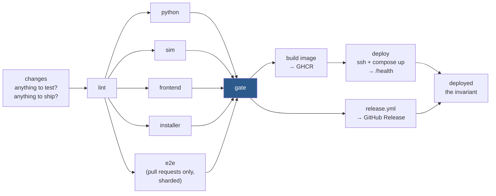

# CI and CD

What runs where, on which trigger, and why it is shaped that way. The gate
itself is `scripts/verify.py` ([testing.md](testing.md)); this page is about how
GitHub Actions slices it, decides whether there is anything to prove, and ships
what passed. Operating the site after it ships is [deployment.md](deployment.md).

## The workflows

| Workflow | Trigger | Job |
|---|---|---|
| `deploy.yml` "verify and deploy" | push to `main`; pull request (including `ready_for_review`); `workflow_dispatch` | The gate, then the site deploy and the Steam Deck release |
| `pr.yml` "pull request" | pull request, including `edited` | The title is a conventional commit and the body follows the template. Separate so that editing a title does not cost a gate run; Dependabot is exempt from the body check |
| `secrets.yml` "secrets" | push to `main`; every pull request | gitleaks, with the allowlist in `.gitleaks.toml`. Shallow on a pull request (its commits plus a little context), full history on `main`. Runs even when the gate decides there is nothing to test |
| `release.yml` "desktop release" | called by `deploy.yml`; `workflow_dispatch` on `main` | The content package and, when the shell changed, the AppImage, published as a GitHub Release |
| `art-backfill.yml` "art backfill" | weekly schedule; `workflow_dispatch` with a `limit` | Crawls the art store and opens a `chore(art):` pull request that merges itself ([below](#art-backfill)) |
| `automerge-guard.yml` "auto-merge guard" | `pull_request_target`: opened, pushed to, or auto-merge turned on | Turns auto-merge off, with one comment, unless the pull request is a maintainer's from a branch here and a maintainer made the push or the switch ([below](#roadmap-autopilot)). Never checks out the pull request's code |
| `tls-check.yml` "tls check" | weekly schedule; `workflow_dispatch` | An alarm, renewing nothing: fails if the certificate is near expiry, `/health` stops answering over TLS, or port 80 stops redirecting. GitHub disables a schedule after two months without repository activity |

Every workflow has its own concurrency group with `cancel-in-progress`
(`deploy.yml` per ref, `pr.yml` per pull request number, `secrets.yml` per ref),
so a newer push supersedes an in-flight run rather than racing it. A
`release.yml` run started by hand has none of its own.

## The deploy pipeline

### `changes`: what is there to prove, and what ships

The first job decides two things, and everything downstream keys off its outputs.

**Is there anything to test?** A run proves nothing when it would re-test a tree
that was already tested, so these runs skip the gate and `gate` still reports:

- **Inert paths.** A change touching only prose (`docs/`, `.agents/`, `.claude/`,
  `terraform/`, top-level `*.md`, the authoring queue, gaps and packets, the data
  READMEs) has nothing to run. Three things under `docs/` are *not* inert:
  [keywords.md](keywords.md) and [card-dsl-reference.md](card-dsl-reference.md)
  are held to the engine by tests, and [roadmap.md](roadmap.md) with the
  items under `docs/roadmap/` is held to `scripts/roadmap.py` by the lint
  stage, so an edit to any of them is a code change.
- **Drafts.** A draft pull request runs no gate; it is still being written.
  Leaving draft (`ready_for_review`) starts the real run, and a draft's gate
  leaves no receipt behind, so it can never vouch for a merge.
- **The push after a squash merge.** The merge commit's *tree* is the tree the
  pull request already passed. A passing pull-request run uploads a
  `tested-tree-<sha>` artifact as a receipt; the push finds it and skips.
- **A prose-only push to `main`** inherits the previous commit's verdict, but
  only if that commit is green on `main` itself.

Every doubt resolves to "test": an API error, a file list too long to see whole,
a force push, a merged tree no run tested as it stands. A wasted half hour is
the cost of being wrong in that direction; shipping an untested tree is the cost
of being wrong in the other. This is a job rather than `paths-ignore` on purpose:
`verify gate` is the required check, and a workflow that never starts never
reports it, so the pull request would wait forever. Here the run always starts,
`gate` always judges, and only whether there was work to judge changes.

**Does this push ship?** Whether a commit reaches players is its conventional
commit type, which for a squash merge is the pull request's title
([ADR 0010](adr/0010-release-every-main-build.md)). The rules live in one script,
`.github/scripts/conventional.sh`, which the title check, the ship decision and
the `/create-pr` skill all call; no other file copies the list. Two things about
the verdict are easy to get wrong:

- **It is judged over everything owed, not over this push.** The site's verdict
  looks at every commit since the last deploy that *finished* (the GitHub
  Deployments record for `production`); the Deck's looks at every commit since
  the latest release's tag. They are judged separately because a cancel or a
  failure can leave the two on different commits. This is what makes
  `cancel-in-progress` safe on `main`: whichever run survives ships whatever the
  cancelled one still owed.
- **Doubt resolves to "ship".** A commit that is not a conventional commit, or a
  list that cannot be read whole, ships, because a quiet type over a real change
  would leave that code unreleased. Pull requests never ship. A
  `workflow_dispatch` on `main` runs the whole gate and ships both, which is the
  recovery path after anything went wrong.

### The gate

`lint` runs first and is the only job that reads the "anything to test" output;
every other slice `needs: lint`, so turning the gate off happens in one place,
and a superseded pull request wastes one runner rather than all of them.

The slices each run `verify.py --only <group> --strict --verbose`:

| Job | Group | Why its own runner |
|---|---|---|
| `python` | `pytest --coverage --jobs $(nproc)` | The four Python suites and the coverage floor, under xdist |
| `sim` | `sim --jobs $(nproc)` | The arena and the live-server games; no Node on the box |
| `frontend` | `frontend --coverage` | Build, lint, the one vitest process that merges jsdom with both story projects, then the desktop shell's lint, build and tests |
| `installer` | `desktop/steam/test/install.test.sh` | A minute of bash on a bare runner |
| `e2e` | `e2e --e2e-project P --e2e-shard i/n` | Pull requests only: `chromium` and `phone` sharded across several legs, plus `handheld`, `deckfit` and `sidecar`, with `fail-fast: false` so one leg's timeout does not hide another's assertion |

**Sharding is the only parallelism Playwright tolerates.** `workers` stays at 1
because the app's motion is frame-driven and a loaded runner draws few frames
under tracing, so a second worker on the same box produces timeouts rather than
speed. `--shard` partitions the test list *before* the run, so a second box costs
nothing: each leg boots its own uvicorn and vite, and the server holds games in
process memory, so there is no state to share. Shards are balanced by test
count, not duration, and Playwright keeps a file's tests together, so the big
specs make the split lumpy; `npx playwright test --project=chromium --shard=i/n
--list` shows the split without running anything. Each shard writes its own
JSON report, named for the shard, because a report landing on a sibling's would
have the verdict read for the wrong run; a slice that ran zero tests fails.

Coverage runs on every event, including pushes to `main`; the e2e matrix runs on
pull requests only, because the push after a merge already proved that tree.

**`gate`** is the single required check, and it is written to be hard to fool:

- It runs `if: always()`, so a cancelled or failed upstream job cannot let it
  pass as "skipped".
- It checks each result literally. When there was nothing to test, every slice
  must be `skipped`; otherwise every slice must be `success`. `e2e` must succeed
  on a pull request and be skipped everywhere else.
- On a tested pull request it uploads the tested-tree receipt.

Everything after the gate uses `if: !cancelled() && needs.gate.result ==
'success' && …` rather than relying on the implicit success check, because the
implicit check covers the whole dependency closure, and the pull-request-only
`e2e` skip once silently skipped every deploy.

### Build and deploy

`build` produces one image that serves the API *and* the built client from one
process on one origin, because the client calls same-origin `/api` and `/art`
and two hosts would mean a base-URL setting and CORS. It pushes an immutable
`sha-<short>` tag (what a rollback names) and `latest`, through the Actions
layer cache.

`deploy` runs in the `production` environment, which is the Deployments record
the ship baseline reads. It copies the compose file, the `Caddyfile` and
`scripts/handover.sh` up, then its SSH script waits for the droplet's cloud-init
to finish, logs in to the registry with the run's own `GITHUB_TOKEN` (no stored
registry token exists anywhere), and **hands over rather than replacing**
([ADR 0023](adr/0023-games-outlive-the-process.md)): `handover.sh` pulls the new
tag for the stopped colour, **asserts the image is present** with
`docker image inspect` (a pull that "succeeded" without the image is a failure
mode worth refusing), starts it, waits for its healthcheck, reloads Caddy, and
only then stops the live colour. A probe polls the site through the droplet's
own Caddy under the public name for the whole handover, and a single poll that
did not answer fails the deploy. Finally the job curls `/health` on the public
domain rather than the droplet's address, which proves DNS and TLS as well as
the app.

### Release

`release.yml` is called by `deploy.yml` next to the deploy, behind the same green
gate, and runs in parallel because a Deck does not depend on the droplet.

- **The version is `X.Y.<commits on main>`.** Major and minor are whatever
  `desktop/package.json` says; the patch is the commit count, stamped at build
  time, so the same commit always gets the same version and a re-run finds its
  release already published and stops. A version not newer than `latest` stops
  too.
- **Shell versus content.** The AppImage is rebuilt only when the shell changed
  since the latest release: the paths electron-builder packs, what builds it,
  or `release.yml` itself. Otherwise the previous AppImage is carried forward
  unchanged and the content's `min_shell_version` names that shell. The content
  package (the frozen server, the built client and the card data, versioned as
  one) is built every time. Any doubt about whether the shell changed means
  rebuild.
- **Everything is smoke-booted before publishing.** The frozen server by
  `smoke.sh`, the AppImage under xvfb with `--smoke`, and the installer against
  a stub Steam again.
- **Draft, then publish.** Assets upload into a draft, any stale draft a
  cancelled run left is deleted first, and the release becomes `latest` only as
  the last step, so a run cancelled by a newer push never leaves a half-uploaded
  `latest` for a Deck to download.
- **No pre-release channel.** `install.sh` and both updaters read only
  `releases/latest/download/…`, with no API and no token. To hold a change back,
  merge it under a type that does not ship and release later by hand.

### `deployed`

The last job checks the whole invariant from outside the chain: once the gate is
green, if something was owed then the deploy or the release must have succeeded,
and if nothing was owed both must have been skipped. It exists so that a
skipped deploy can never look like a quiet success.

## Art backfill

`art-backfill.yml` runs `scripts/backfill_art.py` with a per-run cap, commits
what it fetched under `data/art_store/` on an `art/backfill-<run>` branch, and
opens a pull request set to auto-merge with a squash
([ADR 0021](adr/0021-art-store-is-committed.md)). A run that found nothing
new opens nothing. The title is `chore(art):`, so the merge neither deploys nor
releases; the art reaches the site with the next merge that ships. `changes`
treats `data/art_store/*` as inert, so the crawl's pull request costs no gate
run, and `tests/server/test_art_api.py::TestTheDeployedShape` holds that line.

It needs two things set once, by a maintainer:

- **`ART_BACKFILL_TOKEN`**, a repository secret: a fine-grained token with
  *Contents* and *Pull requests* write on this repository. Not `GITHUB_TOKEN`,
  because a pull request opened with that one starts no workflow, so the
  required checks never report and the auto-merge waits forever. The workflow
  fails at its first step without it.
- **Allow auto-merge**, under the repository's general settings.

## Roadmap autopilot

Not a workflow: a scheduled task in Claude Code on the web, named `roadmap
autopilot`, starts a fresh session every four hours with `/extend-roadmap
--auto` ([ADR 0026](adr/0026-the-roadmap-autopilot-merges-on-green.md)). The
session builds the top decided item (`scripts/roadmap.py --next --auto`), opens
its pull request labelled `autopilot` with auto-merge on, drives it to green,
and fires the task again when it merges. An open `autopilot` pull request is the
lock: a firing that finds one stops. The skill's §10 is the procedure.

It needs, set once by a maintainer:

- **Allow auto-merge**, as for the art backfill.
- **Branch protection on `main`** requiring the status checks `verify gate`,
  `pull request title` and `gitleaks` (the `secrets.yml` job, which has no name
  of its own), and, as its own checkbox, conversation resolution. This is what
  makes auto-merge wait for the gate; without it the pull request merges as
  soon as it opens.
- **The Claude GitHub App** on this repository with write access, so the
  session's pull requests start workflows (a `GITHUB_TOKEN` one would not, as
  above).

**Only a maintainer's work merges itself.** The repository is public, so
`automerge-guard.yml` turns auto-merge off on any pull request from a fork,
opened by someone without the admin or maintain role, or pushed to or switched
to auto-merge by such a person; a maintainer can still merge it by hand. The
autopilot's sessions open pull requests as the owner, so they pass. On its own
side, an `--auto` run acts only on review comments from maintainers and treats
everyone else's as data, so a stranger's comment on an autopilot pull request
cannot steer what merges. Its **Decisions** come from `main`, so merging
someone else's edit to an item's **Decisions** is approving what the
autopilot will build.

To pause it, disable the scheduled task; to stop one pull request, turn off its
auto-merge or remove the label and close it.

## Conventions CI enforces

- **Commit types** are the one list in `.github/scripts/conventional.sh`. It also
  holds the title length limit and refuses a trailing period.
- **The pull request body** must carry the template's headings, a details block
  and exactly one mermaid diagram, with no placeholder left behind.
- **Dependabot** runs monthly and grouped, because every shipping bump is a Deck
  download. Runtime ecosystems get `fix(deps)`, which ships; Actions get
  `ci(deps)`, which does not.
- **There are no local git hooks.** `verify.py` and the `/create-pr` skill, which
  runs the same conventional-commit script before opening a pull request, are the
  local enforcement.
- **Skips are failures.** Every job passes `--strict`; a job whose toolchain went
  missing fails instead of passing having asserted nothing.
- **The toolchain cache** (`.github/actions/setup`) keys the venv on the
  interpreter, the image and the dependency files, and saves immediately rather
  than at end of job, so a failing job still leaves a warm cache.

Failure artifacts (coverage data, Playwright reports) are uploaded only when a
job fails and kept briefly; the tested-tree receipt is kept long enough to cover
the push that follows its pull request.
