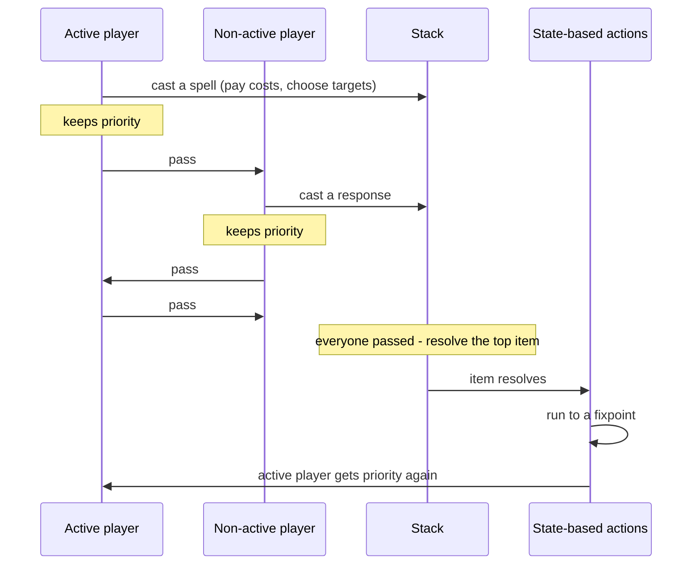
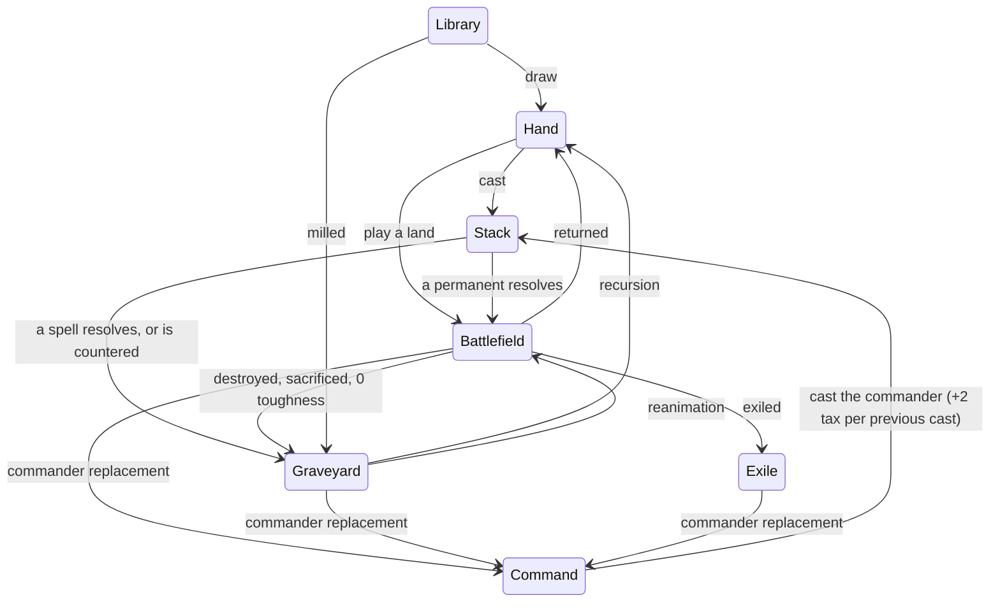
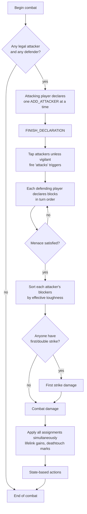

# How the engine plays Magic

This is the rules walkthrough. For what is *not* implemented, read
[rules-coverage.md](rules-coverage.md).

## The turn

Thirteen steps, in order. Priority is granted in every step except untap and
cleanup.

```mermaid
stateDiagram-v2
    direction LR
    [*] --> UNTAP
    UNTAP --> UPKEEP: no priority
    UPKEEP --> DRAW
    DRAW --> PRECOMBAT_MAIN
    PRECOMBAT_MAIN --> BEGIN_COMBAT
    BEGIN_COMBAT --> DECLARE_ATTACKERS

    state combat_branch <<choice>>
    DECLARE_ATTACKERS --> combat_branch
    combat_branch --> END_OF_COMBAT: no attackers
    combat_branch --> DECLARE_BLOCKERS: attackers declared

    state strike_branch <<choice>>
    DECLARE_BLOCKERS --> strike_branch
    strike_branch --> FIRST_STRIKE_DAMAGE: someone has first/double strike
    strike_branch --> COMBAT_DAMAGE: nobody does
    FIRST_STRIKE_DAMAGE --> COMBAT_DAMAGE

    COMBAT_DAMAGE --> END_OF_COMBAT
    END_OF_COMBAT --> POSTCOMBAT_MAIN
    POSTCOMBAT_MAIN --> END_STEP
    END_STEP --> CLEANUP
    CLEANUP --> CLEANUP: something happened (514.3a)
    CLEANUP --> [*]: next player's turn
```



Turn-based actions per step:

| Step | What happens automatically |
|---|---|
| Untap | Active player untaps everything; land drops reset |
| Upkeep | `upkeep` triggers fire |
| Draw | Active player draws (the starting player skips this on turn 1 **in a duel only** — in multiplayer everyone draws) |
| Begin combat | Combat state is created; `begin_combat` triggers fire |
| Declare attackers | The active player declares; attackers tap unless vigilant; `attacks` triggers fire |
| Declare blockers | Each defending player declares in turn order; damage order is sorted; `blocks` triggers fire |
| First strike damage | Only creatures with first or double strike deal damage — the step is skipped entirely if nobody has it |
| Combat damage | Everyone else, plus double strikers again |
| End of combat | Combat state is cleared |
| End step | `end_step` triggers fire |
| Cleanup | Discard to seven, then damage and until-end-of-turn effects are removed |

## Priority and the stack



Two behaviours worth knowing:

- **Auto-pass.** When a player's only legal action is "pass", the engine passes for
  them. This is why the game can jump several turns in one `apply()` call when nobody
  has anything to do — no decision was skipped, only empty ones.
- **A triggered ability chooses its targets on the way onto the stack** (603.3d),
  not as it resolves — so its controller is asked *before* anybody may respond, and
  what they answer is what an opponent is responding to. Nothing is asked when the
  ability has one legal target tuple or none, which is most triggers. While the
  drain is waiting on that answer the stack is empty and `pending_triggers` still
  holds the trigger: neither list is a reliable "the board has settled" test on its
  own, and `pending_triggers` is the one to check.
- **Casting keeps priority.** After you cast, you get priority back, so you can
  respond to your own spell if you have anything to respond with.

## Zones



Every one of these goes through `zones.move_object()`, so enters/leaves/dies triggers,
permanent-state resetting and the commander replacement all happen in exactly one
place.

### What a zone change reports

`ZONE_CHANGE` carries `from`, `to`, and three fields about *why*:

| field | meaning |
|---|---|
| `cause` | how it moved: `destroyed`, `sacrificed`, `lethal_damage`, `zero_toughness`, `legend_rule`, `aura_unattached`, `exiled`, `returned`, `tuck`, `cost`, `player_left`, `countered`, `resolved`, `draw`, `mill`, … |
| `by` | the oid of what moved it — the resolving spell or ability, or the creature that dealt the killing blow. `None` when nothing sensible can be named |
| `by_card` | that object's card id, resolved *before* the move, because the culprit may itself be leaving in the same SBA pass |

`source` on this event is the object that **moved**, not the thing that moved it,
which is why `by` had to be added: without it no consumer could build a sentence of
the form "X destroys Y", and the client's log said only "Grizzly Bears dies".

Two rules the client depends on:

- **`to` and `cause` answer different questions.** Rule 903.9a redirects a commander
  to the command zone while leaving the cause alone, so a destroyed commander is
  `to=command, cause=destroyed`. Anything routing by cause sends it to a graveyard it
  is not in.
- **A gang block names nobody.** `sba._creature_deaths` only sets `by` when
  `damage_ledger` holds exactly one damager for that creature. `state.last_damager`
  records whichever source wrote last, which in a multi-block is an arbitrary one of
  them, so it declines rather than blaming a blocker at random.

`by`/`cause` are deliberately **not** on `DIES` or `LEAVES_BATTLEFIELD`. Nothing reads
them there, and a new key in a *fired* event's data can collide with a card's trigger
bindings; `move_object` emits the zone change alongside both, so a consumer that wants
the reason correlates with that.

## Combat



**Declaration is incremental.** The attacker declares one creature at a time and then
finishes. Each increment is validated on its own, which is what lets the RL action
mask stay exact without ever enumerating 2ⁿ attack sets. The HTTP layer accepts a whole
set and loops the increments server-side, so a human still gets "select all, confirm".

Damage assignment for a blocked attacker:

1. Assign lethal to each blocker in order — **1** if the attacker has deathtouch,
   otherwise the blocker's remaining toughness.
2. Any remainder goes to the defending player if the attacker has trample, and is
   otherwise wasted on the last blocker.
3. An attacker that was blocked but whose blockers all died deals no damage at all
   (unless it tramples).

All assignments are collected first and applied together, so simultaneous trades work.

## State-based actions

Run to a fixpoint before any player gets priority and after anything resolves:

1. A player at 0 or less life loses.
2. A player who tried to draw from an empty library loses.
3. A player who has taken 21+ combat damage from a single commander loses.
4. A creature with toughness 0 or less is put into its graveyard (indestructible does
   not save it — this is not destruction).
5. A creature with lethal damage, or damaged by deathtouch, is destroyed unless
   indestructible.
6. An Aura or Equipment attached to nothing falls off; an Aura with nothing to
   enchant is put into the graveyard.
7. A token outside the battlefield ceases to exist.
8. `+1/+1` and `-1/-1` counters annihilate in pairs.
9. The legend rule.

When a player loses, their permanents and stack objects are exiled and their commander
goes to the command zone. The game ends when one player is left (or none — a draw).

## Commander rules

- 40 starting life, 100-card singleton deck, one legendary creature as commander.
- Casting from the command zone costs 2 extra generic mana per previous cast from
  there ("commander tax").
- 21 combat damage from a single commander eliminates a player. It is tracked
  per-source, so two different commanders dealing 20 each is survivable.
- A commander that would go to the graveyard, exile, hand or library goes to the
  command zone instead. The engine always applies this (see
  [rules-coverage.md](rules-coverage.md)).

## Derived characteristics: "layers-lite"

Real Magic uses seven numbered layers with timestamps and dependency analysis. This
engine applies a fixed order instead:

```
printed values
  -> subtype/type grants
  -> keyword grants
  -> P/T setting effects
  -> P/T modifying effects (anthems)
  -> +1/+1 and -1/-1 counters
  -> until-end-of-turn pumps
```

One constraint makes that safe, and it is enforced at load time:

> **A static ability's filter may not read another static ability's output.**

Static filters are matched against *printed* characteristics plus the object's own
board state (controller, tapped, attacking). That removes all recursion and all
dependency ordering. The cost is that a card whose anthem depends on another anthem's
result cannot be expressed — the curated decks contain no such card, and the loader
rejects one if you try to add it.

Results are cached against `state.char_version`, which every mutating primitive bumps.
